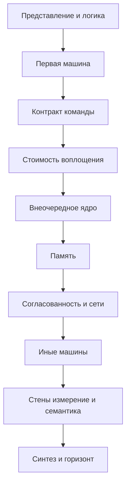

# Архитектура компьютера. Полный курс: от бита и вентиля до исследовательского уровня

Карта самостоятельного изучения. Каждая часть начинается после тех механизмов, на которые она опирается. Определения и разборы живут в указанных книгах и спецификациях; здесь — порядок, состав и место, где отложенный аргумент закрывается.

Номер части задаёт достаточный порядок: идти по нему можно, не заглядывая вперёд. Где есть более ранний вход, это сказано в строке «Можно параллельно». Полный указатель таких развилок собран в части 51.

Курс идёт по RISC-V. Норма контракта — непривилегированная и привилегированная спецификации. System/360, CDC 6600, Cray-1, MIPS, ARM и x86 разбираются рядом с тем механизмом, который на них впервые стал ясен: совместимость, табло, вектор, слот задержки, модель памяти, цена сложного декодирования.

Математика берётся из `maths/contents.md` и заново здесь не строится. Для схем хватает переключательной алгебры части 2. Та же алгебра как логика высказываний есть в части 13 курса математики, вероятность для измерений и мягких ошибок — в частях 11 и 32, коды сильнее контроля чётности — в части 54.

## Уровни

- **0.** Бит, переключатель и первая целая машина.
- **I.** Базовый университет: конвейер, кэш, ввод-вывод, система команд.
- **II.** Продвинутый университет: микроархитектура, память, параллелизм, задержка и энергия.
- **III.** Аспирантское ядро: когерентность, согласованность, сети, семантика, доказуемые пределы. Утверждения этого уровня изучаются с аргументом.
- **IV.** Исследовательский горизонт: точная постановка, место в курсе и минимальный вход. Владение горизонтом есть умение читать работу в этой точке, а не клетка в оглавлении.

## Спираль

Некоторые темы названы дважды. Второй проход закрывает то, что первый оставил числом, блоком или обещанием.

- Задержка вентиля в части 3 — приписанное число. Из ёмкости, логического усилия и провода она выводится в части 20.
- Такт в части 4 — один общий фронт. Перекос, метастабильность и несколько доменов — часть 21.
- Сумматор части 6 — готовый блок. Префиксный перенос, умножение и деление — часть 18. Округление по IEEE 754 — часть 19.
- Маленького RISC-V из части 7 хватает, чтобы собрать тракт. Пространство систем команд открывается в части 15. Семантика, с которой сверяют реализацию, — в части 50.
- Однотактный тракт части 8 становится конвейером в части 10 и внеочередной машиной с точным исключением в части 26. Во что спекуляция обходится изоляции, разбирается в части 43.
- Железный закон времени вводится в части 12. Стены масштабирования — часть 48, честное измерение — часть 49.
- Кэш и страница в части 13 ещё схема на словах. Ячейка и контроллер — часть 27, микроархитектура кэша — часть 28, трансляция адреса — часть 29, когерентность — часть 33, слабые модели памяти — часть 34.
- Прерывание части 11 в части 17 становится привилегированным контрактом, а в части 44 — опорой виртуализации.
- Хранимая программа части 7 остаётся основным контрактом. Потоковая машина, систолический массив и сверхдлинная команда собраны в части 39, ускоритель — в части 45. Машины, которые этот контракт уже не уточняют, стоят в части 52.

## Как читать часть

У каждой части четыре строки: уровень, опора, что она открывает, канон. Канон устроен так: первый текст — основной путь, следующие — параллельные. Пункт внутри главы называет определение, механизм, теорему или метод, которые в этом месте изучаются.

Если учебник и спецификация RISC-V расходятся, верна спецификация. Транслятор, операционная система, проектирование кристалла и сеть выше разъёма устройства остаются соседними курсами. Здесь от них берётся только то, что входит в обещание машины: вызов, ловушка, задержка вентиля, очередь устройства.

## Зависимости частей

Представление и логика — части 0–4. Первая машина — части 5–14. Контракт команды — части 15–19. Стоимость воплощения — части 20–21: после части 14 их можно читать рядом с контрактом команды, сходятся они в части 22. Внеочередное ядро — части 22–26. Память — части 27–30. Согласованность и сети — части 31–36. Иные машины — части 37–40. Энергия, надёжность, безопасность, виртуализация, ускорители, склад, пределы, измерение и семантика — части 41–50. Синтез и горизонт — части 51–52.

## Содержание

0. [Архитектура как предмет и как контракт](#часть-0-архитектура-как-предмет-и-как-контракт)
1. [Представление информации](#часть-1-представление-информации)
2. [Переключательная алгебра](#часть-2-переключательная-алгебра)
3. [Комбинационные схемы](#часть-3-комбинационные-схемы)
4. [Последовательностные схемы, первый проход](#часть-4-последовательностные-схемы-первый-проход)
5. [Запоминающие массивы](#часть-5-запоминающие-массивы)
6. [Целочисленная арифметика, первый проход](#часть-6-целочисленная-арифметика-первый-проход)
7. [Хранимая программа и минимальная система команд](#часть-7-хранимая-программа-и-минимальная-система-команд)
8. [Однотактная реализация](#часть-8-однотактная-реализация)
9. [Многотактность и микропрограммирование](#часть-9-многотактность-и-микропрограммирование)
10. [Конвейер, первый проход](#часть-10-конвейер-первый-проход)
11. [Исключения и простое управление](#часть-11-исключения-и-простое-управление)
12. [Количественный язык производительности](#часть-12-количественный-язык-производительности)
13. [Иерархия памяти, первый проход](#часть-13-иерархия-памяти-первый-проход)
14. [Ввод-вывод и целая простая машина](#часть-14-ввод-вывод-и-целая-простая-машина)
15. [Проектирование системы команд](#часть-15-проектирование-системы-команд)
16. [Контракт с транслятором и программной средой](#часть-16-контракт-с-транслятором-и-программной-средой)
17. [Привилегированная архитектура](#часть-17-привилегированная-архитектура)
18. [Целочисленная арифметика блоков](#часть-18-целочисленная-арифметика-блоков)
19. [Вещественная арифметика](#часть-19-вещественная-арифметика)
20. [КМОП, задержка, энергия и провод](#часть-20-кмоп-задержка-энергия-и-провод)
21. [Тактирование и метастабильность](#часть-21-тактирование-и-метастабильность)
22. [Конвейер, второй проход](#часть-22-конвейер-второй-проход)
23. [Параллелизм команд и его пределы](#часть-23-параллелизм-команд-и-его-пределы)
24. [Предсказание переходов](#часть-24-предсказание-переходов)
25. [Динамическое планирование](#часть-25-динамическое-планирование)
26. [Суперскалярное внеочередное исполнение](#часть-26-суперскалярное-внеочередное-исполнение)
27. [Технологии памяти и контроллер](#часть-27-технологии-памяти-и-контроллер)
28. [Микроархитектура кэша](#часть-28-микроархитектура-кэша)
29. [Виртуальная память](#часть-29-виртуальная-память)
30. [Внешняя память и пути устройств](#часть-30-внешняя-память-и-пути-устройств)
31. [Параллельная машина](#часть-31-параллельная-машина)
32. [Последовательная согласованность и её цена](#часть-32-последовательная-согласованность-и-её-цена)
33. [Когерентность кэшей](#часть-33-когерентность-кэшей)
34. [Слабые модели согласованности](#часть-34-слабые-модели-согласованности)
35. [Атомарные операции и синхронизация](#часть-35-атомарные-операции-и-синхронизация)
36. [Сети межсоединений](#часть-36-сети-межсоединений)
37. [Вектор, SIMD и графические процессоры](#часть-37-вектор-simd-и-графические-процессоры)
38. [Многопоточность и многоядерность](#часть-38-многопоточность-и-многоядерность)
39. [Иные организации вычислений](#часть-39-иные-организации-вычислений)
40. [Жёсткие ограничения](#часть-40-жёсткие-ограничения)
41. [Энергия и тепло](#часть-41-энергия-и-тепло)
42. [Надёжность](#часть-42-надёжность)
43. [Безопасность как архитектурный контракт](#часть-43-безопасность-как-архитектурный-контракт)
44. [Виртуализация](#часть-44-виртуализация)
45. [Специализированные ускорители](#часть-45-специализированные-ускорители)
46. [Реконфигурируемые архитектуры](#часть-46-реконфигурируемые-архитектуры)
47. [Масштаб вычислительного склада](#часть-47-масштаб-вычислительного-склада)
48. [Масштабирование и доказуемые пределы](#часть-48-масштабирование-и-доказуемые-пределы)
49. [Модели, измерение и достоверность](#часть-49-модели-измерение-и-достоверность)
50. [Формальная семантика и уточнение](#часть-50-формальная-семантика-и-уточнение)
51. [Синтез курса](#часть-51-синтез-курса)
52. [Исследовательский горизонт](#часть-52-исследовательский-горизонт)

---

## Часть 0. Архитектура как предмет и как контракт

**Уровень.** 0

**Опирается на.** Умение читать связный текст и отличать правило от примера.

**Открывает.** Часть 1: слои названы, дальше можно говорить о бите.

**Канон.** Блаау, Брукс, «Computer Architecture: Concepts and Evolution» — основной путь для различения слоёв. Параллельно: Амдал, Блаау, Брукс, «Architecture of the IBM System/360».

### Глава 1. Три слоя

1.1. Архитектура — функциональный облик машины для того, кто составляет программу: какие состояния различимы, какие операции законны, какой результат обещан.
1.2. Реализация — логическая организация, которой обещание выполняется: тракт данных, управление, последовательность шагов. В современном языке этот слой называется микроархитектурой.
1.3. Воплощение — физическое устройство: вентили, провода, питание, время распространения сигнала.
1.4. Одна архитектура допускает много реализаций. Одна реализация допускает много воплощений. System/360 устроена как книга обещаний, пережившая смену схем.
1.5. Вопрос принадлежит слою, в котором лежит ответ. Длительность такта, не видимая программе, не становится пунктом архитектуры оттого, что её легко измерить.

### Глава 2. Контракт и совместимость

2.1. Архитектура есть обещание, которое обязана выполнить каждая реализация, носящая это имя.
2.2. Двоичная совместимость: программа в кодах машины сохраняет смысл на новой реализации.
2.3. Контракт молчит о длительности команды, энергии и порядке микрошагов, пока те не видны программе.
2.4. Контракт обязан говорить о всём, что программа наблюдает: коды результатов, исключения, порядок памяти, атомарность записи.
2.5. Добавление новой законной операции совместимо со старыми программами. Переопределение видимого поведения старой операции ломает контракт.
2.6. Совместимость связывает будущие реализации. Это инженерное обязательство, а не эстетическое предпочтение простоты.

### Глава 3. Наблюдаемое состояние

3.1. Наблюдаемое состояние — то, что программа читает архитектурными средствами: регистры, память, управляющие регистры, флаги причин.
3.2. Скрытое состояние реализации может влиять на время и на энергопотребление и при этом отсутствовать в контракте результата.
3.3. Как только скрытое состояние одного контекста влияет на результат или на наблюдаемое время другого контекста, граница контракта подлежит пересмотру. Механизм этого влияния — часть 43, после того как спекуляция будет построена.
3.4. Две реализации согласованы, если на каждой программе совпадает наблюдаемое состояние в точках, где контракт требует определённости. Совпадение тактов не требуется.
3.5. Неопределённость контракта бывает трёх видов, и их нельзя смешивать: значение полностью определено; значение выбрано из названного множества и реализация обязана выбрать устойчиво; операция запрещена и обязана быть видна как ловушка.

### Глава 4. Устройство этого курса

4.1. Курс есть достаточный порядок чтения от бита до горизонта.
4.2. Уровни 0, I, II, III и IV задают тип обязательства. На IV обязательство состоит в постановке, входе и статусе.
4.3. Где курс оставляет механизм блоком или числом, спираль в начале файла называет часть, которая его открывает.
4.4. Основной текст части и параллельные тексты. Спецификация ближе к норме, чем пересказ.
4.5. Ранние входы, которые не ломают зависимость, собраны в части 51. До той части ими можно пользоваться там, где строка «Можно параллельно» уже стоит в самой части.
4.6. Документ фон Неймана, Бёркса и Голдстайна «Preliminary Discussion of the Logical Design of an Electronic Computing Instrument» здесь образец того, как выглядит контракт. Разбор хранимой программы — часть 7.

**Переход.** Слои разделены. Первый предмет архитектуры — состояние, которое наблюдатель устойчиво отличает от другого состояния.

---

## Часть 1. Представление информации

**Уровень.** 0

**Опирается на.** Часть 0. Позиционная запись и единственность разложения по основанию, если они нужны в полном виде, — часть 1 курса математики. Здесь они берутся в объёме, которого довольно машине.

**Открывает.** Алгебру переключателей, кодирование команд, арифметику слов.

**Канон.** Харрис, Харрис, «Digital Design and Computer Architecture», издание RISC-V, главы о системах счисления — основной путь. Параллельно: Паттерсон, Хеннесси, «Computer Organization and Design», RISC-V, глава о данных.

### Глава 1. Бит и слово

1.1. Знак есть состояние устройства, которое наблюдатель устойчиво отличает от другого его состояния.
1.2. Бит — выбор из двух устойчивых состояний. Имена «0» и «1» назначаются соглашением.
1.3. Два состояния оставляют запас относительно шума и дают короткие правила композиции. Машина с большим числом уровней в проводе возможна; двоичный контракт выигрывает запасом и простотой полной системы операций.
1.4. Слово — упорядоченный набор битов фиксированной длины. Длина слова есть параметр архитектуры.
1.5. Октет, или байт, — группа из восьми битов. RISC-V адресует память октетами. Иная адресуемая единица законна в другом контракте и должна быть названа явно.
1.6. Число различных слов длины n равно 2 в степени n. Это предел таблицы, счётчика и пространства адресов.

### Глава 2. Позиционная запись

2.1. Основание, разряд и вес разряда. Вес i-го разряда в основании b есть b в степени i.
2.2. Перевод между основаниями делением с остатком и группировкой разрядов. Восьмеричная и шестнадцатеричная записи суть группировка двоичной.
2.3. Запись без ведущих нулей в данном основании единственна.
2.4. Сложение и сдвиг столбиком выводятся из позиционного принципа и станут схемами в части 6.
2.5. Переполнение есть выход результата за длину слова. Обнаружение переполнения — механизм части 6. Решение, видит ли его программа как ловушку, — пункт контракта части 15.

### Глава 3. Смысл одного и того же слова

3.1. Один набор битов допускает много истолкований: число без знака, число со знаком, символ, команда, адрес.
3.2. Смысл назначают контракт и контекст программы. Ячейка памяти метки смысла не хранит.
3.3. Порядок байтов в слове виден программе и потому принадлежит архитектуре. Порядок от младшего байта к старшему — выбор RISC-V. Порядок от старшего к младшему — другой законный контракт.
3.4. Порядок битов на проводе может расходиться с номерами битов в регистре. Если программе это невидимо, расхождение принадлежит воплощению.
3.5. Выравнивание: адрес доступа кратен размеру доступа. RISC-V разрешает невыровненный доступ к словам, а реализация вправе выполнить его схемой или ловушкой. Атомарность естественно выровненного доступа и судьба невыровненного — разные пункты. Точная норма читается в части 7 по спецификации.

### Глава 4. Коды, команды и избыточность

4.1. Код символа — таблица соответствия знаков словам. ASCII достаточен как пример таблицы. Unicode хранится теми же битами по отдельному соглашению о кодировке октетов.
4.2. Команда есть слово или последовательность слов, которой контракт назначает операцию.
4.3. В машине с хранимой программой команда лежит в той же памяти, что и число. Следствие для устройства — часть 7. Здесь фиксируется только отсутствие метки «это команда» на самих битах.
4.4. Исполнение данных и чтение команды как числа суть ошибки контекста. Защита границ — механизм привилегий и прав частей 17, 29 и 43.
4.5. Другой код тех же сведений может быть короче или избыточнее. Количественная энтропия — часть 54 курса математики. Коды, исправляющие ошибку ячейки, — часть 42 этой карты.

**Переход.** Биты различимы и записаны. Дальше нужна алгебра операций, переводящих одни наборы битов в другие.

---

## Часть 2. Переключательная алгебра

**Уровень.** 0

**Опирается на.** Часть 1. Если пройдена глава о булевой алгебре высказываний в части 13 курса математики, её теоремы переносятся сюда как алгебра переключателей. Таблицы этой части самодостаточны и без того курса.

**Открывает.** Комбинационные схемы: всякая конечная таблица станет блоком.

**Канон.** Харрис, Харрис, «Digital Design and Computer Architecture», главы о булевой алгебре — основной путь. Параллельно: Шеннон, «A Symbolic Analysis of Relay and Switching Circuits».

### Глава 1. Функции двух значений

1.1. Переменная принимает значение 0 или 1. Функция n переменных задаётся таблицей из 2 в степени n строк.
1.2. Конъюнкция, дизъюнкция и отрицание. Коммутативность, ассоциативность, дистрибутивность и законы де Моргана проверяются по таблице и затем применяются как правила переписывания.
1.3. Исключающее или, стрелка Пирса и штрих Шеффера.
1.4. Двойственность: обмен 0 с 1 вместе с обменом конъюнкции и дизъюнкции переводит теорему в теорему.
1.5. Две формулы равны, когда совпадают их таблицы. На этом шаге иного критерия нет.

### Глава 2. Полнота набора

2.1. Набор связок полон, если формулами над ним представима любая функция.
2.2. Набор из конъюнкции, дизъюнкции и отрицания полон: функция есть дизъюнкция тех конъюнкций, которые отвечают строкам со значением 1.
2.3. Одной стрелки Пирса достаточно для полноты. Одного штриха Шеффера достаточно для полноты.
2.4. Набор из конъюнкции и дизъюнкции без отрицания неполон. Одно отрицание неполно. Контрпример строится функцией, которую набор сохранить не может.
2.5. Полнота говорит, что из данного набора собирается любой комбинационный блок. Длину формулы и число элементов она ещё не оценивает.

### Глава 3. Нормальные формы

3.1. Минтерм — конъюнкция, в которой каждая переменная входит ровно один раз, с отрицанием или без. Макстерм — двойственное понятие.
3.2. Совершенная дизъюнктивная нормальная форма единственна при фиксированном порядке переменных.
3.3. Совершенная конъюнктивная нормальная форма строится по строкам, где функция равна 0.
3.4. Переход между совершенными формами выполняется по законам де Моргана.
3.5. Несовершенная форма короче совершенной и не единственна. Выбор короткой формы при безразличных строках — задача части 3.

### Глава 4. Алгебра как задание блока

4.1. Блок задаётся функцией. Картинка вентиля есть одна из реализаций функции.
4.2. Подстановка равной формулы вместо равной сохраняет функцию.
4.3. Переменная существенна, если существует набор остальных, на котором её переключение меняет значение.
4.4. Частично определённая функция оставляет часть строк безразличными. Такие строки появятся в неиспользуемых кодах команд и в недостижимых состояниях автомата.
4.5. В этой части нет времени. Функция говорит, чем является выход, и молчит о моменте, когда он им становится.

**Переход.** Алгебра задаёт, что вычислить. Схема задаёт, из каких элементов это собрано и какая задержка приписана пути.

---

## Часть 3. Комбинационные схемы

**Уровень.** 0

**Опирается на.** Часть 2.

**Открывает.** Конечные автоматы, сумматор как блок, тракт данных.

**Канон.** Харрис, Харрис, «Digital Design and Computer Architecture», главы о комбинационной логике — основной путь. Параллельно: Уэйкерли, «Digital Design: Principles and Practices», главы о рисках и минимизации.

### Глава 1. Вентиль и путь

1.1. Вентиль реализует одну функцию малого числа входов. Набор вентилей курса полон в смысле части 2: отрицание, конъюнкция, дизъюнкция. Исключающее или собирается из них.
1.2. Схема без циклов есть комбинационная схема. Её выход является функцией текущих входов после задержки пути.
1.3. Задержка пути на этом шаге — число, приписанное вентилям и проводам. Вывод числа из ёмкости и тока — часть 20.
1.4. Критический путь — путь с наибольшей приписанной задержкой. Он задаёт, как скоро выходом можно пользоваться.
1.5. Нагрузочная способность выхода ограничивает число входов, которые он питает. Повторитель есть вентиль, введённый ради нагрузки, а не ради новой функции.

### Глава 2. Блоки, без которых не собрать тракт

2.1. Мультиплексор выбирает один из входов по адресу. Он реализует таблицу выбора.
2.2. Дешифратор поднимает ровно один выход по адресу. Шифратор решает обратную задачу на кодах с одной единицей.
2.3. Схема сравнения на равенство и схема нуля.
2.4. Сдвигатель на постоянную величину есть проводка. Сдвигатель на переменную величину — комбинационный блок, который часть 18 сделает бочкообразным.
2.5. Полусумматор и полный сумматор одного разряда. Многоразрядный сумматор как блок, ещё без разговора о ускорении переноса, — часть 6.
2.6. Памятью эти блоки не обладают: снятый вход уносит и выход, как только пройдёт задержка.

### Глава 3. Двухуровневая форма и её цена

3.1. Дизъюнкция конъюнкций и конъюнкция дизъюнкций суть двухуровневые схемы.
3.2. Карта соседних наборов используется для малого числа переменных как способ увидеть склейку минтермов.
3.3. Метод Куайна и Мак-Класки даёт ту же склейку для большего числа переменных: систематическое слияние и покрытие простых импликант.
3.4. Безразличные строки расширяют выбор простых импликант и не обязаны получать определённое значение на выходе, пока следующий слой этого не потребует.
3.5. Минимум числа термов не есть минимум задержки и не есть минимум энергии. Оба последних критерия ждут части 20. Здесь критерий — число элементов и уровней в идеальной модели.

### Глава 4. Риски

4.1. Статический риск единицы: при переходе между двумя входными наборами, где функция равна 1, выход на мгновение падает до 0. Статический риск нуля определяется двойственно.
4.2. Причина статического риска — разная задержка путей, покрывающих соседние минтермы, когда покрытие не содержит согласующего терма.
4.3. Согласующий терм, консенсус, устраняет статический риск данного перехода. Динамический риск возникает при немонотонном прохождении выхода и требует отдельного разбора путей.
4.4. Риск опасен, если его успевает заметить элемент с памятью. Синхронная дисциплина части 4 запрещает замечать выход между тактами. Покрытие риска остаётся гигиеной схемы, а запас по времени станет числом в части 21.
4.5. Инструмент обнаружения риска на этом шаге — таблица переходов с учётом задержки путей, а не только таблица функции.

### Глава 5. Иерархия и состав

5.1. Проверенный блок далее используется как вентиль с известной функцией и известной задержкой.
5.2. Задержка состава есть задержка критического пути состава, а не сумма задержек всех элементов.
5.3. Общие подвыражения можно вынести. Вынесение сокращает число элементов и может удлинить или укоротить критический путь.
5.4. Цикл в комбинационной схеме выводит её из класса этой части. Цикл с памятью — предмет части 4.
5.5. Спецификация блока для следующего уровня пишется функцией и задержкой. Внутренняя схема может быть заменена любой другой с той же функцией и не худшей задержкой.

**Переход.** Схема без памяти вычисляет таблицу и забывает её. Машине нужно состояние, которое переживает смену входов.

---

## Часть 4. Последовательностные схемы, первый проход

**Уровень.** 0

**Опирается на.** Часть 3.

**Открывает.** Регистры, конечное управление, правило такта, на котором стоит вся дальнейшая реализация.

**Канон.** Харрис, Харрис, «Digital Design and Computer Architecture», главы о последовательностной логике — основной путь. Параллельно: Кац, Борриело, «Contemporary Logic Design».

### Глава 1. Элемент памяти

1.1. Бистабильная схема из двух инверторов хранит один бит, пока питание сохраняется. Два устойчивых состояния и есть хранимый бит.
1.2. Защёлка прозрачна, пока разрешающий сигнал открыт: выход следит за входом. Защёлка хранит, когда разрешающий сигнал закрыт.
1.3. Триггер по фронту принимает вход в узком окне около активного фронта такта и хранит его до следующего такого фронта.
1.4. Ведущий и ведомый: двухступенчатая схема получает поведение фронта из двух защёлок с противоположной прозрачностью.
1.5. Время предустановки и время удержания здесь называются как условия правильного приёма. Их неравенства и связь с перекосом такта — часть 21.
1.6. Асинхронный сброс и установка переводят элемент в известное состояние вне правила фронта. Их снятие обязано быть согласовано с тактом. Полное правило — часть 21.

### Глава 2. Синхронная дисциплина

2.1. Правило такта: всё архитектурное и реализационное состояние, подчинённое этому такту, меняется по активному фронту.
2.2. Между регистрами лежит комбинационная схема без циклов.
2.3. Период такта достаточен для самого длинного комбинационного пути вместе с предустановкой. Самый короткий путь достаточен для удержания. Оба требования будут записаны формулами в части 21.
2.4. Пока правило выполнено, риски внутри такта не попадают в регистры. Наблюдаемый снаружи шаг есть функция состояния и входов на предыдущем фронте.
2.5. Один глобальный такт есть рабочая аксиома этой части. Несколько доменов и асинхронный вход её нарушают сознательно и разбираются в части 21.

### Глава 3. Регистры и счётчики

3.1. Регистр — набор триггеров с общим тактом. Загрузка регистра может быть условной.
3.2. Шина выбирает источник мультиплексором. Несколько источников на одном проводе без правила выбора дают конфликт, который дисциплина запрещает.
3.3. Счётчик есть регистр, у которого комбинационная приставка прибавляет единицу или ноль.
3.4. Сдвиг регистра на один разряд есть проводка между соседними триггерами. Последовательный вход и последовательный выход связывают регистр с внешним потоком битов.
3.5. Регистровый файл с несколькими портами чтения и записи — массив регистров с адресацией. Он станет блоком части 5 и тракта части 8.

### Глава 4. Конечный автомат

4.1. Автомат задаётся множеством состояний, входом, выходом и двумя функциями: следующего состояния и выхода.
4.2. Автомат Мура вычисляет выход по состоянию. Автомат Мили вычисляет выход по состоянию и входу. Выбор меняет момент, когда выход становится верен относительно фронта.
4.3. Таблица переходов и диаграмма состояний суть две записи одного автомата. Критерий равенства — совпадение наблюдаемого выхода на всякой входной последовательности после согласования начального состояния.
4.4. Кодирование состояний назначает словам абстрактные состояния. Соседнее кодирование сокращает логику переходов. Единственность кодирования не требуется.
4.5. Недостижимые состояния и безразличные переходы используются при синтезе и обязаны получить безопасное поведение, если шум всё же заведёт схему туда.
4.6. Минимизация числа состояний выполняется по отношению неразличимости. Меньше состояний не означает меньше вентилей после кодирования. Оба критерия стоит держать отдельно.

### Глава 5. Синтез и разложение управления

5.1. Словесное описание протокола переводится в набор последовательностей, затем в диаграмму, затем в регистр состояния и комбинационные функции.
5.2. Правильность синтеза на этом шаге проверяется обходом всех переходов и сравнением с таблицей, а не испытанием нескольких тактов.
5.3. Разложение на управляющий автомат и операционный тракт: тракт хранит данные и умеет шаги, автомат выбирает шаг. Это разложение станет однотактной и многотактной машиной частей 8 и 9.
5.4. Время входа, приходящего не от нашего такта, в эту часть не входит. Такой вход запрещено подавать прямо на комбинационную логику, питающую регистр. Промежуточный синхронизатор — часть 21.
5.5. Конечный автомат с конечной памятью данных есть вся реализация машины с конечным адресом. Снятие конечности — разговор о вычислимости в курсе математики, не добавление ещё одного вентиля.

**Переход.** Один бит уже умеет переживать такт, и автомат умеет выбирать шаг. Дальше состоянию нужен адрес, чтобы слов было больше, чем регистров в управляющем тракте.

---

## Часть 5. Запоминающие массивы

**Уровень.** 0

**Опирается на.** Часть 4.

**Открывает.** Память команд и память данных однотактной машины. Технологию ячейки эта часть не открывает: ячейка остаётся блоком до части 27.

**Канон.** Харрис, Харрис, «Digital Design and Computer Architecture», главы о памяти малого объёма — основной путь. Параллельно: Паттерсон, Хеннесси, «Computer Organization and Design», RISC-V, приложение о блоках памяти.

**Можно параллельно с.** Частью 6 после части 4. Тракт части 8 требует обе.

### Глава 1. Адрес и порт

1.1. Массив хранит 2 в степени m слов. Адрес выбирает слово. Число битов адреса есть m, если каждое слово адресуется отдельно.
1.2. Порт чтения отдаёт слово по адресу. Порт записи заменяет слово по адресу, когда запись разрешена.
1.3. Регистровый файл — маленький многопортовый массив. Два порта чтения и один порт записи достаточны для команд, которые читают два источника и пишут один результат.
1.4. Чтение и запись одного адреса в одном такте подчиняются явному правилу: либо запись видна чтению в том же такте, либо чтение видит старое слово. Учебный тракт части 8 выбирает второе для записи по фронту и пользуется этим в обходе конфликтов позже.
1.5. Память команд и память данных на этом шаге — два массива. Вопрос о том, одна ли это память для программы, принадлежит архитектуре части 7, а не картинке двух блоков.

### Глава 2. Постоянная и оперативная память как блоки

2.1. Постоянная память задаёт слово функцией адреса. Её содержимое не меняется командой записи программы.
2.2. Оперативная память меняет слово по записи и хранит его, пока выполнена дисциплина питания и такта.
2.3. Время доступа на этом шаге — одно число тактов. Разложение этого числа на строку, усилитель и шину — часть 27.
2.4. Инициализация памяти есть часть воплощения или загрузчика. До первой записи содержимое оперативной памяти контрактом результата не определено, если спецификация не говорит иное.
2.5. Ошибка адреса вне массива обязана получить имя: ловушка либо молчаливое отбрасывание старших битов. Учебная машина выбирает одно и записывает выбор. Молчаливое отбрасывание опасно тем, что две разные программы получают одну ячейку.

### Глава 3. Ширина доступа

3.1. Байтовая адресация означает, что адрес указывает октет, а доступ к слову собирает несколько соседних октетов.
3.2. Порядок сборки октетов в слово есть порядок байтов части 1. Схема сборки принадлежит реализации и обязана совпасть с контрактом.
3.3. Знаковое и беззнаковое расширение узкого чтения до ширины регистра — разные функции. Обе понадобятся системе команд части 7.
3.4. Запись байта в слово не должна разрушать соседние байты. Реализация читает слово, подменяет байт и пишет слово либо имеет отдельный байтовый стробирующий сигнал. Наблюдаемый результат один.
3.5. Выравнивание слова на границу его размера упрощает схему. Поведение невыровненного доступа откладывается до нормы RISC-V в части 7.

### Глава 4. Память как конечный автомат

4.1. Состояние массива есть набор всех слов. Переход по записи меняет одно слово. Переход по чтению состояния массива не меняет.
4.2. Эта модель молчит о кэше, буфере записи и регенерации. Они добавят скрытое состояние. Пока скрытое состояние не видно программе, модель массива остаётся архитектурной.
4.3. Две записи в разные адреса независимы. Две записи в один адрес упорядочиваются правилом порта. Конфликт двух портов записи на одном адресе запрещён спецификацией портов либо разрешён с явным победителем.
4.4. Последовательная память с одним портом задаёт простую цену: один доступ за такт. Желание делать выборку команды и доступ к данным в одном такте заставит часть 10 раздвоить порт или память.
4.5. Конец этой части: массив умеет хранить программу и данные. Кто решает, какое слово есть команда, — ещё не массив.

**Переход.** Слова получили адреса. Рядом, и независимо до сборки тракта, слову нужна арифметика.

---

## Часть 6. Целочисленная арифметика, первый проход

**Уровень.** 0

**Опирается на.** Части 1 и 3. Часть 5 не требуется.

**Открывает.** Арифметико-логическое устройство однотактной машины. Быстрые сумматоры, умножение и деление остаются закрытыми до части 18.

**Канон.** Харрис, Харрис, «Digital Design and Computer Architecture», главы о сложении и арифметико-логическом устройстве — основной путь. Параллельно: Паттерсон, Хеннесси, «Computer Organization and Design», RISC-V, глава об арифметике в объёме дополнительного кода и сложения.

**Можно параллельно с.** Частью 5 после части 4.

### Глава 1. Числа без знака и со знаком

1.1. Число без знака на слове длины n есть значение позиционной записи. Диапазон — от нуля до 2 в степени n без единицы.
1.2. Дополнительный код представляет отрицательные числа. Старший бит несёт вес минус 2 в степени n−1, остальные биты — обычные неотрицательные веса.
1.3. Диапазон дополнительного кода несимметричен: одно отрицательное значение не имеет парного положительного. Это свойство кодирования, а не дефект сумматора.
1.4. Знаковое расширение повторяет старший бит. Беззнаковое расширение дописывает нули. Подмена одного другим меняет значение и обязана быть видна в спецификации команды.
1.5. Сравнение без знака и сравнение со знаком — разные функции одних и тех же битов. Обе нужны командам перехода.

### Глава 2. Сложение и вычитание

2.1. Полный сумматор принимает два бита и входной перенос и выдаёт сумму и выходной перенос.
2.2. Сумматор со сквозным переносом соединяет выходной перенос разряда со входным переносом следующего. Задержка растёт линейно с длиной слова.
2.3. Вычитание в дополнительном коде есть сложение с поразрядным отрицанием вычитаемого и входным переносом единицы.
2.4. Переполнение беззнакового сложения есть выходной перенос старшего разряда. Переполнение знакового сложения есть расхождение переносов в старший разряд и из него, равносильное сложению двух чисел одного знака с результатом противоположного знака.
2.5. Учебная машина умеет вычислить оба признака. Попадёт ли признак в регистр, в флаг или в ловушку, решает система команд. В базовом RISC-V целое переполнение ловушки не вызывает. Это пункт части 15, и схема части 6 уже должна уметь признак, если его попросят.

### Глава 3. Арифметико-логическое устройство

3.1. Устройство выбирает операцию: сложение, вычитание, поразрядные конъюнкцию, дизъюнкцию и исключающее или, сравнение «меньше».
3.2. Сравнение «меньше» выдаёт слово, в котором младший бит есть истина, а остальные нули. Так результат сравнения становится обычным значением регистра.
3.3. Сдвиг на этом шаге допускается как блок с приписанной задержкой. Бочкообразный сдвигатель и его логарифмическая глубина — часть 18.
3.4. Умножение и деление в первый тракт не входят. Команда, которая их требует, либо отсутствует в минимальной системе, либо исполняется многотактной последовательностью части 9. Алгоритмы блоков — часть 18.
3.5. Задержка устройства в однотактной машине войдёт в критический путь. Пока путь оценивается суммой приписанных задержек части 3.

### Глава 4. Битность и перенос между ширинами

4.1. Узкое сложение можно выполнить на широком сумматоре, если неиспользуемые разряды зафиксированы правилом расширения.
4.2. Старшая половина произведения двух слов длины n имеет длину n. Её отсутствие в команде, возвращающей только младшие n битов, есть контракт усечения, а не потеря схемы.
4.3. Расширение знака после узкой загрузки — операция тракта, а не свойство памяти. Память части 5 отдаёт байты. Смысл расширения назначает команда.
4.4. Номер бита в спецификации RISC-V растёт от младшего к старшему: бит 0 — младший. Рисунок, где старший бит слева, обязан совпадать с этой нумерацией.
4.5. Конец первого прохода: есть устройство, которое по управляющему слову превращает два регистра в один результат. Откуда берётся управляющее слово, скажет хранимая программа.

**Переход.** Арифметика и память готовы как блоки. Машина появляется, когда слово в памяти выбирает операцию над другими словами.

---

## Часть 7. Хранимая программа и минимальная система команд

**Уровень.** 0

**Опирается на.** Части 1, 5 и 6.

**Открывает.** Однотактную реализацию и все последующие уточнения того же контракта.

**Канон.** Паттерсон, Хеннесси, «Computer Organization and Design», RISC-V, глава о системе команд — основной путь. Параллельно: Уотерман, Асанович, «The RISC-V Reader»; непривилегированная спецификация RISC-V как норма.

### Глава 1. Машина с хранимой программой

1.1. Память хранит и команды, и данные. Программа есть последовательность слов, которые устройство управления читает как команды.
1.2. Счётчик команд хранит адрес команды. Шаг исполнения читает команду по этому адресу, выполняет её и изменяет счётчик.
1.3. Изменение счётчика на длину команды даёт следующую команду. Команда перехода записывает в счётчик иной адрес.
1.4. Документ фон Неймана, Бёркса и Голдстайна фиксирует этот круг: команда есть данные, данные адресуются, управление последовательно, пока его не переписали. Исторические детали арифметики того проекта не переносятся в RISC-V.
1.5. Хард — один архитектурный контекст исполнения: свой счётчик команд, свои регистры, своя привилегия. Пока хард один. Несколько хартов — часть 31.
1.6. Конечность памяти делает машину конечным автоматом очень большого состояния. Вопросы вычислимости при идеальной бесконечной памяти остаются в части 13 курса математики.

### Глава 2. Регистры и ширина

2.1. Базовое целое RISC-V имеет 32 регистра целых. Регистр x0 постоянно равен нулю. Запись в x0 не меняет его.
2.2. Ширина целого регистра обозначается XLEN и равна 32 либо 64 в базовых контрактах RV32 и RV64. Учебный тракт можно собрать на RV32. Пункты, где RV64 меняет команду, называются отдельно.
2.3. Регистры адресуются пятью битами поля команды. Отдельной команды пересылки между регистрами нет: сложение с x0 выполняет пересылку.
2.4. Программный счётчик не является регистром с номером из того же файла. Его читают команды, которые явно прибавляют его к смещению или сохраняют адрес возврата.
2.5. Начальное значение регистров, кроме обязанностей сброса, контрактом базовой программы не фиксировано. Среда запуска обязана установить то, что сама же обещает. Сброс — часть 17.

### Глава 3. Форматы команд базового целого

3.1. Базовая команда занимает 32 бита и выровнена на 4. Младшие биты кода операции задают формат и группу.
3.2. Формат R связывает два регистра-источника, регистр-приёмник, код операции и функциональные поля. Формат I кладёт вместо второго источника непосредственное значение.
3.3. Формат S кодирует запись в память со смещением. Формат B кодирует условный переход со смещением от счётчика команд. Смещения ветвлений и переходов кратны двум, а в базовом целом исполняются кратными четырём, пока не включено сжатие команд.
3.4. Формат U задаёт старшие биты непосредственного значения для загрузки верхней части и для прибавления верхней части к счётчику. Формат J кодирует безусловный переход с сохранением адреса возврата.
3.5. Непосредственное значение собирается из полей и расширяется знаком, кроме верхней загрузки, где свободные младшие биты равны нулю. Ошибка сборки непосредственного значения есть ошибка тракта, невидимая в таблице мнемоник.
3.6. Код, не описанный спецификацией, является незаконной командой и обязан вызвать исключение. Молчаливое «ничего» запрещено.

### Глава 4. Минимальный набор, которого довольно тракту

4.1. Арифметика регистров: сложение, вычитание, поразрядные операции, сдвиги, сравнение «меньше» со знаком и без.
4.2. Арифметика с непосредственным значением покрывает те же действия, которым не нужен второй регистр. Вычитание непосредственного значения собирается сложением с противоположным непосредственным значением.
4.3. Загрузка и запись: байт, полуслово и слово, со знаковым расширением чтения там, где спецификация его требует, и с беззнаковым расширением в отдельных командах.
4.4. Условные переходы сравнивают два регистра и прибавляют смещение к счётчику либо оставляют последовательный адрес. Отдельных флагов базовое целое не имеет.
4.5. Безусловный переход сохраняет адрес следующей команды в регистре. Переход по регистру прибавляет непосредственное значение к регистру-источнику и обнуляет младший бит адреса в правиле спецификации.
4.6. Верхняя загрузка и прибавление верхней части к счётчику позволяют собрать 32-битный адрес константы или положения в программе парой команд.
4.7. Учебный однотактный тракт части 8 обязан исполнить этот набор. Сжатые 16-битные команды, умножение, деление, атомарные команды и привилегированные команды в минимальный набор не входят и получают свои части.

### Глава 5. Исполнение одной команды как отношение

5.1. Состояние минимальной машины: 31 изменяемый регистр, память октетов, счётчик команд.
5.2. Команда определяет следующее состояние. Загрузка читает память. Запись меняет память. Арифметика меняет регистр. Переход меняет счётчик иначе, чем прибавление четырёх.
5.3. Команда, которая пишет регистр и не есть переход, также прибавляет к счётчику четыре. Команда записи в память регистров не пишет, если спецификация не говорит иное.
5.4. Порядок байтов при переносе между памятью и регистром — от младшего к старшему.
5.5. Естественно выровненное чтение и запись атомарны относительно других хартов. Пока хард один, атомарность видна как цельность значения. Невыровненный доступ реализация вправе выполнить несколькими доступами или ловушкой. Норма — непривилегированная спецификация, и пересказ не заменяет её пункты.
5.6. Это отношение состояния к состоянию есть контракт. Однотактная схема, микропрограмма и конвейер законны ровно в той мере, в какой наблюдаемое отношение сохраняется.

**Переход.** Контракт минимальной команды записан. Ближайшая реализация выполняет всё отношение за один такт.

---

## Часть 8. Однотактная реализация

**Уровень.** 0

**Опирается на.** Части 4, 5, 6 и 7.

**Открывает.** Многотактное управление и конвейер как иные реализации того же отношения.

**Канон.** Харрис, Харрис, «Digital Design and Computer Architecture», глава об однотактном процессоре RISC-V — основной путь. Параллельно: Паттерсон, Хеннесси, «Computer Organization and Design», RISC-V, глава об однотактном тракте.

### Глава 1. Тракт данных

1.1. Память команд читается по счётчику команд. Регистровый файл читает два источника по полям команды.
1.2. Арифметико-логическое устройство получает первый источник из регистра и второй источник из регистра либо из расширенного непосредственного значения. Выбор делает мультиплексор.
1.3. Память данных читается и пишется по адресу, который вычислило устройство. Пишется значение второго регистра-источника в командах записи.
1.4. В регистр-приёмник пишется результат устройства либо прочитанное из памяти значение. Команды записи и переходы, не сохраняющие адрес, запись в файл запрещают.
1.5. Следующий счётчик команд есть сумма текущего счётчика и четырёх либо сумма текущего счётчика и смещения перехода, когда условие перехода истинно. Переход по регистру подставляет сумму регистра и смещения.
1.6. x0 реализуется отсутствием записи либо обнулением читаемого значения. Оба воплощения обязаны совпасть с контрактом.

### Глава 2. Управление

2.1. Управляющие сигналы суть функция полей кода операции и функциональных полей. Это комбинационная схема, а не хранимая микропрограмма.
2.2. Сигналы выбирают источник второго операнда, операцию устройства, чтение памяти, запись памяти, источник записи в регистр, запись в регистр и тип следующего счётчика.
2.3. Функция управления задаётся таблицей по группам форматов. Строка таблицы есть пункт реализации, сверяемый с отношением части 7.
2.4. Незаконная комбинация полей не должна молча выбрать похожую операцию. Она обязана попасть в путь исключения. Полный механизм исключения можно отложить на часть 11, если в этой части незаконная команда останавливает учебную машину явным сигналом.
2.5. Управление не содержит состояния. Всё состояние однотактной машины лежит в регистрах, счётчике и памяти.

### Глава 3. Такт и критический путь

3.1. За один такт команда прочитывается и целиком исполняется. К следующему фронту архитектурное состояние уже равно следующему состоянию контракта.
3.2. Критический путь проходит через те блоки, которые стоят последовательно в самой долгой команде. Обычно это загрузка: память команд, чтение регистра, устройство, память данных, запись регистра.
3.3. Период такта не меньше этого пути. Более короткие команды ждут тот же такт.
3.4. Число тактов на команду в этой реализации равно единице. Время программы равно числу команд, умноженному на период. Период велик, потому что путь содержит и выборку, и память данных.
3.5. Память команд и память данных разделены, чтобы оба доступа уложились в один такт. Для программы по-прежнему одно адресное пространство, если загрузчик разместил образы согласованно. Расхождение кэшей команд и данных — тема барьера выборки в части 16.

### Глава 4. Сверка с контрактом

4.1. Для каждой команды минимального набора прослеживается путь активных блоков и проверяется, что записанное состояние совпадает с отношением части 7.
4.2. Отдельно сверяются знаковые расширения загрузок, обнуление младшего бита перехода по регистру и неизменность x0.
4.3. Запись байта проверяется на сохранность соседних байтов.
4.4. Условный переход проверяется в обе стороны условия, включая переход на тот же адрес и переход вперёд и назад.
4.5. Однотактная реализация годится как эталон наблюдаемого состояния. Она плоха как эталон времени. Следующие реализации имеют право менять период и число тактов и не имеют права менять эталон состояния.

**Переход.** Отношение команды выполнено, и такт равен самому долгому пути. Следующий шаг делит путь на короткие шаги и платит за это несколькими тактами на команду.

---

## Часть 9. Многотактность и микропрограммирование

**Уровень.** 0 с выходом в I в главе о микропрограмме.

**Опирается на.** Часть 8.

**Открывает.** Конвейер, который перекроет шаги соседних команд вместо того, чтобы выстраивать их в очередь одной команды. Цену сложной команды. Исторический слой CISC.

**Канон.** Паттерсон, Хеннесси, «Computer Organization and Design», глава многотактной реализации в том издании, где она сохранена, — основной путь. Параллельно: Уилкс, «The Best Way to Design an Automatic Calculating Machine»; Харрис, Харрис, соседние главы об управлении, чтобы однотактный и конвейерный тракты оставались в тех же обозначениях.

### Глава 1. Шаги одной команды

1.1. Исполнение делится на шаги: выборка, декодирование и чтение регистров, выполнение либо вычисление адреса, доступ к памяти, запись результата.
1.2. Каждый шаг укладывается в более короткий такт, чем критический путь части 8. Число тактов на команду становится больше единицы и зависит от команды.
1.3. Один арифметический блок и одна память могут использоваться повторно в разных шагах. Плата — мультиплексоры и регистры между шагами.
1.4. Регистр команды хранит выбранное слово, пока идут поздние шаги. Регистры операндов хранят прочитанные источники.
1.5. Время команды есть число её шагов, умноженное на короткий период. Выигрыш против однотактной машины возникает, когда короткий период и малое число шагов простых команд побеждают длинный общий такт.

### Глава 2. Управление как автомат

2.1. Состояние автомата соответствует шагу. Переход выбирает следующий шаг по коду операции и по условию перехода.
2.2. Выходы автомата в каждом состоянии суть управляющие сигналы тракта. Это автомат Мура, если сигналы зависят только от шага.
2.3. Таблица состояний сверяется с отношением части 7 так же, как сверялся однотактный тракт. Промежуточные регистры в наблюдаемое состояние не входят.
2.4. Число состояний растёт с числом особых случаев. Незаконная команда ведёт в состояние ловушки.
2.5. Автомат управления есть конечный автомат части 4, поставленный рядом с трактом. Ни нового принципа памяти здесь нет.

### Глава 3. Микропрограмма

3.1. Уилкс задаёт управление памятью микрокоманд. Адрес микрокоманды есть состояние автомата. Поле микрокоманды есть управляющие сигналы и правило следующего адреса.
3.2. Горизонтальная микрокоманда содержит много независимых сигналов и мало декодирования. Вертикальная микрокоманда короче и требует дешифратора. Выбор есть обмен памяти управления на комбинационную логику.
3.3. Условный микропереход зависит от бита тракта. Так собираются циклы умножения и деления, которых нет в комбинационном устройстве части 6.
3.4. Подпрограмма микрокода и возврат адреса микрокоманды позволяют разделить общие хвосты команд. Это организация управления, не новая архитектура.
3.5. Смена микропрограммы меняет реализацию и не должна менять наблюдаемое отношение. Если смена его меняет, изменилась архитектура, даже когда набор мнемоник выглядит прежним.

### Глава 4. Цена сложной команды

4.1. Сложная команда есть длинная микропрограмма: много доступов к памяти, много условных микропереходов, много тактов.
4.2. Простая команда на той же реализации всё равно платит за выборку микрокоманд и за общие мультиплексоры.
4.3. Набор сложных команд сокращает число выборок из памяти команд ценой тактов внутри команды. Выгоден ли обмен, решает железный закон части 12, а не вкус к краткости ассемблера.
4.4. Микрокод остаётся законным способом прятать редкие и сложные операции: инициализацию, атомарные последовательности, куски привилегированного поведения. Он перестаёт быть способом делать быстрый общий случай.
4.5. Конец части: шаги одной команды упорядочены во времени и не перекрываются с шагами следующей. Перекрытие — конвейер.

**Переход.** Короткие шаги уже есть. Осталось выполнять шаг следующей команды в том же такте, когда предыдущая делает свой следующий шаг.

---

## Часть 10. Конвейер, первый проход

**Уровень.** I

**Опирается на.** Части 8 и 9.

**Открывает.** Исключения в конвейере, измерение простоев, внеочередное исполнение как снятие ограничений этого конвейера.

**Канон.** Харрис, Харрис, «Digital Design and Computer Architecture», глава о конвейерном процессоре — основной путь. Параллельно: Паттерсон, Хеннесси, «Computer Organization and Design», RISC-V, глава о конвейере.

### Глава 1. Пять стадий

1.1. Стадии учебного конвейера: выборка, декодирование и чтение регистров, выполнение, доступ к памяти, запись результата.
1.2. Между стадиями стоят регистры конвейера. Они хранят команду, операнды, результат и управляющие сигналы, уже вычисленные на предыдущей стадии.
1.3. В идеальном случае в каждом такте каждая стадия занята другой командой. Пять команд одновременно находятся в тракте.
1.4. Ускорение идеального конвейера относительно однотактной машины связано с укорочением такта и с тем, что работа пяти команд перекрыта. Если стадии неравны, такт равен самой долгой стадии.
1.5. Диаграмма конвейера ставит команды по одной оси и такты по другой. Каждый прямоугольник есть пребывание команды на стадии. Дальнейшие споры о конфликтах ведутся на диаграмме, а не на ощущении «почти параллельно».

### Глава 2. Структурные конфликты и разделение памяти

2.1. Структурный конфликт возникает, когда две стадии в одном такте требуют один и тот же ресурс.
2.2. Выборке и доступу к данным нужна память в одном такте. Раздельные память команд и память данных снимают конфликт на учебном конвейере.
2.3. Для архитектуры адресное пространство по-прежнему одно. Разделение относится к реализации первого уровня. Согласование образов при записи команды в память данных — контракт барьера выборки, часть 16.
2.4. Регистровый файл с записью по фронту и чтением в том же такте обязан иметь явное правило порядка. Учебный конвейер пишет в первой половине такта и читает во второй, чтобы команда видела уже зафиксированный результат предыдущей записи, когда проброс не нужен.
2.5. Если ресурс нельзя раздвоить, конфликт решается остановом одной из команд. Останов есть вставленный пузырь, а не пропуск архитектурной записи.

### Глава 3. Конфликты данных и проброс

3.1. В этом конвейере команды фиксируют результаты по порядку. Конфликт, который здесь реален, — чтение регистра, который более ранняя команда ещё не дописала в файл.
3.2. Проброс подаёт результат со стадии выполнения или со стадии памяти прямо на вход устройства, минуя ожидание записи в файл.
3.3. Результат загрузки появляется лишь в конце стадии памяти. Следующей команде он нужен в начале стадии выполнения. Проброс не успевает. Требуется один останов, затем проброс.
3.4. Команды, которые не пишут регистр, источником проброса не являются. Команды, которые пишут x0, источником значения для другого регистра не являются.
3.5. Обнаружение конфликта есть сравнение полей регистров команды на стадии декодирования с полями приёмника команд, которые ещё в тракте, при условии что те команды действительно пишут регистр.
3.6. Зависимости по имени, при которых порядок чтения и записи одного регистра обращается, этот конвейер не создаёт: запись происходит в порядке команд. Их определение — часть 23.

### Глава 4. Конфликты управления

4.1. Условный переход, разрешаемый на стадии выполнения, позволяет двум последующим командам уже войти в выборку и декодирование.
4.2. Если переход совершается, эти команды отменяются до того, как они изменят архитектурное состояние. Отмена есть запрет записи, а не «обратное исполнение».
4.3. Простейшая политика первого прохода — предсказывать, что перехода нет, и отменять две команды при совершённом переходе. Останов до разрешения перехода тоже верен и дороже.
4.4. Разрешение сравнения уже на стадии декодирования сокращает штраф. Это законная перестройка тракта, если сравнение не требует полного устройства.
4.5. Слот задержки, в котором команда после перехода исполняется всегда, есть архитектурное следствие ранних конвейеров MIPS. Базовый RISC-V такого слота не имеет. Реализация обязана сама отменить или не выбирать лишнее. Сравнение контрактов — часть 15.
4.6. Штраф перехода растёт с глубиной конвейера. Количественный разговор и предсказатели — части 22 и 24.

### Глава 5. Что этот конвейер уже обещает

5.1. Наблюдаемое состояние после каждой команды совпадает с отношением части 7. Проброс и останов не видны никому, кроме времени.
5.2. Число тактов на команду равно единице плюс такты остановов и отмен. Идеальная единица достигается, когда нет загрузки с немедленным использованием и нет совершённых переходов при наивном предсказании.
5.3. Запись в память и чтение из памяти идут через одну стадию данных по порядку команд. Обход «запись затем чтение по тому же адресу» на этой стадии обязан увидеть записанное значение, если обе команды уже в правильном порядке. Буфер записи более сложной машины — часть 26.
5.4. Исключения в эту часть не входят. Пока их нет, конвейер не имеет обязанности остановиться на незаконной команде так, чтобы более молодые команды не испортили состояние. Эта обязанность — часть 11.
5.5. Конец первого прохода: есть диаграмма, проброс, один неизбежный останов загрузки и грубый штраф перехода.

**Переход.** Конвейер совпадает с контрактом только на командах, которые доходят до записи. Исключение обязано остановить машину так, чтобы контракт можно было продолжить.

---

## Часть 11. Исключения и простое управление

**Уровень.** I

**Опирается на.** Части 7 и 10.

**Открывает.** Привилегированную архитектуру, точные исключения внеочередной машины, виртуализацию через ловушку.

**Канон.** Паттерсон, Хеннесси, «Computer Organization and Design», RISC-V, главы об исключениях — основной путь. Параллельно: непривилегированная спецификация RISC-V в пунктах о ecall и ebreak; привилегированная спецификация — нормой части 17, здесь только в объёме точности.

### Глава 1. Исключение и прерывание

1.1. Исключение привязано к команде: незаконная команда, точка останова, вызов среды, а позже — отказ страницы и невыровненный доступ, если реализация выбрала ловушку.
1.2. Прерывание приходит извне относительно потока команд: таймер, внешнее устройство, межъядерный сигнал. Оно не является виной конкретной команды, хотя обязано быть принято на границе команды.
1.3. Ловушка — передача управления на обработчик с записью причины и адреса возврата. Исключение и прерывание суть два повода одной ловушки.
1.4. Команда ecall просит среду. Команда ebreak просит отладку. Их наблюдаемый эффект — ловушка, а не арифметика.
1.5. Приоритет одновременных поводов задаётся контрактом, а не удачей такта. Полная таблица приоритетов RISC-V читается в части 17. Здесь достаточно, что таблица существует и реализация не вольна менять её от команды к команде.

### Глава 2. Точность

2.1. Точное исключение означает: все команды старше виновной уже зафиксировали архитектурное состояние; виновная и все младше неё архитектурного состояния не изменили.
2.2. Точность нужна, чтобы обработчик мог устранить причину и перезапустить виновную команду либо продолжить со следующей. Отказ страницы перезапускает команду. Вызов среды продолжает после неё. Разницу назначает причина.
2.3. Адрес, сохранённый для возврата, поэтому зависит от причины. Для перезапуска сохраняют адрес виновной команды. Для продолжения — адрес следующей.
2.4. Неточное исключение оставляет неопределённым набор уже зафиксированных более молодых команд. Ранние вещественные конвейеры допускали это ради длинной операции. Базовый контракт RISC-V требует точности архитектурных ловушек. Доказательство для внеочередной машины — часть 26.
2.5. Прерывание точно в том же смысле на некоторой границе команды: есть последняя команда, которая точно завершилась, и первая, которая точно ещё нет.

### Глава 3. Точность на учебном конвейере

3.1. Команда, вызвавшая исключение, обязана запретить свою запись в регистр и в память.
3.2. Более молодые команды, уже вошедшие в конвейер, отменяются тем же способом, что и команды за совершённым переходом.
3.3. Более старые команды должны дойти до записи. Останов приёма новых команд держится, пока старые не зафиксируются.
3.4. Если исключение обнаружено на стадии декодирования, как незаконная команда, отмена младших проще. Если оно обнаружено на стадии памяти, как будущий отказ страницы, младшие уже могут быть на стадии выполнения и всё ещё не имеют права записать результат.
3.5. Сохранённый счётчик команд берётся из регистра конвейера той стадии, где исключение признано, а не из текущего счётчика выборки, который уже ушёл вперёд.
3.6. Двойная ловушка внутри входа в обработчик есть отдельная ошибка. Пока обработчик не отключён от новых ловушек правилом привилегии, точность не спасает от цикла. Правило отключения — часть 17.

### Глава 4. Что видно программе

4.1. Программа видит причину, адрес возврата и новое управление. Она не видит, на какой стадии конвейера причину заметили.
4.2. Маскирование прерываний и вложенные ловушки меняют наблюдаемое поведение и потому принадлежат архитектуре. Их биты будут регистрами управления части 17.
4.3. Задержка входа — время от события до первой команды обработчика. На этом конвейере в неё входят дописывание старых команд и штраф отмены. Жёсткая граница задержки — часть 40.
4.4. Внешнее прерывание можно принять не в том такте, когда провод поднялся, а на ближайшей безопасной границе. Контракт ограничивает эту отсрочку отдельно, если среда обещает реальное время.
4.5. Конец части: учебный конвейер точен. Цена точности пока почти незаметна, потому что команды и так завершаются по порядку.

**Переход.** Машина уже верна относительно контракта. Дальше её можно улучшать только тем, что умеет говорить о времени.

---

## Часть 12. Количественный язык производительности

**Уровень.** I

**Опирается на.** Части 8, 10 и 11. Очереди в полном виде не требуются.

**Открывает.** Сравнение конвейера с внеочередной машиной, иерархию памяти, закон для ускорителя, правило честного измерения.

**Канон.** Хеннесси, Паттерсон, «Computer Architecture: A Quantitative Approach», глава оснований количественного проектирования — основной путь. Параллельно: Джейн, «The Art of Computer Systems Performance Analysis», вводные главы; Амдал, «Validity of the Single Processor Approach to Achieving Large Scale Computing Capabilities».

### Глава 1. Время как мера

1.1. Мера работы машины на данной программе есть время от оговорённого начала до оговорённого конца. Начало и конец входят в утверждение о результате.
1.2. Железный закон: время равно числу выполненных команд, умноженному на среднее число тактов на команду и на период такта.
1.3. Три сомножителя можно менять порознь, и они связаны. Глубокий конвейер укорачивает период и способен увеличить число тактов на команду остановами и отменами.
1.4. Число команд зависит от системы команд и от транслятора. Число тактов на команду зависит от реализации и от программы. Период зависит от воплощения и от баланса стадий.
1.5. Сравнение реализаций одной архитектуры при одной и той же программе и том же трансляторе держит число команд близким и показывает такты и период. Сравнение разных архитектур этого равенства не имеет.

### Глава 2. Ускорение и закон Амдала

2.1. Ускорение есть отношение времени исходной реализации ко времени новой на той же работе.
2.2. Если доля времени f улучшается в S раз, а остальная доля не меняется, ускорение целого равно единице, делённой на (1 − f) + f/S.
2.3. Следствие: неулучшаемая доля остаётся в знаменателе. Бесконечное ускорение части не делает бесконечным ускорение целого.
2.4. Долю нужно измерять во времени исходной реализации, а не в числе строк исходного текста.
2.5. Закон говорит о фиксированной работе. Чтение, в котором с ростом машины растёт и задача, — закон Густавсона. Оно откладывается до части 38, где появляется много хартов.
2.6. Всякое позднее «ускорили в десять раз» обязано назвать f и S либо признать, что названо время целого.

### Глава 3. Такты, простои и классы команд

3.1. Среднее число тактов на команду раскладывается по классам: сумма доли класса, умноженной на такты этого класса.
3.2. На конвейере части 10 к идеальной единице прибавляются такты останова загрузки и такты отмены перехода.
3.3. Частота команд классов берётся из программы, а не из равномерной таблицы учебника. Инструмент — счётчик или трасса. Достоверность трассы — часть 49.
3.4. Пиковая производительность есть темп машины, у которой нет остановов и все функциональные устройства заняты полезной работой. Достигнутая производительность есть темп на программе.
3.5. Число команд в секунду сравнивает темп выдачи и молчит о работе, совершаемой командой. Без общей архитектуры и общей программы это число не есть время.

### Глава 4. Закон Литтла

4.1. В устойчивой системе среднее число заявок в системе равно темпу прибытия, умноженному на среднее время пребывания.
4.2. Для памяти: среднее число незавершённых промахов равно темпу промахов, умноженному на задержку промаха.
4.3. Если реализация не держит столько незавершённых промахов, она не достигнет пропускной способности памяти, даже когда сама память её имеет. Регистры незавершённых промахов — часть 28.
4.4. Закон есть сохранение: на длинном пробеге число прибытий равно числу завершений. Он не заменяет модель очереди с конкретным распределением. Такие модели — часть 49, опора на часть 32 курса математики там, где нужны распределения.
4.5. Тот же закон применяется к окну команд, к буферу записей и к очереди устройства. В каждом случае нужно назвать, что считается заявкой.

### Глава 5. Эталон и преждевременный вывод

5.1. Эталон есть набор программ, правила сборки и правило, какое время считается. SPEC и родственные наборы суть такие договорённости, а не свойство природы.
5.2. Нормировка ко времени эталонной машины даёт отношение. Геометрическое среднее отношений есть обычная сводка. Она зависит от выбранной эталонной машины.
5.3. Арифметическое среднее скоростей, взятых уже как частоты, отвечает другой задаче, чем среднее времён. Подмена одной сводки другой меняет вывод.
5.4. Транслятор, ключи сборки и набор данных входят в утверждение наравне с кристаллом. Сравнение, где они разошлись, не является сравнением реализаций.
5.5. Счётчики производительности — циклы, завершённые команды, промахи — дают сырьё закона. Что именно счётчик не видит и какой доверительный интервал имеет оценка, разбирается в части 49. До той части число из одного прогона считается предварительным.
5.6. Конец части: всякое последующее устройство обязано говорить, какой сомножитель железного закона оно уменьшает и какую долю времени по Амдалу затрагивает.

**Переход.** Время программы упирается в память чаще, чем в арифметику. Следующая часть даёт памяти иерархию, пока ещё с одной приписанной ценой промаха.

---

## Часть 13. Иерархия памяти, первый проход

**Уровень.** I

**Опирается на.** Части 5, 7 и 12.

**Открывает.** Технологию ячеек, микроархитектуру кэша, трансляцию адресов, когерентность.

**Канон.** Паттерсон, Хеннесси, «Computer Organization and Design», RISC-V, глава об иерархии памяти — основной путь. Параллельно: Деннинг, «The Working Set Model for Program Behavior»; Белади, «A Study of Replacement Algorithms for a Virtual-Storage Computer».

### Глава 1. Локальность

1.1. Временная локальность: адрес, к которому обратились, с заметной вероятностью потребуется снова в ближнем окне времени.
1.2. Пространственная локальность: соседние адреса с заметной вероятностью потребуются вслед за данным.
1.3. Рабочее множество Деннинга есть набор страниц, к которым программа обращается в окне недавнего времени. Рост окна меняет набор. Это модель поведения программы, а не схема кэша.
1.4. Локальность есть свойство программ, на которых иерархия выигрывает. Программа без локальности платит штрафы и не получает попаданий.
1.5. Иерархия законна только потому, что малая память быстрее большой. Почему ячейка большой памяти медленнее, скажет часть 27. Здесь быстрый уровень и медленный уровень суть блоки с двумя временами.

### Глава 2. Попадание и промах

2.1. Попадание — обращение, обслуженное быстрым уровнем. Промах — обращение, которое идёт на медленный уровень и затем занимает место в быстром.
2.2. Время попадания, доля промахов и штраф промаха — три величины среднего времени доступа. Среднее время есть время попадания плюс доля промахов, умноженная на штраф.
2.3. Формула среднего времени есть следствие полной вероятности, а не новый закон. Она предполагает, что штраф не перекрывается другой работой. Перекрытие незавершённых промахов — часть 28, в языке закона Литтла части 12.
2.4. Для нескольких уровней формула применяется рекурсивно: штраф верхнего уровня содержит среднее время нижнего.
2.5. Уменьшать можно каждый из трёх членов. Большая ёмкость бьёт по времени попадания. Крупная строка бьёт по штрафу и по доле пространственных промахов. Часть 28 разложит долю промахов на обязательные, ёмкостные и конфликтные.

### Глава 3. Прямой кэш

3.1. Память делится на блоки, или строки. В кэше прямого соответствия каждый блок памяти имеет ровно одно разрешённое место.
3.2. Адрес делится на смещение внутри строки, индекс выбора места и тег. Индекс есть функция адреса, обычно младшие биты номера блока.
3.3. Попадание есть совпадение тега при действительной строке. Запись тега и бита действительности происходит при заполнении после промаха.
3.4. Две активные строки, которым достался один индекс, вытесняют друг друга. Это конфликт размещения, ещё без общего имени «три класса промахов».
3.5. Политика записи на первом проходе называется, но не исчерпывается. Сквозная запись немедленно повторяет запись на нижний уровень. Обратная запись помечает строку грязной и выталкивает её позже. Буфер записи прячет часть штрафа сквозной записи.
3.6. Кэш команд и кэш данных разделяют структурный конфликт части 10. Архитектурно память одна.

### Глава 4. Страница как идея

4.1. Программа пользуется адресами, которых может быть больше, чем физических ячеек. Адрес программы называется виртуальным.
4.2. Страница — непрерывный кусок виртуального адреса фиксированного размера. Кадр — кусок физической памяти того же размера.
4.3. Таблица страниц переводит номер виртуальной страницы в номер кадра либо сообщает, что кадра нет. Отсутствие кадра есть отказ страницы.
4.4. Отказ страницы есть точное исключение части 11: виновная команда обязана быть перезапущена, когда среда поместит страницу в кадр.
4.5. Буфер трансляции хранит недавние переводы и есть кэш таблицы, а не третья память программных данных. Его устройство — часть 29.
4.6. Защита на первом проходе сводится к биту разрешения и к тому, что программа не пишет в таблицу без привилегии. Кольца защиты и права пользователя — части 17 и 29.

### Глава 5. Замещение, пока без полной теории

5.1. При промахе и полном кэше одна строка уходит. Правило выбора есть политика замещения.
5.2. Для прямого кэша выбора нет: место одно. Выбор появляется, как только в наборе несколько каналов. Каналы — часть 28.
5.3. Политика, которая вытесняет строку с самым дальним следующим использованием, оптимальна для фиксированной ёмкости при известных будущих обращениях. Это результат Белади. Будущее программе и кэшу неизвестно, поэтому оптимум есть предел сравнения, а не схема.
5.4. Вытеснение наименее недавно использованного есть осуществимое приближение, опирающееся на временную локальность. Его точная цена по битам состояния — часть 28.
5.5. Первый проход кончается формулой среднего времени и картиной прямого кэша. Ассоциативность, включение уровней, предварительная выборка и неблокирующее обслуживание ждут части 28, потому что им нужна настоящая цена промаха из части 27.

**Переход.** Память уже не один массив. Машина всё ещё не встречает устройство. Ввод и вывод замыкают простую машину.

---

## Часть 14. Ввод-вывод и целая простая машина

**Уровень.** I

**Опирается на.** Части 10, 11 и 13.

**Открывает.** Привилегированный доступ к устройствам, очереди накопителей, виртуализацию устройств, склад запросов.

**Канон.** Паттерсон, Хеннесси, «Computer Organization and Design», RISC-V, глава о вводе и выводе — основной путь. Параллельно: Харрис, Харрис, соответствующие главы о связи процессора с внешним миром.

### Глава 1. Регистры устройства

1.1. Устройство имеет регистры состояния, управления и данных. Программа читает и пишет их командами.
1.2. В RISC-V эти регистры отображены в память: обычные загрузки и записи по адресам, которые контракт платформы отвёл устройству. Отдельного пространства портов, как в x86, базовый контракт не вводит.
1.3. Чтение регистра состояния не есть чтение обычной ячейки. Повторное чтение может вернуть иное значение, потому что устройство меняет его само. Память, для которой это запрещено, и память устройства различаются атрибутами. Атрибуты физической памяти — часть 17.
1.4. Запись в регистр управления есть приказ. Контракт устройства обязан сказать, когда приказ принят и что видно при чтении того же регистра.
1.5. Выравнивание, порядок и ширина доступа к регистрам устройства задаются контрактом устройства. Перенос правил обычной памяти сюда без чтения контракта ошибочен.

### Глава 2. Опрос и прерывание

2.1. Опрос: программа читает регистр состояния, пока не увидит готовность. Время ожидания целиком занимает хард.
2.2. Прерывание: устройство поднимает сигнал, процессор входит в точную ловушку части 11 и вызывает обработчик. Время ожидания хард может занять другой работой.
2.3. Цена прерывания включает отмену конвейера, сохранение состояния и команду возврата. Частые события с дешёвой работой проигрывают опросу, если цена входа больше цены ожидания.
2.4. Объединение нескольких событий в одно прерывание снижает частоту входов и увеличивает задержку отдельного события. Это обмен, который надо считать законом части 12.
2.5. Источник прерывания обязан быть назван причиной или регистром ожидания. Обработчик, который не может узнать источник, не является контрактом.

### Глава 3. Прямой доступ к памяти

3.1. Прямой доступ переносит блок между устройством и памятью, не исполняя на харте команду на каждый октет.
3.2. Программа задаёт адрес, длину и направление, затем ждёт завершение опросом или прерыванием.
3.3. Перенос минует регистры харта и может обойти кэш. Строка кэша, которую устройство изменило в памяти, обязана быть инвалидирована либо обновлена. Строка, которую процессор изменил и не вытолкнул, обязана стать видимой устройству до начала переноса. Кто выполняет эту обязанность — пункт контракта платформы. Протоколы — часть 33, устройство трансляции адресов ввода-вывода — часть 30.
3.4. Ошибка адреса прямого доступа не должна молча писать в чужую память. Пока нет трансляции адресов устройства, изоляция устройства слабее изоляции харта.
3.5. Владение буфером на время переноса: программа не пишет в буфер, который читает устройство, пока контракт завершения этого не разрешил. Нарушение есть гонка программы и устройства, ещё без общей модели памяти.

### Глава 4. Шина простой машины

4.1. Общая шина несёт адрес, данные и управляющие сигналы. Ведущий начинает обмен. Ведомый отвечает.
4.2. Арбитраж выбирает одного ведущего, когда просят несколько. Правило выбора — часть контракта шины и обязано исключать бесконечное ожидание того, кого обходят всегда.
4.3. Ширина и частота шины ограничивают пропускную способность. Несколько устройств на одном проводе увеличивают ёмкость и тем самым задержку. Это качественный предел, который часть 36 заменит сетью.
4.4. Ведущим может быть харт или устройство прямого доступа. Пока ведущий один, арбитраж прост. Схема на случай двух уже должна быть явной.
4.5. Ошибка ведомого, который не отвечает, обязана завершаться по времени, а не зависанием харта. Таймер ожидания есть часть реализации шины.

### Глава 5. Целая простая машина

5.1. Состав: один харт с конвейером части 10, точные ловушки части 11, один уровень кэша и идея страницы части 13, одно устройство с опросом, прерыванием и прямым доступом.
5.2. Наблюдаемое состояние по-прежнему сверяется с отношением части 7 на командах целого набора. Устройства добавляют состояние регистров и память, изменённую прямым доступом.
5.3. Идеализации, которые ещё держатся: вентиль с приписанной задержкой, один домен такта, один хард, промах с одним числом штрафа, страница без настоящего обхода таблицы, отсутствие слабого порядка памяти, отсутствие спекуляции сверх наивного перехода.
5.4. С этой границы курс перестаёт строить «ещё одну обязательную деталь, без которой машина не полна», и начинает открывать контракты, которые простая машина сознательно сузила.
5.5. Время этой машины уже можно записать железным законом. Дальнейшие части обязаны улучшать названный сомножитель либо расширять наблюдаемый контракт, и говорить, что именно они делают.

**Переход.** Простая машина цела. Первый вопрос за её границей: какие команды вообще заслуживают места в контракте, если каждую команду придётся реализовать.

---

## Часть 15. Проектирование системы команд

**Уровень.** I

**Опирается на.** Части 7, 9, 10 и 12. Опыт однотактной и конвейерной цены команды уже есть.

**Открывает.** Соглашение о вызове, привилегированный контракт, сравнение RISC-V с иными книгами архитектуры, формальную семантику.

**Канон.** Блаау, Брукс, «Computer Architecture: Concepts and Evolution», главы о видимом контракте — основной путь. Параллельно: непривилегированная спецификация RISC-V; «IBM System/360 Principles of Operation» как историческая форма книги обещаний.

### Глава 1. Что принадлежит системе команд

1.1. В систему команд входит всё наблюдаемое программное состояние и правило его изменения командами, включая незаконные коды.
1.2. Не входит длительность, если программа не может на неё опереться как на смысл. Как только программа обязана укладываться в известное число тактов, длительность становится пунктом контракта. Такие машины — часть 40.
1.3. Ортогональность: независимые оси команды — операция, тип операндов, адресация — сочетаются свободно. Дыра в сочетаниях есть особый случай дешифратора и транслятора.
1.4. Частота операции в программах важнее её выразительности на бумаге. Редкая сложная операция, которая раздувает критический путь общей команды, проигрывает железному закону.
1.5. Совместимость запрещает менять смысл уже выпущенной команды. Новые смыслы занимают прежде незаконные коды либо входят как именованные расширения.

### Глава 2. Адресность и число регистров

2.1. Аккумуляторная команда называет один операнд в памяти, второй — в неявном регистре. Код короткий, а параллельно читать несколько значений нельзя.
2.2. Стековая команда берёт операнды с вершины стека. Код плотный. Зависимость по вершине последовательна, и конвейеру нечего переупорядочить без анализа стека.
2.3. Команда «регистр-регистр» называет источники и приёмник в регистровом файле. Память трогают только явные загрузки и записи. Таков базовый RISC-V.
2.4. Число архитектурных регистров есть видимый программе файл. Малое число, как у x86, уплотняет код полями и переносит давление на переименование в реализации. Большое число удешевляет распределение регистров транслятором и удлиняет поля команды.
2.5. Регистровые окна SPARC дают каждой процедуре свой срез большого файла и платят сбросом окон при переполнении. Это архитектурный механизм, которого RISC-V не имеет: вызов там есть соглашение о регистрах, а не окно.
2.6. Команда с операндами в памяти, как многие команды x86, сокращает число команд и удлиняет зависимость внутри одной команды. Реализация такого контракта часто внутри себя переписывает команду в простые шаги.

### Глава 3. Длина команды и декодирование

3.1. Фиксированные 32 бита дают простое следующее значение счётчика и простой дешифратор. Плата — разрежённый код.
3.2. Переменная длина, как у x86, уплотняет частые команды и делает выборку и декодирование машиной внутри машины: граница следующей команды зависит от разбора предыдущей.
3.3. Сжатое расширение RISC-V добавляет 16-битные команды рядом с 32-битными. Выравнивание становится кратным двум. Выигрыш есть размер выборки. Цена есть более сложный дешифратор и новые правила о слотах перехода.
3.4. Незаконные и зарезервированные коды — разные пункты. Зарезервированный код может получить смысл в будущем расширении. Программа, которая им пользуется как постоянным «ничего», несовместима с будущим.
3.5. Профиль RISC-V есть именованный набор расширений, который платформа обещает целиком. Профиль возвращает модульной системе команд предсказуемую мишень для транслятора.
3.6. Декодирование x86 во внутренние простые операции есть реализация, а не смена контракта. Наблюдаемые регистры и память по-прежнему меняются по книге x86. Внутренние операции программе не обещаны.

### Глава 4. Управление на уровне команды

4.1. Флаги условий хранят итог прошлой арифметики и читаются переходом. Они создают неявную зависимость через слово состояния и связывают арифметику с управлением.
4.2. Сравнение и переход в одной команде, как в базовом RISC-V, убирает флаги. Плата — повторное сравнение, если один итог нужен нескольким переходам.
4.3. Предикатное исполнение выполняет команду как пустую, когда предикат ложен, и не меняет счётчик. Оно убирает переход на коротких участках и занимает устройства. Полная форма этого приёма — часть 39, на EPIC и VLIW.
4.4. Слот задержки перехода архитектурно исполняет одну или две команды за переходом независимо от того, совершился ли переход. Это утечка пятистадийного конвейера в контракт. RISC-V от слота отказывается и оставляет штраф реализации.
4.5. Косвенный переход имеет целью регистр, а не смещение. Его цель труднее предсказать. Сохранение адреса возврата отдельной командой позволяет отличить вызов от произвольного косвенного перехода. Предсказатель — часть 24.
4.6. Вызов и возврат в базовом RISC-V суть те же переходы с соглашением, какой регистр хранит адрес. Отдельной команды возврата нет. Соглашение — часть 16.

### Глава 5. Память в контракте команды

5.1. Базовая адресация RISC-V для загрузки и записи — регистр плюс смещение. Индексный режим с двумя регистрами в базу не входит и собирается предшествующим сложением.
5.2. Отсутствие арифметики в самой команде памяти упрощает стадию памяти и зависимость адреса.
5.3. Порядок байтов зафиксирован контрактом от младшего к старшему. Реализация для сети, где порядок иной, преобразует данные явно.
5.4. Запись команды в память данных не обязана быть немедленно видна выборке команд. Барьер выборки команд, fence.i, упорядочивает запись в память команд с последующей выборкой. Это архитектурное следствие раздельных кэшей части 10, доведённое до контракта.
5.5. Самомодифицирующийся код, который не исполнил требуемый барьер, не имеет определённой выборки. Это не разрешение реализации делать что угодно в остальных программах, а граница определённости именно этого приёма.
5.6. Модель памяти нескольких хартов в эту часть не входит. Здесь один харт. Слабый порядок — часть 34.

### Глава 6. Расширения, которые не надо прятать в базу

6.1. Умножение и деление образуют отдельное расширение, потому что их тракт дорог и не всем машинам нужен. Алгоритмы — часть 18. Контрактный смысл — младшая часть произведения, отдельная старшая часть, частное и остаток с названным правилом знака и деления на ноль.
6.2. Деление на ноль и переполнение деления обязаны иметь явное значение: ловушка либо определённый результат. Базовое целое расширение RISC-V выбирает определённые результаты, а не ловушку. Это сознательный контракт, и его нельзя «улучшить» ловушкой, не сломав программы.
6.3. Счётчики производительности, если они есть, не меняют результата программы, которая их не читает. Чтение счётчика есть наблюдение реализации и может стать каналом. Осторожность — часть 43.
6.4. Команды подсказки предсказателю, если архитектура их даёт, могут быть проигнорированы реализацией. Подсказка не имеет права менять архитектурный результат.
6.5. Двоичный перевод и слой совместимости позволяют исполнять чужой контракт на этой машине. Наблюдаемый смысл чужой программы сохраняется. Время — время хозяина. Механизм перевода — часть 44.
6.6. Критерий конца части: новая команда принимается, если её наблюдаемый смысл невыразим приемлемым числом старых команд либо выражается столь частым фрагментом, что отдельный код окупает дешифратор и тракт. Окупаемость считается частью 12.

**Переход.** Система команд говорит, что делает одна команда. Программе ещё нужно соглашение, как команды складываются в вызов, стек и общую память нескольких потоков языка.

---

## Часть 16. Контракт с транслятором и программной средой

**Уровень.** I

**Опирается на.** Часть 15.

**Открывает.** Привилегированный вход в среду, отображение языковой модели памяти на барьеры, требования к точной ловушке со стороны транслятора.

**Канон.** Двоичный интерфейс RISC-V, документ psABI, в части соглашения о вызове — основной путь. Параллельно: Паттерсон, Хеннесси, «Computer Organization and Design», RISC-V, главы о связи с транслятором; Брайант, О'Хэлларон, «Computer Systems: A Programmer's Perspective», в объёме границы, где программа становится кодом машины.

### Глава 1. Двоичный интерфейс

1.1. Система команд говорит, что делает команда. Двоичный интерфейс говорит, какие регистры хранят аргументы, результат и адрес возврата и как устроен кадр стека. Это соглашение программ, а не код операции.
1.2. В psABI RISC-V аргументы передаются в именованных регистрах, дополнительные — в стеке, адрес возврата — в регистре связи, указатель стека — в выделенном регистре.
1.3. Часть регистров вызываемая сторона обязана сохранить, если пользуется ими. Остальные она вправе затереть. Транслятор распределяет регистры по этому разделению.
1.4. Выравнивание стека и красная зона, если она обещана интерфейсом, суть пункты соглашения. Код, который их нарушает, может быть прав относительно системы команд и неправ относительно интерфейса.
1.5. Двоичная совместимость программ требует совпадения и системы команд, и интерфейса, и профиля расширений. Одного процессора недостаточно.

### Глава 2. Адрес возврата, лист и позиция

2.1. Вызов сохраняет адрес следующей команды и передаёт управление. Возврат переходит по сохранённому адресу. В RISC-V обе операции — команды перехода части 15.
2.2. Лист, который никого не вызывает, может не сохранять регистр связи в стек. Это решение транслятора в рамках интерфейса.
2.3. Позиционно независимый код собирает адрес относительно счётчика команд парой из прибавления верхней части и младшего смещения. Это позволяет загрузить программу по заранее неизвестному адресу.
2.4. Глобальная таблица смещений и процедура связи принадлежат среде загрузки. Архитектура обязана лишь иметь команды, которыми такая среда выразима. Устройство загрузчика в курс не входит.
2.5. Формат файла, в котором лежат код и данные, есть контракт загрузчика. Для архитектуры машины достаточно, что загрузчик в конце концов создаёт образ памяти и начальные регистры.

### Глава 3. Что транслятор имеет право предполагать

3.1. Транслятор предполагает, что незаконная команда не возникнет из его собственного кода и что определённые спецификацией результаты соблюдены.
3.2. Он предполагает соглашение о регистрах только между единицами, которые собраны с тем же интерфейсом. Внутри одной процедуры он вправе использовать регистры иначе, пока внешний вызов соблюдён.
3.3. Псевдокоманды ассемблера, вроде пересылки и загрузки дальней константы, не являются командами. Они раскрываются в настоящие команды. Спор о смысле решается по раскрытию.
3.4. Встраивание и разворачивание циклов меняют число команд и число переходов и тем самым все три сомножителя железного закона. Это законный приём транслятора. Сравнение машин обязано фиксировать транслятор, как уже сказано в части 12.
3.5. Подсказка о вероятности перехода и размещение редкого пути в стороне от прямого кода суть советы реализации. Результат обязан совпасть с последовательным смыслом.
3.6. Планирование команд под задержку загрузки уменьшает остановы части 10. Оно не меняет контракт и перестаёт быть обязательным, если реализация часть 26 перекрывает задержку сама. Хороший контракт не заставляет программу знать глубину конвейера. Слот задержки этим правилом и плох.

### Глава 4. Память глазами языка

4.1. Язык даёт программе объекты и указатели. Машина даёт байты и команды. Перевод указателя в адрес есть дело транслятора и среды, пока нет архитектурных возможностей части 43.
4.2. Выравнивание объекта есть одновременно требование машины для атомарности и требование среды для скорости. Невыровненный объект может быть законен в языке и дорог или ловушечен в реализации.
4.3. Гонка данных в языке есть одновременный доступ к одному объекту без синхронизации, среди которых есть запись. Язык вправе объявить такую программу неопределённой. Это более жёсткий договор, чем аппаратная модель: машина всё ещё делает что-то определённое своими правилами, но язык это «что-то» программе не обещает.
4.4. Отображение языковых атомарных операций и барьеров на команды машины есть часть контракта транслятора. Конкретные команды — часть 35. Здесь фиксируется обязанность: отображение должно сохранять гарантию, которую язык дал программе без гонок.
4.5. Теорема о программах без гонок, в форме «при корректном отображении исполнение выглядит последовательно согласованным», будет названа в части 34. Транслятор является стороной этой теоремы наравне с хартом.

### Глава 5. Среда исполнения как недостающая половина

5.1. Начальный указатель стека, начальный адрес и передача аргументов среды задаются интерфейсом запуска, а не мнемоникой add.
5.2. Вызов ecall выходит из чистой арифметики в услугу среды: ввод, вывод, завершение, отображение страницы. Смысл номера вызова есть контракт среды. Машина гарантирует лишь точную ловушку.
5.3. Сохранение регистров при ловушке делится между машиной и обработчиком. Машина обязана сохранить то, что сама обещает в регистрах причины и адреса. Остальное сохраняет код входа, если обработчик собирается пользоваться регистрами.
5.4. Обработчик, написанный с тем же двоичным интерфейсом, обязан соблюдать его на вложенных вызовах и может иметь отдельное соглашение на самом входе, где регистры ещё не сохранены.
5.5. Конец части: программа есть код плюс интерфейс плюс среда. Дальше среда получает архитектурные привилегии, без которых её обещания нельзя защитить.

**Переход.** Вызов среды уже точен. Ему не хватает регистров, которые программа не может подделать, и границ, которые она не может сдвинуть.

---

## Часть 17. Привилегированная архитектура

**Уровень.** I с выходом в II в главах о защите памяти и отладке.

**Опирается на.** Части 11, 15 и 16.

**Открывает.** Трансляцию адресов как механизм, виртуализацию, границу изоляции.

**Канон.** Привилегированная спецификация RISC-V — основной путь и норма. Параллельно: Уотерман, Асанович, «The RISC-V Reader», главы о привилегиях, как атлас, сверяемый со спецификацией.

### Глава 1. Режимы

1.1. Режим машины — наибольшая привилегия. В нём доступны все реализованные регистры управления и вся физическая память, которую платформа не отняла иными средствами.
1.2. Режим среды менее привилегирован. В нём живёт операционная среда. Режим пользователя — наименее привилегированный. В нём живёт прикладная программа.
1.3. Хард всегда находится ровно в одном режиме. Смена режима есть явный переход: ловушка вверх и возврат вниз, либо иной переход, описанный спецификацией.
1.4. Не все режимы обязаны быть реализованы. Платформа без режима среды исполняет среду в режиме машины. Это обедняет изоляцию и упрощает машину. Выбор записан в описании платформы.
1.5. Поле расширения, обещающее будущий режим гипервизора, здесь только называется. Двухступенчатая трансляция — часть 44.

### Глава 2. Ловушка как привилегированный переход

2.1. Ловушка записывает прежний счётчик команд, причину, дополнительные сведения и прежний режим, затем переходит по адресу обработчика нужного режима.
2.2. Регистры, хранящие эти сведения, являются регистрами управления и состояния. Их имена, поля и кто имеет право их читать задаёт спецификация. Учебные имена RISC-V для режима машины — mstatus, mepc, mcause, mtval — изучаются по текущему тексту спецификации, а не по памяти пересказа.
2.3. Возврат из ловушки восстанавливает счётчик и режим из сохранённых значений. Команда возврата привилегированна.
2.4. Делегирование передаёт выбранные причины в менее привилегированный режим, чтобы среда обрабатывала отказ страницы, не входя в режим машины на каждое исключение.
2.5. Вложенная ловушка в том же режиме обязана иметь правило: какие прерывания замаскированы на время входа и что происходит, если обработчик сам вызвал исключение до сохранения старых регистров причины. Спецификация задаёт это полями разрешения и глобального разрешения прерываний.
2.6. Точность части 11 сохраняется. Привилегия добавляет, куда управление уходит и какие регистры при этом пишутся самими собой, без помощи обычной команды записи.

### Глава 3. Физическая защита памяти

3.1. Защита физической памяти ограничивает физические адреса, которые режим имеет право читать, писать и исполнять. В RISC-V это записи PMP.
3.2. Запись защиты задаёт диапазон адресов и права. Режимы сопоставления диапазона изучаются по спецификации: отключённая запись, верхняя граница, естественно выровненная степень двойки.
3.3. При нескольких записях побеждает первая подходящая в порядке, который называет спецификация. Порядок есть часть контракта. Иная реализация не вправе «искать удобную».
3.4. Нарушение права есть точное исключение. Оно не есть отказ страницы: страницы может ещё не быть в машине. Трансляция — часть 29.
3.5. Защита физической памяти действует и там, где трансляция выключена. Поэтому изоляция встроенной машины части 40 не обязана заводить страницы.
3.6. Атрибуты физической памяти говорят, кэшируема ли область, можно ли её читать повторно с тем же результатом и есть ли побочный эффект у чтения. Память устройства части 14 получает иные атрибуты, чем обычная память.

### Глава 4. Прерывания платформы

4.1. Причины прерываний режима машины включают таймер, программный запрос и внешний сигнал. Бит ожидания и бит разрешения независимы: ожидание помнит событие, разрешение выпускает его в ловушку.
4.2. Контроллер прерываний платформы собирает провода устройств в нумерованные источники. Его регистры — контракт платформы. Контракт харта — биты ожидания и причина в ловушке.
4.3. Межъядерное программное прерывание позволяет одному харту разбудить другой. Доставка сообщения между хардами через память потребует модели части 34. Сам сигнал прерывания есть отдельный канал.
4.4. Таймер задаёт прерывание по наступлении времени. Чем измеряется время — регистром цикла или отдельным счётчиком — говорит спецификация. Сравнение времени разных хартов требует общей шкалы, если платформа её обещает.
4.5. Команда ожидания прерывания останавливает выдачу команд, пока не появится событие. Она есть подсказка энергии части 41 и не меняет архитектурного результата, кроме течения времени и счётчиков.

### Глава 5. Сброс, загрузка и отладка

5.1. Сброс приводит харт в определённый режим и к определённому адресу первой выборки. Какие регистры обнулены, говорит спецификация. Что не названо, то не обещано.
5.2. Описание платформы, переданное загрузчику в регистре, есть соглашение загрузчика и среды, а не код операции. Архитектура обязана лишь не разрушать те регистры, которые соглашение объявило живыми на входе.
5.3. Двоичный интерфейс среды, живущей в режиме машины и обслуживающей режим среды, есть программный контракт поверх ловушек. Он не расширяет систему команд. Его место — граница с курсом операционной среды.
5.4. Отладка имеет отдельную спецификацию: останов харта, абстрактный доступ к регистрам, аппаратные точки срабатывания по адресу выборки и по адресу данных. Точка срабатывания есть точное исключение либо вход в режим останова, как решает спецификация отладки.
5.5. Регистры отладки не должны быть доступны непривилегированной программе, иначе точка останова становится инструментом чужого наблюдения. Связь с частью 43 прямая: отладка есть сознательно открытый канал для того, кто имеет право отладки.
5.6. Счётчики циклов и завершённых команд доступны в мере, которую позволяет привилегия. Запрет чтения из пользователя есть признание, что время само по себе является наблюдаемым состоянием.

### Глава 6. Что сознательно отложено

6.1. Трансляция виртуального адреса, таблицы страниц и буфер трансляции обещаны как механизм режима среды и раскрываются в части 29. Здесь довольно бита, который трансляцию включает, и исключения, которое она может вызвать.
6.2. Гипервизор и вторая ступень трансляции — часть 44.
6.3. Атомарные операции и барьеры памяти — части 34 и 35. Привилегированный код подчинён той же модели памяти, что и пользовательский, если спецификация не даёт ему отдельного правила.
6.4. Конец части: у харда есть режимы, ловушки, физические границы и отладка. Страничная машина ещё не построена, но ловушка, которой она воспользуется, уже точна.

**Переход.** Контракт команды и привилегии записан. Арифметический блок, который до сих пор был сумматором с приписанной задержкой, можно открыть.

---

## Часть 18. Целочисленная арифметика блоков

**Уровень.** I с выходом в II в главах об умножении, делении и префиксном переносе.

**Опирается на.** Части 6 и 12. Часть 20 уточнит цену проводов этих схем и может читаться рядом, как сказано в части 20.

**Открывает.** Вещественную арифметику, энергетическую цену широких трактов, сравнение с систолическим умножением матриц.

**Канон.** Эрцеговац, Ланг, «Digital Arithmetic» — основной путь. Параллельно: Корен, «Computer Arithmetic Algorithms»; Харрис, Харрис, главы об арифметике как мост от первого прохода.

### Глава 1. Перенос

1.1. Сквозной перенос части 6 верен и имеет глубину, линейную по числу разрядов.
1.2. Порождение переноса в разряде означает, что разряд даёт выходной перенос независимо от входного. Распространение означает, что выходной перенос равен входному. Сумма разряда выражается через эти величины.
1.3. Блок ускоренного переноса вычисляет порождение и распространение группами, затем собирает переносы дерева. Глубина логики становится логарифмической, число элементов растёт.
1.4. Префиксный сумматор вычисляет все групповые порождения и распространения как префикс по ассоциативной операции объединения. Объединение ассоциативно, поэтому дерево законно.
1.5. Сеть Когге–Стоуна имеет малую логическую глубину и большую связность проводов. Сеть Брента–Кунга бережёт провода и платит глубиной. Сеть Ладнера–Фишера и сеть Хана–Карлсона занимают промежуточные точки. Выбор без цены провода части 20 предварителен: здесь сравниваются глубина и число узлов.
1.6. Сумматор с выбором переноса считает две версии участка, с входным переносом 0 и 1, и выбирает одну, когда приходит настоящий перенос. Это обмен площади на задержку участка.

### Глава 2. Сдвиг и счёт нулей

2.1. Бочкообразный сдвигатель собирает сдвиг на любое число разрядов из каскада сдвигов на степени двойки. Глубина логарифмическая.
2.2. Логический сдвиг вносит нули. Арифметический сдвиг вправо вносит знак. Циклический сдвиг вносит выдвинутые биты. Это три разные команды, если контракт их различает.
2.3. Счёт ведущих нулей нужен нормализации вещественного числа и может быть отдельной командой. Его схема родственна дереву сравнений.
2.4. Сдвиг и сложение на критическом пути одной команды складывают глубины. Разнесение по разным командам, как в RISC-V, оставляет каждой команде один из трактов.
2.5. Ошибки сдвига на ширине слова: сдвиг на величину не меньше ширины обязан быть определён контрактом. Маскирование величины сдвига и ловушка — разные контракты. RISC-V определяет результат через младшие биты величины.

### Глава 3. Умножение

3.1. Умножение столбиком есть сложение сдвинутых частичных произведений. Число частичных произведений равно числу битов множителя.
3.2. Кодирование Бута уменьшает число частичных произведений, читая группы битов и используя отрицательные частичные произведения. Отрицание в дополнительном коде уже есть.
3.3. Дерево Уоллеса или дерево Дадда складывает частичные произведения сумматорами с сохранением переноса, откладывая сквозной перенос на последний сумматор. Задержка определяется глубиной дерева плюс один префиксный сумматор.
3.4. Произведение двух слов длины n имеет длину 2n. Контракт команды может вернуть младшую половину, старшую половину со знаком или без знака. Это разные команды расширения умножения, а не один «умножитель вообще».
3.5. Конвейер умножителя даёт пропускную способность выше, чем задержка одного произведения. Такт выдачи и такт задержки обязаны быть названы отдельно, иначе закон Литтла для очереди умножений нечем кормить.
3.6. Целочисленное умножение точно на своей ширине. Округления нет. Вещественное умножение этим от него отличается, и отличие станет главным в части 19.

### Глава 4. Деление

4.1. Деление с восстановлением пробует вычесть делитель, и при отрицательном остатке возвращает прежний остаток. Цифра частного есть 0 или 1.
4.2. Деление без восстановления оставляет отрицательный остаток и на следующем шаге прибавляет либо вычитает в зависимости от знака. Число шагов фиксировано.
4.3. SRT выбирает цифру частного из большего набора, включая отрицательные цифры, по нескольким старшим битам остатка и делителя. Основание 4 даёт меньше шагов и более сложный выбор цифры.
4.4. Остаток и частное обязаны сойтись с контрактом знака: какое округление к нулю или от нуля принято и какой знак у остатка. Расширение RISC-V это фиксирует. Схема, дающая иной знак остатка, не реализует контракт, даже если частное «почти то».
4.5. Деление плохо конвейеризуется шагами зависимости остатка. Мультипликативные методы Гольдшмидта и Ньютона–Рафсона заменяют шаги умножениями и дают другую картину конвейера. Для целого частного последний шаг обязан попасть в точное целое. Для вещественного частного тот же метод вернётся в части 19 уже с округлением.
4.6. Деление и остаток от нуля имеют в расширении RISC-V определённые результаты. Аппаратная ловушка здесь была бы другой архитектурой, как уже сказано в части 15.

### Глава 5. Насыщение, переполнение и несколько слов

5.1. Арифметика с насыщением заменяет переполнение крайним представимым значением. Она нужна обработке сигналов и не является правилом дополнительного кода RISC-V, где переполнение молча оборачивается по модулю степени двойки.
5.2. Команда, которая ловит знаковое переполнение, обязана быть точным исключением, если она есть. База её не содержит. Программная проверка признака части 6 остаётся законным выражением.
5.3. Сложение чисел двойной ширины собирается из сложения младших половин и сложения старших с переносом. Контракт переноса между командами бывает явным флагом либо отдельной командой сложения с переносом. Если флага нет, перенос получают сравнением или специальной командой расширения.
5.4. Постоянное время арифметики означает, что задержка не зависит от значений операндов. Обычное деление и ранний выход по нулям этому противоречат. Требование постоянного времени — часть 43, в пункте о задержке, не зависящей от данных.
5.5. Конец части: блоки имеют глубину, площадь и контракт результата. Их провода и энергия ещё оценены идеальным вентилем. Воплощение цены — часть 20, и её можно читать параллельно, если она ещё не прочитана к части 22.

**Переход.** Целые операции точны на своей ширине. Вещественное число на слове конечной длины точным быть не обязано, и контракт обязан сказать, чем именно оно неточно.

---

## Часть 19. Вещественная арифметика

**Уровень.** I с выходом в II в главах об округлении и совмещённом умножении-сложении.

**Опирается на.** Части 15 и 18. Позиционная запись дробей — часть 2 курса математики в объёме знаменателя-степени двойки.

**Открывает.** Воспроизводимость численного результата, отдельные функциональные устройства конвейера, требования к исключениям вещественного тракта.

**Канон.** Голдберг, «What Every Computer Scientist Should Know About Floating-Point Arithmetic» — основной путь. Параллельно: стандарт IEEE 754 как норма; Мюллер и др., «Handbook of Floating-Point Arithmetic»; непривилегированная спецификация RISC-V, расширения F и D.

### Глава 1. Кодирование

1.1. Конечное вещественное формата IEEE 754 состоит из знака, смещённого порядка и поля мантиссы. Смещение порядка позволяет сравнивать положительные конечные числа как целые той же битовой строки в определённых границах, и этим пользуется реализация, но контракт сравнения всё равно задаётся отдельно.
1.2. Нормализованное число имеет скрытую единицу мантиссы. Нулевой порядок кодирует субнормальные числа, где скрытая единица заменена нулём и точность падает. Это расширяет постепенное исчезновение к нулю.
1.3. Знаковые нули, бесконечности и нечисла занимают крайние порядки. Нечисло несёт полезную нагрузку и бывает тихим или сигнальным, как различает стандарт.
1.4. Форматы binary32 и binary64 суть рабочие форматы курса. binary16 и binary128 называются как существующие. Десятичные форматы стандарта в учебный контракт не входят и читаются по стандарту, когда платформа их обещает.
1.5. В RISC-V вещественные регистры отделены от целых. Более узкое значение в широком регистре подчиняется правилу упаковки нечислом: старшие биты обязаны быть единичными, иначе значение не есть законный узкий вещественный результат. Это пункт спецификации F и D, и его легко сломать при пересылке через память, если сохранить не все биты регистра.

### Глава 2. Округление

2.1. Контракт точного округления: результат операции таков, как если бы она была вычислена бесконечно точно, а затем округлена к представимому числу выбранным режимом.
2.2. Режимы: к ближайшему с выбором чётной мантиссы при равенстве расстояний; к нулю; к плюс бесконечности; к минус бесконечности. Режим есть состояние, видимое программе, либо поле команды.
2.3. Разряды защиты, округления и липкости достаточны, чтобы округлить сумму выровненных мантисс так же, как округлилось бы бесконечно точное значение. Липкость есть дизъюнкция всех битов правее сохраняемых.
2.4. Двойное округление возникает, когда значение сначала округлили к более широкому формату, затем к более узкому. Результат может разойтись с прямым округлением к узкому. Контракт, обещающий прямое округление, двойное не принимает.
2.5. Совмещённое умножение-сложение округляет один раз, после точных умножения и сложения. Оно не равно композиции умножения и сложения с двумя округлениями. Транслятор вправе подменять композицию совмещённой командой только там, где язык это разрешил. Молчаливая подмена ломает воспроизводимость.
2.6. Доказательство, что конкретной схемы разрядов довольно для контракта, есть содержание этой главы, а не ссылка «см. стандарт». Стандарт задаёт обязательство. Схема обязана быть с ним сверена.

### Глава 3. Исключения вещественного тракта

3.1. Исключительные ситуации стандарта: неправильная операция, деление на ноль, переполнение, исчезновение, неточность. Это не ловушки процессора сами по себе.
3.2. Флаги ситуаций накапливаются: раз поднятый флаг остаётся, пока программа его не сбросит. Побочный результат — тихое нечисло, бесконечность или наибольшее конечное число по правилам режима.
3.3. RISC-V хранит режим округления и накопленные флаги в регистре управления вещественным состоянием и позволяет задать режим полем команды. Запись регистра состояния упорядочивается относительно вещественных команд так, как говорит спецификация.
3.4. Ловушка по вещественной ситуации есть отдельный, более редкий механизм, чем флаг. Если реализация её не даёт, программа узнаёт ситуацию только флагом. Это законный сокращённый контракт, и он должен быть назван, а не подразумеваться.
3.5. Сравнение при нечисле даёт неупорядоченность, а не ложь обычного отношения. Команды сравнения RISC-V пишут целый регистр и различают случаи, включая неупорядоченность. Флагов условий по-прежнему нет.

### Глава 4. Реализация вещественного тракта

4.1. Сложение требует выравнивания порядков, сложения или вычитания мантисс, нормализации и округления. Вычитание близких чисел снимает ведущие единицы и выявляет ведущие нули.
4.2. Умножение складывает порядки и умножает мантиссы, затем нормализует на один разряд и округляет.
4.3. Деление и квадратный корень пользуются SRT либо мультипликативным методом части 18 и обязаны попасть в правильно округлённый результат, а не в «хорошее приближение».
4.4. Субнормальные операнды и результаты усложняют нормализацию. Реализация, которая обнуляет субнормальные числа ради такта, покидает стандарт. Если такой режим существует, он является отдельным контрактом и не называется IEEE 754.
4.5. Конвейер вещественного устройства длиннее целого. Неточная ловушка на длинном вещественном конвейере запрещена, если общий контракт машины требует точности. Буфер переупорядочения части 26 умеет ждать длинную операцию и всё же фиксировать состояние точно.
4.6. Задержка вещественной команды зависит от операции и может зависеть от операндов, если субнормальный путь особый. Зависимость от операндов есть канал времени. Закрытие канала — часть 43.

### Глава 5. Воспроизводимость

5.1. Две реализации, соблюдающие один формат, один режим и один набор операций, дают одинаковые биты результата на тех же входах. В этом смысл стандарта для архитектуры: число переносимо.
5.2. Расхождение возникает из слияния операций транслятором, из режима обнуления субнормальных, из библиотечных функций, которые стандарт не обязывает округлять точно, и из параллельного суммирования, переставляющего слагаемые.
5.3. Точно округляемые элементарные функции возможны и дороги. Если контракт библиотеки их не обещает, архитектура процессора не виновата в расхождении синуса. Граница обязательства должна быть произнесена.
5.4. Воспроизводимость не есть точность относительно вещественной математики. Правильно округлённый результат может быть далёк от математического ответа задачи, если сама задача плохо обусловлена. Это граница курса численных методов, часть 52 курса математики, а не дефект сумматора.
5.5. Конец части: слово вещественного регистра имеет полный контракт битов. Можно возвращаться к времени и энергии, которые этот тракт и весь кристалл потребляют.

**Переход.** Логика и арифметика заданы. Их задержка до сих пор была числом на вентиле. Воплощение объясняет, откуда число берётся и чем платят за переключение.

---

## Часть 20. КМОП, задержка, энергия и провод

**Уровень.** II

**Опирается на.** Части 3 и 14. Части 15–19 можно читать рядом: к части 22 нужны и контракт команды, и эта стоимость.

**Открывает.** Такт с перекосом, энергетический бюджет, конец бесплатного масштабирования, предел глубины конвейера.

**Канон.** Сазерленд, Спроул, Харрис, «Logical Effort» — основной путь для задержки. Параллельно: Вест, Харрис, «CMOS VLSI Design», главы о задержке, энергии и проводе, без полного курса топологии; Рабаи, Чандракасан, Николич, «Digital Integrated Circuits», как параллельный разбор тех же величин.

**Можно параллельно с.** Частями 15–19 после части 14.

### Глава 1. Ключ и инвертор

1.1. Полевой транзистор в этой части есть ключ с порогом и с ёмкостью затвора. Физика канала глубже курса не требуется.
1.2. Дополняющая пара: транзистор n тянет выход к нижнему питанию, транзистор p — к верхнему. В статике сквозного пути от питания к питанию нет.
1.3. Инвертор на дополняющей паре реализует отрицание. Его передаточная характеристика даёт два устойчивых уровня и запас помехи между ними.
1.4. Порог и запас помехи объясняют, почему два уровня части 1 воплотимы: между уровнем нуля и уровнем единицы есть область, в которую статический выход не должен попадать.
1.5. Сложный вентиль собирает конъюнкцию и дизъюнкцию последовательным и параллельным включением ключей. Функция части 2 получает транзисторную схему.
1.6. Динамическая логика предварительно заряжает узел и затем разрешает ему разрядиться по условию. Она быстра и требует дисциплины фаз, потому что заряд хранится на ёмкости лишь часть такта. Курс считает её существующим приёмом с особым тактом, а не основным стилем тракта.

### Глава 2. Логическое усилие

2.1. Задержка вентиля нормируется на задержку минимального инвертора. Логическое усилие говорит, насколько вентиль хуже инвертора при той же нагрузке из-за своей функции. Электрическое усилие есть отношение выходной ёмкости к входной.
2.2. Задержка вентиля есть логическое усилие, умноженное на электрическое, плюс паразитная задержка самой схемы вентиля.
2.3. Усилие пути есть произведение усилий ступеней с учётом ветвления. Ветвление увеличивает усилие, потому что один выход питает несколько входов.
2.4. Число ступеней, минимизирующее задержку при заданном усилии пути, оценивается из равенства усилий ступеней. Отсюда берётся правило о разумном усилении на ступень.
2.5. Приписанная задержка вентиля части 3 есть эта модель, посчитанная при выбранном электрическом усилии. Спираль задержки здесь закрывается: число больше не произвольно, оно вычислено из ёмкостей и топологии.
2.6. Модель логического усилия слабо видит очень длинный провод. Провод получает собственную главу и затем возвращается в путь как нагрузка.

### Глава 3. Провод

3.1. Провод имеет погонное сопротивление и погонную ёмкость. Короткий местный провод ведёт себя как добавка ёмкости на вентиль.
3.2. Длинный провод без повторителей имеет задержку, растущую квадратично с длиной, потому что и сопротивление, и ёмкость растут линейно.
3.3. Повторители разбивают провод на участки и возвращают задержке линейный рост с длиной ценой площади и энергии повторителей.
3.4. Слои металла различаются шагом и сечением. Длинные связи кладут на толстый металл. Короткие — на тонкий. Это решение воплощения меняет достижимую частоту при той же логике.
3.5. Задержка пересечения кристалла может превысить задержку арифметического блока. Отсюда архитектурное следствие, которое часть 48 сделает пределом: перенос бита через кристалл есть ресурс, а не бесплатный такт.
3.6. Правило Рента о числе внешних выводов блока от числа элементов внутри будет сформулировано в части 48. Здесь достаточно наблюдения, что иерархия блоков порождает больше проводов на границах, чем наивная схема «один провод на сигнал тетради».

### Глава 4. Энергия переключения

4.1. Энергия перезаряда ёмкости пропорциональна ёмкости и квадрату напряжения питания. Мощность динамическая есть эта энергия, умноженная на частоту переключений и на долю тактов, в которые узел переключается.
4.2. Сквозной ток во время переключения инвертора добавляет энергию, которой нет в формуле идеального перезаряда. Её уменьшают крутизной фронта.
4.3. Утечка течёт, пока питание подано, даже без переключений. Она растёт, когда порог снижают ради скорости. Подпороговая утечка и утечка затвора называются как два механизма. Количественная модель канала в курс не входит.
4.4. Глитч, или лишний переход из-за риска и разной задержки путей, потребляет энергию, не меняя архитектурного результата. Покрытие риска части 3 имеет энергетический смысл.
4.5. Энергия и задержка спорят. Увеличение транзисторов ускоряет путь до предела провода и увеличивает ёмкость. Метрики «энергия на задержку» и «энергия на квадрат задержки» суть два способа сложить спор в одно число. Какая метрика уместна, зависит от того, что бюджет части 41 считает дороже.
4.6. Тактовая сеть переключается каждый такт и потому занимает заметную долю мощности, даже когда логика простаивает. Отключение такта праздным блокам — часть 41.

### Глава 5. Что архитектура берёт из воплощения

5.1. Критический путь части 8 и стадия конвейера части 10 теперь оцениваются в логическом усилии и в проводе, а не в числе вентилей.
5.2. Площадь есть бюджет. Префиксный сумматор с богатой связностью может проиграть более глубокому дереву, если его провода длиннее.
5.3. Узел процесса изготовления задаёт доступные пороги, металлы и разброс. Имя узла в нанометрах не равно длине канала. Сравнивать машины по имени узла без измерений части 49 пусто.
5.4. Вставление цепочки сканирования для производственного теста добавляет мультиплексор в путь регистра. Архитектор закладывает эту добавку в такт заранее. Полный курс контроля кристаллов сюда не входит.
5.5. Конец части: у каждого блока есть задержка, энергия и площадь. Такт, который эти блоки принимает, сам неидеален.

**Переход.** Вентиль больше не абстрактен. Такт, который в части 4 был глобальным фронтом, предстоит собрать из провода, перекоса и чужих сигналов.

---

## Часть 21. Тактирование и метастабильность

**Уровень.** II

**Опирается на.** Части 4 и 20.

**Открывает.** Глубину конвейера как задачу о такте, домены ввода-вывода, предел синхронной дисциплины.

**Канон.** Вест, Харрис, «CMOS VLSI Design», главы о тактировании — основной путь. Параллельно: Дэлли, Полтон, «Digital Systems Engineering», главы о метастабильности и согласовании доменов.

**Можно параллельно с.** Частями 15–19 после части 20. Часть 20 сама параллельна частям 15–19 после части 14.

### Глава 1. Запас по предустановке и удержанию

1.1. Период такта не меньше суммы задержки выхода регистра, комбинационного пути, времени предустановки приёмника и перекоса, который отнимает запас.
1.2. Удержание требует, чтобы самый короткий путь вместе с задержкой выхода регистра был длиннее времени удержания плюс перекос, который подгоняет фронт приёмника.
1.3. Эти два неравенства суть обещание части 4, записанное числами. Нарушение предустановки делает следующий такт неверным. Нарушение удержания делает неверным тот же фронт и не лечится удлинением периода.
1.4. Перекос есть разность времён прибытия одного и того же фронта к разным регистрам. Дрожание есть отклонение фронта от идеальной сетки от такта к такту. Дрожание съедает период. Перекос входит в оба неравенства со знаком, зависящим от направления.
1.5. Полезный перекос сознательно сдвигает фронт, чтобы занять запас длинного пути. Он покупается риском удержания на коротких путях.

### Глава 2. Сеть такта

2.1. Дерево такта выравнивает длину путей от источника к регистрам. Сетка такта связывает листья и уменьшает местный перекос ценой ёмкости.
2.2. Энергия сети такта есть плата за глобальную дисциплину. Она не выполняет архитектурной команды и обязана быть видна в бюджете части 41.
2.3. Управление фронтами, включая преднамеренную задержку ветвей, есть инструмент полезного перекоса и закрытия удержания.
2.4. Несколько тактов одной частоты с известным сдвигом фаз позволяют защёлкам части 4 принимать данные в прозрачное окно. Проектирование на защёлках занимает время заимствования у соседней стадии. Это усложнение дисциплины, законное, когда границы стадий конвейера неравны.
2.5. Источник такта, петля фазовой автоподстройки, здесь блок с дрожанием и с временем захвата. Его внутренняя схема в курс не входит.

### Глава 3. Метастабильность

3.1. Триггер, которому нарушили предустановку или удержание, может остановиться вблизи неустойчивого равновесия. Выход тогда не есть законный уровень ни нуля, ни единицы в течение времени разрешения.
3.2. Вероятность оставаться неразрешённым падает экспоненциально со временем, отпущенным на разрешение. Постоянная времени есть параметр схемы и измеряется. Вывод её из физики канала в этот курс не входит.
3.3. Среднее время между отказами синхронизатора растёт экспоненциально с временем разрешения и падает с частотой асинхронных событий и с частотой приёма. Формула изучается в каноне этой части вместе с условиями применимости.
3.4. Двухступенчатый синхронизатор отдаёт асинхронному сигналу целый такт или более на разрешение, прежде чем пустить его в логику. Это стандартный приём одного бита.
3.5. Шина, у которой каждый бит синхронизируют отдельно, может собраться из битов разных тактов отправителя. Так многобитное слово не переносят. Переносят указатели в коде Грея через синхронизатор либо пользуются асинхронным буфером с рукопожатием.

### Глава 4. Домены

4.1. Домен такта — множество регистров с одним тактом и одной дисциплиной. Внутри домена верны неравенства этой части.
4.2. Переход между доменами есть асинхронный интерфейс, даже если частоты связаны дробью, пока сдвиг фаз не зафиксирован на всём времени жизни.
4.3. Асинхронный буфер с раздельными тактами записи и чтения переносит поток слов. Полнота и пустота вычисляются по указателям, согласованным между доменами.
4.4. Сброс, снятый асинхронно относительно такта, нарушает удержание регистра сброса. Снятие сброса синхронизируют. Установка сброса может быть асинхронной, если спецификация блока это выдерживает.
4.5. Глобально асинхронная локально синхронная организация оставляет внутри блока обычный такт, а между блоками — обмен с рукопожатием. Она есть ответ на провод части 20, когда один такт на весь кристалл уже не имеет запаса.
4.6. Волновой конвейер пускает несколько волн данных в комбинационную схему без регистра на каждой волне. Он требует жёсткого контроля разброса задержек и в общем тракте процессора редкость. Он назван здесь как предел идеи «стадия равна регистру», чтобы часть 22 не считала этот предел единственным.

### Глава 5. Углы и разброс

5.1. Задержка вентиля есть распределение, а не одно число. Угол проверки задаёт процесс, напряжение и температуру, на которых неравенства такта обязаны выполняться.
5.2. Быстрый угол опасен для удержания. Медленный угол опасен для предустановки. Проверка одного угла не закрывает другой.
5.3. Статистический расчёт такта учитывает, что не все пути одновременно находятся в худшей точке. Он сложнее углового и становится рабочим там, где угловой запас съедает частоту. Вход в метод — по канону воплощения; в этой части обязательна постановка, чем угловой запас пессимистичен.
5.4. Старение и падение напряжения питания сдвигают распределение задержки уже после выпуска. Запас части 42 связан с этим сдвигом: кристалл, верный в день выпуска, может нарушить предустановку годы спустя, если запас нулевой.
5.5. Конец части: синхронная дисциплина восстановлена как численный контракт и ограничена доменом. Конвейер можно обсуждать заново, уже с ценой стадии и с точностью исключения.

**Переход.** Такт имеет период, перекос и домен. Глубина конвейера есть вопрос о том, сколько стадий помещается в работу одной команды, пока штраф и перекос не съедают выигрыш.

---

## Часть 22. Конвейер, второй проход

**Уровень.** II

**Опирается на.** Части 10, 11, 20 и 21.

**Открывает.** Параллелизм команд, предсказание как ответ на штраф глубины, внеочередную фиксацию.

**Канон.** Хеннесси, Паттерсон, «Computer Architecture: A Quantitative Approach», главы о конвейере и параллелизме команд в объёме глубины и точности — основной путь. Параллельно: Шен, Липасти, «Modern Processor Design», главы о конвейере.

### Глава 1. Глубина и баланс стадий

1.1. Дробление стадии укорачивает комбинационный путь и позволяет поднять частоту, пока путь не упрётся в перекос, предустановку и провод регистра.
1.2. Неравные стадии не дают выигрыша дробления длинной стадии: такт равен максимуму. Заимствование времени на защёлках части 21 есть один ответ. Перенос работы между стадиями — другой.
1.3. Накладной расход регистра на каждой новой границе платится и задержкой, и энергией такта. С некоторой глубины новый разрез увеличивает период, измеренный в логическом усилии, либо увеличивает число тактов на команду сильнее, чем уменьшает период.
1.4. Штраф ошибочного перехода в тактах растёт с глубиной, если переход разрешается поздно. Время штрафа есть число тактов штрафа, умноженное на новый период. Оптимум глубины существует только для данной смеси команд и данной точности предсказания.
1.5. Сверхглубокий конвейер исторически доводил дробление до предела и проигрывал на штрафах и на энергии. Урок количественный: частота не есть время программы.

### Глава 2. Точное исключение при длинном тракте

2.1. Точность части 11 на конвейере по порядку сохраняется, если запись в архитектурный регистр и в память происходит на последней стадии и отмена младших запрещает эту запись.
2.2. Длинная операция, занимающая функциональное устройство много тактов, не должна выпускать свой результат в архитектурный регистр раньше, чем все старшие команды успешно завершились.
2.3. Внешние прерывания принимаются на границе команды. При длинной операции граница обязана быть определена: либо операция отменяема и будет повторена, либо она дописывается, и границей становится следующая команда. Контракт выбирает одно.
2.4. Неточная арифметическая ловушка, если её ещё допускает какой-то контракт, обязана перечислить, какие команды могли зафиксироваться. RISC-V этого списка в обычном исполнении не имеет: ловушка точна.
2.5. Страничный отказ на загрузке, которая уже породила побочные микрооперации, требует отмены этих микроопераций. Механизм отмены вне порядка — часть 26. Здесь фиксируется требование, которому тот механизм служит.

### Глава 3. Выборка и предел одной команды в такт

3.1. Пока за такт выбирается одна команда, число завершённых команд за такт не превосходит единицы на длинном пробеге. Это потолок, независимый от числа функциональных устройств.
3.2. Выборка через границу перехода требует знать цель до выборки. Без предсказания выборка останавливается. С предсказанием ошибочная цель выбрасывается.
3.3. Кэш команд с длинной строкой даёт несколько команд подряд, если они лежат последовательно. Переход ломает последовательность. Буфер трассы складывает уже пройденный путь, включая переход, в одну строку выборки. Его цена — сложность, когда путь меняется.
3.4. Сжатые команды усложняют нарезку пакета выборки, потому что границы команд внутри пакета не фиксированы заранее. Дешифратор пакета есть часть предела выборки, а не мелочь кодировки.
3.5. Отдельный буфер цикла подаёт короткое тело цикла без повторного обращения к кэшу команд. Это реализация. Архитектурный результат цикла не меняется.

### Глава 4. Широкая выдача по порядку

4.1. Суперскалярная выдача по порядку запускает несколько команд в одном такте, если между ними нет конфликта и ресурсы свободны.
4.2. Зависимость по данным внутри пакета всё ещё обязана соблюдаться. Пакет из двух зависимых команд не становится парой независимых оттого, что ширина тракта равна двум.
4.3. Выравнивание пакета по слотам упрощает декодирование и теряет команду, если полезная команда не встала в слот. Динамическое пакетирование ловит больше и сложнее.
4.4. Останов старшей команды в порядке останавливает младших, даже если младшие независимы и их данные готовы. Это главный потолок порядка. Снятие его — часть 25.
4.5. Ширина без внеочередности уже требует предсказания, нескольких портов регистрового файла и нескольких доступов к кэшу. Эти цены платятся до того, как куплен выигрыш переупорядочения.

### Глава 5. Память в конвейере по порядку

5.1. Загрузка, адрес которой ещё не готов, занимает стадию и держит младшие команды, если выдача по порядку.
5.2. Запись проходит через буфер записи, чтобы освободить конвейер до того, как память приняла данные. Чтение по тому же адресу обязано увидеть буфер раньше кэша. Иначе наблюдаемое состояние расходится с отношением части 7.
5.3. Промах кэша на конвейере по порядку останавливает команду и всех младше, если нет отдельного механизма терпения промаха. Терпение нескольких промахов — часть 28.
5.4. Порядок доступов к памяти одного харта в этой машине совпадает с порядком команд. Более слабый наблюдаемый порядок появится, когда появятся буферы, спекуляция и несколько хартов. Пока контракт одного харта на обычной памяти сохраняет видимость последовательного исполнения.
5.5. Конец части: конвейер умеет быть глубоким, точным и немного шире одной команды. Он останавливается на первой же неготовой зависимости, даже если дальше в программе есть независимая работа.

**Переход.** Потолок порядка и потолок выборки известны. Нужно понять, сколько независимой работы вообще есть в программе, прежде чем строить машину, которая эту работу ищет.

---

## Часть 23. Параллелизм команд и его пределы

**Уровень.** II

**Опирается на.** Части 12 и 22.

**Открывает.** Предсказание переходов, динамическое планирование, трезвую оценку ширины машины.

**Канон.** Хеннесси, Паттерсон, «Computer Architecture: A Quantitative Approach», главы о параллелизме уровня команд — основной путь. Параллельно: Волл, «Limits of Instruction-Level Parallelism».

### Глава 1. Зависимости

1.1. Истинная зависимость по данным: команда читает значение, которое пишет более ранняя команда. Этот порядок обязан сохраниться в наблюдаемом результате.
1.2. Зависимость по имени через запись после чтения: более поздняя команда пишет регистр, который более ранняя ещё должна прочитать. Переименование регистра снимает зависимость, не меняя значения.
1.3. Зависимость по имени через запись после записи: две команды пишут один регистр. Порядок записей в архитектурный регистр обязан сохраниться. Переименование снова разделяет физические места.
1.4. Зависимость по управлению: команда не должна менять архитектурное состояние, если более ранний переход, от которого она зависит, уходит в другую сторону. Спекуляция исполняет её условно и отменяет.
1.5. Зависимость по памяти истинна, когда загрузка читает адрес, который более ранняя запись пишет. Пока адрес неизвестен, реализация либо ждёт, либо предполагает независимость и проверяет позже. Второе — часть 26.

### Глава 2. Окно и базовый блок

2.1. Базовый блок есть прямой участок без входа и без выхода посередине. Его длина в обычных программах мала, порядка нескольких команд. Точное распределение зависит от программы и транслятора и измеряется, а не заучивается.
2.2. Внутри одного блока параллелизм ограничен истинными зависимостями. Между блоками он ограничен переходами.
2.3. Окно команд есть набор уже выбранных и ещё не зафиксированных команд, среди которых машина ищет независимые. Ширина окна есть параметр реализации.
2.4. Идеальная машина с бесконечным окном, совершенным предсказанием и бесконечными устройствами оценивает верхнюю границу параллелизма программы. Она не является проектом.
2.5. Реальное окно ограничено дешифратором, переименованием, числом физических регистров и энергией просмотра зависимостей. Просмотр зависимостей каждого с каждым дорожает с квадратом окна, если делать его в лоб. Структуры части 26 существуют, чтобы не делать его в лоб.

### Глава 3. Предел Волла

3.1. Волл измеряет достижимый параллелизм при разных степенях идеализации: совершенное предсказание, совершенный анализ псевдонимов памяти, бесконечный файл, окно различной ширины.
3.2. Результат, который курс обязан усвоить: даже при щедрой идеализации параллелизм обычных целочисленных программ остаётся скромным, как только окно и предсказание становятся реалистичными. Научные циклы с регулярной независимостью дают больше.
3.3. Главные убийцы параллелизма в этих измерениях — переходы и неоднозначные адреса памяти, а не отсутствие сумматоров.
3.4. Следствие для проекта: машина ширины восемь, не умеющая предсказывать и не умеющая терпеть промах памяти, не получит восьмикратного ускорения. Закон Амдала применяется к доле тактов, где ширина простаивает.
3.5. Предел Волла есть предел параллелизма уровня команд внутри одного потока управления. Он не запрещает параллелизм данных части 37 и параллелизм потоков части 38. Он объясняет, почему они понадобились.

### Глава 4. Что может сделать транслятор

4.1. Разворачивание цикла увеличивает базовый блок и число независимых команд ценой размера кода.
4.2. Программная конвейеризация цикла переставляет команды так, чтобы задержка длинной операции перекрывалась соседней итерацией. Ей нужны регистры и знание задержек.
4.3. Если задержки входят в контракт, как в слоте задержки и как в широком командном слове части 39, смена реализации ломает план транслятора. Если задержки скрыты, план есть оптимизация, а не условие верности.
4.4. Статическое планирование по порядку помогает конвейеру части 10 и широкой выдаче части 22. Внеочередная машина части 26 сама ищет то, что транслятор расставил заранее, и всё же выигрывает от хорошего плана, потому что окно конечно.
4.5. Граница курса транслятора: здесь изучаются только те преобразования, которые имеют прямой архитектурный эффект. Алгоритм распределения регистров и разбор языка остаются за границей.

### Глава 5. Параллелизм памяти внутри одного харта

5.1. Параллелизм уровня памяти есть число независимых промахов, которые можно держать незавершёнными. Закон Литтла части 12 связывает его с пропускной способностью.
5.2. Команды, адреса которых независимы, могут обращаться к памяти одновременно, если реализация не держит их в одном порядке останова.
5.3. Предварительная выборка в программу командой или в реализацию аппаратно есть способ начать промах раньше, чем команда загрузки дошла до исполнения. Верность предварительной выборки в обычную кэшируемую память требует, чтобы лишняя выборка не меняла архитектурное состояние. Ошибка предварительной выборки по устройству с побочным эффектом запрещена атрибутами части 17.
5.4. Обход дальних загрузок раньше ближних записей, когда адреса различны, увеличивает параллелизм и обязан быть отменён, если догадка о различии адресов ложна.
5.5. Конец части: параллелизм команд реален, ограничен и измеряем. Первый ограничитель, который лечится отдельным механизмом, — переход.

**Переход.** Штраф перехода уже посчитан глубиной конвейера. Имеет смысл предсказывать цель и направление до того, как сравнение операндов завершится.

---

## Часть 24. Предсказание переходов

**Уровень.** II

**Опирается на.** Части 22 и 23.

**Открывает.** Спекулятивное исполнение, стоимость ошибки в широкой машине, канал наблюдения за предсказателем.

**Канон.** Хеннесси, Паттерсон, «Computer Architecture: A Quantitative Approach», глава о предсказании переходов — основной путь. Параллельно: Смит, «A Study of Branch Prediction Strategies»; Сезнек, работы о предсказателе TAGE как современный предел направления.

### Глава 1. Что предсказывается

1.1. Направление условного перехода: совершится или нет. Цель прямого перехода известна из смещения и счётчика, как только команда декодирована, и всё же может быть предсказана раньше декодирования по одному лишь адресу выборки.
1.2. Цель косвенного перехода не известна из команды до чтения регистра. Её предсказывают отдельно.
1.3. Адрес возврата из процедуры имеет структуру стека вызовов. Отдельный стек адресов возврата предсказывает возврат лучше, чем общий буфер целей.
1.4. Предсказание есть скрытое состояние реализации. Архитектурный результат обязан совпасть с результатом, который дало бы исполнение без предсказания, после проверки догадки.
1.5. Ошибка предсказания отменяет все команды, выбранные по неверной догадке, и возобновляет выборку по верному адресу. Механизм отмены тот же по духу, что в части 10, и становится дорогим, когда отменять нужно десятки команд внеочередной машины.

### Глава 2. Направление

2.1. Статическое правило «назад совершается, вперёд нет» ловит цикл и не требует состояния. Его точность есть предел сравнения для коротких машин.
2.2. Бит истории перехода, хранимый по адресу перехода, запоминает, что было в прошлый раз. Один бит ошибается дважды на выходе из цикла: в последний проход и в первый проход после возврата к телу.
2.3. Двухбитный насыщающий счётчик Смита требует двух расхождений подряд, чтобы сменить сильное предсказание. Он устойчивее на циклах.
2.4. Таблица счетчиков, адресуемая младшими битами адреса перехода, сталкивает разные переходы в одной ячейке. Это конфликт, родственный прямому кэшу.
2.5. Коррелирующий предсказатель смотрит историю соседних переходов, а не только свою. Регистр глобальной истории сдвигает исходы последних условий. Индекс таблицы смешивает адрес перехода и эту историю. Схема gshare Макфарлинга есть базовый пример смешивания.
2.6. Турнирный предсказатель держит несколько гипотез и выбирает, какая из них сейчас права, мета-счётчиком. Так локальная и глобальная истории соревнуются, а не навязываются всем переходам разом.
2.7. TAGE хранит несколько историй разной длины и выбирает наидлиннейшее совпадение с меткой. Идея части: длина полезной истории зависит от перехода, и одна длина для всех хуже. Детали индексации читаются по Сезнеку, потому что в них вся реализация.

### Глава 3. Цель и возврат

3.1. Буфер целей хранит ожидаемый адрес перехода и цель. Попадание позволяет выбрать следующую команду в том же такте, не дожидаясь декодирования.
3.2. Ошибочная цель буфера отменяется так же, как ошибочное направление. Цель обязана быть проверена, когда команда декодирована и смещение известно.
3.3. Стек возвратов кладёт адрес при вызове и снимает при возврате. Непарный вызов, исключение и спекулятивный вызов, который отменили, портят стек. Восстановление стека при отмене есть часть верности предсказания, а не украшение.
3.4. Косвенный переход с многими целями, как вызов по указателю, требует истории целей, а не одной ячейки. Предсказатель целей с историей есть отдельная таблица.
3.5. Предсказание возврата и предсказание направления суть разные таблицы. Их путаница даёт устойчивые ошибки на коде, который сам по себе предсказуем.

### Глава 4. Цена ошибки

4.1. Штраф ошибки есть число отменённых тактов выборки плюс работа, уже сделанная ошибочно выбранными командами. Во внеочередной машине эта работа велика: переименование, исполнение, чтения памяти.
4.2. Энергия ошибочного пути потрачена. Результат выброшен. Предсказатель с чуть лучшей точностью может проиграть, если его собственные таблицы медленнее критического такта выборки.
4.3. Точность сообщается отдельно от ускорения. Ноль целых девятьдесят девять сотых на одном наборе переходов не переносится на другой набор. Измерение — часть 49.
4.4. Команда, которая редко переходит, и команда цикла с предсказуемым выходом дают разный вклад в среднее. Среднее без весов по частоте перехода вводит в заблуждение.
4.5. Восстановление верного адреса обязано быть точным относительно исключения: отменённый ошибочный путь не имеет права оставить архитектурную запись. Спекулятивное состояние прячется до фиксации. Это подготовка к части 26.

### Глава 5. Наблюдаемость предсказателя

5.1. Состояние таблиц зависит от истории, включая историю другого контекста, если таблицы не разделены.
5.2. Время программы зависит от того, угадала ли таблица. Поэтому время становится каналом, по которому видна чужая история переходов. Архитектурный контракт части 7 о регистрах этого канала не закрывает.
5.3. Разделение таблиц по привилегии, сброс при смене контекста и команды барьера спекуляции суть ответы. Их цена есть потеря точности и лишние такты. Подробный разбор угрозы и границы контракта — часть 43. Здесь запрещено оставлять предсказатель «невидимым», потому что время его видит.
5.4. Подсказки транслятора, если они есть в системе команд, суть дополнительные входы предсказателя и могут быть проигнорированы. Они не должны быть единственным способом получить верный результат.
5.5. Конец части: направление и цель можно угадывать с известной ценой ошибки. Угадывание не снимает истинной зависимости по данным. Её снимает исполнение не в порядке программы, а в порядке готовности.

**Переход.** Предсказанный путь выбран. На этом пути часть команд ещё ждёт данные, а другая часть уже готова. Машина, которая выпускает только в порядке программы, готова ждать вместе с неготовой командой.

---

## Часть 25. Динамическое планирование

**Уровень.** II

**Опирается на.** Части 23 и 24.

**Открывает.** Внеочередную ширину, переименование как отдельный ресурс, точную фиксацию через буфер.

**Канон.** Хеннесси, Паттерсон, «Computer Architecture: A Quantitative Approach», глава о динамическом планировании — основной путь. Параллельно: Торнтон, «Design of a Computer: The Control Data 6600»; Томасуло, «An Efficient Algorithm for Exploiting Multiple Arithmetic Units».

### Глава 1. Табло

1.1. Табло CDC 6600 выпускает команду, когда её операнды готовы и функциональное устройство свободно, даже если более ранняя команда ещё идёт в другом устройстве.
1.2. Для каждой команды табло помнит, от какого устройства она ждёт операнд и в какое устройство пишет результат.
1.3. Истинная зависимость удерживает команду. Зависимость по имени через запись после чтения удерживает писателя, пока читатель не забрал старое значение. Зависимость записи после записи удерживает вторую запись, пока первая не закончилась.
1.4. Табло не переименовывает регистры. Поэтому зависимости по имени остаются остановками. В этом его предел и его простота.
1.5. Центральное управление табло видит все устройства. Задержка этого управления растёт с числом устройств. Это цена схемы, которую часть 20 позволяет обсуждать как провод и логическое усилие, а не как «сложность вообще».

### Глава 2. Станции резервирования

2.1. Алгоритм Томасуло ставит команду в станцию при функциональном устройстве. Станция помнит операцию и значения операндов либо имена результатов, которые ещё не пришли.
2.2. Общая шина результата объявляет имя результата и значение. Станции, ждавшие это имя, подставляют значение. Команда исполняется, когда оба операнда стали значениями и устройство свободно.
2.3. Имя результата есть метка, а не номер архитектурного регистра. Две записи в один архитектурный регистр получают разные метки. Зависимость по имени исчезает.
2.4. Регистровый файл помнит для каждого архитектурного регистра либо значение, либо метку последнего ещё не пришедшего результата. Чтение регистра на выдаче получает то, что есть сейчас.
2.5. Историческая схема Томасуло писала результат в регистр по шине сразу по готовности. Точное исключение при таком раннем написании не получается: младший результат может сесть в регистр раньше, чем старшая команда признаёт отказ. Исправление — часть 26.

### Глава 3. Переименование

3.1. Переименование сопоставляет каждому архитектурному записываемому регистру новый физический регистр. Читатели команды получают физические имена источников, которые верны на момент переименования.
3.2. Карта переименования есть таблица из архитектурного номера в физический. Каждая команда, пишущая регистр, выделяет свободный физический регистр и обновляет карту.
3.3. Свободные физические регистры суть ресурс. Окно не может быть шире, чем число свободных имён, даже если станции пусты.
3.4. Восстановление карты при ошибке предсказания обязано вернуть соответствие архитектурных имён к моменту перехода. Снимок карты на переходе есть один способ. Пошаговый откат — другой. Оба должны совпасть с архитектурным состоянием старших команд, которые остаются.
3.5. x0 не переименовывается в новое значение: чтение x0 всегда даёт ноль. Запись в x0 не создаёт источника для будущих читателей.

### Глава 4. Порядок готовности и порядок программы

4.1. Исполнение в порядке готовности меняет порядок пользования устройствами и шинами. Оно не имеет права менять наблюдаемый порядок записей в память и в архитектурные регистры, пока контракт требует видимость последовательного исполнения одним хартом.
4.2. Поэтому результаты исполнения ждут в стороне и становятся архитектурными в порядке программы. Структура ожидания — буфер переупорядочения части 26.
4.3. Исключение, обнаруженное вне порядка, запоминается при команде и объявляется, только когда команда становится старшей. Так сохраняется точность.
4.4. Прерывание тоже ждёт границу старшей команды. Иначе обработчик увидел бы младшие записи без старших.
4.5. Планирование есть выбор готовой команды среди многих. Политика «старая прежде молодой» уменьшает опасность опоздать на критическом пути окна. Политика «короткая прежде длинной» может увеличить пропускную способность и ухудшить задержку старшей команды. Выбор политики измеряется.

### Глава 5. Предел самого планировщика

5.1. Пробуждение есть рассылка метки результата по станциям. Выбор есть назначение свободного устройства одной из готовых команд. Петля пробуждения и выбора обязана уложиться в такт, иначе устройство простаивает при готовых данных.
5.2. Палачарла и ряд последующих работ показывают, что эта петля, а не сумматор, становится критическим путём широкой внеочередной машины. Следствие части 20: провод раздачи меток растёт с окном.
5.3. Спекулятивное пробуждение предполагает, что результат придёт в известный такт, и заранее будит зависимых. Если результат опоздал, зависимых отменяют и будят снова. Это спекуляция по времени, а не по направлению перехода.
5.4. Размер станции, число меток и число портов чтения физического файла суть площади. Окно, которое нечем читать, бесполезно.
5.5. Конец части: зависимости по имени сняты, готовность управляет исполнением, точность ещё не собрана в одну структуру. Сбор точности, ширины и памяти — следующая часть.

**Переход.** Планировщик умеет выпускать готовую команду раньше неготовой. Наблюдаемое состояние машины всё ещё обязано выглядеть так, будто команды завершились по порядку.

---

## Часть 26. Суперскалярное внеочередное исполнение

**Уровень.** II с выходом в III в главах о памяти внутри окна и о восстановлении.

**Опирается на.** Части 22, 24 и 25.

**Открывает.** Спекуляцию как скрытое состояние, параллелизм промахов, угрозу изоляции в части 43, формальное уточнение реализации в части 50.

**Канон.** Шен, Липасти, «Modern Processor Design» — основной путь. Параллельно: Джонсон, «Superscalar Microprocessor Design»; Хеннесси, Паттерсон, «Computer Architecture: A Quantitative Approach», главы о внеочередном исполнении.

### Глава 1. Буфер переупорядочения

1.1. Буфер переупорядочения хранит команды в порядке программы от переименования до фиксации. Каждая запись помнит архитектурный приёмник, физический результат или ссылку на него, сведения об исключении и готовность.
1.2. Фиксация выбирает старшую запись, если она готова и не несёт исключения, и делает её результат архитектурным. Затем запись освобождается.
1.3. Если старшая запись несёт исключение, фиксация объявляет точную ловушку, а все младшие записи отбрасываются. Так выполняется обещание части 11 в машине, где исполнение шло вне порядка.
1.4. Две организации хранения значения: значение лежит в самом буфере, а архитектурный файл обновляется на фиксации; либо значение лежит в физическом регистре, буфер хранит имена, а архитектурной становится сама карта на фиксации. Вторая экономит пересылки и усложняет освобождение физических регистров: регистр свободен, только когда ни архитектурная карта, ни более молодая карта его не читают.
1.5. Ширина фиксации должна догонять ширину выдачи на среднем пробеге. Узкая фиксация копит окно и останавливает переименование, даже если устройства свободны.
1.6. Указатель старшей и младшей записи буфера есть кольцо. Полнота кольца есть структурный останов, такой же настоящий, как конфликт части 10.

### Глава 2. Ширина тракта

2.1. Ширина выборки, декодирования, переименования, исполнения и фиксации могут не совпадать. Узкое место определяет средний темп. Остальные ширины, взятые с запасом, прячут неравномерность.
2.2. Несколько команд за такт читают и пишут карту переименования. Порядок внутри такта обязан совпадать с порядком программы: младшая команда того же такта видит запись старшей.
2.3. Физический регистровый файл имеет столько портов чтения и записи, сколько требует ширина. Порты стоят площади и провода. Это предел части 20 на ширину, независимый от предела Волла.
2.4. Кластеры устройств со своими копиями файла уменьшают местный провод и платят пересылкой между кластерами. Команда, чьи данные лежат в чужом кластере, ждёт пересылку. Это снова зависимость, уже реализационная.
2.5. Слияние соседних команд в одну внутреннюю операцию законно, если наблюдаемое состояние совпадает с последовательным исполнением обеих. Проверка этого совпадения есть частный случай уточнения части 50.

### Глава 3. Память внутри окна

3.1. Загрузка и запись несут адрес, который сам может быть результатом ещё не готовой команды. До готовности адреса обращение к кэшу не начинается.
3.2. Буфер записей хранит записи, уже исполненные и ещё не зафиксированные, либо зафиксированные и ещё не принятые кэшем. Граница фиксации записи есть момент, когда её уже нельзя отменить.
3.3. Загрузка обязана увидеть старшую запись в тот же адрес, лежащую в буфере, и не видеть младшую. Это обход по буферу. Без него нарушается отношение одного харта.
3.4. Если загрузка ушла в кэш раньше, чем известны адреса всех старших записей, она спекулирует на отсутствии конфликта. При появлении старшей записи в тот же адрес загрузка и её зависимые команды повторяются либо отменяются.
3.5. Предсказание зависимости памяти, в духе множеств записей Хризоса и Эмера, запоминает пары, которые конфликтовали, и в следующий раз не пускает загрузку раньше записи. Ошибочное предсказание независимости лечится повтором. Ошибочное предсказание зависимости лишь замедляет.
3.6. Порядок фиксации записей в кэш по порядку программы даёт одному харту видимость последовательной памяти. Ослабление этого порядка для нескольких хартов без барьеров запрещено, пока модель памяти его не разрешила. Модель — часть 34. Машина этой части, даже внеочередная, не имеет права самовольно показывать чужому харту младшую запись раньше старшей, если контракт этого не позволяет.

### Глава 4. Спекуляция и восстановление

4.1. Спекулятивное состояние есть результат команд, ещё не зафиксированных: физические регистры, строки предсказателя, предварительные заполнения кэша, записи в буфере.
4.2. Архитектурное состояние есть то, что видит ловушка и что видит более старшая уже зафиксированная команда. Спекулятивное состояние в него не входит.
4.3. Ошибка предсказания восстанавливает карту переименования и указатель буфера на команду перехода, затем выбрасывает младшие записи. Верный путь выбирается заново.
4.4. Восстановление должно починить стек возвратов и, насколько реализация считает нужным, таблицы предсказателя. Непочиненный стек есть уже не ошибка пути, а порча следующего предсказания.
4.5. Повтор команды из-за позднего обнаружения зависимости по памяти уже локальнее полной отмены перехода: причина в адресе, а не в направлении. Механизм повтора обязан не зациклиться. Живой тупик повторов есть ошибка реализации.
4.6. Заполнение кэша по спекулятивному пути может остаться после отмены и влиять на время и на вытеснение. Это не меняет архитектурных битов памяти и меняет время. Часть 43 считает это состоянием, видимым через время. Часть 26 обязана хотя бы не называть такое заполнение «несуществующим».

### Глава 5. Исключения, прерывания и редкие операции

5.1. Исключение помечает запись буфера и ждёт, пока запись станет старшей. Младшие результаты не фиксируются. Точность выполнена.
5.2. Прерывание отмечается на границе старшей команды тем же способом. Задержка входа включает ожидание, пока старшая длинная команда станет готова зафиксироваться.
5.3. Микрокод редкой операции занимает окно многими внутренними шагами либо уводит харт в побочный автомат. На время побочного автомата внеочередное окно обязано прийти в согласованное архитектурное состояние.
5.4. Команды, которые сбрасывают скрытое состояние, вроде барьера выборки и барьеров памяти, ограничивают переупорядочение. Их семантика сильнее обычной арифметики: они упорядочивают чужие команды. Полный смысл барьеров — части 34 и 35.
5.5. Самомодификация и барьер выборки на внеочередной машине обязаны сбросить или согласовать уже выбранные команды, а не только кэш. Иначе харт исполнит старое тело из очереди выборки.

### Глава 6. Что эта машина всё ещё идеализирует

6.1. Промах кэша в этой части ещё может считаться числом тактов. Настоящая память с банками, строками и контроллером — часть 27. Неблокирующий кэш — часть 28.
6.2. Один харт. Чужие записи не приходят в его кэш. Когерентность — часть 33.
6.3. Энергия ошибочного пути и утечка огромного окна не входят в железный закон сами собой. Их добавит часть 41. Тёмный кремний отчасти вырастет отсюда: широкое окно нельзя включить целиком на всякой программе.
6.4. Верность относительно контракта пока аргументирована устройством буфера, а не формальным уточнением. Обязательство формального аргумента — часть 50.
6.5. Конец внеочередного ядра: один харт исполняет команды не в порядке программы и показывает точное последовательное состояние. Дальше ограничитель — не окно, а память под окном.

**Переход.** Ядро умеет ждать данные. Память, которая эти данные хранит, до сих пор была штрафом в тактах. Её ячейка, строка и контроллер имеют собственное время.

---

## Часть 27. Технологии памяти и контроллер

**Уровень.** II

**Опирается на.** Части 13, 20 и 26.

**Открывает.** Микроархитектуру кэша, виртуальную память с настоящей ценой промаха, внешнюю память, стену памяти.

**Канон.** Джейкоб, Нг, Ван, «Memory Systems: Cache, DRAM, Disk» — основной путь. Параллельно: Хеннесси, Паттерсон, «Computer Architecture: A Quantitative Approach», приложение и главы о памяти в объёме технологии.

### Глава 1. Ячейка статической памяти

1.1. Шеститранзисторная ячейка хранит бит петлёй из двух инверторов и открывает его наружу двумя ключами доступа. Пока питание есть, регенерация не нужна.
1.2. Чтение не должно разрушить хранимое состояние. Размеры транзисторов выбираются так, чтобы разрядная линия сдвинулась достаточно для усилителя и недостаточно, чтобы перевернуть ячейку.
1.3. Время доступа складывается из дешифрации строки, разряда линии и усилителя. Оно мало относительно динамической памяти и велико относительно регистра.
1.4. Площадь ячейки велика относительно конденсаторной ячейки. Поэтому большой последний уровень кэша дорог по площади, а оперативная память программы делается иной технологией.
1.5. Порты ячейки умножают доступ и площадь. Многопортовая статическая память регистрового файла есть этот обмен, доведённый до предела.
1.6. Сбой в ячейке от частицы или от заряда соседа есть дефект хранения. Коды части 42 ставятся на массивы именно потому, что ячейка сама не обещает вечности бита.

### Глава 2. Ячейка динамической памяти

2.1. Ячейка динамической памяти хранит заряд на конденсаторе и открывает его одним ключом. Чтение разрушает заряд и обязано сопровождаться восстановлением.
2.2. Линия слова открывает строку ячеек. Линии разрядов делят малый заряд с ёмкостью линии. Дифференциальный усилитель решает, какой уровень был запасён.
2.3. Открытая строка живёт в усилителях как строковый буфер. Повторное обращение к той же строке не платит открытие снова. Обращение к другой строке того же банка закрывает прежнюю.
2.4. Заряд стекает. Регенерация обязана обойти все строки за время удержания. Регенерация занимает банк и есть часть пропускной способности, а не внешняя забота.
2.5. Разрушающее чтение и регенерация означают, что «ячейка хранит сама» — неверная картина. Хранит контур из ячейки, усилителя и расписания контроллера.

### Глава 3. Временные параметры и банки

3.1. Время от открытия строки до столбца, время столбца, время закрытия строки и минимальное время открытой строки суть параметры, без которых штраф промаха есть пустое число.
3.2. Банк есть независимый массив со своими усилителями. Несколько банков держат несколько открытых строк. Конфликт банка возникает, когда две заявки требуют один банк в несовместимых фазах.
3.3. Ранг, кристалл и канал суть уровни сборки модуля. Ширина канала и частота переноса задают пиковую пропускную способность. Пик достижим, только если заявки не ломают расписание строк.
3.4. Передача пакетом по столбцам использует пространственную локальность: соседние столбцы дёшевы, чужая строка дорога. Размер строки кэша, не кратный удобному пакету, платит лишним.
3.5. Задержка случайного доступа и пропускная способность потока суть разные меры. Программа с локальностью видит вторую. Программа с разбросанными адресами видит первую. Железный закон обязан сказать, какая мера подставлена в штраф.

### Глава 4. Контроллер памяти

4.1. Контроллер принимает заявки от кэшей и устройств, раскрывает их в команды открытия, чтения, записи и закрытия и соблюдает временные параметры.
4.2. Политика «впервые готовая, при равенстве — старейшая» предпочитает заявку в уже открытую строку и тем поднимает пропускную способность. Старейшая заявка не должна голодать: политика обязана иметь предел обхода.
4.3. Заявки чтения и записи мешают друг другу, потому что направление шины данных меняется не бесплатно. Группировка направлений есть обмен задержки одиночного чтения на эффективность.
4.4. Контроллер есть планировщик в смысле части 25, только ресурс — банк и шина, а зависимость — временной параметр, а не регистр.
4.5. Несколько каналов увеличивают пропускную способность и требуют правила, какой канал владеет каким адресом. Чередование адресов по каналам разносит соседние строки. Ошибка чередования собирает конфликты в один канал.
4.6. Качество расписания измеряется достигнутой долей пика и задержкой. Модель очереди — часть 49. Здесь достаточно закона Литтла и параметров главы 3.

### Глава 5. Стеки, кристаллы и отказы строк

5.1. Память высокой пропускной способности складывает кристаллы стопкой и выводит широкую шину через промежуточный слой. Выигрыш — ширина. Цена — тепло стопки, цена сборки и фиксированный объём рядом с вычислительным кристаллом.
5.2. Широкий интерфейс стопки меняет баланс: пропускная способность велика, а случайная задержка всё ещё включает открытие строки. Крыша производительности части 45 упирается в этот баланс, а не только в пик.
5.3. Запасные строки и столбцы подменяют дефектные на производстве. Для архитектора это скрытое переименование адреса внутри кристалла. Оно не видно программе и видно выходу годных.
5.4. Помеха соседней строке, при которой частая активация одной строки портит заряд другой, есть дефект изоляции ячеек. Имя явления — часть надёжности. Здесь оно называется как ограничение расписания: контроллер и регенерация обязаны учитывать соседство, а не только время удержания спокойной матрицы.
5.5. Ошибка контроллера в расписании есть молчаливая порча памяти, а не исключение команды. Проверка временных параметров поэтому относится к верности машины наравне с верностью сумматора.

### Глава 6. Энергонезависимые массивы как фон

6.1. Флеш-память хранит заряд, который переживает снятое питание, и стирает его крупными блоками, а не байтами. Запись в уже записанное требует стирания. Износ ограничивает число стираний.
6.2. Уровень трансляции флеш-памяти прячет стирание и выравнивание износа за интерфейсом блоков. Усиление записи означает, что одна запись хозяина вызывает несколько записей носителя. Это причина, почему пиковая скорость интерфейса не есть скорость устойчивой записи.
6.3. Энергонезависимая память с адресацией байта, которую пытались поставить рядом с динамической памятью, обязана была определить, когда запись стала устойчивой к снятию питания. Попадание в энергозависимый кэш ещё не есть устойчивость. Разбор исхода такого продукта — часть 51. Контракт устойчивости, если он снова появится, принадлежит архитектуре, а не драйверу по умолчанию.
6.4. Конец части: штраф промаха получил устройство. Кэш можно проектировать как машину, которая прячет это устройство, а не как букву в формуле среднего времени.

**Переход.** Строка динамической памяти дорога и широка. Строка кэша есть решение о том, сколько из этой ширины оставить рядом с хартом и по какому правилу заменить.

---

## Часть 28. Микроархитектура кэша

**Уровень.** II

**Опирается на.** Части 13, 26 и 27.

**Открывает.** Виртуальные адреса в индексе, когерентные состояния строки, предварительную выборку как параллелизм памяти.

**Канон.** Хеннесси, Паттерсон, «Computer Architecture: A Quantitative Approach», глава об иерархии памяти — основной путь. Параллельно: Джейкоб, Нг, Ван, «Memory Systems», главы о кэше; Хилл, «A Case for Direct-Mapped Caches» и работы о трёх классах промахов.

### Глава 1. Ассоциативность

1.1. Канал есть одно из нескольких мест, где может лежать строка с данным индексом. Прямой кэш имеет один канал. Полностью ассоциативный кэш имеет индекс нулевой ширины: строка может лежать где угодно.
1.2. Набор есть все каналы одного индекса. Поиск сравнивает теги всех каналов набора. Задержка и энергия поиска растут с числом каналов.
1.3. Конфликтный промах прямого кэша исчезает, если конфликтующим строкам хватило разных каналов. Ёмкостный промах остаётся, когда рабочих строк больше, чем мест во всём кэше.
1.4. Три класса Хилла: обязательный промах первой загрузки строки, ёмкостный промах при идеальной ассоциативности данной ёмкости, конфликтный промах сверх ёмкостного из-за ограниченной ассоциативности. Четвёртый, когерентный, появится в части 33.
1.5. Классификация зависит от порядка измерений. Ею пользуются как диагнозом, а не как единственным разложением. Смена размера строки переносит промахи между классами.

### Глава 2. Запись и замещение

2.1. Сквозная запись не держит грязной строки и множит трафик. Обратная запись держит грязную строку и выталкивает её при замещении или при чужом запросе когерентности.
2.2. Запись с подкачкой строки приписывает промах записи к загрузке старого содержимого, если политика требует строку целиком. Запись без подкачки обновляет нижний уровень и не занимает канал. Выбор зависит от того, будет ли строка сейчас читаться.
2.3. Наименее недавнее использование требует порядка каналов в наборе. Точное состояние порядка дорого. Псевдопорядок хранит приближение. Случайный выбор прост и иногда близок по промахам.
2.4. Политика RRIP и родственные ей хранят дальновидность переиспользования грубее полного порядка и лучше ловят строки, которые трогают один раз. Они изучаются как ответ на потоки без повторного использования, а не как замена определения Белади.
2.5. Жертвенный кэш Жупи принимает строку, вытесненную из основного набора, и спасает конфликт при малой дополнительной ассоциативности.
2.6. Грязная жертва обязана уйти на нижний уровень до того, как её место займут. Буфер выталкивания прячет эту запись. Потеря жертвы есть порча памяти.

### Глава 3. Неблокирующий кэш и параллелизм промахов

3.1. Блокирующий кэш держит все обращения, пока один промах не завершён. Он превращает штраф в простой харта.
3.2. Регистр незавершённого промаха Крофта помнит запрос, который ушёл вниз, и позволяет другим обращениям попадать в кэш. Несколько регистров дают несколько промахов в полёте.
3.3. Закон Литтла части 12 получает здесь действующее лицо: число регистров незавершённых промахов ограничивает параллелизм уровня памяти.
3.4. Два промаха в одну строку обязаны слиться в один запрос вниз, иначе нижний уровень обслужит одно и то же дважды и ответы перепутаются.
3.5. Промах под промахом на внеочередной машине не останавливает харт, пока буфер переупорядочения и регистры промахов не кончились. Кончились — это структурный останов, и его видно в разложении тактов.
3.6. Обход раннего выполнения, пока промах старшей команды ещё в полёте, есть спекуляция части 26, продолженная в память. Повтор при конфликте адресов остаётся обязательным.

### Глава 4. Уровни, включение и дорожки

4.1. Малый быстрый уровень стоит рядом с хартом. Крупный медленный уровень стоит ближе к памяти. Среднее время части 13 применяется по уровням, уже с настоящим штрафом части 27.
4.2. Включение означает, что строка верхнего уровня присутствует в нижнем. Тогда жертва верхнего уровня не обязана немедленно уходить в память, если нижний уровень её держит, а внешний запрос когерентности можно проверить на нижнем уровне.
4.3. Исключение означает, что строка живёт не более чем на одном уровне. Ёмкость суммируется. Обмен между уровнями чаще. Невключающая и неисключающая политика разрешает оба присутствия без гарантии включения.
4.4. Неоднородный кэш раскладывает большой уровень по площади кристалла. Задержка попадания зависит от того, какой банк ближе к харту. Адрес банка есть решение, похожее на чередование каналов.
4.5. Полосатость банков внутри кэша даёт параллельные доступы и конфликты банков, когда адреса бьют в один банк. Конфликт банка не есть промах, но есть простой.
4.6. Дорожка предвыборки команд и данных может обгонять спрос. Ошибочная предвыборка занимает канал и энергию и может вытеснить полезную строку. Польза считается по чистому изменению времени программы, а не по числу угаданных строк.

### Глава 5. Предварительная выборка

5.1. Следующая строка есть предположение о пространственной локальности. Шаговая выборка ловит постоянный шаг адреса. Коррелирующая выборка помнит последовательности адресов, которые уже встречались.
5.2. Предвыборка в кэш данных и предвыборка в отдельный буфер различаются тем, портят ли они замещение спроса.
5.3. Своевременность: слишком поздно — спрос уже случился; слишком рано — строку успеют вытеснить. Расстояние опережения есть параметр.
5.4. Программная предвыборка командой выражает то, что видит транслятор. Аппаратная выражает то, что видно в потоке адресов. Обе подчинены атрибутам: устройство с побочным эффектом не предвыбирают.
5.5. На внеочередной машине дальний независимый спрос сам по себе есть предвыборка. Отдельный механизм нужен там, где окно не дотягивается до будущего адреса.
5.6. Измерение предвыборки без учёта лишнего трафика завышает пользу. Трафик есть энергия и есть конкуренция за канал памяти части 27.

### Глава 6. Адрес, которым индексируют

6.1. Физический индекс и физический тег требуют перевода адреса до поиска в кэше. Задержка перевода встаёт на критический путь загрузки.
6.2. Виртуальный индекс позволяет начать поиск параллельно с переводом. Тег затем сравнивается с физическим адресом, чтобы одноимённые виртуальные адреса разных пространств не считались попаданием.
6.3. Если биты индекса шире, чем смещение внутри страницы, индекс зависит от кадра и от виртуальной страницы. Два виртуальных адреса одного кадра могут попасть в разные наборы. Это синоним. Его либо запрещают выравниванием, либо ищут и вычищают.
6.4. Виртуальный тег требует сброса или меток пространства при смене адресного пространства и осложняет синонимы. Часть 29 свяжет это с буфером трансляции.
6.5. Кэш, индексированный виртуально и помеченный физически, есть обычный компромисс первого уровня. Его верность зависит от размера страницы. Смена размера страницы меняет условие синонима.
6.6. Конец части: кэш есть машина со состоянием строк, портами и промахами в полёте. Имена, которыми программа называет байты, ещё не имена этой машины. Их переводит виртуальная память.

**Переход.** Индекс и тег уже спорят с переводом адреса. Сам перевод, таблица и защита страницы становятся механизмом, а не абзацем первого прохода.

---

## Часть 29. Виртуальная память

**Уровень.** II

**Опирается на.** Части 11, 17 и 28.

**Открывает.** Защиту процесса, двухступенчатую трансляцию гостя, рассылку сброса буфера, слабые порядки вокруг таблицы страниц.

**Канон.** Хеннесси, Паттерсон, «Computer Architecture: A Quantitative Approach», глава о виртуальной памяти — основной путь вместе с главой привилегированной спецификации RISC-V о трансляции. Параллельно: Килберн и др., описание Atlas; Джейкоб, Нг, Ван, главы о трансляции.

### Глава 1. Страница и таблица

1.1. Виртуальный адрес делится на номер страницы и смещение внутри страницы. Смещение в кадр переносится без перевода. Номер страницы переводится в номер кадра.
1.2. Таблица страниц есть структура в памяти, индексируемая номером страницы. Запись таблицы хранит номер кадра, бит присутствия, права чтения, записи и исполнения и биты, нужные замещению и согласованию с кэшем.
1.3. Одноуровневая таблица на всё пространство адреса слишком велика. Многоуровневая таблица хранит только занятые ветви. Обход идёт от корня к листу и стоит нескольких обращений к памяти.
1.4. Размер страницы есть обмен: крупная страница сокращает число переводов и увеличивает внутреннюю пустую область; мелкая делает наоборот. Несколько размеров сразу позволяют крупным объектам занять крупную страницу.
1.5. В RISC-V схемы Sv32, Sv39, Sv48 и Sv57 задают число уровней и ширину виртуального адреса. Конкретные поля записи читаются по спецификации этой главы. Пересказ битов не заменяет таблицу спецификации.
1.6. Бит обращения и бит изменения нужны среде, чтобы выбирать жертву и чтобы не выталкивать чистую страницу. Кто их ставит, аппаратный обход или программный обработчик, есть пункт контракта. Оба выбора законны, если названы.

### Глава 2. Отказ и точность

2.1. Отсутствие листа, недостаточные права и резервные биты вызывают точное исключение страницы. Виновная команда не меняет архитектурные регистры.
2.2. Обработчик среды может подложить кадр, поправить запись таблицы и перезапустить команду. Для этого исключение обязано быть точным в смысле части 11, уже на внеочередной машине части 26.
2.3. Отказ на середине сложной команды, которая уже успела записать часть операндов в память, обязан либо не случаться, либо быть определён контрактом как повторяемый. Повторяемость означает, что повторный запуск после устранения отказа даёт тот же итог, что однократный успешный. Спецификация RISC-V требует аккуратности именно здесь для команд, пишущих память.
2.4. Отказ при спекулятивной загрузке, которая оказалась на неверном пути, не должен стать архитектурным исключением, если команда будет отменена. Исключение становится видимым, только когда команда старшая и путь подтверждён. Это прямое приложение части 26.
2.5. Программная подкачка страницы с внешнего носителя есть дело среды. Архитектура обещает точную ловушку и перевод. Время носителя в штраф страницы входит как факт части 30, не как обязанность обработчика «быть быстрым».

### Глава 3. Буфер трансляции

3.1. Буфер трансляции кэширует готовые переводы. Попадание избегает обхода таблицы.
3.2. Промах буфера может обслуживаться аппаратным обходом либо ловушкой в среду. Аппаратный обход прячет задержку нескольких чтений таблицы. Программный обход проще в аппаратуре и дороже на каждом промахе.
3.3. Идентификатор адресного пространства позволяет не сбрасывать весь буфер при смене процесса: запись буфера помечена пространством. Глобальная страница принадлежит всем пространствам и помечена особо.
3.4. Смена записи таблицы не меняет буфер сама собой. Команда или операция сброса буфера обязана существовать. Сброс бывает по адресу, по пространству и полный.
3.5. На нескольких хардах каждый буфер хранит свою копию перевода. Смена таблицы одним хартом требует рассылки сброса остальным. Рассылка есть протокол между хардами. Его верность — часть согласованности переводов, родственная части 33, хотя объектом является не строка данных, а перевод.
3.6. Синоним части 28 и буфер связаны: два виртуальных адреса одного кадра не должны дать две несовместимые строки кэша. Крупная страница меняет биты, входящие в виртуальный индекс, и потому меняет условие синонима.

### Глава 4. Защита

4.1. Права записи таблицы суть защита: пользовательский режим не исполняет страницу среды, среда не пишет страницу, помеченную только для чтения.
4.2. Бит пользователя на записи отделяет страницы, доступные из пользователя, от страниц только среды. Нарушение есть исключение, а не «чтение нулей».
4.3. Запрет исполнения на странице данных и запрет записи на странице кода суть архитектурная гигиена против класса ошибок, где данные принимают за команду. Они не заменяют возможности части 43 и уже отсекают часть случайных переходов.
4.4. Физическая защита части 17 продолжает действовать на физический адрес после перевода. Перевод не имеет права обойти PMP. Порядок проверок задаётся спецификацией и сверяется по ней.
4.5. Канал через время промаха буфера и через конфликт строк существует и при верных правах: программа не читает чужой бит, но может измерить, вытеснила ли чужая страница её перевод. Это снова граница части 43.
4.6. Сегментация как отдельное именование базы и предела исторически давала защиту иначе, чем страница. В x86 сегменты остались в контракте рядом со страницами. В RISC-V защита страницы и PMP обходятся без сегмента. Сравнение нужно, чтобы не переносить термины одного контракта в другой.

### Глава 5. Большие страницы, окраска и хэш

5.1. Крупная страница сокращает давление на буфер трансляции для больших непрерывных областей. Она требует выравнивания кадра на свой размер.
5.2. Хэшированная таблица страниц, как в ряде контрактов Power и Itanium, ищет запись по хэшу виртуального номера вместо обхода дерева. Коллизия хэша есть дополнительный путь. Дерево RISC-V коллизии этого вида не имеет и имеет глубину уровней.
5.3. Окраска страниц есть выбор кадра так, чтобы соседние виртуальные страницы получали разные индексы кэша. Это договор среды с реализацией кэша, не новая команда.
5.4. Копирование при первой записи есть политика среды: страница доступна на чтение двум пространствам, запись вызывает отказ, среда делает частную копию. Архитектура даёт отказ по записи и сброс перевода. Политика остаётся в среде.
5.5. Конец части: имя байта в программе есть виртуальный адрес с правами. Несколько хартов, несколько ядер и устройства ещё могут называть тот же кадр. Сначала нужен путь к данным, которые не являются динамической строкой: накопитель и устройство.

**Переход.** Страница может отсутствовать в кадре и жить на накопителе. Накопитель и путь устройства имеют собственный контракт очередей и завершения.

---

## Часть 30. Внешняя память и пути устройств

**Уровень.** II

**Опирается на.** Части 14, 27 и 29.

**Открывает.** Прямой доступ с переводом, когерентность устройства с кэшем, хвост задержки в масштабе склада.

**Канон.** Джейкоб, Нг, Ван, «Memory Systems», главы о диске и флеш-памяти — основной путь для носителя. Параллельно: спецификация NVMe в объёме модели очередей; Хеннесси, Паттерсон, «Computer Architecture: A Quantitative Approach», главы о вводе и выводе и о складе в обзорном объёме.

### Глава 1. Носитель

1.1. Вращающийся диск даёт большую задержку установки и высокую последовательную скорость. Случайный доступ платит установкой на каждый блок. Эта асимметрия исторически сформировала ожидание файловой среды и не обязана сохраняться на твёрдом носителе.
1.2. Твёрдый носитель на флеш-памяти части 27 стирает блоки и изнашивается. Интерфейс блоков прячет это уровнем трансляции. Архитектурно видимы задержка, устойчивая скорость записи и очередь.
1.3. Усиление записи и сборка мусора на носителе создают хвост задержки: редкая операция ждёт стирание. Средняя скорость этого хвоста не показывает. Хвост станет главной мерой части 47.
1.4. Ошибка носителя есть дефект хранения. Коды и запасные блоки внутри устройства чинят часть дефектов незаметно. То, что не счинилось, обязано стать ошибкой завершения, а не тихим нулём, если контракт устройства честен.
1.5. Энергонезависимый байтовый носитель, если он есть, требует команды, после которой запись переживёт снятое питание. Запись в кэш процессора такого обещания не даёт. Барьер устойчивости, если он входит в систему команд, есть отдельная операция упорядочения, не сводимая к обычной записи.

### Глава 2. Очереди устройства

2.1. Очередь заданий содержит описания переносов: адрес в памяти хозяина, адрес на носителе, длина, направление. Очередь завершений содержит извещения о сделанном.
2.2. Хозяин и устройство общаются через эти очереди в памяти и через сигнал прерывания или запись завершающего колокола. Модель NVMe есть рабочий пример: несколько пар очередей, а не один регистр данных части 14.
2.3. Глубина очереди прячет задержку носителя параллелизмом заявок. Закон Литтла снова связывает глубину, темп и время пребывания заявки.
2.4. Несколько очередей позволяют разным хардам не толкаться в одной блокировке. Правило изоляции очередей есть часть контракта устройства.
2.5. Завершение обязано быть видимо харту в смысле модели памяти: запись завершения устройством и чтение завершения хартом образуют пару, которую часть 34 обязана уметь упорядочить. До части 34 достаточно требования, что барьер или атрибут области очереди это упорядочение обеспечивает.

### Глава 3. Путь ввода и вывода

3.1. Шина части 14 не масштабируется на множество быстрых устройств. Пакетный путь с раздельными операциями чтения и записи заменяет общие провода.
3.2. Слои пути разделяют физический перенос, целостность пакета и смысл операции. Архитектура видит смысл операции и правила порядка. Физический слой остаётся воплощением, пока его ошибки не становятся ошибками завершения.
3.3. Отложенная запись считается принятой путём раньше, чем она дошла до конечного устройства. Поэтому порядок «запись затем чтение» не сохраняется сам собой. Правила порядка пути суть контракт, и драйвер, который их игнорирует, видит старые данные.
3.4. Прерывание, доставленное записью в память, а не проводом, масштабируется лучше и подчиняется тем же правилам видимости, что и запись. Получатель обязан прочитать причину так, чтобы не обогнать данные, которые прерывание извещает.
3.5. Пропускная способность пути делится между устройствами. Арбитраж пути есть наследник арбитража шины. Голодание устройства есть ошибка арбитража.

### Глава 4. Адреса устройства

4.1. Устройство прямого доступа, которое называет физический адрес хозяина, видит память так, как её видит режим машины. Ошибка в адресе устройства пишет в чужой кадр.
4.2. Устройство трансляции адресов ввода-вывода переводит адрес, которым пользуется устройство, в физический адрес и проверяет права. Оно есть таблица страниц для устройства.
4.3. Промах и отказ этой трансляции не являются исключением прикладной команды сами по себе. Они становятся ошибкой устройства и, если так устроено, прерыванием. Их точность определяется контрактом устройства, не буфером переупорядочения харта.
4.4. Кэш хозяина и прямой доступ обязаны сойтись, как уже требовала часть 14. Либо путь когерентен и участвует в протоколе части 33, либо программа явно выталкивает и инвалидирует строки вокруг переноса.
4.5. Виртуализация устройства без перевода адреса отдаёт гостю физическую память хозяина. С переводом хозяин назначает гостю кадры. Это подготовка части 44, ещё без гипервизора.

### Глава 5. Ошибки и завершение

5.1. Таймер ожидания на пути обязателен: молчащее устройство не должно держать харт бесконечно.
5.2. Повтор операции после ошибки безопасен только для операций, которые это обещают. Запись с побочным эффектом, повторённая без спроса, удваивает эффект. Контракт устройства делит операции на повторяемые и неповторяемые.
5.3. Частичное завершение блока обязано сообщить, сколько байтов дошло. Молчаливое усечение есть порча данных.
5.4. Упорядочение устойчивости и упорядочение видимости в кэше суть разные обещания. Данные могут быть видны другому харту и ещё не устойчивы к снятию питания.
5.5. Конец части: у машины есть путь к миру за пределами кристалла. Несколько хартов на одном кристалле ставят следующий вопрос раньше склада: что они видят в общей памяти.

**Переход.** Один харт и его устройства описаны. Несколько хартов с общими адресами больше не являются повторением одной и той же главы.

---

## Часть 31. Параллельная машина

**Уровень.** II

**Опирается на.** Части 17, 26 и 30.

**Открывает.** Последовательную согласованность как закон, когерентность как механизм, сети как перенос этого механизма.

**Канон.** Каллер, Сингх, Гупта, «Parallel Computer Architecture: A Hardware/Software Approach» — основной путь для карты параллельных машин. Параллельно: Хеннесси, Паттерсон, «Computer Architecture: A Quantitative Approach», введение в параллелизм уровня потоков.

### Глава 1. Харты

1.1. Несколько хартов имеют каждый свои регистры и свой счётчик команд. Общая память, если она обещана, одна на названные адреса.
1.2. Машина с общей памятью позволяет хартам читать и писать одни адреса командами загрузки и записи. Машина без общей памяти позволяет им обмениваться сообщениями. Оба контракта законны. Их смешение без имени порождает ложные споры о «правильной» параллельности.
1.3. Поток управления программы есть то, что среда сажает на харт. Несколько потоков на одном харте по очереди суть переключение среды. Несколько потоков сразу на одном ядре суть одновременная многопоточность части 38. Пока считается, что харт занят одним потоком.
1.4. Старт, останов и прерывание одного харта другим уже имеют привилегированные механизмы части 17. Здесь они становятся обычной жизнью, а не редкой отладкой.
1.5. Параллельная программа имеет собственный смысл результата. Смысл не выводится из смысла одного харта, пока не сказано, как складываются порядки их доступов. Это скажет часть 32.

### Глава 2. Работа, которую имеет смысл делить

2.1. Параллелизм уровня команд ограничен частью 23. Параллелизм уровня данных делит элементы массива. Параллелизм уровня потоков делит независимые цепочки управления. Параллелизм уровня запросов делит внешние работы. Все четыре слова дальше используются как термины, а не как синонимы.
2.2. Деление работы имеет накладной расход: запуск, передача данных, слияние результата. Закон Амдала применяется к доле, которую не удалось делить, и к этому расходу.
2.3. Баланс означает, что харты получают доли, которые кончаются вместе. Перекос оставляет часть хартов ждать самого долгого. Ожидание есть время программы.
2.4. Зернистость есть объём работы между точками синхронизации. Слишком мелкая зернистость тонет в синхронизации. Слишком крупная ломает баланс.
2.5. Ускорение параллельной программы измеряется относительно лучшей последовательной программы той же задачи, а не относительно параллельной программы, запущенной на одном харте и несущей лишний расход. Второе сравнение льстит машине.

### Глава 3. Общая память и частные кэши

3.1. Частный кэш при общей памяти создаёт несколько копий одной строки. Запись в одну копию не меняет другие сама собой.
3.2. Программа, которая ждёт, что запись одного харта станет видна чтению другого, на машине с частными кэшами без протокола этой видимости не получает.
3.3. Ложное разделение: два харта пишут разные слова одной строки кэша и с точки зрения протокола спорят за всю строку. Верность может сохраниться, время погибает. Лечение на стороне программы — разнести данные. Лечение на стороне машины — меньшая строка или иная гранулярность когерентности, каждая со своей ценой.
3.4. Истинное разделение есть спор за одно и то же слово. Его нельзя убрать раскладкой. Его обслуживает протокол части 33.
3.5. Пока протокола нет, даже интуитивное «последняя запись видна» не имеет субъекта, который решает, какая запись последняя. Этот субъект — модель части 32, а не кэш.

### Глава 4. Машина без общей памяти

4.1. В машине без общей памяти харт шлёт сообщение и принимает сообщение. Память сообщения копируется. Общего байта нет.
4.2. Порядок сообщений задаётся контрактом сети: сохраняется ли порядок пары отправитель-получатель, сохраняется ли порядок при нескольких получателях. Это не модель общей памяти, и термины когерентности сюда не переносятся без перевода.
4.3. Удалённый вызов и передача блока суть операции над сообщениями. Их задержка включает сеть части 36 и обработчик на другом конце.
4.4. Кластер из целых машин с общей памятью внутри узла и сообщениями между узлами есть составной контракт. Программа, которая считает весь кластер одной общей памятью, ошибается, если такая память не собрана поверх сообщений явно.
4.5. Склад части 47 ближе к параллелизму запросов и к сообщениям, чем к одному когерентному кристаллу. Называть склад «очень большим процессором» можно только после того, как контракт памяти назван.

### Глава 5. Что уже можно требовать от программы

5.1. Гонка данных есть два доступа разных хартов к одному адресу без синхронизации между ними, из которых хотя бы один — запись. Определение синхронизации зависит от модели. Пока модели нет, гонка означает: программа не установила порядок этими средствами, которые модель потом назовёт.
5.2. Взаимное исключение, барьер партии и передача флага суть схемы синхронизации. Их команды — часть 35. Здесь они нужны как намерение программы.
5.3. Детерминизм результата есть свойство программы и модели вместе. Одна и та же программа может быть детерминирована при последовательной согласованности и не определена при слабой модели, если автор полагался на неявный порядок.
5.4. Ошибка параллельной программы может не воспроизводиться. Измерение и отладка поэтому требуют модели, которая говорит, какие исходы вообще допустимы. Литмус-тесты части 34 суть такие вопросы в малом.
5.5. Конец части: постановка сделана. Закон, который программист хотел бы иметь, записывается раньше, чем протокол кэша.

**Переход.** Несколько хартов и частные копии уже столкнулись. Сначала фиксируется закон наблюдаемого порядка. Протокол будет отвечать на него, а не заменять его.

---

## Часть 32. Последовательная согласованность и её цена

**Уровень.** III

**Опирается на.** Часть 31.

**Открывает.** Когерентность как более слабое обещание об одной ячейке, слабые модели как сознательный отход от этого закона, литмус-тесты.

**Канон.** Нагараджан, Сорин, Хилл, Вуд, «A Primer on Memory Consistency and Cache Coherence» — основной путь. Параллельно: Лампорт, «How to Make a Multiprocessor Computer That Correctly Executes Multiprocess Programs».

### Глава 1. Определение Лампорта

1.1. Последовательная согласованность: исход параллельного исполнения таков, как если бы все обращения к памяти всех хартов встали в один общий порядок, причём обращения каждого харта сохранили свой порядок программы, и каждое чтение взяло значение последней записи в тот же адрес в этом общем порядке.
1.2. Общий порядок не обязан совпадать с порядком часов стены. Требуется существование порядка, который объясняет наблюдения. Несколько порядков могут быть годны. Годен хотя бы один.
1.3. Определение говорит о завершённых обращениях, а не о тактах конвейера. Внеочередное исполнение законно, пока наблюдаемые значения объяснимы таким порядком.
1.4. Запись и чтение одного харта в разные адреса не имеют права обогнать друг друга в этом объяснении, если между ними нет иного правила. В этом сила определения и в этом его цена.
1.5. Лампорт фиксирует закон для программиста. Он не описывает кэш, шину и буфер. Путать закон с механизмом — главная ошибка следующих двух частей, и она закрывается здесь заранее разделением слов.

### Глава 2. Следствия, которые программа имеет право использовать

2.1. Флаг: запись данных, затем запись флага одним хартом; другой харт читает флаг, затем читает данные. При последовательной согласованности увиденный флаг гарантирует увиденные данные.
2.2. Взаимное исключение на одной ячейке, если алгоритм Деккера или Петерсона написан так, как его доказывали для этой модели, опирается на запрет исхода, где оба харта «проходят». Проверка конкретных алгоритмов входит в эту главу по канону, а не по памяти имени.
2.3. Отсутствие гонки не требуется определением. Определение осмысленно и для программ с гонками: исход всё равно обязан найти общий порядок. Слабые модели части 34 у части гонок откажут в такой ясности.
2.4. Чтение обязано увидеть свою собственную последнюю запись или более позднюю чужую в общем порядке. «Потерять» собственную запись нельзя.
2.5. Транзитивность объяснения: если порядок заставляет A раньше B и B раньше C, объяснение с C раньше A не годится. Кажущиеся циклы в наблюдениях запрещены, когда они не укладываются ни в какой один порядок.

### Глава 3. Цена прямого исполнения

3.1. Прямая реализация держит следующее обращение к памяти харта, пока предыдущее обращение этого харта не стало видимо всем остальным в смысле общего порядка. Такая реализация верна и убивает перекрывание промахов.
3.2. Буфер записей позволяет харту продолжать после записи, пока запись ещё не видна остальным. Чтение этим хартом своего буфера обязано видеть свою запись. Чужой харт её ещё не видит.
3.3. Исход, в котором два харта пишут каждый свой флаг и затем читают флаг другого, и оба чтения дают старое значение, буфер записей допускает. Последовательная согласованность его запрещает. Следовательно, буфер записей без дополнительной проверки не реализует закон этой части.
3.4. Спекулятивное чтение с откатом, если позже обнаружилось нарушение порядка, может пытаться совместить закон и перекрытие. Откат обязан быть полным относительно уже запущенных зависимых команд. Это дорого и родственно повтору части 26.
3.5. Цена закона есть простой или откат на обращениях, которые программа на самом деле не упорядочивала логически. Слабые модели части 34 перекладывают явное упорядочение на барьеры там, где программе оно нужно.

### Глава 4. Когерентность сюда не подставляется

4.1. Когерентность, в том смысле, который часть 33 сделает точным, говорит о порядке записей в одну и ту же ячейку и о том, какое значение читает тот, кто эту ячейку читает.
4.2. Последовательная согласованность говорит о совместном порядке обращений к разным ячейкам.
4.3. Машина может держать согласованные копии каждой ячейки по отдельности и всё ещё допускать исход с двумя флагами из предыдущей главы. Верность копий не чинит порядок разных адресов.
4.4. Поэтому фраза «кэши когерентны, значит программа видит последовательный порядок» ложна. Контрпример — исход двух флагов при буферах записей и когерентных кэшах.
4.5. Протокол части 33 будет отвечать за ячейку. Барьеры части 34 и 35 будут собирать из ячеек тот порядок, который программа попросила. Ни один из этих механизмов не заменяет определение этой части: они либо реализуют его, либо реализуют более слабый названный закон.

### Глава 5. Спецификация и доказательство

5.1. Доказательство, что конкретная машина последовательно согласована, состоит в предъявлении общего порядка для всякого её наблюдения либо в инварианте, из которого такой порядок строится.
5.2. Для шины, которая сама упорядочивает все обращения, общий порядок можно взять с шины, если каждый харт выставляет обращения в порядке программы и не читает мимо своих записей. Это теорема достаточности, и у неё есть предпосылки. Снимать предпосылки нельзя.
5.3. Сеть, которая переставляет сообщения, эту теорему не наследует. Точка упорядочения или иное дополнительное правило должны появиться явно. Их место — часть 36, после того как протокол скажет, какие сообщения вообще ездят.
5.4. Один хард, даже внеочередной, может давать программе видимость последовательного исполнения своих команд и при этом не давать последовательной согласованности нескольким хардам. Внутренний буфер части 26 и закон этой части — разные обязательства.
5.5. Конец части: закон записан, цена названа, подмена когерентностью запрещена. Можно строить протокол копий.

**Переход.** Закон нескольких адресов стоит и ждёт реализации. Протокол копий отвечает на более узкий вопрос: что такое «последнее значение» одной строки.

---

## Часть 33. Когерентность кэшей

**Уровень.** III

**Опирается на.** Части 28 и 32.

**Открывает.** Слабые модели, которым нужен честный протокол одной ячейки, справочники и сети сообщений когерентности, проверку протоколов.

**Канон.** Нагараджан, Сорин, Хилл, Вуд, «A Primer on Memory Consistency and Cache Coherence» — основной путь. Параллельно: Каллер, Сингх, Гупта, «Parallel Computer Architecture», главы о протоколах.

### Глава 1. Инварианты одной ячейки

1.1. Инвариант единственного писателя: в любой момент логического времени писать строку может один обладатель, либо писателей нет, пока значение распространяется.
1.2. Инвариант значения: чтение строки возвращает значение последней записи в эту строку в порядке, который протокол установил для этой строки.
1.3. Эти инварианты не упоминают другие адреса. Они слабее последовательной согласованности, как показывает контрпример части 32.
1.4. Гранула когерентности есть строка, а не слово языка. Отсюда ложное разделение части 31 получает механический смысл.
1.5. Протокол верен, если всякое его исполнение сохраняет оба инварианта и не теряет грязную строку. Грязное значение доходит до следующего читателя или до памяти.

### Глава 2. Состояния и подслушивание

2.1. Протокол MSI даёт строке состояния недействительна, разделяема и изменена. Изменённая строка единственна и грязна. Разделяемая чиста и может быть у многих. Недействительная не хранит значения.
2.2. Чтение в недействительном состоянии добывает строку и ставит разделяемое. Запись добывает исключительность, инвалидирует чужие копии и ставит изменённое.
2.3. MESI добавляет исключительное состояние: чистая строка есть только у одного. Запись из исключительного состояния не спрашивает общую среду. Это экономит трафик на частных данных.
2.4. MOESI добавляет состояние владельца: грязную строку могут читать другие, а за выталкивание в память отвечает один владелец. MESIF выделяет одного отправителя среди разделяющих, чтобы ответ не дублировался.
2.5. Протоколы обновления, вроде Dragon, рассылают новое значение держателям вместо инвалидации. Они выгодны при частом чтении чужих записей и дороги при широком разделении. Выбор между инвалидацией и обновлением количественный.
2.6. Подслушивание означает, что каждый кэш видит чужие запросы на общем упорядоченном носителе и сам меняет состояние. Носитель, который не упорядочивает запросы, эту форму подслушивания не поддерживает.

### Глава 3. Справочник

3.1. Справочник хранит, где лежат копии строки. Запрос идёт в справочник, а не на общую шину. Так когерентность переживает отсутствие одной шины.
3.2. Полный битовый вектор на каждый блок памяти точен и дорог по памяти справочника. Разреженный справочник хранит записи лишь для строк, которые сейчас в кэшах, и обрабатывает переполнение.
3.3. Распределённый справочник делит записи по домашним узлам адреса. Домашний узел есть функция адреса. Чужой запрос едет к домашнему.
3.4. Сообщения справочника — запрос чтения, ответ данными, запрос инвалидации, подтверждение, выталкивание грязной строки. Набор сообщений есть часть протокола наравне с состояниями кэша.
3.5. На каждом шаге определено, кто владеет значением. Дыра, в которой владельца нет, теряет значение. Дыра, в которой владельцев двое, плодит расхождение.

### Глава 4. Гонки протокола

4.1. Два запроса на одну строку могут обогнать друг друга в сети. Протокол ставит их в очередь у домашнего узла либо явно называет победителя.
4.2. Инвалидация раньше данных и данные раньше инвалидации требуют промежуточных состояний ожидания. Без них диаграмма MSI описывает только спокойные моменты.
4.3. Тупик протокола возникает, когда буферы сообщений полны и каждый ждёт сообщение, которому нет места. Разделение сетей запросов и ответов либо виртуальные каналы части 36 суть обычное лечение. Оно принадлежит протоколу сразу, а не последующей настройке.
4.4. Голодание возникает, когда арбитраж всегда пропускает одного клиента вперёд. Предел обхода обязателен, как уже был в контроллере памяти.
4.5. Живой тупик возникает, когда стороны не стоят и не делают прогресса, бесконечно отменяя друг друга. Повтор загрузки части 26 при когерентном отказе обязан иметь путь вперёд.
4.6. Включение уровней части 28 упрощает подслушивание: внешний запрос проверяет крупный уровень. Невключающий кэш обязан спросить верхние уровни либо держать их метки в фильтре. Фильтр, который ошибается в сторону лишнего запроса, верен и дороже. Фильтр, который молчит о существующей копии, неверен.

### Глава 5. Проверка

5.1. Перебор состояний протокола на малом числе кэшей проверяет инварианты, если модель сообщений полна. Взрыв числа состояний ограничивает перебор.
5.2. Индуктивный инвариант сохраняется каждым сообщением. Его поиск и есть доказательство протокола.
5.3. Случайная симуляция ловит ошибки и не заменяет инвариант. Отсутствие найденной ошибки не есть верность.
5.4. Протокол, верный по когерентности, может нарушать последовательную согласованность. Проверка обязана называть закон, который она проверяет.
5.5. Когерентность устройства ввода-вывода добавляет клиента протокола без счётчика команд. Клиент подчиняется тем же сообщениям либо явно остаётся вне протокола и тогда выталкивает строки программно.
5.6. Конец части: одна строка имеет владельца и значение. Несколько строк связываются в наблюдаемый порядок уже не протоколом MSI, а моделью памяти.

**Переход.** Копии одной строки сходятся. Порядок двух разных адресов может быть слабее закона Лампорта, и это ослабление обязано иметь имя.

---

## Часть 34. Слабые модели согласованности

**Уровень.** III

**Опирается на.** Части 32 и 33.

**Открывает.** Атомарные команды и барьеры, аксиоматическую запись модели в части 50, каналы, использующие переупорядочение.

**Канон.** Адве, Гарачорлу, «Shared Memory Consistency Models: A Tutorial» — основной путь. Параллельно: Нагараджан, Сорин, Хилл, Вуд, главы о моделях; непривилегированная спецификация RISC-V, приложение о модели RVWMO; Олглейв, Маранже, введение в аксиоматические модели.

### Глава 1. Зачем ослаблять

1.1. Слабая модель разрешает исходы, которые последовательная согласованность запрещает, и тем разрешает буфер записей, перекрытие промахов и сеть без единой шины.
1.2. Ослабление законно, когда оно названо и когда программе даны средства запретить его там, где алгоритм требует порядка.
1.3. Модель есть контракт. Реализация, которая допускает меньше исходов, чем модель, верна. Реализация, которая допускает больше, неверна. Программа, которая опирается на необещанный порядок, неверна как программа этой модели.
1.4. x86 близка к полной согласованности записи. ARM и RISC-V слабее. Перенос алгоритма между ними без барьеров есть ошибка переноса.
1.5. Полная согласованность записи позволяет буфер записей и ограничивает исходы, которые более слабая модель ещё допускает. Точное определение берётся у Адве и из спецификации x86.

### Глава 2. Литмус-тесты

2.1. Литмус-тест есть маленькая программа из нескольких доступов и разрешённый либо запрещённый исход. Это теорема модели в миниатюре.
2.2. Тест двух флагов разделяет последовательную согласованность и полную согласованность записи: исход «оба увидели старое» на второй модели допустим.
2.3. Тест передачи сообщения спрашивает, может ли флаг прийти новым, а данные, записанные перед флагом, — старыми. Слабая модель отвечает да, если между доступами нет зависимости или барьера, которые она признаёт.
2.4. Тест независимых чтений независимых записей ловит отсутствие мультикопийной атомарности: два читателя могут увидеть две записи в разном порядке. RVWMO и Armv8 мультикопийно атомарны. Более старые модели ARM — нет. Пункт сверяется по спецификации поколения.
2.5. Каталог тестов проверяет края модели. Он не заменяет её аксиомы. Учебный набор берётся из канона этой части и из спецификации RISC-V.

### Глава 3. RVWMO как рабочая модель курса

3.1. Модель RVWMO перечисляет, какие пары обращений одного харта сохраняют программный порядок, и задаёт аксиомы видимости между хартами.
3.2. Сохраняемый порядок включает зависимости по адресу и по данным там, где спецификация их признаёт. Логический смысл программы, которого нет в битах команды, модель не читает.
3.3. Барьер fence с битами предшественника и последователя упорядочивает названные виды доступов. Барьер без нужных битов не делает того, чего от него ждут по имени.
3.4. Обычная память, память устройства и выборка команд входят в модель по-разному. Атрибуты части 17 меняют применимые аксиомы.
3.5. Полный список сохраняемых пар читается по спецификации в этой главе. Пересказ списком «зависит от» недостаточен для доказательства верности программы.
3.6. Один хард без чужих наблюдателей видит свои обращения так, как требует последовательное исполнение его команд. Слабость проявляется, когда наблюдатель другой.

### Глава 4. Теорема о программах без гонок

4.1. Синхронизирующий доступ есть доступ, который модель считает упорядочивающим: атомарная операция с нужным порядком, барьер, иной названный примитив.
4.2. Гонка данных есть два конфликта по адресу, не упорядоченные отношением «происходит раньше», из которых хотя бы один пишет. Точное отношение берётся из канона Адве и из спецификации языка, когда речь о языке.
4.3. Теорема: программа без гонок на модели, для которой теорема доказана, имеет исход, объяснимый последовательной согласованностью. На соседнюю модель доказательство не переносится по аналогии.
4.4. Следствие: либо гонок нет и можно рассуждать законом Лампорта, либо гонки есть и нужен полный разбор слабой модели.
4.5. Транслятор части 16 есть сторона теоремы. Если он переставил доступы сильнее, чем позволяет модель языка, аппаратная верность не спасает программу. Отображение языковых атомарных операций на fence и биты порядка RISC-V обязано теорему сохранять.
4.6. Теорема обещает объяснение значений. Она не обещает времени, справедливости планировщика и прогресса. Прогресс — обязательство части 35.

### Глава 5. Операционная и аксиоматическая запись

5.1. Аксиоматическая запись говорит, какие исполнения допустимы, через запрет циклов в отношениях порядка. Язык cat и инструмент herd суть рабочая форма этой записи.
5.2. Операционная запись говорит, какие шаги машина может сделать. Она ближе к реализации и обязана быть доказана равносильной аксиомам там, где курс называет их одной моделью.
5.3. Значение «из воздуха» есть значение, которое не писала ни одна команда программы и которое возникает из слишком слабого цикла зависимостей. Годная модель его запрещает.
5.4. Отменённый спекулятивный путь не пишет архитектурную память и может оставить след во времени. Модель значений — эта часть. След во времени как канал — часть 43.
5.5. Совпадение спецификации RVWMO, аксиоматического инструмента и реализации есть обязательство части 50. Здесь нужно уметь читать литмус и знать, какой исход чем запрещён.
5.6. Конец части: слабость названа, барьер назван, теорема без гонок поставлена. Синхронизацию программа строит атомарными командами.

**Переход.** Барьер упорядочивает соседние доступы. Атомарная команда делает саму ячейку местом соглашения.

---

## Часть 35. Атомарные операции и синхронизация

**Уровень.** III

**Опирается на.** Части 16, 33 и 34.

**Открывает.** Языковое отображение, примитивы виртуализации и ускорителей, предел аппаратной транзакционной памяти.

**Канон.** Непривилегированная спецификация RISC-V, расширение A, вместе с главами Нагараджана, Сорина, Хилла и Вуда о синхронизации — основной путь. Параллельно: Херлихи, Шавит, «The Art of Multiprocessor Programming», главы о примитивах; Херлихи, Мосс, «Transactional Memory: Architectural Support for Lock-Free Data Structures».

### Глава 1. Атомарность

1.1. Атомарность доступа означает, что другой харт не видит промежуточного состояния этого доступа. Естественно выровненное слово базового контракта атомарно как перенос значения. Атомарная операция сильнее: она совмещает чтение и запись в одно соглашение.
1.2. Обмен, сложение, поразрядная логика, минимум и максимум в памяти суть одна команда с точки зрения модели. Промежуточное значение другому харту не показывается.
1.3. Гранула атомарности может быть шире слова языка. Ложное разделение бьёт и по атомарным операциям.
1.4. Невыровненная атомарная операция либо запрещена, либо собрана из нескольких доступов с явным правилом видимости. Расширение RISC-V задаёт правило в спецификации.
1.5. Устройство и харт, делящие атомарную ячейку, входят в один протокол когерентности либо не считают ячейку общей.

### Глава 2. Резервирование и условная запись

2.1. Загрузка с резервированием читает значение и ставит резерв на гранулу. Условная запись пишет, только если резерв жив, и сообщает успех или неудачу.
2.2. Чужая запись в гранулу и иные названные спецификацией события убивают резерв. Реализация вправе убивать резерв чаще. Она не вправе сохранять резерв вопреки названному убийце.
2.3. Пара позволяет вычислить новое значение в регистрах и опубликовать его, если никто не вклинился. Шина не держит ячейку запертой на всё время вычисления.
2.4. Прогресс гарантируется только петле, удовлетворяющей явному списку ограничений спецификации: длина, отсутствие посторонних обращений к памяти, отсутствие вложенных ловушек. Список читается по тексту спецификации этой главы.
2.5. Безусловный прогресс всей системы резервирование не обещает. При постоянных чужих записях голодание возможно.

### Глава 3. Сравнение с обменом и порядок

3.1. Сравнение с обменом пишет новое значение, только если прочитанное совпало с ожидаемым. Оно выражается через резервирование и само выражает широкий класс примитивов.
3.2. Проблема ABA: ячейка меняется с A на B и обратно на A, а сравнение с обменом не отличает возврат от покоя. Лечение — эпоха или иная ширина слова.
3.3. Биты захвата и освобождения на атомарной команде RISC-V связывают её с соседними доступами. Захват не даёт последующим доступам подняться выше операции. Освобождение не даёт предыдущим утонуть ниже. Точные следствия берутся из спецификации RVWMO.
3.4. Ослабленная атомарная операция переносит значение атомарно и мало что упорядочивает вокруг. Она годится там, где нужен итог ячейки, а не передача соседних данных.
3.5. Последовательная согласованность атомарной операции есть более сильный запрос порядка. Он нужен не каждому алгоритму.

### Глава 4. Примитивы

4.1. Спин-блокировка есть цикл атомарного захвата. Верность порядка не даёт прогресса при несправедливом арбитраже когерентности.
4.2. Барьер партии считает прибывших и выпускает всех, когда счёт полон. Ему нужны и атомарный счёт, и порядок относительно данных до и после барьера.
4.3. Список и очередь без блокировки строятся условным обновлением указателя. Их доказательство опирается на модель части 34.
4.4. Языковые операции захвата, освобождения, ослабленного порядка и последовательно согласованного порядка отображаются на эти команды. Отображение проверяется литмусами.
4.5. Справедливость планировщика потоков не следует из команд. Если она обещана, её обещает среда. Архитектура обязана не делать невозможным прогресс петли, которую спецификация признала ограниченной.

### Глава 5. Транзакционная память

5.1. Аппаратная транзакция выполняет участок так, будто его обращения произошли одним шагом относительно других хартов, и отменяет участок при конфликте.
5.2. Конфликт, нехватка буфера и запрещённая внутри команда дают откат. Программа обязана иметь запасной путь.
5.3. Херлихи и Мосс задают архитектурную постановку. Массовые реализации показали пользу на коротких участках, отказы из-за ёмкости и столкновение со спекулятивным состоянием части 26.
5.4. Исход массового расширения транзакций в x86 разбирается в части 51: контракт, который слишком часто срывается в запасной путь и чьё скрытое состояние стало каналом, не удерживается как общий инструмент. Постановка остаётся законной для специальных машин.
5.5. Вложенность, сила атомарности относительно обычных записей и взаимодействие с исключениями входят в контракт транзакции, если она есть.
5.6. Конец части: программа умеет назвать синхронизацию явно. Инвалидации и данные едут по сети, которая не должна впадать в тупик на этих сообщениях.

**Переход.** Сообщения когерентности, памяти и устройств едут по сети кристалла. У сети собственная верность: тупик, прогресс и порядок доставки.

---

## Часть 36. Сети межсоединений

**Уровень.** III

**Опирается на.** Части 21, 30, 33 и 35.

**Открывает.** Неоднородную задержку многоядерной машины, чиплеты, предел пропускной способности разреза, масштаб склада.

**Канон.** Дэлли, Тоулз, «Principles and Practices of Interconnection Networks» — основной путь. Параллельно: Дуато, Яламанчили, Ни, «Interconnection Networks: An Engineering Approach».

### Глава 1. От шины к сети

1.1. Шина упорядочивает обращения проводом и тем даёт простое подслушивание. Ёмкость провода и арбитраж ограничивают число участников.
1.2. Коммутатор полной связности дорог квадратично по числу портов и уместен при малом числе.
1.3. Сеть на кристалле собирает маршрутизаторы и связи. Пакет делится на флиты, единицы управления потоком, и на физические порции переноса.
1.4. Топология есть правило связей: кольцо, сетка, тор, толстое дерево, бабочка. Диаметр и пропускная способность разреза суть первые меры. Разрез делит узлы на две доли. Его пропускная способность ограничивает трафик, обязанный перейти из доли в долю.
1.5. Задержка пустой сети не есть задержка под нагрузкой. Под нагрузкой есть очередь. Закон Литтла связывает очередь, темп и время.

### Глава 2. Маршрутизация и тупик

2.1. Детерминированная маршрутизация выбирает путь однозначно. Адаптивная учитывает загрузку и неисправности.
2.2. Червячная передача пускает флиты вслед за заголовком, не собирая весь пакет в узле. Она бережёт буфер и создаёт зависимости вдоль длинного пакета.
2.3. В графе зависимостей каналов есть дуга, когда пакет, заняв один канал, может запросить следующий. Цикл в этом графе при червячной передаче и конечном буфере есть признак тупика, который курс учит узнавать и снимать.
2.4. Маршрутизация по порядку измерений на сетке ациклична и при обычных предпосылках свободна от тупика. Обход препятствия эту ацикличность ломает, если сделан неосторожно.
2.5. Теорема Дуато говорит, что адаптивная маршрутизация остаётся свободной от тупика, если есть подмножество путей-убежищ с ациклическим графом зависимостей и пакет всегда может уйти на убежище. Предпосылки об управлении потоком читаются по Дуато.
2.6. Живой тупик и голодание возможны и в сети без тупика. Справедливость арбитража портов есть отдельное требование.

### Глава 3. Управление потоком

3.1. Управление по кредитам разрешает отправителю слать флит, только когда у получателя есть место. Буфер не переполняется.
3.2. Виртуальный канал есть логическая очередь на физическом проводе. Несколько виртуальных каналов снимают блокировку головы очереди.
3.3. Виртуальные каналы разделяют запросы и ответы когерентности и закрывают тупик протокола части 33.
3.4. Качество обслуживания назначает классам доли провода. Без него один класс может навсегда обогнать другой и лишить протокол прогресса.
3.5. Ошибка контроля целостности флита становится повтором или видимой ошибкой. Порча адреса в пути есть порча памяти.

### Глава 4. Порядок сообщений и модель памяти

4.1. Сеть может переставлять пакеты одной пары узлов, если порядок не обещан. Протокол либо терпит перестановку, либо просит порядок класса.
4.2. Точка упорядочения собирает обращения в одном месте и восстанавливает более сильную модель памяти поверх слабой сети. Её задержка входит в цену последовательной согласованности.
4.3. Механизм, которым реализация добывает полную согласованность записи, сверяется с литмусами части 34.
4.4. Широковещание инвалидации собирает подтверждения. Пока они не собраны, запись не стала исключительной. Дыра в сборе подтверждений есть дыра инварианта единственного писателя.
4.5. Сетевой интерфейс харта превращает загрузку в пакет и ответ в значение. Его буферы входят в предел незавершённых промахов.

### Глава 5. За пределами одного кристалла

5.1. Вывод за кристалл ограничен контактами, энергией контакта и проводом платы. Последовательный приёмопередатчик экономит контакты ценой частоты и энергии.
5.2. Чиплет делит систему на кристаллы, связанные коротким межузловым путём. Задержка этого пути больше связи на кристалле и меньше связи через плату. Контракт обязан сказать, когерентен ли путь и какова гранула.
5.3. Промежуточный слой и подложка входят в архитектуру как задержка, ширина и цена. Стандарт межузлового пути задаёт пакеты и порядок и читается по действующему документу проекта.
5.4. Когерентное подключение ускорителя или памяти расширяет протокол части 33 за кристалл. Кэш устройства становится клиентом справочника. Ошибка порядка на этом пути видна программе как нарушение модели памяти.
5.5. Неоднородность задержки есть количественный контракт. Среда размещения страниц может учитывать домашний узел. Игнорирование неоднородности есть ошибка измерения времени.
5.6. Конец части: сообщения доезжают без тупика. Поверх той же сети живут машины, чья команда применяется сразу ко многим данным.

**Переход.** Сеть переносит и когерентность, и поток данных. Контракт, в котором одна команда называет много элементов, использует память иначе, чем скалярный харт.

---

## Часть 37. Вектор, SIMD и графические процессоры

**Уровень.** II с выходом в III в главах о модели памяти графического процессора и о крыше производительности.

**Опирается на.** Части 12, 27, 28 и 36.

**Открывает.** Ускоритель как ещё более жёсткую специализацию и предел параллелизма данных.

**Канон.** Хеннесси, Паттерсон, «Computer Architecture: A Quantitative Approach», главы о векторе и графических процессорах — основной путь. Параллельно: Рассел, «The CRAY-1 Computer System»; спецификация векторного расширения RISC-V; Омодт, Фанг, Роджерс, «General-Purpose Graphics Processor Architectures».

### Глава 1. Векторный контракт

1.1. Векторная команда применяет операцию к последовательности элементов. Длина последовательности есть архитектурное состояние.
1.2. Векторные регистры Cray-1 держат элементы. Связывание цепочкой пускает результат одной векторной команды на вход следующей без полной записи в память.
1.3. Полосатость разбивает длинный вектор на полосы по длине регистра. Это программный приём при фиксированной длине.
1.4. Маска запрещает запись части элементов. Контракт говорит, сохраняются ли запрещённые элементы и меняется ли длина.
1.5. Последовательная векторная загрузка даёт пространственную локальность. Неудачный шаг адреса её разрушает.
1.6. Векторный харт остаётся одним потоком управления. Раздвоение внутри вектора делается маской, а не отдельным счётчиком команд на элемент.

### Глава 2. Векторный контракт RISC-V

2.1. Векторное расширение RISC-V выдаёт аппаратную длину в обещанных пределах. Программа спрашивает длину и верна при любой выдаче. Транслятор длину заранее не знает.
2.2. Такая договорённость даёт двоичную совместимость между реализациями разной ширины. Код, развёрнутый под фиксированную SIMD-ширину, этого не даёт.
2.3. Группировка регистров увеличивает длину логического регистра ценой их числа. Политика хвоста и неактивных элементов говорит, что происходит с элементами за текущей длиной и под выключенной маской.
2.4. Политика есть наблюдаемое состояние. Реализация не заменяет её другой. Неустановленная политика есть политика по умолчанию из спецификации.
2.5. Векторные обращения и скалярная память того же харта входят в одну модель памяти. Векторная запись, не упорядоченная с последующим флагом, попадает под литмусы части 34.
2.6. Исключение на элементе посередине вектора подчиняется правилу повторяемости. Спецификация говорит, какие элементы уже записаны.

### Глава 3. Упакованный SIMD

3.1. Упакованная команда делит широкий регистр на поля фиксированной ширины и применяет операцию к полям.
3.2. Исторические расширения мультимедиа и современные широкие SIMD-регистры суть этот контракт. Перенос между ширинами есть перекомпиляция или несколько версий кода.
3.3. Выключенное поле обязано иметь ту же ясность, что и неактивный элемент векторного расширения.
3.4. Скалярный файл и упакованный файл, если они разделены, связываются явной пересылкой с задержкой.
3.5. Остаток, не кратный ширине, и невыровненный адрес остаются скалярным хвостом.

### Глава 4. Графический процессор

4.1. Поток графического процессора исполняет скалярную на вид программу. Аппаратура собирает потоки в варп и ведёт их одной командой, пока пути совпадают.
4.2. При расхождении сторон перехода варп исполняет стороны по очереди и маскирует непричастных. Время есть сумма сторон. Схождение возвращает общий путь.
4.3. Много регистров варпа прячет задержку памяти переключением на другой готовый варп. Занятость есть доля удерживаемых варпов от предела. Она спорит с числом регистров на варп и с местной памятью.
4.4. Объединение обращений собирает адреса варпа в малое число строк. Разбросанный адрес множит обращения.
4.5. Программно управляемая местная память имеет предсказуемый адрес и сама по себе не когерентна с чужими ядрами. Кэш прячет повторные чтения. Это разные памяти.
4.6. Особые пути констант и текстур суть памяти с отдельными правилами кэша. Контракт конкретного процессора читается по его книге.

### Глава 5. Память и крыша

5.1. Модель крыши ставит по одной оси арифметическую интенсивность, по другой — достигнутую производительность. Потолок вычислений и потолок пропускной способности пересекаются в точке излома.
5.2. Левее излома программа ограничена памятью. Правее — арифметикой. Ускорять не ту сторону бесполезно.
5.3. Графический процессор держит много незавершённых обращений и приближается к потолку памяти, если объединение успешно. Малое окно скалярного харта на той же памяти остаётся ниже при той же интенсивности.
5.4. Модель памяти графического процессора имеет области видимости: группа, устройство, хозяин. Атомарная операция без нужной области не публикует значение тому, кому программа его обещает.
5.5. Когерентность с хозяином есть протокол части 33 с большим числом клиентов. Если её нет, перенос буфера есть явная копия.
5.6. Конец части: данные шире скалярного регистра, управление на группу всё ещё одно. Несколько цепочек управления делят ядро иначе.

**Переход.** Одна команда уже покрыла много данных. Несколько независимых цепочек управления делят то же ядро и ту же сеть.

---

## Часть 38. Многопоточность и многоядерность

**Уровень.** II с выходом в III в главах о законе Хилла–Марти и о неоднородной памяти.

**Опирается на.** Части 12, 31, 35 и 36.

**Открывает.** Энергетический предел числа ядер, размещение страниц, изоляцию по времени.

**Канон.** Хеннесси, Паттерсон, «Computer Architecture: A Quantitative Approach», главы о параллелизме потоков — основной путь. Параллельно: Тулсен, Эггерс, Леви, «Simultaneous Multithreading: Maximizing On-Chip Parallelism»; Хилл, Марти, «Amdahl's Law in the Multicore Era».

### Глава 1. Многопоточность одного ядра

1.1. Крупнозернистая многопоточность переключает харт на длинном простое. Короткие простои она теряет.
1.2. Мелкозернистая многопоточность чередует харты по тактам и прячет короткие задержки ценой быстрого переключения файла.
1.3. Одновременная многопоточность выпускает команды нескольких хартов в одно окно в одном такте. Свободный слот одного потока занимает другой.
1.4. Харты делят кэш, предсказатель, очередь памяти и устройства. Ускорение суммы меньше суммы ускорений. Вмешательство измеряется.
1.5. Справедливость дележа есть политика: равные доли, приоритет, предел. Без политики один харт вытесняет другого из кэша и из окна.
1.6. Архитектурное состояние хартов раздельно. Скрытое состояние предсказателя и кэша общее, пока его не разделили. Канал части 43 возникает внутри одного ядра и без общей записи в одну ячейку.

### Глава 2. Ядра

2.1. Несколько ядер суть несколько машин на одном кристалле с общей сетью и общей памятью.
2.2. Частный первый уровень и общий последний уровень связываются когерентностью части 33. Включающий общий уровень упрощает справочник.
2.3. В рабочем виде правило Поллока говорит, что производительность одного широкого ядра растёт медленнее его площади. Условия — часть 48. Следствие: несколько меньших ядер дают больше суммарной пропускной способности, если работа делится.
2.4. На непараллельной цепочке широкое ядро остаётся быстрее маленького. Состав больших и малых ядер отвечает смеси работ части 23.
2.5. Ядро, которое нельзя выключить, ест утечку. Включение и выключение — акт части 41.

### Глава 3. Закон для многоядерной машины

3.1. Хилл и Марти применяют закон Амдала к выбору: потратить площадь на несколько ядер или на усиление одного. Они сравнивают симметричный, несимметричный и динамический составы.
3.2. Динамический состав собирает ресурсы в одно сильное ядро на последовательном участке и разбирает их на параллельном. Ему нужно быстрое перестроение. Медленное перестроение оставляет гипотезу недостигнутой.
3.3. Закон Густавсона читает ускорение при задаче, которая растёт с числом хартов. Он верен для программ, которые действительно растут, и не отменяет Амдала для фиксированной задачи.
3.4. Оба закона требуют честной последовательной базы и учёта накладного расхода части 31.
3.5. Предел числа ядер упирается в сеть, память и мощность раньше, чем в размер фотошаблона. Стена мощности — части 41 и 48.

### Глава 4. Неоднородный доступ

4.1. При памяти у каждого узла задержка зависит от адреса. Когерентная неоднородность добавляет протокол части 33 поверх разных задержек.
4.2. Совпадение домашнего узла справочника и домашнего узла кадра уменьшает лишние прыжки. Размещение страницы средой есть архитектурное решение.
4.3. Перенос страницы ближе к харту стоит сброса переводов и копирования. Выгода считается по времени.
4.4. Ложное разделение на неоднородной машине гоняет инвалидации далеко. Раскладка данных входит в производительность наравне с алгоритмом.
4.5. Неоднородность меняет время, а не набор разрешённых моделью исходов. Программа, верная только потому, что «далеко и не успевает», неверна.

### Глава 5. Изоляция производительности

5.1. Общий последний уровень позволяет одному харту вытеснить рабочее множество другого. Раздел кэша ограничивает долю.
5.2. Общий канал памяти имеет тот же спор. Предел числа незавершённых запросов на харт есть грубый регулятор.
5.3. Общий предсказатель портит время соседа при верном результате. Для части 40, где время входит в контракт, это функциональный отказ.
5.4. Чужое множество видно через собственные промахи. Раздел кэша лечит производительность и часть канала. Остаток разбирает часть 43.
5.5. Конец части: много хартов делят память и мешают друг другу. Иные организации могут не делить ни окно команд, ни этот кэш.

**Переход.** Внеочередное ядро, вектор и много ядер закрывают главный путь. Остаются организации, которые иначе устроили команду, данные и готовность.

---

## Часть 39. Иные организации вычислений

**Уровень.** II с выходом в III там, где пределы сравниваются с частью 23.

**Опирается на.** Части 23, 25 и 26.

**Открывает.** Ускоритель с фиксированным потоком данных и трезвое чтение неудавшихся общих машин.

**Канон.** Фишер, Фарабоски, Янг, «Embedded Computing: A VLIW Approach to Architecture, Compilers and Tools» — основной путь для сверхдлинного командного слова. Параллельно: Деннис, «Data Flow Supercomputers»; Кунг, «Why Systolic Architectures»; Шланскер, Рау, обзор EPIC.

**Можно параллельно с.** Частями 27–38 после части 26.

### Глава 1. Потоковая машина

1.1. В потоковой машине следующую команду выбирает готовность операндов, а не программный счётчик.
1.2. Статическая схема Денниса держит на дуге не больше одного значения. Динамическая схема Арвинда помечает значения тегом итерации и пускает несколько итераций в полёт.
1.3. Сопоставление тегов требует памяти ожидающих операндов. Это цена снятого счётчика команд.
1.4. Программа с перезаписью переменной плохо ложится на правило запуска. Язык без перезаписи ложится лучше. Граница с курсом языков здесь только называется.
1.5. Внеочередное окно части 25 есть ограниченный потоковый фрагмент внутри последовательного контракта: метка есть тег, станция есть ожидание операнда, фиксация возвращает счётчик команд.
1.6. Потоковая машина общего назначения не вытеснила машину со счётчиком команд. Идея выжила в окне, в систолических массивах и в ускорителях.

### Глава 2. Систолический массив

2.1. Систолический массив Кунга есть сеть простых ячеек. В каждом такте ячейка читает входы соседей, делает шаг и отдаёт выходы соседям.
2.2. Умножение матриц с неподвижными весами или с неподвижным результатом есть канонический рисунок. Край массива ограничивает вход данных.
2.3. Верность есть инвариант фронта волны: элемент оказывается в нужной ячейке в нужный такт.
2.4. Массив силён на регулярной зависимости и слаб на ветвлении и на редких исключениях.
2.5. Тот же рисунок вернётся как внутренность ускорителя части 45. Здесь он организация, а не изделие.

### Глава 3. Сверхдлинное командное слово

3.1. Длинная команда содержит несколько операций, которые транслятор объявил независимыми. Машина не проверяет зависимость.
3.2. Ошибка транслятора в независимости есть ошибка результата. Проверка, которую делало табло, перенесена в транслятор.
3.3. Задержки устройств входят в план. Смена задержки при новой реализации ломает двоичный код. Внеочередная машина задержку прячет.
3.4. Трассирующее планирование Фишера собирает длинную команду из пути через переходы и чинит места, где путь не угадан.
3.5. Пустой слот тратит выборку. Нет независимости — нечем заполнить слот. Это предел, родственный пределу Волла.
3.6. Сверхдлинное слово удержалось на регулярных циклах с стабильной задержкой. Как общая замена внеочередного ядра оно проигрывает непредсказуемым программам и смене реализации.

### Глава 4. EPIC

4.1. EPIC добавляет предикаты, спекулятивную загрузку с проверкой и вращающиеся регистры для программной конвейеризации.
4.2. Предикат выключает операцию без перехода. Спекулятивная загрузка выносит чтение выше перехода и отменяется проверкой, если путь неверен или зависимость по памяти нарушена.
4.3. Вращающиеся регистры делают программную конвейеризацию частью контракта. Код зависит от этой машины регистров.
4.4. Itanium есть массовая попытка сделать EPIC общей машиной. Транслятор не видел достаточно параллелизма на обычных программах, смена поколения ломала план, внеочередные машины той же эпохи выигрывали время. Разбор исхода — часть 51.
4.5. Явный параллелизм полезен, когда автор кода и автор машины — одна цепочка, как в ускорителе. Он слаб, когда код обязан жить на сменяющихся задержках.

### Глава 5. Сравнение организаций

5.1. Последовательный контракт с внеочередной реализацией прячет микроархитектуру и платит окном, энергией и сложностью проверки.
5.2. Длинное командное слово переносит план в контракт и упрощает аппаратную проверку зависимостей ценой совместимости.
5.3. Потоковая машина и систолический массив переносят готовность в данные и выигрывают на регулярности.
5.4. Ни одна организация не отменяет железный закон, локальность и закон Амдала. Они по-разному раскладывают одни и те же сомножители.
5.5. Выбор организации есть выбор того, что наблюдаемо и живёт долго, а что скрыто и может смениться. Это критерий части 0.
5.6. Конец части: общие организации перечислены. Есть машины, которые отказываются от средней скорости ради верхней границы времени.

**Переход.** Быстрая средняя машина собрана. Есть задачи, где опоздание хуже неверного среднего, и ради них отказываются от части уже построенных механизмов.

---

## Часть 40. Жёсткие ограничения

**Уровень.** II

**Опирается на.** Части 15, 17, 22 и 26.

**Открывает.** Отказ от спекуляции как инженерное решение, изоляцию по времени, связь надёжности с предсказуемым тактом.

**Канон.** Вольф, «Computers as Components» — основной путь. Параллельно: Вильгельм и др., «The Worst-Case Execution-Time Problem — Overview of Methods and Survey of Tools»; спецификация сжатого расширения RISC-V.

### Глава 1. Размер кода и малый регистровый файл

1.1. Встроенная машина платит за каждый октет памяти программ. Сжатые команды сокращают выборку ценой дешифратора.
1.2. Узкий регистровый файл, как в сокращённом целом RISC-V, укорачивает поля и учащает обращения к стеку. Это обмен части 15, доведённый до предела тесноты.
1.3. Локальная память с фиксированной задержкой заменяет кэш там, где разброс времени попадания недопустим. Программа сама раскладывает данные.
1.4. Контроллер прерываний с короткой векторной доставкой снижает задержку входа. Его регистры — контракт платформы, как уже было в части 17, только бюджет задержки здесь жёсткий.
1.5. Энергия покоя важнее пиковой производительности. Ядро, которое просыпается по прерыванию и снова засыпает, есть рабочий режим, а не недоделка конвейера.

### Глава 2. Худшее время

2.1. Контракт реального времени ограничивает время ответа. Среднее время части 12 этот контракт не выполняет.
2.2. Худшее время исполнения есть максимум по допустимым входам и состояниям кэша, предсказателя и шин. Оно обязано быть конечным и достижимым в модели, иначе цифра произвольна.
2.3. Кэш, предсказатель и внеочередное окно раздувают худшее время: в худшем случае промах, ошибка предсказания и останов складываются. Машина, обещающая границу, часто отказывается от этих механизмов или фиксирует их состояние перед участком.
2.4. Измерение худшего времени перебором путей взрывается. Оценка сверху по модели конвейера законна, если модель включает все остановы. Оценка «прогнали много раз» худшего времени не даёт.
2.5. Дрожание задержки есть разность худшего и лучшего. Его тоже могут обещать. Одновременная многопоточность части 38 без раздела ресурсов делает дрожание чужим и неконтролируемым.

### Глава 3. Отказ от механизмов средней скорости

3.1. Конвейер по порядку без спекуляции имеет обозримый худший путь. Внеочередное окно имеет худший путь длины окна и очереди памяти.
3.2. Запрет предварительной выборки и запрет заполнения кэша на участке сохраняют рабочее множество. Это программное управление тем, что часть 28 делала автоматически.
3.3. Прямой доступ и опрос могут быть предсказуемее прерывания, если прерывание имеет неограниченную вложенность. Вложенность ограничивается явно.
3.4. Разделение по времени отдаёт ядро задаче на известный квант и требует холодного или восстановленного скрытого состояния, если следующая задача не должна платить за чужой кэш. Сброс скрытого состояния стоит тактов и закрывает часть канала части 43.
3.5. Двойное исполнение в пошаговом дубле сравнивает два ядра такт в такт. Расхождение есть отказ, а не ускорение. Дубль не совместим со спекуляцией, если спекуляция не детерминирована бит в бит.

### Глава 4. Граница с надёжностью и безопасностью

4.1. Пропуск срока есть отказ услуги, даже когда все биты результата верны. Таксономия части 42 включает этот отказ.
4.2. Сторожевой таймер поднимает сброс, если программа не отметилась. Он независим от конвейера, который мог зависнуть.
4.3. Защита физической памяти части 17 здесь часто заменяет страницы: границ мало, перевод адреса был бы лишним разбросом времени.
4.4. Постоянное время критического участка есть одновременно требование безопасности и требование реального времени. Механизмы части 43, чья задержка зависит от данных, этот участок покидают.
4.5. Конец части: предсказуемость куплена отказом от части среднего ускорения. Энергия и тепло ограничивают и среднюю машину, и предсказуемую.

**Переход.** Механизмы можно выключить ради границы времени. Те, что включены, всё равно платят энергию каждого переключения и утечку каждого включённого транзистора.

---

## Часть 41. Энергия и тепло

**Уровень.** II с выходом в III в главе о тёмном кремнии.

**Опирается на.** Части 20, 26 и 38.

**Открывает.** Стену масштабирования, специализацию как способ тратить площадь при ограниченной мощности, тепловой бюджет склада.

**Канон.** Хеннесси, Паттерсон, «Computer Architecture: A Quantitative Approach», глава о мощности — основной путь. Параллельно: Вест, Харрис, «CMOS VLSI Design», главы о мощности; Эсмаилзаде и др., «Dark Silicon and the End of Multicore Scaling».

### Глава 1. Слагаемые мощности

1.1. Динамическая мощность есть энергия перезаряда, умноженная на частоту и на долю узлов, которые переключаются. Формула части 20 здесь становится бюджетом машины.
1.2. Утечка течёт в каждом включённом блоке. Её доля растёт, когда динамическую мощность уже урезали, а питание снять нельзя.
1.3. Тактовая сеть переключается всегда, пока такт не отключён. Она видна в бюджете отдельно от полезных команд.
1.4. Энергия ошибочного спекулятивного пути есть динамическая мощность без зафиксированной команды. Предсказатель, который чуть точнее и заметно дороже, может проиграть по энергии на задачу.
1.5. Энергия доступа к памяти и к проводу часто больше энергии арифметики. Перенос операнда через кристалл входит в бюджет наравне с умножением.

### Глава 2. Рычаги

2.1. Отключение такта останавливает переключения блока и сохраняет состояние. Пробуждение быстрое. Утечка остаётся.
2.2. Отключение питания снимает утечку и уничтожает состояние, если его не сохранили. Пробуждение включает восстановление.
2.3. Совместное управление напряжением и частотой снижает напряжение вместе с частотой, потому что задержка вентиля зависит от напряжения. Ниже некоторого напряжения запас части 21 исчезает.
2.4. Несколько доменов напряжения позволяют бывшему критическому блоку оставаться высоким, а остальным — снижаться. Граница домена есть переход уровня сигнала, со своей задержкой и своей проверкой.
2.5. Команда ожидания прерывания части 17 есть архитектурная подсказка этих рычагов. Реализация вправе сделать меньше, чем подсказка просит, и не вправе испортить наблюдаемый результат.

### Глава 3. Тёмный кремний

3.1. Пока напряжение и размеры уменьшались вместе, мощность на площадь держалась. Когда напряжение перестало падать, каждый новый транзистор добавил больше мощности, чем позволял тепловой бюджет.
3.2. Тёмный кремний есть доля кристалла, которую нельзя переключать на полной частоте одновременно с остальным, не выйдя из бюджета. Доля растёт с поколением при тех предпосылках, которые названы в работе Эсмаилзаде и др.
3.3. Следствие для части 38: удвоение числа ядер не удваивает включённую мощность. Лишние ядра либо простаивают, либо работают на пониженной частоте.
3.4. Специализация тратит тёмную площадь на блоки, которые включаются редко и делают частую работу меньшим числом переключений. Это мост к части 45, а не самостоятельная мода.
3.5. Правило Поллока и тёмный кремний вместе ограничивают и одно широкое ядро, и толпу одинаковых ядер. Состав машины есть ответ на оба ограничения сразу.

### Глава 4. Тепло

4.1. Тепловой бюджет есть мощность, которую корпус и охлаждение уносят при допустимой температуре. Превышение есть отказ по температуре, даже если логика верна.
4.2. Местный нагрев горячего блока теснее среднего по кристаллу. Размещение горячего умножителя рядом с таким же умножителем есть ошибка плана, видимая теплом, а не схемой.
4.3. Датчик температуры и снижение частоты суть обратная связь воплощения. Она меняет время программы. Измерение производительности без записи теплового режима неполно.
4.4. Кратковременный всплеск мощности можно допустить дольше, чем устойчивую мощность, если теплоёмкость успевает сгладить пик. Контракт всплеска, если платформа его обещает, называет длительность и потолок.
4.5. Конец части: энергия и тепло ограничивают, какие блоки могут быть включены. Оставшиеся блоки ещё должны сохранять бит.

**Переход.** Включённый транзистор может переключиться неверно, ячейка может потерять заряд, срок может быть пропущен. Надёжность даёт этим событиям имена и архитектурные ответы.

---

## Часть 42. Надёжность

**Уровень.** II с выходом в III в главах о мягких ошибках и о факторе уязвимости.

**Опирается на.** Части 21, 27 и 41.

**Открывает.** Коды памяти, дубли, запас по старению, связь дефекта ячейки с изоляцией.

**Канон.** Мукерджи, «Architecture Design for Soft Errors» — основной путь. Параллельно: Авиженис и др., «Basic Concepts and Taxonomy of Dependable and Secure Computing».

### Глава 1. Дефект, ошибка, отказ

1.1. Дефект есть причина: частица, оборванный провод, истощённый запас времени, ошибка оператора. Ошибка есть неправильное состояние, которое дефект породил. Отказ есть нарушение обещанной услуги.
1.2. Дефект может не стать ошибкой, если его поглотила маска. Ошибка может не стать отказом, если её поймали и исправили до выдачи услуги.
1.3. Постоянный дефект остаётся. Кратковременный дефект проходит сам. Перемежающийся возвращается. Лечение трёх классов разное: запасной блок, повтор, изоляция больного узла.
1.4. Пропуск срока части 40 есть отказ услуги при верных битах. Таксономия это вмещает.
1.5. Архитектурный ответ выбирает, на каком слое останавливать цепочку: код в памяти, повтор команды, дубль ядра, сообщение среде.

### Глава 2. Коды

2.1. Бит чётности обнаруживает нечётное число ошибок в защищённой группе и не исправляет их.
2.2. Код, исправляющий одну ошибку и обнаруживающий две, добавляет проверочные биты с независимыми уравнениями. Расстановка битов и синдром изучаются по Хэммингу в объёме, достаточном, чтобы схема синдрома была понята. Более сильные коды опираются на часть 54 курса математики.
2.3. Защита строки памяти, регистра файла и шины может различаться. Дыра на одном из путей обесценивает защиту остальных, если ошибка обязана пройти именно там.
2.4. Обнаруженная неисправимая ошибка обязана стать видимым отказом: ловушка, отравленное значение, останов. Молчаливая подстановка нуля есть ложный результат.
2.5. Исправление на лету не меняет архитектурного значения и меняет задержку. В реальном времени эта задержка входит в худшее время.
2.6. Код не лечит системную ошибку, которая портит и данные, и проверочные биты согласованно. Дубль и разнородность закрывают иной класс, чем код.

### Глава 3. Мягкие ошибки

3.1. Мягкая ошибка есть кратковременный дефект хранения или логики, часто от ионизации. Она не означает, что ячейка сломана навсегда.
3.2. Архитектурный фактор уязвимости Мукерджи есть доля битов и тактов, в которые порча этого бита способна повлиять на архитектурный результат. Бит спекулятивного пути, который выбросят, имеет меньший фактор, чем бит зафиксированного регистра.
3.3. Частота мягких отказов оценивается как поток дефектов, умноженный на фактор уязвимости и на долю, которую не поймал код. Формула честна только при названных определениях каждого множителя.
3.4. Файл архитектурных регистров, буфер переупорядочения и кэш имеют разные факторы. Защищать все биты одинаково дорого. Защищать только биты с высоким фактором есть архитектурное решение.
3.5. Маскирование на уровне команды: порча бита, который команда всё равно затрёт, не становится отказом. Анализ времени жизни значения есть практический способ оценить фактор.

### Глава 4. Дубль, повтор и старение

4.1. Пошаговый дубль сравнивает два вычисления. Расхождение есть обнаружение. Кто прав, дубль сам не знает, если нет третьего.
4.2. Тройное голосование выбирает большинство. Оно лечит один дефектный канал и платит тремя площадями.
4.3. Повтор команды после обнаруженной ошибки лечит кратковременный дефект и не лечит постоянный. Повтор обязан быть точным: те же операнды, отсутствие удвоенного побочного эффекта устройства.
4.4. Запас времени части 21 стареет: пороги плывут, провод утоньшается от электромиграции. Кристалл, подписанный впритык, отказывает позже без нового дефекта логики.
4.5. Спекуляция по времени, в духе Razor, принимает результат коротким тактом и проверяет его теневой защёлкой. Ошибка срока вызывает повтор. Это обмен среднего такта на редкий повтор и на энергию проверки. Верность требует, чтобы повтор не расходился с контрактом исключений.

### Глава 5. Дефект, который ломает изоляцию

5.1. Помеха соседней строки динамической памяти портит заряд, которого программа не писала. Это дефект части 27 и одновременно дыра изоляции, если порча бьёт по таблице страниц или по биту прав.
5.2. Лечение на стороне контроллера — учёт частоты активации и целевая регенерация. Лечение кодом ограничено кратностью, которую код тянет. Лечение на стороне среды — не держать в соседних строках то, что вместе даёт переход привилегии.
5.3. Курс не даёт приёма эксплуатации этой помехи. Курс требует понимать, что изоляция адреса не сильнее физики ячейки и расписания регенерации.
5.4. Отказ пути ввода-вывода и отказ сети имеют те же три слова: дефект пакета, ошибка буфера, отказ услуги устройства. Повтор подчиняется правилу повторяемости части 30.
5.5. Конец части: бит можно защитить, время можно запасти, изоляцию можно проиграть дефектом ячейки. Следующий контракт говорит, кто имеет право видеть какое состояние, когда биты ещё верны.

**Переход.** Верный бит ещё не есть изоляция. Программа может соблюдать все права на слова и всё же узнавать чужое состояние по времени, а чужой указатель может быть подделан, если он просто число.

---

## Часть 43. Безопасность как архитектурный контракт

**Уровень.** II с выходом в III в главах о скрытом состоянии и о возможностях.

**Опирается на.** Части 17, 26, 29, 34 и 42.

**Открывает.** Виртуализацию как изоляцию гостей, требования к сбросу предсказателя, горизонт совместной спекуляции и изоляции.

**Канон.** Уотсон и др., «An Introduction to CHERI» — основной путь для контракта, в котором права сидят в указателе. Параллельно: Солтцер, Шрёдер, «The Protection of Information in Computer Systems», принципы, которые относятся к архитектуре; Кочер и др., «Spectre Attacks», как постановка разрыва контракта. Приём воспроизведения в курс не входит.

### Глава 1. Что изоляция обязана назвать

1.1. Субъект, объект и право: кто, к какому состоянию, каким доступом. Без трёх слов политика не проверяется.
1.2. Посредничество полно, если всякий доступ идёт через проверку. Дыра, в которой устройство части 30 пишет физическую память мимо проверки, отменяет права харта.
1.3. Наименьшие права означают, что субъект получает набор, без которого работа не идёт, а не весь режим машины. Привилегированный режим части 17 слишком крупен для этого принципа и остаётся историческим механизмом.
1.4. Доверенная граница мала, только если её текст и её аппаратный механизм перечислимы. «Весь процессор» как граница честен и велик. «Ядро среды» как граница честен, только если устройство и микрокод внутри границы учтены.
1.5. Архитектурное состояние части 0 есть нижняя граница того, что изоляция обязана покрыть. Скрытое состояние, влияющее на время другого субъекта, эту границу превышает. Курс фиксирует превышение здесь, после того как скрытое состояние построено в частях 24, 26 и 28.

### Глава 2. Кольца и страницы

2.1. Режимы части 17 суть грубые кольца. Переход вверх идёт ловушкой. Переход вниз идёт возвратом, который нельзя подделать из нижнего режима.
2.2. Страницы части 29 дают права на кадр внутри режима. Исполнение данных и запись кода режутся битами, если среда их выставила.
2.3. Физическая защита ограничивает даже тот код, который выключил перевод. Порядок проверок — пункт спецификации.
2.4. Теневой стек хранит адреса возврата в области, недоступной обычной записи, и сверяет возврат. Контракт состоит в сверке. Конкретное расширение читается по действующей спецификации.
2.5. Метка памяти, вроде маркировки указателей и ячеек, ловит часть ошибок типа ценой вероятности или ценой дополнительной памяти. Она не равна доказательству отсутствия выхода за границы.
2.6. Аппаратная граница, которую программы не включают, потому что она ломает совместимость или дорога, не меняет наблюдаемую изоляцию. История таких границ разбирается в части 51 рядом с другими контрактами, которые не удержались.

### Глава 3. Скрытое состояние и спекуляция

3.1. Время попадания в кэш, исход предсказателя и заполнение строки по отменённому пути зависят от чужой активности. Измерение своего времени сообщает сведения о чужом состоянии.
3.2. Класс, названный Spectre, состоит в том, что спекулятивный путь части 26 обходит проверку, которую архитектурный путь бы выполнил, и оставляет след в скрытом состоянии. Контракт, говорящий только о регистрах и памяти, этот след не покрывает.
3.3. Класс, названный Meltdown, состоит в том, что значение, которое проверка прав обязана была скрыть, успевает повлиять на скрытое состояние до того, как исключение стало точным. Точность исключения чинит архитектурные регистры и не чинит след.
3.4. Курс называет оба класса как разрывы границы наблюдаемого состояния. Он не описывает построение программы, которая эти разрывы использует.
3.5. Ответы архитектуры: барьер, останавливающий спекуляцию; сброс или раздел предсказателя и кэша при смене субъекта; задержка, не зависящая от данных, на операциях, где значение не должно влиять на время. Каждый ответ платит тактами и энергией.
3.6. Расширение, обещающее задержку, не зависящую от данных, обязано перечислить команды, которые обещание покрывает. Деление с ранним выходом и кэш в это обещание сами не входят.

### Глава 4. Возможности

4.1. Архитектурная возможность есть указатель вместе с границами, правами и тегом. Обычная запись не может создать тег. Порча битов превращает возможность в число, которым нельзя пользоваться как указателем.
4.2. Монотонность: из возможности можно получить более узкую, а не более широкую. Расширение прав требует отдельного полномочия, которого у обычной программы нет.
4.3. CHERI на RISC-V есть рабочий контракт этой главы. Проверка границы и прав происходит при загрузке и записи через возможность. Нарушение есть точное исключение.
4.4. Пространственная безопасность здесь архитектурна: выход за границы возможности ловится машиной, а не соглашением транслятора. Временная безопасность, то есть запрет пользоваться освобождённой памятью, требует отзыва возможностей и в этот контракт сама не входит. Отзыв — часть 52.
4.5. Возможность не закрывает канал времени части 3 этой же части. Два контракта ортогональны. Машина может иметь один без другого.
4.6. Совместимость с программами, для которых указатель есть число, требует режима или соглашения, где тег можно не иметь. Такой режим возвращает старую дыру для того кода, который в нём живёт.

### Глава 5. Анклав и граница доверия

5.1. Анклав есть участок кода и данных, который среда и даже часть привилегированного кода не читают. Первый вопрос контракта — кто остаётся противником: соседняя программа, ядро, оператор с доступом к шине памяти.
5.2. Шифрование памяти закрывает оператора шины и не закрывает того, кто управляет процессором во время расшифровки в кэше. Модель противника произносится до сравнения изделий.
5.3. Удостоверение запуска говорит удалённой стороне, какой код принят в анклав. Оно опирается на ключ, зашитый в границу доверия. Подмена границы обесценивает удостоверение.
5.4. Интерфейс вызова в анклав и из него есть новая система команд или новое соглашение. Ошибка на этом интерфейсе есть обычная ошибка контракта, не «обход криптографии».
5.5. Побочный канал времени остаётся, если скрытое состояние делится с противником. Анклав без раздела кэша и предсказателя обещает конфиденциальность архитектурных битов и молчит о времени.
5.6. Конец части: изоляция есть перечень состояния и противника. Машина, которая принимает гостя, переносит тот же перечень на второй уровень трансляции.

**Переход.** Права одного режима уже можно назвать. Следующий шаг — пустить целую машину гостем внутри другой, не отдав гостю физическую память хозяина.

---

## Часть 44. Виртуализация

**Уровень.** III

**Опирается на.** Части 17, 29, 30 и 43.

**Открывает.** Хозяина нескольких гостей, двоичный перевод как совместимость, требования склада к миграции.

**Канон.** Буньон, Ни, Цафрир, «Hardware and Software Support for Virtualization» — основной путь. Параллельно: Попек, Голдберг, «Formal Requirements for Virtualizable Third Generation Architectures»; привилегированная спецификация RISC-V, расширение гипервизора.

### Глава 1. Условие Попека и Голдберга

1.1. Чувствительная команда меняет распределение ресурсов либо ведёт себя иначе в зависимости от режима и размещения. Привилегированная команда в нижнем режиме вызывает ловушку.
1.2. Теорема: классическая ловушка и моделирование достаточны для виртуализации, если всякая чувствительная команда привилегированна. Доказательство читается по статье вместе с определением эквивалентности гостя.
1.3. Если чувствительная команда в нижнем режиме не ловится и ведёт себя иначе, чем в настоящем режиме машины, гость отличает модель от железа либо портит хозяина. Исторический x86 содержал такие команды. Отсюда отдельные расширения виртуализации, а не «более аккуратный интерпретатор» как единственный путь.
1.4. Условие проверяется по списку команд конкретного режима. Расширение гипервизора RISC-V не полагается на случайное выполнение условия: оно вводит гостевые режимы и вторую ступень перевода как именованную часть контракта.
1.5. Моделирование всех команд без ловушки тоже виртуализует и платит тем, что каждая команда гостя становится программой хозяина. Это интерпретация. Ловушка нужна, чтобы большинство команд шло на харте напрямую.

### Глава 2. Вторая ступень перевода

2.1. Первая ступень переводит виртуальный адрес гостя в то, что гость считает физическим. Вторая ступень переводит это в физический адрес хозяина.
2.2. Отказ второй ступени есть ловушка гипервизора, точная относительно гостя. Гость её не видит, если гипервизор подложил кадр и повторил команду.
2.3. Теневые таблицы страниц держат перевод, который гипервизор построил сам, и ловят попытки гостя писать свою таблицу. Вложенный аппаратный обход делает ту же работу без тени на каждом шаге и платит более долгим промахом буфера.
2.4. Идентификаторы пространств и сброс буфера распространяются на оба уровня. Ошибка сброса оставляет гостю чужой перевод. Это разрыв изоляции, не только лишний промах.
2.5. Физическая защита хозяина остаётся последней границей под обеими ступенями.

### Глава 3. Устройства и прерывания гостя

3.1. Перевод адресов устройства части 30 позволяет назначить гостю устройство, не отдав ему всю физическую память.
3.2. Прерывание устройства хозяин может принять сам и впрыснуть гостю либо отдать гостю напрямую. Прямая отдача требует, чтобы гость не маскировал чужие источники.
3.3. Виртуальное устройство есть модель регистров, которую гипервизор исполняет при ловушке доступа к адресам устройства. Частые доступы делают модель дорогой. Очереди в памяти гостя, которые хозяин читает без ловушки на каждый шаг, дешевле.
3.4. Когерентность прямого доступа гостя есть когерентность части 33 плюс вторая ступень адресов. Пропуск любой из ступеней пишет не в тот кадр.
3.5. Вложенная виртуализация ставит третью ступень или моделирует гипервизор гостя ловушками. Контракт обязан сказать, сколько уровней обещано аппаратно.

### Глава 4. Двоичный перевод и миграция

4.1. Двоичный перевод исполняет чужой контракт на этой машине, заменяя чувствительные и отсутствующие команды последовательностями хозяина. Наблюдаемый смысл гостя сохраняется в мере, которую переводчик доказал.
4.2. Кэш перевода хранит уже переведённые блоки. Сброс при самомодификации гостя есть тот же барьер выборки, только между двумя системами команд.
4.3. Перевод как совместимость позволяет сменить реализацию под старым контрактом. Он не делает старый контракт хорошим. Он изолирует его цену в переводчике.
4.4. Миграция гостя на другой узел переносит архитектурное состояние и память. Грязные страницы отслеживаются битом изменения. Скрытое состояние предсказателя можно не переносить: оно не входит в архитектурный результат и входит во время после миграции.
4.5. Миграция обязана перенести и состояние устройств, которые гость считает своими, либо отказать в миграции такого гостя. Молчаливый обрыв очереди NVMe есть отказ услуги.
4.6. Конец части: гость есть программа относительно своего контракта и данные относительно хозяина. Специализация следующего шага отдаёт частую работу отдельному тракту, который гостем уже не является.

**Переход.** Общая машина умеет притворяться несколькими. Когда полезная работа на джоуль важнее общности, рядом с ней ставят тракт, который умеет только одну формулу.

---

## Часть 45. Специализированные ускорители

**Уровень.** II с выходом в III в главе о критерии специализации.

**Опирается на.** Части 12, 28, 39 и 41.

**Открывает.** Реконфигурацию как промежуточную точку, учёт ускорителя в складе, предел переноса данных к ускорителю.

**Канон.** Хеннесси, Паттерсон, «Computer Architecture: A Quantitative Approach», глава о предметных архитектурах — основной путь. Параллельно: Жупи и др., «In-Datacenter Performance Analysis of a Tensor Processing Unit»; Хеннесси, Паттерсон, «A New Golden Age for Computer Architecture»; Уильямс, Уотерман, Паттерсон, «Roofline».

### Глава 1. Когда общая машина проигрывает

1.1. Общая команда платит выборку, декодирование, переименование и проверку зависимости за каждый шаг формулы. Если формула одна и та же на миллиардах элементов, эта плата больше самой формулы.
1.2. Железный закон остаётся: время есть число команд на элемент, умноженное на такты и на период. Специализация уменьшает число команд на элемент, часто до долей команды, перенося формулу в провода.
1.3. Энергия на полезную операцию падает, потому что не переключаются предсказатель, окно и лишние пересылки. Тёмный кремний части 41 получает работу, которая включается на время задачи.
1.4. Специализация проигрывает, когда задачи разные, когда данные не успевают прибыть и когда площадь редкого блока не окупается его долей времени по Амдалу.
1.5. Критерий конца главы: ускоритель оправдан, если выигрыш по времени или по энергии на названной смеси больше цены переноса данных и цены простоя блока на остальной смеси.

### Глава 2. Систолический ускоритель

2.1. Массив части 39, фиксированный на умножение-сложение матриц, есть внутренность ускорителя. Веса стоят в ячейках, активации текут, частичные суммы текут в другую сторону. Иные расписания неподвижности законны и сравниваются по трафику.
2.2. Блок местной памяти кормит массив без обращения к кэшу хозяина на каждый элемент. Размер блока определяет, какой кусок матрицы живёт рядом.
2.3. Команда или дескриптор запуска задаёт адреса, размеры и шаг. Дальше массив идёт сам. Харт хозяина нужен для запуска и для обработки конца, не для каждого умножения.
2.4. Исключение элемента, нечисло и переполнение обязаны иметь правило: остановить массив, записать флаг, подставить названное нечисло. Молчаливый пропуск ломает воспроизводимость части 19.
2.5. Статья о TPU разбирается как измерение: доля времени, где массив занят, энергия на операцию, сравнение с современной ему общей машиной. Цифры статьи не переносятся на другое поколение без нового измерения.

### Глава 3. Память ускорителя

3.1. Ускоритель, не когерентный с хозяином, работает на копии. Верность копии есть обязанность запуска: вытолкнуть грязные строки хозяина до старта и инвалидировать устаревшие после конца.
3.2. Когерентный ускоритель есть клиент протокола части 33. Он проще для программы и тяжелее для справочника.
3.3. Пропускная способность к ускорителю ограничена путём части 36 и крышей части 37. Массив, который считает быстрее, чем путь кормит, простаивает. Это видно на модели крыши как работа левее излома.
3.4. Сжатие по пути и сокращение разрядности уменьшают трафик ценой контракта точности. Контракт точности произносится. «Почти те же числа» не есть пункт архитектуры.
3.5. Несколько ускорителей делят память и путь. Арбитраж и изоляция одних клиентов от других суть те же задачи, что для ядер части 38.

### Глава 4. Какие ещё формулы заслуживают тракта

4.1. Криптографический блок делает именованную операцию с постоянным временем. Постоянное время здесь есть пункт контракта части 43, не оптимизация.
4.2. Блок кодека и блок радио обрабатывают поток с жёстким сроком части 40. Их буфер и пропускная способность считаются законом Литтла.
4.3. Перенос регулярного выражения, поиска по графу или иного специального автомата в аппаратуру законен по тому же критерию главы 1. Каждому такому блоку нужны память, запуск, завершение и модель ошибки.
4.4. Программируемый внутри узких границ блок — компромисс между фиксированным массивом и общим хартом. Если границы программирования широки, блок становится реконфигурируемой машиной части 46.
4.5. Конец части: специализация покупает работу на джоуль ценой негибкости. Рядом стоит ткань, которую можно перешить под следующую формулу без нового кристалла.

**Переход.** Фиксированный ускоритель ждёт свою формулу. Ткань логики позволяет сменить формулу после выпуска, если успеть переконфигурировать и если задержка ткани приемлема.

---

## Часть 46. Реконфигурируемые архитектуры

**Уровень.** II

**Опирается на.** Части 3, 21 и 45.

**Открывает.** Место ткани между процессором и фиксированным блоком, предел реконфигурации как ответа на тёмный кремний.

**Канон.** Хак, Деон, «Reconfigurable Computing: The Theory and Practice of FPGA-Based Computation» — основной путь. Параллельно: Комптон, Хак, обзор реконфигурируемых архитектур; Бетц, Роуз, Марквардт, «Architecture and CAD for Deep-Submicron FPGAs», в объёме устройства ткани, без курса размещения.

### Глава 1. Ткань

1.1. Таблица истинности с памятью конфигурации реализует любую функцию малого числа входов. Это полнота части 2, отложенная до загрузки конфигурации.
1.2. Триггер рядом с таблицей даёт элемент состояния части 4. Ткань без триггера была бы только комбинационной.
1.3. Программируемая связь соединяет выходы со входами. Её транзисторы и провода доминируют в площади и в задержке. Логическое усилие таблицы — меньшая часть пути.
1.4. Специализированные столбцы, память и умножители внутри ткани закрывают то, что таблицами делать дорого. Они суть маленькие фиксированные ускорители внутри реконфигурируемой машины.
1.5. Поток конфигурации есть программа ткани. Его биты не являются командами RISC-V. Ошибка в потоке есть ошибка машины, которую ткань изображает.

### Глава 2. Время и память конфигурации

2.1. Задержка пути в ткани больше задержки того же графа на фиксированном кристалле, потому что связь программируема. Частота поэтому ниже.
2.2. Частичная реконфигурация меняет кусок ткани, пока другой кусок работает. Граница куска обязана быть спокойна: нет сигнала посередине перезаписи.
2.3. Время реконфигурации входит в железный закон задачи, если задачу считают один раз. На длинном потоке одной формулы оно амортизируется.
2.4. Память конфигурации сама подвержена мягким ошибкам части 42. Порча конфигурации меняет функцию, а не данные. Её обнаружение есть отдельная защита, не код данных.
2.5. Тактовые домены внутри ткани подчиняются части 21. Глобальный такт на большой ткани имеет перекос, который фиксированный кристалл того же размера уже счёл неприемлемым.

### Глава 3. Вычисление на ткани

3.1. Пространственное отображение кладёт операции на разные таблицы одновременно. Это край потоковой и систолической идеи: параллелизм есть площадь, а не окно команд.
3.2. Конвейер по ткани продвигает данные каждый такт между регистрами ткани. Глубина измеряется в элементах ткани, не в стадиях ядра.
3.3. Доступ к внешней памяти подчиняется той же крыше. Ткань, которая считает быстрее канала, ждёт память.
3.4. Соединение с хартом бывает когерентным портом, прямым доступом или очередью. Выбор есть контракт части 30 и 33 в малом.
3.5. Отладка ткани есть наблюдение внутренних регистров через отдельный путь. Этот путь не должен менять функцию, когда отладка выключена, и является каналом, когда отладка доступна не тому субъекту.

### Глава 4. Место в ряду машин

4.1. Фиксированный ускоритель быстрее и энергоэффективнее на своей формуле. Ткань быстрее сменяется на соседнюю формулу. Общий харт сменяется командой, без перезаписи связей.
4.2. Крупнозернистый массив занимает середину: узлы шире таблицы истинности, связь проще, отображение алгоритма грубее. Он законен как отдельная точка ряда, со своим временем реконфигурации.
4.3. Ткань не отменяет тёмный кремний сама собой: конфигурация, которая включает всю ткань на высокой частоте, упирается в тот же тепловой бюджет.
4.4. Критерий выбора между тканью, ускорителем и хартом есть критерий части 45 плюс частота смены формулы плюс допустимая задержка.
4.5. Конец части: ряд от харта до фиксированной формулы заполнен. Много таких узлов, вместе с памятью и сетью, становятся одной машиной масштаба здания.

**Переход.** Кристалл больше не граница машины. Запрос приходит снаружи, и машина, которая его обслуживает, занимает зал.

---

## Часть 47. Масштаб вычислительного склада

**Уровень.** II с выходом в III в главах о хвосте задержки и об отказе как норме.

**Опирается на.** Части 30, 36, 41 и 42.

**Открывает.** Предел, который ставит уже не конвейер, а доставка запроса, питание зала и отказ узла.

**Канон.** Баррозу, Хёльцле, Ранганатан, «The Datacenter as a Computer» — основной путь. Параллельно: Дин, Баррозу, «The Tail at Scale».

### Глава 1. Склад как одна машина

1.1. Склад есть вычислительная машина, чьи блоки — стойки, чья сеть — фабрика зала, чья память — совокупность узлов. Запрос есть команда этой машины.
1.2. Параллелизм уровня запросов делит независимые внешние работы. Он не требует общей памяти между запросами и страдает, когда запросы связаны состоянием.
1.3. Узел склада есть машина предыдущих частей: харты, кэши, возможно ускорители, свой контроллер памяти. Склад не заменяет их контракт, а ставит над ним контракт запроса.
1.4. Граница курса операционных сред проходит по тому, как запрос планируется и как хранится долговечное состояние. Архитектура склада обязана назвать задержку, отказ и мощность. Она не обязана выбирать файловую систему.
1.5. Однородность узлов упрощает запас и миграцию. Неоднородность поколений есть фактическое состояние склада и входит в модель задержки.

### Глава 2. Хвост

2.1. Хвост задержки есть верхние квантили времени ответа, а не среднее. Пользователь склада видит хвост, когда один запрос ждёт самый медленный из многих внутренних обращений.
2.2. Причины хвоста: сборка мусора носителя, перекос очереди, повтор по мягкой ошибке, фоновая регенерация, всплеск когерентности, планировщик соседа. Каждая причина уже встречалась в предыдущих частях как редкое событие. На складе редкое событие происходит постоянно где-нибудь.
2.3. Сокращение хвоста дублирует запрос и берёт первый ответ, ограничивает очередь, изолирует фон, уменьшает разбиение запроса на последовательные редкие шаги. Каждый приём имеет цену в нагрузке.
2.4. Среднее время, улучшенное ценой ухудшения хвоста, может быть регрессом услуги. Мера части 12 здесь дополняется квантилем, а не заменяется.
2.5. Закон Литтла на узком ресурсе склада предсказывает очередь. Непредсказуемый хвост сверх этой очереди ищется в механизме редкого останова, а не в среднем темпе.

### Глава 3. Отказ как норма

3.1. При достаточном числе дисков, источников питания и узлов отказ в день есть ожидаемое событие. Проект, который считает отказ исключением, неверен на этом масштабе.
3.2. Изоляция отказа не даёт одному узлу портить чужие запросы. Общая сеть без противодавления распространяет отказ очередью.
3.3. Избыточность данных и избыточность пути суть архитектурные ответы части 42 на масштабе зала. Цена — лишний трафик и лишняя мощность.
3.4. Обновление программы узла без остановки услуги требует миграции запроса и совместимости контракта запроса между версиями. Это двоичная совместимость части 0, поднятая на уровень запроса.
3.5. Наблюдаемость склада есть часть машины: без измерения очередей и отказов хвост необъясним. Достоверность этих измерений — часть 49.

### Глава 4. Мощность зала

4.1. Мощность вычисления плюс мощность охлаждения и распределения есть мощность склада. Отношение полной мощности к мощности вычисления характеризует сооружение, а не процессор.
4.2. Тепловой бюджет части 41 суммируется по стойкам и упирается в подвод энергии и в отвод тепла зала. Тёмный кремний и тёмный зал — одна идея на разных масштабах.
4.3. Размещение работы рядом с данными уменьшает трафик фабрики. Это неоднородность части 38 на масштабе зала.
4.4. Выключение узла экономит утечку и стоит времени пробуждения, которое бьёт по хвосту, если пробуждение попадает на путь запроса.
4.5. Конец части: машина выросла до зала. Пора собрать пределы, которые на каждом масштабе говорили одно и то же: такт, провод, мощность, локальность.

**Переход.** Склад упёрся в те же стены, что и конвейер. Стены можно назвать законами и оценками, отделив наблюдение от теоремы.

---

## Часть 48. Масштабирование и доказуемые пределы

**Уровень.** III

**Опирается на.** Части 20, 23, 27, 41 и 47.

**Открывает.** Честное место для специализации и для горизонта: какие стены уже теоремы, какие — исторические наблюдения.

**Канон.** Хеннесси, Паттерсон, «Computer Architecture: A Quantitative Approach», главы об исторических тенденциях — основной путь. Параллельно: Деннард и др., работа о масштабировании; Вулф, Макки, «Hitting the Memory Wall»; Ландман, Руссо о правиле Рента; Томпсон, «Area-Time Complexity for VLSI».

### Глава 1. Наблюдения, которые не являются физическими законами

1.1. Наблюдение Мура связывает экономически оправданное число элементов на кристалле со временем. Это не закон физики. Каденция менялась, и курс не обещает ей продолжения.
1.2. Масштабирование Деннарда: при одновременном уменьшении размеров и напряжения задержка падает, а мощность на площадь держится. Оно кончилось, когда напряжение перестало падать из-за порога и утечки. Конец Деннарда есть причина тёмного кремния, а не отдельная метафора.
1.3. Правило Поллока в рабочем виде части 38 есть эмпирическая связь площади широкого ядра и его однопоточной производительности. Вне диапазона, где его мерили, оно не аксиома.
1.4. Правило Рента связывает число внешних выводов блока с числом элементов внутри степенным законом. Показатель зависит от типа схемы. Это эмпирическая регулярность с теоретическими моделями, и её не путают с доказанной нижней оценкой.
1.5. Польза этих наблюдений в том, что они объясняют, почему архитектура сменила ставку с одного лишь такта на параллелизм, локальность и специализацию. Они не заменяют измерение конкретной машины.

### Глава 2. Стена памяти

2.1. Вулф и Макки формулируют расхождение роста скорости процессора и задержки памяти. Даже после смены ставок расхождение пропускной способности и случайной задержки остаётся структурным: часть 27 даёт ему механизм.
2.2. Иерархия части 13 есть ответ, который работает при локальности и не работает без неё. Предел Волла и стена памяти вместе объясняют, почему одно лишь окно команд не прячет память.
2.3. Параллелизм уровня памяти и модель крыши переводят стену в численный потолок для данной интенсивности. Потолок можно поднять шириной канала, стопкой памяти и близостью данных, и нельзя поднять командой предвыборки, если данные непредсказуемы.
2.4. Перенос вычисления к данным, а не данных к вычислению, есть архитектурный ответ горизонта части 52. В ядре курса достаточно видеть, что перенос — доминирующая статья энергии части 41.
2.5. Когерентность на большом числе узлов множит сообщения инвалидации. Стена памяти тогда дополняется стеной протокола. Справочник и гранула части 33 суть рычаги этой стены, не её отмена.

### Глава 3. Нижние оценки переноса

3.1. В модели кристалла как сети с ограниченной степенью узлов объём информации, который обязан пересечь разрез, ограничивает совместное произведение площади и времени. Теорема Томпсона об оценке площади-времени ставит это точно. Предпосылки модели входят в утверждение.
3.2. Оценка есть нижняя граница, а не проект. Она запрещает некоторые пары площади и времени и не выбирает микроархитектуру.
3.3. Следствие для архитектора: алгоритм с большим обязательным пересечением разреза не станет быстрым от одного лишь ускорения арифметики. Ему нужна либо иная раскладка данных, либо иная задача.
3.4. Правило Рента и оценка Томпсона говорят о разном. Первое описывает, как схемы обычно устроены. Второе запрещает некоторые стоимости. Смешение эмпирики и теоремы здесь запрещено так же, как смешение когерентности и согласованности в части 32.
3.5. Энергия переноса бита через провод имеет физический масштаб, который курс не выводит. Принцип Ландауэра о пределе необратимого стирания называется в части 52 как горизонт, не как результат этой главы.

### Глава 4. Стена мощности и стена параллелизма команд

4.1. После конца масштабирования Деннарда частота и число одновременно включённых транзисторов ограничены бюджетом части 41. Это стена мощности.
4.2. Стена параллелизма команд есть предел Волла: обычный поток управления не содержит произвольного числа независимых команд. Ширина ядра упирается в него раньше, чем в число сумматоров.
4.3. Три стены вместе объясняют состав современной машины: умеренное внеочередное ядро, много ядер, вектор или ускоритель, иерархия памяти, отдельный бюджет мощности. Ни одна стена по отдельности этот состав не диктует.
4.4. Специализация части 45 есть ответ на стену мощности при наличии повторяющейся формулы. Она не отвечает на задачу, у которой формулы нет.
4.5. Конец части: пределы разделены на наблюдения, механизмы и теоремы. Число, которым предел подтверждают на конкретной машине, ещё должно быть достоверным.

**Переход.** Стена без измерения есть сюжет. Измерение без метода есть сюжет с цифрой. Дальше — что именно может утверждать цифра.

---

## Часть 49. Модели, измерение и достоверность

**Уровень.** III

**Опирается на.** Части 12, 26, 28 и 48. Статистическая оценка опирается на часть 33 курса математики в объёме доверительного интервала.

**Открывает.** Право сравнивать машины и право читать чужую статью. Горизонт без этого права превращается в каталог имён.

**Канон.** Джейн, «The Art of Computer Systems Performance Analysis» — основной путь. Параллельно: Лазовска и др., «Quantitative System Performance», для моделей очередей; Бинкерт и др., «The gem5 Simulator»; Шервуд и др., работы о SimPoint.

### Глава 1. Что утверждает число

1.1. Результат называет машину, программу, данные, транслятор, ключи, тепловой режим и то, какой квантиль или среднее сообщено. Пропуск любого пункта делает число несопоставимым.
1.2. Ускорение называет базу. База «предыдущая версия той же программы» и база «лучшая известная последовательная программа» суть разные утверждения, как уже требовала часть 31.
1.3. Пиковая величина есть предел схемы, не результат программы. Достигнутая величина без доли от пика не показывает, упёрлась ли программа в крышу.
1.4. Разложение тактов по причинам останова есть диагноз. Причины должны покрывать такт без двойного счёта. Дыра в покрытии прячет главный простой.
1.5. Статья, в которой выигрыш объясняется механизмом, обязана показывать, что при выключенном механизме выигрыш исчезает. Иначе объяснение есть догадка.

### Глава 2. Модель

2.1. Аналитическая модель называет параметры и формулы, как среднее время доступа и закон Литтла. Она быстра и слепа ко всему, что не вошло в параметры.
2.2. Модель очередей даёт задержку и хвост при названных распределениях прибытия и обслуживания. Неверное распределение даёт верную арифметику неверной задачи. Часть 32 курса математики нужна, когда распределения перестают быть вырожденными.
2.3. Модель уровня тактов исполняет команды на модели кэша и конвейера. Она видит конфликты, которых нет в формуле среднего, и не видит того, чего автор модели не заложил.
2.4. Имитатор уровня регистровых пересылок видит протокол таким, каким его написали. Он медленнее и ближе к воплощению. Ошибка модели протокола остаётся ошибкой результата.
2.5. Иерархия моделей законна, если более грубая сверена с более тонкой на общей области. Несверенная грубая модель есть мнение.

### Глава 3. Выбор прогона

3.1. Полный прогон большой программы точен и дорог. Выбор участка обязан представлять те фазы, которые входят в утверждение.
3.2. SimPoint и родственные методы кластеризуют фазы по признакам исполнения и берут представителей. Ошибка метода есть пропуск фазы, которая определяет время.
3.3. Прогрев кэша и буфера трансляции перед измерением обязателен, если в утверждение не входит холодный старт. Холодный старт, выданный за устойчивый режим, завышает цену промаха.
3.4. Короткий прогон внеочередной машины не видит редкого хвоста части 47. Длина прогона входит в утверждение о квантиле.
3.5. Фиксация начального состояния генератора и конфигурации есть часть воспроизводимости результата. Невоспроизводимый выигрыш не принимается.

### Глава 4. Разброс и сравнение

4.1. Один прогон даёт точку, не интервал. Повторные прогоны дают разброс от планировщика, от фоновых прерываний и от температуры.
4.2. Доверительный интервал строится по правилам части 33 курса математики. Сравнение двух машин без интервалов есть сравнение двух точек.
4.3. Геометрическое среднее отношений зависит от базы, как сказано в части 12. Смена базы без пересчёта есть другая сводка.
4.4. Подбор программы под механизм, который хотят похвалить, сужает утверждение до этой программы. Такое сужение законно, если произнесено, и неверно, если выдано за общую производительность.
4.5. Счётчик производительности искажает то, что считает, если сам вызывает промахи или исключения. Влияние инструмента измеряется отдельным опытом.

### Глава 5. Сверка с железом

5.1. Имитатор сверяется с хардом на общей программе по времени, по числу промахов и по характерным событиям. Расхождение выше названного допуска закрывает имитатору право на абсолютные цифры и может оставить право на сравнение внутри одной модели.
5.2. Ошибка сверки часто сидит в модели памяти и в модели устройства, не в ядре конвейера. Части 27 и 30 поэтому входят в достоверность наравне с частью 26.
5.3. Чужой график переносится в новый текст только вместе с условиями опыта. Перенос цифры TPU, SPEC или склада без условий есть подделка сопоставления.
5.4. Отрицательный результат, где механизм не дал выигрыша, есть результат. Его отсутствие в курсе чтения создаёт ложное ощущение, что каждый названный блок обязателен.
5.5. Конец части: цифра имеет область. Формальная семантика имеет другую область — не время, а допустимые значения. Обе нужны, и они не заменяют друг друга.

**Переход.** Измерение говорит, сколько тактов. Семантика говорит, какие итоги вообще допустимы. Реализация верна, когда всякий её итог допустим семантикой.

---

## Часть 50. Формальная семантика и уточнение

**Уровень.** III

**Опирается на.** Части 7, 15, 26, 34 и 49.

**Открывает.** Смысл горизонта, в котором уточнение полной спекулятивной машины ещё не стало учебным доказательством.

**Канон.** Армстронг и др., «ISA Semantics for ARMv8-A, RISC-V, and CHERI-MIPS» — основной путь для операционной семантики команд. Параллельно: Нагараджан, Сорин, Хилл, Вуд, главы об аксиоматической модели; Чхве и др., «Kami: A Platform for High-Level Parametric Hardware Specification and Its Modular Verification»; Бёрч, Дилл, «Automatic Verification of Pipelined Microprocessor Control».

### Глава 1. Операционная семантика команд

1.1. Состояние минимальной машины части 7 есть состояние семантики: регистры, память, счётчик, а для полной машины ещё режим, регистры управления и резерв атомарной операции.
1.2. Команда есть отношение шага на этом состоянии. Незаконная команда шагает в состояние ловушки, а не в неопределённость.
1.3. Язык описания, вроде Sail, фиксирует шаг так, чтобы из него можно было породить тесты и сверить со спецификацией. Расхождение описания и книги спецификации есть дефект описания либо дефект книги, и его закрывают, а не обходят.
1.4. Уточнение наблюдаемого состояния: реализация может иметь сколько угодно скрытых регистров, если всякий завершённый архитектурный шаг совпадает с некоторым шагом семантики.
1.5. Скрытое состояние, влияющее только на время, уточнением функциональной семантики не ограничено. Поэтому верность части 50 не закрывает часть 43. Граница наблюдения должна быть названа до доказательства.

### Глава 2. Конвейер как уточнение

2.1. Доказательство Бёрча и Дилла для конвейера по порядку показывает, что после промывки стадий состояние архитектурных регистров совпадает с последовательным исполнением тех же команд.
2.2. Промывка есть способ сравнения, а не обязанность аппаратуры промываться на каждой команде. Обязанность аппаратуры — совпадение наблюдаемого итога.
2.3. Проброс и останов входят в доказательство как пути, которые не создают лишней архитектурной записи. Диаграмма части 10 получает здесь индуктивный шаг.
2.4. Внеочередная машина с буфером переупорядочения уточняет семантику, если фиксация идёт в порядке программы и отмена младших полна. Аргумент части 26 становится доказательством, когда состояния буфера и карты переименования включены в инвариант.
2.5. Полное доказательство промышленного внеочередного ядра со спекуляцией и слабой памятью в ядро курса не входит. Входит форма доказательства и честная граница: что именно проверено. Остаток — глава горизонта о проверке.

### Глава 3. Модель памяти как спецификация

3.1. Аксиоматическая модель части 34 есть семантика нескольких хартов. Исполнение допустимо, если отношения порядка удовлетворяют аксиомам.
3.2. Литмус-тест есть теорема или контртеорема этой семантики. Инструмент, перечисляющий допустимые исходы, сверяется с ручным разбором на учебном наборе.
3.3. Операционная модель памяти обязана быть доказана равнообъёмной аксиоматической там, где обе выдаются за RVWMO. Расхождение есть дефект одной из записей.
3.4. Запрет значения «из воздуха» проверяется на семантике, а не на примере удачной программы. Если аксиомы его допускают, семантика слабее обещанной.
3.5. Барьер и атомарная команда суть шаги семантики с иными отношениями порядка, чем обычная загрузка. Их кодирование в описании сверяется со спецификацией бит за битом.

### Глава 4. Что формализация не обещает

4.1. Она не обещает времени, энергии и худшего срока. Эти обязательства остаются в частях 12, 40, 41 и 49.
4.2. Она не заменяет проверку воплощения: сбой, метастабильность и помеха строки лежат ниже отношения шага. Их контракт — части 21 и 42.
4.3. Она не делает программу без гонок верной относительно задачи. Она делает исход программы объяснимым. Ошибку алгоритма семантика исполнит точно.
4.4. Независимая повторная реализация описания, которая расходится с книгой, ловит двусмысленность книги. Это практическая польза формализации для архитектора, пишущего контракт.
4.5. Конец ядра: есть цепочка от бита до семантики и есть имена пределов. Синтез собирает цепочку в повторные проходы и отделяет закрытые аргументы от открытых.

**Переход.** Ядро умеет сказать, что такое верная машина. Осталось пройти те же темы в обратную сторону и увидеть, где первый проход оставил обещание, которое поздний проход закрыл.

---

## Часть 51. Синтез курса

**Уровень.** III

**Опирается на.** Части 0–50 в той мере, в какой глава называет их номера.

**Открывает.** Горизонт: постановка, которой в ядре ещё нет доказательства или нет изделия.

**Канон.** Сама карта. Тексты уже названы в частях, которые синтез связывает.

### Глава 1. Вентиль, провод и такт

1.1. Часть 3 приписывает пути число задержки. Часть 20 выводит число из логического усилия, ёмкости и провода и показывает, когда число определяется уже не вентилем.
1.2. Энергия переключения и утечка из той же части 20 объясняют, почему самая быстрая логика части 3 может быть недопустима по бюджету части 41.
1.3. Часть 4 считает такт глобальным фронтом. Часть 21 пишет неравенства предустановки и удержания, ставит перекос и дрожание и ограничивает дисциплину доменом.
1.4. Метастабильность есть цена входа, который пришёл не из этого домена. Синхронизатор и код Грея на указателях суть ответы. Прямой запуск асинхронной шины в регистр остаётся ошибкой.
1.5. Волновой конвейер и глобально асинхронная связь названы как края дисциплины, чтобы глубина конвейера части 22 не казалась единственным способом укоротить путь.

### Глава 2. Арифметика

2.1. Сумматор части 6 верен на сквозном переносе. Часть 18 заменяет глубину префиксной сетью и отделяет умножение от деления.
2.2. Сети Когге–Стоуна и Брента–Кунга суть разные точки одной ассоциативной операции. Выбор между ними закрывается ценой провода части 20, а не вкусом к глубине.
2.3. Целое умножение точно на своей ширине. Вещественная операция части 19 точна в ином смысле: как бесконечно точный результат, затем округлённый. Совмещённое умножение-сложение округляет один раз и не равно двум отдельным операциям.
2.4. Субнормальный путь и ранний выход деления делают время зависящим от значения. Это законно для производительности и незаконно там, где часть 43 требует независимости задержки от данных.
2.5. Воспроизводимость битов есть следствие стандарта и дисциплины транслятора. Она не есть близость к математическому ответу плохо обусловленной задачи. Вторая близость принадлежит курсу численных методов.

### Глава 3. Контракт команды

3.1. Минимальный набор части 7 достаточен, чтобы построить тракт и сверить его с отношением шага. Часть 15 спрашивает, какие ещё команды заслуживают места, когда каждая команда имеет цену дешифратора и тракта.
3.2. Слот задержки есть утечка пятистадийного конвейера в контракт. RISC-V его не имеет. Сравнение с MIPS нужно как пример того, что скрытое состояние реализации не должно становиться смыслом программы.
3.3. Двоичный интерфейс части 16 не есть система команд. Совместимость программы требует обоих. Транслятор есть сторона теоремы о гонках части 34.
3.4. Привилегированный контракт части 17 обещает перевод адреса и откладывает его до части 29. Физическая защита действует и без перевода.
3.5. Операционная семантика части 50 есть тот же контракт, записанный как отношение шага. Уточнение реализации есть доказательство, что буфер, проброс и фиксация не добавляют архитектурных итогов.

### Глава 4. От однотактного тракта к спекуляции

4.1. Однотактная машина части 8 делает один архитектурный шаг за длинный такт. Многотактная часть 9 делит шаг и открывает микропрограмму. Конвейер части 10 перекрывает шаги разных команд.
4.2. Точное исключение части 11 на конвейере по порядку есть запрет записи младших и дописывание старших. Часть 22 сохраняет это при длинной операции. Часть 26 переносит ожидание в буфер переупорядочения, потому что исполнение уже не в порядке программы.
4.3. Табло не снимает зависимости по имени. Томасуло снимает их метками. Буфер переупорядочения возвращает порядок только на фиксации. Три механизма не заменяют друг друга.
4.4. Предсказание части 24 покупает глубину и ширину. Ошибочный путь тратит энергию и пишет скрытое состояние. Часть 43 считает это состояние наблюдаемым через время.
4.5. Предел Волла объясняет, почему ширина не растёт произвольно. Тёмный кремний объясняет, почему даже имеющаяся ширина не может быть включена вся. Оба предела остаются после того, как конвейер уже умеет всё, чему его учили.

### Глава 5. Память

5.1. Иерархия части 13 есть формула среднего времени и прямой кэш. Часть 27 раскрывает штраф в строку, банк и контроллер. Часть 28 делает кэш неблокирующим и ассоциированным.
5.2. Три класса промахов Хилла диагностируют ёмкость, конфликт и обязательный первый доступ. Когерентный класс появляется только в части 33 и не должен приписываться программе, которая ещё однопоточна.
5.3. Виртуальная память части 29 есть перевод, защита и точный отказ. Синоним виртуального индекса есть стык этой части с кэшем, а не отдельная «оптимизация адреса».
5.4. Последовательная согласованность части 32 есть закон нескольких адресов. Когерентность части 33 есть закон одной строки. Слабая модель части 34 есть названное ослабление первого закона при сохранении второго.
5.5. Буфер записей, достаточный для полной согласованности записи, недостаточен для последовательной согласованности. Этот контрпример — обязательная проверка, что слова не слиплись.
5.6. Атомарные команды и барьеры части 35 возвращают программе тот порядок, который слабая модель иначе не обещает. Транзакция возвращает его участку и может откатиться. Откат есть часть контракта транзакции, а не неудача реализации.

### Глава 6. От ловушки к гостю и к залу

6.1. Прерывание части 11 есть точная граница команды. Часть 17 добавляет режим, причину и физическую границу. Часть 44 ставит на эту ловушку гостя, если выполнено условие чувствительных команд либо есть явная вторая ступень перевода.
6.2. Устройство части 14 пишет память мимо регистров харта. Часть 30 даёт ему очередь, путь и перевод адреса. Без перевода изоляция гостя дырява со стороны устройства.
6.3. Сеть части 36 переносит когерентность и ввод. Тупик протокола и тупик сети суть одна болезнь на двух слоях, лечимая разделением классов сообщений.
6.4. Склад части 47 поднимает отказ и хвост из редких событий узла в постоянный режим зала. Среднее время перестаёт быть мерой услуги.
6.5. Виртуализация и склад оба требуют назвать, какое состояние переносится, а какое остаётся скрытым. Предсказатель можно не переносить. Очередь устройства нельзя бросить молча.

### Глава 7. Иные организации

7.1. Потоковая машина и систолический массив переносят готовность в данные. Внеочередное окно есть их ограниченный наследник внутри последовательного контракта.
7.2. Сверхдлинное командное слово переносит план в биты команды. Смена задержки ломает план. В этом цена явного параллелизма.
7.3. Вектор с длиной, которую выдаёт реализация, сохраняет двоичную совместимость между ширинами. Упакованный SIMD фиксированной ширины её не сохраняет.
7.4. Ускоритель части 45 оправдан крышей и энергией на названной формуле. Ткань части 46 оправдана, когда формула сменяется быстрее, чем допустим новый кристалл, и когда нижняя частота ткани приемлема.
7.5. Встроенная машина части 40 отказывается от спекуляции ради худшего времени. Это не бедный родственник части 26, а другой контракт: время входит в наблюдаемый смысл.

### Глава 8. Разобранные исходы

8.1. Itanium как общая машина: явный параллелизм не нашёл достаточно независимых команд в обычных программах, а смена реализации ломала план. Урок относится к части 39 и к пределу Волла, не к качеству отдельной команды EPIC.
8.2. Аппаратная транзакционная память в массовом x86: короткие участки выигрывали, отказы по ёмкости были часты, скрытое состояние стало каналом. Постановка Херлихи и Мосса от этого не становится бессмысленной. Общим инструментом контракт не удержался.
8.3. Энергонезависимая память, которую ставили рядом с динамической как новый ярус, ушла с рынка как изделие. Вопрос, когда запись стала устойчива к снятию питания, остаётся для любого носителя с энергозависимым кэшем на пути.
8.4. Сверхглубокий конвейер ради частоты проигрывал на штрафе предсказания и на энергии. Частота не вошла в железный закон одна.
8.5. Аппаратная проверка границ, которую программы не включили, не изменила изоляцию. Контракт безопасности обязан быть тем, которым реально пользуются, иначе наблюдаемая машина равна машине без него.
8.6. Эти исходы читаются как закрытые опыты. Их не ставят заново в горизонт как открытые вопросы. Открытый вопрос начинается там, где опыта с известным итогом ещё нет.

### Глава 9. Реестр отложенных аргументов

9.1. Приписанная задержка закрыта логическим усилием и проводом.
9.2. Глобальный такт закрыт неравенствами домена и синхронизатором.
9.3. Сумматор-блок закрыт префиксной сетью, умножением, делением и округлением.
9.4. Точность исключения закрыта для конвейера по порядку и для буфера переупорядочения. Полное формальное уточнение промышленного ядра сознательно оставлено на границе части 50 и горизонта.
9.5. Штраф промаха закрыт устройством динамической памяти. Среднее время закрыто классами промахов и незавершёнными промахами в мере закона Литтла.
9.6. Подмена когерентности согласованностью закрыта контрпримером двух флагов.
9.7. Список сохраняемых пар RVWMO и список условий прогресса резервирования остаются в тексте спецификации. Карта указывает место чтения и не подменяет список.
9.8. Достоверность цифры закрыта частью 49 в том смысле, что известен состав утверждения. Конкретный опыт всё равно проводится заново.

### Глава 10. Развилки чтения

10.1. После части 4 запоминающие массивы и первый проход арифметики независимы до тракта части 8.
10.2. После части 14 части 15–19 и части 20–21 идут рядом и сходятся в части 22. Раньше части 14 стоимость воплощения не к чему приложить, кроме голого вентиля.
10.3. После части 15 главы части 40 о размере кода можно читать сразу. Главы о худшем времени ждут части 26, потому что им нужно знать, от чего они отказываются.
10.4. После части 21 главы части 46 о ткани можно читать до ускорителей. Глава о месте ткани в ряду ждёт части 45.
10.5. После части 26 часть 39 можно читать рядом с памятью и ядрами. Сравнение организаций не требует справочника когерентности.
10.6. После части 36 векторная машина и многоядерная машина независимы. Модель памяти векторного расширения сверяется с частью 34, уже пройденной.
10.7. Аналитические главы части 49 можно читать сразу после части 12. Главы об имитаторе ждут частей 26 и 28. Семантика команд части 50 ждёт части 15, семантика памяти — части 34, уточнение конвейера — части 26.
10.8. Достаточный порядок файла есть порядок номеров. Этот указатель нужен там, где ранний вход не ломает зависимость.

**Переход.** Ядро кончается там, где аргумент можно потребовать. Горизонт начинается там, где честная постановка и вход важнее клетки, притворяющейся пройденным курсом.

---

## Часть 52. Исследовательский горизонт

**Уровень.** IV

**Опирается на.** На ядро, названное в каждой главе. Владение горизонтом есть умение восстановить постановку, указать, какие результаты ядра в неё входят, и читать специальную работу в этой точке. Оно не состоит в том, что каждая названная схема построена читателем.

**Открывает.** Границу, от которой начинается самостоятельная литература. Новая программа подключается сюда тем же способом: постановка, вход из ядра, статус.

**Канон.** У каждой главы свой обзор, названный в ней. Обзор не заменяет статьи, в которых живёт результат.

### Глава 1. Вычисление рядом с данными

1.1. В ядре уже есть стена памяти части 48, энергия переноса части 41, стопка памяти части 27 и систолический массив части 39.
1.2. Постановка: выполнять часть формулы там, где строка уже открыта, чтобы не везти все элементы через узкий край стопки или кристалла.
1.3. Минимальный вход сверх ядра: организация команд внутри банка или рядом с ним, модель согласованности копий между вычислением у памяти и хартом, тепловой бюджет стопки.
1.4. Обзор для входа: обзор Мутулу и др. о вычислении у памяти как карта постановок, а не как каталог изделий.
1.5. Статус: отдельные изделия и опыты показывают выигрыш на регулярных формулах. Общий контракт программирования и когерентности для произвольной программы остаётся открытой инженерной программой.
1.6. Исход энергонезависимого яруса из части 51 сюда не возвращается как обещание. Рядом с данными может стоять и обычная динамическая строка.

### Глава 2. Спекуляция и изоляция вместе

2.1. В ядре уже есть внеочередное окно части 26, предсказатель части 24, классы разрыва контракта части 43 и цена барьеров.
2.2. Постановка: сохранить параллелизм уровня команд, сделав время и скрытое состояние частью изоляции. Наблюдатель, которому не положено значение, не должен извлекать его из задержки.
2.3. Минимальный вход сверх ядра: учёт помеченности секретного операнда в тракте, задержка публикации скрытых эффектов до неспекулятивной фиксации, измерение потери производительности по части 49.
2.4. Обзор для входа: работы о спекулятивном отслеживании пометок и о задержке скрытых эффектов, как класс архитектурных ответов. Приёмы извлечения чужого состояния в этот обзор не входят и в курс не входят.
2.5. Статус: ответы существуют и стоят тактов и энергии. Базовый контракт массовой машины по-прежнему не обещает изоляцию времени. Пока это так, горизонт не закрыт.
2.6. Возможности части 43 эту постановку не решают. Они закрывают подделку указателя. Время закрывается отдельно, как уже сказано в ядре.

### Глава 3. Права, которыми пользуются

3.1. В ядре уже есть возможность с границей и тегом, монотонность прав и отдельность временной безопасности.
3.2. Постановка: сделать отзыв освобождённой памяти и целую программную стопку такими, чтобы обычный код не возвращался к голому указателю, иначе наблюдаемая изоляция равна изоляции без возможностей.
3.3. Минимальный вход сверх ядра: таблица отзыва или иная схема инвалидации возможностей, двоичный интерфейс, в котором тег переживает загрузчик, измерение размера и времени на больших программах.
3.4. Обзор для входа: Уотсон и др., обзоры CHERI о переносе системного кода, как карта того, что уже перенесено, и того, что держится на особом соглашении.
3.5. Статус: контракт указателя построен и проверен на существенных системах. Массовая замена голого указателя в уже выпущенном коде остаётся программой внедрения, а не теоремой ядра.
3.6. Метки памяти и теневые стеки ядра остаются более слабыми соседними контрактами. Они не становятся возможностями оттого, что тоже проверяют границы.

### Глава 4. Свет и холод как воплощение связи

4.1. В ядре уже есть провод, энергия контакта, чиплет и предел разреза.
4.2. Постановка оптической связи: переносить бит светом там, где электрический провод части 20 доминирует в энергии и задержке. Постановка сверхпроводящей логики: переключать элемент при ином физическом пределе, приняв цену охлаждения.
4.3. Минимальный вход сверх ядра: преобразователь между электрическим доменом и оптическим или холодным, модель ошибок нового канала, бюджет охлаждения как часть мощности склада.
4.4. Обзор для входа: обзор оптических межсоединений в машине и обзор сверхпроводящей логики как карты зрелости, отдельно для связи и для логики.
4.5. Статус: связь светом на коротких и средних расстояниях ближе к инженерной практике, чем замена всей логики. Сверхпроводящая логика остаётся особым воплощением с тяжёлым охлаждением. Ни одна из постановок не отменяет контракт команды.
4.6. Оценка Томпсона о разрезе остаётся в силе, пока сеть имеет ограниченную степень, чем бы ни был носитель сигнала. Меняется постоянная, не вид ограничения.

### Глава 5. Нейроморфная организация

5.1. В ядре уже есть событие как причина работы, программно управляемая местная память и отказ от глобального такта на краю части 21.
5.2. Постановка: машина, в которой сообщение-спайк, а не команда из памяти программ, запускает местный узел. Общая память и счётчик команд не являются центром контракта.
5.3. Минимальный вход сверх ядра: правило обучения или правило фиксированных весов, модель времени события, способ сверить результат с формулой, которую уже умеет ускоритель части 45.
5.4. Обзор для входа: обзор нейроморфных машин как сравнение контрактов, а не как утверждение, что они исполняют произвольную программу ядра.
5.5. Статус: это иные контракты с опытными изделиями на своих задачах. Они не уточняют RISC-V и не заменяют ядро курса. Путать их с ускорителем матриц нельзя: у ускорителя матриц формула и завершение детерминированы иначе.
5.6. Если нейроморфный узел принимают в склад как устройство, к нему возвращаются очередь, изоляция и худшее время. Иной контракт не отменяет частей 30, 40 и 43 на границе с хозяином.

### Глава 6. Квантовая машина как иной контракт

6.1. В ядре уже есть шум и код исправления, дубль, низкая температура как бюджет и отделение контракта от реализации.
6.2. Постановка: логический кубит собирается из многих физических степенью кода исправления, а классическая машина ядра подаёт импульсы управления и читает синдром. Архитектура здесь — частота синдрома, объём классической обработки и контракт логической операции.
6.3. Минимальный вход сверх ядра: поверхностный код или иной код как схема синдрома, оценка числа физических элементов на логический, задержка логической операции, классический тракт реального времени части 40 на пути обратной связи.
6.4. Обзор для входа: обзор исправления ошибок и стека управления как карта слоёв. Технология изготовления элемента в курс архитектуры не входит.
6.5. Статус: машины с шумными физическими элементами существуют. Машина с большим числом устойчивых логических кубитов, достаточным для заявленной задачи, остаётся программой. Путать наличие физического элемента с наличием логического контракта нельзя.
6.6. Этот контракт не есть расширение RVWMO. Стык с ядром — классический контроллер, его худшее время и его изоляция.

### Глава 7. Память, собранная из чужих узлов

7.1. В ядре уже есть когерентное подключение за кристаллом, неоднородный доступ, перевод адресов устройства и хвост склада.
7.2. Постановка: кадр может жить в другом узле зала так, будто он в локальной памяти, с названными правилами отказа узла и названной моделью согласованности.
7.3. Минимальный вход сверх ядра: семантика обрыва пути посреди записи, изоляция производительности между съёмщиками одного пула, взаимодействие с устойчивостью части 30.
7.4. Обзор для входа: спецификация когерентного пути поверх ввода-вывода в действующей редакции и обзор разобщённой памяти как постановка открытых вопросов поверх уже существующего пути.
7.5. Статус: путь и часть изделий существуют. Программная модель отказа и справедливого дележа на масштабе зала не стала таким же устойчивым контрактом, как страницы одного узла.
7.6. Склад части 47, в котором узлы обмениваются сообщениями явно, эту постановку не решает и ей не противоречит. Это соседний контракт, уже лежащий в ядре.

### Глава 8. Постановки, которые остаются открытыми

8.1. Совместить предел Волла, тёмный кремний и изоляцию времени так, чтобы однопоточная программа не платила за изоляцию больше, чем она выигрывает от спекуляции. Вход — части 23, 26, 41 и 43.
8.2. Сделать временную безопасность памяти таким же архитектурным фактом, как пространственную проверку возможности, и чтобы этим фактом пользовался обычный код. Вход — часть 43.
8.3. Снизить долю энергии переноса в задаче с плохой локальностью. Иерархия эту долю не убирает. Вход — части 27, 41 и 48. Принцип Ландауэра задаёт физический масштаб необратимого стирания бита и не является результатом, выведенным в ядре. Он служит нижней границей разговора, не упражнением.
8.4. Проверять уточнение реализации, в которой вместе есть внеочередное исполнение, слабая память и спекуляция, с той же строгостью, с какой часть 50 проверяет учебный конвейер. Вход — части 26, 34 и 50.
8.5. Держать хвост службы склада при отказе как норме, не превращая среднее время узла в обещание зала. Вход — части 42, 47 и 49.
8.6. Наблюдение Мура больше не является планом. Открытый вопрос ядра в том, какие контракты остаются совместимыми, когда число элементов растёт дороже, чем прежде. Это вопрос части 0, поставленный заново при других ценах части 48.
8.7. Как пользоваться списком: открытая постановка не становится упражнением на реализацию. Она указывает, какие части ядра должны быть живыми, чтобы текст статьи в этой точке читался.

---

Конец курса. Дальше нет общей карты, которая заменяла бы спецификацию и статью. Есть ядро, в котором контракт, механизм и аргумент входят в обязательство читателя, и горизонт, в котором обязательство состоит в точной постановке, честном входе и названном статусе.
