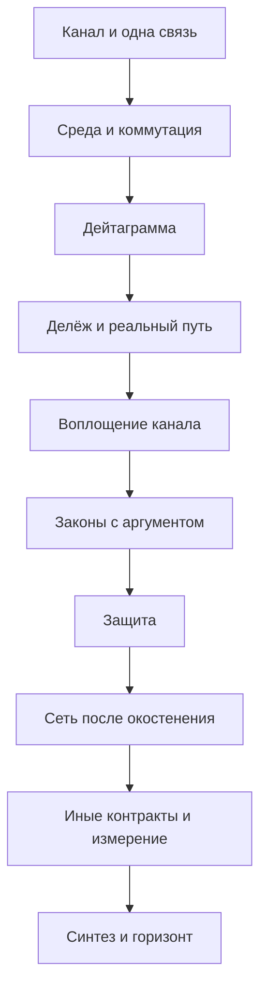

# Компьютерные сети. Полный курс: от кадра на ненадёжном канале до исследовательского уровня

Карта самостоятельного изучения. Каждая часть начинается после тех механизмов, на которые она опирается. Определения и разборы живут в указанных книгах и спецификациях; здесь — порядок, состав и место, где отложенный аргумент закрывается.

Номер части задаёт достаточный порядок: идти по нему можно, не заглядывая вперёд. Где есть более ранний вход, это сказано в строке «Можно параллельно». Полный указатель таких развилок собран в части 52.

Курс идёт по архитектуре Интернета. Норма контракта — действующий RFC или стандарт IEEE. Телефон, X.25, ATM, OSI, Ethernet, сотовая сеть, вычислительный зал, сеть с опекой и сеть именованного содержимого разбираются рядом с тем механизмом, который на них впервые стал ясен: канал с блокировкой, надёжность внутри сети, толстый стек, общая среда, расписанный доступ, другой масштаб времени, отсутствие сквозного пути, имя содержимого.

Математика берётся из `maths/contents.md` и заново здесь не строится. Классической вероятности части 11 хватает для первого прохода ALOHA. Цепи Маркова и пуассоновский процесс части 32 нужны теории очередей. Доверительный интервал измерения — часть 33. Выпуклая двойственность части 53 даёт язык полезности затора, не его сетевой смысл. Энтропия, пропускная способность и линейные коды — часть 54. Здесь они входят как граница и как блок.

Машина берётся из `computer/architecture/contents.md`. Бит, октет и порядок байтов — часть 1. Шина, прерывание и прямой доступ — части 14 и 30. Закон Литтла вводится в части 12. Тупик сети на кристалле, виртуальный канал и флит — часть 36. Выше разъёма устройства начинается этот курс. Удалённый прямой доступ к памяти встречается с той частью на границе зала и не переписывает её.

Операционной системы в этой карте нет. Берётся только то, что входит в обещание сети: сокет, буфер, задержка планировщика, привилегия интерфейса.

Если учебник и спецификация расходятся, верна спецификация.

## Уровни

- **0.** Две стороны, кадр, общая среда, мост. Служба уже названа, Интернета ещё нет.
- **I.** Базовый университет: дейтаграмма, кратчайший путь, поток байтов, имена, целая простая сеть, первый закон затора.
- **II.** Продвинутый университет: коммутатор, туннель, междоменная политика, канал, радио, расписанный доступ, время, группа.
- **III.** Аспирантское ядро: очереди, справедливость, верность окна, алгебра маршрутов, разрез, защита, зал, проверяемые плоскости, измерение. Утверждения этого уровня изучаются с аргументом.
- **IV.** Исследовательский горизонт: точная постановка, место в курсе и минимальный вход. Владение горизонтом есть умение читать работу в этой точке, а не клетка в оглавлении.

## Спираль

Некоторые темы названы дважды. Второй проход закрывает то, что первый оставил числом, блоком или обещанием.

- Контроль кадра в части 1 обнаруживает порчу и не называет, какую. Какие пачки ошибок он ловит и почему обнаружение не есть подлинность, разбирается в части 26.
- Тайм-аут части 3 есть догадка о задержке. Оценка времени оборота и алгоритм Карна — часть 32. Условие живости при канале, который не обязан доставлять честно, — часть 33.
- Одного бита чередования в части 3 хватает останову и ожиданию. Окно и пространство номеров открываются в части 12. Нижняя граница размера пространства доказывается в части 33.
- Три договора доставки названы в части 3. Поток части 12 повторяет байт, пока соседний транспорт его не принял, и не отдаёт принятый байт приложению дважды. Исполнение эффекта приложения ровно один раз требует устойчивого состояния вне сети. Это части 33 и 46.
- Очередь в частях 5 и 15 есть слово. Качественная картина — часть 16. Система M/G/1 и спор о размере буфера — часть 31. Закон управления — часть 32. Противник, который наполняет ту же очередь, — часть 40.
- Связующее дерево части 5 верно и оставляет связи праздными. Ткань коммутатора — часть 17. Равноценные кратчайшие пути — часть 21. Разрез и балансировка — часть 35. Междоменный маршрут не есть ни дерево, ни кратчайший путь. Это часть 20.
- Сквозной аргумент вводится в части 7 на контрольной сумме файла. Трансляция адреса и окостенение показывают, где путь перестал быть прозрачным. Это часть 19. Транспорт, который прячет свои заголовки от середины пути, — часть 41. Вычисление внутри сети остаётся горизонтом части 53.
- Кратчайший путь части 9 сходится при своих предпосылках. Политика части 20 может не сойтись. Алгебра, отделяющая эти случаи, — часть 34.
- Адрес частей 6 и 10 совмещает имя и место. Раскол закрывается в части 44, после мобильности, anycast и переноса соединения.
- Общая радиосреда частей 4 и 27 разыгрывается. Сотовый доступ части 28 расписан. Это разные договоры о том, кто говорит.
- Затор части 15 ещё пила аддитивного увеличения. Сходимость к справедливости, полезность Келли и граница модели BBR — часть 32. Постоянные времени зала — часть 42.

## Как читать часть

У каждой части четыре строки: уровень, опора, что она открывает, канон. Канон устроен так: первый текст — основной путь, следующие — параллельные. Пункт внутри главы называет определение, механизм, теорему или метод, которые в этом месте изучаются.

Защита в этом курсе есть сломанный инвариант и свойство, которое протокол обязан восстановить. Приёмы компрометации в карту не входят.

## Зависимости частей

Канал и одна связь — части 0–3. Среда и коммутация — части 4–6. Дейтаграмма — части 7–14. Делёж и реальный путь — части 15–24. Воплощение канала — части 25–30. Законы с аргументом — части 31–37. Защита — части 38–40. Сеть после окостенения — части 41–47. Иные контракты, измерение, масштаб и отказ — части 48–51. Синтез и горизонт — части 52–53.

После части 8 кратчайший путь и план адресов можно читать в любом порядке; сходятся они в части 14. После части 16 междоменная маршрутизация и второй проход внутренней маршрутизации независимы. Раньше части 9 политике не с чем спорить, а весу связи не на что лечь.

## Содержание

0. [Сеть как предмет и как контракт](#часть-0-сеть-как-предмет-и-как-контракт)
1. [Канал, символ и кадр](#часть-1-канал-символ-и-кадр)
2. [Служба связи](#часть-2-служба-связи)
3. [Надёжная передача по одной связи, первый проход](#часть-3-надёжная-передача-по-одной-связи-первый-проход)
4. [Общая среда](#часть-4-общая-среда)
5. [Коммутация и связующее дерево](#часть-5-коммутация-и-связующее-дерево)
6. [Имена на связи и первая иерархия](#часть-6-имена-на-связи-и-первая-иерархия)
7. [Дейтаграмма и тонкая талия](#часть-7-дейтаграмма-и-тонкая-талия)
8. [Пересылка](#часть-8-пересылка)
9. [Кратчайший путь](#часть-9-кратчайший-путь)
10. [План адресов](#часть-10-план-адресов)
11. [Порт и ненадёжная дейтаграмма](#часть-11-порт-и-ненадёжная-дейтаграмма)
12. [Надёжный поток байтов, первый проход](#часть-12-надёжный-поток-байтов-первый-проход)
13. [Классические приложения](#часть-13-классические-приложения)
14. [Целая простая сеть](#часть-14-целая-простая-сеть)
15. [Поток получателя и затор сети, первый проход](#часть-15-поток-получателя-и-затор-сети-первый-проход)
16. [Очередь, первый проход](#часть-16-очередь-первый-проход)
17. [Коммутатор, второй проход](#часть-17-коммутатор-второй-проход)
18. [Инкапсуляция](#часть-18-инкапсуляция)
19. [Промежуточные узлы и окостенение](#часть-19-промежуточные-узлы-и-окостенение)
20. [Междоменная маршрутизация](#часть-20-междоменная-маршрутизация)
21. [Маршрутизация внутри области, второй проход](#часть-21-маршрутизация-внутри-области-второй-проход)
22. [IPv6](#часть-22-ipv6)
23. [Система имён, второй проход](#часть-23-система-имён-второй-проход)
24. [Прикладной контракт веба](#часть-24-прикладной-контракт-веба)
25. [Хост и сетевой интерфейс](#часть-25-хост-и-сетевой-интерфейс)
26. [Канал, второй проход](#часть-26-канал-второй-проход)
27. [Беспроводная общая среда](#часть-27-беспроводная-общая-среда)
28. [Сотовый доступ](#часть-28-сотовый-доступ)
29. [Службы со временем](#часть-29-службы-со-временем)
30. [Групповая рассылка](#часть-30-групповая-рассылка)
31. [Теория очередей](#часть-31-теория-очередей)
32. [Управление затором, второй проход](#часть-32-управление-затором-второй-проход)
33. [Верность протоколов доставки](#часть-33-верность-протоколов-доставки)
34. [Алгебра маршрутов](#часть-34-алгебра-маршрутов)
35. [Топология, разрез и балансировка](#часть-35-топология-разрез-и-балансировка)
36. [Эгоистичный выбор пути](#часть-36-эгоистичный-выбор-пути)
37. [Сетевое кодирование](#часть-37-сетевое-кодирование)
38. [Защита канала](#часть-38-защита-канала)
39. [Подлинность маршрута и имени](#часть-39-подлинность-маршрута-и-имени)
40. [Доступность](#часть-40-доступность)
41. [Транспорт после окостенения](#часть-41-транспорт-после-окостенения)
42. [Сеть вычислительного зала](#часть-42-сеть-вычислительного-зала)
43. [Инженерия трафика и плоскость управления](#часть-43-инженерия-трафика-и-плоскость-управления)
44. [Что именует адрес](#часть-44-что-именует-адрес)
45. [Наложенные сети](#часть-45-наложенные-сети)
46. [Чего сеть не обещает](#часть-46-чего-сеть-не-обещает)
47. [Проверяемые плоскости](#часть-47-проверяемые-плоскости)
48. [Иные архитектуры связи](#часть-48-иные-архитектуры-связи)
49. [Измерение и достоверность](#часть-49-измерение-и-достоверность)
50. [Трафик, энергия и масштаб](#часть-50-трафик-энергия-и-масштаб)
51. [Отказ как обычный режим](#часть-51-отказ-как-обычный-режим)
52. [Синтез курса](#часть-52-синтез-курса)
53. [Исследовательский горизонт](#часть-53-исследовательский-горизонт)

---

## Часть 0. Сеть как предмет и как контракт

**Уровень.** 0

**Опирается на.** Умение читать связный текст и отличать правило от примера.

**Открывает.** Часть 1: слои названы, дальше можно говорить о символе на среде.

**Канон.** Петерсон, Дейви, «Computer Networks: A Systems Approach», глава об основах — основной путь. Параллельно: Солтцер, Рид, Кларк, «End-to-End Arguments in System Design».

### Глава 1. Три слоя

1.1. Служба — то, что наблюдатель слоя вправе отличить: какие сообщения приняты, в каком порядке, под какими именами, при каких отказах, с каким обещанием времени или без него.
1.2. Протокол — правила сверстников, которые из более слабой службы получают более сильную: состояния, сообщения, таймеры, инварианты.
1.3. Воплощение — среда, очередь, коммутатор, провод, спектр. Пока порча, задержка и потеря не видны службе, воплощение остаётся за контрактом.
1.4. Одна служба допускает много протоколов. Один протокол допускает много воплощений. Одно и то же обещание дейтаграммы переживёт смену провода на радио, если контракт среды не называл.
1.5. Вопрос принадлежит слою, в котором лежит ответ. Длина очереди внутри узла не становится пунктом контракта потока оттого, что её легко измерить.

### Глава 2. Наблюдаемое

2.1. Наблюдатель службы видит сообщения и те отказы, которые контракт обязал сделать видимыми. Момент прихода есть физический факт. Обещанием он становится только тогда, когда контракт его ограничил.
2.2. Скрытое состояние протокола — номера, таймеры, окна — может менять время и при этом отсутствовать в данных приложения.
2.3. Как только скрытое состояние одного потока меняет доставку другого, граница контракта подлежит пересмотру. Механизм общего затора — часть 15, после того как один поток уже будет построен.
2.4. Две реализации согласованы, если на каждой допустимой истории среды совпадают наблюдения там, где контракт требует определённости. Совпадение задержек не требуется, пока задержка не обещана.
2.5. Неопределённость бывает трёх видов, и их нельзя смешивать: исход определён; исход выбран из названного множества, и реализация обязана выбрать допустимо; операция запрещена и обязана быть видна как отказ.

### Глава 3. Стороны

3.1. Стороны не разделяют судьбу. Отказ одной не есть отказ другой и не виден ей сам собой.
3.2. Стороны не разделяют часы. «Одновременно» не является наблюдением протокола, пока отдельный договор о времени не будет назван. Его место — часть 46.
3.3. Стороны не разделяют исправный провод. Потеря, повтор, перестановка, порча и неограниченная задержка суть разные служения среды. Протокол обязан назвать, какие из них он терпит.
3.4. Нарушитель в этой карте есть сторона, которая ломает инвариант. В курс входит свойство, которое от этого ломается, и свойство, которое протокол ставит вместо него.
3.5. Административная граница тоже есть сторона. Доверие через неё не выводится из того, что пакеты проходят.

### Глава 4. Устройство этого курса

4.1. Курс есть достаточный порядок чтения от кадра до горизонта.
4.2. Уровни 0, I, II, III и IV задают тип обязательства. На IV обязательство состоит в постановке, входе и статусе.
4.3. Где курс оставляет механизм блоком или числом, спираль в начале файла называет часть, которая его открывает.
4.4. Основной текст части и параллельные тексты. Спецификация ближе к норме, чем пересказ.
4.5. Ранние входы, которые не ломают зависимость, собраны в части 52. До той части ими можно пользоваться там, где строка «Можно параллельно» уже стоит в самой части.
4.6. Статья Кларка «The Design Philosophy of the DARPA Internet Protocols» здесь образец того, как выглядит контракт сети. Разбор тонкой талии — часть 7.

**Переход.** Слои разделены. Первый предмет сети — символ, который приёмник обязан отделить от соседнего символа.

---

## Часть 1. Канал, символ и кадр

**Уровень.** 0

**Опирается на.** Часть 0. Бит, октет и порядок байтов — часть 1 курса архитектуры. Здесь достаточно соглашения: кадр есть последовательность октетов, смысл которой назначает протокол.

**Открывает.** Службу связи: у символа уже есть граница, порча и три числа стоимости.

**Канон.** Петерсон, Дейви, «Computer Networks: A Systems Approach», главы о среде и кадре — основной путь. Параллельно: Куроуз, Росс, «Computer Networking: A Top-Down Approach», главы о физическом и канальном уровне как вид тех же механизмов сверху.

### Глава 1. Три числа

1.1. Задержка распространения есть время, за которое сигнал проходит среду. Она зависит от расстояния и скорости среды, а не от того, сколько битов решено послать.
1.2. Полоса есть темп, с которым среда принимает биты. Время передачи кадра есть его длина, делённая на полосу.
1.3. Произведение полосы на задержку распространения есть объём битов, уже находящихся в среде, когда первый бит ещё не принят. Пока это число. Окно, которому оно понадобится, — часть 12.
1.4. Шум есть третье число: вероятность того, что принятый символ не совпадёт с посланным. Количественная граница шума — пропускная способность части 54 курса математики. Здесь шум только объясняет, почему кадр может быть испорчен.
1.5. Эти три числа не заменяют друг друга. Короткая задержка при узкой полосе и широкая полоса при долгой среде суть разные каналы.

### Глава 2. Символ

2.1. Символ есть решение приёмника о состоянии среды на интервале времени. Имена решений назначаются соглашением, как имена бита в части 1 курса архитектуры.
2.2. Граница символа требует общего ритма на этой связи. Общие часы всей сети из такого ритма не следуют.
2.3. Несколько битов могут ехать одним символом. Для службы выше кадра это воплощение, пока наружу виден только октет.
2.4. Ошибка символа становится ошибкой кадра, когда протокол собирает символы в единицу, у которой есть целостность.
2.5. Среда с памятью о предыдущем символе возможна. Первый проход считает шум независимым от символа к символу там, где эта гипотеза названа. Зависимый шум вернётся в части 26.

### Глава 3. Граница кадра

3.1. Кадр есть последовательность октетов, у которой приёмник умеет найти начало и конец.
3.2. Сторож, длина и нарушение ритма суть три способа назвать границу. Способ входит в контракт связи.
3.3. Прозрачность: данные, похожие на сторож, не должны становиться границей. Вставка согласованного побега есть часть контракта, а не украшение кода.
3.4. Пока граница не найдена, контрольная сумма не к чему приложить. Верность кадра начинается после того, как кадр отделён.
3.5. Кадр есть единица этой части. Пакет многих связей и поток байтов из кадра не следуют.

### Глава 4. Обнаружение порчи

4.1. Паритет ловит нечётное число перепутанных битов в названном поле и пропускает чётное. Это обнаружение, не исправление.
4.2. Циклический избыточный код ловит больше названных пачек ошибок. Какие именно, эта часть не выводит. Вывод — часть 26, код как подпространство — часть 54 курса математики.
4.3. Контрольная сумма, сошедшаяся на испорченном кадре, есть необнаруженная ошибка. Вероятность такого события зависит от кода и от канала. Нулевой её контракт не объявляет.
4.4. Обнаружение не называет автора кадра. Подлинность есть другой договор. Его отсутствие здесь фиксируется, строится он в части 38.
4.5. Кадр с обнаруженной порчей служба этой части уничтожает. Повтор не обещан: повторять пока некому.

### Глава 5. Что уже можно обещать

5.1. Есть две стороны одной связи, граница кадра и отказ по порче.
5.2. Потеря, повтор и перестановка этой частью ещё не названы как отдельные служения. Они станут моделью службы в части 2.
5.3. Общая среда, где говорящих больше двух, этой частью не разбирается.
5.4. Конец части: приёмник умеет сказать «этот кадр, по контролю, похож на посланный». Он ещё не умеет сказать «этот кадр дошёл ровно один раз».

**Переход.** Кадр отделён. Теперь можно честно перечислить, что среда делает с уже отделённым кадром.

---

## Часть 2. Служба связи

**Уровень.** 0

**Опирается на.** Часть 1.

**Открывает.** Протокол надёжности: слабости среды названы по отдельности, и их уже нельзя лечить одним словом «шум».

**Канон.** Петерсон, Дейви, «Computer Networks: A Systems Approach», модель канала в главе о надёжной передаче — основной путь. Параллельно: Куроуз, Росс, «Computer Networking: A Top-Down Approach», та же модель в главе транспорта.

### Глава 1. Служба как отношение

1.1. Служба есть отношение между историей передач и допустимыми историями приёмов. Протокол реализует службу, если всякая его история приёма допустима отношением.
1.2. История включает порядок отправки, содержание, и отказы, которые контракт делает видимыми.
1.3. Реализация может терять кадры внутри себя только так, как службе разрешено терять. Скрытая потеря сверх контракта есть дефект реализации.
1.4. Более сильная служба есть более узкое отношение. Построить её поверх слабой и есть работа протокола.
1.5. Слой вправе пользоваться только тем, что нижняя служба обещала. Удачный прогон, в котором нижний слой сделал больше, доказательством не является.

### Глава 2. Четыре порчи

2.1. Потеря: отправленный кадр не входит ни в одну приёмную историю.
2.2. Повтор: один отправленный кадр входит в приёмную историю более одного раза.
2.3. Перестановка: порядок приёма не совпадает с порядком отправки.
2.4. Порча содержания уже поймана частью 1, если контроль не сошёлся. Необнаруженная порча остаётся внутри модели потери или внутри модели подмены. Эти две модели нельзя склеивать: подмена есть кадр, который прошёл контроль и не был отправлен. Подмену обнаружение порчи не закрывает.
2.5. Среда может сочетать порчи. Контракт, который назвал только потерю, молчит о перестановке и потому её не запрещает.

### Глава 3. Задержка

3.1. Ограниченная задержка: существует известный предел, после которого кадр уже не придёт. Предел есть пункт контракта, не свойство всякой среды.
3.2. Неограниченная задержка: для любого срока найдётся допустимая история, в которой кадр приходит позже. Тайм-аут в такой службе не отличает потерю от опоздания.
3.3. Конечная, но неизвестная сторонам граница не равна известной границе. Протокол, которому предел не сообщён, обязан жить как при неограниченной задержке.
3.4. Повтор при ограниченной задержке можно отличить от нового кадра ожиданием. При неограниченной это ожидание не является доказательством.
3.5. Общие часы сети из ограниченной задержки одной связи не следуют.

### Глава 4. Составные договоры

4.1. Доставка не более одного раза разрешает потерю и запрещает повтор в приёмной истории.
4.2. Доставка хотя бы один раз запрещает тихую потерю и разрешает повтор.
4.3. Доставка ровно один раз запрещает и тихую потерю, и повтор.
4.4. Порядок есть отдельная ось. Ровно один раз без порядка и порядок без ровно одного раза суть разные службы.
4.5. Идеальная связь — частный договор: ровно один раз, в порядке, с известной границей задержки, без подмены. Протокол, который молча считает связь идеальной, переносит этот договор в свою службу. Перенос обязан быть написан.

### Глава 5. Что контроль не закрывает

5.1. Сошедшийся контроль части 1 совместим с повтором, потерей, перестановкой и подменой автора.
5.2. Подлинность автора, целостность против намеренной подмены и свежесть против повтора суть три разных свойства. Одно из них не производит двух других.
5.3. Секретность содержания есть четвёртое свойство. Оно не следует из целостности.
5.4. Эти четыре свойства получат протоколы в части 38. Здесь они только отделены от контроля кадра, чтобы дальнейшая надёжность не притворялась защитой.
5.5. Конец части: служба связи записана как отношение. Поверх отношения потери можно строить повтор.

**Переход.** Слабая служба названа. Следующий предмет — протокол, который на одной связи сужает её до доставки в порядке.

---

## Часть 3. Надёжная передача по одной связи, первый проход

**Уровень.** 0

**Опирается на.** Часть 2.

**Открывает.** Общую среду и, позже, поток байтов. Инварианты здесь названы; доказательства сохранности и живости — часть 33.

**Канон.** Петерсон, Дейви, «Computer Networks: A Systems Approach», глава об остановке и ожидании — основной путь. Параллельно: Куроуз, Росс, «Computer Networking: A Top-Down Approach», тот же протокол.

### Глава 1. Повтор

1.1. Отправитель хранит кадр, пока не получил знак приёма. Знак приёма есть кадр обратной службы, а не магия среды.
1.2. Обратная служба подчиняется той же части 2. Подтверждение тоже теряется, повторяется и опаздывает.
1.3. Потеря подтверждения неотличима для отправителя от потери кадра. Повтор кадра есть ответ на оба события сразу.
1.4. Приёмник, который при повторе отдаёт данные наверх дважды, реализует «хотя бы один раз». Приёмник, который повтор узнаёт и глотает, сужает службу.
1.5. Узнать повтор можно только по состоянию, которое переживает кадр. Таким состоянием на первом проходе служит один бит.

### Глава 2. Чередующийся бит

2.1. Кадр несёт бит эпохи. Приёмник принимает кадр с ожидаемым битом, отдаёт его наверх один раз и переворачивает ожидание.
2.2. Подтверждение несёт бит, который подтверждает. Подтверждение другого бита не двигает отправителя.
2.3. Отправитель переворачивает свой бит только после подтверждения текущего. В среде тогда не больше одного кадра, смысл которого ещё не закрыт.
2.4. Старый кадр с прежним битом приёмник глотает и может снова подтвердить. Глотание и есть запрет второго вручения наверх.
2.5. Одного бита хватает, пока в полёте не больше одного незакрытого кадра и канал не переставляет кадры. Перестановка делает кадр прошлой эпохи неотличимым от нового, когда бит снова совпал. Окно и граница пространства номеров — части 12 и 33.

### Глава 3. Тайм-аут

3.1. Если задержка не ограничена известным пределом, отправитель выбирает срок и объявляет кадр потерянным по истечении срока.
3.2. Короткий срок плодит повторы живого кадра. Долгий срок медлит после настоящей потери. Оба исхода совместимы с протоколом этой части.
3.3. Число срока здесь приписано. Оценка по образцам времени оборота и запрет портить оценку повтором — часть 32.
3.4. Повтор по тайм-ауту не доказывает, что кадр не дошёл. Поэтому приёмник обязан терпеть повтор.
3.5. Протокол без тайм-аута и без известной границы задержки не имеет хода, которым он добивается прогресса после потери. Это будет условием живости в части 33.

### Глава 4. Три договора на одной связи

4.1. Глотание повтора даёт приёмнику вручение не более одного раза для каждого закрытого кадра.
4.2. Повтор до подтверждения даёт отправителю основание считать, что принятый кадр был вручён хотя бы один раз, если подтверждению можно верить.
4.3. Вместе, при честной реализации обеих сторон и при канале без подмены, закрытый кадр вручён один раз. Это ещё не теорема: гипотезы канала и честности будут выписаны в части 33.
4.4. Подмена подтверждения ломает вывод предыдущего пункта. Контроль порчи подмену не закрывает, как уже сказано в части 2.
4.5. Эффект выше приёмника — запись на диск, действие приложения — этим договором не покрыт. Приёмник мог вручить кадр и не успеть сделать то, что отправитель считает смыслом доставки.

### Глава 5. Чего один кадр не решает

5.1. Протокол этой части занимает связь одним незакрытым кадром. Произведение полосы на задержку при этом простое.
5.2. Номер из одного бита не вырастает в пространство номеров сам собой. Правило роста доказывается вместе с окном.
5.3. Две стороны одной связи не дают адреса. Адреса появятся, когда говорящих станет больше двух.
5.4. Общая среда со столкновениями не есть потеря этой модели. Столкновение — часть 4.
5.5. Конец части: на одной связи есть останов, ожидание, бит эпохи и приписанный срок. Доказательство, при каких гипотезах это есть ровно одно вручение, отложено.

**Переход.** Две стороны умеют вручить кадр один раз. Следующий предмет — среда, в которой желание говорить есть больше чем у одной пары.

---

## Часть 4. Общая среда

**Уровень.** 0

**Опирается на.** Части 1–3. Доля успехов ALOHA считается классической вероятностью части 11 курса математики. Цепи Маркова не нужны.

**Открывает.** Коммутацию: общая среда объясняет, зачем вообще делить говорящих по разным связям.

**Канон.** Петерсон, Дейви, «Computer Networks: A Systems Approach», глава о множественном доступе — основной путь. Параллельно: Абрамсон, «The ALOHA System»; Меткалф, Боггс, «Ethernet: Distributed Packet Switching for Local Computer Networks».

### Глава 1. Кто говорит

1.1. Общая среда вручает кадр всем приёмникам сразу либо не вручает никому, если столкновение разрушает кадр. Это служение отличается от потери на проводе между парой.
1.2. Адрес в кадре выбирает, кому из слушателей отдавать кадр наверх. Услышать кадр могут и те, кому он не адресован. Адрес не есть секретность.
1.3. Право говорить есть договор. Фиксированная очередь, жребий и прослушивание несущей суть разные договоры. Расписание по общему плану — другой договор, его место в части 28.
1.4. Пока договора нет, два кадра, наложившиеся во времени, дают приёмнику порчу. Часть 3 такую порчу видит как потерю, если контроль не сошёлся, и не видит, кто был вправе говорить.
1.5. Широковещание на общей среде дёшево: один кадр слышат все. Та же дешевизна на сети из многих связей станет отдельной задачей части 30.

### Глава 2. ALOHA

2.1. Чистая ALOHA разрешает говорить в любой момент. Уязвимое окно кадра длиннее самого кадра: чужой кадр, начатый раньше или позже, оба разрушают приём.
2.2. Щелевая ALOHA пускает кадр только от границы щели. Уязвимое окно сокращается до одной щели. Общая щель есть местный ритм, то есть дополнительная гипотеза сверх части 3.
2.3. При пуассоновском предложении нагрузки, фиксированной длине, разрушении обоих кадров в столкновении и без эффекта захвата доля успеха щелевой ALOHA достигает 1/e от темпа среды. Вывод есть классическая вероятность пустого окна, не теорема части 31.
2.4. Чистая ALOHA при тех же гипотезах даёт вдвое меньший пик. Постоянная 1/e есть свойство модели, не закон всякой радиосети.
2.5. Повтор после столкновения обязан быть случайным. Одинаковый срок повтора у всех столкнувшихся воспроизводит столкновение.

### Глава 3. Прослушивание несущей

3.1. Прослушивание запрещает начинать кадр, когда среда уже занята. Оно помогает, когда чужой сигнал доходит прежде, чем свой кадр почти закончен.
3.2. Если время распространения сравнимо со временем кадра, прослушивание опаздывает: оба уже начали. Параметр «время распространения, делённое на время кадра» и есть мера этой беспомощности.
3.3. Обнаружение столкновения позволяет оборвать уже обречённый кадр. Обнаружение требует, чтобы свой и чужой сигналы были сравнимы у передающего. На радио это часто ложно. Поэтому проводной Ethernet и радио разойдутся в части 27.
3.4. Двоичная экспоненциальная отсрочка увеличивает случайное ожидание после повторных столкновений. Она гасит синхронные повторы ценой задержки.
3.5. Классический Ethernet на общем проводе есть этот договор: прослушивание, обнаружение столкновения, экспоненциальная отсрочка. Норма действующей сети — IEEE 802.3. Учебная формула доли успеха при малом времени распространения читается у Петерсона или Куроуза и не подменяет стандарт.

### Глава 4. Область столкновения

4.1. Область столкновения есть множество интерфейсов, кадры которых могут разрушить друг друга на общей среде.
4.2. Пока область велика, добавление говорящих делит одну и ту же полосу и растит вероятность столкновения.
4.3. Удлинение провода растит время распространения и тем портит прослушивание, даже если говорящих двое.
4.4. Коммутатор, который даст каждой паре отдельную среду, снимет столкновение. Это часть 17. Здесь среда ещё общая, и столкновение есть нормальный отказ договора.
4.5. Широковещательный адрес кадра обязан дойти до всех в области. Отсюда же вырастет петля, когда области начнут сшивать.

### Глава 5. Что общая среда обещает

5.1. Она обещает доставку кадра в области, если столкновения не было и контроль сошёлся. Она не обещает порядка между разными отправителями сверх того, что дала среда.
5.2. Она не обещает справедливой доли на любом сроке. Экспоненциальная отсрочка уменьшает долю того, кому не везло.
5.3. Она не подлинна: адрес отправителя в кадре пишет отправитель. Вера в этот адрес есть гипотеза, которая будет снята в части 39.
5.4. Надёжность части 3 можно поставить поверх кадра общей среды. Столкновение тогда видно как потеря. Протокол надёжности не лечит договор о том, кто говорит.
5.5. Конец части: много станций делят одну среду и платят столкновениями. Дальше среду режут на связи.

**Переход.** Общая среда объяснила столкновение и широковещание. Узел, который соединяет несколько связей, обязан решить, куда деть кадр, и что будет, если кадр может вернуться.

---

## Часть 5. Коммутация и связующее дерево

**Уровень.** 0

**Опирается на.** Часть 4.

**Открывает.** Иерархию имён. Дерево здесь впервые отделяет «куда» от «по какой среде».

**Канон.** Перлман, «Interconnections: Bridges, Routers, Switches, and Internetworking Protocols» — основной путь для моста и дерева. Параллельно: Петерсон, Дейви, «Computer Networks: A Systems Approach», глава о коммутации.

### Глава 1. Три способа соединить

1.1. Коммутация каналов резервирует путь на время разговора. Чужой разговор этого пути не делит. Блокировка есть отказ в резерве, а не потеря кадра.
1.2. Коммутация сообщений принимает сообщение целиком и несёт его дальше. Сообщение занимает узел на время своей длины.
1.3. Коммутация пакетов режет сообщение на кадры с ограниченной длиной и может отправить первый кадр дальше, не дожидаясь последнего. Статистическое уплотнение, при котором короткие разговоры делят одну связь, начинается здесь как идея. Его очередь — часть 16.
1.4. Эти три способа суть разные службы. Надёжность части 3 не выбирает между ними.
1.5. Дейтаграмма, в которой каждый кадр несёт адрес назначения и не опирается на заранее занятый путь, станет контрактом части 7. Здесь достаточно, что таблица узла смотрит на адрес в кадре.

### Глава 2. Задержка пересылки

2.1. Время на связи есть сумма передачи, распространения и ожидания. Ожидание в этой части есть слово: кадр стоит, пока узел занят другим кадром.
2.2. Передача равна длине, делённой на полосу связи. На длинном пути из многих связей передачи складываются, если узел ждёт кадр целиком.
2.3. Сквозная передача, которая начинает выходной кадр до конца входного, уменьшает сумму передач. Условие верности такого начала — часть 17. Здесь узел ждёт кадр целиком.
2.4. Распространение зависит от длины среды и не лечится более быстрым узлом.
2.5. Формула без ожидания описывает пустой путь. Утверждение о пути под нагрузкой этой формулой подменять нельзя.

### Глава 3. Мост с обучением

3.1. Мост соединяет области общей среды и несёт кадр со входа на выход по адресу назначения канального кадра.
3.2. Обучение записывает адрес источника и вход, откуда кадр пришёл. Позже кадр к этому адресу уходит только в тот вход.
3.3. Неизвестный адрес назначения рассылается во все остальные входы. Широковещание рассылается всегда.
3.4. Запись обучения стареет. Без старения адрес, уехавший на другой вход, остаётся ложью.
3.5. Мост не понимает пакет уровня выше кадра. Для него достаточно адресов части 4.

### Глава 4. Петля

4.1. Два моста между одними и теми же областями дают цикл. Широковещание, пришедшее по циклу, рассылается снова.
4.2. Шторм есть неограниченное размножение широковещания по циклу. Обучение на таком кадре ещё и портит таблицу: один и тот же источник виден с разных входов.
4.3. Надёжность части 3 шторм не лечит. Кадр подлинный, контроль сходится, и копий становится больше.
4.4. Запрет цикла есть свойство топологии активных входов, а не свойство отдельного кадра.
4.5. Резервная связь полезна при обрыве и вредна, пока обе живы и обе проводят широковещание. Протокол дерева оставляет резерв и выключает его из кадра.

### Глава 5. Связующее дерево

5.1. Связующее дерево, оно же остовное дерево графа связей, есть подграф без циклов, в котором всякая пара узлов области ещё достижима, если исходный граф был связен.
5.2. Протокол выбирает корень и оставляет на каждом мосту один путь к корню. Остальные входы, ведущие к корню короче или с лучшим идентификатором, блокируются. Норма действующего дерева — IEEE 802.1Q. Исходная ясность петли — Перлман.
5.3. Пока дерево сошлось, широковещание доходит до каждого узла конечное число раз. Это сохранность от шторма.
5.4. Сходимость после обрыва занимает время. В это время петля или разрыв ещё возможны. Время сходимости есть пункт протокола, не ноль.
5.5. Заблокированная связь исправна и не несёт кадров. Дерево верно и расточительно. Тратить запасные связи, не возвращая шторм, — части 17 и 21.
5.6. Конец части: кадр идёт по дереву, широковещание конечно, запасные связи молчат. Имени, которое переживёт одну область дерева, ещё нет.

**Переход.** Дерево сшило области. Адрес, по которому мост учится, плоский: он не говорит, в какой стороне света лежит назначение, если обучения ещё не было.

---

## Часть 6. Имена на связи и первая иерархия

**Уровень.** 0

**Опирается на.** Часть 5.

**Открывает.** Дейтаграмму: без различия плоского адреса и префикса межсетевой адрес нечем мотивировать.

**Канон.** Петерсон, Дейви, «Computer Networks: A Systems Approach», глава об адресации — основной путь. Параллельно: Солтцер, «On the Naming and Binding of Network Destinations», RFC 1498, как ранний документ различия имён. Полный раскол имени и места — часть 44.

### Глава 1. Имя и область

1.1. Имя есть строка, по которой сторона находит объект внутри названной области действия.
1.2. Одно и та же строка в другой области может именовать другое. Контракт имени обязан назвать область.
1.3. Привязка соединяет имя одного пространства с именем другого. Привязка имеет срок. Бессрочная привязка есть отдельное, более сильное обещание.
1.4. Адрес в этом курсе есть имя, которым механизм пересылки выбирает следующий шаг. Не всякое имя есть адрес.
1.5. Локатор говорит, куда вести. Идентификатор говорит, о ком речь, когда место сменилось. До части 44 курс будет часто пользоваться адресом, который совмещает оба смысла, и обязан это совмещение замечать.

### Глава 2. Плоский адрес связи

2.1. Адрес кадра на общей среде плоский: соседние численные значения не обещают соседства в топологии.
2.2. Длина адреса задаёт размер пространства, не число реально присутствующих станций. IEEE 802 использует пространство, которым делятся изготовители. Уникальность есть административный договор, не следствие дерева.
2.3. Локально назначенный адрес законен, если область его действия не притворяется глобальной.
2.4. Мост части 5 хранит плоские адреса по одному на станцию. Таблица растёт с числом станций, которые через мост видны.
2.5. Широковещание по неизвестному плоскому адресу есть цена отсутствия структуры в имени.

### Глава 3. Префикс

3.1. Иерархическое имя устроено так, что общий префикс именует область, а продолжение — объект внутри неё.
3.2. Пересылка по префиксу хранит одну запись на область. Таблица растёт с числом областей, которые узел различает, а не с числом станций внутри далёкой области.
3.3. Агрегирование возможно, только если все имена с данным префиксом действительно достижимы тем путём, который записан для префикса. Дыра в этом правиле — часть 10.
3.4. Иерархия есть договор о назначении имён. Она не возникает из графа связей сама.
3.5. Плоский адрес связи остаётся нужен на последнем шаге: префикс доводит кадр до области, а внутри области работает часть 5.

### Глава 4. Привязка

4.1. Станция, знающая иерархический адрес назначения, спрашивает, какой адрес связи этот адрес сейчас носит.
4.2. Ответ записывается в таблицу привязки и стареет. Протокол запроса на общей среде IPv4 есть ARP, RFC 826. Здесь важен договор, не перечень полей.
4.3. Вопрос рассылается широковещанием в области. Ответ может быть одноадресным. Широковещание вопроса есть нагрузка, пропорциональная интересу к новым адресам, а не к объёму данных.
4.4. Первый кадр к новому адресу ждёт привязку. Это задержка пути, которой нет в модели одной уже настроенной связи.
4.5. Привязка верит ответу, который сошёл за ответ на вопрос. Подлинности автора ответа в договоре нет. Разрыв этого доверия разбирается в части 39 как отсутствующая подлинность, без приёма подмены.

### Глава 5. Чего иерархии ещё не хватает

5.1. Одна иерархия на все станции мира требует, чтобы префиксы назначались согласованно. Кто назначает, эта часть не решает.
5.2. Смена места станции меняет локатор, если локатор вшит в иерархию топологии. Идентификатор, который пережил бы смену, ещё не построен.
5.3. Мост не читает иерархический адрес. Узел, который читает его и выбирает следующую сеть, есть маршрутизатор. Его служба — часть 7.
5.4. Дерево части 5 не есть маршрут по префиксам. Оно гасит петлю широковещания внутри области кадра.
5.5. Конец части: есть плоское имя связи, префикс области и привязка между ними. Обещания доставки через много сетей ещё нет.

**Переход.** Имена разных масштабов разделены. Можно обещать службу, которая несёт кадр через сети, не зная устройства каждой из них.

---

## Часть 7. Дейтаграмма и тонкая талия

**Уровень.** I

**Опирается на.** Части 2 и 6.

**Открывает.** Пересылку. Талия названа, и уже видно, чего в ней сознательно нет.

**Канон.** Кларк, «The Design Philosophy of the DARPA Internet Protocols» — основной путь. Параллельно: Серф, Кан, «A Protocol for Packet Network Intercommunication»; Петерсон, Дейви, «Computer Networks: A Systems Approach», глава об интерсети.

### Глава 1. Дейтаграмма

1.1. Дейтаграмма несёт адреса источника и назначения и не требует, чтобы сеть заранее держала состояние разговора.
1.2. Служба дейтаграммы есть лучшее усилие части 2: потеря, повтор, перестановка и порча допустимы. Порядок и ровно одно вручение сеть не обещает.
1.3. Состояние разговора, который обязан пережить отказ узла внутри сети, живёт на концах. Узел, который умер, уносит только дейтаграммы, бывшие в нём. Это разделение судьбы.
1.4. Пузен в CYCLADES уже отделил дейтаграмму от надёжности на концах. Серф и Кан в работе 1974 года описали межсетевой переход. Разделение того перехода на тонкую пересылку и надёжный поток и есть талия, которой пользуется этот курс.
1.5. Виртуальный канал, который держит состояние разговора в каждом узле пути, есть другой договор. Он вернётся в частях 29 и 48 как контракт, от которого Интернет отказался в талии и который местами вернулся выше или ниже неё.

### Глава 2. Сквозной аргумент

2.1. Функция, которую можно выполнить верно только при знании приложения, выполняется на концах. Сеть может помочь, но помощь не заменяет конец.
2.2. Контрольная сумма файла есть образец. Сумма на каждой связи не ловит порчу в памяти отправителя, в памяти получателя и при записи. Сумма у приложения ловит. Сумма на связи остаётся оптимизацией: она раньше выбрасывает уже обречённый кадр.
2.3. Аргумент не говорит, что сети запрещено делать что бы то ни было. Он говорит, что полнота функции сидит там, где есть знание и судьба разговора.
2.4. Повтор части 3 на одной связи есть такая оптимизация. Повтор между процессами приложения остаётся нужен, если судьба разговора включает диск и сам процесс.
2.5. Где аргумент перестаёт описывать действующий путь — трансляция адреса и промежуточные узлы, — разбирается в части 19. Здесь аргумент задаёт проект талии, не отчёт о любом нынешнем ящике на пути.

### Глава 3. Цели Кларка

3.1. Первая цель проекта — соединить существующие сети так, чтобы они вместе несли чужой трафик. Отсюда переход между разными средами части 1, а не одна обязательная среда.
3.2. Живучесть разговора при отказе внутренней сети есть вторая цель и прямой смысл разделения судьбы: состояние разговора не сидит в обречённом узле.
3.3. Разные виды службы, разные сети под талией, распределённое управление, дешевизна и простота присоединения хоста перечислены Кларком как цели следующего ряда. Не каждая из них стала свойством действующей сети в той форме, в какой была названа.
3.4. Подотчётность пользования ресурсами названа целью, которая удалась хуже других. Управление затором части 15 есть поздний ответ на эту дыру, не пункт исходной дейтаграммы.
3.5. Список целей объясняет, почему талия тонкая. Он не является теоремой о том, что всякая иная талия хуже.

### Глава 4. Заголовок как контракт

4.1. Норма IPv4 — RFC 791. Учебник, который расходится с ней в поле заголовка, неверен в этом поле.
4.2. Адреса источника и назначения суть локаторы этой части. Их план — часть 10. Совмещение с идентификатором ещё не снято.
4.3. Время жизни уменьшается на каждом переходе. Дейтаграмма, у которой оно исчерпано, уничтожается. Это тормоз петли пересылки, не протокол маршрутизации.
4.4. Номер протокола выбирает, кому на хосте отдать полезная нагрузка. Порт транспорта в этот номер не входит.
4.5. Контрольная сумма заголовка покрывает заголовок, не данные. Это прямое следствие главы 2: целостность данных есть дело концов. Поле типа службы в исходном заголовке обещало различие видов службы. Его позднейший смысл — части 29 и 32.
4.6. Фрагментация разрешает узлу разрезать дейтаграмму, если следующая связь короче. Почему состояние сборки на назначении и потеря одного куска губительны, разбирается в части 8.

### Глава 5. Песочные часы

5.1. Талия есть минимальный договор, который обязаны понимать хост и маршрутизатор разных сетей: дейтаграмма с адресами и временем жизни.
5.2. Ниже талии может смениться кадр. Выше — поток, имя, приложение. Смена кадра не требует смены приложения. Смена приложения не требует смены кадра.
5.3. Утолщение талии новым обязательным механизмом ломает это разделение. Поэтому механизм, без которого сеть ещё пересылает, в талию не кладут.
5.4. Образ песочных часов есть позднее имя того же выбора. Он не добавляет цели сверх главы 3.
5.5. Конец части: сеть обещает нести дейтаграмму по лучшему усилию и не обещает разговор. Разговор можно строить на концах именно потому, что сеть его не держит.

**Переход.** Обещание дейтаграммы записано. Следующий предмет — как узел по адресу выбирает следующий шаг, не став протоколом маршрутизации.

---

## Часть 8. Пересылка

**Уровень.** I

**Опирается на.** Часть 7.

**Открывает.** Кратчайший путь и план адресов. Таблица, которую им предстоит заполнять, уже определена.

**Канон.** RFC 791 — норма заголовка и фрагментации. Параллельно: RFC 1812, требования к маршрутизатору IPv4; Петерсон, Дейви, «Computer Networks: A Systems Approach», глава о пересылке.

### Глава 1. Пересылка и маршрутизация

1.1. Пересылка есть выбор следующего шага для одной дейтаграммы по уже готовой таблице.
1.2. Маршрутизация есть вычисление таблицы. Она происходит в другом времени, не в времени одного кадра.
1.3. Подмена одного другим прячет отказ. Верная пересылка кривой таблицы доставляет дейтаграмму не туда с полной исправностью узла.
1.4. Таблица есть отображение префикса назначения в следующий шаг и выход. Источник в это отображение этой частью не входит.
1.5. Политика, которая смотрит на источник, на соседа или на договор между сетями, не выводится из таблицы назначения. Её место — часть 20.

### Глава 2. Самый длинный префикс

2.1. В таблице может лежать несколько префиксов одного назначения. Выбирается самый длинный из совпавших.
2.2. Префикс нулевой длины есть маршрут по умолчанию. Он совпадает со всем и проигрывает любому более длинному совпадению.
2.3. Самый длинный префикс делает безопасной дыру в агрегате: исключение записано более длинным префиксом и побеждает. Смысл дыры для плана адресов — часть 10.
2.4. Поиск в таблице обязан дать тот же шаг, что правило самого длинного совпадения. Способ поиска — дерево, хэш или воплощение в кремнии — не виден дейтаграмме.
2.5. Отсутствие совпадения есть отказ пересылки. Дейтаграмма уничтожается. Молчаливый сброс и извещение отправителя суть разные видимые отказы.

### Глава 3. Время жизни

3.1. Каждый переход уменьшает время жизни не меньше чем на единицу. Достижение нуля уничтожает дейтаграмму.
3.2. Тем самым петля пересылки не бессмертна. Она всё ещё тратит полосу, пока счётчик не кончится.
3.3. Время жизни не есть расстояние и не есть маршрут. Два узла с разными таблицами могут гонять дейтаграмму, пока счётчик позволяет.
3.4. Начальное значение выбирает отправитель в пределах поля. Оно ограничивает число шагов, не время на часах.
3.5. Извещение об исчерпании есть сообщение ICMP. Само извещение есть дейтаграмма и может потеряться.

### Глава 4. Фрагментация

4.1. Если дейтаграмма длиннее максимального блока следующей связи и её разрешено резать, маршрутизатор режет её на фрагменты. Фрагмент несёт смещение и признак продолжения.
4.2. Сборка в IPv4 выполняется на назначении, не на промежуточном маршрутизаторе. Назначение держит состояние недособранной дейтаграммы.
4.3. Потеря одного фрагмента губит всю дейтаграмму. Повтор всей дейтаграммы есть плата за один потерянный кусок.
4.4. Состояние сборки само есть ресурс. Поток фрагментов без продолжения занимает память назначения. Это асимметрия, к которой часть 40 вернётся как к классу, не как к приёму.
4.5. Узнавание максимального блока на всём пути есть дело концов. Классическое узнавание опирается на извещение ICMP. Чёрная дыра, в которой извещение фильтруют, а бит запрета фрагментации установлен, — часть 19.
4.6. IPv6 запрещает фрагментацию в маршрутизаторе. Это часть 22. Урок уже здесь: состояние сборки не принадлежит талии.

### Глава 5. ICMP

5.1. ICMP есть протокол извещений об отказах пересылки и о диагностике, RFC 792. Он едет дейтаграммой и наследует её лучшее усилие.
5.2. Назначение недостижимо, время жизни исчерпано, фрагментация нужна, а её запретили, — разные извещения. Приложение, которое их не различает, теряет причину.
5.3. Извещение не подлинно. Узел, который верит всякому ICMP, исполняет чужую волю в своём состоянии. Подлинность здесь отсутствует; что ставить вместо веры, — часть 38.
5.4. Фильтр, который уничтожает ICMP, прячет отказ и ломает узнавание блока пути. Фильтр, который пропускает всякий ICMP, принимает подделку извещения. Оба края будут видны в части 19.
5.5. Конец части: дейтаграмма либо уходит в следующий шаг по самому длинному префиксу, либо умирает счётчиком, длиной или отсутствием записи. Кто заполняет таблицу, ещё не сказано.

**Переход.** Пересылка определена при готовой таблице. Таблицу надо вычислить. Первое вычисление, у которого есть теорема, — кратчайший путь.

---

## Часть 9. Кратчайший путь

**Уровень.** I с выходом в II в главах о распределённом вычислении и о счёте до бесконечности.

**Опирается на.** Часть 8. Язык графа, пути и дерева — часть 11 курса математики. Алгоритм здесь строится заново: отдельной части о кратчайших путях в курсе математики нет.

**Открывает.** Внутреннюю маршрутизацию второго прохода и контраст с междоменной политикой.

**Канон.** Петерсон, Дейви, «Computer Networks: A Systems Approach», глава о маршрутизации — основной путь. Параллельно: Берцекас, Галлагер, «Data Networks», главы о распределённом кратчайшем пути.

**Можно параллельно с.** Частью 10 после части 8.

### Глава 1. Граф сети

1.1. Вершина есть маршрутизатор или сеть, которую модель считает неразличимой внутри. Ребро есть связь с весом.
1.2. Вес назначает администратор. Физическая длина есть один из возможных весов, не определение веса.
1.3. Кратчайший путь есть путь с наименьшей суммой весов. При равных суммах кратчайших путей несколько. Выбор между ними эта часть не делает.
1.4. Положительность весов есть гипотеза Дейкстры в той форме, в которой алгоритм здесь доказывается. Отрицательный цикл ломает смысл «кратчайшего».
1.5. Граф, который видит алгоритм, есть модель. Связь, которая умерла и ещё не вынута из модели, всё ещё несёт вычисленный путь.

### Глава 2. Два алгоритма одного вычислителя

2.1. Дейкстра выращивает множество вершин, до которых кратчайший путь уже окончателен. Очередная вершина есть вершина с наименьшей предварительной оценкой вне множества.
2.2. При неотрицательных весах оценка выбранной вершины окончательна. Это шаг индукции, без которого алгоритм неверен.
2.3. Беллман–Форд ослабляет рёбра многократно. После достаточного числа проходов оценка есть кратчайший путь, если отрицательного цикла нет.
2.4. Отрицательный цикл обнаруживается тем, что ослабление всё ещё уменьшает оценку после того, как число проходов исчерпало простой путь. В сети с административными весами это граница модели, не режим IP.
2.5. Оба алгоритма читают весь граф в одном месте. Маршрутизатор действующей сети всего графа заранее не видит. Поэтому глава 2 не есть ещё протокол.

### Глава 3. Распределённое вычисление

3.1. Вектор расстояний: узел сообщает соседям свою оценку до каждого назначения и принимает чужую оценку, прибавляя вес ребра к соседу.
3.2. Асинхронность: сообщения опаздывают, теряются и приходят не по раундам. Алгоритм обязан сказать, что делается со устаревшей оценкой.
3.3. При неизменном конечном графе, положительных весах и доставке хотя бы одного сообщения по живому ребру за конечное время распределённое ослабление сходится к кратчайшим путям. Точные гипотезы читаются у Берцекаса и Галлагера. Без них «протоколы сходятся» есть лозунг.
3.4. Состояние связей: узел затопляет описание своих рёбер, и каждый узел собирает карту, на которой запускает Дейкстру сам.
3.5. Затопление несёт идентификатор объявления, чтобы старое описание не победило новое. Исчерпание идентификатора и возраст объявления суть часть протокола, не мелочь формата.
3.6. Пока затопление не дошло до всех, карты различны. Пересылка по различным картам законна как пересылка и может петлять. Петлю гасит время жизни части 8, не теорема кратчайшего пути.

### Глава 4. Счёт до бесконечности

4.1. После отказа ребра узел может принять старую оценку соседа, которая сама опиралась на путь через отказавшее ребро.
4.2. Оценки тогда растут шагами веса, пока не достигнут порога, который протокол объявил бесконечностью. Это счёт до бесконечности.
4.3. Расщеплённый горизонт запрещает сообщать соседу оценку, которая пришла от этого соседа. Отравленный обратный ход сообщает ему бесконечность.
4.4. Эти приёмы снимают некоторые петли из двух узлов и не являются доказательством сходимости при любом порядке отказов и сообщений.
4.5. Порог бесконечности в RIP, RFC 2453, мал нарочно: счёт кончается раньше, и диаметр сети, которую протокол согласен нести, ограничен тем же порогом.
4.6. Состояние связей не считает до бесконечности этим способом: отказавшее ребро вынуто из карты, когда новое объявление дошло. Цена — затопление и временное разногласие карт.

### Глава 5. Что протокол уже можно назвать

5.1. RIP есть маленький вектор расстояний с бесконечностью 16. Он годится как пример главы 4 и плох как скрытая норма большой сети.
5.2. OSPF есть протокол состояния связей действующей внутренней маршрутизации, RFC 2328. Области, назначенный маршрутизатор и вес, который не есть расстояние, — часть 21.
5.3. Статическая запись таблицы есть вычисление, сделанное человеком. Она верна, пока сеть совпадает с тем, что человек записал.
5.4. Маршрут по умолчанию есть префикс нулевой длины из части 8. Кто объявляет себя умолчанием, забирает всё, чего нет в более длинных префиксах.
5.5. Кратчайший путь оптимизирует сумму весов. Он не оптимизирует договор между организациями, которые не хотят нести чужой трафик. Этот договор — часть 20.
5.6. Конец части: таблицу части 8 уже умеет заполнить кратчайший путь, в одном месте или распределённо, с названными гипотезами. План, по которому адрес вообще имеет префикс, идёт рядом.

**Переход.** Путь вычислен при заданных адресах. Откуда у адреса берётся префикс и почему самый длинный совпадающий префикс спасает агрегат, — отдельный план.

---

## Часть 10. План адресов

**Уровень.** I

**Опирается на.** Часть 8.

**Открывает.** Междоменное объявление префиксов и трансляцию адреса. Без плана нечего объявлять.

**Канон.** RFC 4632 — норма бесклассовой междоменной маршрутизации. Параллельно: RFC 1918 о частных адресах; Петерсон, Дейви, «Computer Networks: A Systems Approach», глава об адресации.

**Можно параллельно с.** Частью 9 после части 8.

### Глава 1. Классы как история

1.1. Классовый адрес выводил длину префикса из старших битов. Длина была общей для всего класса, не для сети, которой адрес выдан.
1.2. Сеть среднего размера либо не помещалась в малый класс, либо занимала большой и оставляла дыру неиспользованных адресов.
1.3. Класс не совпадал с топологией. Таблица, проиндексированная классом, не умела агрегировать то, что топология могла бы склеить.
1.4. История нужна, чтобы читать старый текст и старый адрес. Действующий план — бесклассовый.
1.5. Возвращать класс как «простоту» нельзя: простота была источником исчерпания.

### Глава 2. Префикс явной длины

2.1. Адрес сети есть префикс и длина. Оба хранятся явно. Длина не восстанавливается из старших битов.
2.2. Маска есть другая запись той же длины. Спор маски и длины при одном префиксе есть ошибка конфигурации, не два плана.
2.3. Подсеть делит выданный префикс на более длинные. Внутри сети таблица может быть подробнее, чем объявление наружу.
2.4. Агрегат есть более короткий префикс, которым поставщик покрывает много выданных внутрь префиксов, если все они достижимы через него.
2.5. Агрегат уменьшает чужие таблицы. Это смысл плана для маршрутизации, не удобство записи.

### Глава 3. Дыра

3.1. Дыра есть более длинный префикс, путь к которому иной, чем путь к покрывающему агрегату.
3.2. Самый длинный префикс части 8 направляет дыру отдельно и агрегат — всем остальным. Без этого правила агрегат был бы ложью для адресов дыры.
3.3. Дыра увеличивает чужие таблицы ровно на исключение. Частые дыры уничтожают выигрыш агрегата.
3.4. Адрес, объявленный и агрегатом, и дырой, имеет один действующий шаг на каждом узле: шаг самого длинного совпадения. Двух одновременно действующих шагов правило не оставляет, если длины различны.
3.5. Кто имеет право объявить префикс, план адресов не решает. Право есть подлинность части 39 и политика части 20.

### Глава 4. Частный адрес

4.1. Частный префикс, RFC 1918, есть адрес с областью действия внутри сети, которая согласилась его не выпускать.
4.2. Одинаковый частный адрес в двух таких сетях именует разные станции. Это прямое следствие области действия из части 6.
4.3. Частный адрес не есть управление доступом. Станция, до которой пакет дошёл, доступна независимо от того, частный ли адрес на конверте.
4.4. Выпуск частного адреса в общую таблицу глобальной маршрутизации ломает область действия и чужие пути.
4.5. Соединить две частные области с общими адресами можно только трансляцией или новым планом. Трансляция — часть 19.

### Глава 5. Исчерпание

5.1. Пространство IPv4 конечно длиной поля. Выдача префиксов его расходует. Агрегат экономит таблицы, не само пространство, если выдачи уже сделаны.
5.2. Исчерпание есть причина более длинного поля локатора. Более длинное поле — часть 22.
5.3. Более длинное поле не меняет службу дейтаграммы, самый длинный префикс и разделение судьбы. Менять архитектуру из-за длины поля не требуется.
5.4. Временные меры экономии пространства — делёж одного внешнего адреса многими внутренними — создают состояние в середине пути. Это часть 19, не глава плана.
5.5. Конец части: префикс имеет явную длину, дыра легальна, частный адрес имеет область, поле конечно. Можно сажать на адрес порт и поток.

**Переход.** Адрес назначения выбирает шаг. Чтобы на одном хосте ужились несколько разговоров, нужен ещё один уровень имени, и служба этого уровня может остаться такой же слабой, как дейтаграмма.

---

## Часть 11. Порт и ненадёжная дейтаграмма

**Уровень.** I

**Опирается на.** Части 6 и 7.

**Открывает.** Поток байтов. Порт уже отделяет разговоры, и остаётся добавить договор доставки.

**Канон.** RFC 768 — норма UDP. Параллельно: RFC 8085, указания по использованию UDP; Петерсон, Дейви, «Computer Networks: A Systems Approach», глава транспорта.

### Глава 1. Порт

1.1. Порт есть число, которым хост различает получателей внутри себя. Пара адресов различает хосты. Пара портов различает разговоры на этих хостах.
1.2. Четвёрка — два адреса и два порта — именует пару концов дейтаграммного разговора. Одна четвёрка не обязана быть единственной у приложения.
1.3. Номер порта назначения в первой дейтаграмме есть привязка к службе, которую хост объявил. Хорошо известные номера суть административный список, не закон маршрутизации.
1.4. Порт источника выбирает отправитель так, чтобы ответ нашёл разговор. Предсказуемость этого выбора есть свойство реализации. Где предсказуемость ломает целостность, скажет часть 38.
1.5. Порт не виден маршрутизатору, который пересылает только по адресу части 8. Промежуточный узел, который читает порт, уже толще талии. Его разбор — часть 19.

### Глава 2. Контракт UDP

2.1. UDP несёт одну дейтаграмму приложения одним сообщением транспорта: границы сообщения сохраняются.
2.2. Потеря, повтор и перестановка UDP не лечатся. Они остаются службой части 7.
2.3. Рукопожатия нет. Первая дейтаграмма уже может нести данные.
2.4. Состояния разговора в сети нет. Разделение судьбы части 7 сохраняется в сильной форме: узлу нечего забывать, кроме самой дейтаграммы.
2.5. Норма — RFC 768. Расхождение учебника с полями заголовка решается в пользу RFC.

### Глава 3. Псевдозаголовок

3.1. Контрольная сумма UDP покрывает не только свой заголовок и данные, но и адреса IP, которые в заголовок UDP не входят. Этот добавок называется псевдозаголовком.
3.2. Псевдозаголовок связывает слои: порча адреса в заголовке IP, которую сумма IP не поймала бы вместе с данными, может быть поймана суммой UDP.
3.3. Связь слоёв есть отступление от чистой талии ради ловли ошибки на конце. Сквозной аргумент части 7 такое отступление разрешает: ловит конец, не маршрутизатор.
3.4. В IPv4 нулевая сумма UDP означает, что сумму не считали. В IPv6 для UDP этот побег закрыт: сумма обязательна. Норма IPv6 — часть 22, но различие договора суммы называется уже здесь, чтобы не перенести привычку v4 на v6.
3.5. Сумма UDP есть обнаружение порчи, как контроль части 1. Подлинности автора она не даёт.

### Глава 4. Что приложение вправе предполагать

4.1. Вправе: границу сообщения, номер порта, лучшее усилие.
4.2. Не вправе: порядок, отсутствие повтора, доставку, границу задержки, подлинность источника.
4.3. Приложение, которому нужен порядок и доставка, либо строит их само, либо берёт поток части 12.
4.4. Приложение, которое строит их само и забывает управление затором, нарушает договор общей сети. Сам закон затора — часть 15. Здесь фиксируется только, что у UDP этого закона нет.
4.5. Ответ, который больше запроса и уходит на источник, ещё не проверенный рукопожатием, создаёт асимметрию объёма. Цена асимметрии для общей среды — часть 40. Приём, которым асимметрию эксплуатируют, в курс не входит.

### Глава 5. Мультиплексирование без договора доли

5.1. Много портов делят одну дейтаграммную службу хоста. Хост не обязан делить полосу между ними поровну, пока его собственный договор этого не сказал.
5.2. Сеть под хостом тем более не видит порта в тонкой талии. Делёж между хостами не выводится из UDP.
5.3. Поток, который займёт полосу и не уменьшится при потере, отнимает долю у потока, который уменьшится. Это будет содержанием части 15.
5.4. RFC 8085 прямо возлагает на приложение UDP обязанность иметь ответ на затор, если объём этого требует. Документ есть часть нормы, не совет.
5.5. Конец части: разговоры на хосте различимы, сообщение сохраняет границу, доставка слабая. Сильная доставка потока байтов строится рядом и не заменяет эту службу там, где граница сообщения и отсутствие состояния нужны сами по себе.

**Переход.** Порт есть. Можно держать на концах состояние, которое превращает слабую дейтаграмму в порядок байтов.

---

## Часть 12. Надёжный поток байтов, первый проход

**Уровень.** I

**Опирается на.** Части 3, 8 и 11.

**Открывает.** Приложения, которым нужен порядок байтов, и долг затора, без которого этот поток ещё нельзя выпускать в общую сеть как законченный.

**Канон.** RFC 9293 — норма TCP. Параллельно: Петерсон, Дейви, «Computer Networks: A Systems Approach», глава о потоке; Фолл, Стивенс, «TCP/IP Illustrated», том I, как наблюдение реализации, не как норма.

### Глава 1. Поток, не сообщение

1.1. TCP вручает байты в том порядке, в каком они были отправлены, без потери и без второго вручения принятого байта приложению, пока соединение живёт и стороны соблюдают протокол.
1.2. Границы записей отправителя в этой службе нет. Два записанных куска могут быть прочитаны одним, и один — двумя. Границу, если она нужна, кладёт приложение.
1.3. Единица пересылки, сегмент, есть воплощение потока. Размер сегмента не виден читателю как граница сообщения.
1.4. Служба сильнее UDP в порядке и доставке и слабее в сохранении границ. Выбор службы есть выбор договора, не «старший протокол».
1.5. Норма договора — RFC 9293. Он замещает RFC 793. Учебник, написанный по 793 в том, что 9293 изменил, устарел в этом пункте.

### Глава 2. Пространство номеров

2.1. Номер последовательности считает байты, не сегменты. Подтверждение называет следующий байт, который получатель ещё ждёт, и тем покрывает все предыдущие.
2.2. Рукопожатие из трёх шагов согласует начальные номера и проверяет, что партнёр этот номер принял. Это договор о пространстве номеров, не церемония.
2.3. Старый повторенный запрос соединения не должен открыть соединение заново. Обмен номерами и состояние на концах для того и нужны.
2.4. Начальный номер обязан быть непредсказуем для стороны вне пути. Предсказуемый номер позволяет вставить байты в поток. Это дыра подлинности. Чем она закрывается помимо непредсказуемости, скажет часть 38.
2.5. Одного бита части 3 здесь нет. Пространство конечно длиной поля. Условие, при котором окно не перепутает новый байт со старым, доказывается в части 33. Здесь окно обязано быть существенно уже пространства.

### Глава 3. Окно и накопительное подтверждение

3.1. Отправитель может иметь в пути не больше байтов, чем позволяет окно, считая от самого старого неподтверждённого байта.
3.2. Накопительное подтверждение двигает этот край сразу через все принятые подряд байты. Дыра в последовательности край не двигает.
3.3. Принятый повтор или принятый не по порядку байт не вручается приложению второй раз и не вручается, пока не закрыта дыра перед ним. Удержание не по порядку есть оптимизация реализации. Вручение не по порядку службу потока байтов нарушило бы.
3.4. Выборочное подтверждение, RFC 2018, сообщает о дырах и не отменяет накопительный край. Оно уменьшает повтор уже принятого.
3.5. Пока подтверждение не пришло, отправитель хранит байты. Хранение есть состояние конца. Сеть эти байты не хранит. Разделение судьбы сохраняется.

### Глава 4. Окно получателя

4.1. Получатель объявляет, сколько байтов он готов принять сверх уже подтверждённого края. Это размер его буфера, не размер сети.
4.2. Отправитель не имеет права послать больше объявленного. Иначе он ломает приёмник, даже если сеть пуста.
4.3. Окно нулевого размера останавливает данные и не обязано останавливать зонды, которыми отправитель узнаёт, что окно снова открылось. Зонд есть часть автомата, не данные приложения.
4.4. Глупое окно — объявлять крошечные свободные куски так, что поток дробится навсегда. Норма запрещает устойчивое дробление. Нейгл ограничивает отправку мелких сегментов, пока старые не подтверждены.
4.5. Взаимодействие запрета дробления и запрета мелкой отправки может остановить обмен «записал — прочитал — записал». Это свойство двух правил вместе. Лечение — не отменять окно, а не держать оба правила там, где обмен мелкий и взаимный.
4.6. Второго окна, по затору сети, в этой части ещё нет. Отправка ограничена получателем и приписанным повтором. Долг перед общей сетью назван в главе 6.

### Глава 5. Повтор, завершение, TIME-WAIT

5.1. Повтор по сроку нужен, потому что задержка части 2 не ограничена известным сторонам пределом. Число срока здесь всё ещё приписано. Оценка — часть 32.
5.2. Завершение несёт признак конца в том же пространстве байтов. Данные до признака конца обязаны быть приняты, иначе конец неверен.
5.3. Половинное закрытие оставляет обратное направление живым. Это служба, не недоделка.
5.4. Сброс обрывает состояние и не обещает довезти уже отправленные байты. Приложение, которое не отличает сброс от конца, путает обрыв с завершением.
5.5. TIME-WAIT держит четвёрку занятой, чтобы старый сегмент не был принят новым соединением с теми же номерами портов и чтобы последний ответ мог быть повторен. Классический срок равен двум максимальным временам жизни сегмента. Метки времени, RFC 7323, защищают быстрый оборот пространства номеров. Теорема о размере пространства — часть 33.
5.6. Состояние TIME-WAIT живёт на конце, который закрыл первым в обычном ходе. Это цена разделения судьбы: помнить должен конец, не сеть.

### Глава 6. Что этот поток уже обещает

6.1. Обещает живому соединению: порядок байтов, одно вручение принятого байта, управление буфером получателя, завершение с признаком конца.
6.2. Не обещает: границу сообщений, срок доставки, подлинность, секретность, долю полосы.
6.3. Не обещает исполнения эффекта приложения ровно один раз. Подтверждённый байт принят соседним транспортом. Приложение за этим транспортом могло не успеть сделать своё дело, а отправитель об этом из TCP не узнает.
6.4. Не обещает честного дележа сети. Окно получателя можно объявить большим, когда буфер сети мал. Коллапс такого дележа — часть 15.
6.5. Конец части: автомат потока на концах построен. Выпускать его в загруженную сеть без закона затора значит считать часть 14 уже истинной там, где она ещё молчит.

**Переход.** Байт доезжает до соседнего транспорта. Приложению остаётся назвать, чей это байт по смыслу службы, а не только по адресу.

---

## Часть 13. Классические приложения

**Уровень.** I

**Опирается на.** Части 11 и 12.

**Открывает.** Целую простую сеть и второй проход системы имён.

**Канон.** RFC 1034 и RFC 1035 — норма DNS. Параллельно: RFC 5321 для почты; RFC 9110 и RFC 9112 для семантики и сообщений HTTP; Петерсон, Дейви, «Computer Networks: A Systems Approach», главы приложений.

### Глава 1. Имя, которое не есть адрес

1.1. DNS даёт имя области приложения, не локатор части 10. Привязка имени к адресу есть запись с сроком.
1.2. Пространство имён иерархично. Право отвечать за суффикс делегируется. Делегирование есть часть службы имён, не часть пересылки.
1.3. Резолвер спрашивает. Авторитетный сервер отвечает за свою зону. Кэш отвечает из чужого ответа, пока срок записи не вышел.
1.4. Запрос чаще едет UDP. Ответ, который не помещается, и передача зоны едут TCP. Одна и та же запись обязана иметь один смысл в обеих службах.
1.5. Подлинность записи этой частью не обеспечена. Кэш верит ответу так же, как привязка части 6 верит кадру. Подлинность записей — часть 39.
1.6. Корень зоны есть административная вершина доверия. Кто держит корень, тот задаёт начало делегирования. Это факт плана имён, не теорема маршрутизации.

### Глава 2. Почта

2.1. SMTP, RFC 5321, передаёт сообщение почты поверх TCP от одного агента передачи к следующему.
2.2. Надёжность TCP кончается на следующем агенте. Судьба сообщения до ящика получателя есть цепочка хранений. Это снова сквозной аргумент: сумма на одном TCP не есть доставка человеку.
2.3. Повтор передачи сообщения после сомнения, дошло ли оно, может создать вторую копию. Ровно один раз для почты есть свойство агента, который умеет узнать копию, а не свойство TCP.
2.4. Адрес почты есть имя приложения. Он не обязан совпадать с именем хоста, на который указывает DNS в момент отправки.
2.5. Отказ агента, который уже принял сообщение, обязан быть виден по нормам почты. Молчаливая потеря после приёмки нарушает договор SMTP, даже если TCP был честен.

### Глава 3. HTTP, который заморозил талию

3.1. HTTP/1.1 несёт запрос и ответ поверх TCP. Семантика — RFC 9110, форма сообщений — RFC 9112.
3.2. Заголовок узла позволил многим именам делить один адрес и один порт. Имя приложения тем самым стало нужно промежуточному узлу, который выбирает сайт. Это утолщение пути сверх талии. Разбор утолщения — часть 19.
3.3. Долгое соединение переносит много запросов одним TCP и не возвращает границы сообщений само. Граница ответа есть длина или иная разметка HTTP.
3.4. Ранний порядок «один запрос за раз» на соединении берёт время оборота на каждый запрос. Поздняя мультиплексность — часть 24.
3.5. Массовая практика порта 80 и затем порта защищённого канала сделала эти порты частью наблюдаемого пути. Промежуточный узел стал ждать именно их. Окостенение, которое из этого вышло, — часть 19.

### Глава 4. Сокет

4.1. Сокет есть местный контракт хоста: операция, которой приложение называется концом UDP или TCP.
4.2. Соединить, слушать, принять, послать и принять байты суть операции этого контракта. Они не являются сообщениями в сети. В сеть уходят сегменты частей 11 и 12.
4.3. Блокировка операции есть местное ожидание. Его нельзя путать с потерей в сети. Срок местной операции задаёт хост или приложение.
4.4. Буфер сокета есть окно части 12 с местной стороны. Малый буфер сужает объявленное окно и тем замедляет путь при пустой сети.
4.5. Привилегия низких портов и право открыть соединение суть политика хоста. Курса операционной системы здесь нет. В обещание сети входит только то, что без местного права говорить в сеть приложение не говорит.
4.6. Интерфейс сокета не есть RFC 9293. Реализация может дать те же байты другим интерфейсом. Наблюдаемый в сети протокол от этого не меняется.

### Глава 5. Граница сообщения приложения

5.1. Поверх TCP границу сообщения делает приложение: длина, разделитель или закрытие соединения.
5.2. Чтение, вернувшее часть байтов, не есть сообщение. Петля до полной границы есть часть верности приложения.
5.3. Поверх UDP граница есть дейтаграмма. Склеивать две дейтаграммы в одно сообщение или резать одну без своего правила нельзя.
5.4. Выбор UDP или TCP не лечит кривую границу. Он выбирает, кто хранит правило.
5.5. Конец части: имя приложения привязано к адресу на срок, почта переживает следующий агент, веб-запрос едет потоком, сокет есть местная дверца. Можно собрать одну сеть, в которой это происходит вместе.

**Переход.** Куски простой сети лежат рядом. Их нужно один раз пройти как один путь и честно сказать, при какой нагрузке этот путь ещё не обещан.

---

## Часть 14. Целая простая сеть

**Уровень.** I

**Опирается на.** Части 5, 8, 9, 12 и 13.

**Открывает.** Закон затора. После этой части карта запрещает считать простую сеть годной для честного дележа под нагрузкой, пока не прочитана часть 15.

**Канон.** Петерсон, Дейви, «Computer Networks: A Systems Approach», сквозной разбор пути — основной путь. Параллельно: Кларк, «The Design Philosophy of the DARPA Internet Protocols», как проверка, что собранный путь ещё отвечает разделению судьбы.

### Глава 1. Две области и один маршрутизатор

1.1. Две области кадра части 5 соединены маршрутизатором, который пересылает дейтаграммы по части 8.
1.2. В каждой области адрес связи плоский. Между областями адрес есть префикс части 10.
1.3. Привязка части 6 нужна на последнем шаге и на шаге к маршрутизатору. На самом маршрутизаторе нужен префикс, не адрес станции дальней области.
1.4. Таблица маршрутизатора заполнена статически или кратчайшим путём части 9. Политики между организациями ещё нет: администратор один.
1.5. Кадр не пересекает маршрутизатор. Дейтаграмма пересекает. Новый кадр строится на выходной связи. Путать адрес кадра с адресом дейтаграммы на этом стыке и есть главная ошибка собранного пути.

### Глава 2. Путь имени

2.1. Приложение называет имя. Резолвер части 13 получает адрес. Сокет соединяет поток части 12 с этим адресом и портом.
2.2. Отказ DNS есть отказ найти локатор. Отказ TCP есть отказ довезти байт. Это разные отказы, и приложение обязано их различать.
2.3. Срок записи DNS может кончиться раньше, чем кончится соединение. Соединение держит адрес, с которым оно началось. Новое соединение может получить другой адрес того же имени.
2.4. Обратный путь дейтаграмм ответа может не совпасть с прямым, уже в простой сети, если веса части 9 несимметричны. TCP не требует симметрии пути. Он требует, чтобы подтверждения доезжали.
2.5. Пока путь пуст, время оборота близко к сумме передач и распространений. Ожидание есть слово части 5 и в это время не входит.

### Глава 3. Отказ связи

3.1. Обрыв связи меняет граф части 9. Пока карты или векторы не сошлись, таблицы могут петлять или молчать.
3.2. Дейтаграммы в пути теряются. Время жизни не даёт петле быть вечной. Оно не доставляет байт.
3.3. TCP повторяет неподтверждённые байты. Состояние разговора живёт на концах. Умерший маршрутизатор не уносит окно. Это разделение судьбы на собранном пути.
3.4. Если альтернативного пути нет, повтор не создаёт доставку. Приложение обязано иметь свой срок. Срок TCP не есть срок смысла приложения.
3.5. Дерево части 5 внутри области может сойтись медленнее или быстрее внутренней маршрутизации. Это два разных протокола на двух слоях. Один не заменяет другой.

### Глава 4. Что ещё блок

4.1. Затор не построен. Окно получателя не знает буфера сети.
4.2. Междоменной политики нет. Один администратор не есть Интернет организаций.
4.3. Подлинности нет ни у привязки, ни у DNS, ни у TCP, кроме непредсказуемого начального номера.
4.4. Радио, расписание доступа, обещание времени и группа не построены.
4.5. Очередь под нагрузкой не построена. Формула пустого пути главы 2 не есть формула занятого.

### Глава 5. Условие, при котором простая сеть верна

5.1. Путь верен как пересылка и как поток, когда таблицы сошлись и потери редки настолько, что повтор успевает, а буфер сети не стоит.
5.2. Как только много потоков делят связь и их окна получателя в сумме больше буфера и полосы, условие снято.
5.3. До части 15 нельзя утверждать, что эта сеть честно делится. Можно утверждать, что один разговор по живому пути довозит байты.
5.4. Наблюдение одного удачного разговора не доказывает пункт 5.1 для других нагрузок.
5.5. Конец части: простая сеть собрана и ограничена. Дальше — закон, без которого общая сеть поедает сама себя.

**Переход.** Байты доезжают, пока сеть пуста. Под нагрузкой нужен отдельный сигнал о том, что кончилась сеть, а не получатель.

---

## Часть 15. Поток получателя и затор сети, первый проход

**Уровень.** I

**Опирается на.** Части 12 и 14.

**Открывает.** Очередь как место, где затор виден, и второй проход закона, уже с доказательством.

**Канон.** Джекобсон, «Congestion Avoidance and Control» — основной путь для закона. Параллельно: RFC 5681, норма аддитивного увеличения и быстрого повтора; Нейгл, RFC 896, раннее описание коллапса.

### Глава 1. Два ресурса

1.1. Окно получателя части 12 ограничивает буфер конца. Окно затора ограничивает то, что отправитель ещё не уверенно считает допустимым для сети.
1.2. В путь уходит не больше минимума двух окон. Большое окно получателя не лечит малый буфер сети.
1.3. Потеря, таймаут и явная отметка перегрузки суть сигналы сети. Исчерпание окна получателя есть сигнал конца. Путать их — лечить не тот ресурс.
1.4. Сигнал сети в первом проходе есть в первую очередь потеря. Отметка в заголовке, ECN, RFC 3168, называет перегрузку без обязательной потери. Её место в законе — часть 32. Здесь достаточно, что бит для такого сигнала в заголовке предусмотрен.
1.5. UDP части 11 сигнала не имеет. Поток, который сигнал имеет и слушается, делит сеть с тем, кто сигнала не слушается, и проигрывает долю.

### Глава 2. Коллапс

2.1. Коллапс затора есть режим, в котором полезная доставка падает, когда предложенная нагрузка растёт: полоса занята повторами того, что ещё стоит в очередях или уже умерло.
2.2. Нейгл описал этот режим как болезнь общей сети. Джекобсон дал закон конца, при котором болезнь отступает, если концы закон исполняют.
2.3. Повтор части 12 без окна затора есть механизм коллапса, а не его лечение. Лечение есть уменьшение нового ввода, не более усердный повтор.
2.4. Коллапс есть отказ дележа, не отказ пересылки. Таблица части 8 может быть верна, пока полезная скорость близка к нулю.
2.5. Один конец, исполняющий закон, не спасает сеть, в которой остальные закон не исполняют. Отсюда обязанность части 11 для объёмного UDP.

### Глава 3. Пила

3.1. Аддитивное увеличение медленно растит окно затора, пока сигнала перегрузки нет. Мультипликативное уменьшение резко режет окно по сигналу.
3.2. Пила есть график этого правила на одном узком месте: рост, срез, рост.
3.3. Самосинхронизация: в установившемся ходе подтверждение освобождает место для нового сегмента. Темп отправки следует темпу выхода из узкого места, а не желанию приложения.
3.4. Пока подтверждения не идут, самосинхронизации нет. Посылать пачкой сверх окна значит снова наполнить очередь.
3.5. Сходимость пил разных потоков к равным окнам здесь наблюдается как цель закона. Теорема Чью и Джейна с её гипотезами — часть 32.

### Глава 4. Медленный старт и быстрый повтор

4.1. Медленный старт растит окно быстро от малого начального значения, пока порог не достигнут: так добывается самосинхронизация, которой в начале соединения ещё нет.
4.2. Имя «медленный» историческое. Рост экспоненциален по времени оборота, пока не сменится режим. Медленен он относительно старта сразу с большого окна.
4.3. После порога рост становится аддитивным. Это избежание затора в смысле RFC 5681.
4.4. Быстрый повтор считает несколько подтверждений одного и того же края знаком дыры и повторяет недостающий байт, не дожидаясь срока. Быстрое восстановление не сбрасывает самосинхронизацию до медленного старта, если подтверждения ещё живут.
4.5. Срок остаётся нужен, когда подтверждений нет вовсе. Оценка срока по образцам — часть 32. Здесь срок всё ещё может быть приписан, но сигнал трёх повторных подтверждений уже отделён от сигнала тишины.
4.6. Норма этого автомата — RFC 5681. Кубический рост и модель полосы — другие законы части 32. Они не отменяют различия двух ресурсов этой части.

### Глава 5. Обязанность доли

5.1. Поток, который уменьшается по сигналу, отдаёт полосу. Поток, который не уменьшается, забирает отданное.
5.2. Поэтому закон затора есть часть договора общей сети, не личная оптимизация конца.
5.3. RFC 8085 для UDP и RFC 9293 вместе с RFC 5681 для TCP фиксируют эту обязанность с двух сторон службы.
5.4. Справедливость в этой части есть равное окно у равных потоков на одном узком месте при общем законе. Другие определения справедливости — доля по полезности, по числу людей, по деньгам — здесь не выводятся.
5.5. Противник, который хочет коллапса, не обязан исполнять закон. Отличие противника от агрессивного потока — часть 40. Лечение противника не прячется внутрь RFC 5681.

### Глава 6. Чего пила ещё не говорит

6.1. Она не говорит размера буфера. Глубокий буфер превращает пилу в пилу задержки. Это часть 16.
6.2. Она не говорит устойчивости при произвольной задержке сигнала. Аргумент устойчивости — часть 32.
6.3. Она не говорит зала, где время оборота измеряется микросекундами, а не маршрутом через континент. Постоянные зала — часть 42.
6.4. Она не говорит нескольких путей одного разговора. Сцепление окон на разных путях — часть 41.
6.5. Конец части: у потока два окна, и окно затора слушается потери. Очередь, в которой эта потеря рождается, ещё названа словом.

**Переход.** Сигнал затора выходит из очереди. Саму очередь нужно увидеть как воплощение дележа, прежде чем строить её теорию.

---

## Часть 16. Очередь, первый проход

**Уровень.** I

**Опирается на.** Часть 15. Закон Литтла как соотношение средних берётся из части 12 курса архитектуры. Вероятностная очередь — часть 31 этого курса и часть 32 курса математики.

**Открывает.** Коммутатор, в котором очередь стоит на входе или на выходе, и теорию, которая снимет слово «ожидание».

**Канон.** Петерсон, Дейви, «Computer Networks: A Systems Approach», глава о заторе и очереди — основной путь. Параллельно: Геттис, Николс, «Bufferbloat: Dark Buffers in the Internet».

### Глава 1. Закон Литтла в сети

1.1. Среднее число единиц в системе равно произведению среднего темпа прибытия на среднее время пребывания, когда средние существуют и система за время наблюдения приходит в тот же режим.
1.2. Для очереди на связи это значит: стоящий объём есть темп, умноженный на задержку. Хочешь малую задержку при том же темпе — держи малый объём.
1.3. Закон не выбирает распределение. Он не говорит, что задержка конечна. Конечность при загрузке, близкой к единице, — часть 31.
1.4. Подмена среднего мгновенным значением есть ошибка чтения закона. Один всплеск не опровергает среднее и не подтверждает его.
1.5. Единица в законе должна быть названа: пакет, байт или заявка. Смешение единиц даёт верную формулу не той величины.

### Глава 2. Колено

2.1. Загрузка есть отношение темпа прибытия к темпу обслуживания. Пока она заметно меньше единицы, очередь в простой модели коротка.
2.2. Вблизи единицы малый прирост темпа даёт большой прирост времени. Этот изгиб и есть колено.
2.3. Работать далеко ниже колена значит держать связь праздной, когда есть спрос. Работать на колене без сигнала части 15 значит ждать коллапса.
2.4. Пила части 15 есть способ держаться у колена, не входя в режим, где полезная доставка падает.
2.5. Где именно сидит изгиб у данной смеси потоков, первый проход не вычисляет. Вычисление — часть 31, и оно зависит от того, пуассоновский ли вход.

### Глава 3. Хвост очереди

3.1. Отброс хвоста уничтожает пакет, который не поместился в буфер. Место в буфере не резервируется под поток.
3.2. Много потоков TCP, делящих один хвост, часто видят потерю вместе, режут окна вместе и растят их вместе. Это синхронизация пил.
3.3. Синхронизация есть отказ дележа во времени: полоса то пуста, то переполнена, хотя среднее могло бы лежать у колена.
3.4. Более глубокий буфер отодвигает отброс и не лечит синхронизацию сам по себе. Он может сделать общую пилу длиннее по задержке.
3.5. Активное управление очередью подаёт сигнал раньше переполнения, чтобы пилы не ждали хвоста. Законы этого сигнала — часть 32.

### Глава 4. Раздувание буфера

4.1. Раздувание есть глубокий буфер, который держит загрузку высокой и задержку высокой одновременно.
4.2. По закону Литтла стоящая в буфере очередь есть лишняя задержка всех, кто через буфер идёт, включая тех, чей собственный поток мал.
4.3. Окно затора, которое растит очередь до отброса хвоста, само наполняет раздутый буфер. Закон части 15, завязанный только на потерю, не видит задержку, пока буфер не кончился.
4.4. Малый буфер режет задержку и требует, чтобы сигнал успевал. Какой размер есть «малый», эта часть не назначает числом. Спор о числе — часть 31.
4.5. Задержка и доля полосы суть разные обещания. Буфер, который покупает долю ценой задержки, не есть нейтральная деталь воплощения.

### Глава 5. Статистическое уплотнение

5.1. Сумма пиков многих прерывистых потоков больше пика их суммы, если пики не совпадают во времени. Разница и есть выигрыш уплотнения.
5.2. Выигрыш есть статистический факт при названной смеси. Он не есть обещание, что пики не совпадут.
5.3. Совпавшие пики дают вброс: много отправителей, один получатель, одна короткая очередь. Имя этого режима в зале — часть 42. Механизм очереди здесь уже виден.
5.4. Резерв коммутации каналов из части 5 отказывается от выигрыша уплотнения и покупает отсутствие очереди данных разговора. Это другой договор, не ошибочный UDP.
5.5. Конец части: очередь есть воплощение дележа, задержка связана со стоящим объёмом, хвост синхронизирует пилы, глубокий буфер покупает задержку. Теорема о среднем времени при заданном распределении ещё впереди.

**Переход.** Очередь стоит в узле, который соединяет связи. Как она стоит — на входе, на выходе, одна на всех — меняет и блокировку, и дерево части 5.

---

## Часть 17. Коммутатор, второй проход

**Уровень.** II

**Опирается на.** Части 5 и 16.

**Открывает.** Топологию зала и равноценные пути. Ткань узла уже не чёрный ящик.

**Канон.** Петерсон, Дейви, «Computer Networks: A Systems Approach», главы о коммутации — основной путь. Параллельно: Маккьюэн, «Fast Switched Backplane for a Gigabit Switched Router», об очередях на входе и о блокировке головы.

### Глава 1. Куда поставить очередь

1.1. Очередь на выходе хранит кадр там, куда он уже направлен. Приход нескольких входов на один выход в один такт требует либо ускорения ткани, либо очереди, которая этот такт переваривает.
1.2. Очередь на входе хранит кадр до того, как ткань его пропустила. Она дешевле ткани и создаёт другую блокировку.
1.3. Виртуальная очередь на выходе держит на входе отдельные очереди по назначениям. Арбитр видит их порознь.
1.4. Разделение очередей по классам службы не выводится из правильности пересылки. Оно нужно, когда один класс не имеет права морить другой. Полный договор классов — часть 29.
1.5. Память очереди есть воплощение задержки части 16. Где она физически стоит, меняет, кто кого блокирует, и не меняет закон Литтла для той очереди, которая действительно копится.

### Глава 2. Блокировка головы

2.1. Блокировка головы очереди: кадр в голове входной очереди ждёт занятый выход и не пускает сзади кадр, которому выход свободен.
2.2. Из-за неё пропускная способность ткани с очередями на входе ниже суммы выходов, даже если сами выходы не перегружены в среднем.
2.3. Виртуальные очереди по выходам снимают эту блокировку. Цена есть число очередей и арбитр.
2.4. Блокировка головы на коммутаторе не есть блокировка головы потока TCP. Вторая есть ожидание дыры в байтах части 12. Третья, в мультиплексе запросов приложения, — часть 24. Три механизма не лечатся одним приёмом.
2.5. Ускорение ткани относительно суммы входов уменьшает, но само по себе не объявляет равным нулю, спор за один выход. Спор за популярный выход есть очередь части 16, не дефект арбитра.

### Глава 3. Сквозная передача

3.1. Коммутация с накоплением проверяет кадр целиком и только потом начинает выход. Порча не уходит дальше.
3.2. Сквозная коммутация начинает выход, когда адрес назначения уже прочитан. Задержка узла падает на время остатка кадра.
3.3. Порча в хвосте сквозного кадра уже вышла на следующую связь. Следующий узел или получатель обязан её обнаружить. Выигрыш задержки куплен распространением обречённого хвоста.
3.4. Сквозной режим несовместим с выходом, который медленнее входа, если некуда деть уже начатый хвост. Скорости обязаны быть согласованы, либо нужен буфер, и тогда режим перестаёт быть чисто сквозным.
3.5. Выбор режима есть вопрос задержки и места обнаружения порчи. На правильность дерева части 5 он не отвечает.

### Глава 4. Ethernet без общей среды

4.1. Полнодуплексная связь между коммутатором и станцией не есть общая среда части 4. Столкновение на ней не определено: передавать можно в оба направления, и прослушивать несущее не с кем.
4.2. Обнаружение столкновения в таком Ethernet не работает, потому что нечему сталкиваться на проводе. Норма IEEE 802.3 это фиксирует. Учебник, который оставляет CSMA/CD законом всякого Ethernet, описывает историю среды, не действующий коммутируемый доступ.
4.3. Виртуальная локальная сеть, IEEE 802.1Q, режет один коммутатор на несколько областей широковещания. Метка кадра есть имя области, не адрес станции.
4.4. Область широковещания по-прежнему нуждается в отсутствии петли. Дерево части 5 строится по области, не обязательно одно на весь коммутатор.
4.5. Коммутатор Ethernet по-прежнему учится по плоскому адресу части 6. Он не становится маршрутизатором оттого, что среда перестала быть общей.

### Глава 5. Праздные связи дерева

5.1. Дерево части 5 блокирует связь, чтобы убить цикл. Заблокированная связь не несёт данных, пока жива выбранная.
5.2. Быстрое схождение дерева сокращает время, в которое топология ещё опасна. Оно не заставляет заблокированную связь работать одновременно с выбранной.
5.3. Кратчайшие пути по всем связям внутри области кадра требуют другого протокола: состояние связей и запрет петли иными средствами, не блокировкой резерва. Имена таких протоколов — TRILL и протокол кратчайшего пути мостов. Их норма читается отдельно. В курсе важно, что они тратят связи, которые дерево прячет.
5.4. Равноценные пути маршрутизатора, не моста, — часть 21. Путать их с деревом кадра нельзя: слой адреса другой.
5.5. Конец части: очередь в коммутаторе имеет место, блокировка головы названа, Ethernet действующего доступа не соревнуется на общем проводе, дерево всё ещё прячет связи. Можно завернуть одну дейтаграмму в другую.

**Переход.** Узел умеет нести кадр. Осталось уметь нести чужой пакет как нагрузку, не делая вид, что внешний заголовок и есть исходный конец.

---

## Часть 18. Инкапсуляция

**Уровень.** II

**Опирается на.** Части 7, 8 и 12.

**Открывает.** Промежуточные узлы, наложенные сети и метку поверх дейтаграммы.

**Канон.** Петерсон, Дейви, «Computer Networks: A Systems Approach», главы о туннеле — основной путь. Параллельно: RFC 2003, инкапсуляция IP в IP.

### Глава 1. Пакет как нагрузка

1.1. Инкапсуляция кладёт пакет вместе с его заголовком в нагрузку другого пакета. Внешний заголовок имеет своих источника и назначение.
1.2. Внутренний заголовок на время пути туннеля не читается пересылкой внешнего. Талия внешнего шага видит только внешнее.
1.3. Снятие оболочки на конце туннеля возвращает внутренний пакет в его собственную пересылку. Конец туннеля есть маршрутизатор или хост, не «сеть вообще».
1.4. Вложенность может быть глубже одного слоя. Каждый слой имеет свой адрес и своё время жизни. Исчерпание внешнего времени жизни не есть исчерпание внутреннего.
1.5. Инкапсуляция не создаёт полосы и не уменьшает задержку распространения. Она тратит и полосу, и место в максимальном блоке на свои заголовки.

### Глава 2. Кто говорит снаружи

2.1. Внешний источник и назначение суть концы туннеля. Внутренние суть концы исходного разговора.
2.2. Ответ ICMP об ошибке внешнего пути адресован внешнему источнику, то есть концу туннеля, не исходному хосту, если конец туннеля сам не переведёт извещение.
2.3. Перевод извещения внутрь есть часть верности туннеля. Молчаливый сброс внутри туннеля возвращает чёрную дыру, даже когда исходные концы умеют её лечить.
2.4. Контрольная сумма внутреннего TCP не покрывает внешний заголовок. Псевдозаголовок части 11 относится к тому IP, который TCP видел при отправке.
2.5. Подмена внешнего источника есть подмена конца туннеля. Подлинность туннеля не выводится из TCP внутри.

### Глава 3. Блок пути туннеля

3.1. Внешний пакет длиннее внутреннего на заголовки. Связь, которая принимала внутренний пакет, может не принять внешний.
3.2. Фрагментация внешнего пакета подчиняется части 8. Состояние сборки сидит на конце туннеля, не на исходном назначении, если собирают снаружи.
3.3. Бит запрета фрагментации на внешнем пакете переносит проблему узнавания блока на концы туннеля. Исходный хост об этом не узнает, пока конец туннеля не сообщит.
3.4. Уменьшение объявленного блока на входе в туннель есть честный договор. Молчаливое урезание или сброс есть чёрная дыра.
3.5. Число, на которое туннель уменьшает блок, зависит от вложенности. Одна и та же формула без числа заголовков врёт.

### Глава 4. Зачем прятать пакет

4.1. Туннель соединяет две области одного адресного плана через сеть другого плана. Внутренние частные адреса части 10 пересекают чужую сеть, не становясь глобальными.
4.2. Туннель несёт чужой протокол поверх дейтаграммы, когда промежуточная сеть умеет только дейтаграмму. Это способ не утолщать чужую талию.
4.3. Обёртка во UDP есть способ пройти узел, который пропускает лишь известные ему порты и не пропускает незнакомый номер протокола. Сам такой узел — часть 19.
4.4. Туннель не прячет факт объёма и ритма, если внешний наблюдатель видит длину и время. Секретность содержания требует части 38, не одной оболочки.
4.5. Наложенная сеть части 45 есть система, в которой туннель становится регулярной службой, а не одним настроенным проходом.

### Глава 5. Чего оболочка не обещает

5.1. Она не обещает, что внутренний путь и внешний путь подчиняются одному закону затора. Внешний поток обязан исполнять часть 15, иначе туннель есть объёмный UDP.
5.2. Она не обещает одинаковой судьбы внутренних потоков: один внешний поток может нести много внутренних, и сигнал затора не говорит, какой внутренний виноват.
5.3. Она не заменяет маршрутизацию. Внешняя таблица всё ещё таблица части 8.
5.4. Метка, которая выбирает путь без просмотра внутреннего адреса на каждом шаге, есть следующий договор поверх той же идеи. Её место — часть 43.
5.5. Конец части: пакет умеет ехать внутри пакета, концы оболочки не совпадают с концами разговора, блок пути уменьшается. Середина пути, которая читает не только талию, больше не сюрприз.

**Переход.** Оболочка уже предполагает узел, который смотрит глубже префикса. Такой узел надо описать как нарушение и как действующую практику одновременно.

---

## Часть 19. Промежуточные узлы и окостенение

**Уровень.** II

**Опирается на.** Части 10, 12 и 18.

**Открывает.** IPv6, которому середина пути мешает, и транспорт, который прячет заголовки именно от этой середины.

**Канон.** RFC 3234, таксономия промежуточных узлов — основной путь для имён. Параллельно: RFC 3022 о традиционной трансляции адреса; Хонда и др., «Is it still possible to extend TCP?».

### Глава 1. Трансляция адреса

1.1. Трансляция подменяет адрес и часто порт пакета на границе области. Внутри области действует один план, снаружи — другой.
1.2. Подмена есть состояние: обратный пакет обязан быть переведён обратно той же записью. Запись живёт в узле границы, не на концах.
1.3. Состояние границы ломает разделение судьбы части 7. Отказ узла трансляции убивает разговоры, которых концы ещё держат.
1.4. Частный адрес части 10 получает выход в общую сеть только через такую подмену или через туннель части 18. Подмена экономит глобальные адреса ценой состояния.
1.5. Трансляция не есть подлинность и не есть управление доступом. Она меняет локатор. Кто вправе войти, решает фильтр, если он есть, а не сам факт подмены.
1.6. Норма классической трансляции — RFC 3022. Практика ушла дальше нормы в сторону многих слоёв подмены. Где учебник описывает «NAT» одним абзацем, там он не описывает состояние, которое реально стоит на пути.

### Глава 2. Середина против конца

2.1. Промежуточный узел есть узел пути, который не есть исходный конец и который держит состояние потока или меняет пакет сверх пересылки части 8.
2.2. Сквозной аргумент части 7 предполагал, что помощь сети не подменяет знание конца. Узел, без которого разговор не устанавливается, уже не помощь, а часть судьбы разговора.
2.3. Фильтр, который пропускает только известные порты, режет новое. Это цена безопасности администратора и одновременно запрет на протокол, которого фильтр не видел.
2.4. Наблюдатель, который собирает заголовки, не обязан менять пакет. Он всё равно делает видимым то, что тонкая талия не считала наблюдаемым для середины: порт, ритм, имя.
2.5. Разделение судьбы нарушено ровно в той мере, в какой разговор не восстановим без состояния середины. Честный отчёт о сети обязан назвать это состояние, а не повторять Кларка так, будто середины нет.

### Глава 3. Чёрная дыра блока пути

3.1. Узнавание максимального блока по извещению ICMP предполагает, что извещение дойдёт до отправителя.
3.2. Фильтр, который режет ICMP, и бит запрета фрагментации вместе дают чёрную дыру: большие пакеты умирают, малые проходят, отправитель не получает причины.
3.3. Классическое узнавание, RFC 1191 и RFC 8201, этим уязвимо. Узнавание со слоя пакетизации, RFC 8899, пробует размер потерей и подтверждением своего протокола и не верит одному ICMP.
3.4. Туннель части 18 уменьшает блок и обязан либо сообщить об этом, либо пробовать. Молчание есть дыра.
3.5. Чёрная дыра есть отказ видимости, не отказ полосы. Диагностика по малым пакетам её не отличает от исправного пути, пока не послан большой.

### Глава 4. Окостенение

4.1. Окостенение есть застывание наблюдаемого пути: середина пропускает только те поля и те последовательности, которые уже видела.
4.2. Новый бит заголовка TCP, новый параметр, новый номер протокола рискуют быть вырезаны или привести к сбросу. Опыт этого риска зафиксирован как невозможность спокойно расширять TCP.
4.3. Заголовок узла HTTP части 13 и хорошо известные порты вошли в ожидание середины. Протокол, который их не несёт, не проходит там, где середина стала частью службы.
4.4. Окостенение есть эмпирический факт пути, не пункт RFC 9293. Спецификация может разрешать расширение, которое путь фактически запрещает.
4.5. Ответ проекта, который не спорит с серединой, а прячет от неё транспорт, — часть 41. Здесь фиксируется болезнь.

### Глава 5. Что ещё можно менять

5.1. Менять можно концы, если середина не смотрит выше того, что она уже заморозила.
5.2. Менять талию адресов труднее, чем менять приложение: талию читает каждый маршрутизатор, не только концы. Это часть 22.
5.3. Шифрование заголовков транспорта снимает у середины способность читать и способность помогать. Обе стороны этого обмена обязаны быть названы. Подлинность канала — часть 38, транспорт — часть 41.
5.4. Промежуточный узел, который нужен администратору, может стоять на конце туннеля или на границе, где это состояние явно. Скрытое состояние в произвольной точке пути остаётся нарушением разделения судьбы.
5.5. Конец части: середина пути держит состояние, режет незнакомое и иногда молчит вместо извещения. Адрес следующей длины обязан считаться с тем, что середина уже существует.

**Переход.** Путь больше не прозрачен. Можно вернуться к маршруту организаций, которые не обязаны быть одним администратором простой сети.

---

## Часть 20. Междоменная маршрутизация

**Уровень.** II с выходом в III в главах об условиях Гао–Рексфорда и о расходимости.

**Опирается на.** Части 9 и 10.

**Открывает.** Алгебру маршрутов, подлинность объявлений и инженерию трафика между сетями.

**Канон.** RFC 4271 — норма BGP. Параллельно: Гао, Рексфорд, «Stable Internet Routing without Global Coordination»; Хастон, обзоры операционной практики пиринга, как описание договоров, не как норма протокола.

**Можно параллельно с.** Частью 21 после частей 9 и 10. Части 16 она не требует.

### Глава 1. Автономная система

1.1. Автономная система есть множество сетей под одним административным решением о том, какие префиксы объявлять наружу и какие пути принимать.
1.2. Граница системы есть граница политики, не граница технологии кадра и не обязательно граница одной страны или одной компании в бытовом смысле.
1.3. Внутри системы может работать кратчайший путь части 9. Снаружи он не является законом выбора.
1.4. Номер системы есть имя в протоколе объявлений. Подлинность того, что объявляющий имеет право на номер и на префикс, из самого номера не следует.
1.5. Две системы, соединённые связью, не обязаны принимать друг у друга полный стол чужих префиксов. Что принято, решает договор.

### Глава 2. Вектор пути

2.1. BGP несёт префикс вместе с путём из номеров систем, через которые объявление прошло.
2.2. Петля пути отвергается: система не принимает объявление, в котором уже есть её номер. Это тормоз цикла объявлений, родственный времени жизни, но на другом объекте.
2.3. Выбор лучшего объявления смотрит на местные предпочтения, длину пути и иные атрибуты. Длина пути есть один атрибут, не определение кратчайшего пути части 9.
2.4. Экспорт есть отдельное решение: лучший выбранный путь можно не объявлять соседу. Выбор и экспорт суть две политики.
2.5. Норма протокола — RFC 4271. Атрибут, которого нет в согласованной норме, не становится обязанностью чужой системы.

### Глава 3. Клиент, поставщик, равный

3.1. Поставщик даёт клиенту транзит в остальные сети, которые поставщик видит. Клиент платит за этот охват в хозяйственном договоре. Протокол денег не несёт. Он несёт объявления, которые договор разрешил.
3.2. Равные стороны обмениваются дорогой до своих клиентов и не обязаны давать друг другу транзит дальше.
3.3. Маршрут без долины не идёт «вниз» к клиенту и снова «вверх» к другому поставщику. Он поднимается к поставщику, затем, возможно, идёт к равному, затем спускается к клиенту.
3.4. Правило без долины есть типичная экономика объявлений, не закон физики и не аксиома RFC 4271. Система может объявить иначе и сломать чужие ожидания.
3.5. Точка обмена есть общая среда многих систем, где равный обмен удешевлён одной площадкой. Она не отменяет политику. Она уменьшает число отдельных проводов.

### Глава 4. Условия Гао–Рексфорда

4.1. Предпочтение клиента над равным и равного над поставщиком, вместе с экспортом, который не создаёт долину, даёт сходимость выбора при гипотезах статьи Гао и Рексфорда.
4.2. Гипотезы включают согласованность этих предпочтений у систем и ограничения экспорта. Выбросить гипотезу и оставить только цитату «BGP сходится» нельзя.
4.3. Условия достаточны для отсутствия спорного цикла предпочтений в их модели. Они не необходимы для всякой иной политики, которая тоже может сойтись.
4.4. Нарушение условий не обязано немедленно развалить сеть. Оно обязано считаться возможным источником незатухающей смены выбора.
4.5. Полная алгебра, в которой видно, какие операции предпочтения вообще сходятся, — часть 34. Здесь достаточно знать, что сходимость есть теорема при условиях, а не свойство аббревиатуры BGP.

### Глава 5. Внутренний BGP

5.1. Внутри одной системы пограничные маршрутизаторы сообщают друг другу выбранные внешние пути. Это внутренний BGP, не OSPF.
5.2. Полный граф таких сообщений не масштабируется числом пограничных узлов. Отражение маршрутов и конфедерации сокращают граф ценой новых правил петли.
5.3. Отражатель есть точка, через которую проходит выбор. Ошибка отражателя есть ошибка многих путей сразу.
5.4. Внутренний протокол кратчайшего пути решает, как дойти до следующего пограничного узла. Он не выбирает, какой внешний префикс лучше. Две таблицы связаны и не совпадают.
5.5. Колебание выбора при отражении есть отдельная болезнь. Её место в части 34, рядом с дурным гаджетом, и она не сводится к счёту до бесконечности части 9.

### Глава 6. Чем BGP не является

6.1. Он не является кратчайшим путём по задержке. Длина списка систем плохо приближает задержку и нарочно не обязана её приближать.
6.2. Он не сходится за время кратчайшего пути на неизменном графе. Смена политики и отзыв префикса имеют свой ход. Пока ход не кончился, пересылка части 8 уже пользуется тем, что выбрано сейчас.
6.3. Он не подлинность. Объявление префикса принимается, если сессия с соседом принята. Имеет ли сосед право на префикс, протокол сессии не доказывает. Это часть 39.
6.4. Он не управление затором. Выбор пути меняется минутами и политикой, не пилой части 15.
6.5. Существует конфигурация предпочтений, при которой выбор не сходится. Экземпляр и теорема — часть 34. Здесь запрещено говорить, что вектор пути сходится всегда.
6.6. Конец части: между организациями путь есть политика и список систем. Внутри одной области по-прежнему можно говорить о кратчайшем пути, но уже со структурой, которой не было в части 9.

**Переход.** Политика снаружи названа. Внутри области карта кратчайших путей тоже перестаёт быть плоской: область, вес и несколько равных путей.

---

## Часть 21. Маршрутизация внутри области, второй проход

**Уровень.** II

**Опирается на.** Части 9 и 16.

**Открывает.** Инженерию трафика внутри одного администратора и балансировку, которая переставляет пакеты.

**Канон.** RFC 2328 — норма OSPF. Параллельно: ISO 10589 и RFC 1195 для IS-IS в IP; Петерсон, Дейви, «Computer Networks: A Systems Approach», главы о внутренней маршрутизации.

**Можно параллельно с.** Частью 20 после частей 9 и 16.

### Глава 1. Область

1.1. Область есть кусок сети, внутри которого затопление состояния связей полно, а наружу выходит сжатое объявление.
1.2. Сжатие уменьшает карту дальнего узла и прячет внутренние рёбра. Кратчайший путь дальнего узла считается уже по сжатому весу, не по скрытым рёбрам.
1.3. Магистральная область соединяет остальные. Плоская сеть части 9 есть частный случай одной области.
1.4. Граница области есть место, где кончается полнота карты. Ошибка на границе портит сжатый вес всех, кто им пользуется.
1.5. Область не есть автономная система части 20. Одна система может содержать много областей. Одна область не объявляет политику пиринга наружу.

### Глава 2. Назначенный маршрутизатор

2.1. На общей среде многих маршрутизаторов полный граф соседства плодит лишние объявления.
2.2. Назначенный маршрутизатор представляет среду в объявлениях. Остальные держат соседство с ним и с запасным.
2.3. Смена назначенного есть смена того, кто говорит от имени среды. Пока смена не кончилась, карта может быть неполна.
2.4. На связи точка-точка назначать представителя не нужно. Протокол, который делает это на всякой связи одинаково, тратит механизм зря.
2.5. Норма OSPF — RFC 2328. Детали пакетов читаются там. Курс требует понять, зачем представитель есть, а не выучить номера сообщений наизусть.

### Глава 3. Второй протокол состояния связей

3.1. IS-IS несёт состояние связей в своём формате и умеет считать кратчайшие пути для IP.
3.2. Выбор между OSPF и IS-IS есть выбор операционного договора и формата, не выбор другой теоремы пути. Теорема остаётся частью 9.
3.3. Расширение IS-IS новыми данными без ломки старых узлов есть свойство его формата. Это инженерное отличие, не отличие графа.
3.4. Два протокола в одной области, не согласованные по весам, дают две карты. Пересылка будет верна каждая своему протоколу и может быть неверна относительно замысла администратора.
3.5. Норма IS-IS для исходного протокола — ISO 10589, для IP — RFC 1195 и действующие расширения. Где они расходятся с рассказом, верна норма.

### Глава 4. Равноценные пути

4.1. Несколько путей с равной суммой весов до одного префикса могут делить трафик. Это равноценная многопутевость.
4.2. Делёж по потоку кладёт одну четвёрку на один путь. Порядок пакетов потока сохраняется, если сам путь его сохраняет.
4.3. Делёж по пакету грузит пути ровнее и переставляет пакеты одного потока. TCP части 12 переживает перестановку удержанием и повтором. Цена есть лишний сигнал затора, если повтор принят за потерю.
4.4. Хэш четвёрки, который выбирает путь, обязан быть стабилен, пока пути живы. Смена хэша на каждом пакете есть уже делёж по пакету.
4.5. Поляризация хэша — совпадение выбора на следующем узле, так что один путь снова перегружен, — есть дефект состава хэшей. Лечение — часть 35 и часть 42. Здесь достаточно, что равный вес не гарантирует равной загрузки.

### Глава 5. Вес не есть расстояние

5.1. Администратор назначает вес ребра. Кратчайший путь по этому весу есть кратчайший путь по политике администратора, уже внутри одной системы.
5.2. Подбор весов, чтобы трафик лёг на нужные связи, есть инженерия. Она не меняет алгоритм Дейкстры. Она меняет вход алгоритма.
5.3. Неудачный вес создаёт узкое место там, где полоса есть, и пустую связь рядом. Вина лежит на входе, не на теореме.
5.4. Динамический вес, завязанный на мгновенную загрузку, может колебаться: трафик уходит с загруженного ребра, ребро пустеет, трафик возвращается. Это та же петля управления, которую часть 51 назовёт общей. Здесь её нельзя считать бесплатным улучшением.
5.5. Вес OSPF не есть атрибут BGP. Путать местную инженерию с междоменным предпочтением значит смешать части 20 и 21.

### Глава 6. Быстрый обход

6.1. Пока затопление не донесло отказ, узел может иметь заранее посчитанный обход, который не создаёт петли с соседями, ещё не знающими об отказе.
6.2. Такой обход сокращает потерю пакетов в окне сходимости. Он не отменяет сходимость: карта всё равно обязана стать новой.
6.3. Обход, который не согласован с тем, что сделает сосед, возвращает петлю. Условие безопасности обхода есть часть протокола, не оптимизация.
6.4. Время обхода и время полной сходимости суть разные величины. Измерять одну и называть другой нельзя. Как измерять, — часть 49.
6.5. Конец части: внутри области карта может быть сжата по областям, путь может быть не единственным, вес есть рычаг администратора, обход снижает цену окна сходимости. Снаружи по-прежнему политика части 20.

**Переход.** IPv4-путь внутри и снаружи описан. Более длинное поле адреса обязано лечь на ту же пересылку, а не изобрести другую сеть.

---

## Часть 22. IPv6

**Уровень.** II

**Опирается на.** Части 8, 10 и 19.

**Открывает.** Раскол адреса. Локатор стал длиннее, а имя станции всё ещё с ним склеено.

**Канон.** RFC 8200 — норма IPv6. Параллельно: RFC 4291 об архитектуре адреса; RFC 4861 об обнаружении соседа.

### Глава 1. Тот же контракт

1.1. IPv6 есть дейтаграмма части 7 с другим форматом заголовка и длиной адреса 128 бит. Лучшее усилие, время жизни шагами, номер следующего заголовка и пересылка по префиксу сохраняются.
1.2. Маршрутизатор IPv6 не фрагментирует. Фрагмент, если он нужен, строит источник. Это закрытие урока части 8.
1.3. Сумма заголовка IPv4 снята. Обнаружение порчи заголовка оставлено нижнему кадру и сумме транспорта. Сквозной аргумент здесь применён ещё раз, не отменён.
1.4. Узел, который умеет только IPv4, не понимает дейтаграмму IPv6. Переход есть задача сосуществования, не свойство самого заголовка.
1.5. Называть IPv6 новой архитектурой Интернета неверно. Архитектура — талия, разделение судьбы и конец, который держит разговор. Поле длиннее.

### Глава 2. Архитектура адреса

2.1. Адрес есть префикс и идентификатор интерфейса в той форме, которую выбрала сеть. Длина префикса явна, как в части 10.
2.2. Область действия адреса бывает локальной на связи, локальной в сайте и глобальной. Адрес одной области, использованный в другой, не обязан быть тем же объектом.
2.3. Один интерфейс имеет много адресов. Выбор исходного адреса есть часть отправки, не мелочь реализации: обратный путь и фильтр зависят от источника.
2.4. Уникальный локальный адрес есть частный план IPv6. Он, как RFC 1918, не есть управление доступом.
2.5. Норма записи и типов — RFC 4291. Сокращённая запись не меняет префикса. Два написания одного адреса суть один адрес.

### Глава 3. Обнаружение соседа

3.1. Обнаружение соседа, RFC 4861, заменяет привязку части 6 и узнавание маршрутизатора на связи.
3.2. Запрос и объявление идут поверх ICMPv6, RFC 4443, не поверх отдельного кадра-протокола вроде ARP.
3.3. Привязка по-прежнему стареет. Устаревшая привязка есть ложный следующий шаг на связи.
3.4. Подлинности объявления соседа в базовом договоре нет. Сосед, который отвечает чужим адресом, принимается так же, как в части 6. Защита этой привязки есть отдельный механизм и не стала свойством всякой сети.
3.5. Обнаружение дубликата адреса есть часть того же договора: интерфейс проверяет, не занят ли идентификатор, прежде чем им пользоваться.

### Глава 4. Заголовки расширения

4.1. Расширения вынесены из основного заголовка в цепочку. Основной заголовок остаётся фиксированным, чтобы пересылка была проще.
4.2. Заголовок, который обязан смотреть каждый узел пути, и заголовок, который смотрит только назначение, суть разные. Путать их значит заставить маршрутизатор делать работу конца.
4.3. Середина пути части 19 режет и роняет пакеты с расширениями, которых она не ждала. Операционное следствие зафиксировано практикой и RFC 9098. Спецификация, разрешающая расширение, не равна пути, который его несёт.
4.4. Фрагментация на источнике есть расширение. Потеря фрагмента губит дейтаграмму так же, как в части 8. Запрет резать в маршрутизаторе не запрещает резать на источнике и не отменяет чёрную дыру.
4.5. Окостенение поэтому бьёт и по IPv6. Длинное поле адреса не лечит середину, которая смотрит глубже талии.

### Глава 5. Сосуществование

5.1. Двойной стек держит оба протокола на хосте. Приложение или резолвер выбирает, какой адрес использовать. Ошибка выбора есть ошибка политики имени, не ошибка пересылки.
5.2. Туннель v6 внутри v4 есть инкапсуляция части 18. Он наследует её блок пути и её состояние концов туннеля.
5.3. Механизмы автоматического туннеля, которые брали глобальный адрес из чужого префикса без договора с владельцем, оставили шрамы: открытые реле и чужие объявления. Их место — история перехода, не образец для новой сети.
5.4. Трансляция между v6 и v4 есть состояние границы, родственное части 19. Она не делает два протокола одним.
5.5. Пока имя DNS не отдаёт адрес той версии, которой путь реально жив, более длинное поле не используется. Имя снова решает раньше пересылки.

### Глава 6. Метка потока

6.1. Метка потока в заголовке задумана как имя совокупности пакетов, которое середина может читать, не заглядывая в транспорт.
6.2. Чтобы метка работала, отправитель обязан ставить её устойчиво, а сеть обязана не требовать от неё смысла, которого спецификация не дала.
6.3. RFC 6437 уточняет, чего метка не обещает. Она не есть замена порта и не есть гарантия качества службы.
6.4. Середина, которая всё равно читает порт, метку не замечает. Окостенение сильнее поля.
6.5. Конец части: локатор длиннее, сосед находится иначе, резать в маршрутизаторе нельзя, архитектура талии та же. Имя, которое на этот локатор указывает, нуждается во втором проходе.

**Переход.** Адрес v6 стоит в той же позиции, что адрес v4. Система имён, которая этот адрес выдаёт, имеет свои отказы, кэш и делегирование, уже не в объёме первого знакомства.

---

## Часть 23. Система имён, второй проход

**Уровень.** II

**Опирается на.** Части 13 и 19.

**Открывает.** Подлинность записей и раскол идентификатора. Здесь имя ещё только указывает на локатор.

**Канон.** RFC 1034 и RFC 1035 — норма. Параллельно: RFC 2181, разъяснения к спецификации DNS.

### Глава 1. Делегирование

1.1. Зона есть непрерывный кусок пространства имён, который ведёт один набор авторитетных серверов.
1.2. Делегирование передаёт дочернюю зону другим серверам. Родитель хранит указание, не копию всех записей ребёнка.
1.3. Обрыв делегирования есть отказ имён ниже точки обрыва, при живой пересылке части 8. Сеть адресов может быть исправна, когда имя мертво.
1.4. Несколько авторитетных серверов зоны дают запас. Запас работает, только если у них одна и та же зона по смыслу договора, а не случайно разошедшиеся копии.
1.5. Подпись делегирования и подлинность цепочки — часть 39. Здесь делегирование есть кто вправе отвечать, без криптографической проверки.

### Глава 2. Кэш и срок

2.1. Запись несёт срок жизни. Кэш вправе отвечать, пока срок не вышел, и обязан перестать, когда вышел.
2.2. Короткий срок уменьшает окно устаревшей привязки и увеличивает нагрузку на авторитетный сервер. Длинный срок делает наоборот.
2.3. Отрицательный ответ тоже кэшируется. Иначе отсутствующее имя будет спрашиваться непрерывно. Срок отрицательного ответа есть часть договора, RFC 2308.
2.4. Кэш, который подменяет срок своим более длинным, нарушает договор зоны. Устаревший адрес тогда живёт дольше, чем зона обещала.
2.5. Смена адреса при живом сроке не видна тем, кто держит старую запись. Это цена кэша, не отказ пересылки.

### Глава 3. Имя разрешается в адрес

3.1. Типичная запись узла указывает на адрес. Имя приложения тем самым становится именем нынешнего локатора.
3.2. Одно имя может указывать на много адресов. Выбор между ними есть политика резолвера и приложения. DNS, вернувший множество, не обязан был выбрать путь.
3.3. Anycast сервера имён и anycast службы кладёт один адрес на много мест. Маршрутизация части 9 или 20 приводит клиента к одному из мест. Клиент этого места не выбирал по имени.
3.4. Соединение TCP к anycast-адресу рвётся по смыслу пути, если маршрут переключится на другое место с другим состоянием. Anycast без общего состояния мест годен для запроса без соединения надёжнее, чем для долгого потока.
3.5. Запись, которая указывает на имя, а не сразу на адрес, добавляет шаг. Цикл таких указаний есть отказ плана. Протокол обязан иметь предел числа шагов.

### Глава 4. Что кэш не гарантирует

4.1. Кэш не гарантирует, что ответ пришёл от владельца зоны. Первый проход части 13 это уже отметил. Здесь следствие: отравленная запись живёт до срока.
4.2. Различать «ответ авторитетный» и «ответ из кэша» обязан тот, кто принимает решение о доверии. Приложение, которое не различает, верит ближайшему резолверу целиком.
4.3. Резолвер, которым пользуется хост, есть промежуточная сторона. Его отказ или его подмена есть отказ имён при живой сети.
4.4. Транспорт DNS поверх TCP не делает запись подлинной. Он даёт поток части 12 для байтов запроса. Подлинность содержания — часть 39.
4.5. Шифрование запроса прячет вопрос от наблюдателя пути и не доказывает, что ответ верен. Эти оси будут разделены в части 39 явно.

### Глава 5. Имя и путь

5.1. Имя не выбирает маршрут. Оно выбирает адрес, маршрут выбирает часть 8.
5.2. Сеть доставки, которая по имени отдаёт разные адреса разным клиентам, уже делает из DNS политику пути. Это приложение части 24, не базовая семантика RFC 1034.
5.3. Смена локатора при том же имени есть смена записи. Смена локатора при том же долгом соединении есть другая задача: соединение держит адрес. Она не решается сроком DNS. Её место — часть 44.
5.4. Обратное отображение адреса в имя не обязано совпадать с прямым. Проверка, которая требует совпадения, есть отдельная политика, не закон DNS.
5.5. Конец части: делегирование, кэш и срок составляют систему имён. Система указывает на локатор и пока не доказывает, что указатель подлинный.

**Переход.** Имя приводит к адресу. Контракт веба, который на этом адресе живёт, уже утолщил путь в части 13. Теперь виден его собственный договор.

---

## Часть 24. Прикладной контракт веба

**Уровень.** II

**Опирается на.** Части 12, 13 и 19.

**Открывает.** Защищённый канал как место в стеке и транспорт, который унесёт этот контракт с TCP.

**Канон.** RFC 9110 — семантика HTTP. Параллельно: RFC 9112 и RFC 9113; Филдинг, «Architectural Styles and the Design of Network-based Software Architectures», в той мере, в какой стиль виден в сети, а не внутри программы.

### Глава 1. Запрос и ответ

1.1. HTTP есть договор сообщений приложения: метод, ресурс, заголовки, тело, код ответа. Сообщение не есть сегмент TCP.
1.2. Идентификатор ресурса есть имя. Оно не обязано совпадать с именем хоста целиком. Хост есть часть имени в практике веба.
1.3. Безопасный метод не обязан менять состояние сервера. Идемпотентный метод терпит повтор. Эти свойства суть обещание приложения. TCP их не знает и повторит байты, не спрашивая, идемпотентен ли метод.
1.4. Кэш HTTP есть второй кэш, не кэш DNS. Срок и проверка свежести суть его договор. Путать два кэша значит обновлять не ту привязку.
1.5. Посредник HTTP есть промежуточный узел части 19 на уровне сообщения. Он может быть полезен администратору и одновременно есть состояние на пути.

### Глава 2. Блокировка головы на потоке

2.1. HTTP/1.1 на одном TCP теряет время оборота на цепочку запросов, если не пользуется конвейером.
2.2. Конвейер запросов на одном потоке байтов блокируется дырой: потерянный сегмент держит все ответы за ним, даже если логически они независимы. Это блокировка головы потока, не блокировка головы коммутатора части 17.
2.3. Несколько соединений TCP к одному серверу обходят блокировку ценой многих окон затора и многих состояний.
2.4. HTTP/2, RFC 9113, мультиплексирует много запросов в одном TCP. Дыра TCP всё ещё держит все потоки HTTP, которые едут этим соединением.
2.5. Снять блокировку можно потоками, у которых потеря одного не держит байты другого. Это уже другой транспорт, часть 41. HTTP/3 есть этот перенос, и его норма называется там, где назван транспорт.

### Глава 3. Место защищённого канала

3.1. Защищённый канал закрывает байты приложения от наблюдателя пути и связывает их с именем. Протокол канала — часть 38. Здесь важно место: канал сидит между TCP и HTTP либо поглощает оба.
3.2. Имя, которое проверяет канал, есть имя приложения части 23, не адрес части 10. Привязка имени к ключу не следует из DNS, пока часть 39 её не даст.
3.3. Посредник, который читал HTTP части 13, перестаёт читать, когда канал закрыт. Окостенение тогда цепляется за внешний заголовок, который ещё виден.
3.4. Раскрытие канала на посреднике возвращает посреднику текст и возвращает его в судьбу разговора. Это административный выбор, и он обязан быть виден концам, иначе конец думает, что канал кончается на сервере.
3.5. Сжатие заголовков и мультиплекс внутри канала не меняют семантики HTTP. Они меняют, что видно снаружи.

### Глава 4. Сеть доставки

4.1. Сеть доставки по имени и по месту клиента отдаёт адрес близкой копии. DNS части 23 становится политикой пути.
4.2. Копия обязана быть свежей относительно договора ресурса. Устаревшая копия есть ложный ответ при верном TCP.
4.3. Перенос клиента к ближайшей копии не есть anycast сам по себе. Anycast делит один адрес. Сеть доставки часто делит разные адреса одного имени.
4.4. Отказ копии обязан вернуть клиента к другой, если договор службы это обещает. Само TCP до другой копии не переезжает: у другой копии другое состояние потока.
4.5. Сеть доставки есть наложение смысла приложения на пересылку. Общая теория наложений — часть 45.

### Глава 5. Что видно в сети

5.1. Видны: адрес, порт, объём, ритм, и всё, что канал не закрыл.
5.2. Не видно из одной только талии: какой ресурс запрошен, если канал закрыт. Середина, которая фильтровала по адресу ресурса, этого больше не умеет.
5.3. Семантика метода и идемпотентность видны только тому, кто видит сообщение. Повтор TCP не становится идемпотентным оттого, что метод был идемпотентен. Это приложение обязано терпеть повтор или не делать повтор неидемпотентного.
5.4. Код ответа есть сигнал приложения, не сигнал затора. Путать отказ сервера с потерей пакета нельзя.
5.5. Конец части: веб есть договор сообщений поверх потока, блокировка головы потока ему мешает, канал закрывает сообщение, копия переносит службу. Канал как протокол ещё не построен. Сначала виден хост, который все эти байты выпускает в провод.

**Переход.** Приложение уже говорит. Между сокетом и проводом стоит воплощение хоста: копии, прерывания и разгрузка, которые могут незаметно сломать контракт TCP.

---

## Часть 25. Хост и сетевой интерфейс

**Уровень.** II

**Опирается на.** Части 12 и 15. Путь устройства, прерывание и прямой доступ — части 14 и 30 курса архитектуры.

**Открывает.** Измерение, в котором задержка хоста не свалена на сеть, и зал, где разгрузка есть часть пути.

**Канон.** Петерсон, Дейви, «Computer Networks: A Systems Approach», программная сторона стека — основной путь. Параллельно: части 14 и 30 курса архитектуры; Салим, Олссон, Кузнецов, «Beyond Softnet», о NAPI.

**Можно параллельно с.** Частями 16–24 после части 15, если нужен только путь байта через хост. Главы о разгрузке требуют контракта TCP из части 12.

### Глава 1. Путь через хост

1.1. Кадр приходит на интерфейс. Дальше он становится дейтаграммой, затем сегментом, затем байтом буфера сокета.
1.2. Каждый из этих шагов есть работа хоста. Время этой работы входит во время оборота наравне с распространением и очередью сети.
1.3. Обратный путь симметричен по слоям и не обязан быть симметричен по времени. Отправка может быть дешевле приёма.
1.4. Очередь интерфейса есть очередь части 16. Отброс на ней есть сигнал затора, который сеть ещё не видела: узкое место оказалось на конце.
1.5. Планировщик хоста, который не даёт приложению вовремя забрать байты, наполняет буфер сокета и сажает окно получателя. Это задержка конца, не пропажа в сети.

### Глава 2. Копии

2.1. Копия из памяти интерфейса в память ядра и из ядра в память приложения тратит полосу памяти и время.
2.2. Нулевая копия возможна, когда владение буфером передаётся, а байт не повторяется. Владелец обязан быть один в каждый момент, иначе два слоя пишут один кадр.
2.3. Согласованность кэша процессора и памяти устройства есть вопрос части 30 курса архитектуры. Сетевой контракт видит только следствие: байт, который приложение прочитало, обязан быть тем, который пришёл, а не устаревшей строкой кэша.
2.4. Отложенное подтверждение TCP, пока копия не дошла до того слоя, который имеет право подтверждать, меняет смысл подтверждения. Подтверждать рано значит обещать байт, который хост ещё может потерять у себя.
2.5. Где именно хост имеет право подтвердить, обязано быть сказано в его договоре с RFC 9293. Подтверждение принятия транспортом не есть подтверждение чтения приложением. Это продолжение границы части 12.

### Глава 3. Разгрузка

3.1. Разгрузка переносит часть работы протокола на интерфейс: сумму, разрезание на сегменты, сборку.
3.2. Разгрузка верна, если наблюдаемый в проводе пакет совпадает с тем, который построил бы стек хоста по RFC.
3.3. Сумма, посчитанная интерфейсом по устаревшему псевдозаголовку, после того как туннель или трансляция подменили адрес, есть ложная сумма. Порядок операций входит в верность.
3.4. Разрезание на сегменты обязано уважать максимальный блок пути и окно. Интерфейс, который режет крупнее дозволенного, ломает часть 8, хотя стек хоста думал, что всё хорошо.
3.5. Наблюдаемость разгрузки есть часть измерения. Счётчик хоста, который считает один большой сегмент там, где в провод ушло много, врёт о числе пакетов.

### Глава 4. Прерывание

4.1. Прерывание на каждый кадр при высоком темпе съедает ядро. Объединение прерываний снижает долю обработки и растит задержку короткого кадра.
4.2. NAPI и родственные ходы переносят высокую нагрузку из прерывания в опрос. Цель — не дать приёму вытеснить всю остальную работу хоста.
4.3. Объединение, которое ждёт пачку, добавляет время к обороту. Закон затора, который оценивает оборот, видит это время как сеть. Путать его с очередью маршрутизатора нельзя.
4.4. Прямой доступ к памяти, часть 30 курса архитектуры, переносит кадр без побайтного участия процессора. Ошибка адреса назначения прямого доступа есть порча памяти хоста, не потеря в сети.
4.5. Мягкая разгрузка приёма, которая склеивает пакеты прежде, чем их увидит стек, обязана сохранять границы там, где служба их обещает. Для TCP граница приложения и так не в пакете. Для UDP склейка дейтаграмм была бы порчей службы части 11.

### Глава 5. Что хост добавляет к обещанию

5.1. Хост может добавить задержку, отброс и порчу суммы, не нарушив ни одного маршрутизатора.
5.2. Хост не может обещать приложению больше, чем обещает протокол, который он реализует. Сокет, который «гарантирует доставку» в смысле эффекта приложения, обещает лишнее сверх части 12.
5.3. Часы хоста, которыми метится пакет, не есть часы сети. Односторонняя задержка из двух часов требует договора части 46.
5.4. Перегрузка конца есть легальный затор. Сигнал части 15 на нём законен. Лечить его расширением окна сети бесполезно.
5.5. Конец части: байт проходит воплощение хоста, и это воплощение входит в контракт, как только меняет провод или подтверждение. Можно вернуться к кадру и наконец назвать, какие ошибки контроль действительно ловит.

**Переход.** Хост выпускает кадр. Второй проход канала говорит, что происходит с кадром в среде, когда среды уже не прячут за словом «провод».

---

## Часть 26. Канал, второй проход

**Уровень.** II с выходом в III там, где пропускная способность берётся как теорема части 54 курса математики.

**Опирается на.** Часть 1. Коды и пропускная способность — часть 54 курса математики. Здесь они не доказываются заново.

**Открывает.** Радио и оптику как среды с разной порчей и разным местом, где начинается пакет.

**Канон.** Петерсон, Дейви, «Computer Networks: A Systems Approach», глава о среде, вместе с частью 54 курса математики — основной путь. Параллельно: IEEE 802.3 для контроля кадра Ethernet.

### Глава 1. Что ловит циклический код

1.1. Циклический избыточный код заданной степени ловит пачку ошибок не длиннее этой степени и ловит многие более длинные пачки. Какие именно, определяется полиномом.
1.2. Ethernet пользуется известным полиномом степени 32. Норма полинома — IEEE 802.3. Учебный пример другого полинома не заменяет поле кадра.
1.3. Код обнаруживает. Он не исправляет, пока к нему не добавлена процедура исправления. Обнаружение части 1 было честным: исправления в кадре Ethernet нет.
1.4. Необнаруженная ошибка возможна. Её вероятность на случайной порче мала и не равна нулю. Протокол, которому нужен нуль, этого кода не имеет.
1.5. Код не называет автора. Кто угодно, кто умеет посчитать полином, строит кадр, который пройдёт контроль. Подлинность — часть 38.

### Глава 2. Исправление

2.1. Код Хэмминга и код Рида–Соломона исправляют названное число ошибок символа. Теоремы минимального расстояния — часть 54 курса математики.
2.2. Исправление на связи уместно, когда повтор дорог по задержке: далёкая среда, вещание без обратного канала, хранение. В короткой связи с дешёвым повтором обнаружения и повтора часто довольно.
2.3. Исправление не отличает шум от подмены. Исправленный кадр может быть кадром противника, если нет подлинности.
2.4. Межсетевая талия не обязана видеть код исправления. Он сидит на связи и наружу отдаёт кадр, который сошёлся, или отказ.
2.5. Смешивать исправление на связи с повтором TCP значит дважды платить и не понимать, кто лечит какую порчу.

### Глава 3. От бита к кадру

3.1. Вероятность битовой ошибки есть свойство среды и способа модуляции. Вероятность ошибки кадра растёт с длиной кадра при независимых битовых ошибках.
3.2. Зависимость ошибок в пачке делает эту оценку оптимистической или пессимистической в зависимости от кода. Гипотеза независимости обязана быть названа.
3.3. Кадр, не прошедший контроль, для верхнего слоя есть потеря. Верхний слой не видит, была ли это порча, столкновение или отброс хвоста, если ему не сказали отдельно.
3.4. Путать потерю кадра с сигналом затора значит резать окно на шуме радио. Это станет главным стыком частей 27 и 32.
3.5. Длинный кадр выгоднее по доле заголовка и хуже по вероятности порчи. Выбор длины есть компромисс среды, не только компромисс TCP.

### Глава 4. Модуляция как воплощение

4.1. Модуляция есть соответствие битов состояниям среды. Для службы кадра она остаётся воплощением, пока наружу виден бит и его ошибка.
4.2. Более плотная модуляция несёт больше битов в герце и требует более высокого отношения сигнала к шуму. Это содержание формулы пропускной способности, не рычаг маршрутизатора.
4.3. Смена модуляции по качеству среды меняет полосу связи во времени. Протокол, который считал полосу постоянной, ошибается в произведении полосы на задержку.
4.4. Спектр, мощность и антенна суть воплощение радио. В службу этой части они входят только через полосу, ошибку и то, кто ещё слышит среду.
4.5. Проводная модуляция тоже есть. Её прячут чаще, потому что ошибка на коротком проводе редка. Редкость не есть отсутствие слоя.

### Глава 5. Оптика под пакетом

5.1. Оптическая связь несёт символы светом. Пакет на ней не начинается, пока нет устройства, которое собрало символы в кадр и отдало их пересылке.
5.2. Волокно имеет полосу, затухание и порчу, отличные от витой пары. Для талии это снова три числа части 1 и вероятность ошибки этой части.
5.3. Коммутация света по длине волны есть резерв канала, родственный коммутации каналов части 5, а не пересылка дейтаграмм. Пакетный маршрутизатор может стоять на краю такого канала и не становиться оптическим.
5.4. Ошибка на оптике лечится кодом исправления и повтором кадра на оборудовании связи чаще, чем TCP. TCP видит уже очищенный поток кадров или редкий остаток.
5.5. Путь через континент может быть оптическим каналом снизу и политикой BGP сверху. Слои не заменяют друг друга оттого, что оба «про сеть».

### Глава 6. Пропускная способность как граница

6.1. Теорема кодирования канала части 54 курса математики говорит: ниже пропускной способности существуют коды со сколь угодно малой ошибкой при достаточной длине, выше — нет.
6.2. Пропускная способность не есть достигнутая скорость TCP и не есть полоса интерфейса в спецификации изготовителя. Подмена этих чисел есть ошибка слоя.
6.3. Граница относится к названной модели канала. Канал с другой моделью имеет другую границу.
6.4. Сеть из многих связей не получает пропускную способность автоматически как минимум по пути. Узкое место, очередь и протокол стоят между границей одной связи и доставкой файла.
6.5. Конец части: контроль кадра ловит названные пачки и не называет автора, исправление живёт на связи, оптика и модуляция суть воплощения под кадром. Радио добавляет то, чего у провода не было: чужого, кого не слышно.

**Переход.** Кадр на проводе понятен. Общая радиосреда ломает прослушивание и обнаружение столкновения, которыми жил Ethernet части 4.

---

## Часть 27. Беспроводная общая среда

**Уровень.** II с выходом в III в главах о модели Бьянки и о масштабе ёмкости.

**Опирается на.** Части 4, 12 и 26.

**Открывает.** Сотовый доступ как другой договор о слове и раскол адреса, когда станция уходит из области радио.

**Канон.** Куроуз, Росс, «Computer Networking: A Top-Down Approach», глава о беспроводной связи — основной путь для механизмов доступа. Параллельно: IEEE 802.11 как норма; Бьянки, «Performance Analysis of the IEEE 802.11 Distributed Coordination Function».

### Глава 1. Среда больше не провод

1.1. Мощность сигнала падает с расстоянием. Две станции могут не слышать друг друга и обе слышать третью.
1.2. Прослушивание несущей тогда лжёт: среда кажется свободной, потому что чужой передающий слишком далеко, а не потому что его нет.
1.3. Обнаружение столкновения на передающем тоже лжёт: свой сигнал заглушает чужой у себя. Поэтому радио отказывается от приёма части 4 «оборвать кадр, потому что услышал столкновение».
1.4. Захват: более сильный сигнал может быть принят, даже если слабый шёл одновременно. Гипотеза ALOHA «оба кадра погибли» здесь неверна.
1.5. Порча части 26 на радио выше, чем на коротком проводе. Потеря кадра чаще есть шум, не отброс хвоста.

### Глава 2. Скрытый и открытый терминал

2.1. Скрытый терминал не слышит передающего и слышен приёмнику. Он начинает кадр и разрушает приём.
2.2. Открытый терминал слышит передающего и мог бы говорить другому приёмнику, которому он не мешает. Прослушивание его запрещает зря.
2.3. Запрос на передачу и разрешение на передачу пытаются занять среду вокруг приёмника, а не вокруг передающего. Короткий обмен несёт время занятия.
2.4. Этот обмен сам уязвим для скрытого терминала и тратит полосу. Он не является теоремой, что скрытый терминал побеждён.
2.5. Норма обмена в локальной радиосети — IEEE 802.11. Версия стандарта меняет поля. Смысл скрытого терминала остаётся.

### Глава 3. Доступ 802.11

3.1. Станция ждёт свободной среды, затем ждёт случайный отступ, затем говорит. Столкновение обнаруживается отсутствием подтверждения кадра, не приёмом чужого сигнала во время своей передачи.
3.2. Подтверждение кадра на связи есть останов и ожидание части 3 на одном кадре радио. Оно не заменяет TCP.
3.3. Экспоненциальный отступ после неудачи родственный Ethernet и имеет другой смысл сигнала: неудача может быть шумом.
3.4. Точка доступа есть мост между радиообластью и проводом. Ассоциация станции с точкой есть привязка, без которой кадр станции в провод не пойдёт.
3.5. Служба инфраструктуры 802.11 не обещает свойств Ethernet части 17. Общая радиообласть всё ещё общая. Полнодуплексный провод коммутатора другим договором снял столкновение. Здесь столкновение остаётся.

### Глава 4. Что видит TCP

4.1. Потеря кадра на радио приходит в TCP как сигнал части 15, если нет отдельного восстановления на связи.
4.2. Восстановление на связи лечит шум и прячет его от TCP. Цена есть задержка повтора на связи, которая входит во время оборота.
4.3. Если восстановление на связи не успевает или его нет, TCP режет окно на шуме. Пила части 15 тогда лечит не ту болезнь.
4.4. Различить шум и затор по одному только факту потери TCP не может. Явная отметка затора и модели, которые не режут окно на всякой потере, — часть 32.
4.5. Подмена точки доступа есть подмена привязки, родственная части 6. Подлинность ассоциации не следует из того, что сигнал силён.

### Глава 5. Модель Бьянки

5.1. Модель Бьянки описывает распределённую функцию доступа 802.11 как марковскую цепь отступа при насыщении: каждая станция всегда имеет кадр.
5.2. Из модели получается доля успеха и вероятность столкновения при названном числе станций и названных параметрах отступа.
5.3. Гипотеза насыщения сильна. Сеть, в которой станции молчат часть времени, модели не подчиняется численно.
5.4. Модель не включает скрытый терминал во всей его геометрии и не включает захват. Это граница применимости, не дефект статьи.
5.5. Пользоваться формулой Бьянки как нормой IEEE 802.11 нельзя. Норма есть стандарт. Формула есть анализ при гипотезах.

### Глава 6. Масштаб ёмкости

6.1. Гупта и Кумар показывают, что суммарная пропускная способность беспроводной сети со случайными парами разговоров растёт с числом узлов медленнее, чем линейно, при модели помехи, которую статья называет.
6.2. Следствие для курса: добавление станций в одну радиосреду не добавляет столько же полезной полосы на станцию. Помеха есть общий ресурс.
6.3. Результат есть теорема о модели, не измерение любого города. Другая модель помехи даёт другую степень.
6.4. Реле и более короткие прыжки меняют постоянные и не отменяют того, что помеха глобальна в модели.
6.5. Расписание, при котором станция говорит, только когда ей дали слот, есть другой договор. Он не опровергает теорему общей среды. Он выходит из общей среды. Это часть 28.
6.6. Конец части: радио ломает прослушивание провода, лечит кадр подтверждением на связи и может обмануть TCP шумом. Сотовая сеть не есть старший родственник этого доступа.

**Переход.** Общая радиосреда разыграна. Лицензированный доступ, где слово дают по расписанию, есть другой контракт.

---

## Часть 28. Сотовый доступ

**Уровень.** II

**Опирается на.** Части 7, 12 и 27.

**Открывает.** Раскол адреса при смене места станции и измерение пути, у которого последний шаг расписан, а не разыгран.

**Канон.** Дальман, Парквалл, Шёльд, «4G: LTE/LTE-Advanced for Mobile Broadband» — основной путь для архитектурного контракта доступа. Параллельно: действующая спецификация 3GPP того поколения, которое читается, как норма полей, не как ось курса.

### Глава 1. Расписание вместо жребия

1.1. В лицензированной сотовой среде станция говорит, когда планировщик базовой станции дал ресурс. Случайный доступ остаётся для просьбы о ресурсе, не для всякого кадра данных.
1.2. Планировщик видит спрос и качество канала и делит время и частоту. Справедливость этого дележа есть политика оператора, не AIMD части 15.
1.3. Скрытый терминал части 27 внутри одной соты снят тем, что слово выдано. Между сотами помеха остаётся. Гупта и Кумар не отменены на границе сот.
1.4. Потеря кадра здесь чаще лечится повтором на радиоканале, которым управляет планировщик. TCP может её не увидеть.
1.5. Полоса станции меняется во времени вместе с радио и вместе с решением планировщика. Произведение полосы на задержку не постоянно.

### Глава 2. Носитель

2.1. Носитель есть состояние разговора станции в сети оператора: какой поток какого качества ей обещан.
2.2. Состояние носителя живёт в сети оператора, не только на концах. Это отступление от разделения судьбы части 7 внутри одной административной системы.
2.3. Отказ узла, который держит носитель, рвёт разговор, даже если концы TCP живы. Конец обязан уметь установить носитель заново.
2.4. Качество, обещанное носителем, есть договор оператора. Оно не есть гарантия времени части 29 через весь Интернет за границей оператора.
2.5. Талия IP может ехать поверх носителя как поверх любой другой связи. Носитель не становится новой талией Интернета.

### Глава 3. Плоскости

3.1. Плоскость пользователя несёт байты станции. Плоскость управления несёт установление носителя, аутентификацию и смену соты.
3.2. Разделение плоскостей позволяет растить их по-разному. Отказ плоскости управления не есть отказ уже идущих байтов автоматически, и наоборот. Конкретная связность зависит от поколения сети и обязана читаться в его спецификации.
3.3. Управление, которое не подлинно, позволяет чужому говорить от имени сети. Урок доверенной плоскости управления без защиты называется здесь как инвариант. Приёмы нарушения в курс не входят.
3.4. Сигнализация телефона прошлого поколения есть тот же урок в чистом виде: плоскость, которой все доверяли, стала судьбой разговоров. Сотовая сеть обязана не повторять этот класс ошибки. Как именно защищена конкретная плоскость, читается в её норме.
3.5. Узел, который видит только IP, не видит носителя. Он видит пакет. Диагностика «пакет потерян» не говорит, потерян ли ресурс радио или запись носителя.

### Глава 4. Передача обслуживания

4.1. Передача обслуживания переносит станцию от одной соты к другой. Радиосвязь меняется, идентификатор разговора в сети оператора обязан сохраниться, если обещано непрерывное обслуживание.
4.2. Во время передачи возможна дыра или повтор пакетов. TCP части 12 дыру переживёт повтором, если она коротка. Долгая дыра есть обрыв по сроку.
4.3. Якорь в сети оператора есть узел, через который путь станции стабилизирован, пока станция меняет соты. Якорь есть состояние. Отказ якоря есть отказ многих станций.
4.4. Якорь прячет от внешней сети смену локатора радио. Внешний корреспондент может видеть один адрес, пока станция двигается внутри оператора.
4.5. Как только станция меняет оператора или внешний адрес, якорь этой системы кончается. Мобильность поверх IP — часть 44.

### Глава 5. Почему это не старший CSMA

5.1. CSMA разыгрывает общую среду. Сота расписывает лицензированную. Кто говорит, решает разный субъект.
5.2. Подтверждение кадра 802.11 есть договор станций. Повтор на сотовом радио есть договор планировщика. Оба лечат кадр и не являются TCP.
5.3. Справедливость соты не обязана совпадать с равным окном AIMD. Поток TCP поверх соты всё ещё исполняет AIMD на внешнем узком месте и дополнительно подчинён планировщику.
5.4. Измерять соту формулой Бьянки нельзя. Гипотеза насыщенного жребия здесь не выполнена.
5.5. Каталог поколений радио и номеров релизов в курс не входит. Входит контракт: расписание, носитель, плоскости, якорь.

### Глава 6. Что остаётся Интернетом

6.1. За границей оператора пакет есть дейтаграмма части 7. Политика пути есть часть 20, если оператор есть автономная система.
6.2. Закон затора на внешнем узком месте остаётся законом концов. Планировщик соты его не отменяет.
6.3. Трансляция адреса на границе оператора есть часть 19. Мобильность внутри оператора её не лечит и не отменяет.
6.4. Обещание задержки оператора кончается на его границе. Конец до конца через Интернет этого обещания не наследует.
6.5. Конец части: слово в соте выдают, состояние носителя сидит в сети оператора, якорь прячет движение внутри неё. Часы и доля времени, обещанные не оператором, а сетью вообще, — отдельный договор.

**Переход.** Доступ расписан. Можно спросить, умеет ли сама талия обещать время, или время, как и раньше, остаётся делом концов.

---

## Часть 29. Службы со временем

**Уровень.** II с выходом в III в главах о сетевом исчислении и о доле процессора.

**Опирается на.** Части 12 и 16.

**Открывает.** Телефон и ATM как исторические договоры времени в части 48 и часы, без которых односторонняя задержка не измеряется.

**Канон.** Ле Будек, Тиран, «Network Calculus: A Theory of Deterministic Queuing Systems for the Internet» — основной путь для границ задержки. Параллельно: Парех, Галлагер, работы об обобщённом разделении процессора; RFC 2475 о дифференцированных услугах.

### Глава 1. Какое время вообще можно обещать

1.1. Лучшее усилие части 7 не обещает ни срока, ни дрожания. Очередь части 16 делает срок случайным.
1.2. Срок можно обещать, только если вход ограничен и служба каждого узла ограничена снизу. Без обоих ограничений обещание есть пожелание.
1.3. Допуск есть отказ принять новый поток, который нарушил бы уже данные обещания. Без допуска гарантия предыдущим потокам не держится.
1.4. Дифференцированная услуга, RFC 2475, метит пакет классом и даёт классу иную очередь, не давая численной гарантии отдельному потоку. Это более слабый договор, и он пережил более сильный.
1.5. Интегрированная услуга пыталась держать состояние потока и допуск на пути. Состояние на пути противоречит тонкой талии и масштабу междоменной сети. Договор не стал общей практикой Интернета. RFC 1633 фиксирует замысел.

### Глава 2. Планирование

2.1. Приоритет отдаёт классу слово раньше другого. Голодание низшего класса возможно, если высший не ограничен.
2.2. Взвешенная справедливая очередь даёт классам доли полосы. При избытке спроса доли сходятся к весам.
2.3. Обобщённое разделение процессора есть жидкостная модель тех же долей: бит, не пакет, получает долю мгновенно. Пакетная реализация приближает жидкость и добавляет ошибку размера пакета.
2.4. Парех и Галлагер связывают задержку пакета в сети справедливых очередей с задержкой жидкости при условии, что вход потока ограничен. Это теорема при гипотезах, не свойство любой очереди с весом.
2.5. Планирование не создаёт полосы. Сумма обещанных долей, большая единицы, есть ложь допуска.

### Глава 3. Сетевое исчисление

3.1. Кривая прибытия ограничивает объём, который поток приносит на любом интервале. Кривая службы ограничивает объём, который узел обязан увести.
3.2. Задержка и очередь ограничиваются сверткой этих кривых. Оценка детерминирована: она верна для всякой траектории внутри кривых, не в среднем.
3.3. Среднее части 31 и эта граница суть разные обещания. Малое среднее совместимо с редким большим сроком. Гарантия срока требует границы, не среднего.
3.4. Состав узлов даёт состав кривых службы. Обещание конца до конца есть обещание состава, не обещание одного узла, повторённое на словах.
3.5. Кривая, которую поток нарушает, аннулирует обещание. Допуск и формирование трафика существуют, чтобы кривая оставалась правдой.

### Глава 4. Время несёт приложение

4.1. RTP, RFC 3550, несёт метку времени и номер в пакете приложения, обычно поверх UDP. Сеть по-прежнему ничего не гарантирует.
4.2. Буфер воспроизведения на приёмнике прячет дрожание ценой дополнительной задержки. Размер буфера есть договор приложения с хвостом задержки, не параметр IP.
4.3. Потеря в RTP лечится маскированием или избыточностью приложения. Повтор TCP часто опоздал бы к сроку воспроизведения. Поэтому поток байтов части 12 здесь не является автоматически правильной службой.
4.4. Управление затором для такого потока обязано существовать, если объём существенен, и обязано уважать срок. Это более жёсткая задача, чем пила части 15. Единого закона, ставшего талией, нет.
4.5. RTCP несёт отчёты о качестве. Отчёт не есть допуск и не чинит очередь.

### Глава 5. Где отдельный канал ещё существует

5.1. Телефонный разговор резервирует канал. Очереди данных разговора нет, есть блокировка допуска. Это коммутация каналов части 5.
5.2. Сеть оператора может нести голос поверх пакетов внутри себя и всё ещё стыковать его с каналом на краю. Стык есть перевод договора времени.
5.3. ATM пытался дать малую ячейку, виртуальный канал и классы качества внутри сети. Урок для курса: состояние канала и малая ячейка не победили талию. Разбор контракта — часть 48.
5.4. Дифференцированные услуги остались меткой класса в поле, которое когда-то было типом службы IPv4. Метка без планировщика на всём пути ничего не гарантирует.
5.5. Гарантия внутри одного администратора возможна допуском и кривой службы. Гарантия через чужие автономные системы требует договора, которого BGP не несёт.

### Глава 6. Чего эта часть не обещает

6.1. Она не обещает, что Интернет дейтаграмм стал сетью со сроком. Она обещает, что срок имеет формулу, когда вход и служба ограничены.
6.2. Она не заменяет закон затора. Лучшее усилие с AIMD остаётся договором тех потоков, которые допуск не проходили.
6.3. Часы для меток RTP суть часы концов. Синхронизация часов — часть 46. Без неё метка есть число отправителя, не общий момент.
6.4. Приоритет не есть подлинность. Кто угодно может поставить метку класса, если край это позволяет. Фильтр края есть часть договора.
6.5. Конец части: время обещается ограничением входа и службы либо не обещается. Группа получателей одного пакета есть следующая служба, которую талия тоже не сделала общей.

**Переход.** Один получатель умеет ждать срок или не ждать его. Много получателей одного и того же пакета требуют иного состояния в сети.

---

## Часть 30. Групповая рассылка

**Уровень.** II

**Опирается на.** Части 7 и 9.

**Открывает.** Сетевое кодирование, где разрез группы становится теоремой, и наложения, которые строят группу на концах.

**Канон.** Диринг, «Host Extensions for IP Multicasting», RFC 1112 — основной путь для модели службы. Параллельно: RFC 7761, разреженный режим PIM.

### Глава 1. Модель Диринга

1.1. Групповой адрес именует множество получателей, не один интерфейс. Отправитель шлёт на адрес группы и не перечисляет членов.
1.2. Членство есть состояние получателя: хост сообщает местной сети, что хочет принимать группу. IGMP и MLD суть протоколы этого сообщения.
1.3. Служба лучшего усилия сохраняется. Группа не добавляет надёжности и порядка.
1.4. Кто вправе слать в группу, базовая модель ограничивает слабо. Ограничение источника есть позднее усиление, не исходный RFC 1112.
1.5. Область действия группы обязана быть названа. Группа без области есть широковещание в ту сеть, куда объявление дошло.

### Глава 2. Состояние в сети

2.1. Маршрутизатор, который несёт группу, держит состояние ветвей: куда ещё копировать пакет.
2.2. Состояние растёт с числом групп, а не только с числом префиксов части 10. Это иная шкала таблицы.
2.3. Копирование ближе к получателям экономит полосу. Копирование у источника плодит одинаковые пакеты на общей связи.
2.4. Отказ маршрутизатора с состоянием группы рвёт ветвь. Разделение судьбы для группового разговора слабее, чем для дейтаграммы без состояния: узел помнил, кто слушает.
2.5. Закон затора для группы не выводится из части 15. Много получателей имеют разные узкие места. Один сигнал потери не говорит, чьё это место.

### Глава 3. Деревья

3.1. Плотный режим предполагает, что получатели есть почти везде, и начинает с затопления, отрезая ветви без получателей.
3.2. Разреженный режим, RFC 7761, предполагает редких получателей и строит дерево от точки рандеву или от источника по явному присоединению.
3.3. Дерево группы не есть связующее дерево части 5. То гасило широковещание кадра. Это несёт одну группу дейтаграмм тем, кто присоединился.
3.4. Кратчайший путь части 9 может лежать в основе ветвей. Политика части 20 может запретить нести чужую группу. Алгоритм дерева этого запрета не видит, пока его не внесли в правило экспорта.
3.5. Переключение с общего дерева на дерево источника уменьшает путь и добавляет состояние. Это инженерный обмен, не обязанность модели Диринга.

### Глава 4. Почему междоменная группа не стала общей

4.1. Состояние группы в чужой автономной системе есть чужая память и чужая полоса. Политика части 20 не обязана их давать.
4.2. Допуска и затора, согласованных между системами, у группы не появилось в той форме, в какой TCP имеет часть 15.
4.3. Модель угрозы слаба: источник группы в базовом договоре трудно ограничить. Подлинность присоединения есть отдельная работа.
4.4. Наблюдаемая практика Интернета поэтому несёт группу внутри одного администратора чаще, чем через произвольный междоменный путь.
4.5. Этот исход есть факт внедрения при названных причинах. Он не отменяет теорему о том, как дерево копирует пакет. Он отменяет утверждение, что талия обязана была включить группу.

### Глава 5. Группа на концах

5.1. Приложение может само копировать пакет на список адресов. Полоса у источника тратится линейно по числу получателей. Состояния в маршрутизаторах нет.
5.2. Наложение части 45 может построить дерево копирования из узлов приложения. Внутренние рёбра суть туннели части 18.
5.3. Такое дерево чинит политику «в сети нельзя» ценой худшей полосы и своей сходимости. Оно не создаёт пропускной способности, которой нет внизу.
5.4. Надёжность группы — кто не получил копию — есть протокол приложения. Ровно один раз для многих получателей ещё труднее, чем для одного. Граница части 12 сохраняется.
5.5. Конец части: модель группы ясна, состояние в сети дорого, междоменный договор не сложился, концы умеют копировать сами. Теория очередей теперь может снять слово «колено» числом.

**Переход.** Службы первого и второго прохода названы. Дальше утверждения, которые без аргумента были бы лозунгами: среднее время очереди, сходимость справедливости, верность окна, сходимость политики.

---

## Часть 31. Теория очередей

**Уровень.** III

**Опирается на.** Часть 16. Пуассоновский процесс, цепь Маркова и ожидание — часть 32 курса математики. Классической вероятности части 11 для этой части мало.

**Открывает.** Закон управления, который знает, почему задержка взрывается у единичной загрузки, и спор о размере буфера.

**Канон.** Клейнрок, «Queueing Systems», том I — основной путь. Параллельно: Берцекас, Галлагер, «Data Networks», главы об очередях.

### Глава 1. Вход и служба

1.1. Обозначение Кендалла называет распределение прибытия, распределение службы и число приборов. M есть память без последействия, то есть экспоненциальное распределение, которое даёт пуассоновский вход.
1.2. Пуассон есть гипотеза, не закон трафика. Она удобна тем, что будущее прибытие не зависит от прошлого. Трафик части 50 эту гипотезу ломает, и очередь обязана сказать, что тогда остаётся.
1.3. Обслуживание на связи часто ближе к постоянному времени пакета, чем к экспоненте. Модель M/D/1 честнее M/M/1 для одинаковых пакетов, и её среднее иное.
1.4. Один прибор есть одна связь, которая несёт один пакет зараз. Много приборов суть другая система. Коммутатор части 17 не становится одним прибором оттого, что у него одна микросхема.
1.5. Стационарный режим предполагается там, где ниже написано «среднее». Без существования стационара формула среднего не о чем.

### Глава 2. M/M/1

2.1. В стационаре вероятность n клиентов в M/M/1 есть геометрическая по загрузке ρ. Среднее число есть ρ/(1−ρ).
2.2. Среднее время в системе есть 1/(μ−λ), где μ — темп службы, λ — темп прибытия. По Литтлу это согласовано со средним числом.
2.3. При ρ → 1 среднее время уходит в бесконечность. Колено части 16 получает формулу.
2.4. Конечный буфер M/M/1/K отказывает во входе, когда в системе уже K. Вероятность отказа не ноль при любом конечном K и растёт, когда ρ растёт.
2.5. Формула не переносится на TCP. TCP меняет λ в ответ на потерю. Очередь с обратной связью закона затора есть другая модель. Эта глава даёт открытую очередь.

### Глава 3. Поллачек–Хинчин

3.1. Для M/G/1 среднее время ожидания определяется формулой Поллачека–Хинчина: оно пропорционально второму моменту времени службы и множителю ρ/(1−ρ).
3.2. Экспоненциальная служба даёт частный случай, согласованный с M/M/1. Постоянная служба даёт меньшее среднее ожидание при той же загрузке: дисперсия службы нулевая.
3.3. Тяжёлый хвост службы, у которого второй момент бесконечен, формулу ломает. Среднее ожидание может не существовать. Это предупреждение к части 50.
3.4. Формула есть теорема при пуассоновском входе, одном приборе и независимости службы от входа. Сеть из многих очередей этих гипотез сразу не имеет.
3.5. Пользоваться формулой как оценкой Интернета без проверки пуассоновости входа нельзя. Она объясняет рычаги: загрузка и неравномерность службы.

### Глава 4. Сети очередей

4.1. Гипотеза независимости Клейнрока говорит: на входе каждого узла большой сети пакеты перемешаны так, что зависимость времён службы соседних узлов можно не считать.
4.2. Это приближение, не теорема сохранения зависимости. Оно работает лучше там, где много потоков смешиваются, и хуже на одном потоке, который идёт узлом за узлом без чужих пакетов.
4.3. Сеть Джексона имеет стационар в виде произведения геометрических множителей узлов при пуассоновских внешних входах и экспоненциальной службе. Маршрутизация в ней задана вероятностями, не таблицей BGP.
4.4. Произведение есть закрытая форма при этих гипотезах. Действующая сеть с TCP и политикой пути ей не равна.
4.5. Теорема Бёрка: выход стационарной M/M/1 есть пуассон. Поэтому следующая M/M/1 ещё имеет пуассоновский вход. Цепочка ломается, как только служба не экспоненциальна или вход не один.

### Глава 5. Приоритет и сохранение

5.1. Закон сохранения говорит, сколько среднего ожидания можно переложить с класса на класс, не меняя взвешенной суммы, в системе, которая не простаивает при непустой очереди.
5.2. Приоритет без вытеснения уменьшает ожидание высшего класса и увеличивает ожидание низшего. Сумма по закону сохранения не становится отрицательной.
5.3. Вытеснение пакета, уже начатого на проводе, обычно невозможно: связь не бросает биты назад. Модель с вытеснением для пакета обязана это оговорить.
5.4. Доли части 29 суть способ назначить классы так, чтобы низший не голодал. Приоритет без ограничения высшего голодание допускает.
5.5. Очередь с приоритетом не есть подлинность класса. Метка класса приходит из пакета. Кто имеет право её ставить, решает край.

### Глава 6. Размер буфера

6.1. Правило «буфер равен произведению полосы на задержку» держит окно одного потока TCP, чтобы связь не простаивала между пилами. Оно не есть закон для многих потоков.
6.2. Аппенцеллер, Кесласси и Маккьюэн показывают, что при многих независимых потоках TCP буфер, который держит загрузку, может расти как корень из числа потоков, а не как полное произведение полосы на задержку. Гипотеза независимости потоков в статье названа.
6.3. Последующий спор уточнил: размер зависит от числа потоков, от закона затора, от того, синхронны ли пилы, и от того, какая потеря ещё терпима. Одного универсального числа нет.
6.4. Глубокий буфер части 16 покупает редкую потерю ценой задержки по Литтлу. Малый буфер покупает задержку ценой частоты сигнала. Выбор есть выбор обещания, не дефект одной из сторон спора.
6.5. Зал с малым временем оборота и иным законом затора имеет иной масштаб буфера. Переносить число из магистрали в зал нельзя. Это часть 42.
6.6. Конец части: среднее время открытой очереди выведено при названных распределениях, сеть очередей имеет приближение, буфер не имеет универсальной константы. Закон конца, который эту очередь закрывает обратной связью, можно доказывать.

**Переход.** Очередь без обратной связи понятна. Поток, который уменьшает вход по сигналу из этой очереди, есть динамическая система, и у неё есть теорема о справедливости.

---

## Часть 32. Управление затором, второй проход

**Уровень.** III

**Опирается на.** Части 15 и 31. Выпуклая двойственность, если она нужна в полном виде, — часть 53 курса математики. Сетевой смысл полезности строится здесь.

**Открывает.** Зал с другими постоянными времени, противника на той же очереди и сменный закон транспорта.

**Канон.** Шрикант, «The Mathematics of Internet Congestion Control» — основной путь. Параллельно: Чью, Джейн, «Analysis of the Increase and Decrease Algorithms for Congestion Avoidance in Computer Networks»; Келли, Маллу, Тан, «Rate Control for Communication Networks».

### Глава 1. Сходимость аддитивного увеличения

1.1. Чью и Джейн рассматривают два потока на одном узком месте и шаг, в котором оба увеличивают долю аддитивно, а по перегрузке уменьшают мультипликативно.
1.2. Вектор долей сходится к равенству при гипотезах синхронного шага и общего сигнала. Аддитивное увеличение с аддитивным уменьшением и мультипликативное увеличение с мультипликативным уменьшением к равенству не сходятся.
1.3. Гипотеза общего синхронного сигнала сильна. Асинхронные потоки с разным временем оборота получают иное стационарное отношение долей: доля зависит от оборота в моделях, где окно, а не темп, есть переменная закона.
1.4. Поэтому «AIMD справедлив» без фразы «при каких гипотезах и в какой метрике» есть лозунг. Теорема говорит о метрике, которую она определила.
1.5. Равенство окон не есть равенство полезности пользователей и не есть равенство денег. Другие метрики — глава 4.

### Глава 2. Оценка времени оборота

2.1. Образец оборота есть время от отправки байта до подтверждения, которое его покрыло. В образец входят сеть, очередь и хост части 25.
2.2. Оценка Джекобсона сглаживает образец и отдельно сглаживает разброс. Срок повтора есть оценка плюс кратный разброс. Норма требований к сроку читается в RFC 6298 и RFC 8961.
2.3. Алгоритм Карна запрещает брать образец с сегмента, который уже повторялся: неизвестно, какой экземпляр подтверждён, и образец может быть систематически ложным.
2.4. Короткий срок плодит повтор и ложный затор. Долгий срок медлит на настоящей потере. Выбор коэффициентов есть компромисс этих ошибок, не естественная константа.
2.5. Подтверждение, задержанное приёмником, и объединение прерываний части 25 сдвигают образец. Оценка не отличает их от очереди сама по себе.
2.6. Часы хода оценки суть часы отправителя. Односторонняя задержка из этой оценки не получается: оборот есть сумма двух направлений.

### Глава 3. Потеря наполняет буфер

3.1. Закон, который режет окно только на потере отброса хвоста, растит очередь до переполнения. В стационаре буфер занят, задержка высока. Это совместимо с формулой части 31 и с жалобой части 16.
3.2. Явная отметка, RFC 3168, позволяет узлу попросить уменьшение до отброса. Конец обязан понимать отметку как сигнал той же природы, что потеря, иначе отметка бесполезна.
3.3. Активное управление очередью задаёт, когда метить или ронять. CoDel, RFC 8289, смотрит на время стояния пакета, а не только на длину. PIE, RFC 8033, смотрит на задержку с иной обратной связью.
3.4. Цель этих законов — держать стояние малым и загрузку высокой. Одновременно достичь нулевой очереди и полной загрузки при переменном входе нельзя. Компромисс обязан быть назван.
3.5. RED в ранней форме метил по средней длине. Его внедрение споткнулось о параметры, которые администратор не умел поставить. Урок: закон очереди без устойчивых параметров не становится нормой сети.

### Глава 4. Полезность

4.1. Келли, Маллу и Тан ставят задачу: максимизировать сумму полезностей потоков при ограничениях ёмкости связей. Решение есть распределение темпов.
4.2. Пропорциональная справедливость есть оптимум логарифмической полезности. Максиминная справедливость есть иной оптимум, где нельзя поднять беднейшего, не отняв у ещё более бедного.
4.3. Разные функции полезности дают разные доли. «Справедливость» без имени функции не определена.
4.4. Распределённый закон, в котором источник меняет темп по сумме цен на своём пути, сходится к оптимуму при гипотезах выпуклости и шага. Двойственность, которая это объясняет, — часть 53 курса математики. Здесь обязателен сетевой смысл цены: перегрузка связи есть цена.
4.5. Окно TCP не есть в точности этот градиентный закон. Связь окна с темпом идёт через оборот. Поэтому оптимум полезности и стационар TCP близки в модели и не тождественны в каждом развёртывании.
4.6. Закон, который максимизирует свою полезность, игнорируя чужую цену, не обязан быть оптимумом суммы. Это стык с частью 36.

### Глава 5. Иные законы конца

5.1. CUBIC, RFC 9438, растит окно кубической функцией времени после последней потери. Он ищет ту же область, что и аддитивный рост, быстрее на большом произведении полосы на задержку.
5.2. Норма CUBIC есть RFC 9438, который замещает RFC 8312. Кубический рост не отменяет мультипликативного уменьшения и не отменяет обязанности уменьшаться.
5.3. BBR строит модель узкого места по достигнутому темпу и по оценке распространения, и ограничивает полёт этой моделью, а не только потерей. Научный источник первой версии — Кардвелл и др. Нормативный текст алгоритма на момент этой карты есть черновик IETF, не RFC. Статус «ещё не стандарт» проверяется по трекеру, номер черновика устаревает.
5.4. Модель BBR врёт, когда оценка распространения включает стояние или когда темп измерен на интервале, который не есть узкое место. Тогда ограничение полёта либо оставляет связь пустой, либо держит очередь, которую модель не признаёт.
5.5. Vegas и иные законы по задержке уменьшаются, не дожидаясь потери. На общем узком месте с законом по потере они отдают долю: они видят стояние раньше и отступают раньше. Это не моральный дефект. Это несовместимость сигналов.
5.6. Дружественность к TCP есть требование не отнять долю у потока RFC 5681 на общем месте. Требование политическое и инженерное. Оно не следует из одной только теоремы Чью и Джейна, если закон другой.

### Глава 6. Общий сигнал

6.1. Явная отметка и отброс лечат затор, только если концы их слушают. Середина, которая метит, и конец, который метку игнорирует, не составляют закона.
6.2. XCP и RCP предлагали писать в заголовок число, на которое окну надо измениться, и тем снять догадку конца. Они остались уроком: более богатый сигнал сходится иначе, чем пила. Общей талией они не стали.
6.3. Пока сигнал есть потеря, шум части 27 неотличим от очереди. Закон, который режет окно на всякой потере, на радио ошибается. Закон, который не режет на потере вовсе, ошибается на отбросе хвоста.
6.4. Несколько законов на одном месте сходятся к предсказуемой доле только при анализе их пары. Утверждение «каждый закон в отдельности устойчив» не есть утверждение об их смеси.
6.5. Зашифрованный заголовок транспорта прячет от очереди признаки потока, по которым она могла метить избирательно. Очередь видит пакет и отметку, если отметка ещё снаружи. Открытый вопрос смеси законов при слепой очереди — горизонт части 53. Здесь фиксируется, что сигнал должен остаться видимым тому, кто обязан его слушать.
6.6. Конец части: справедливость AIMD доказана при гипотезах, срок повтора оценен, полезность названа функцией, BBR есть модель со статусом черновика, общий сигнал не гарантирован разнообразием законов.

**Переход.** Закон конца предполагает, что повтор и окно вообще верны как протокол. Верность доставки надо отделить от удачного графика пилы.

---

## Часть 33. Верность протоколов доставки

**Уровень.** III

**Опирается на.** Части 3 и 12.

**Открывает.** Границу ровно одного раза для эффекта приложения и метод, которым позже проверяют плоскости.

**Канон.** Линч, «Distributed Algorithms», главы о чередующемся бите и об окне — основной путь. Параллельно: Лампорт, «Specifying Systems», как метод записи инварианта, не как замена доказательства.

### Глава 1. Сохранность и живость

1.1. Сохранность: всякий достижимый след не содержит запрещённого события. Пример запрета — второе вручение того же байта или подтверждение байта, который не принимался.
1.2. Живость: при справедливом исполнении разрешённых шагов желаемое событие наконец наступает. Пример — байт, который отправитель не перестаёт повторять, будет вручён, если канал не глух навсегда.
1.3. Сохранность не следует из живости и наоборот. Протокол может никогда не вручить вторую копию, потому что не вручает ничего.
1.4. Справедливость шагов есть гипотеза живости: канал, который имеет право молчать всегда, живость не даёт. Тайм-аут части 3 есть инженерная замена этой гипотезы, не её доказательство.
1.5. Слово «безопасность» в этой части не используется: в курсе оно занято защитой от нарушителя. Здесь речь о сохранности инварианта при честных сторонах и названной среде.

### Глава 2. Чередующийся бит

2.1. Состояние отправителя есть бит, который он шлёт, и флаг, ждёт ли он подтверждения. Состояние приёмника есть бит, который он ждёт.
2.2. Инвариант: если отправитель уже перешёл к следующему биту, приёмник этот предыдущий бит уже вручил ровно один раз.
2.3. Потеря и повтор не нарушают инвариант на канале без перестановки: кадр, посланный раньше, не обгоняет посланный позже. Приёмник глотает кадр с неожидаемым битом и может подтвердить его снова.
2.4. Перестановка или хранение кадра дольше, чем на две смены бита, ломают однобитовый протокол. Неограниченная задержка в такой среде бьёт по сохранности, а не только по живости. Одному биту нужен канал, который не выдаёт слишком старый кадр. Пространство номеров шире бита лечит это в главе 3. Живость по-прежнему требует, чтобы отправитель не прекращал повтор навсегда, пока канал ещё способен доставить.
2.5. Подмена кадра, которая проходит контроль, инвариант ломает. Теорема обязана сказать, что среда не подменяет, либо что есть подлинность, которой в части 3 не было.
2.6. Доказательство есть индукция по шагам, не прогон. Один удачный обмен битами теоремой не является.

### Глава 3. Окно

3.1. Пространство номеров циклично. Окно есть интервал номеров, которые ещё в пути или ещё ожидаются.
3.2. Чтобы старый кадр не был принят как новый, размер пространства обязан быть не меньше удвоенного окна при гипотезах, которые отделяют живой кадр от кадра прошлой эпохи. Точная граница читается у Линч и сверяется с RFC 9293.
3.3. Накопительное подтверждение двигает левый край окна. Выборочное подтверждение не двигает левый край через дыру. Инвариант левого края: всё левее него вручено один раз и подряд.
3.4. TIME-WAIT части 12 есть способ дать старому номеру умереть до повторного использования четвёрки. Метки времени сужают необходимый простой, не отменяя инварианта эпохи.
3.5. Окно получателя входит в тот же инвариант как запрет слать вне объявленного. Окно затора в инвариант доставки не входит. Оно о доле, не о верности байта.
3.6. Теорема окна не говорит, что приложение получило эффект. Она говорит, что транспорт вручил байт соседнему транспорту один раз.

### Глава 4. Задержка и отказ

4.1. При известной границе задержки отправитель может отличить потерю от опоздания ожиданием этой границы. Повтор тогда не обязан быть вечным.
4.2. При неизвестной границе никакой конечный срок не есть доказательство потери. Срок есть риск лишнего повтора, который приёмник обязан глотать.
4.3. Отказ отправителя после того, как он послал байт и не дождался подтверждения, оставляет неизвестный исход: байт мог быть вручён. Протокол доставки этот исход не закрывает.
4.4. Отказ приёмника после вручения наверх и до отправки подтверждения оставляет тот же неизвестный исход отправителю.
4.5. Устойчивое состояние, пережившее отказ процесса, нужно, чтобы неизвестный исход стал известным. Транспорт в памяти одного процесса таким состоянием не является.

### Глава 5. Ровно один раз

5.1. Ровно одно вручение транспортом есть теорема глав 2 и 3 при честных сторонах, среде без подмены и при модели канала, которую глава назвала: без перестановки для одного бита, с границей пространства номеров для окна.
5.2. Ровно один эффект приложения — списание, запись, отправка письма — требует, чтобы приложение узнавало повтор запроса после того, как эффект уже совершён. Это состояние приложения, не поле TCP.
5.3. Потеря ответа после совершённого эффекта заставляет клиента повторить запрос. Без идемпотентности или записи об уже сделанном эффект удваивается. TCP подтвердил байты запроса и этим эффект не охраняет.
5.4. «Хотя бы один раз» для эффекта есть то, что остаётся, если повтор есть, а записи о сделанном нет. «Не более одного раза» есть то, что остаётся, если при сомнении эффект не повторяют и допускают, что он не случился.
5.5. Сеть не может сама дать ровно один эффект: у неё нет судьбы диска приложения. Это предел части 7, записанный как теорема границы, а не как совет.

### Глава 6. Инвариант и перебор

6.1. Инвариант, сохранённый каждым шагом и истинный в начале, истинен всегда. Поиск такого утверждения и есть доказательство сохранности.
6.2. Перебор состояний проверяет модель с конечным числом состояний. Окно произвольной длины и канал произвольной ёмкости требуют либо малой модели, либо индукции, которую перебор не заменяет.
6.3. Модель, в которой забыта подмена или забыт повтор подтверждения, доказывает другой протокол. Полнота модели есть часть верности.
6.4. Запись на языке временных действий годится, если из неё видно то же отношение службы, что в части 2. Красивая запись кривого отношения есть кривой протокол.
6.5. Конец части: чередующийся бит и окно имеют инварианты, срок не есть доказательство потери, ровно один эффект приложения лежит вне транспорта. Можно вернуться к маршруту и спросить, какой алгеброй предпочтение вообще обязано обладать, чтобы выбор сошёлся.

**Переход.** Доставка байта доказана при своих гипотезах. Выбор пути по политике доказан не был: часть 20 оставила контрпример на потом.

---

## Часть 34. Алгебра маршрутов

**Уровень.** III

**Опирается на.** Части 9 и 20.

**Открывает.** Понимание, какие политики вообще имеют право называться протоколом маршрутизации, а какие суть генератор колебаний.

**Канон.** Собринью, «An Algebraic Theory of Dynamic Network Routing» — основной путь. Параллельно: Гриффин, Шеферд, Уилфонг, «The Stable Paths Problem and Interdomain Routing».

### Глава 1. Полукольцо

1.1. Маршрут описан меткой из множества с операцией сочетания меток вдоль пути и операцией выбора лучшей метки.
1.2. Сочетание соответствует приписыванию шага. Выбор соответствует тому, что узел объявляет соседу лучшее.
1.3. Кратчайший путь части 9 есть частный случай: метка есть неотрицательное число, сочетание есть сложение, выбор есть минимум.
1.4. Вектор пути BGP есть другая метка: список номеров, сочетание есть дописывание своего номера, выбор есть местное предпочтение, не минимум длины.
1.5. Полукольцо задаёт, какие алгебраические тождества эти операции обязаны выполнять, чтобы решение уравнений маршрута существовало. Тождества читаются у Собринью. Имя «полукольцо» без тождеств пусто.

### Глава 2. Монотонность и изотонность

2.1. Монотонность запрещает метке улучшаться от того, что путь удлинился. Обход не должен казаться лучше прямого шага только потому, что он длиннее.
2.2. Изотонность говорит: если одна метка лучше другой, то приписывание одного и того же шага сохраняет это отношение.
2.3. При монотонности и изотонности распределённый выбор, родственный части 9, сходится к устойчивому назначению маршрутов в модели Собринью.
2.4. Кратчайший путь с положительными весами эти свойства имеет. Поэтому теорема части 9 садится в теорему этой части как частный случай.
2.5. Отсутствие свойства не означает, что конкретная сеть обязана колебаться завтра. Оно означает, что протокол не имеет общего доказательства сходимости.

### Глава 3. Предпочтение, которое расходится

3.1. Местное предпочтение BGP может объявить длинный путь лучше короткого, потому что сосед-клиент важнее длины. Это законно как политика и может нарушить монотонность относительно наивной метрики длины.
3.2. Дурной гаджет Гриффина есть маленькая конфигурация узлов и предпочтений, у которой нет устойчивого назначения: каждый узел, глядя на выбор других, хочет сменить свой путь.
3.3. Гаджет есть контрпример к лозунгу «вектор пути всегда сходится». Он не есть доказательство, что всякая политика расходится.
3.4. Условия Гао–Рексфорда части 20 достаточны, чтобы такой цикл предпочтений не возникал в их модели клиент-поставщик. Алгебра объясняет, какое свойство эти условия восстанавливают.
3.5. Политика, которая не проверяет ни условия Гао–Рексфорда, ни монотонность, не имеет права ссылаться на сходимость как на теорему. Она имеет право ссылаться на наблюдение, оформленное как измерение части 49.

### Глава 4. Устойчивые пути

4.1. Задача устойчивых путей спрашивает, существует ли назначение, в котором каждый узел уже выбрал лучший путь среди совместимых с выбором соседей.
4.2. Существование не есть сходимость распределённого протокола. Протокол может колебаться вокруг существующего назначения, если правила обновления это позволяют.
4.3. Сходимость протокола есть отдельное утверждение о правиле обновления. RFC 4271 задаёт обмен и таймеры. Он не содержит теоремы об отсутствии гаджета в произвольной политике.
4.4. Импортный фильтр и экспортный фильтр меняют множество допустимых путей. Анализ устойчивости обязан включать фильтр, не только предпочтение.
4.5. Численное решение для маленькой конфигурации не есть решение для Интернета. Оно есть способ увидеть механизм на примере, размер которого умещается в доказательство.

### Глава 5. Колебание внутреннего BGP

5.1. Отражение маршрутов части 20 добавляет правило, по которому пограничный выбор зависит от того, что отражатель уже принял.
5.2. Существуют конфигурации отражения и внутренних весов, в которых выбор пограничного маршрута колеблется, хотя внешние объявления неизменны.
5.3. Это не счёт до бесконечности части 9. Веса внутренней сети могут быть стабильны, а колебание идёт от взаимодействия отражения с выбором выхода.
5.4. Лечение есть ограничение на то, какие отражения разрешены, либо смена правила выбора. Лечение не есть «подождать, пока сойдётся».
5.5. Путать это колебание с дурным гаджетом нельзя: место болезни другое. Сводить оба к фразе «маршрутизация иногда мигает» нельзя тем более.

### Глава 6. Что алгебра не выбирает

6.1. Она не выбирает, какая политика выгоднее администратору. Она говорит, какие политики имеют устойчивый смысл.
6.2. Она не заменяет подлинность объявления. Устойчивый выбор ложного префикса устойчиво несёт трафик не туда.
6.3. Она не управляет затором. Устойчивый путь может быть перегружен.
6.4. Кратчайший путь, эгоистичный выбор части 36 и политика BGP суть три разные задачи. Общая у них только картинка графа.
6.5. Конец части: сходимость есть следствие монотонности и изотонности либо следствие условий на предпочтение. Без них есть гаджет. Можно говорить о разрезе графа как об ёмкости, уже не путая ёмкость с политикой.

**Переход.** Политика либо сходится, либо нет. Сколько трафика граф вообще способен пропустить, есть другой вопрос, и он про разрез.

---

## Часть 35. Топология, разрез и балансировка

**Уровень.** III

**Опирается на.** Части 9 и 17. Поток в графе строится здесь: отдельной части о максимальном потоке в курсе математики нет. Спектральная щель графа, если она привлекается как оценка расширения, — часть 51 курса математики.

**Открывает.** Зал, эгоистичный выбор по задержке и сетевое кодирование, которое разрез переопределяет.

**Канон.** Берцекас, Галлагер, «Data Networks», главы о потоках — основной путь для разреза. Параллельно: Клоз, «A Study of Non-Blocking Switching Networks»; Вэлиант, «A Scheme for Fast Parallel Communication».

### Глава 1. Разрез

1.1. Разрез есть разбиение вершин на две доли. Ёмкость разреза есть сумма ёмкостей рёбер, пересекающих разрез.
1.2. Поток из источника в сток не больше ёмкости любого разреза, отделяющего источник от стока. Это верхняя граница, не алгоритм.
1.3. Теорема о максимальном потоке и минимальном разрезе говорит, что в сети с ограниченными ёмкостями рёбер максимум потока равен минимуму разреза. Доказательство в этой части комбинаторное: увеличивающий путь или эквивалентная форма. Линейная двойственность — часть 53 курса математики, если читатель хочет тот язык.
1.4. Разрез есть предел одновременного трафика, не предел одного пакета. Один пакет проходит, если есть путь. Много пакетов упираются в разрез.
1.5. Политика части 20 может запретить ребро, которое разрез хотел бы использовать. Тогда действующий разрез меньше физического. Физический разрез не есть обещание BGP.

### Глава 2. Диаметр и степень

2.1. Диаметр есть максимум кратчайших путей по числу рёбер. Задержка пустой сети снизу оценивается диаметром, умноженным на задержку шага, плюс передачи.
2.2. Граница Мура ограничивает число вершин при заданных степени и диаметре. Сеть не может быть одновременно очень большой, очень низкой степени и очень короткого диаметра.
2.3. Степень есть число портов. Порт стоит денег и выводов. Граница Мура есть граница воплощения, не только граф на бумаге.
2.4. Расширитель имеет сильное расширение при малой степени: из любого небольшого множества много рёбер наружу. Спектральная оценка расширения, если она нужна, берётся из части 51 курса математики, не доказывается здесь заново.
2.5. Сеть Интернета не обязана быть расширителем. Называть её им без измерения нельзя.

### Глава 3. Клоз и толстое дерево

3.1. Сеть Клоза из трёх ступеней даёт много путей между входом и выходом. При достаточных средних ступенях она неблокируема для перестановок в смысле статьи Клоза.
3.2. Неблокируемость Клоза есть утверждение о коммутации каналов или о расписании, не о статистическом уплотнении очередей. Очередь части 16 на популярном выходе остаётся.
3.3. Толстое дерево утолщает связи ближе к корню, чтобы разрез между половинами листьев не был тоньше суммы листьев. Идея Лейзерсона есть ответ на тонкий корень обычного дерева.
3.4. Дерево части 5 блокировало резерв. Толстое дерево резерв тратит и потому обязано иметь правило, куда класть поток, иначе все выберут один толстый путь и оставят второй пустым.
3.5. Зал части 42 пользуется этой картинкой. Здесь она теорема о разрезе, не описание изделия.

### Глава 4. Балансировка Вэлианта

4.1. Вэлиант посылает каждый пакет сначала в случайный промежуточный узел, затем к назначению. Два случайных пути разгружают регулярную сеть лучше, чем прямые пути многих пар, которые все хотят один разрез.
4.2. Цена есть лишний шаг и возможная перестановка. Выигрыш есть в модели, где спрос враждебен к фиксированным кратчайшим путям.
4.3. Случайный промежуточный узел не есть политика BGP и не есть кратчайший путь части 9. Это иной договор маршрута.
4.4. Обозримая маршрутизация Рэке даёт результат того же духа с доказуемым приближением к оптимальному разрезу на широком классе графов. Курс требует знать, что приближение существует и имеет цену, не воспроизводить конструкцию целиком.
4.5. Практика хэша равноценных путей есть бедный родственник этой идеи: случайность ограничена уже выбранными равными путями и стабильна на поток, чтобы не переставлять пакеты.

### Глава 5. Поляризация

5.1. Если каждый узел хэширует одну и ту же четвёрку одним и тем же способом, поток выбирает «левый» путь на каждом шаге. Равные пути не загружаются.
5.2. Поляризация есть дефект состава функций, не дефект теоремы о разрезе. Разрез мог бы пропустить поток. Хэш его не пускает.
5.3. Соль шага в хэше или иное поле, которое меняется от узла к узлу, ломает совпадение выбора.
5.4. Балансировка мельче потока, чтобы загрузить пути ровнее, возвращает перестановку. Терпимость TCP к перестановке ограничена тем, что повтор по дыре похож на потерю. Это стык с частью 21.
5.5. Измерять загрузку путей и не видеть поляризацию значит списать узкое место на «мало полосы».

### Глава 6. Чего разрез не говорит

6.1. Он не говорит задержки. Путь минимального разреза может быть длинным.
6.2. Он не говорит справедливости между потоками. Максимальный поток может отдать всё одному.
6.3. Он не говорит устойчивости при отказе ребра. Резервный разрез есть отдельный счёт.
6.4. Сетевое кодирование части 37 меняет, что считать пропускной способностью группы: пересылка копий не есть предел, если узел имеет право мешать пакеты.
6.5. Конец части: предел одновременного трафика есть минимальный разрез, толстое дерево лечит тонкий корень, случайный обход лечит враждебный спрос, хэш может этот предел не достичь. Рядом живёт модель, в которой путь выбирает сам пользователь.

**Переход.** Разрез есть оптимум того, кто распоряжается всеми потоками. Если каждый распоряжается только своим путём, оптимум может не совпасть с общим.

---

## Часть 36. Эгоистичный выбор пути

**Уровень.** III

**Опирается на.** Части 32 и 35.

**Открывает.** Ясное отличие этой модели от BGP. Путать их дальше нельзя.

**Канон.** Рафгарден, «Selfish Routing and the Price of Anarchy» — основной путь. Параллельно: Брэсс, «Über ein Paradoxon aus der Verkehrsplanung», как исходный парадокс.

### Глава 1. Неатомарная игра

1.1. Поток в этой модели делим до бесконечности. Каждый бесконечно малый кусок выбирает путь с наименьшей задержкой при задержках, которые создают все куски вместе.
1.2. Равновесие есть такое распределение, при котором ни один кусок не уменьшит свою задержку сменой пути.
1.3. Задержка ребра есть неубывающая функция его загрузки. Без монотонности равновесие, о котором говорит книга, не обязано существовать в той же форме.
1.4. Модель неатомарна нарочно: атомный игрок, чей один поток толст относительно связи, есть другая игра.
1.5. Пользователь здесь выбирает путь. Он не объявляет префикс соседу и не носит номер автономной системы.

### Глава 2. Пигу и Брэсс

2.1. Пример Пигу: два параллельных ребра, одно с постоянной задержкой, другое с задержкой, растущей от загрузки. Эгоисты все могут сесть на растущее ребро до точки, где оно не лучше постоянного, и общее время будет хуже, чем если часть потока принудить к постоянному.
2.2. Цена анархии примера есть отношение общей задержки равновесия к общей задержке оптимума.
2.3. Парадокс Брэсса добавляет ребро, которое каждый эгоист хочет использовать, и общее время растёт. Добавление ёмкости не монотонно в эгоистичной модели.
2.4. Парадокс есть теорема о функциях задержки, не наблюдение любой дороги и не наблюдение BGP. Переносить его на объявление префикса без модели нельзя.
2.5. Оптимум, с которым сравнивают равновесие, есть оптимум того, кто распоряжается всем потоком. Это оптимум части 35 по задержке, не по политике организаций.

### Глава 3. Цена анархии

3.1. Рафгарден и Тардош дают верхние оценки цены анархии для широких классов функций задержки. Для линейных задержек оценка равна 4/3.
3.2. Оценка есть гарантия: хуже этого отношения равновесие и оптимум не разъедутся, если функция задержки из класса.
3.3. Для иных классов функций оценка иная и может быть сколь угодно плохой. Класс функции есть гипотеза теоремы.
3.4. Цена анархии не говорит, как протокол находит равновесие. Она сравнивает уже найденное равновесие с оптимумом.
3.5. Механизм платы за ребро может сдвинуть равновесие к оптимуму. Плата есть цена Келли из части 32, прочитанная как рычаг на пути, не как очередь на одной связи.

### Глава 4. Атомарный случай

4.1. Атомарный игрок несёт неделимый поток. Равновесие по Нэшу определяется его отклонением, не отклонением бесконечно малого куска.
4.2. Цена анархии атомарной игры зависит от класса функций иначе, чем неатомарная. Число 4/3 не переносится молча.
4.3. Неделимость ближе к одному потоку TCP, чем к жидкости. Она всё ещё не близка к политике автономной системы: система выбирает не задержку своего пакета, а экспорт префикса.
4.4. Существование равновесия требует аргумента. Не всякая атомарная игра с произвольными предпочтениями его имеет. Это перекличка с гаджетом части 34, не тот же гаджет.
4.5. Алгоритм, которым игроки ищут равновесие, может колебаться, даже если равновесие существует. Динамика есть отдельная теорема.

### Глава 5. Это не междоменная маршрутизация

5.1. В игре этой части агент есть источник трафика, который видит задержку и выбирает путь. В BGP агент есть автономная система, которая видит объявления и выбирает предпочтение и экспорт.
5.2. Целевая функция здесь есть задержка. Целевая функция BGP есть договор о транзите, который может игнорировать задержку.
5.3. Равновесие эгоистов может существовать там, где политика BGP имеет гаджет, и наоборот. Теоремы не подменяют друг друга.
5.4. Инженерия весов части 21 ближе к оптимуму распорядителя, чем к эгоистичной игре, если веса ставит один администратор. Она ближе к игре, если много администраторов ставят веса, глядя друг на друга. Курс обязан назвать, какой случай имеется в виду.
5.5. Книга Рафгардена не есть описание Интернета. Она есть граница того, насколько плохо может быть, когда путь выбирают эгоисты с названной задержкой.

### Глава 6. Стык с полезностью

6.1. Оптимум части 32 распределяет темп при заданных путях. Игра этой части выбирает пути при заданной жадности к задержке.
6.2. Совместная задача — и темп, и путь — есть композиция. Решение одной не есть решение обеих.
6.3. Плата, которая выравнивает эгоистов к оптимуму, должна быть той ценой, которую источник действительно чувствует. Если источник чувствует только потерю, плата задержкой до него не доходит.
6.4. Противник, которому нужна не своя задержка, а чужая боль, из модели выпадает. Его место — часть 40.
6.5. Конец части: цена анархии ограничена для названных функций задержки, парадокс Брэсса показывает немонотонность ёмкости, модель не есть BGP. Можно спросить, меняется ли сам разрез, если узлу разрешено не копировать пакет, а мешать пакеты.

**Переход.** Пересылка копирует или не копирует. Сетевое кодирование разрешает узлу выдать функцию нескольких пакетов и тем поднять группу выше пересылочного разреза.

---

## Часть 37. Сетевое кодирование

**Уровень.** III

**Опирается на.** Части 30 и 35. Линейная алгебра над конечным полем — часть 54 курса математики в объёме, которого довольно коду. Пропускная способность одного канала — там же.

**Открывает.** Честный статус: теорема меняет разрез группы и не заменяет пересылку Интернета.

**Канон.** Йенг, «Information Theory and Network Coding», главы о сетевом коде — основной путь. Параллельно: Альсведе, Цай, Ли, Йенг, «Network Information Flow».

### Глава 1. Бабочка

1.1. В сети-бабочке два приёмника хотят оба пакета источника, а общее ребро посередине одно. Пересылка вынуждена отдать ребро одному пакету и отказать другому приёмнику в этом такте.
1.2. Узел на общем ребре может отдать сумму двух пакетов. Каждый приёмник, уже имеющий один пакет по боковому ребру, вычитает его и получает второй.
1.3. Пропускная способность группы в этом такте выше, чем у пересылки копий. Разрез части 35, посчитанный как копирование, не есть предел, если разрешена функция пакетов.
1.4. Пример есть схема на конечном поле. Сумма есть сложение в поле, не конкатенация заголовков.
1.5. Бабочка не есть топология Интернета. Она есть минимальный контрпример к убеждению, что пересылка достаточна для группы.

### Глава 2. Минимум разреза

2.1. Теорема Альсведе, Цая, Ли и Йенга: для многоадресной задачи с одним источником пропускная способность при сетевом кодировании равна минимуму разрезов от источника к каждому приёмнику по отдельности.
2.2. Без кодирования этот минимум может быть недостижим, как показывает бабочка. С кодированием он достижим в пределе длины блока.
2.3. Теорема о группе с одним источником. Несколько источников имеют более сложную область, и минимум разреза каждого уже не вся истина.
2.4. Достижимость в пределе длины блока не есть достижимость одним заголовком IP. Задержка блока есть цена теоремы.
2.5. Разрез части 35 остаётся верным для задачи одного стока без кодирования. Теорема этой главы его не отменяет. Она меняет задачу.

### Глава 3. Линейный код

3.1. Линейное сетевое кодирование держит на ребре линейную комбинацию исходных пакетов. Коэффициенты берутся из конечного поля.
3.2. При достаточно большом поле случайные коэффициенты с высокой вероятностью дают полный ранг у приёмника в многоадресной задаче с одним источником. Это теорема о вероятности, не обещание одного жребия.
3.3. Приёмник решает линейную систему. Пакет обязан нести коэффициенты или иной способ узнать, какая комбинация пришла. Накладной расход входит в длину.
3.4. Потеря пакета и изменение топологии требуют нового кода или кода, который терпит дыру. Статический код бабочки на живой сети с отказами не живёт сам собой.
3.5. Кодирование в промежуточном узле есть состояние вычисления. Разделение судьбы для этого состояния слабее, чем у чистой пересылки.

### Глава 4. Где выигрыш настоящий

4.1. Выигрыш настоящий в беспроводной среде, где передача и так слышна многим: комбинация, переданная один раз, служит нескольким соседям.
4.2. Выигрыш настоящий в хранении с избыточностью, где узел хранения отдаёт комбинацию, а читатель собирает файл из любых достаточных узлов. Это родственник кодов части 54 курса математики, перенесённый на граф.
4.3. Выигрыш группы внутри одного администратора возможен, если задержка блока терпима и узлы умеют считать.
4.4. Выигрыш не автоматичен на пути TCP. TCP ждёт конкретный байт, не комбинацию, из которой байт ещё надо извлечь, согласовав это с концом.
4.5. Подмена комбинации ломает решение системы. Подлинность комбинации не следует из линейной алгебры.

### Глава 5. Чего код не делает с талией

5.1. Он не заменяет пересылку дейтаграммы. Талия несёт пакет к адресу. Код несёт функцию пакетов к группе, которая согласилась решать систему.
5.2. Он не снимает политику части 20. Чужая система не обязана считать чужую комбинацию.
5.3. Он не отменяет закон затора. Комбинация занимает полосу.
5.4. Он не делает ровно один эффект приложения. Приёмник получил символы. Что с ними сделало приложение, по-прежнему вне сети.
5.5. Статус внедрения: сетевое кодирование не стало общей пересылкой Интернета. Оно живёт в названных задачах, где модель группы и блок уместны. Выдавать теорему за описание действующей талии нельзя.
5.6. Конец части: минимум разреза достижим кодированием для группы с одним источником, пересылка этого не всегда достигает, талия Интернета от этого не сменилась. Дальше — нарушитель, который ломает не модель трафика, а инвариант автора и целостности.

**Переход.** Честные стороны и среда без подмены были гипотезой теорем доставки. Гипотезу пора снять и поставить на её место свойства, которые проверяются.

---

## Часть 38. Защита канала

**Уровень.** II с выходом в III в главе о том, что именно доказано.

**Опирается на.** Части 12 и 24. Трудность задач, к которым сводят схемы, — глава 5 части 54 курса математики. Стойкость конкретной схемы этой главой не становится теоремой курса математики и не становится ею здесь.

**Открывает.** Подлинность маршрута и имени и транспорт, который прячет заголовок.

**Канон.** RFC 8446 — норма TLS 1.3. Параллельно: RFC 4301, архитектура IPsec; Бойд, Матуриа, «Protocols for Authentication and Key Establishment».

### Глава 1. Четыре свойства

1.1. Целостность: изменение содержания обнаруживается. Это сильнее контроля части 26, потому что ключ есть только у того, кто имеет право строить метку.
1.2. Подлинность автора: получатель отличает сторону, с которой согласован ключ, от остальных. Контроль кадра этого не делает.
1.3. Свежесть: повтор старого исправного сообщения отвергается. Нужен номер, одноразовое значение или иное состояние, которое помнит, что уже было.
1.4. Секретность: наблюдатель без ключа не отличает содержания от случайного в смысле определения схемы. Секретность не даёт целостности сама собой, если схема их не соединила.
1.5. Четыре свойства независимы в постановке. Протокол может дать три и забыть четвёртое. Забытое обязано быть названо дырой договора, не «в целом защищено».

### Глава 2. Примитив как блок

2.1. Симметричная метка подлинности и схема с секретом и целостностью сразу берутся как блоки с обязательством: без ключа подделать метку нельзя в смысле определения блока.
2.2. Обмен Диффи–Хеллмана согласует общий секрет по открытому каналу и сам по себе не называет, с кем секрет согласован. Подлинность сторон добавляется подписями или заранее известными ключами.
2.3. Подпись связывает сообщение с ключом. Кто держит ключ, решает удостоверение, не подпись.
2.4. Хэш без ключа не есть метка подлинности. Его может посчитать кто угодно. Путать его с контролем, усиленным до подлинности, нельзя.
2.5. Сведение стойкости к задаче части 54 курса математики есть свойство схемы. Ошибка в составе схем может сломать протокол при стойких блоках. Поэтому часть о протоколе не заменяется частью о задаче.

### Глава 3. Защита пакета

3.1. IPsec, RFC 4301, защищает дейтаграмму между концами ассоциации. Ассоциация есть состояние: какие адреса, какой ключ, какой номер.
3.2. Номер последовательности ассоциации ловит повтор. Окно приёма номеров есть компромисс перестановки и свежести.
3.3. Туннельный режим есть инкапсуляция части 18 плюс защита внешнего. Транспортный режим защищает нагрузку и зависит от адресов, которые трансляция части 19 может подменить. Подмена адреса ломает ассоциацию, которая эти адреса включила в контракт.
3.4. Состояние ассоциации сидит на концах или на шлюзах. Шлюз, который держит ассоциацию за хост, есть промежуточная судьба разговора.
3.5. IPsec не лечит окостенение сам по себе: незнакомый протокол середина может резать. Это практический предел, не дефект определения целостности.

### Глава 4. Автомат рукопожатия

4.1. TLS 1.3, RFC 8446, согласует ключи и затем несёт записи приложения в секретности и целостности.
4.2. Рукопожатие есть автомат. Сообщение, принятое не в том состоянии, обязано быть отвергнуто. «Почти TLS» есть другой протокол.
4.3. Согласование версии и набора схем выбирает более сильный набор из тех, что обе стороны объявили. Откат к слабой схеме, который нарушитель на пути навязывает вырезанием, есть классическая дыра состава. TLS 1.3 сужает откат относительно прежних версий. Точный запрет читается в RFC, не в памяти о прежних атаках.
4.4. Ранние данные до окончания рукопожатия имеют более слабое обязательство свежести. Их повтор возможен в пределах, которые RFC называет. Приложение, которое кладёт в них неидемпотентный эффект, нарушает границу части 33.
4.5. Запись TLS не есть сообщение HTTP. Граница записи и граница запроса части 24 суть разные границы.
4.6. Защита заголовка транспорта в QUIC есть перенос этого автомата внутрь другого транспорта. Место — часть 41. Здесь автомат ещё сидит поверх TCP.

### Глава 5. Удостоверение

5.1. Удостоверение связывает имя с ключом и подписано издателем. Проверка подписи без вопроса «имеет ли издатель право на это имя» не есть подлинность имени.
5.2. Имя в удостоверении веб-канала есть имя части 23, не адрес. Совпадение адреса, на который пришли, с именем, которое ожидали, есть отдельная проверка приложения.
5.3. Список доверенных издателей есть корень доверия на хосте. Кто положил список, тот входит в судьбу подлинности. Это не делегирование DNS, хотя оба суть деревья имён.
5.4. Отзыв удостоверения имеет задержку и дыру, в которой отозванное ещё принято. Свежесть отзыва есть часть договора, не автоматическое следствие подписи.
5.5. Удостоверение не шифрует трафик. Оно участвует в согласовании ключа. Секретность даёт уже согласованный канал.

### Глава 6. Что доказано

6.1. Символическая модель проверяет, что при идеальных блоках автомат не имеет запрещённого следа. Вычислительная модель оценивает преимущество нарушителя, ограниченного временем.
6.2. Эти модели разные. Успех в одной не есть теорема в другой.
6.3. Баргаван и др. дали проверенные модели и реализации рукопожатия TLS. Граница их результата есть граница модели: что включено в автомат, то проверено.
6.4. Реализация, которая расходится с RFC в автомате, не наследует чужое доказательство. Норма остаётся RFC 8446.
6.5. Доказательство канала не есть доказательство HTTP и не есть доказательство BGP. Слой, который не вошёл в модель, не защищён цитатой о TLS.
6.6. Конец части: целостность, подлинность, свежесть и секретность различаются, IPsec защищает пакет ценой состояния и трения с серединой пути, TLS 1.3 есть автомат записей, удостоверение привязывает имя к ключу. Объявление маршрута и запись имени этой привязки ещё не имеют.

**Переход.** Канал между концами умеет быть подлинным. Объявление префикса и ответ DNS идут не тем автоматом. Их подлинность есть отдельный договор.

---

## Часть 39. Подлинность маршрута и имени

**Уровень.** II с выходом в III в главах о том, чего происхождение префикса не доказывает.

**Опирается на.** Части 20, 23 и 38.

**Открывает.** Доступность, потому что поддельный источник есть рычаг чужой полосы, и горизонт о том, пользуются ли подлинностью на самом деле.

**Канон.** RFC 6480 — архитектура инфраструктуры открытых ключей ресурсов. Параллельно: RFC 4033, введение в DNSSEC; Голдберг, «Why Is It Taking So Long to Secure Internet Routing?».

### Глава 1. Два разных отказа маршрута

1.1. Угон происхождения: система объявляет префикс, права на который у неё нет, и чужой трафик к этому префиксу идёт к ней, если объявление выбрано.
1.2. Утечка: система объявляет дальше префикс, который получила по договору, этот экспорт запрещавшему. Соседи, принявшие утечку, несут трафик не туда по своей политике.
1.3. Это разные нарушения. Первое ломает право на префикс. Второе ломает правило экспорта. Лечение одного не закрывает другое.
1.4. Оба могут быть устойчивы в смысле части 34. Сходимость к ложному пути есть успешная сходимость не туда.
1.5. Сессия BGP подлинна на уровне TCP или канала между соседями и всё ещё не говорит, что объявленный префикс принадлежит объявившему. Подлинность сессии и подлинность права суть разные слои.

### Глава 2. Происхождение

2.1. Инфраструктура ключей ресурсов, RFC 6480, подписывает право держать номер системы и префикс. Корень доверия есть распределение адресного пространства, не список веб-издателей части 38.
2.2. Разрешение на происхождение, RFC 6482, говорит: этому префиксу разрешено объявляться от этих номеров систем.
2.3. Проверка происхождения, RFC 6811, сравнивает объявление с разрешением. Объявление без подходящего разрешения отвергается или понижается, в зависимости от политики узла.
2.4. Проверка не смотрит весь путь. Сосед, который верно указал разрешённое происхождение и приписал ложный путь далее, эту проверку проходит.
2.5. Внедрение частично. Узел, который проверяет, защищён от части угонов. Узел, который не проверяет, принимает угон по-прежнему. Частичность есть свойство коллективного договора, не дефект подписи как подписи.

### Глава 3. Путь

3.1. Подпись каждого шага пути, BGPsec, RFC 8205, связывает объявление с тем, кто его передал дальше.
3.2. Подпись пути не решает, верна ли политика экспорта. Подписанная утечка остаётся утечкой.
3.3. Стоимость подписи на каждом объявлении и смена операций есть причина, по которой путь внедрён не так, как происхождение. Голдберг фиксирует этот разрыв как вопрос внедрения, не как отсутствие спецификации.
3.4. Спецификация пути существует. Утверждение «маршруты Интернета подписаны» на момент карты ложно как описание практики. Статус практики проверяется заново, не заучивается.
3.5. Алгебра части 34 не становится истинной от подписи. Подпись говорит, кто объявил. Монотонность говорит, сойдётся ли выбор.

### Глава 4. Подлинность записи имени

4.1. DNSSEC, RFC 4033, RFC 4034 и RFC 4035, подписывает записи зоны и делегирование. Проверка идёт от корня доверия имён к записи.
4.2. Подпись доказывает, что владелец зоны эту запись издал, в пределах стойкости схемы и верности корня. Она не доказывает, что адрес, на который запись указывает, ведёт к честному серверу приложения.
4.3. DNSSEC не шифрует запрос и не прячет факт вопроса. Секретность запроса есть другой договор.
4.4. Отрицательный ответ тоже подписывается, иначе нарушитель подделает отсутствие имени. Способ отрицания входит в норму.
4.5. Резолвер, который проверяет подпись и отдаёт приложению только ответ, есть место, где проверка обязана произойти. Резолвер, который не проверяет, возвращает систему к вере части 23.
4.6. Срок кэша по-прежнему ограничивает свежесть. Подписанная старая запись жива до срока. Отзыв внутри срока есть отдельный механизм.

### Глава 5. Тайна вопроса и подлинность ответа

5.1. DNS поверх TLS, RFC 7858, и DNS поверх HTTPS, RFC 8484, закрывают вопрос и ответ от наблюдателя пути между клиентом и резолвером.
5.2. Они не заменяют DNSSEC. Канал к резолверу подлинно говорит с резолвером. Он не делает запись зоны подлинной, если резолвер не проверяет подпись или клиент ему необоснованно верит.
5.3. Резолвер видит вопрос даже при закрытом канале. Доверие к резолверу есть граница секретности. Иной резолвер есть иная граница.
5.4. Подлинность ответа без тайны вопроса возможна: DNSSEC поверх открытого UDP. Тайна вопроса без подлинности записи возможна: закрытый канал к непроверенному резолверу. Четыре сочетания не надо склеивать.
5.5. Окостенение части 19 режет незнакомый транспорт DNS. Закрытие поверх хорошо известного HTTPS есть ответ на окостенение и одновременно утолщение зависимости от веб-канала.

### Глава 6. Адрес источника

6.1. Пересылка части 8 выбирает шаг по назначению и не обязана проверять, что источник достигнут обратным путём.
6.2. Фильтрация на входе, RFC 2827 и RFC 3704, запрещает принимать пакет, чей источник не принадлежит сети, которая сидит за этим входом. Это подлинность источника на крае, не на всём пути.
6.3. Фильтр действует, только если его поставили. Сосед, который не фильтрует, пускает чужой источник дальше. Коллективность та же, что у проверки происхождения.
6.4. Туннель и трансляция меняют адрес. Фильтр, который не знает договора туннеля, либо режет законный трафик, либо пропускает подмену. Верность фильтра есть верность модели края.
6.5. Конец части: происхождение префикса можно проверить частично, путь подписан спецификацией и слабо внедрён, запись имени подписывается отдельно от тайны вопроса, источник верен там, где край фильтрует. Поддельный источник, допущенный в сеть, становится рычагом полосы.

**Переход.** Право на префикс и право на имя отделены от права занять чужую полосу. Занять полосу можно и без угона префикса, если сеть несёт пакет, который просит ответа больше вопроса.

---

## Часть 40. Доступность

**Уровень.** III

**Опирается на.** Части 32 и 38. Глава об источнике использует часть 39.

**Открывает.** Честное отличие перегрузки от противника и предел, который подлинность не заменяет ёмкостью.

**Канон.** Миркович, Райер, «A Taxonomy of DDoS Attack and DDoS Defense Mechanisms» — карта классов отказов доступности, не руководство. Параллельно: часть 32 этого курса как закон дележа, который класс отказа нарушает.

### Глава 1. Наведённый затор

1.1. Доступность есть способность принятого потока получать свою долю части 32, пока он исполняет закон.
1.2. Наведённый затор есть нагрузка, цель которой — исчерпать долю или состояние, а не завершить свой разговор.
1.3. Очередь части 16 не отличает злой пакет от честного по содержанию, если содержание не проверяется. Она видит темп.
1.4. Коллапс части 15 есть тот же симптом при других намерениях: полезная доставка падает, потому что ресурс занят бесполезным. Намерение не меняет формулы очереди. Оно меняет, обязан ли источник слушаться сигнала.
1.5. Противник, который не слушается сигнала, выпадает из гипотез теоремы Чью и Джейна. Лечение законом AIMD одних только честных потоков его не вычитает.

### Глава 2. Асимметрия состояния

2.1. Рукопожатие TCP заставляет принявший конец держать состояние до завершения обмена. Отправитель, который начинает и не завершает, тратит чужую память дешевле, чем свою.
2.2. Откладывание состояния до доказательства, что источник получил ответ, выравнивает цену. Способ откладывания есть свойство автомата конца. Курс не описывает, как строить пакет, который состояние исчерпывает.
2.3. Асимметрия есть структурный факт протокола с ранним состоянием, не свойство одной реализации.
2.4. UDP без состояния этого конкретного расхода не имеет и имеет другой: ответный объём. Это следующая глава.
2.5. Подлинность канала части 38, установленная до тяжёлой работы, уменьшает класс. Она не уменьшает класс того, кто уже подлинно вошёл и шлёт много.

### Глава 3. Ответ больше вопроса

3.1. Служба, которая на один небольшой запрос отвечает многими байтами на адрес источника, умножает темп источника на пути к жертве, если источник в запросе подделан.
3.2. Умножение есть свойство размера ответа и отсутствия проверки источника. Имена конкретных служб и коэффициенты в курс не входят: они не нужны, чтобы понять инвариант, и достаточны, чтобы служить инструкцией.
3.3. Проверка источника рукопожатием или фильтр части 39 снимают подделку адреса. Служба, которой ответ по договору велик, остаётся дорогой для настоящего источника. Это уже обычный затор, и его лечит часть 32.
3.4. Отражение в узле, который не проверяет источник, есть отказ договора края, не отказ теоремы о разрезе. Разрез мог бы нести полезный трафик. Его несёт ответ.
3.5. Закрывать отражение сокрытием устройства сети бесполезно как единственная мера: инвариант сидит в протоколе ответа и в фильтре края.

### Глава 4. Ёмкость не выводится из подлинности

4.1. Подлинный поток от многих настоящих отправителей может исчерпать связь честным исполнением закона. Это популярность или вброс, не подделка.
4.2. Подпись пакета не увеличивает разрез части 35. Она увеличивает работу проверки.
4.3. Фильтр, который отбрасывает поддельное, возвращает ёмкость полезному трафику только в той мере, в какой поддельное эту ёмкость занимало. Остаток спроса никуда не девается.
4.4. Разнесение службы по многим местам делит спрос между разрезами. Это архитектура ёмкости, родственная сети доставки части 24, не свойство шифра.
4.5. Поэтому защита доступности есть в первую очередь ресурс, фильтр края и закон дележа. Криптографический канал есть защита других инвариантов главы 1 части 38.

### Глава 5. Доля как защита

5.1. Справедливая очередь не даёт одному источнику занять весь буфер. Честный поток сохраняет долю, пока классификация источника верна.
5.2. Классификация по подделанному источнику неверна. Очередь справедлива между ложными именами и может быть несправедлива к жертве. Фильтр источника есть предусловие.
5.3. Доля по потоку наказывает поток с многими соединениями иначе, чем доля по адресу. Выбор ключа дележа есть выбор политики, и он обязан быть явным.
5.4. Очередь не лечит исчерпание состояния рукопожатия, если состояние выделяется до очереди данных. Место расхода и место очереди должны совпасть, иначе защита стоит не там.
5.5. Закон Келли предполагает, что источники чувствуют цену. Противник, которому цена безразлична, гипотезу не выполняет. Его ограничивает допуск или фильтр, не градиент полезности.

### Глава 6. Предел фильтра

6.1. Фильтр на краю видит то, что край умеет отличить. Зашифрованный полезный поток и зашифрованный злой поток на одном канале край не различит по содержанию.
6.2. Фильтр в середине пути видит меньше, когда часть 41 прячет заголовки. Цена окостенению уплачена, цена наблюдаемости тоже.
6.3. Фильтр, который режет по адресу назначения во время наведённого затора, режет и полезный трафик к этому адресу. Это отказ службы ради сохранения узла. Он обязан быть виден как отказ, не как обычная потеря.
6.4. Измерение доступности есть доля отброшенного полезного и задержка выжившего, не наличие фильтра в конфигурации. Метод измерения — часть 49.
6.5. Конец части: противник выпадает из закона дележа, асимметрия состояния и ответа есть структурные факты, подлинность не создаёт полосы, справедливая очередь помогает после верной классификации. Транспорт, который прячет свои заголовки, меняет и окостенение, и этот фильтр.

**Переход.** Делёж и подлинность канала описаны. Можно строить транспорт, который не спорит с серединой пути открытым заголовком TCP и не склеивает потоки приложения в одну блокировку головы.

---

## Часть 41. Транспорт после окостенения

**Уровень.** II с выходом в III в главах о потере и о нескольких путях.

**Опирается на.** Части 15, 19, 33 и 38.

**Открывает.** Перенос соединения при смене адреса и зал, который подставляет свой закон затора в тот же разъём.

**Канон.** RFC 9000 — норма QUIC. Параллельно: RFC 9001 и RFC 9002; RFC 9260 для SCTP; RFC 8684 для нескольких путей TCP.

### Глава 1. Дорога, которой не пошли

1.1. SCTP, RFC 9260, несёт сообщения с границами, несколько потоков внутри ассоциации и несколько адресов конца.
1.2. Потеря в одном потоке не обязана держать байты другого. Это прямой ответ на блокировку головы части 24.
1.3. Ассоциация с несколькими адресами переживает отказ одного адреса, если протокол это подтвердил. Переживание есть состояние ассоциации, не свойство IP.
1.4. SCTP не стал общим транспортом веба. Середина пути режет незнакомый протокол, а стек хоста и приложения уже говорили TCP. Исход есть факт окостенения, не опровержение устройства SCTP.
1.5. Урок сохраняется: сообщение, много потоков и много адресов суть свойства службы, которые у TCP части 12 были отказаны или отложены.

### Глава 2. QUIC

2.1. QUIC несёт транспорт поверх UDP, RFC 9000. Середина видит UDP на известном шаблоне и не видит заголовков транспорта, которые закрыты.
2.2. Закрытие заголовков есть ответ части 19: расширять TCP было нельзя, потому что середина смотрела. Прятать транспорт значит лишить середину права его заморозить.
2.3. Рукопожатие совмещено с согласованием ключей, RFC 9001. Отдельного открытого TCP и отдельного TLS поверх него нет. Автомат один.
2.4. Ранние данные имеют тот же предел свежести, что в части 38. Повтор ранних данных есть риск второго эффекта, если приложение не идемпотентно.
2.5. Версия протокола согласуется так, чтобы незнакомая версия не была навсегда заморожена серединой. Успех этого приёма есть эмпирический вопрос пути. Замысел есть пункт спецификации.
2.6. UDP-субстрат обязан исполнять закон затора. QUIC не есть «UDP без обязанности». Обязанность переехала внутрь.

### Глава 3. Потоки

3.1. Поток QUIC есть свой поток байтов со своим смещением. Потеря в одном потоке не блокирует чтение другого.
3.2. Управление потоком есть и у соединения, и у потока. Окно соединения не даёт сумме потоков обойти память конца. Это два уровня окна получателя части 12.
3.3. HTTP/3, RFC 9114, кладёт семантику HTTP части 24 на эти потоки. Блокировка головы TCP снята. Блокировка головы одного потока на его собственной дыре остаётся и должна оставаться: порядок внутри потока есть служба.
3.4. Сжатие заголовков HTTP на QUIC имеет свою норму и свою блокировку, если словарь ещё не доехал. Слой сжатия может вернуть блокировку, которую транспорт снял. Это стык, не мелочь.
3.5. Сообщение приложения по-прежнему не есть поток автоматически. Границу, если она не совпала с потоком, кладёт приложение.

### Глава 4. Потеря заново

4.1. RFC 9002 задаёт обнаружение потери по порогу пакетов и по времени, и задаёт пример закона затора, родственный пиле части 15.
4.2. Пример закона в RFC 9002 не есть единственный закон. Спецификация отделяет обнаружение потери от выбора закона. TCP исторически склеил их теснее.
4.3. Номера пакетов QUIC растут монотонно и не переиспользуются как номера последовательности TCP, которые считали байты. Подтверждение говорит о пакетах. Смещение потока говорит о байтах. Путать эти пространства нельзя.
4.4. Инвариант части 33 — не вручить байт потока дважды и не подтвердить непринятое — сохраняется. Меняется носитель номера. Доказательство обязано быть перенесено на новый автомат, а не процитировано с TCP.
4.5. Оценка оборота подчиняется тому же запрету Карна: образец с повторенного пакета двусмыслен. Часть 32 не отменена субстратом UDP.

### Глава 5. Сменный закон

5.1. Конец QUIC может исполнять CUBIC, RFC 9438, пример из RFC 9002 или иной закон, если обнаружение потери честно сообщает сигнал.
5.2. Смесь законов на одном узком месте есть вопрос части 32, не внутреннее дело одного соединения.
5.3. BBR как черновик может стоять внутри QUIC так же, как внутри TCP. Статус черновика от субстрата не меняется.
5.4. Середина пути не видит, какой закон внутри. Она видит UDP и объём. Фильтр части 40 теряет признак потока, который раньше читал в TCP.
5.5. Явная отметка затора, если она стоит на внешнем заголовке IP, ещё видна. Закон, который ждёт отметку только внутри закрытого заголовка, её не получит от очереди, которая внутрь не смотрит.

### Глава 6. Несколько путей

6.1. Multipath TCP, RFC 8684, ведёт несколько TCP-подпотоков одной службы байтов и обязан собирать их в одно смещение.
6.2. Сцепление окон, RFC 6356, не даёт сумме подпотоков отнять долю так, будто каждый есть отдельный TCP на общем узком месте. Гипотеза «не навреди» есть пункт закона, не лозунг.
6.3. Перестановка между подпотоками есть норма, не ошибка. Обнаружение потери, которое принимает всякую дыру за потерю, на нескольких путях ошибается.
6.4. QUIC умеет сменить путь соединения, когда сменился адрес конца, если подлинность пути подтверждена. Это перенос соединения, не новый TCP. Подробный смысл для адреса — часть 44.
6.5. Несколько путей не создают разреза части 35. Они используют уже существующие разрезы и могут перегрузить общий, если сцепление окон неверно.
6.6. Конец части: транспорт умеет прятать заголовок, делить потоки и менять закон затора. Сеть одного зала пользуется тем же пакетом на другой задержке и другой топологии.

**Переход.** Общий Интернет прячет заголовки и спорит с серединой. Зал принадлежит одному администратору, и время там другое.

---

## Часть 42. Сеть вычислительного зала

**Уровень.** II с выходом в III в главах о вбросе, о постоянных времени и о приостановке.

**Опирается на.** Части 17, 32 и 35. Тупик сети на кристалле и виртуальный канал — часть 36 курса архитектуры.

**Открывает.** Отказ как обычный режим при одном администраторе и инженерию, которой этот администратор распоряжается целиком.

**Канон.** Аль-Фарес, Лукиссас, Вахдат, «A Scalable, Commodity Data Center Network Architecture», вместе с Ализаде и др., «Data Center TCP» — основной путь. Параллельно: Гринберг и др., «VL2»; Чжу и др., «Congestion Control for Large-Scale RDMA Deployments».

### Глава 1. Один администратор

1.1. Зал есть сеть одного администратора с малым диаметром и известной регулярной топологией. Политики чужих автономных систем внутри него нет.
1.2. Топология Клоза или толстого дерева части 35 даёт много равных путей между листьями. Разрез проектируется, а не принимается как исторический граф.
1.3. Регулярность есть гипотеза балансировки. Дыра в регулярности — выключенная стойка, оборванный канал — обязана войти в правило обхода, иначе хэш части 35 кладёт поток в дыру.
1.4. Адрес в зале может быть назначен так, чтобы префикс совпадал с местом в топологии. Тогда префикс снова локатор в сильном смысле. Это местный план, не BGP.
1.5. Один администратор может менять и концы, и коммутаторы. Сквозной аргумент не запрещает помощь внутри одного администратора. Он запрещает выдавать эту помощь за талию Интернета.

### Глава 2. Вброс

2.1. Вброс есть много отправителей, которые в один оборот присылают одному получателю больше, чем буфер узкого места успевает увести.
2.2. Синхронизация частей 16 здесь структурна: барьер вычисления толкает отправителей вместе. Это не случайная независимость гипотезы Джексона.
2.3. Отброс хвоста режет многие потоки сразу и оставляет получателя недогруженным, пока окна растут. Полезная скорость падает при живой полосе.
2.4. Буфер размера из магистральной формулы части 31 может быть и слишком велик по задержке, и слишком мал против числа синхронных отправителей. Число обязано считаться заново.
2.5. Лечение есть либо сигнал раньше хвоста, либо расписание отправки, либо приёмник, который не просит больше, чем может увести. Лечение не есть «поставить TCP и забыть».

### Глава 3. Другие постоянные

3.1. Время оборота в зале есть микросекунды до десятков микросекунд, не десятки миллисекунд магистрали. Произведение полосы на задержку в пакетах мало.
3.2. Пила части 15, настроенная на долгий оборот и на потерю, наполняет буфер или не успевает занять полосу. Коэффициенты магистрали здесь неверны.
3.3. DCTCP метит очередь рано и режет окно пропорционально доле помеченных пакетов, а не вдвое. Норма описания — RFC 8257. Гипотеза — поддержка отметки на коммутаторах зала.
3.4. Закон по задержке, как у Swift, держит очередь короткой, потому что задержку в зале ещё можно отличить от распространения. На магистрали с шумом оценки это труднее, что часть 32 уже сказала про модели по задержке.
3.5. Постоянная времени есть параметр закона. Перенос закона зала в Интернет без смены постоянных есть ошибка слоя, родственная переносу формулы Бьянки на соту.

### Глава 4. Память без копии и среда без потерь

4.1. Удалённый прямой доступ к памяти даёт концу писать в память другого конца через сеть, с меньшим участием процессора, чем сокет части 13.
4.2. Контракт доступа обещает, что запись дошла до памяти, в смысле, который называет спецификация интерфейса. Это не подтверждение TCP и не эффект приложения части 33.
4.3. Потеря пакета такого доступа дорога: повтор устроен иначе, чем окно TCP. Поэтому ткань зала иногда пытаются сделать средой без потерь.
4.4. Приоритетная приостановка, IEEE 802.1Q, останавливает входящий класс, когда буфер выходного класса полон. Приостановка распространяется вверх по дереву.
4.5. Цикл приостановок есть тупик: каждый ждёт, чтобы сосед снял паузу, и не снимает свою. Это тот же класс цикла зависимостей, что тупик сети на кристалле в части 36 курса архитектуры. Зал, который сделал Ethernet «без потерь» и не разделил классы так, чтобы цикл был невозможен, повторил известную ошибку.
4.6. Виртуальный канал и разделение классов там суть лечение. Курс архитектуры его уже содержит. Здесь обязанность — узнать болезнь на границе зала и не пересказывать доказательство Дуато заново.

### Глава 5. Балансировка мельче потока

5.1. Поток целиком на одном пути оставляет короткий поток на перегруженном пути на всё его время жизни. В зале жизнь потока часто короче, чем успевает сойтись пила.
5.2. Пачка, отделённая паузой, может выбрать новый путь, не переставляя пакеты внутри пачки. Это компромисс части 21, доведённый до микросекундных пауз.
5.3. Распыление пакетов по путям грузит разрез ровнее и переставляет. Приёмник, который это терпит, обязан не принимать перестановку за потерю. Транспорт зала может быть не TCP.
5.4. Поляризация хэша части 35 в регулярной топологии особенно заметна: путей много, а выбор беден. Соль шага здесь не украшение.
5.5. Сведение балансировки есть телеметрия. Если телеметрия врёт о занятости пути, балансировка кладёт трафик в уже занятое. Верность измерения — часть 49.

### Глава 6. Отказ при одном администраторе

6.1. Отказ связи в зале есть норма размера, не редкость. Топология обязана иметь запасной разрез.
6.2. Один коммутатор на пути многих пар есть общее место отказа. Регулярность Клоза уменьшает такие места и не уничтожает отказ стойки.
6.3. Администратор видит все концы и может остановить виновный поток. Этого права нет у концов в чужом Интернете. Закон зала имеет рычаг, которого нет у RFC 5681.
6.4. Контроллер зала, который центрально считает пути, есть плоскость управления части 43 в малом диаметре. Его отказ есть отказ многих путей сразу, если данные не переживают контроллер.
6.5. Конец части: зал есть спроектированный разрез, вброс, короткая задержка, опасная приостановка и балансировка мельче потока. Инженерия трафика на длинном пути Интернета распоряжается не всеми концами и не микросекундой.

**Переход.** Зал может поставить контроллер над своими коммутаторами. Длинная сеть ставит метку и политику поверх дейтаграммы и обязана сказать, что будет, когда контроллер умрёт.

---

## Часть 43. Инженерия трафика и плоскость управления

**Уровень.** II с выходом в III в главе о согласованном обновлении.

**Опирается на.** Части 18, 20 и 21.

**Открывает.** Проверку плоскости: если управление отделено, его можно сверить с намерением.

**Канон.** RFC 3031 — архитектура MPLS. Параллельно: RFC 8402, сегментная маршрутизация; Райтблатт, Фостер, Рексфорд, Уокер, «Abstractions for Network Update».

### Глава 1. Метка

1.1. Метка есть имя пути или класса, которое узел меняет за постоянное время, не ища самый длинный префикс внутреннего адреса.
1.2. Коммутация по метке, RFC 3031, строит путь из таких замен. Путь есть состояние на узлах, родственное виртуальному каналу, лежащее под дейтаграммой или рядом с ней.
1.3. Край, где метка надевается, есть место, где политика становится путём. Середина пути метки политику заново не вычисляет.
1.4. Время жизни метки и снятие стека обязаны быть определены. Бесконечная петля меток есть петля пересылки без времени жизни IP, если метка его заменила и своего счётчика не имеет.
1.5. Метка не есть подлинность. Кто имеет право наклеить метку, решает край и договор, не само поле.

### Глава 2. Горячая картофелина

2.1. Горячая картофелина отдаёт пакет в соседнюю систему как можно раньше. Своя сеть несёт его мало. Чужая несёт остаток.
2.2. Холодная держит пакет в своей сети дольше, ближе к назначению. Своя сеть тратит больше полосы и уменьшает зависимость от чужого пути.
2.3. Оба правила суть политика стоимости, не кратчайший путь по задержке. BGP части 20 может их выразить выбором выхода.
2.4. Инженерия трафика внутри своей сети выбирает выход не только ближайший по внутреннему весу. Вес части 21 есть слабый рычаг. Явный путь есть сильный.
2.5. Явный путь, который не учитывает отказ ребра, чёрен, когда ребро умерло. Обход обязан быть частью договора пути, как в части 21.

### Глава 3. Маршрут от источника

3.1. Маршрут от источника перечисляет шаги в пакете. Промежуточный узел исполняет шаг, а не выбирает его по своей таблице назначения.
3.2. Историческая слабость приёма — доверие к перечислению, которое написал отправитель. Без ограничения, кто имеет право перечислять, это рычаг чужого пути.
3.3. Сегментная маршрутизация, RFC 8402, возвращает перечень в ограниченном домене. Сегмент есть инструкция узла домена. За доменом перечень не является командой чужой сети.
3.4. Состояние пути сидит в пакете и на входе в домен, а не на каждом узле, как в сигнализации, которая ставила метки заранее. Это иной обмен памяти.
3.5. Перечень занимает место в пакете и уменьшает блок пути, как заголовок туннеля части 18. Глубина перечня имеет предел.

### Глава 4. Отделённое управление

4.1. Плоскость данных пересылает пакет. Плоскость управления считает таблицу. Часть 8 уже разделила эти времена. Отделение в контроллер есть перенос вычисления из каждого узла в общее место.
4.2. Новизна не в самой идее таблицы. Новизна в том, что один вычислитель видит много узлов и может поставить согласованный снимок.
4.3. Протокол от контроллера к узлу обязан быть подлинным и свежим в смысле части 38. Иначе кто угодно пишет таблицу.
4.4. Задержка контроллера входит в реакцию на отказ. Пока снимок не дошёл, узел пересылает по старому. Это окно части 21, собранное в одном месте.
4.5. Плоскость данных обязана иметь поведение на случай смерти контроллера: держать последний снимок, уйти в заранее посчитанный обход или остановиться. Молчаливое «как-нибудь» есть дыра договора.

### Глава 5. Согласованное обновление

5.1. Смена таблицы не атомарна на многих узлах. Пакет в пути видит смесь старых и новых правил.
5.2. Райтблатт и др. показывают, как поставить обновление так, чтобы каждый пакет шёл целиком по старой версии или целиком по новой, при гипотезах о том, как метятся пакеты и как узлы хранят обе версии на время перехода.
5.3. Без такого приёма смесь может петлять или резать поток, даже если и старый, и новый снимок по отдельности верны.
5.4. Две версии одновременно занимают память таблицы. Цена согласованности есть память и время, пока старая версия ещё нужна.
5.5. Согласованность снимка не есть согласованность политики между автономными системами. Чужой BGP не обязан участвовать в двухфазном приёме одного контроллера.

### Глава 6. Отказ вычислителя

6.1. Контроллер есть общее место отказа всех путей, которые без него не обновляются.
6.2. Несколько копий контроллера требуют договора о том, какая копия пишет таблицу. Две пишущие копии без договора суть две плоскости, которые часть 34 назвала бы отсутствием устойчивого выбора.
6.3. Разделение судьбы говорит: пакет в полёте не должен зависеть от того, жив ли контроллер в этот миг. Зависимость жива, если узел спрашивает контроллер на каждый пакет. Такой режим есть иной контракт, дорогой и хрупкий.
6.4. Инженерия, которая держит состояние на каждом узле пути, умирает кусками. Инженерия, которая держит его только в контроллере, умирает целиком и встаёт целиком. Выбор есть выбор размера отказа.
6.5. Конец части: метка и перечень задают путь, обновление имеет теорему согласованности, контроллер обязан иметь договор смерти. Адрес, по которому этот путь ищут, всё ещё совмещает имя и место.

**Переход.** Путь умеет быть явным. Пора разнять то, что адрес называет станцию, и то, что адрес называет место в топологии.

---

## Часть 44. Что именует адрес

**Уровень.** II с выходом в III в главе о статусе раскола.

**Опирается на.** Части 22, 28 и 41.

**Открывает.** Наложения, которые строят своё пространство имён поверх локаторов, и горизонт о том, пользуется ли расколом действующая сеть.

**Канон.** Солтцер, «On the Naming and Binding of Network Destinations», RFC 1498 — основной путь. Параллельно: RFC 9300, плоскость данных разделения локатора и идентификатора, как одна попытка со своим статусом.

### Глава 1. Два смысла

1.1. Идентификатор называет сторону разговора так, чтобы ссылка переживала смену места.
1.2. Локатор называет место в топологии, по которому пересылка части 8 выбирает шаг.
1.3. IP-адрес частей 6 и 10 совмещает оба смысла: соединение TCP держит его как имя конца, маршрутизатор читает его как префикс места.
1.4. Совмещение удобно, пока место не меняется. Смена места ломает либо маршрут, либо ссылку разговора.
1.5. RFC 1498 различает эти роли раньше, чем появились отдельные протоколы раскола. Путаница ролей есть ошибка слоя, не недостаток длины поля.

### Глава 2. Почему совмещение удержалось

2.1. Пересылка и сокет пользуются одним полем. Раскол требует нового состояния привязки идентификатора к локатору.
2.2. Привязка имеет срок и кэш, как DNS и как ARP. Устаревшая привязка несёт пакет не в то место.
2.3. Кто отвечает за привязку, тот входит в судьбу разговора. Это новое состояние сверх талии.
2.4. Середина пути части 19 уже смотрит на адрес как на конец потока. Раскол, который меняет локатор на лету, ломает её состояние, если она не умеет жить без старого адреса.
2.5. Длина IPv6 не расколола смыслы. Она удлинила совмещённое поле. Часть 22 это уже сказала; здесь причина, почему удлинения было мало.

### Глава 3. Три разрыва совмещения

3.1. Мобильность: та же сторона в другом месте. Нужен устойчивый идентификатор и новый локатор.
3.2. Anycast: одно имя места, много мест. Сторона разговора не одна. Долгий поток с состоянием в одном месте рвётся при смене места, как уже было в части 23.
3.3. Многодомность: одна сторона, много мест сразу. Входящий трафик выбирает место по чужой маршрутизации, исходящий — по местной политике. Обратный путь может не совпасть с прямым.
3.4. Три разрыва лечатся разными привязками. Один приём «добавим поле» без указания, какой разрыв лечится, смешивает задачи.
3.5. Якорь соты части 28 лечит мобильность внутри оператора и не лечит многодомность хоста в Интернете.

### Глава 4. Перенос соединения

4.1. QUIC подтверждает новый путь и продолжает те же потоки, если подлинность соединения сохранена. Идентификатор соединения не есть адрес.
4.2. Это раскол на транспорте: локатор может смениться, ссылка потока — нет. Талия IP по-прежнему видит локатор в заголовке дейтаграммы.
4.3. Старый локатор после переноса не должен приниматься как продолжение, если проверка пути его отвергла. Свежесть части 38 здесь обязательна.
4.4. TCP с одним адресом в четвёрке этого переноса не имеет. Смена адреса есть новое соединение, и ровно один эффект приложения через границу соединений не появляется сам собой.
4.5. Перенос не лечит смену стороны на другую программу. Он лечит смену места той же подлинной стороны.

### Глава 5. Независимый от поставщика адрес

5.1. Адрес, не покрытый агрегатом поставщика, приходится объявлять отдельно. Таблица чужих систем растёт на этот префикс.
5.2. Многодомный сайт берёт такой адрес, чтобы не менять его при смене поставщика. Цена есть дыра агрегации части 10.
5.3. Адрес поставщика, который сайт объявляет через второго поставщика, есть дыра или утечка в смысле части 39, в зависимости от договора. Инженерия и подлинность здесь стыкуются.
5.4. Раскол идентификатора и локатора обещает многодомность без дыры в глобальной таблице: наружу виден локатор поставщика, идентификатор живёт в привязке. Обещание верно, только если привязка внедрена у тех, кто шлёт трафик.
5.5. Пока привязка не у всех, независимый адрес остаётся действующим приёмом, а раскол — приёмом части сети.

### Глава 6. Статус попыток

6.1. LISP, RFC 9300, разделяет идентификатор конца и локатор маршрутизации в своей плоскости данных. Это действующая спецификация наложения, не замена талии.
6.2. Иные попытки — отдельное пространство идентификатора хоста, вложенные заголовки — суть тот же раскол с другим местом состояния. Ни одна не стала обязательным полем всякой пересылки Интернета.
6.3. QUIC сделал раскол там, где приложение и так обновляет транспорт: на соединении. Это более узкий успех и более реальный.
6.4. Статус на момент карты: совмещённый адрес остаётся тем, по чему пересылает талия. Раскол живёт на краях и в наложениях. Повторять статус как вечный нельзя. Повторять, что спецификация LISP «не существует», нельзя тоже.
6.5. Конец части: идентификатор и локатор различны, совмещение удержалось из-за привязки и середины пути, три разрыва различны, перенос соединения есть раскол на транспорте. Поверх локаторов можно построить целую вторую сеть имён.

**Переход.** Талия осталась совмещённой. Наложение строит службу, которой внизу нет, из туннелей и своих имён.

---

## Часть 45. Наложенные сети

**Уровень.** II с выходом в III в главах о поиске в таблице и о пределе наложения.

**Опирается на.** Части 7, 18, 23 и 33.

**Открывает.** Границу того, что никакое наложение не вычитает из разреза и не добавляет к обещаниям части 46.

**Канон.** Стойка и др., «Chord: A Scalable Peer-to-Peer Lookup Service for Internet Applications» — основной путь для структурированного поиска. Параллельно: Маймунков, Мазьер, «Kademlia: A Peer-to-Peer Information System Based on the XOR Metric»; Каргер и др., «Consistent Hashing and Random Trees».

### Глава 1. Служба, которой нет внизу

1.1. Наложение есть сеть узлов приложения, соединённых туннелями части 18 поверх талии.
1.2. Оно даёт имя, поиск или группу, которых действующая талия не даёт как общую службу.
1.3. Ребро наложения есть путь внизу. Задержка ребра есть задержка этого пути, включая затор. Модель, в которой ребро наложения есть один прыжок постоянной цены, врёт.
1.4. Отказ узла наложения не есть отказ маршрутизатора. Отказ пути внизу выглядит для наложения как отказ ребра. Два отказа путать нельзя.
1.5. Наложение не создаёт ёмкости разреза части 35. Два туннеля через одну связь делят её, а не удваивают.

### Глава 2. Согласованное хэширование

2.1. Кольцо хэша назначает узлам и объектам места на окружности. Объект лежит на ближайшем узле по правилу кольца.
2.2. Приход или уход узла переносит только объекты, чьё место оказалось между старым и новым соседом. Остальные привязки не двигаются. Это смысл согласованности хэша.
2.3. Равномерность хэша есть гипотеза баланса. Плохой хэш кладёт половину объектов на один узел.
2.4. Виртуальные места одного узла в нескольких точках кольца выравнивают баланс ценой большего числа записей об узле.
2.5. Хэш не подлинность. Кто занял место на кольце, тот получает объекты этого места, если протокол не проверяет право.

### Глава 3. Поиск за логарифм

3.1. Chord держит на узле пальцы: ссылки на узлы, отстоящие по кольцу на степени двойки. Поиск идёт к ближайшему предшественнику ключа и занимает логарифмическое число шагов по числу узлов в стабильном кольце.
3.2. Инвариант пальцев обязан восстанавливаться после прихода и ухода. Пока он не восстановлен, поиск может идти длиннее или в дыру.
3.3. Теорема о числе шагов есть теорема стабильного кольца при верных пальцах. Сеть в непрерывном приходе узлов живёт в другой области.
3.4. Поиск находит узел, ответственный за ключ. Он не доставляет эффект приложения ровно один раз. Граница части 33 остаётся.
3.5. Злой узел, который врёт о пальце, направляет поиск не туда. Сохранность Chord в модели честных узлов не переносится на модель с нарушителем. Подлинность узла есть дополнительный договор.

### Глава 4. Метрика исключающего или

4.1. Kademlia мерит близость ключей симметричной разностью битов. Соседство симметрично: если A близок к B, B близок к A.
4.2. Узел знает несколько контактов в каждом интервале расстояния. Поиск уточняет биты ключа шаг за шагом.
4.3. Параллельные запросы к нескольким контактам уменьшают задержку хвоста одного умершего контакта. Это живость за счёт лишних сообщений.
4.4. Таблица контактов обновляется трафиком. Узел, который молчит, забывается. Молчание и отказ в этой эвристике близки и не тождественны датчику отказа части 46.
4.5. Kademlia, как и Chord, есть служба поиска при гипотезе о доле честных узлов. Доля, при которой поиск ещё верен, есть пункт анализа конкретной системы, не свойство аббревиатуры DHT.

### Глава 5. Доставка и сплетня

5.1. Сеть доставки части 24 есть наложение с центральным назначением копий, а не кольцо равных. Управление копией сидит у владельца службы.
5.2. Группа части 30, собранная туннелями между узлами приложения, есть наложение дерева. Оно обходит запрет междоменной группы ценой полосы и своей сходимости.
5.3. Сплетня распространяет сообщение так, что узел рассказывает его случайным соседям. При достаточной связности и честности доля знающих растёт быстро.
5.4. Сплетня даёт высокую вероятность доставки, не детерминированную границу сетевого исчисления. Путать вероятность с обещанием срока нельзя.
5.5. Сплетня не подлинность. Повтор и подмена слуха лечатся подписью части 38, если лечатся. Сам факт «все повторяют» подпись не заменяет.

### Глава 6. Предел наложения

6.1. Наложение не быстрее света внизу и не шире разреза внизу. Оно может быть только хуже на заголовок туннеля и на лишний путь.
6.2. Оно не делает из лучшего усилия талии службу со сроком. Срок надо доказывать кривыми части 29 на реальном пути, не на картинке кольца.
6.3. Оно не заменяет подлинность маршрута части 39. Узел наложения может быть честен, когда BGP под ним несёт трафик не туда, и наоборот.
6.4. Оно не отменяет закон затора. Туннель, который его не исполняет, есть объёмный UDP части 11.
6.5. Конец части: поиск по кольцу и сплетня строят службу сверху, предел снизу остаётся, нарушитель в кольце выходит за гипотезу честности. Некоторые обещания не даёт ни низ, ни наложение.

**Переход.** Наложение умеет искать ключ. Оно не умеет дать общие часы, датчик отказа и ровно один эффект. Эти пределы пора записать отдельно, чтобы их не искали в следующем протоколе.

---

## Часть 46. Чего сеть не обещает

**Уровень.** III

**Опирается на.** Части 12, 29, 33 и 44.

**Открывает.** Иные архитектуры, которые обещают как раз то, от чего талия отказалась, и проверку, которая не должна принимать эти обещания молча.

**Канон.** Линч, «Distributed Algorithms», главы о согласии и о датчиках отказа — основной путь. Параллельно: Лампорт, «Time, Clocks, and the Ordering of Events in a Distributed System»; Фишер, Линч, Патерсон, «Impossibility of Distributed Consensus with One Faulty Process».

### Глава 1. Неизвестный исход вызова

1.1. Вызов удалённой операции посылает запрос и ждёт ответ. Потеря ответа после того, как операция могла совершиться, оставляет неизвестный исход части 33.
1.2. Повтор вызова без идемпотентности удваивает эффект. Отказ от повтора теряет эффект, который не совершился. Сеть не говорит, какой из двух миров настоящий.
1.3. Идентификатор запроса и запись об уже сделанном эффекте закрывают повтор. Запись есть устойчивое состояние вызываемого, не поле дейтаграммы.
1.4. Срок ожидания вызывающего есть риск объявить отказ при живой операции. Срок не превращает неизвестный исход в известный.
1.5. Поток TCP, который «просто довозит байты запроса», этот выбор не делает. Он довозит байты.

### Глава 2. Порядок без общих часов

2.1. Часы Лампорта нумеруют события так, что если одно событие причинно предшествует другому, номер первого меньше. Обратное неверно: меньший номер не доказывает причинность.
2.2. Векторные часы Фиджа и Маттерна хранят по счётчику на участника. Сравнение векторов отличает причинность от параллельности, когда нет потери сообщений в модели и участники известны.
2.3. Ни одни, ни другие не есть показание физического времени. Метка «секунды» из часов хоста есть другой объект.
2.4. Часы сообщения упорядочивают события, которые и так обменялись сообщением. Они не создают порядка между молчащими сторонами.
2.5. Подмена метки часов ломает порядок. Подлинность метки не следует из правила увеличения счётчика.

### Глава 3. Физические часы

3.1. NTP, RFC 5905, оценивает смещение часов хоста относительно источника по оборотам. Оценка зависит от симметрии задержки. Несимметричный путь части 14 смещает оценку.
3.2. Пересечение интервалов Марцулло отбрасывает источники, которые несовместимы с остальными. Алгоритм есть правило устойчивости к лживому или сломанному источнику в пределах гипотез, не абсолютная истина времени.
3.3. PTP, IEEE 1588, использует метки ближе к проводу и часто помощь аппаратуры. Точность выше там, где путь короток и узлы умеют метить. Через произвольный Интернет эта точность не переносится.
3.4. Односторонняя задержка равна разности часов прихода и отправки только при известных смещениях. Из одного оборота два направления порознь не восстанавливаются.
3.5. Часы не делают сеть синхронной в смысле модели согласия. Ограничение задержки сообщения есть отдельная гипотеза. Часы могут быть сверены, а сообщения всё ещё произвольно опаздывать.

### Глава 4. Датчик отказа

4.1. Датчик отказа говорит «подозрение» или «жив». Ошибка подозрения возможна при опоздании. Ошибка пропуска отказа возможна, если датчик молчит.
4.2. Чандра и Туэг классифицируют датчики по полноте и точности. Сильный датчик, который никогда не подозревает живого и в конце концов подозревает мёртвого, не реализуем в полностью асинхронной сети со справедливыми потерями.
4.3. Срок части 3 есть датчик с ошибками. TCP, объявивший партнёра мёртвым, мог объявить рано.
4.4. Аренда есть право, которое кончается по местным часам, если его не продлили. Аренда превращает неизвестность в отзыв права ценой возможного отзыва у ещё живого.
4.5. Эвристика «молчит, значит умер» в Kademlia есть датчик. Её ошибки суть ошибки датчика, не особенность хэш-таблицы.

### Глава 5. Согласие

5.1. Согласие есть решение всех честных участников об одном значении, если хотя бы один честный его предложил, при соблюдении соглашения, достоверности и завершения.
5.2. Фишер, Линч и Патерсон: в полностью асинхронной системе, где может молчать хотя бы один процесс, детерминированного протокола согласия с завершением нет.
5.3. Гипотеза асинхронности сильна: нет границы задержки. Частичная синхронность Дворк, Линч и Стокмейера возвращает решение, когда границы задержки в конце концов выполняются, даже если момент неизвестен.
5.4. Сеть Интернет не есть ни чистая асинхронность, ни известная граница. Протокол, который обещает согласие, обязан назвать, на какой гипотезе он живёт. Молчаливая ссылка на TCP не годится: TCP не согласие.
5.5. Отказ узла и раздел сети выглядят для участника похоже. Датчик не всегда их разделяет. Протокол, который при разделе продолжает обе стороны, даёт два решения. Это нарушение соглашения.

### Глава 6. Устойчивость к разделу

6.1. Гилберт и Линч формулируют теорему: при асинхронном разделе нельзя одновременно иметь согласованное линейное чтение и запись, доступность всякого запроса к живому узлу и устойчивость к разделению в тех определениях, которые статья даёт.
6.2. Лозунг из трёх букв без этих определений теоремой не является. Курс пользуется статьёй, не лозунгом.
6.3. Сеть может дать доставку байтов через раздел, который уже зажил, и не дать согласия во время раздела. Это не противоречие. Это разные службы.
6.4. Выбор в пользу доступности при разделе есть выбор принять расхождение. Выбор в пользу согласованности есть выбор отказать части запросов. Приложение обязано знать, какой выбор сделан.
6.5. Конец части: неизвестный исход, частичный порядок, часы с симметрией, слабый датчик и невозможность согласия в чистой асинхронности суть пределы. Их не снимает ни дейтаграмма, ни поток, ни наложение. Проверять можно то, что сеть действительно обещает: пересылку и её снимок.

**Переход.** Пределы записаны. Плоскость данных, которая обещает достижимость, всё же поддаётся проверке, если модель конечна и намерение сказано.

---

## Часть 47. Проверяемые плоскости

**Уровень.** III

**Опирается на.** Части 8, 33 и 43.

**Открывает.** Горизонт о проверке междоменной политики. Внутри одного снимка проверка уже имеет метод.

**Канон.** Каземян, Варгезе и др., «Header Space Analysis» — основной путь для достижимости. Параллельно: Босшарт и др., «P4: Programming Protocol-Independent Packet Processors»; Хуршид и др., «VeriFlow».

### Глава 1. Сопоставление и действие

1.1. Правило таблицы сопоставляет поля пакета с образцом и выполняет действие: выйти в порт, сменить поле, отбросить, послать контроллеру.
1.2. Порядок правил есть часть смысла. Два перекрывающихся образца без приоритета не определяют пересылку.
1.3. Действие, которое меняет поле, меняет то, что увидит следующая таблица. Композиция таблиц не есть одна таблица, если забыть промежуточное поле.
1.4. Конвейер коммутатора обязан кончиться. Цикл таблиц есть петля пересылки внутри узла.
1.5. Модель сопоставления беднее произвольной программы. Бедность и есть условие, при котором проверка ещё разрешима.

### Глава 2. Язык плоскости данных

2.1. P4 описывает разбор заголовков и конвейер таблиц так, чтобы цель компиляции могла быть разной.
2.2. Описание есть модель плоскости, не сама кремниевая схема. Расхождение описания и схемы есть дефект проверки, как расхождение семантики и реализации в курсе архитектуры.
2.3. Язык не выбирает политику. Он выражает таблицу, которую политика уже выбрала.
2.4. Состояние, которое правило копит между пакетами, выходит за беспамятный конвейер. Проверка беспамятной модели этого состояния не видит.
2.5. Норма языка читается по действующей спецификации языка. Курс не заменяет её учебником.

### Глава 3. Пространство заголовков

3.1. Пространство заголовков есть множество векторов полей. Правило есть преобразование и ограничение этого множества.
3.2. Анализ Каземяна считает, какие множества доходят от входа к выходу, и где множества пересекаются так, что возможны петля, дыра или обход фильтра.
3.3. Метод точен относительно модели правил. Правило, которого в модели нет, в вывод не входит.
3.4. Заголовок, закрытый частью 41, для середины не является полем. Проверка середины его не читает и не должна делать вид, что читает.
3.5. Перебор множеств дорог. Инженерия проверки состоит в том, чтобы представлять множества компактно. Компактность не имеет права менять ответ.

### Глава 4. Что разрешимо

4.1. Достижимость в конечном беспамятном конвейере с конечными полями разрешима: множество заголовков конечно, хотя и огромно.
4.2. Практическая разрешимость зависит от представления. Теоретическая разрешимость не обещает ответ до смены политики.
4.3. VeriFlow и родственные системы проверяют снимок при обновлении, чтобы поймать нарушение инварианта до того, как пакет пойдёт по новой таблице. Окно проверки есть задержка обновления.
4.4. Инвариант «нет петли» и инвариант «фильтр не обойдён» суть сохранность части 33 для плоскости данных. Живость «пакет дойдёт при отказе связи» требует модели отказов, которую снимок одной таблицы не содержит.
4.5. Произвольная программа в узле, без границы конвейера, проверке этого класса не поддаётся. Обещание проверяемости есть обещание бедности модели.

### Глава 5. Намерение

5.1. Намерение есть требование на языке администратора: кто с кем может говорить, какой путь обязан пережить один отказ, какой префикс кому объявлен.
5.2. Таблица есть воплощение намерения. Проверка сверяет воплощение с намерением. Без записанного намерения проверять нечего, кроме внутренних противоречий таблиц.
5.3. Minesweeper и родственные работы сводят конфигурацию протоколов к формуле, выполнимость которой отвечает на вопрос о снимке. Граница есть то, какие протоколы модель умеет.
5.4. BGP с произвольной политикой упирается в часть 34: если политика может содержать гаджет, проверка одного снимка не ловит будущее колебание.
5.5. Намерение, которое противоречит само себе, не имеет воплощения. Проверка обязана уметь сказать «невозможно», а не подобрать ближайшую таблицу молча.

### Глава 6. Синтез таблицы не есть синтез политики

6.1. Синтез, который из намерения строит таблицу, верен, если всякая построенная таблица удовлетворяет намерению и всякое намерение из класса либо получает таблицу, либо отказ.
6.2. Класс намерений обязан быть назван. Синтез «для любой политики BGP» не следует из синтеза внутри одного зала.
6.3. Синтез не выбирает, какую долю полосы кому обещать, если намерение этого не говорит. Молчаливый оптимум есть скрытая политика.
6.4. Обновление синтезированной таблицы обязано пройти главу 5 части 43, иначе верные снимки по отдельности дают неверный переход.
6.5. Конец части: достижимость в беспамятном конвейере проверяема, намерение должно быть записано, междоменная политика шире одного снимка. Можно посмотреть на договоры, которые обещали иное, чем талия, и понять, от чего курс отказался сознательно.

**Переход.** Метод проверки относится к тому, что обещано. Иные архитектуры обещали другое. Их надо прочитать как другие контракты, не как черновики этой талии.

---

## Часть 48. Иные архитектуры связи

**Уровень.** II с выходом в III там, где договор сравнивается с пределами части 46.

**Опирается на.** Части 7, 29 и 46.

**Открывает.** Синтез: отказ Интернета от чужого договора становится явным, а не молчаливым.

**Канон.** Кларк, «The Design Philosophy of the DARPA Internet Protocols» — основной путь как документ того, от чего талия отказалась. Параллельно: RFC 4838 о сети с опекой; Таненбаум, Уэзеролл, «Computer Networks», главы об OSI как таксономия, не как ось.

### Глава 1. Телефон

1.1. Телефон резервирует канал на время разговора. Очереди данных разговора нет. Есть блокировка допуска, когда каналов не осталось.
1.2. Формула Эрланга для вероятности блокировки относится к пуассоновскому приходу, экспоненциальной длительности и отказу без ожидания. Иные гипотезы дают иную формулу. Имя «Эрланг» без гипотез не есть число.
1.3. Сигнализация есть плоскость управления. Историческая сеть сигнализации, которой узлы доверяли без проверки подлинности, стала судьбой разговоров. Урок совпадает с главой о плоскостях части 28. Приём нарушения в курс не входит.
1.4. Голос поверх пакетов внутри оператора стыкует договор канала с договором дейтаграммы. Стык обязан назвать, где кончается гарантия допуска.
1.5. Телефон не ошибочный Интернет. Он обещает другое: занятый канал либо отказ в начале, а не лучшее усилие посреди разговора.

### Глава 2. Виртуальный канал внутри сети

2.1. X.25 держит состояние вызова в узлах пути и чинит ошибки на каждом шаге. Судьба разговора сидит в сети. Разделение судьбы части 7 этим договором отвергнуто сознательно.
2.2. ATM режет поток на короткие ячейки фиксированной длины, несёт их по виртуальному каналу и различает классы качества. Состояние канала и малая ячейка суть ответ на дрожание, которое очередь переменных пакетов не прячет.
2.3. Цена состояния есть предел числа разговоров в узле и хрупкость при отказе узла: канал надо восстанавливать, потому что середина его помнила.
2.4. Интернет взял у этих договоров урок очереди и метки и не взял их в талию. Метка части 43 есть возвращение канала поверх дейтаграммы, внутри домена, который на это согласился.
2.5. Называть ATM «ошибкой, потому что победил IP» бессодержательно. Верный разбор: какой пункт контракта не пережил масштаба и какой пункт жив в метке и в допуске.

### Глава 3. Толстый стек

3.1. Эталон OSI даёт семь слоёв как таксономию обязанностей. Таксономия полезна, когда надо сказать, чей вопрос.
3.2. Действующий Интернет не исполняет эту таксономию как протокол. Талия части 7 тоньше: многие обязанности OSI остались на концах или не выделены в отдельный слой.
3.3. Перевод «транспорт OSI равен TCP, сеть равна IP» есть мнемоника и ломается на ICMP, на туннеле, на TLS и на промежуточном узле. Пользоваться ею как нормой нельзя.
3.4. Спор о числе слоёв не есть спор о службе. Служба части 2 записывается отношением, а не номером слоя.
3.5. Таненбаум полезен как карта имён. Ось курса им не становится.

### Глава 4. Опека без сквозного пути

4.1. Сеть с опекой, RFC 4838, рассчитана на путь, которого нет от конца до конца в момент отправки: связь появляется и исчезает.
4.2. Опека передаёт ответственность за хранение сообщения следующему узлу. Узел обязан не потерять сообщение молча. Это состояние середины, противоположное разделению судьбы.
4.3. Конец не может подтвердить эффект, пока путь не возник. Неизвестный исход части 46 здесь нормален и длинен.
4.4. Такой договор нужен там, где гипотеза «подтверждение вернётся за время оборота TCP» ложна. Он не улучшает обычный путь Интернета, где эта гипотеза почти верна.
4.5. Путать опеку с почтой части 13 можно лишь как родство хранения. Почта едет по уже существующему TCP между агентами. Опека живёт, когда и этого TCP нет.

### Глава 5. Имя содержимого

5.1. Сеть именованного содержимого называет пакет именем данных, а не локатором хоста. Запрос ищет данные по имени. Кэш на пути может ответить, если у него есть данные и подпись сходится.
5.2. Подлинность привязана к данным, не к сессии с хостом. Это иной раскол, чем идентификатор и локатор части 44: здесь нет и стороны, есть объект.
5.3. Состояние имени в узлах пути есть та же цена, что у группы части 30: таблица растёт с интересом, не только с топологией.
5.4. Закон затора, междоменная политика и фильтр источника обязаны быть переосмыслены, потому что адрес назначения больше не говорит, куда нести запрос. Эти задачи в дейтаграммной талии не решены автоматически переносом.
5.5. Статус: именованное содержимое не стало талией Интернета. Оно остаётся другим контрактом со своими реализациями. Выдавать его за скрытую истину IP нельзя. Выдавать IP за опровержение задачи об имени данных тоже нельзя.

### Глава 6. Что остаётся талией

6.1. Талией остаётся дейтаграмма лучшего усилия, пересылка по префиксу, состояние разговора на концах, где конец вообще есть.
6.2. Канал со сроком, опека, имя данных и толстая таксономия остаются соседними договорами. Они входят в курс, чтобы граница талии была выбрана, а не забыта.
6.3. Возвращение куска чужого договора — метка, допуск, кэш копии — законно внутри домена, который назвал границу. Незаконно выдавать кусок за новую обязанность всякого маршрутизатора.
6.4. Пределы части 46 не снимаются сменой архитектуры сами собой. Согласие при асинхронном отказе не появляется оттого, что пакет назван содержимым.
6.5. Конец части: чужие контракты прочитаны как чужие. Дальше — как вообще узнавать, что действующая сеть делает, а не что о ней сказано.

**Переход.** Договор записан. Наблюдение обязано отличить договор от одного удачного прогона.

---

## Часть 49. Измерение и достоверность

**Уровень.** III

**Опирается на.** Части 16, 20 и 32. Доверительный интервал — часть 33 курса математики.

**Открывает.** Отказ как режим, о котором можно говорить числом, и запрет цитировать чужой график без условий опыта.

**Канон.** Кровелла, Кришнамурти, «Internet Measurement: Infrastructure, Traffic, and Applications» — основной путь. Параллельно: Паксон, «End-to-End Routing Behavior in the Internet».

### Глава 1. Точка наблюдения

1.1. Наблюдение в одной точке видит пакеты, которые через неё прошли, и не видит пакеты, которые обошли её или умерли раньше.
1.2. Две точки без общих часов не склеивают одностороннюю задержку. Часть 46 уже дала причину. Измерение обязано либо сверить часы, либо говорить об обороте.
1.3. Счётчик интерфейса считает то, что интерфейс определил как событие. Разгрузка части 25 может сдвинуть смысл счётчика относительно провода.
1.4. Журнал потока есть выборка или полный учёт в пределах того, что классификатор счёл потоком. Закрытый заголовок QUIC меняет признаки, по которым поток узнаётся.
1.5. Точка наблюдения есть часть утверждения. Число без точки есть не число.

### Глава 2. Слагаемые задержки

2.1. Задержка пакета складывается из распространения, передачи, очереди и обработки. Обработка включает хост.
2.2. Минимальный оборот за много проб оценивает распространение и передачу, если хотя бы одна проба застала пустую очередь. Гипотеза «хотя бы одна пустая» обязана быть правдоподобна, иначе минимум есть минимум очереди, не пустой путь.
2.3. Дрожание есть разброс, не второй адрес. Один порог дрожания без распределения прячет хвост.
2.4. Разность прямого и обратного пути делает половину оборота плохой оценкой одного направления. Несимметрия части 14 здесь становится ошибкой измерения.
2.5. Задержка DNS, задержка рукопожатия и задержка данных суть разные величины. Сумма без названных слагаемых не интерпретируется.

### Глава 3. Зонд меняет путь

3.1. Пакет измерения занимает очередь, которую измеряет. Частый зонд есть нагрузка.
3.2. Ответ на зонд может идти другим путём. Оборот тогда суммирует два маршрута.
3.3. Фильтр может отвечать на зонд иначе, чем на данные, или не отвечать. Измерение фильтра не есть измерение службы данных.
3.4. Активный зонд и пассивное наблюдение существующих пакетов имеют разные смещения. Пассивное не видит того, чего не послали. Активное не видит того, как ведут себя чужие длинные потоки.
3.5. Паксон показал, что путь и его устойчивость надо измерять, а не выводить из картины кратчайшего пути. Этот урок не устарел оттого, что статья стара: устаревают числа, не обязанность измерить.

### Глава 4. Смещение выборки

4.1. Выборки по пакету и по потоку отвечают на разные вопросы. Длинный поток невидим в выборке потоков так же, как он доминирует в выборке пакетов.
4.2. Короткий поток не успевает войти в пилу части 15. Среднее по длинным потокам не есть среднее по соединениям.
4.3. Наблюдение в ядре сети недосчитывает трафик, который не дошёл до ядра. Наблюдение на краю недосчитывает чужие края.
4.4. Самоподобие части 50 означает, что короткая выборка не представляет длинную. Длина наблюдения есть параметр, не деталь отчёта.
4.5. Агрегат, который прячет хвост, оптимистичен там, где служба обещает редкий плохой исход. Часть 29 требовала границу. Среднее её не заменяет.

### Глава 5. Интервал

5.1. Один прогон даёт точку. Повторные прогоны дают разброс от пути, от очереди и от хоста.
5.2. Доверительный интервал строится по части 33 курса математики при названной модели ошибок. Сравнение двух законов затора без интервалов есть сравнение двух точек.
5.3. Зависимость проб во времени ломает формулу интервала, которая считает пробы независимыми. Модель ошибок есть часть утверждения.
5.4. Чужой график переносится только вместе с топологией, нагрузкой, законом концов и длиной наблюдения. Перенос числа зала в магистраль есть подделка, как перенос числа буфера в части 31.
5.5. Отрицательный результат, где механизм не дал выигрыша, есть результат. Его отсутствие в обзоре создаёт ложное чувство, что каждый названный протокол обязателен.

### Глава 6. Чужой трафик

6.1. Пакеты чужих сторон содержат данные и имена, которых эксперимент не имеет права делать публичными только потому, что они прошли через наблюдаемую связь.
6.2. Зонд в чужую сеть есть нагрузка и может быть нарушением договора пользования. Разрешение есть часть метода, не бюрократия вокруг метода.
6.3. Скрытие адресов в публикации обязано быть достаточным относительно вопроса статьи. Скрытие, которое ломает воспроизводимость, заменяется описанием класса топологии, а не раскрытием чужих сторон.
6.4. Измерение доступности части 40 на живой атаке не есть повод воспроизвести атаку. Наблюдают защиту и долю, не строят усилитель.
6.5. Конец части: число имеет точку, слагаемые, смещение, интервал и право на наблюдение. Масштаб трафика можно обсуждать только такими числами.

**Переход.** Метод измерения есть. Им можно проверить, какой трафик очередь части 31 вообще видит и где в сети сидят энергия и деньги.

---

## Часть 50. Трафик, энергия и масштаб

**Уровень.** III

**Опирается на.** Части 31, 35 и 42. Энергия переключения и предел разреза машины — части 41 и 48 курса архитектуры, в том объёме, в каком сеть берёт у них цену бита и цену провода.

**Открывает.** Эксплуатацию, в которой хвост и корреляция важнее среднего узла.

**Канон.** Леланд, Такку, Виллинджер, Уилсон, «On the Self-Similar Nature of Ethernet Traffic» — основной путь для зависимости во времени. Параллельно: Виллинджер, Алдерсон, Дойл, «Mathematics and the Internet: A Source of Enormous Confusion and Promise».

### Глава 1. Зависимость, которой нет у пуассона

1.1. Пуассон имеет независимые приращения. Агрегат многих независимых источников с конечной дисперсией к нему сходится в классической теореме. Трафик данных этот предел часто не показывает на практических масштабах времени.
1.2. Леланд и др. показали долгую зависимость и самоподобие на трафике локальной сети: всплеск виден на многих масштабах, а не сглаживается так, как обещает независимый источник.
1.3. Долгая зависимость есть свойство корреляции, не синоним «трафик случайный». Оценка показателя есть статистическая задача части 33 курса математики, с интервалом, не с одной цифрой из статьи.
1.4. Причина, которую часто называют, — смесь потоков с тяжёлым хвостом длительности. Причина есть гипотеза объяснения, не сам факт самоподобия.
1.5. Самоподобие не отменяет закон затора. Оно меняет очередь, в которую этот закон смотрит.

### Глава 2. Тяжёлый хвост

2.1. Хвост распределения тяжёл, когда вероятность большого значения убывает так медленно, что дисперсия или даже среднее могут быть бесконечны.
2.2. Формула Поллачека–Хинчина требует конечного второго момента службы. При тяжёлом хвосте размера пакета или длины потока формула молчит. Это граница части 31, не её опровержение внутри гипотез.
2.3. Мало потоков несут большую долю байтов. Политика очереди, которая не видит этих потоков, оптимизирует не ту массу.
2.4. Короткий поток, которого много по счётчику соединений, почти не занимает полосу и почти весь состоит из рукопожатия. Его задержка есть задержка установления, не пила.
2.5. Модель, в которой все потоки бесконечны и равны, удобна теореме Чью и Джейна и ложна как описание смеси. Теорема остаётся теоремой равных долгих потоков.

### Глава 3. Что остаётся от очереди

3.1. Остаётся закон Литтла: он не требовал пуассона.
3.2. Остаётся качественный факт, что загрузка вблизи единицы опасна, хотя формула M/M/1 уже не число.
3.3. Не остаётся численный прогноз среднего времени, пока распределение не проверено измерением части 49.
3.4. Буфер, рассчитанный на независимые пилы, мал против синхронного вброса и против долгой зависимости, которая держит всплеск. Часть 42 поэтому считала зал отдельно.
3.5. Честный курс говорит формулу вместе с гипотезой и говорит, какой факт переживёт отказ гипотезы.

### Глава 4. Степень связности

4.1. Утверждение «степени узлов Интернета распределены степенным законом» было популярной моделью. Оно обязано иметь определение графа: кто вершина, что ребро, какой срез данных.
4.2. Виллинджер, Алдерсон и Дойл показывают, как смешение определений и смещение выборки рождают кажущийся закон. Критика есть часть науки о сети, не сноска.
4.3. Инженерное следствие, которое держалось только на степенном законе, обязано быть пересчитано. Следствие, которое держится на разрезе и политике, от этой критики не умирает.
4.4. Граф автономных систем есть граф политики части 20, не граф проводов. Граф проводов другой. Один показатель на оба есть ошибка объекта.
4.5. Расширитель части 35 не выводится из степенного закона. Оценку расширения, если она нужна, измеряют или доказывают для названного графа.

### Глава 5. Энергия переноса

5.1. Перенос бита через очередь, провод и оптику тратит энергию на переключение и на удержание связи живой. Порядок величины зависит от дистанции и от того, простаивает ли порт.
5.2. Праздный порт, который нельзя усыпить без потери договора о готовности, тратит энергию без полезных битов. Это цена статистического уплотнения наоборот: резерв готовности.
5.3. Энергия вычисления на конце и энергия переноса не заменяют друг друга. Сквозной аргумент не выбирает, где дешевле считать. Он выбирает, где верно считать. Где дешевле, решает измерение.
5.4. Предел разреза и цена провода из курса архитектуры остаются пределом машины. Сеть между машинами добавляет свою оптику и свой простой. Складывать числа из разных статей без условий нельзя.
5.5. Закон затора не минимизирует энергию, если в его полезности энергии нет. Явная цель нужна, иначе энергия есть побочный итог пилы.

### Глава 6. Где сидят задержка и стоимость

6.1. Распространение континента и океана есть нижняя граница, которую очередь не уменьшит. Оптика части 26 несёт эту границу.
6.2. Последняя миля и радиочасть часто дают и задержку доступа, и узкую полосу. Модель, в которой узкое место всегда в ядре, на этом факте врёт.
6.3. Пиринг и транзит суть стоимость политики части 20. Кратчайший по задержке путь может быть дороже принятого. Сеть несёт принятый.
6.4. Зал часть задержки снял близостью и вернул вбросом и приостановкой. Его энергия есть энергия многих равных путей, не энергия одного океана.
6.5. Конец части: трафик зависим на многих масштабах, хвост ломает момент очереди, картинка степенного закона неустойчива к определению графа, энергия и деньги сидят в конкретных местах пути. Эксплуатация начинается там, где отказ этих мест есть режим, не сюрприз.

**Переход.** Масштаб понятен как статистика. Осталось увидеть отказ, корреляцию и человека, который меняет конфигурацию.

---

## Часть 51. Отказ как обычный режим

**Уровень.** II с выходом в III в главах о хвосте и о корреляции.

**Опирается на.** Части 20, 42 и 49.

**Открывает.** Синтез курса: дальше нет нового механизма, есть сборка границ.

**Канон.** Гилл, Джейн, Нагаппан, «Understanding Network Failures in Data Centers» — основной путь для отказа как режима зала. Параллельно: Говиндан и др., «Evolve or Die: High-Availability Design Principles Drawn from Google's Network Infrastructure».

### Глава 1. Среднее не есть обещание

1.1. Среднее время между отказами одного узла не есть время между отказами службы. Служба умирает, когда умер разрез, от которого нет обхода.
1.2. Хвост времени восстановления входит в простой сильнее среднего, если восстановление иногда долгое. Часть 49 запрещает прятать хвост.
1.3. Доступность службы есть доля времени, в которое договор выполнен, не доля живых коробок. Живой маршрутизатор с кривой политикой договор не выполняет.
1.4. План на один отказ недостаточен там, где размер сети делает два отказа обычными. Число, на которое план рассчитан, есть пункт договора.
1.5. Обход части 21 и запасной разрез части 35 суть механизмы. Без измерения того, как часто обход сам неверен, они остаются чертежом.

### Глава 2. Корреляция

2.1. Общий источник питания, общий контроллер и общее обновление программ дают отказ многих узлов сразу. Независимость, удобная формуле, здесь ложна.
2.2. Ошибочное объявление BGP коррелирует по политике: одна утечка видна многим. Это не поломка провода. Это поломка данных управления.
2.3. Вброс части 42 коррелирует по барьеру вычисления. Лечение, рассчитанное на независимые потоки, опаздывает.
2.4. Зал Говиндана и др. проектирует так, чтобы домен отказа был виден и ограничен. Невидимый общий домен есть главный дефект.
2.5. Корреляция меняет запас. Два пути, которые делят один невидимый домен, не суть два пути.

### Глава 3. Петля управления

3.1. Петля измеряет, решает и меняет сеть. Задержка решения есть часть петли, как задержка сигнала есть часть закона затора.
3.2. Быстрая петля на шуме части 49 колеблется. Медленная петля держит ложный режим. Выбор времени родствен выбору срока Карна и не является «чем быстрее, тем лучше».
3.3. Петля, которая меняет веса части 21 по мгновенной загрузке, может гонять трафик. Это тот же класс, что пила, только рычаг у администратора.
3.4. Две петли, которые не знают друг о друге, составляют одну петлю с неизвестной динамикой. Отделённый контроллер и закон концов суть такие две петли, если обе двигают один и тот же трафик.
3.5. Устойчивость петли доказывается или измеряется. Название системы управления доказательством не является.

### Глава 4. Конфигурация

4.1. Конфигурация есть вход таблицы и политики. Ошибка входа есть верная пересылка не туда, как уже сказано в части 8.
4.2. Радиус поражения есть множество путей, которые одна правка меняет. Отражатель, агрегат и контроллер имеют большой радиус. Правка одного веса имеет меньший, пока на этом весе не держится разрез.
4.3. Проверка части 47 уменьшает радиус тем, что ловит противоречие намерению до пакета. Она не уменьшает радиус правки, которую намерение само содержит по ошибке человека.
4.4. Откат есть часть договора изменения. Правка без отката имеет бесконечный хвост восстановления, даже если сама правка была мала.
4.5. История конфигурации есть запись причин. Без неё измерение части 49 видит симптом и не видит, какая правка его включила.

### Глава 5. Оператор

5.1. Оператор есть сторона системы. Его действие есть переход состояния, как сообщение протокола.
5.2. Понимание оператора ограничено тем, что показывают точка наблюдения и конфигурация. Скрытая середина пути части 19 делает его вывод неверным при верных локальных счётчиках.
5.3. Процедура, которая требует от оператора не ошибиться в поле, не заменяет проверку поля. Человек плох как автомат сверки битов и необходим как носитель намерения.
5.4. Инцидент есть расхождение договора и наблюдения плюс ход восстановления. Отчёт об инциденте без договора, который нарушен, есть рассказ.
5.5. Автоматическая петля, которая не оставляет оператору наблюдаемого состояния, прячет систему от единственной стороны, способной сменить намерение.

### Глава 6. Что измерение делает обязательным

6.1. Утверждение «сеть выдерживает отказ» обязано назвать отказ, долю службы и длительность. Иначе это не утверждение части 49.
6.2. Утверждение «политика сошлась» обязано отличить устойчивый выбор части 34 от окна, в котором наблюдение было коротким.
6.3. Утверждение «зал не теряет пакеты» обязано сказать, что сделано с приостановкой части 42. Среда без потерь, купленная тупиком, не есть отсутствие потерь.
6.4. Утверждение «имя разрешается» обязано назвать кэш и срок. Иначе измерен чужой кэш, не зона.
6.5. Конец части: отказ обычен, коррелирован и иногда внесён правкой. Среднее узла не обещает службу. Курс может собирать границы вместе.

**Переход.** Механизмы кончились. Дальше тот же курс в обратную сторону: где первый проход оставил обещание и какой поздний проход его закрыл.

---

## Часть 52. Синтез курса

**Уровень.** III

**Опирается на.** Части 0–51 в той мере, в какой глава называет их номера.

**Открывает.** Горизонт: постановка, которой в ядре ещё нет закрытого статуса.

**Канон.** Сама карта. Тексты уже названы в частях, которые синтез связывает.

### Глава 1. Кадр и подлинность

1.1. Часть 1 отделяет кадр и обнаруживает порчу. Часть 26 называет, какие пачки ловит циклический код, и фиксирует, что код не называет автора.
1.2. Четыре свойства части 38 — целостность, подлинность, свежесть, секретность — не следуют друг из друга. Контроль кадра не закрывает ни одно из них против намеренной подмены.
1.3. Привязка части 6 и запись DNS части 23 верят ответу. Часть 39 ставит подпись происхождения, подпись записи и фильтр источника. Каждое закрывает свой разрыв и оставляет соседний.
1.4. Середина пути, которая режет незнакомое, не становится подлинной оттого, что она посередине. TLS и QUIC переносят подлинность на концы и платят наблюдаемостью.
1.5. Оптика и модуляция остаются воплощением. Пропускная способность канала остаётся теоремой части 54 курса математики, не службой маршрутизатора.

### Глава 2. Доставка

2.1. Часть 3 вручает кадр чередующимся битом и приписанным сроком. Часть 12 расширяет это до окна байтов. Часть 33 доказывает сохранность и границу пространства номеров.
2.2. Алгоритм Карна и оценка оборота части 32 не превращают тайм-аут в доказательство потери. Живость требует гипотезы о канале, которая в части 33 названа.
2.3. Поток TCP вручает принятый байт один раз соседнему транспорту. Эффект приложения ровно один раз требует записи о сделанном. Части 33 и 46 это разделяют.
2.4. Неизвестный исход вызова, датчик отказа и согласие при асинхронном молчании не становятся свойствами потока оттого, что байты доехали.
2.5. SCTP и QUIC меняют носитель номера и границы потоков. Инвариант невручения дважды переносится доказательством, не названием «тоже транспорт».

### Глава 3. Очередь и затор

3.1. Очередь была словом в частях 5 и 15. Часть 16 связала стояние с задержкой законом Литтла и назвала раздувание буфера.
3.2. Часть 31 даёт среднее открытой очереди при пуассоне и честно молчит при бесконечном втором моменте. Часть 50 показывает, что трафик данных часто выходит за пуассон.
3.3. Универсальной константы буфера нет. Размер зависит от числа потоков, закона и синхронности. Этот спор закрыт как спор о константе и открыт как обязанность считать заново для новой сети.
3.4. Часть 15 даёт пилу. Часть 32 доказывает сходимость AIMD при гипотезах, отличает функции полезности и ставит BBR моделью, чей нормативный текст на момент карты есть черновик.
3.5. Противник части 40 не исполняет гипотезу закона. Подлинность не создаёт разреза. Справедливая очередь помогает после верной классификации источника.
3.6. Зал меняет постоянные и добавляет вброс и приостановку. Приостановка без разделения классов повторяет тупик, уже известный части 36 курса архитектуры.

### Глава 4. Дерево, путь, политика

4.1. Связующее дерево части 5 гасит шторм и прячет связи. Коммутатор части 17 не возвращает эти связи одним лишь полным дуплексом. Равноценные пути части 21 тратят связи уже на другом слое адреса.
4.2. Кратчайший путь части 9 сходится при своих гипотезах. Это частный случай монотонной изотонной алгебры части 34.
4.3. BGP не есть кратчайший путь и не есть дерево. Условия Гао–Рексфорда достаточны для их модели. Дурной гаджет показывает, что произвольное предпочтение не сходится.
4.4. Эгоистичный выбор части 36 есть игра источников по задержке. Цена анархии для линейных задержек не есть теорема о BGP. Синтез запрещает перенос.
4.5. Разрез части 35 есть предел одновременного потока при пересылке. Кодирование части 37 поднимает предел группы с одним источником и не становится талией. Статус внедрения закрыт в той части.
4.6. Метка и перечень части 43 возвращают явный путь внутри домена. Согласованное обновление нужно, потому что смесь двух верных снимков может быть неверна.

### Глава 5. Сквозной аргумент

5.1. Часть 7 ставит аргумент на контрольной сумме файла: помощь связи не заменяет конец, у которого судьба разговора.
5.2. Часть 19 показывает, где действующий путь перестал быть прозрачным: трансляция, фильтр, окостенение. Повторять Кларка так, будто середины нет, после этой части нельзя.
5.3. Часть 41 прячет транспорт от середины. Аргумент выигрывает у окостенения и проигрывает фильтру доступности, которому больше нечего читать.
5.4. Помощь внутри одного зала совместима с аргументом, потому что администратор один и знание может быть в пакете. Помощь как новая обязанность всякой чужой системы с аргументом спорит.
5.5. Вычисление в сети общего Интернета, где знание приложения размазано по чужим узлам, остаётся горизонтом. Ядро аргумент не отменило и не объявило абсолютным.

### Глава 6. Адрес

6.1. Плоский адрес связи, префикс, порт и имя DNS суть разные пространства. Синтез начинается с запрета их путать.
6.2. Частный адрес не есть управление доступом. Anycast не есть долгое состояние одного места. Метка потока не есть порт.
6.3. IPv6 есть тот же контракт с длинным полем и запретом резать в маршрутизаторе. Середина пути режет расширения и тем показывает, что длина поля окостенение не лечит.
6.4. Идентификатор и локатор разделены в части 44. Талия по-прежнему пересылает совмещённое поле. QUIC расколот на соединении. LISP есть спецификация наложения, не замена талии.
6.5. Три разрыва — мобильность, anycast, многодомность — не лечатся одним приёмом.

### Глава 7. Радио и расписание

7.1. Общая среда части 4 разыгрывает слово. Радио части 27 ломает прослушивание и обнаружение столкновения провода.
7.2. Потеря радио, выданная TCP как затор, лечит не ту болезнь. Восстановление на связи прячет шум и добавляет задержку в оборот.
7.3. Сота части 28 расписывает слово и держит носитель в сети оператора. Это не старший CSMA и не новая талия.
7.4. Модель Бьянки и теорема Гупты–Кумара относятся к своим гипотезам. Формула Эрланга относится к каналу. Перенос формулы в чужой доступ есть ошибка, того же сорта, что перенос буфера магистрали в зал.
7.5. Обещание времени части 29 требует кривой входа и кривой службы. Радиочасть может обещать внутри оператора и не обещать конец до конца.

### Глава 8. Разобранные исходы

8.1. Интегрированные услуги и ATM не стали талией. Остались метка класса, допуск внутри домена и кривая службы как язык. Исход закрыт.
8.2. Междоменная группа не стала общей службой. Причины — состояние, политика и затор. Группа на концах этот исход не отменяет и не опровергает. Исход закрыт как факт внедрения.
8.3. IPv6 не есть новая архитектура. Именованное содержимое не есть скрытый IP. Оба исхода закрыты.
8.4. Происхождение префикса проверяется там, где внедрена инфраструктура ключей ресурсов. Подпись всего пути специфицирована и на момент карты не является практикой Интернета. Спецификацию и практику синтез не склеивает. Открыт не факт существования RFC, а пользование. Это горизонт.
8.5. Среда Ethernet «без потерь» через приостановку вернула тупик. Исход закрыт как предупреждение, не как открытый вопрос, существует ли тупик.
8.6. Сетевое кодирование не заменило пересылку. Эгоистичная маршрутизация не объяснила BGP. Эти отождествления закрыты.

### Глава 9. Реестр закрытых обещаний

9.1. Приписанный срок повтора закрыт оценкой оборота и алгоритмом Карна в той мере, в какой гипотезы оценки выполнены. Он не закрыт как доказательство потери.
9.2. Один бит закрыт окном и нижней границей пространства номеров.
9.3. Ровно один эффект приложения закрыт как задача вне сети: нужна запись о сделанном.
9.4. Слово «очередь» закрыто Литтлом, открытой очередью при названном распределении и отказом от универсального буфера.
9.5. Сходимость кратчайшего пути закрыта. Сходимость произвольной политики закрыта отрицательно: есть гаджет. Сходимость при условиях Гао–Рексфорда закрыта в их модели.
9.6. Сквозной аргумент закрыт как проект талии и как неполный отчёт о середине пути. Он не закрыт как запрет всякой помощи внутри одного администратора.
9.7. Список полей действующего заголовка остаётся в RFC. Карта указывает норму и не подменяет её.
9.8. Достоверность числа закрыта частью 49 как состав утверждения. Конкретный опыт всё равно проводится заново.

### Глава 10. Развилки чтения

10.1. После части 8 части 9 и 10 независимы и сходятся в части 14.
10.2. После частей 9 и 16 часть 21 можно читать рядом с частями 17–20. Часть 20 не ждёт областей OSPF. Часть 21 не ждёт BGP.
10.3. После части 15 часть 25 можно читать рядом с дальнейшим дележом. Разгрузка требует только контракта TCP.
10.4. Качественная очередь части 16 не ждёт теории вероятностей. Часть 31 ждёт части 32 курса математики.
10.5. Часть 36 не читается как продолжение части 20. Часть 37 не читается как продолжение пересылки части 8. Обе требуют своего места в зависимости.
10.6. Часть 28 не читается как усиление части 27. Расписание и жребий — разные договоры.
10.7. Главы части 49 о методе интервала можно читать после частей 16 и 33 курса математики. Главы о пути требуют части 20. Главы о заторе требуют части 32.
10.8. Часть 46 требует окна и неизвестного исхода. Раньше неё согласие не к чему привязать. Часть 48 требует части 46, иначе чужой договор не с чем сравнить.
10.9. Достаточный порядок файла есть порядок номеров. Этот указатель нужен там, где ранний вход не ломает зависимость.

**Переход.** Ядро кончается там, где аргумент можно потребовать. Горизонт начинается там, где честная постановка и статус важнее клетки, притворяющейся пройденным курсом.

---

## Часть 53. Исследовательский горизонт

**Уровень.** IV

**Опирается на.** На ядро, названное в каждой главе. Владение горизонтом есть умение восстановить постановку, указать, какие результаты ядра в неё входят, и читать специальную работу в этой точке. Оно не состоит в том, что каждая названная схема построена читателем.

**Открывает.** Границу, от которой начинается самостоятельная литература. Новая постановка подключается сюда тем же способом: постановка, вход из ядра, статус.

**Канон.** У каждой главы свой обзор, названный в ней. Обзор не заменяет статьи, в которых живёт результат.

### Глава 1. Вычисление на пути

1.1. В ядре уже есть сквозной аргумент частей 7 и 19, помощь внутри одного зала части 42 и проверяемый беспамятный конвейер части 47.
1.2. Постановка: выполнять часть работы приложения в узле пути, когда знание, нужное для этой части, уже есть в пакете, а выигрыш есть выигрыш разреза или задержки.
1.3. Минимальный вход сверх ядра: модель того, какое состояние узел имеет право помнить, как закон затора видит эту работу, и что происходит при отказе узла, который эффект уже совершил.
1.4. Обзор для входа: обзор вычислений в сети как карта постановок, отдельно для одного администратора и для пути через чужие системы.
1.5. Статус: внутри одного зала отдельные задачи показывают выигрыш. Общий контракт для произвольного приложения на чужом пути не стал талией. Пока это так, горизонт не закрыт.
1.6. Аргумент части 7 эту постановку не запрещает и не решает. Он требует сказать, где знание и где судьба. Глава обязана это сказать, а не объявить аргумент устаревшим.

### Глава 2. Затор при разных законах и закрытых заголовках

2.1. В ядре уже есть теорема AIMD при общем сигнале, полезность Келли, черновик BBR, отделение закона от обнаружения потери в QUIC и слепота очереди к закрытому заголовку.
2.2. Постановка: при каких условиях смесь законов на одном узком месте имеет предсказуемую долю и устойчивую очередь, если очередь видит только внешний пакет и явную отметку.
2.3. Минимальный вход сверх ядра: модель смеси, которую часть 32 сознательно не объявила теоремой, и измерение части 49 на пути, где законы различны.
2.4. Обзор для входа: работы о справедливости между разными законами и о сигнале, который остаётся снаружи закрытого транспорта.
2.5. Статус: отдельные законы специфицированы или циркулируют как черновики. Общей теоремы смеси, ставшей нормой талии, нет.
2.6. Закрытый спор о том, существует ли один универсальный размер буфера, сюда не возвращается. Здесь открыта смесь законов, не константа буфера.

### Глава 3. Подлинность маршрута, которой пользуются

3.1. В ядре уже есть различие угона и утечки, проверка происхождения, спецификация подписи пути и частичность внедрения.
3.2. Постановка: при каком множестве проверяющих выбор пути фактически перестаёт принимать объявление без права, включая путь, а не только происхождение.
3.3. Минимальный вход сверх ядра: модель частичного внедрения, в которой проверяющий сосед не защищает непроверенного, и измерение доли покрытых префиксов.
3.4. Обзор для входа: Голдберг, «Why Is It Taking So Long to Secure Internet Routing?», как постановка разрыва между спецификацией и практикой, и работы после неё о фактическом покрытии.
3.5. Статус: происхождение внедрено частично. Подпись пути специфицирована и не является обычной практикой. Горизонт есть пользование, не отсутствие документа.
3.6. Алгебра сходимости этот горизонт не закрывает. Подписанный гаджет остаётся гаджетом.

### Глава 4. Имя, которое не есть адрес, в действующей сети

4.1. В ядре уже есть раскол идентификатора и локатора, три разных разрыва совмещения, перенос соединения QUIC и статус LISP как наложения.
4.2. Постановка: привязка, которой пользуется обычный трафик, а не только участники отдельного наложения, и которая переживает смену места без смены ссылки разговора.
4.3. Минимальный вход сверх ядра: кто хранит привязку, каков срок, что делает середина пути с пакетом, у которого локатор сменился, и как измеряется доля трафика, идущего через эту привязку.
4.4. Обзор для входа: RFC 1498 как постановка ролей и обзор попыток раскола, который отличает спецификацию от доли трафика.
4.5. Статус: талия пересылает совмещённое поле. Раскол на соединении QUIC реален и узок. Общая привязка для произвольного трафика остаётся программой.
4.6. Именованное содержимое части 48 сюда не подставляется. Это другой контракт, уже разобранный, и он не становится ответом на мобильность хоста оттого, что тоже спорит с адресом.

### Глава 5. Проверка междоменной политики

5.1. В ядре уже есть проверка беспамятного конвейера, намерение, гаджет политики и предел одного снимка.
5.2. Постановка: по записанному намерению многих администраторов узнать, что объявление не создаст устойчивого ложного пути и не создаст колебания, в масштабе, где таблицы уже велики.
5.3. Минимальный вход сверх ядра: форма намерения, которую администратор реально может написать, и граница, где задача упирается в отсутствие монотонности.
5.4. Обзор для входа: работы о проверке конфигурации BGP как карта того, что решается на одном снимке и что требует динамики части 34.
5.5. Статус: проверка внутри одного домена и одного конвейера есть метод ядра. Проверка произвольной междоменной политики как рутина эксплуатации не стала таким же методом.
5.6. Синтез таблицы внутри зала этот горизонт не закрывает. Там один администратор и другое намерение.

### Глава 6. Низкая задержка как служба

6.1. В ядре уже есть кривая службы, явная отметка и отличие сигнала очереди от потери.
6.2. Постановка: служба, в которой часть трафика держит короткую очередь, а классический трафик не теряет своей доли, на пути длиннее одного зала.
6.3. Минимальный вход сверх ядра: RFC 9330, RFC 9331 и RFC 9332 как уже записанный договор низкой задержки, двойной очереди и отметки, и измерение того, проходит ли отметка путь через чужие системы.
6.4. Обзор для входа: эти RFC как норма замысла и отчёты о внедрении как статус, не как замена нормы.
6.5. Статус: спецификация службы есть. Прохождение отметки через произвольный междоменный путь не стало таким же фактом, как лучшее усилие дейтаграммы. Горизонт есть внедрение договора, не отсутствие формулы очереди.
6.6. Зал, где отметка уже работает, этот горизонт не закрывает. Вопрос в чужой середине пути.

### Глава 7. Путь, чья задержка перестала быть земной

7.1. В ядре уже есть оценка оборота, произведение полосы на задержку, сходимость маршрута и несимметрия, которая ломает часы.
7.2. Постановка: путь через спутниковую группировку, в которой задержка и сам состав пути меняются быстрее, чем привычные постоянные TCP и BGP, и при этом договор доставки остаётся понятным.
7.3. Минимальный вход сверх ядра: модель изменения задержки, которую часть 32 умеет оценить, а не только усреднить, и модель того, кто в этот момент является локатором.
7.4. Обзор для входа: измерения спутниковых группировок как наблюдения части 49, отдельно от рекламы ёмкости.
7.5. Статус: такие пути существуют как связь. Их согласие с законом затора, с временем жизни маршрута и с оценкой часов не стало закрытой главой ядра.
7.6. Нижняя граница скорости света не отменяется орбитой. Меняется то, что считать постоянной пути. Часть 1 это различала; горизонт начинается, когда постоянная уходит из-под гипотез закона.

### Глава 8. Квантовый канал ключа

8.1. В ядре уже есть обмен секретом по открытому каналу, подлинность сторон и различие секретности и подлинности.
8.2. Постановка: физический канал, который даёт сторонам коррелированный секрет из квантового носителя, встроенный в обычную сеть как служба ключа, не как новая пересылка пакетов.
8.3. Минимальный вход сверх ядра: классический канал, который всё ещё нужен, чтобы подлинность сторон и согласование сессии существовали, модель дальности и темпа ключа, и место, где ключ входит в IPsec или TLS как блок, а не как замена автомата.
8.4. Обзор для входа: обзор квантового распределения ключей как карты дальности, темпа и доверия к узлам, отдельно от пересылки дейтаграмм.
8.5. Статус: канал ключа на ограниченных дистанциях существует как инженерная служба. Он не пересылает IP и не снимает удостоверение, автомат рукопожатия и политику маршрута.
8.6. Подмена классического канала, по которому сверяют сессию, ломает смысл квантового канала. Часть 38 поэтому остаётся входом, а не наследием, которое можно забыть.

### Глава 9. Постановки, которые остаются открытыми

9.1. Совместить помощь узла на пути с разделением судьбы так, чтобы отказ узла не оставлял неизвестный эффект приложения. Вход — части 7, 33, 46 и глава 1 этого горизонта.
9.2. Дать очереди сигнал, которого довольно для устойчивости смеси законов, когда транспорт закрыт. Вход — части 32 и 41.
9.3. Сделать право на префикс и на путь фактом выбора, а не только фактом спецификации. Вход — части 34 и 39.
9.4. Дать обычной стороне устойчивую ссылку, не совмещённую с местом, так, чтобы середина пути и пересылка это пережили. Вход — часть 44.
9.5. Проверять междоменное намерение до объявления, включая колебание, а не только один снимок конвейера. Вход — части 34 и 47.
9.6. Держать хвост задержки службой через чужие системы, не только кривой внутри одного зала. Вход — части 29, 32 и 49.
9.7. Как пользоваться списком: открытая постановка не становится упражнением на реализацию. Она указывает, какие части ядра должны быть живыми, чтобы текст статьи в этой точке читался.

---

Конец курса. Дальше нет общей карты, которая заменяла бы спецификацию и статью. Есть ядро, в котором служба, протокол и аргумент входят в обязательство читателя, и горизонт, в котором обязательство состоит в точной постановке, честном входе и названном статусе.
