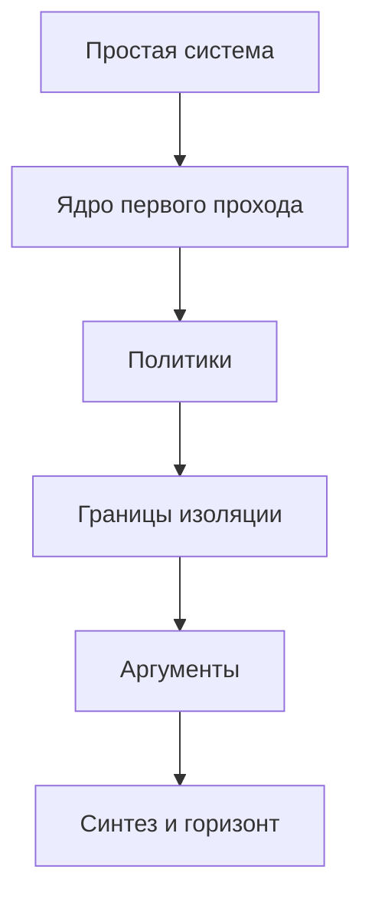

# Операционная система Linux. Полный курс: от системного вызова до исследовательского уровня

Карта самостоятельного изучения. Каждая часть начинается после тех механизмов, на которые она опирается. Определения и разборы живут в указанных книгах, страницах руководства и документации ядра; здесь — порядок, состав и место, где отложенный аргумент закрывается.

Номер части задаёт достаточный порядок: идти по нему можно, не заглядывая вперёд. Где есть более ранний вход, это сказано в строке «Можно параллельно». Полный указатель таких развилок собран в части 52.

Курс идёт по контракту Linux. Норма наблюдаемого — страница руководства, раздел 2, и документация ядра. POSIX есть переносимое обещание, которое Linux выполняет не целиком; расхождение называется там, где оно меняет смысл. Если учебник и эта норма расходятся в том, что делает Linux, верна норма. Раскладка полей конкретной версии есть воплощение. Карта называет обязательство и инвариант, а список полей оставляет дереву.

Маленькая система первого прохода — xv6 на RISC-V и Unix шестой редакции в комментарии Лайонса. Это не Linux. С части 9 норма есть дерево Linux. xv6 остаётся сверкой целой простой системы, как маленький RISC-V в курсе архитектуры.

Чужие системы разбираются рядом с тем механизмом, который на них впервые стал ясен: THE — слои и семафор, Multics — кольца и иерархия имён, Mach — внешний пейджер и микроядро, L4 — цена пересечения границы, seL4 — доказанное малое ядро, экзоядро — отдача ресурса библиотеке, Plan 9 — пространство имён процесса и протокол 9P, Xen и ESX — гость как единица дележа, KeyKOS и Capsicum — возможность в академическом смысле.

Машина берётся из `computer/architecture/contents.md`. Ловушка и точность — часть 11. Привилегированный контракт — часть 17. Перевод адреса — часть 29. Атомарные операции и модели памяти — части 34 и 35. Путь устройства — часть 30. Условие Попека и Голдберга и вторая ступень перевода — часть 44. Здесь они входят как обещание машины. Конвейер, когерентность хартов и доказательство виртуализуемости заново не строятся.

Сеть берётся из `computer/networks/contents.md` в том, что касается закона кадра, потока и затора. Путь хоста, поскольку он меняет контракт TCP, — часть 25 того курса. Здесь сокет есть объект ядра: буфер, сон, срок жизни пакета, мягкое прерывание как одновременность.

Математика берётся из `maths/contents.md`. Доверительный интервал измерения — часть 33. Теория вероятностей части 32 нужна там, где очередь имеет распределение. Теоремы планирования в курсе математики не живут и доказываются здесь.

Защита в этом курсе есть сломанный инвариант и свойство, которое механизм обязан восстановить. Приёмы компрометации в карту не входят.

Синтаксис оболочки, сопровождение дистрибутива и перечень настраиваемых параметров ядра остаются за картой. Программа, которая исполняет обязанности первой программы, встречается как сторона контракта PID 1.

## Уровни

- **0.** Служба, которую видит программа: вызов, процесс, ожидание, память как забор, файл, канал. Ядра Linux ещё нет.
- **I.** Базовый университет: путь вызова, объект процесса, первые числа планировщика, страницы, физическая память, дисциплина ядра, виртуальная файловая система, устройство, терминал, целая загрузка.
- **II.** Продвинутый университет: политики, которые первый проход оставил числом, и границы изоляции. Утверждения этого уровня называют механизм и его обязательство. Доказательство, где оно есть, откладывается до уровня III.
- **III.** Аспирантское ядро: модель памяти, отложенное освобождение, теоремы планирования, модель сбоя, стандарт доказательства. Утверждения этого уровня изучаются с аргументом.
- **IV.** Исследовательский горизонт: точная постановка, место в курсе и минимальный вход. Владение горизонтом есть умение читать работу в этой точке, а не клетка в оглавлении.

## Спираль

Некоторые темы названы дважды. Второй проход закрывает то, что первый оставил числом, блоком или обещанием.

- Память части 5 есть карта с отказом. Обход аппаратуры, область виртуальной памяти и копирование при записи раскрываются в части 12. Кадр, которым карта обеспечена, — часть 13. Изгнание кадра при нехватке — часть 24.
- Сон части 4 есть инвариант потерянного пробуждения. Очередь ожидания ядра — часть 14. Futex, которому ядро нужно только на споре, — часть 15. Период отсрочки, после которого объект можно освободить, — часть 42.
- Файл части 6 обещает, что байты переживут процесс. Словарь устойчивости вызовов — часть 23. Носитель, который переставляет записи и помнит их в собственном энергозависимом кэше, — часть 25. Журнал, мягкие обновления и копирование при записи — часть 26. Модель сбоя, при которой эти приёмы правдивы, — часть 45. Сервер, который молчит, — часть 46.
- Круговой обход части 3 есть справедливость по очереди. Первые числа задержки и веса — часть 11. Лаг, вес, срок и неоднородный доступ — часть 22. Теорема и её гипотезы — часть 44. Контроллер процессора в группе ресурсов — часть 37. Наследование приоритета — часть 50.
- Дерево имён части 6 становится таблицей монтирования части 18, пространством имён части 36 и корнем контейнера части 38.
- Закрытие прерываний в простой системе части 8 становится дисциплиной одновременности части 14, моделью памяти ядра части 41 и отложенным освобождением части 42.
- Канал части 7 есть первый объект ядра, на который ссылается дескриптор. Сокет — часть 27. Передача самого дескриптора — часть 30. Академическая возможность, которой дескриптор ещё не является, — часть 47.
- Изоляция части 5 есть таблица страниц. Избирательные полномочия — часть 34. Обязательный контроль — часть 35. Частное имя — часть 36. Композиция контейнера — часть 38. Гость виртуальной машины — часть 39. Стандарт доказательства изоляции — часть 48. Время как наблюдение, которого изоляция страниц не закрывает, названо в части 47 и поставлено в горизонте.
- Загрузка части 8 собирает учебную систему. Загрузка части 21 собирает Linux. Часть 51 спрашивает, какое состояние каждой из этих сборок вообще можно сохранить.

## Как читать часть

У каждой части четыре строки: уровень, опора, что она открывает, канон. Канон устроен так: первый текст — основной путь, следующие — параллельные. Пункт внутри главы называет определение, механизм, теорему или метод, которые в этом месте изучаются.

Если учебник расходится со страницей руководства Linux или с документацией ядра в том, что делает Linux, верны страница руководства и документация. POSIX остаётся переносимым обещанием и не подменяет эту норму. Список полей структуры и перечень параметров настройки остаются в дереве версии, которой пользуется читатель.

## Зависимости частей

Простая система — части 0–8. Ядро первого прохода — части 9–21. Политики — части 22–34. Границы изоляции — части 35–40. Аргументы — части 41–51. Синтез и горизонт — части 52–53.

После части 21 второй проход планировщика и линия хранения независимы. Они сходятся там, где изгнание грязной страницы требует записи назад, и в контроллере группы части 37. Модель памяти части 41 опирается на дисциплину части 14 и на модель памяти курса архитектуры. Файловые системы ей не нужны. Файл на молчащем узле, часть 46, опирается на сокет части 27, на модель сбоя части 45 и на отказ доставки из курса сетей.

## Содержание

0. [Операционная система как предмет и как контракт](#часть-0-операционная-система-как-предмет-и-как-контракт)
1. [Машина под ядром](#часть-1-машина-под-ядром)
2. [Программа и системный вызов](#часть-2-программа-и-системный-вызов)
3. [Процесс и дележ процессора, первый проход](#часть-3-процесс-и-дележ-процессора-первый-проход)
4. [Ожидание и пробуждение](#часть-4-ожидание-и-пробуждение)
5. [Память процесса, первый проход](#часть-5-память-процесса-первый-проход)
6. [Файл, первый проход](#часть-6-файл-первый-проход)
7. [Канал, дескриптор и оболочка](#часть-7-канал-дескриптор-и-оболочка)
8. [Целая простая система](#часть-8-целая-простая-система)
9. [Путь системного вызова](#часть-9-путь-системного-вызова)
10. [Процесс в ядре и родословие Unix](#часть-10-процесс-в-ядре-и-родословие-unix)
11. [Планировщик, первый количественный проход](#часть-11-планировщик-первый-количественный-проход)
12. [Виртуальная память](#часть-12-виртуальная-память)
13. [Физическая память](#часть-13-физическая-память)
14. [Одновременность ядра, первый проход](#часть-14-одновременность-ядра-первый-проход)
15. [Синхронизация пользователя](#часть-15-синхронизация-пользователя)
16. [Тупик и порядок захвата](#часть-16-тупик-и-порядок-захвата)
17. [Виртуальная файловая система и кэш страниц](#часть-17-виртуальная-файловая-система-и-кэш-страниц)
18. [Имена и монтирование](#часть-18-имена-и-монтирование)
19. [Устройство, драйвер и прерывание завершения](#часть-19-устройство-драйвер-и-прерывание-завершения)
20. [Терминал и сессия](#часть-20-терминал-и-сессия)
21. [Целый Linux: от передачи управления до первой программы](#часть-21-целый-linux-от-передачи-управления-до-первой-программы)
22. [Планировщик, второй проход](#часть-22-планировщик-второй-проход)
23. [Запись назад и словарь устойчивости](#часть-23-запись-назад-и-словарь-устойчивости)
24. [Вытеснение, рабочий набор и чрезмерное обязательство](#часть-24-вытеснение-рабочий-набор-и-чрезмерное-обязательство)
25. [Блочный слой и носитель с собственным переводом](#часть-25-блочный-слой-и-носитель-с-собственным-переводом)
26. [Файловые системы и целостность после сбоя](#часть-26-файловые-системы-и-целостность-после-сбоя)
27. [Сетевой стек ядра](#часть-27-сетевой-стек-ядра)
28. [Мультиплексор событий](#часть-28-мультиплексор-событий)
29. [Сигналы и прерывание вызова](#часть-29-сигналы-и-прерывание-вызова)
30. [Объекты общения и передача ссылки](#часть-30-объекты-общения-и-передача-ссылки)
31. [Образ программы и устойчивый двоичный интерфейс](#часть-31-образ-программы-и-устойчивый-двоичный-интерфейс)
32. [Время](#часть-32-время)
33. [Модель устройств, питание и контракт драйвера](#часть-33-модель-устройств-питание-и-контракт-драйвера)
34. [Полномочия и избирательный доступ](#часть-34-полномочия-и-избирательный-доступ)
35. [Обязательный контроль и поверхность вызовов](#часть-35-обязательный-контроль-и-поверхность-вызовов)
36. [Пространства имён](#часть-36-пространства-имён)
37. [Управление ресурсами](#часть-37-управление-ресурсами)
38. [Контейнер как композиция](#часть-38-контейнер-как-композиция)
39. [Виртуальная машина](#часть-39-виртуальная-машина)
40. [Иные ядра и вынос службы](#часть-40-иные-ядра-и-вынос-службы)
41. [Модель памяти ядра](#часть-41-модель-памяти-ядра)
42. [RCU и отложенное освобождение](#часть-42-rcu-и-отложенное-освобождение)
43. [Масштаб и цена разделяемого](#часть-43-масштаб-и-цена-разделяемого)
44. [Планирование как теорема](#часть-44-планирование-как-теорема)
45. [Верность хранения](#часть-45-верность-хранения)
46. [Файл на молчащем узле](#часть-46-файл-на-молчащем-узле)
47. [Неприкосновенность](#часть-47-неприкосновенность)
48. [Проверяемость](#часть-48-проверяемость)
49. [Наблюдение и загружаемый код](#часть-49-наблюдение-и-загружаемый-код)
50. [Задержка, энергия и полное вытеснение](#часть-50-задержка-энергия-и-полное-вытеснение)
51. [Сохраняемое состояние](#часть-51-сохраняемое-состояние)
52. [Синтез курса](#часть-52-синтез-курса)
53. [Исследовательский горизонт](#часть-53-исследовательский-горизонт)

---

## Часть 0. Операционная система как предмет и как контракт

**Уровень.** 0

**Опирается на.** Умение читать связный текст и отличать правило от примера.

**Открывает.** Часть 1: слои названы, дальше можно говорить о ловушке.

**Канон.** Зальтцер, Каашок, «Principles of Computer System Design», главы о контракте системы — основной путь. Параллельно: Ричи, Томпсон, «The UNIX Time-Sharing System»; Дейкстра, «The Structure of the "THE"-Multiprogramming System».

### Глава 1. Три слоя

1.1. Служба — то, что программа вправе отличить: какие вызовы завершились, с каким результатом, какие объекты ей видны, какой отказ обязан быть сообщён.
1.2. Механизм — устройство ядра, которым обещание выполняется: очереди, таблицы, порядок захвата. Пока программа этого не наблюдает, механизм остаётся за контрактом.
1.3. Воплощение — конкретное дерево исходного текста, архитектура машины и конфигурация сборки. Смена воплощения законна, пока служба сохраняет обещанный смысл.
1.4. Одна служба допускает много механизмов. Один механизм допускает много воплощений. Обещание процесса, файла и вызова пережило смену машины, потому что не называло раскладку внутренней структуры.
1.5. Вопрос принадлежит слою, в котором лежит ответ. Длина очереди планировщика не становится пунктом контракта чтения оттого, что её легко измерить.

### Глава 2. Три нормы

2.1. POSIX описывает переносимую службу. Программа, которая держится этого текста, рассчитывает на одинаковый смысл вызова на разных системах, где текст принят.
2.2. Контракт Linux есть то, что делает Linux. Страница руководства раздела 2 и документация ядра ближе к этой норме, чем пересказ в учебнике.
2.3. Дерево конкретной версии есть воплощение. Поле структуры может переехать. Обязанность, которую поле исполняло, принадлежит контракту и не исчезает от смены имени поля.
2.4. Где Linux расходится с POSIX, расхождение называется в той части, где оно меняет наблюдаемый смысл. Отождествление двух норм делает неверным и переносимый текст, и текст Linux.
2.5. Внутренний стык частей ядра Linux не обещает устойчивости от версии к версии. Пользовательский двоичный интерфейс обещает устойчивость. Разделение этих двух обещаний открывается в части 31. Здесь достаточно, что они различны.

### Глава 3. Наблюдаемое состояние

3.1. Наблюдаемое состояние программы — то, что она читает законными средствами службы: память своего адресного пространства, результат вызова и то содержимое файла, которое контракт обязал сделать видимым.
3.2. Скрытое состояние ядра может менять время и при этом отсутствовать в результате вызова.
3.3. Как только скрытое состояние одного процесса меняет результат другого, граница контракта подлежит пересмотру. Для памяти этот пересмотр начинает часть 5, для файла — часть 6.
3.4. Две реализации согласованы, если на каждой допустимой истории совпадает наблюдаемое состояние там, где контракт требует определённости. Совпадение числа тактов не требуется.
3.5. Неопределённость бывает трёх видов, и их нельзя смешивать: исход определён; исход выбран из названного множества, и реализация обязана выбрать допустимо; операция запрещена и обязана быть видна как отказ.

### Глава 4. Устройство этого курса

4.1. Курс есть достаточный порядок чтения от вызова до горизонта.
4.2. Уровни 0, I, II, III и IV задают тип обязательства. На IV обязательство состоит в постановке, входе и статусе.
4.3. Где курс оставляет механизм блоком или числом, спираль в начале файла называет часть, которая его открывает.
4.4. Основной текст части и параллельные тексты. Страница руководства ближе к норме Linux, чем пересказ.
4.5. Ранние входы, которые не ломают зависимость, собраны в части 52. До той части ими можно пользоваться там, где строка «Можно параллельно» уже стоит в самой части.
4.6. Статья Ричи и Томпсона здесь образец того, как выглядит контракт системы: мало объектов, и каждый объект назван через то, что программа наблюдает. Механизм этих объектов начинается с части 3.

**Переход.** Слои разделены. Первый предмет системы — просьба программы, которую сама машина по своему контракту не исполняет.

---

## Часть 1. Машина под ядром

**Уровень.** 0

**Опирается на.** Часть 0. Ловушка, режим, перевод адреса и путь устройства в полном виде — части 11, 17, 29 и 30 курса архитектуры. Здесь они берутся в объёме, которого довольно, чтобы поставить ядро.

**Открывает.** Системный вызов как передачу управления в другой режим.

**Канон.** Кокс, Каашок, Моррис, книга xv6, глава о ловушке — основной путь, если курс архитектуры ещё не пройден. Параллельно: части 11 и 17 курса архитектуры; Лайонс, комментарий к Unix шестой редакции, вход по ловушке.

### Глава 1. Режим

1.1. Машина различает по меньшей мере два режима. В нижнем режиме программе запрещены команды, которые меняют перевод адреса, маску прерываний и регистры устройств.
1.2. Нарушение запрета есть ловушка, а не тихий успех. Точность ловушки берётся из части 11 курса архитектуры: есть граница команды, на которой причина признана.
1.3. Ядро исполняется в верхнем режиме. Оно видит физическую память и управляющие регистры. Программа нижнего режима их по контракту машины не видит.
1.4. Смена режима есть часть контракта машины. Программа не назначает себе верхний режим записью в обычную ячейку своей памяти.
1.5. Кольца Multics и позднейшие уровни привилегии суть разные воплощения одного различия. Для первого прохода довольно двух режимов. Промежуточное кольцо не есть полномочие Linux: полномочие Linux есть свойство задачи, и его место — часть 34.

### Глава 2. Ловушка и вектор

2.1. Ловушка сохраняет адрес возврата и причину и передаёт управление на адрес, который назначило ядро.
2.2. Причина бывает виной команды и внешним событием. Вина команды — вызов среды, незаконная команда, а позже отказ страницы. Внешнее событие — таймер или устройство.
2.3. Вектор есть таблица входов. Причина выбирает в ней обработчик. Расположение таблицы назначает ядро, пока машина даёт ему это право.
2.4. Вход в обработчик переключает стек на стек ядра. Стек пользователя для этого не годится: его содержимое выбирает та же программа, от которой ядро обязано остаться целым.
2.5. Возврат из ловушки восстанавливает маску, указатель стека и счётчик команд. Ошибка восстановления видна программе как порча её собственных регистров и потому есть ошибка ядра, а не свойство службы.

### Глава 3. Память и устройство как блоки

3.1. На этом проходе физическая память есть массив ячеек с физическим адресом. Перевод виртуального адреса обещан машиной. Как карта процесса он откроется в части 5, как механизм Linux — в части 12.
3.2. Устройство имеет регистры, которые ядро читает и пишет, и может писать в память само. Прямой доступ и очередь устройства остаются частью 30 курса архитектуры. Здесь достаточно следствия: завершение работы устройства умеет поднять прерывание.
3.3. Таймер есть устройство, которое поднимает прерывание по истечении срока, назначенного ядром. Без таймера ядро не отнимает процессор у программы, которая сама не делает вызов.
3.4. Прерывание принимается на границе команды. Обработчик сохраняет регистры, которые занимает, и возвращает их до возврата в прерванный поток.
3.5. Пока обработчик не защищён от второго прерывания, вложенный вход может испортить те же сохранённые регистры. Простая дисциплина первого прохода закрывает приём прерываний на коротком участке. Цена этой дисциплины и дисциплина, которая её сменяет, — часть 14.

### Глава 4. Что ядро вправе предполагать

4.1. Ядро вправе предполагать точность ловушки в мере части 11 курса архитектуры: команды старше границы завершились, команды младше границы архитектурный результат не записали.
4.2. Ядро вправе предполагать, что нижний режим не пишет в память ядра. Если воплощение машины этого не держит, изоляция программ на этой машине не начинается.
4.3. Ядро не вправе предполагать, что указатель, пришедший из нижнего режима, указывает на память этого процесса и имеет нужную длину. Проверка такого указателя есть обязанность границы вызова. Её место — часть 2.
4.4. Ядро не вправе предполагать общий темп с устройством. Устройство отвечает позже и может ответить ошибкой. Вызов, который ждёт устройство, обязан иметь видимый отказ, а не вечное молчание без имени.
4.5. Конец части: машина обещает режим, ловушку, таймер и массив памяти. Процесса в этом обещании нет. Процесс есть объект системы.

**Переход.** Машина умеет передать управление в верхний режим и вернуть его назад. Дальше эта передача получает имя со стороны программы.

---

## Часть 2. Программа и системный вызов

**Уровень.** 0

**Опирается на.** Части 0 и 1.

**Открывает.** Процесс как программу, которая уже умеет просить и завершаться.

**Канон.** Керриск, «The Linux Programming Interface», главы о системных вызовах и об ошибках — основной путь для контракта. Параллельно: книга xv6, глава о вызове; страница руководства `syscall` и `errno`.

### Глава 1. Образ одной программы

1.1. Образ программы на этом проходе есть память, в которой лежат команды и данные, и набор регистров, среди которых есть счётчик команд и указатель стека.
1.2. Смысл байтов в памяти назначает контракт исполнения, а не метка ячейки. Та же оговорка, что у слова в части 1 курса архитектуры, здесь повторяется для целого образа.
1.3. Программа в нижнем режиме исполняет обычные команды сама. Просьба, которой в нижнем режиме нет, выражается командой ловушки.
1.4. Номер просьбы и её аргументы передаются в регистрах по соглашению машины. Соглашение есть часть двоичного интерфейса. Библиотечная обёртка прячет соглашение и не заменяет его.
1.5. Память образа пока считается принадлежащей этой одной программе. Забор между двумя программами — часть 5. До неё достаточно одной программы и ядра.

### Глава 2. Вызов и возврат

2.1. Системный вызов есть просьба службы, исполняемая ядром в верхнем режиме, с возвратом в ту же программу.
2.2. Результат вызова есть значение, которое программа читает после возврата, и то изменение наблюдаемого состояния, которое контракт этого вызова назвал.
2.3. Отказ есть результат, а не отсутствие возврата. Он обязан быть отличим от успеха. В контракте Linux отказ обычно несёт номер ошибки; соглашение о том, как номер кладётся в регистры, принадлежит двоичному интерфейсу.
2.4. Библиотека языка может перевести номер ошибки в своё представление. Перевод, который теряет различие двух отказов, портит контракт вызова для вызывающего.
2.5. Вызов, который не возвращается, потому что программа завершилась, есть отдельный исход. Он не кодируется номером ошибки. Его наблюдатель — та программа, которая запустила завершившуюся, и она появится в части 3.

### Глава 3. Что ядро проверяет на границе

3.1. Номер вызова обязан лежать в множестве, которое ядро признаёт. Номер вне множества есть отказ, а не переход по случайному адресу.
3.2. Указатель аргумента проверяется до того, как ядро читает или пишет по нему: адрес принадлежит образу этой программы, длина покрывает обещанный буфер, обращение не берёт память ядра.
3.3. Проверка есть часть службы. Пропуск проверки делает память ядра наблюдаемой программе и тем ломает режим части 1.
3.4. Время проверки входит во время вызова. Контракт результата проверку не заменяет контрактом скорости. Скорость границы станет вопросом части 31, когда появится страница, исполняемая без входа в ядро.
3.5. Аргумент, который проверен в один момент и использован в другой, обязан оставаться тем же объектом. Условие, при котором программа меняет буфер во время вызова, называется вместе с вызовом, а не оставляется удаче.

### Глава 4. Первые просьбы

4.1. Завершение программы есть вызов, после которого её образ больше не исполняется. Успех этого вызова наблюдает не она сама.
4.2. Запись байтов в заранее открытый вывод есть наименьшая просьба, которая производит наблюдаемый след вне регистров. Куда ведёт вывод, на этом проходе можно считать назначенным при старте.
4.3. Чтение в буфер программы есть парная просьба. Короткий результат законен: прочитано меньше, чем просили, и это не отказ. Условие короткого результата называется в контракте чтения и не выводится из длины буфера.
4.4. Имя файла, каталог и курсор положения в этот проход не входят. Они становятся службой в части 6. Здесь байтовый поток уже нужен, чтобы программа могла показать, что вызов случился.
4.5. Конец части: одна программа умеет просить, получать отказ и оставлять след. Несколько таких программ на одном процессоре требуют нового объекта.

**Переход.** Просьба уже отделена от обычной команды. Дальше одна машина исполняет больше одной такой программы.

---

## Часть 3. Процесс и дележ процессора, первый проход

**Уровень.** 0

**Опирается на.** Части 1 и 2. Таймер части 1 даёт право отнять процессор.

**Открывает.** Ожидание, память процесса и целую простую систему.

**Канон.** Арпачи-Дюссо и Арпачи-Дюссо, «Operating Systems: Three Easy Pieces», раздел о виртуализации процессора — основной путь. Параллельно: Бах, «The Design of the UNIX Operating System», главы о процессе; страница руководства `fork`, `execve`, `wait`.

### Глава 1. Процесс

1.1. Процесс есть экземпляр исполнения программы: свой счётчик команд, свои регистры, свой образ памяти и запись о том, чего он ждёт.
1.2. Идентификатор процесса есть имя этой записи внутри одной системы. На первом проходе имя живёт, пока живёт запись. Дыра, при которой то же имя позже достаётся другой записи, названа в части 10 и закрывается ссылкой в части 30.
1.3. Два процесса наблюдают разные результаты своих вызовов, если контракт не обещал им общий объект. Общего объекта на этом проходе ещё нет. Канал появится в части 7.
1.4. Создание процесса есть вызов, который оставляет два продолжения одного текущего образа. Их различает результат вызова. Это контракт `fork` в Unix и в Linux.
1.5. Замена образа есть отдельный вызов. Новый образ получает те же открытые ссылки, которые контракт велел сохранить, и новые регистры входа. Создание и замена разделены сознательно: между ними программа ещё исполняет старый образ.

### Глава 2. Состояния и переключение

2.1. Готовый процесс может исполняться, когда ему дадут процессор. Исполняющийся процесс держит процессор. Ожидающий процесс не может исполняться, пока не наступит названное условие. Завершившийся процесс ещё имеет запись, пока её не забрали ожиданием.
2.2. Переключение сохраняет регистры снимаемого процесса и восстанавливает регистры назначаемого. После переключения процессор исполняет другой счётчик команд.
2.3. Сохранённые регистры принадлежат записи процесса, а не стеку той программы, которая случайно оказалась текущей. Порча этого сохранения есть порча службы, потому что процесс наблюдает свои регистры.
2.4. Переключение само есть код ядра. Оно исполняется в верхнем режиме и не является командой пользователя, хотя вызвано таймером или вызовом.
2.5. На одном процессоре в каждый момент исполняется не больше одного процесса. Несколько процессоров откладываются: первый проход строит дележ одного.

### Глава 3. Круговой обход

3.1. Круговой обход назначает процессор каждому готовому процессу по очереди, на отрезок времени, который отмеряет таймер.
3.2. Отрезок конечен. Программа, которая не делает вызовов, всё равно теряет процессор на прерывании таймера. Это и есть причина, по которой таймер части 1 стоит раньше процесса.
3.3. Справедливость этого правила есть справедливость очереди: готовый процесс, который не завершился, дождётся своего отрезка, если множество готовых конечно и никто не выходит из очереди навсегда.
3.4. Вес, задержка и срок в это правило не входят. Они станут числами части 11 и теоремой части 44. Здесь очередь уже достаточна, чтобы несколько программ продвигались.
3.5. Смена отрезка имеет цену: сохранение регистров и сброс того состояния машины, которое не входит в контракт процесса, но влияет на время. Цена называется, чтобы короткий отрезок не считали бесплатным. Количественный язык этой цены — часть 11.

### Глава 4. Создание и ожидание завершения

4.1. После `fork` оба продолжения исполняют один и тот же текст, пока одно из них не заменит образ. Различие, которое контракт обязан дать сразу, есть результат самого `fork`.
4.2. `exec` сохраняет идентификатор процесса и заменяет образ. Несохранённая память старого образа после успешной замены не наблюдается.
4.3. Ожидание завершения забирает запись завершившегося потомка и возвращает предку статус. Потомок, которого никто не ждёт, занимает запись. Кто обязан её забрать, если предок сам завершился, — вопрос родословия части 10.
4.4. Статус завершения есть наблюдаемый результат, а не скрытое поле. Контракт называет, какие различия статуса родитель видит.
4.5. Конец части: несколько программ делят один процессор, и у каждой есть имя. Память между ними всё ещё не разгорожена как служба. Ожидание без занятия процессора тоже ещё не построено.

**Переход.** Процессор уже отнимается по таймеру. Процесс, которому нечего делать до события, не должен сжигать очередь только ради проверки этого события.

---

## Часть 4. Ожидание и пробуждение

**Уровень.** 0

**Опирается на.** Части 1 и 3. Прерывание устройства и таймер уже умеют войти в ядро.

**Открывает.** Блокирующий вызов, канал и всякое позднее «уснуть, пока не случится».

**Канон.** Арпачи-Дюссо и Арпачи-Дюссо, «Operating Systems: Three Easy Pieces», глава о сне и пробуждении — основной путь. Параллельно: Лайонс, комментарий к Unix шестой редакции, сон и пробуждение; Дейкстра, «Cooperating Sequential Processes», в объёме семафора как более позднего имени того же ожидания.

### Глава 1. Занятое ожидание

1.1. Занятое ожидание есть цикл в готовом процессе, который снова и снова читает условие. Процессор занят, хотя полезная работа процесса не идёт.
1.2. На одном процессоре занятое ожидание события, которое может произвести только другой процесс, не продвигается, если ждущий не отдаёт процессор. Круговой обход части 3 его спасает ценой пустых отрезков.
1.3. Занятое ожидание устройства держит процессор, пока устройство не поднимет наблюдаемый бит. Прерывание части 1 делает этот цикл ненужным, если ядро умеет снять процесс с процессора до события.
1.4. Короткое занятое ожидание внутри ядра бывает сознательной ценой, когда сон дороже оставшегося срока. Право на такой цикл появляется вместе с количественным языком части 11. На первом проходе сон предпочтителен, как только ожидание может быть долгим.
1.5. Наблюдаемый смысл ожидания один: процесс не производит результата, пока условие ложно. Занят ли при этом процессор, контракт результата обычно не называет. Это скрытое состояние, и оно становится видимым через время.

### Глава 2. Сон

2.1. Сон переводит процесс в ожидающие и отдаёт процессор готовому. Условие, которого ждут, записано в аргументе сна.
2.2. Пробуждение переводит процесс в готовые, когда код, обнаруживший условие, назвал тот же аргумент. Пробуждение не обещает, что процесс немедленно получит процессор. Оно обещает, что процесс снова имеет право исполняться.
2.3. Сон в нижнем режиме сам по себе не есть служба. Служба есть блокирующий вызов: ядро проверяет условие и укладывает процесс, не возвращаясь в нижний режим, пока условие не станет истинным или пока вызов не обязан вернуться отказом.
2.4. Таймер может быть причиной пробуждения. Тогда вызов имеет срок. Контракт обязан сказать, чем отличается возврат по сроку от возврата по условию.
2.5. Прерывание, которое будит, исполняется в контексте, где спать нельзя. Оно только помечает условие и пробуждает. Разбор этой границы — часть 14. Здесь достаточно, что пометить и продолжить долгую работу — разные действия.

### Глава 3. Потерянное пробуждение

3.1. Потерянное пробуждение есть история, в которой условие стало истинным и пробуждение уже прошло, а процесс ещё не уснул и укладывается спать после этого. Он может спать при истинном условии.
3.2. Инвариант, который это запрещает: проверка условия и решение уснуть происходят в одном критическом участке с тем кодом, который условие объявляет. Участок не даёт пробуждению вклиниться между проверкой и сном.
3.3. В простой системе участок держат закрытием прерываний, если и проверка, и пробуждение исполняются на том же процессоре в ядре. Это та дисциплина, которую часть 1 отложила.
3.4. Закрытие прерываний на время сна было бы ошибкой другого рода: устройство не сможет пробудить спящего. Поэтому сон обязан открыть приём прерываний атомарно с переходом в ожидающие. «Атомарно» здесь значит: нет наблюдаемого промежутка, где процесс уже спит, а прерывание ещё закрыто, и нет промежутка, где прерывание уже открыто, а процесс ещё считается готовым и уже пропустил событие.
3.5. Семафор Дейкстры есть более поздний объект, в котором счётчик и ожидание спрятаны в операции. Он не отменяет инвариант. Он даёт ему имя. Инвариант остаётся обязательным и в семафоре, и в очереди ожидания Linux, которая появится в части 14.

### Глава 4. Что видит вызывающий

4.1. Блокирующий вызов возвращается, когда названное условие выполнено или когда контракт разрешил возврат без него. Третьего наблюдаемого исхода нет.
4.2. Вызов, который может вернуться, сделав только часть работы, обязан назвать короткий результат. Короткое чтение части 2 есть такой случай. Оно не является потерей пробуждения.
4.3. Вызов, который вернулся по сроку, оставляет условие, возможно, ложным. Повтор вызова есть решение программы. Ядро не подставляет повтор само, пока отдельный контракт этого не скажет. Такой контракт появится у сигнала в части 29.
4.4. Два процесса, которые ждут одного условия, требуют правила: будят одного или всех. Правило входит в контракт объекта ожидания. Без правила пробуждение недетерминировано сверх названного множества.
4.5. Конец части: ожидание больше не сжигает отрезок. Цена — обязанность не потерять пробуждение. Всякий поздний блокирующий вызов наследует эту обязанность.

**Переход.** Процесс умеет отдать процессор до события. Пока у двух процессов одна и та же память без правил, событие можно испортить простой записью.

---

## Часть 5. Память процесса, первый проход

**Уровень.** 0

**Опирается на.** Части 1 и 3. Перевод адреса как обещание машины — часть 29 курса архитектуры, в объёме «виртуальный адрес становится физическим либо отказ».

**Открывает.** Изоляцию образов, позднее копирование при записи и подкачку как политику кадров.

**Канон.** Арпачи-Дюссо и Арпачи-Дюссо, «Operating Systems: Three Easy Pieces», первые главы о виртуализации памяти — основной путь. Параллельно: часть 29 курса архитектуры в объёме одной таблицы страниц; Бах, главы об адресном пространстве.

### Глава 1. Забор

1.1. Изоляция памяти означает: процесс не читает и не пишет память другого процесса и память ядра иначе, чем через вызов, который контракт разрешил.
1.2. База и предел есть первый механизм забора. Виртуальный адрес прибавляется к базе, и результат обязан попасть в предел. Иначе — отказ.
1.3. База и предел дают каждому процессу непрерывный физический кусок. Дыры внутри куска и разделение одного куска между двумя процессами этот механизм не выражает.
1.4. Отказ есть ловушка, точная относительно команды, которая обратилась вне забора. Точность берётся из машины. Ядро на этом проходе может завершить процесс. Более богатый исход отказа — часть 12.
1.5. Регистры базы и предела сами живут в управляющем состоянии. Их пишет ядро при переключении процесса. Программа нижнего режима их не пишет.

### Глава 2. Карта страниц

2.1. Страница есть кусок виртуального адреса фиксированной длины. Кадр есть кусок физической памяти той же длины. Карта переводит номер виртуальной страницы в номер кадра либо отмечает, что перевода нет.
2.2. Карта позволяет физическим кадрам процесса лежать не подряд. Наблюдаемая непрерывность виртуального адреса не обязана быть непрерывностью физики.
2.3. Бит права в строке карты различает чтение, запись и исполнение, если машина это обещает. Попытка записи в страницу без права записи есть отказ, даже если перевод существует.
2.4. Карта одного процесса не содержит кадров другого и не содержит памяти ядра, кроме тех страниц, которые контракт явно отобразил. На первом проходе таких отображений нет.
2.5. Смена карты при переключении процесса есть часть переключения. Исполнение процесса с чужой картой есть разрыв изоляции, а не частный случай кругового обхода.

### Глава 3. Отказ как наблюдаемый исход

3.1. Отказ страницы наблюдаем процессом, если ядро не устранило причину и не повторило команду. На первом проходе ядро не устраняет причину: отказавший процесс завершается.
3.2. Завершение по отказу есть отказ службы изоляции в узком смысле: процесс нарушил свой забор. Это не отказ ядра. Отказ ядра был бы, если бы забор не поймал чужое обращение.
3.3. Команда, вызвавшая отказ, не обязана быть завершена. Точность значит, что её запись не произошла. Повторить команду можно, когда карта станет законной. Это обещание машины, которым часть 12 воспользуется для подгрузки.
3.4. Ядро пользуется той же машиной перевода для своей памяти либо особым режимом, в котором перевод выключен. Смешение двух режимов без правила оставляет окно, в котором пользовательский адрес читается как адрес ядра. Правило проверки указателя части 2 стоит на этом различии.
3.5. Размер страницы есть параметр машины. Он влияет на длину карты и на внутреннюю дыру в последней странице объекта. Выбор размера как политика — часть 12.

### Глава 4. fork и общая карта

4.1. Создание процесса копирует образ, если контракт обещает, что после `fork` записи одного продолжения не видны другому. На первом проходе копирование можно считать полным и немедленным.
4.2. Полное копирование верно и дорого. Механизм, который откладывает копию до первой записи, сохраняет тот же наблюдаемый смысл и будет назван в части 12. Здесь смысл уже фиксирован: общая запись без явного контракта разделения не предполагается.
4.3. Разделение страницы только для чтения наблюдаемо как общая константа. Оно законно, пока ни одна сторона не пишет. Попытка записи обязана либо получить свою копию, либо быть отказом. Какой из двух исходов выбран, обязано быть сказано.
4.4. Замена образа при `exec` строит новую карту и отпускает старую, если на неё не осталось ссылок. Освобождение кадра, на который ссылка ещё есть, есть разрыв изоляции.
4.5. Конец части: у каждого процесса своя карта. Чем карта обеспечена при нехватке кадров и что происходит при записи в общую страницу, первый проход сознательно не решает.

**Переход.** Образы разгорожены. Байты, которые должны пережить завершение процесса, в карту процесса не кладут: она умирает вместе с ним.

---

## Часть 6. Файл, первый проход

**Уровень.** 0

**Опирается на.** Части 2 и 5. Устойчивость к потере питания не требуется.

**Открывает.** Имена, кэш страниц, файловые системы и всякое позднее «байты переживают процесс».

**Канон.** Арпачи-Дюссо и Арпачи-Дюссо, «Operating Systems: Three Easy Pieces», первые главы о хранении — основной путь. Параллельно: Ричи, Томпсон, «The UNIX Time-Sharing System», разделы о файле; страница руководства `open`, `read`, `write`, `close`, `lseek`.

### Глава 1. Байтовая последовательность

1.1. Файл на этом проходе есть именованная последовательность байтов, которая не является памятью одного процесса. Её читают и пишут вызовами.
1.2. Длина файла есть число байтов последовательности. Чтение за концом даёт короткий результат или конец, как сказано в контракте чтения, и не дописывает файл нулями само по себе.
1.3. Курсор есть положение следующего чтения или записи у одной открытой ссылки. Сдвиг курсора есть операция над ссылкой, а не над последовательностью. Две ссылки на один файл могут стоять в разных местах.
1.4. Запись в середину заменяет байты. Запись в конец удлиняет. Контракт обязан сказать, что видит одновременный читатель. На первом проходе достаточно грубого правила: байт, который запись уже вернула как записанный в память ядра, последующее чтение на той же системе вправе увидеть. Устойчивости к снятию питания в этом правиле нет.
1.5. Короткий ввод и короткий вывод законны. Цикл «пока не перенесено всё» есть программа поверх контракта, а не скрытое обещание одного вызова.

### Глава 2. Имя и объект

2.1. Имя есть строка, по которой вызов открытия находит файл. Объект файла есть сама последовательность и её служебные сведения. Несколько имён могут вести к одному объекту, если контракт имён это разрешает. Жёсткая ссылка откроется в части 18.
2.2. На первом проходе дерево имён есть один каталог за другим, от корня, без монтирования. Монтирование — часть 18.
2.3. Каталог есть объект, который переводит компонент имени в ссылку на объект. Программа читает каталог отдельным контрактом, а не как произвольную запись байтов, если система хочет сохранить инвариант перевода.
2.4. Удаление имени не обязано уничтожить объект, пока на объект есть открытая ссылка или другое имя. Контракт Linux и Unix сохраняет объект до последней ссылки. Программа, которая держит дескриптор, продолжает читать после удаления имени.
2.5. Индекс здесь есть слово для служебной записи объекта: длина, расположение байтов, счётчик ссылок. Раскладка индекса на диске — часть 26. Сейчас индекс есть блок, без которого имя не к чему прикрепить.

### Глава 3. Открытая ссылка

3.1. Открытие переводит имя в ссылку процесса и возвращает дескриптор — маленькое целое в таблице этого процесса.
3.2. Дескриптор не есть имя. Имя можно удалить, дескриптор остаётся. Дескриптор можно передать по правилу наследования при создании процесса, и это не есть повторный поиск имени.
3.3. Закрытие отпускает ссылку в этом процессе. Последняя ссылка отпускает объект, если имён тоже не осталось.
3.4. Права открытия — чтение, запись или оба — проверяются при открытии и запоминаются в ссылке. Позднейшая смена прав каталога не отменяет уже открытую ссылку. Это сознательное правило контракта, а не дыра проверки: проверка привязана к моменту открытия.
3.5. Флаг, который закрывает дескриптор при замене образа, есть часть контракта ссылки. Зачем он нужен изоляции, станет видно в части 7, когда дескриптор начнёт нести доступ к чужому объекту.

### Глава 4. Что «пережить процесс» ещё не значит

4.1. Байты файла остаются доступны другому процессу после завершения писавшего. В этом и состоит обещание первого прохода.
4.2. Обещание не говорит, что байты переживут потерю питания, сбой машины или перестановку записей устройством. Эти слова принадлежат частям 23, 25 и 26.
4.3. Обещание не говорит, что запись уже покинула оперативную память. Кэш, который обслуживает чтение из памяти ядра, законен на этом проходе, пока наблюдаемый смысл части 1.4 сохранён. Политика грязных страниц — часть 23.
4.4. Метаданные — длина, расположение, сам каталог — суть такие же байты службы, только их читает поиск имени, а не `read` программы. Их целость при обрыве питания тоже отложена.
4.5. Конец части: файл есть объект вне карты процесса. Как несколько программ составляются через такие объекты, ещё не сказано.

**Переход.** Последовательность байтов уже переживает процесс. Не хватает способа соединить вывод одной программы со входом другой, не договариваясь об имени заранее.

---

## Часть 7. Канал, дескриптор и оболочка

**Уровень.** 0

**Опирается на.** Части 3, 4 и 6.

**Открывает.** Композицию программ, таблицу дескрипторов как ссылки и целую простую систему.

**Канон.** Керриск, «The Linux Programming Interface», главы о каналах, о дублировании дескрипторов и о запуске программ — основной путь. Параллельно: книга xv6, глава о канале; Ричи, Томпсон, «The UNIX Time-Sharing System», разделы о канале и оболочке.

### Глава 1. Канал

1.1. Канал есть объект ядра с двумя концами. Запись в один конец становится доступной чтению из другого. Имени в дереве файлов у такого объекта может не быть.
1.2. Создание канала возвращает два дескриптора в таблицу создателя. Дальнейшая судьба концов определяется тем, какие дескрипторы оставлены у каких процессов.
1.3. Буфер канала конечен. Запись в полный канал спит, пока чтение не освободит место. Чтение из пустого канала спит, пока запись не положит байты или пока пишущих концов не останется. Это сон части 4 на условии «есть байт» или «есть место».
1.4. Закрытие последнего пишущего конца делает чтение конечным: читатель получает короткий результат и конец, а не вечный сон. Закрытие последнего читающего конца делает запись отказом. Оба правила обязательны, иначе ожидание не завершается.
1.5. Порядок байтов в канале есть порядок записей, который ядро установило. Одновременные записи коротких кусков, не длиннее обещанного атомарного размера, не перемешиваются. Длинная запись такого обещания не получает, пока контракт его явно не дал.

### Глава 2. Таблица дескрипторов

2.1. У каждого процесса своя таблица. Дескриптор есть индекс в этой таблице. Одна и та же ячейка у двух процессов может ссылаться на разные объекты.
2.2. Дублирование дескриптора создаёт вторую ячейку той же таблицы, указывающую на ту же открытую ссылку. Курсор у этой ссылки общий. Это другой контракт, чем второе открытие того же имени: второе открытие дало бы второй курсор.
2.3. Наследование при `fork` копирует таблицу: потомок имеет дескрипторы на те же открытые ссылки. Замена образа по умолчанию эту таблицу сохраняет. Так вывод родителя становится выводом новой программы.
2.4. Флаг закрытия при замене образа режет наследование в точке `exec`. Он нужен, когда дескриптор несёт право, которое новая программа получить не должна. Право здесь пока понимается как «возможность делать вызовы над этим объектом». Академическая возможность, у которой другие законы, — часть 47.
2.5. Закрытие есть отказ от ячейки. Контракт Linux отличает закрытие от отказа, который можно повторить: успешный путь отпускает ячейку. Расхождение с текстом POSIX, где повтор после прерывания описан иначе, фиксируется здесь как расхождение норм. Программа, которая повторяет закрытие того же номера, рискует закрыть уже другой объект, если номер успели занять.

### Глава 3. Перенаправление

3.1. Перенаправление есть расстановка дескрипторов перед заменой образа. Оболочка открывает файл или канал, дублирует дескриптор на номер, который новая программа считает своим входом или выводом, и закрывает лишнее.
3.2. Номера входа, вывода и диагностического вывода суть соглашение программ, а не закон ядра. Ядро обязано лишь сохранить таблицу. Смысл номеров держится тем, что программы его разделяют.
3.3. Канал между двумя программами строится так: создаётся канал, создаются два процесса, у одного остаётся читающий конец на номере входа, у другого — пишущий конец на номере вывода, лишние концы закрыты. Если лишний пишущий конец не закрыт, читатель не увидит конец файла.
3.4. Ошибка расстановки есть ошибка композиции, и она обязана быть видна создателю как отказ вызова, а не как тихий пустой канал.
3.5. Имя временного файла может имитировать канал, но даёт другой контракт: байты видны в дереве имён и переживают оба процесса иначе, чем буфер канала. Подмена одного другим меняет наблюдаемое.

### Глава 4. Оболочка как клиент контракта

4.1. Оболочка есть программа, которая читает строки и превращает их в `fork`, расстановку дескрипторов, `exec` и ожидание. Синтаксис строк в этот курс не входит.
4.2. Ожидание завершает контракт запуска: родитель получает статус. Оболочка, которая не ждёт, оставляет запись завершившегося процесса. Родословие части 10 скажет, кто обязан ждать, если оболочка сама ушла.
4.3. Последовательное исполнение двух программ есть ожидание первой до запуска второй. Параллельное исполнение с каналом есть отсутствие этого ожидания до того, как обе запущены. Различие принадлежит клиенту, а не ядру.
4.4. Управление заданиями — остановка группы с терминала — требует сигнала и сессии. Оба ещё блоки. Их место — части 20 и 29. Оболочка первого прохода умеет запустить и дождаться, и этого довольно для целой простой системы.
4.5. Конец части: программы составляются, не зная друг друга, через дескрипторы и байты. Система, в которой так устроен запуск от включения машины, ещё не собрана.

**Переход.** Контракт процесса, ожидания, памяти, файла и канала уже достаточен. Дальше из него собирается одна машина, которая доходит до оболочки.

---

## Часть 8. Целая простая система

**Уровень.** 0

**Опирается на.** Части 1–7.

**Открывает.** Сравнение с Linux: какие блоки простой системы дерево обязано раскрыть, не меняя службы.

**Канон.** Кокс, Каашок, Моррис, книга xv6 — основной путь целой простой системы. Параллельно: Лайонс, комментарий к Unix шестой редакции.

### Глава 1. От включения до первого процесса

1.1. Прошивка машины передаёт управление начальному коду. Как устроена прошивка, простой системе безразлично, пока передача происходит на известном адресе и в известном режиме.
1.2. Начальный код ставит вектор ловушек, включает перевод адреса ядра и запускает первый процесс в нижнем режиме. До этого момента процесса части 3 ещё нет: есть только машина и код ядра.
1.3. Первый процесс имеет таблицу дескрипторов и карту памяти, уже соединённые с устройством вывода и с диском, на котором лежит файловая система. Соединение есть воплощение простого ядра, а не отдельная служба.
1.4. Дальше первый процесс запускает оболочку через контракт части 7. Всё, что пользователь видит после этого, есть программы в нижнем режиме.
1.5. Учебная система xv6 исполняет этот путь на RISC-V. Unix шестой редакции исполнял его на другой машине. Служба процесса и файла у них узнаваема. Это не дерево Linux.

### Глава 2. Что ядро простой системы держит в памяти

2.1. Запись процесса: состояние, сохранённые регистры, карта, таблица дескрипторов, то, чего процесс ждёт.
2.2. Таблица файловых объектов и индексов, достаточная для частей 6 и 7. Буфер байтов файла может быть прямым чтением с диска на каждый вызов. Кэш как политика появится позже и не обязан менять смысл короткого чтения.
2.3. Очередь готовых для кругового обхода. Ожидающие в этой очереди не стоят.
2.4. Критические участки сна закрыты запретом прерываний, как требует инвариант части 4. На одном процессоре этого хватает.
2.5. Драйвер устройства на этом проходе есть код, который ставит запрос и на прерывании будит спящего. Контракт драйвера Linux — часть 19 и часть 33. Здесь драйвер ещё блок с одним свойством: прерывание завершает ожидание, а не исполняет службу само.

### Глава 3. Чего эта система честно не умеет

3.1. Она не умеет нескольких процессоров. Закрытие прерываний на одном процессоре не останавливает другой.
3.2. Она не умеет политики памяти богаче полной копии при `fork` и завершения при отказе. Подгрузка, копирование при записи и нехватка кадров отложены.
3.3. Она не обещает устойчивости к потере питания. Диск в ней есть массив секторов, который принимает запись.
3.4. Она не отделяет полномочия. Любой процесс, которого запустили, пользуется теми вызовами, которые ядро вообще предоставляет. Избирательный доступ — часть 34.
3.5. Она не есть Linux. Имена структур, путь вызова и политика планировщика дерева Linux другие. Совпадает служба, которую части 0–7 зафиксировали.

### Глава 4. Какие блоки обязаны раскрыться

4.1. Путь вызова в дереве Linux обязан сохранить проверку номера, проверку указателя и различимый отказ. Это часть 9.
4.2. Запись процесса обязана вырасти до родословия Unix: группы, сессии, завершение без ожидания. Это часть 10.
4.3. Круговой обход обязан получить числа, иначе им нельзя пользоваться там, где у процессов разные права на время. Это часть 11.
4.4. Один процессор и закрытые прерывания обязаны смениться дисциплиной, которая выдерживает прерывание и второй процессор. Это часть 14.
4.5. Конец простого прохода: служба названа, учебная машина её исполняет, и каждый сознательно оставленный блок имеет номер части.

**Переход.** Простая система верна своей службе и мала. Дальше та же служба исполняется деревом Linux, и первый раскрываемый блок — путь, которым просьба входит в это дерево.

---
## Часть 9. Путь системного вызова

**Уровень.** I

**Опирается на.** Части 2 и 8. Двоичное соглашение регистров берётся из контракта машины, на которой собрано ядро.

**Открывает.** Всякий вызов Linux как проверяемую границу, а не как библиотечную функцию.

**Канон.** Страница руководства `syscall` и документация ядра о входе в ядро — норма. Параллельно: Керриск, «The Linux Programming Interface», глава о системных вызовах; Лав, «Linux Kernel Development», глава о вызове, с оговоркой, что при расхождении с деревом верно дерево.

### Глава 1. Вход

1.1. Программа в нижнем режиме исполняет команду входа, которую назначает двоичный интерфейс машины. Номер вызова и аргументы лежат в регистрах по таблице этого интерфейса.
1.2. Вход переключает режим и стек и сохраняет пользовательские регистры в запись, по которой возврат сможет их восстановить. Потеря регистра на этом пути есть порча процесса.
1.3. Код входа зависит от архитектуры машины. Обязанность кода от архитектуры не зависит: после него ядро видит номер, аргументы и место, куда положить результат, и не исполняет пользовательский стек как свой.
1.4. Старый путь через страницу, отображённую в каждый процесс и исполняемую как вход, заменён путём, который не оставляет исполняемой памяти ядра в карте пользователя. Причина замены относится к изоляции части 47. Здесь фиксируется следствие: вход есть ловушка, а не прыжок в отображённую страницу ядра.
1.5. Неверный номер не индексирует таблицу обработчиков за её концом. Отказ «нет такого вызова» есть обязательный исход части 2, воплощённый проверкой границы таблицы.

### Глава 2. Таблица и аргументы

2.1. Таблица сопоставляет номеру функцию ядра. Функция получает аргументы уже снятыми с регистров, в соглашении языка ядра, а не в соглашении пользователя.
2.2. Копирование буфера между памятью процесса и памятью ядра идёт отдельным путём, который повторяет проверку указателя. Прямое разыменование пользовательского адреса в коде ядра эту проверку обходит и потому не есть обычное чтение.
2.3. Проверка и копирование могут увидеть отказ страницы в памяти пользователя. Такой отказ относится к памяти процесса, а не к ошибке ядра: ядро либо дожидается, пока страница станет доступна, либо возвращает отказ вызова, если адрес так и остался незаконным.
2.4. Длина, которую заявил пользователь, проверяется до копирования заявленного числа байтов. Переполнение длины есть отказ, а не усечение в отрицательное или огромное число.
2.5. Результат и номер ошибки кладутся в регистры возврата так, чтобы библиотечная обёртка могла отличить успех от отказа. Путаница в знаке или в регистре есть разрыв двоичного интерфейса, даже если функция ядра была верна.

### Глава 3. Контекст, в котором вызов исполняется

3.1. Обычный вызов исполняется в контексте процесса, который его сделал: есть где спать, есть карта этого процесса, есть его полномочия.
3.2. Сон внутри вызова есть сон части 4. Процессор уходит другому процессу. Возврат из сна продолжает тот же вызов, если условие ещё не требует отказа.
3.3. Прерывание может прийти во время вызова. Оно пользуется стеком ядра того же процесса либо отдельным стеком прерывания, как решит воплощение машины, и обязано не испортить регистры незавершённого вызова.
3.4. Вызов, который держит замок и спит, обязан спать по правилам части 14. На этом пути ещё нет полного каталога замков, но уже есть запрет: нельзя уснуть, держа запрет прерываний так, что пробуждение невозможно.
3.5. Долгий вызов можно остановить событием, которое ещё не изучено, — сигналом. Место этого события — часть 29. Путь вызова обязан иметь, куда вернуть «прервано», иначе части 29 не к чему будет прикрепить перезапуск.

### Глава 4. След вызова

4.1. Номер вызова, его аргументы в мере, которую можно скопировать, и его результат суть наблюдаемое процесса. Трасса, которая это записывает, не меняет результат, хотя может менять время. Честность времени — часть 49.
4.2. Таблица номеров есть часть устойчивого двоичного интерфейса. Смена смысла занятого номера ломает уже собранные программы. Новый смысл получает новый номер. Это обязательство части 31, видимое уже здесь.
4.3. Вызов, реализованный только в библиотеке без входа в ядро, не есть системный вызов, даже если его страница руководства стоит рядом. Различие проверяется тем, происходит ли смена режима.
4.4. Страница, которую ядро отображает в процесс, чтобы часть запросов исполнялась без входа, — особый контракт части 31. Пока её нет, каждый номер из таблицы входит в ядро.
4.5. Конец части: граница Linux проверяет номер и указатель, спит в контексте процесса и возвращает различимый отказ. Объект, от имени которого всё это происходит, раскрывается следующим.

**Переход.** Путь один и тот же для всякого номера. Различаются записи, от имени которых путь исполняется: процесс в дереве Linux богаче записи простой системы.

---

## Часть 10. Процесс в ядре и родословие Unix

**Уровень.** I

**Опирается на.** Части 3 и 9.

**Открывает.** Планировщик, потоки, сессии терминала и пространства имён как дальнейшее деление той же записи.

**Канон.** Страницы руководства `fork`, `clone`, `wait`, `credentials`, `_exit` — норма контракта. Параллельно: Бах, «The Design of the UNIX Operating System», главы о процессе и родословии; Керриск, главы о процессах, сессиях и группах.

### Глава 1. Запись задачи

1.1. Запись задачи есть воплощение процесса в ядре Linux: состояние, сохранённые регистры, ссылка на карту памяти, таблица дескрипторов, полномочия, то, чего задача ждёт.
1.2. Идентификатор задачи и идентификатор группы потоков различаются, когда внутри одного процесса несколько задач делят карту. Контракт `getpid` сообщает идентификатор группы, которую программы считают процессом. Путаница двух чисел ломает ожидание и сигналы.
1.3. Состояние задачи включает готовое, исполняемое, ожидающее и завершённое, как в части 3, и уточняет ожидающее: ожидание, которое сигнал вправе прервать, и ожидание, которого сигнал не прерывает, суть разные состояния. Сигнал ещё блок, но различие состояний ставится здесь, потому что сон вызова уже есть.
1.4. Переключение части 3 сохраняет в эту запись то, что машина считает состоянием потока, и не сохраняет скрытое состояние предсказателя. Время после переключения может зависеть от скрытого состояния. Результат вызова — нет.
1.5. Запись не вечна. После того как статус забрали ожиданием и последняя ссылка на задачу отпущена, запись можно освободить. Освобождение записи, на которую ещё ждут, теряет статус.

### Глава 2. clone и что именно делится

2.1. `fork` в Linux есть частный случай клона, при котором потомок получает новую карту, новую таблицу дескрипторов и новую запись задачи. Наблюдаемый смысл остаётся смыслом части 3.
2.2. Клон с общей картой и общей таблицей дескрипторов создаёт второй поток того же процесса. Оба потока наблюдают одну память. Изоляция части 5 между ними сознательно не действует. Их синхронизация — часть 15.
2.3. Клон может разделить одни объекты и скопировать другие. Каждый флаг есть отдельное решение. Флаги, которые создают новое пространство имён, здесь только называются: их смысл — часть 36.
2.4. Вызов, при котором родитель не продолжает исполнение, пока потомок не заменит образ или не завершится, есть исторический способ избежать копии карты. Он опасен в процессе, где потоков больше одного, потому что остальные потоки стоят, держа свои замки. Современный запуск программы есть отдельный вызов, который создаёт процесс и заменяет образ без этого окна. Он не отменяет `fork`. Он закрывает окно для случая запуска.
2.5. В процессе со многими потоками `fork` дублирует только вызывающий поток. Потомок не наследует чужие замки как живых владельцев. Контракт поэтому ограничивает, что потомок вправе делать до `exec`: только действия, безопасные в этом окне. Нарушение есть порча синхронизации, а не частный случай параллельности.

### Глава 3. Родословие

3.1. Родитель есть задача, которая обязана забрать статус потомка, если потомок завершился. Потомок, чей статус ещё не забрали, занимает запись. Это зомби: образа уже нет, обязательство статуса ещё есть.
3.2. Если родитель завершается раньше, обязанность ждать переходит к предку, которого назначает родословие. В простом случае это первая программа. Особый предок поддерева может перехватить обязанность. Правило обязано быть тотальным: статус не остаётся без ожидающего навсегда, иначе записи утекают.
3.3. Группа процессов есть множество задач, которым можно вместе послать событие терминала. Сессия есть множество групп, у которого один управляющий терминал либо нет ни одного. Точный смысл события — части 20 и 29. Здесь ставятся сами множества, потому что без них терминалу некого будет будить.
3.4. Выход лидера сессии есть событие для групп этой сессии. Наблюдаемый вид события — сигнал. Доставка отложена. Обязанность части 10 — не потерять сам факт выхода.
3.5. Идентификатор процесса есть число, которое система может выдать новой задаче после того, как старая запись освобождена. Поэтому число не есть устойчивая ссылка на задачу. Дыра названа здесь. Закрывает её дескриптор задачи в части 30.

### Глава 4. Полномочия как блок на записи

4.1. На записи задачи лежат числа пользователя и группы, от имени которых проходят проверки доступа. Смысл проверок — часть 34.
4.2. Смена этих чисел есть привилегированный вызов либо свойство замены образа на файл, у которого такой переход обещан. Самовольная запись в поле записи задачи из нижнего режима невозможна: поле живёт в памяти ядра.
4.3. Поток внутри процесса делит полномочия с другими потоками того же процесса, если контракт потока так сказал. Раздельные полномочия потоков одного процесса есть отдельное и редкое решение и обязаны быть названы явно, иначе проверка доступа недетерминирована.
4.4. Первая программа запускается с полномочиями, которые позволяют ей назначить полномочия следующим. Откуда берутся начальные полномочия загрузки — часть 21.
4.5. Конец части: задача Linux есть процесс части 3 плюс родословие, дележ карты по желанию создателя и место для полномочий. Кто из готовых задач получит процессор, всё ещё круговой обход, пока не появятся числа.

**Переход.** Задач может быть много, и они не одинаково терпят ожидание. Очередь без чисел уже не отличает короткую просьбу от длинной.

---

## Часть 11. Планировщик, первый количественный проход

**Уровень.** I

**Опирается на.** Части 3, 4 и 10. Закон Амдала и закон Литтла, если нужны в полном виде, — часть 12 курса архитектуры. Здесь достаточно отношения времён и сохранения «сколько вошло, столько вышло» на длинном пробеге.

**Открывает.** Политику веса, классы реального времени и теоремы, которые назовут гипотезы этих чисел.

**Канон.** Арпачи-Дюссо и Арпачи-Дюссо, «Operating Systems: Three Easy Pieces», главы о планировании — основной путь для чисел. Параллельно: документация ядра о классах планирования; Керриск, главы о приоритете и уступке процессора.

### Глава 1. Что измеряют

1.1. Задержка задачи есть время от события, которое сделало её готовой, до момента, когда она получила процессор и продвинула работу. Начало и конец входят в утверждение.
1.2. Пропускная способность есть объём полезной работы за время системы. Пустые отрезки занятого ожидания в полезную работу не входят.
1.3. Справедливость есть отношение реально данной доли времени к обещанной доле. Обещанная доля на этом проходе может быть равной. Неравные доли — вес, и он появится в той же части как число, ещё без теоремы.
1.4. Эти три меры не заменяют друг друга. Политика, которая повышает пропускную способность длинными отрезками, растит задержку короткой задачи.
1.5. Время, которое задача проводит в ожидании условия части 4, не есть вина планировщика. Вина планировщика начинается, когда задача уже готова. Смешение двух времён делает вывод о политике неверным.

### Глава 2. Вытеснение задачи

2.1. Вытеснение задачи есть снятиё процессора у задачи, которая ещё готова, ради другой готовой задачи. Круговой обход делает это по таймеру.
2.2. Задача, которая исполняет вызов в ядре, может стоять в точке, где снимать её нельзя: она держит инвариант, который прерывание или другая задача порвут. Такие точки накапливаются. Их дисциплина — часть 14. Планировщик первого прохода обязан уважать уже известный запрет: не переключать контекст там, где сон запрещён.
2.3. Уступка есть добровольное вытеснение: задача сама говорит, что готова отдать отрезок. Она остаётся готовой. Это не сон.
2.4. Цена переключения есть время, в которое ни одна из двух задач не делает своей работы, плюс холодное состояние машины после смены. Частый таймер уменьшает задержку и увеличивает долю этой цены.
2.5. На многих процессорах появляется вопрос, которого круговой обход одного процессора не имел: переносить ли задачу на свободный процессор. Перенос имеет цену холодного кэша. Первый количественный проход называет цену и оставляет политику балансировки части 22.

### Глава 3. Вес

3.1. Вес есть положительное число, с которым доля процессора обещается задаче среди готовых задач того же класса. Равные веса дают равные доли.
3.2. Вежливость, которую программа задаёт числом `nice`, переводится в вес таблицей, а не линейной пропорцией. Два соседних значения не обязаны давать доли, отличающиеся на одну и ту же добавку. Таблица есть часть контракта политики.
3.3. Задача, которая спит, вес не копит в виде права забрать процессор навсегда, когда проснётся. Иначе долгий сон превращался бы в произвольно долгую задержку остальных. Как именно политика ограничивает такой долг, — число части 22.
3.4. Политика дня упорядочивает готовые задачи по числу, которое растёт, пока задача занимает процессор, и сравнивается с её правом по весу. Имя этого числа и границы, в которых порядок честен, откладываются. Здесь достаточно, что круговой обход равных отрезков есть частный случай равных весов.
3.5. Класс реального времени, класс обычного дележа и класс простоя не описываются одним весом. Задача более срочного класса может голодать обычный класс. Это свойство называется здесь, чтобы равный вес не считали единственной политикой машины. Контракт классов — часть 22, теорема срока — часть 44.

### Глава 4. Наблюдаемые числа

4.1. Средняя нагрузка есть сглаженное число задач, которые готовы либо ждут в состоянии, которое не прерывается сигналом. Это определённая статистика, а не «занятость машины» в бытовом смысле.
4.2. В среднее входят и задачи, ждущие диска, если их состояние именно такое. Поэтому рост среднего может говорить о хранении, а не о нехватке процессора. Часть 23 даст словам «ждут записи» механизм.
4.3. Доля времени в пользователе, в ядре и в простое различается. Простой есть отсутствие готовых задач, а не сон всех задач: спящие не готовы.
4.4. Один замер доли есть точка. Сравнение двух политик по одной точке не есть заключение. Интервал — часть 33 курса математики, и часть 49 этого курса скажет, что именно трасса планировщика возмущает.
4.5. Конец части: у дележа есть слова и грубые числа. Политика дня уже не обязана быть круговым обходом, но ещё не обязана доказывать границу задержки.

**Переход.** Пока задача исполняется, ей нужна память сверх той, что уже лежит в кадрах. Отказ страницы, который простая система считала гибелью, в Linux чаще является просьбой доделать карту.

---

## Часть 12. Виртуальная память

**Уровень.** I

**Опирается на.** Части 5 и 10. Аппаратный обход таблицы и точный отказ — часть 29 курса архитектуры.

**Открывает.** Физический кадр как валюту, изгнание, отображение файла и общую память.

**Канон.** Арпачи-Дюссо и Арпачи-Дюссо, «Operating Systems: Three Easy Pieces», главы о страницах и о подгрузке — основной путь. Параллельно: документация ядра об управлении памятью процесса; часть 29 курса архитектуры.

### Глава 1. Область карты

1.1. Карта процесса есть набор областей. Область имеет начало, длину, права и правило, откуда берётся кадр при обращении.
1.2. Поиск области по адресу отказа есть операция на этом наборе. Структура поиска есть воплощение. Обязанность — найти область, покрывающую адрес, либо признать, что адреса нет в карте.
1.3. Смена набора областей берёт замок карты. Пока замок держат, параллельное изменение той же карты не рвёт поиск. Цена одного замка на всю карту станет вопросом части 43. Здесь замок есть способ сохранить инвариант «область либо целиком вставлена, либо нет».
1.4. Стек, куча, файл, отображённый в память, и страница, которую ядро отдало под особый контракт, суть области с разными правилами заполнения. Снаружи все они выглядят как страницы с правами.
1.5. Раскладка областей при старте включает случайный сдвиг, если воплощение его включило. Сдвиг есть факт раскладки. Какое наблюдение он затрудняет и какого не закрывает, — часть 47.

### Глава 2. Отказ, который чинится

2.1. Отказ на области, которой ещё не выдан кадр, есть подгрузка. Ядро выбирает кадр, заполняет его по правилу области и повторяет команду. Точность машины это разрешает.
2.2. Анонимная область заполняется нулями либо кадром, уже отданным под эту виртуальную страницу. Файловая область заполняется байтами файла с соответствующей позиции. Правило записывается в области и не выводится из одного только бита присутствия.
2.3. Отказ записи в страницу, которую карта держит только для чтения, хотя область обещает запись, есть повод дать пишущему собственный кадр. Наблюдаемый смысл совпадает с немедленной копией при `fork`, если чужой процесс свою копию не видит изменённой.
2.4. Отказ вне всякой области не чинится. Процесс получает сигнал отказа, семантика которого ещё блок части 29. До той части достаточно: это не тихий успех и не порча чужой карты.
2.5. Отказ в ядре по адресу, который ядро уже проверило как пользовательский, возвращается в вызов как отказ доступа. Отказ в ядре по адресу самого ядра есть неисправность ядра. Смешивать эти два отказа нельзя.

### Глава 3. Отображение и большая страница

3.1. Отображение файла делает область, чьи байты суть байты файла. Запись в такую область и запись через `write` обязаны иметь названное правило видимости. Правило POSIX в этом месте слабее, чем многие ожидают, и Linux обязан держаться собственного текста. Подробный разбор согласованности — вместе с кэшем части 17.
3.2. Снятие отображения убирает область. Кадр, который больше никому не отображён и не грязен сверх правила файла, можно вернуть. Грязный кадр файла подчиняется словарю устойчивости части 23.
3.3. Большая страница есть страница машины большего размера. Она уменьшает число строк карты и увеличивает внутреннюю дыру, если объект мал.
3.4. Прозрачная большая страница есть политика, которая склеивает соседние кадры без отдельной просьбы программы. Просьба фиксированного большого размера есть другой контракт: программа сама выделила выровненную область. Обе политики пользуются одной машиной и не обещают одной и той же задержки отказа.
3.5. Смена размера страницы на живой области либо удаётся целиком, либо оставляет прежний размер. Промежуток, в котором часть адресов уже большая, а соседние ещё малые, обязан быть невидим программе, если контракт размера ей вообще не показан.

### Глава 4. Что карта ещё не обещает

4.1. Карта обещает перевод и отказ. Она не обещает, что кадр уже лежит в оперативной памяти до первого обращения. Первое обращение может спать в подгрузке.
4.2. Закрепление страницы есть отдельная просьба не изгонять кадр. Её сила ограничена правом процесса и наличием кадров. Просьба без права есть отказ, а не тихий успех.
4.3. Подсказка о будущем обращении есть подсказка. Ядро вправе ей не последовать. Программа, которая ставит верность алгоритма в зависимость от подсказки, выходит за контракт.
4.4. Два процесса могут явно попросить общую анонимную область. Тогда запись одного видна другому, и это уже не изоляция части 5, а канал через память. Синхронизация таких записей — часть 15 и модель памяти пользователя, которую часть 41 стыкует с машиной.
4.5. Конец части: виртуальный адрес либо переводится, либо даёт точный отказ, который ядро чинит или сообщает. Откуда берётся физический кадр, всё ещё блок.

**Переход.** Каждая починка отказа тратит кадр. Кадры конечны, и их учёт есть отдельная служба ядра, не видимая программе как адрес.

---

## Часть 13. Физическая память

**Уровень.** I

**Опирается на.** Часть 12. Устройство динамической памяти, поскольку оно задаёт цену промаха, — часть 27 курса архитектуры. Здесь кадр есть единица учёта.

**Открывает.** Изгнание, кэш страниц файла и всякую политику, которая платит кадром.

**Канон.** Бонвик, «The Slab Allocator» — основной путь для кэша объектов. Параллельно: документация ядра о распределителе страниц; Лав, главы о памяти ядра, с оговоркой воплощения.

### Глава 1. Кадр и парный распределитель

1.1. Кадр есть наименьшая единица физической памяти, которую распределитель страниц выдаёт и забирает. Его размер связан с базовой страницей машины, а не с длиной объекта программы.
1.2. Парный распределитель держит свободные блоки порядков: блок порядка k есть 2 в степени k соседних кадров. Выдача блока раскалывает более крупный свободный блок. Возврат сливает соседние свободные половинки обратно.
1.3. Внешняя фрагментация есть ситуация, в которой свободных кадров достаточно, а непрерывного блока нужного порядка нет. Слияние лечит её только там, где соседи действительно свободны.
1.4. Уплотнение переносит занятые кадры, чтобы собрать непрерывный блок. Перенос законен, если все ссылки на кадр можно обновить либо кадр закреплён и переносу не подлежит. Неподвижный кадр есть предел уплотнения.
1.5. Составной кадр из нескольких базовых есть воплощение, которым ядро уменьшает учёт. Обязанность распределителя от этого не меняется: выдать непрерывное и вернуть его целиком.

### Глава 2. Кэш объектов

2.1. Объект ядра часто много меньше кадра. Кэш объектов кладёт несколько объектов в кадры и выдаёт их без парного распределителя на быстром пути.
2.2. Конструктор объекта приводит свободную ячейку к начальному состоянию. Разрушение обязано снять все ссылки наружу. Выдача ячейки со старой ссылкой есть утечка чужого объекта.
2.3. Резерв на процессор позволяет брать и возвращать объект без замка общего кэша. Правильность такого резерва есть правильность одновременности части 14: два процессора не получают одну ячейку.
2.4. Имя воплощения кэша менялось. Обязанность — та, что названа в пунктах 2.1–2.3. Список полей текущего воплощения остаётся в дереве.
2.5. Кэш объектов не заменяет парный распределитель. Он сидит на нём. Исчерпание кадров видно кэшу как отказ взять новый кадр.

### Глава 3. Кто имеет право просить кадр

3.1. Просьба из контекста, где спать можно, вправе ждать, пока кадр появится, и вправе запустить изгнание. Просьба из контекста, где спать нельзя, обязана либо взять кадр немедленно, либо отказаться.
3.2. Это различие есть часть контракта выделения в ядре, не параметр программы пользователя. Пользователь спит в отказе страницы и не вызывает распределитель сам.
3.3. Резерв кадров для пути, который не спит, ограничен. Тратить его на путь, который спать может, значит отнять резерв у прерывания и у атомарного контекста.
3.4. Учёт принадлежности кадра — анонимная страница, кэш файла, объект ядра, ядро само — нужен, чтобы изгнание знало, куда страницу отдать. Неучтённый кадр нельзя безопасно забрать.
3.5. Неоднородная память, у которой цена доступа зависит от узла, здесь называется как свойство машины. Политика, какой узел выбрать, — часть 22 для задачи и часть 24 для кадра.

### Глава 4. Отказ выделения

4.1. Отказ выделить кадр в ядре есть отказ той службы, которая просила кадр, либо неисправность, если служба обещала невозможное в атомарном контексте.
4.2. Отказ выдать кадр процессу на подгрузке не обязан быть немедленным отказом вызова. Политика чрезмерного обязательства может выдать виртуальную страницу раньше кадра. Цена этого решения и видимый отказ — часть 24.
4.3. Память ядра, которую нельзя изгнать, конкурирует с памятью процессов. Без учёта этой доли изгнание процессов не освобождает обещанного.
4.4. Возврат кадра стирает его содержимое в мере, которую требует изоляция: новый владелец не читает байты старого. Стирание есть часть выдачи, а не вежливость. Его цена входит во время выделения.
4.5. Конец части: кадр имеет владельца, порядок и контекст, в котором его законно ждать. Когда владельцев больше, чем кадров, нужна политика, кого лишить. Сначала ядро обязано само не разрушиться, исполняясь на нескольких процессорах.

**Переход.** Распределитель и карта уже делят данные между процессорами. Закрытие прерываний на одном процессоре этого дележа не держит.

---

## Часть 14. Одновременность ядра, первый проход

**Уровень.** I

**Опирается на.** Части 4, 9 и 13. Атомарная операция машины — части 34 и 35 курса архитектуры, в объёме «одна ячейка меняется неделимо».

**Открывает.** Замки, запрет сна, модель памяти ядра и отложенное освобождение.

**Канон.** Документация ядра о блокировках и о контекстах — норма. Параллельно: Арпачи-Дюссо и Арпачи-Дюссо, «Operating Systems: Three Easy Pieces», главы о замках; Лав, глава о синхронизации, с оговоркой воплощения.

### Глава 1. Два контекста

1.1. Контекст процесса имеет задачу, от имени которой исполняется код. В нём можно спать: есть кого перевести в ожидающие.
1.2. Контекст прерывания не имеет права спать. Он может прервать почти любой другой код на этом процессоре. Его долг — короткий: пометить событие и разбудить.
1.3. Мягкое продолжение, которое исполняется позже контекста жёсткого прерывания, всё ещё ограничено в праве спать, хотя уже не держит запрет на приём следующих прерываний. Имя воплощения такого продолжения в дереве менялось. Обязанность остаётся: не спать там, где сна нет, и не тянуть долгую работу внутри запрета прерываний.
1.4. Очередь работ есть способ отдать долгую работу контексту, в котором спать можно. Очередь не ускоряет работу. Она переносит её в законный контекст.
1.5. Путаница контекстов есть ошибка ядра, а не нагрузка. Симптом — сон, который никогда не продолжится, либо замок, взятый в контексте, который не имеет права его ждать.

### Глава 2. Взаимное исключение

2.1. Критический участок есть код, который наблюдает или меняет общий объект в состоянии, где инвариант на миг ложен. Два таких участка об одном объекте не исполняются одновременно.
2.2. Спин-блокировка крутится, пока участок не освободится. Крутиться законно только там, где держатель гарантированно не ждёт этого же процессора и не спит. Иначе кручение не кончается.
2.3. Мьютекс укладывает ждущего спать. Его можно держать в контексте процесса и нельзя брать в контексте, где спать нельзя. Спин-блокировка и мьютекс не взаимозаменяемы от смены вкуса: у них разные права на сон.
2.4. Замок, взятый на одном процессоре, обязан быть виден другому процессору как взятый, прежде чем станут видны записи, которые участок защищает. Это обещание барьера машины. Формальная модель того, что «видны» значит в языке ядра, — часть 41. Здесь замок уже обязан не быть простой записью байта без соглашения.
2.5. Рекурсия одного замка тем же держателем либо явно разрешена его контрактом, либо есть ошибка. Молчаливый повторный захват спин-блокировки тем же процессором есть вечное кручение.

### Глава 3. Запрет прерываний и запрет сна

3.1. Запрет прерываний на одном процессоре защищает участок от обработчика на этом процессоре. Он не защищает от другого процессора. Поэтому общий объект нескольких процессоров требует замка, а не только запрета.
3.2. Участок, который берёт спин-блокировку и может быть прерван обработчиком, берущим ту же блокировку, обязан закрыть такие прерывания на время захвата. Иначе обработчик крутится на процессоре, который сам держит замок.
3.3. Сон, держа спин-блокировку, запрещён: спящий не отпускает замок, крутящийся не будит спящего. Этот запрет есть инвариант ядра, а не совесть программиста.
3.4. Вытеснение задачи в ядре на точке, где нет запрета, делает ядро вытесняемым и уменьшает задержку. Точки, где вытеснение запрещено, совпадают с держанием спин-блокировки и с атомарным контекстом. Полное вытеснение, которое превращает почти всякий такой участок в сон, — часть 50.
3.5. Счётчик вложенности запретов обязан возвращаться к нулю. Потерянный запрет прячет прерывания до конца жизни процессора и выглядит как мёртвое устройство.

### Глава 4. Очередь ожидания

4.1. Очередь ожидания есть воплощение сна части 4: задача спит на названном условии, пробуждение называет ту же очередь.
4.2. Инвариант потерянного пробуждения сохраняется так: условие проверяется под тем же замком, который упорядочивает пробуждение, а переход в сон атомарен относительно этого замка. Пробуждение, пришедшее между проверкой и сном, обязано застать задачу уже на очереди либо ещё не решившую спать.
4.3. Будить одну задачу или все — часть контракта конкретной очереди. Будить всех там, где условие делает истинным только одного, создаёт лишние пробуждения. Это не потерянное пробуждение, но это цена.
4.4. Ожидание с сроком возвращает различимый исход по таймеру. Таймер обязан будить ту же очередь. Часы, от которых отмеряется срок, — часть 32.
4.5. Конец части: ядро имеет контексты, замки и сон, который не теряет событие на многих процессорах. Программа пользователя ещё не получила своего замка, который почти никогда не входит в ядро.

**Переход.** Два потока одной карты не могут пользоваться спин-блокировкой ядра. Им нужно ожидание, которое в спокойном случае исполняется в их собственной памяти.

---

## Часть 15. Синхронизация пользователя

**Уровень.** I

**Опирается на.** Части 12 и 14. Атомарные операции и барьеры машины — части 34 и 35 курса архитектуры.

**Открывает.** Мьютекс в памяти процесса, условную переменную и границу, на которой пользовательская гонка становится обязательством ядра.

**Канон.** Дреппер, «Futexes Are Tricky» — основной путь. Параллельно: Франке, Рассел, «Fuss, Futexes and Furwocks»; Керриск, главы о мьютексе и об условной переменной POSIX; страницы руководства `futex` и `pthread_mutex_lock`.

### Глава 1. Слово в памяти процесса

1.1. Мьютекс пользователя есть слово в памяти, которую видят спорящие потоки, плюс протокол, кто имеет право его менять.
1.2. Быстрый путь не входит в ядро: атомарная операция машины забирает свободное слово или обнаруживает, что оно занято. Если оно свободно и операция прошла, поток владеет мьютексом без вызова.
1.3. Медленный путь входит в ядро и спит, пока владелец не отпустит слово и не разбудит. Ядро не понимает смысл слова само. Ему передают адрес слова и операцию ожидания.
1.4. Futex есть этот стык: адрес слова в памяти пользователя и очередь ожидания в ядре, связанная с этим адресом. Ядро не хранит мьютекс. Оно хранит ждущих по адресу.
1.5. Ошибка протокола, при которой слово уже свободно, а пробуждение потеряно, есть то же потерянное пробуждение части 4, только проверка лежит в пользователе, а сон — в ядре. Поэтому протокол обязан не допускать промежутка между изменением слова и решением спать. Текст Дреппера разбирает, почему наивный промежуток здесь гонка, и как операция ядра закрывает его атомарным сравнением слова.

### Глава 2. Контракт мьютекса и условной переменной

2.1. Мьютекс POSIX обещает взаимное исключение среди потоков, которые его соблюдают. Поток, который пишет защищённые данные мимо мьютекса, контракт не ловит. Это не отказ ядра.
2.2. Условная переменная спит, атомарно отпуская связанный мьютекс, и при пробуждении снова его берёт. Атомарность относительно мьютекса есть тот же инвариант части 4, выраженный в объектах POSIX.
2.3. Пробуждение одного и пробуждение всех различаются. Пробуждение одного при нескольких ждущих не обещает, кого именно разбудят, если контракт этого не назвал.
2.4. Мьютекс с ограниченным сроком возвращает различимый отказ по времени и не оставляет вызывающего владельцем, если захват не удался. Путаница «срок вышел, но владелец я» есть разрыв взаимного исключения.
2.5. Уничтожение мьютекса, на котором ещё спят, есть ошибка программы. Ядро может не иметь способа сделать её безопасной, потому что слово принадлежит памяти пользователя и может быть переиспользовано под другой объект по тому же адресу. Это предел стыка futex.

### Глава 3. Что замок упорядочивает

3.1. На этом проходе замок упорядочивает участки так, как это обещает модель машины для атомарных операций с барьером, который протокол мьютекса обязан вставить. Полная модель языка пользователя и модель ядра — часть 41.
3.2. Запись, сделанная до отпускания мьютекса, обязана быть видна следующему владельцу после его захвата, относительно данных, которые мьютекс защищает. Это и есть смысл «замок упорядочивает» на первом проходе.
3.3. Данные, которые мьютекс не защищает, такого обещания не получают. Гонка по ним остаётся гонкой, даже если рядом есть верный мьютекс другого объекта.
3.4. Общая память двух процессов, не двух потоков, пользуется тем же futex, если адрес слова в каждом процессе отображён на один кадр. Адрес в очереди ядра есть физическая идентичность кадра, а не равенство виртуальных чисел. Путаница двух чисел будит не ту очередь.
3.5. Перезапускаемая последовательность, которой поток чинит данные на одном процессоре без замка, здесь только называется. Ей нужно ядро, которое умеет откатить участок при вытеснении. Это родственник данных на процессор внутри ядра и разбирается в части 43.

### Глава 4. Инверсия и честность, пока без теоремы

4.1. Инверсия приоритета есть история, в которой задача высокого права ждёт мьютекс, который держит задача низкого права, а процессор отдан третьей задаче среднего права. Ждущий высокого права не исполняется.
4.2. Наследование приоритета есть ремонт: держатель временно получает право ждущего, чтобы отпустить мьютекс. Ремонт требует, чтобы планировщик знал о мьютексе. Обычный futex этого не обещает. Контракт, который обещает, — часть 50.
4.3. Справедливость очереди ждущих на одном futex не следует из кругового обхода. Кто проснётся, решает протокол пробуждения. Если контракт мьютекса обещает отсутствие голода, протокол обязан это сказать. Не всякий мьютекс POSIX это говорит одинаково для всех типов.
4.4. Тупик двух мьютексов есть частный случай тупика части 16. Порядок захвата есть дисциплина программы. Ядро её не восстанавливает, пока программа сама не соблюдает порядок.
4.5. Конец части: пользовательский замок входит в ядро только на споре. Верность быстрого пути есть верность атомарной операции и протокола слова, а не верность планировщика.

**Переход.** Два верных ожидания могут ждать друг друга. Тогда сон части 4 уже не кончается, и это не потерянное пробуждение, а постоянный отказ продвижения.

---

## Часть 16. Тупик и порядок захвата

**Уровень.** I

**Опирается на.** Части 14 и 15.

**Открывает.** Порядок замков как дисциплину ядра, свидетель порядка и отложенное наследование приоритета.

**Канон.** Коффман, Элфик, Шошани, «System Deadlocks» — основной путь для условий. Параллельно: Арпачи-Дюссо и Арпачи-Дюссо, «Operating Systems: Three Easy Pieces», глава о тупике; документация ядра о проверке порядка захвата.

### Глава 1. Определение

1.1. Тупик есть состояние, в котором каждая задача из непустого множества ждёт событие, произвести которое может только задача из того же множества, и ждать будет вечно при данных правилах.
1.2. Вечное ожидание одного внешнего устройства, которое сломано, есть отказ живости другого рода. Его нет в множестве, которое ждёт само себя. Чинить его порядком замков нельзя.
1.3. Голод есть ситуация, в которой задача может продвигаться при иной удаче расписания, но в этой истории не продвигается. Тупик не зависит от удачи: ни одна чередующаяся история из этого состояния не продвигает множество.
1.4. Тупик наблюдаем как задачи, которые не исполняются и не завершают вызов. Наблюдение само по себе не называет, какой замок виноват. Для этого нужен граф ожидания.
1.5. Обнаружение после факта не спасает службу, которая обязана была продвинуться. Оно нужно как свидетель для исправления порядка. Предотвращение есть другой контракт: не войти в состояние.

### Глава 2. Условия Коффмана

2.1. Четыре условия вместе достаточны для возможности тупика при многократных ресурсах классической модели: взаимное исключение, удержание ресурса во время ожидания другого, отсутствие отъёма ресурса, круговое ожидание.
2.2. Снятие любого одного условия снимает тупик этой модели. Снятие имеет цену. Отказ от взаимного исключения меняет смысл объекта. Отъём замка у держателя портит инвариант участка, если участок не умеет откатиться.
2.3. Условия говорят о возможности, не о том, что всякая история с этими правилами обязана в тупик войти. Для обязательства войти нужны ещё претензии, которые действительно складываются в цикл.
2.4. Модель предполагает, что ресурс возвращают добровольно и что множество типов ресурсов известно. Замок ядра этой модели соответствует. Произвольный объект пользователя — не всегда.
2.5. Статья Коффмана, Элфика и Шошани есть норме этого определения. Пересказ, который оставляет три условия вместо четырёх или меняет их смысл, модель уже не цитирует.

### Глава 3. Граф и банкир

3.1. Граф ожидания имеет вершинами задачи и ресурсы. Ребро «задача ждёт ресурс» и ребро «ресурс занят задачей» дают цикл в случае тупика одноэкземплярных ресурсов.
3.2. Цикл в графе одноэкземплярных ресурсов равносилен тупику в этой модели. Для ресурсов со многими одинаковыми экземплярами нужен более общий критерий: нет такого распределения оставшихся экземпляров, при котором кто-то может закончить и вернуть свои.
3.3. Алгоритм банкира разрешает захват, только если после него остаётся безопасное состояние: существует порядок завершения, при котором максимальные заявки удовлетворимы. Это теорема при гипотезах: максимальные заявки известны заранее, задачи завершаются и возвращают ресурсы, отъёма нет.
3.4. Ядро Linux эти гипотезы для своих замков не выполняет: максимальная заявка кода ядра не объявляется банкиру при каждом захвате. Поэтому банкир не есть механизм Linux. Он есть критерий, с которым сравнивают более дешёвую дисциплину.
3.5. Дешёвая дисциплина ядра есть полный порядок на замках: участок берёт их в порядке и отпускает в обратном либо в любом, но не берёт младший, держа старший. Цикл ожидания тогда не возникает. Нарушение порядка есть ошибка, даже если в этом прогоне повезло.

### Глава 4. Свидетель и то, что он не доказывает

4.1. Свидетель порядка запоминает, в каком порядке на этой машине замки уже брали, и сообщает цикл, как только наблюдённый порядок допускает цикл.
4.2. Свидетель видит исполненные истории. Он не видит историю, которой не было. Отсутствие сообщения не есть доказательство отсутствия тупика.
4.3. Свидетель обязан сам не вносить тупик и не спать в запрещённом контексте. Иначе инструмент портит измеряемое, как всякий инструмент части 49.
4.4. Инверсия приоритета не есть тупик: цикл задач нет, есть неудачный вес держателя. Её ремонт откладывается до части 50 именно потому, что порядок захвата её не лечит.
4.5. Конец части: тупик определён, банкир ограничен своими гипотезами, рабочая дисциплина ядра есть порядок захвата, свидетель этот порядок стережёт на исполненных историях.

**Переход.** Замки охраняют объекты ядра. Самый большой из наблюдаемых программе объектов — файл — ещё не получил своего места в этом ядре: общей схемы для всех файловых систем.

---

## Часть 17. Виртуальная файловая система и кэш страниц

**Уровень.** I

**Опирается на.** Части 6, 12 и 14.

**Открывает.** Имена и монтирование, запись назад, местные файловые системы и обход имени без замка.

**Канон.** Клейман, «Vnodes: An Architecture for Multiple File System Types in Sun UNIX» — основной путь для идеи общего объекта. Параллельно: документация ядра о VFS; Керриск, главы о файловом вводе-выводе; Бах, главы о файловой системе, как исторический объём того же контракта.

### Глава 1. Четыре объекта

1.1. Суперблок есть воплощение одной установленной файловой системы: её тип, её операции, её корень.
1.2. Индекс в ядре есть воплощение объекта файла части 6: длина, владелец, расположение байтов, счётчик ссылок, операции типа. Дисковая раскладка сюда не входит.
1.3. Дентри есть воплощение перевода одного компонента имени в индекс, с кэшем этого перевода. Дентри не есть каталог на диске. Это память поиска.
1.4. Открытый файл есть воплощение ссылки части 6: курсор, права, с которыми открыли, связь с индексом. Два открытых файла могут делить индекс и иметь разные курсоры.
1.5. Вектор операций есть набор функций типа. Вызов `read` идёт в операцию того типа, которым объект открыт. Новый тип добавляет операции, не меняя путь вызова в ядре сверх общего контракта.

### Глава 2. Кэш страниц

2.1. Кэш страниц держит кадры, чьи байты суть байты файла на названном смещении. Чтение, которое находит кадр, не идёт на устройство.
2.2. Кадр кэша учитывается как кадр части 13. Его владелец — файл и смещение. Второй читатель того же смещения обязан увидеть тот же кадр, а не вторую копию с устаревшими байтами, в пределах правила видимости этой части.
2.3. Запись в кэш меняет кадр и помечает его грязным. Грязный кадр ещё не есть устойчивая запись. Словарь того, что программа вправе называть устойчивым, — часть 23.
2.4. Отображение файла в память и `read` делят этот кэш, если воплощение так устроено. Тогда видимость записи через отображение и через чтение определяется одним кадром. Где POSIX оставляет видимость неопределённой, норма Linux называется отдельно и не подменяется желаемым смыслом.
2.5. Вытеснение чистого кадра кэша не теряет байтов: их можно снова прочитать с устройства. Вытеснение грязного кадра без записи теряет обещание части 6. Поэтому грязный кадр сначала отдаётся записи назад.

### Глава 3. Путь чтения и записи

3.1. Чтение копирует байты из кэша в буфер пользователя либо сначала заполняет кэш с устройства, если кадра нет. Заполнение может спать. Это сон в контексте процесса.
3.2. Запись копирует байты в кэш. Короткий результат законен так же, как в части 6. Ошибка устройства, обнаруженная позже, на пути записи назад, уже не умещается в результат этого вызова, если вызов давно вернулся. Этот разрыв и есть причина словаря части 23.
3.3. Прямой ввод, который минует кэш, есть отдельный контракт. Он обязан сказать, как он стыкуется с отображением и с обычным чтением того же файла. Молчаливая смесь двух путей даёт два разных байта одного смещения.
3.4. Замок индекса или более узкий замок диапазона упорядочивает одновременные записи так, как обещает тип файловой системы. Отсутствие замка есть обещание более слабого порядка, и оно должно быть сказано.
3.5. Копирование в пользовательский буфер пользуется проверкой указателя части 9. Ошибка доступа в середине копирования оставляет контракт короткого результата либо отказа, как названо для этого вызова, и не оставляет кэш в состоянии, которого операции не допускают.

### Глава 4. Обход имени, пока под замком

4.1. Поиск пути берёт компоненты по одному и переводит их через дентри. Каталог, который меняется во время поиска, не должен заставлять поиск увидеть полусобранное имя.
4.2. На этом проходе поиск держит замок, который исключает несовместимое изменение. Замок верен и дорог, если путь длинный и процессоров много.
4.3. Обход без замка, при котором читатель может увидеть устаревшую дентри и обязан повторить поиск, требует отложенного освобождения. Его место — часть 42. До той части замок есть норма карты, а не временная неловкость.
4.4. Отрицательный результат поиска тоже кэшируется, если воплощение это делает: «такого имени нет» есть результат, который обязан стать ложным, когда имя создадут. Устаревшее отрицание есть неверный отказ открытия.
4.5. Конец части: все типы файлов входят через четыре объекта и один кэш. Как имя пересекает границу установленной системы, ещё не сказано.

**Переход.** Индекс уже находится по компоненту имени внутри одной системы. Дерево, которое программа считает одним, часто склеено из нескольких систем.

---

## Часть 18. Имена и монтирование

**Уровень.** I

**Опирается на.** Часть 17.

**Открывает.** Пространство имён монтирования, корень контейнера и целостность каталога при сбое.

**Канон.** Керриск, «The Linux Programming Interface», главы о файловых системах и о монтировании — основной путь контракта. Параллельно: страницы руководства `mount`, `umount`, `rename`, `link`, `unlink`; Бах, глава о каталоге.

### Глава 1. Каталог как граф

1.1. Жёсткая ссылка есть второе имя того же индекса в той же файловой системе. Счётчик ссылок индекса увеличивается. Удаление одного имени уменьшает счётчик и не трогает байты, пока счётчик и открытые ссылки живы.
1.2. Каталог не есть произвольный граф для программы, которая идёт только вниз и в «..». Иерархия имён, по которой этот обход идёт, старше Unix: Multics уже искал файл по дереву каталогов. Цикл, который жёсткая ссылка на каталог могла бы создать, ломает обход. Поэтому ссылка на каталог ограничена контрактом: обычный пользователь её не создаёт.
1.3. Символическая ссылка есть файл, чьё содержимое есть строка пути. Поиск подставляет строку и продолжает. Цикл символических ссылок обязан оборваться отказом, а не поиском без конца.
1.4. «..» есть имя родителя в этом графе, а не текстовое стирание последнего компонента. После монтирования родитель может лежать в другой системе. Верным должен остаться обход, а не строковая догадка программы.
1.5. Имя компонента имеет ограниченную длину, и длина всего пути ограничена. Отказ по длине есть отказ контракта, а не усечение имени с тихим успехом.

### Глава 2. Атомарность имени

2.1. Создание и удаление имени суть операции над каталогом. Их наблюдаемый результат для поиска — имя либо есть, либо нет. Промежуточной строки в каталоге программа через поиск не видит.
2.2. `rename` заменяет назначение атомарно относительно поиска: наблюдатель видит старое имя или новое, а не отсутствие обоих и не оба как разные объекты, в мере, которую контракт `rename` обещает внутри одной файловой системы.
2.3. `rename` через границу файловых систем этим обещанием не обладает и является отказом. Подмена копированием и удалением имеет другое наблюдаемое: окно, в котором имени нет или есть две копии.
2.4. Атомарность `rename` ещё не есть устойчивость к потере питания. Она есть атомарность относительно других вызовов на живой системе. Устойчивость — части 23 и 26.
2.5. Временный файл и `rename` поверх цели суть протокол программы, которым новая версия объекта становится видна сразу. Верность протокола при сбое питания зависит от того, пережили ли каталог и данные сбой. Это долг части 26.

### Глава 3. Монтирование

3.1. Монтирование прикрепляет корень одной файловой системы к каталогу другой. Поиск, дойдя до этой точки, продолжает в прикреплённой системе.
3.2. Точка монтирования прячет прежнее содержимое каталога на время монтирования. Сокрытие не есть удаление. Снятие монтирования возвращает прежнее содержимое, если на прикреплённой системе нет занятости, которую контракт считает препятствием.
3.3. Связывание каталога в другое место есть второе прикрепление уже доступного дерева, а не вторая копия байтов. Запись через одно место видна через другое, потому что индекс один.
3.4. Стек монтирований в одной точке имеет порядок. Какое прикрепление поиск видит, обязано быть определено. Неопределённый порядок есть разрыв контракта имени.
3.5. Таблица монтирования на этом проходе одна на систему. Частная таблица у группы процессов — пространство имён части 36. До той части все процессы видят одно дерево.

### Глава 4. Наблюдатель каталога

4.1. Чтение каталога возвращает имена, которые поиск мог бы принять в момент чтения, с оговоркой одновременного изменения: контракт может разрешить не увидеть имя, которое вставляют прямо сейчас, но не должен выдумать имя, которого не было.
4.2. Позиция чтения каталога не есть байтовый курсор файла, хотя воплощение может так хранить. Программа, которая считает каталог текстовым файлом фиксированной раскладки, выходит за контракт.
4.3. Слежение за изменениями каталога есть отдельный объект ожидания: программа спит, пока имя не изменится. Оно не заменяет замок и не делает изменение атомарным. Оно будит.
4.4. Права на поиск в каталоге и права на чтение списка имён различаются. Право пройти компонент не есть право прочитать весь каталог. Смешение двух прав выдаёт имена, которые контракт прятал.
4.5. Конец части: имя есть путь по графу с монтированиями и с атомарной заменой внутри одной системы. Байты файла по-прежнему могут лежать в грязном кадре. Устройство, которое примет их насовсем, ещё блок.

**Переход.** Поиск кончается индексом. Индекс дискового файла кончается запросом к устройству, и завершение этого запроса есть то самое событие, которого ждёт сон.

---

## Часть 19. Устройство, драйвер и прерывание завершения

**Уровень.** I

**Опирается на.** Части 1, 4, 14 и 17. Путь устройства машины — часть 30 курса архитектуры.

**Открывает.** Блочный слой, контракт драйвера и всякое «запрос завершился».

**Канон.** Документация ядра о модели устройств и о прерываниях — норма. Параллельно: часть 30 курса архитектуры; Бах, главы о буфере и о драйвере, как исторический объём.

### Глава 1. Файл устройства

1.1. Файл устройства есть имя, открытие которого даёт ссылку не на последовательность байтов диска, а на драйвер. Читают и пишут через тот же вызов, операции которого ведут в драйвер.
1.2. Символьное устройство и блочное устройство различаются тем, есть ли у объекта кэш страниц и адрес блока. Терминал — символьный. Диск — блочный. Общность им даёт дескриптор, а не одинаковый смысл `lseek`.
1.3. Номер устройства связывает файл с драйвером в таблице ядра. Номер не есть положение на шине. Положение на шине есть воплощение, которое может смениться при перечислении.
1.4. Драйвер регистрирует операции при появлении устройства и снимает их при исчезновении. Исчезновение при живой открытой ссылке обязано иметь исход: отказ последующих операций либо ожидание последнего закрытия. Тихая порча операций есть разрыв.
1.5. Программа, которая открывает файл устройства, проходит те же проверки прав, что и при открытии файла. Файл устройства есть объект доступа части 34, когда права появятся. Здесь он уже объект таблицы дескрипторов.

### Глава 2. Запрос и завершение

2.1. Драйвер принимает просьбу, записывает её устройству в форме, которую требует часть 30 курса архитектуры, и возвращает управление, не дожидаясь конца, если конец долгий.
2.2. Прерывание завершения будит спящего на условии «запрос окончен» либо помечает очередь завершённых. Инвариант потерянного пробуждения действует. Устройство, которое завершилось между проверкой и сном, обязано быть увиденным.
2.3. Обработчик прерывания короток по части 14: он не спит и не берёт мьютекс. Долгая разборка результата уходит в контекст, где спать можно, если разборка вообще нужна.
2.4. Ошибка устройства есть завершение с отказом, а не отсутствие прерывания. Контракт драйвера обязан отличить «ещё не готово» от «уже отказано», иначе вызов спит вечно.
2.5. Отмена запроса при закрытии или при сигнале обязана либо дождаться, пока устройство забудет буфер, либо явно запретить отмену. Буфер, который устройство ещё пишет, нельзя вернуть в распределитель.

### Глава 3. Блок как единица диска

3.1. Блочное устройство адресуется блоками. Кэш страниц и буфер блоков суть воплощения одной идеи: держать копию блока в кадре. Исторически буфер был отдельной службой. Обязанность одна — не иметь двух противоречивых копий одного блока.
3.2. Запрос блока есть биографический объект ядра: какие кадры, какой сектор, чтение или запись, кто спит. Имя структуры в дереве есть воплощение. Обязанность — довести запрос до драйвера и до будящего завершения.
3.3. Несколько страниц одного файла могут стать одним запросом. Склейка есть оптимизация пути. Наблюдаемый смысл по-прежнему побайтный, в мере кэша.
3.4. Очередь запросов устройства упорядочивает их ради носителя. Упорядочение может переставить записи. Пока контракт файла не требует порядка, перестановка законна. Когда потребует, её придётся запретить барьером. Это часть 25.
3.5. Конец первого прохода устройства: прерывание завершает сон, блок имеет одну копию в памяти, драйвер не спит в обработчике. Политика очереди и ложь носителя ещё впереди.

### Глава 4. Что остаётся блоком драйвера

4.1. Прямой доступ в память, отображение регистров и запрет трогать буфер, пока им владеет устройство, — контракт части 33. Здесь драйвер может быть проще: копировать через регистры, если устройство малое.
4.2. Несколько процессоров могут завершать прерывания разных устройств одновременно. Замок на структуре устройства есть замок части 14, а не глобальный запрет всех прерываний машины.
4.3. Общий большой замок ядра, который когда-то сериализовал почти весь код, снят. Это закрытый исход: вернуться к нему как к норме нельзя. Частные замки объектов стоят на его месте.
4.4. Драйвер, который регистрируется из загружаемого модуля, подчиняется тому же контракту операций. Загрузка модуля есть воплощение появления драйвера, а не другой вид файла. Модель модуля — часть 33.
4.5. Простая система части 8 имела один диск и один терминал. Linux имеет шину, на которой устройства появляются и исчезают. Появление есть событие, и часть 33 сделает из него модель. Терминал всё же разбирается раньше, потому что без него сессия части 10 не имеет наблюдаемого конца.

**Переход.** Диск принимает блоки. Терминал принимает символы и вместе с ними — право остановить группу процессов. Это другая служба, хотя дескриптор тот же.

---

## Часть 20. Терминал и сессия

**Уровень.** I

**Опирается на.** Части 10 и 19. Доставка сигнала как полного механизма ещё впереди: здесь сигнал есть именованное событие группы.

**Открывает.** Управление заданиями, прерываемый сон и контракт демона, у которого терминала нет.

**Канон.** Керриск, «The Linux Programming Interface», главы о терминалах, сессиях и группах — основной путь. Параллельно: Бах, глава о терминальном драйвере; страница руководства `termios` и `setsid`.

### Глава 1. Дисциплина линии

1.1. Дисциплина линии стоит между драйвером символов и программой, которая читает терминал. Она превращает поток символов в поток, который видит чтение, и порождает события по особым символам.
1.2. Канонический режим собирает строку, обрабатывает стирание и отдаёт чтению строку целиком. Неканонический режим отдаёт символы по правилу срока и минимального числа, которое назвал контракт.
1.3. Символ прерывания и символ останова не становятся байтами чтения. Они становятся событиями управляющей группы сессии. Имя события — сигнал. Как сигнал доходит до задачи, — часть 29.
1.4. Эхо, перевод регистра и обработка перевода строки суть политика дисциплины, а не свойство устройства. Другая дисциплина даёт другой наблюдаемый поток при том же устройстве.
1.5. Псевдотерминал есть пара устройств: ведущий конец принимает байты программы, ведомый выглядит терминалом для сессии. Контракт сессии от этого не меняется. Меняется, кто сидит на ведущем конце.

### Глава 2. Управляющий терминал

2.1. Сессия имеет не больше одного управляющего терминала. Группа переднего плана этой сессии получает события дисциплины.
2.2. Группа фона, которая читает терминал, останавливается событием, а не получает байты. Это и есть начало управления заданиями. Оболочка, которая расставляет группы, есть клиент контракта, как в части 7.
2.3. Запись группы фона на терминал может быть разрешена или тоже порождать событие, как настроена дисциплина. Настройка есть часть контракта терминала и обязана быть наблюдаема программе, которая её меняет.
2.4. Выход лидера сессии отпускает терминал и порождает событие группам, как часть 10 уже обязала не потерять факт выхода. Теперь у факта есть адресат: группы, чей управляющий терминал кончился.
2.5. Новая сессия создаётся вызовом, который требует отсутствия управляющего терминала у вызывающего. Нарушение этого условия есть отказ, а не вторая сессия на том же терминале.

### Глава 3. Наблюдаемое программы

3.1. Программа, запущенная оболочкой на терминале, наследует дескриптор ведомого конца или настоящего устройства. Она может не знать, псевдотерминал это или нет. Контракт `termios` один.
3.2. Смена режима терминала есть изменение общей дисциплины, а не частного состояния дескриптора. Два процесса с дескрипторами одного терминала видят одну дисциплину.
3.3. Восстановление режима при завершении оболочки есть обязанность клиента, который режим менял. Ядро не угадывает «прежний» режим само, кроме случаев, которые контракт именито назвал, например при обрыве ведущего конца.
3.4. Обрыв ведущего конца псевдотерминала есть событие ведомой сессии. Молчаливое продолжение чтения, которое никогда не вернётся, было бы потерей завершения части 4.
3.5. Конец части: терминал связывает символы с группой и сессией. Событие ещё не имеет полного механизма сигнала, но уже имеет адресата и причину.

### Глава 4. Процесс без терминала

4.1. Демон в смысле контракта есть процесс, чья сессия не имеет управляющего терминала и чей родительский статус не держит оболочку. Как этого добиться вызовами — следствие правил сессии, а не отдельная магия.
4.2. Процесс, который остался в группе оболочки и в её сессии, получит событие обрыва терминала вместе с группой. Если он не хотел этого события, он обязан был выйти из сессии до того.
4.3. Закрытие унаследованных дескрипторов терминала есть часть того же перехода. Флаг закрытия при замене образа из части 7 делает это систематическим для дескрипторов, которые демон получить не должен.
4.4. Первая программа системы есть особый случай: у неё нет родительской оболочки, и она сама заводит сессии для входящих. Её обязанности при загрузке — часть 21.
4.5. Журнал демона есть файл или сокет, а не терминал. Путаница двух выводов оставляет демона в сессии, от которой он собирался уйти.

**Переход.** Службы процесса, памяти, файла, устройства и терминала названы порознь. Осталось пройти одну загрузку, в которой они появляются в нужном порядке.

---

## Часть 21. Целый Linux: от передачи управления до первой программы

**Уровень.** I

**Опирается на.** Части 9–20 в той мере, в какой загрузка их задействует. Сигнал управления заданиями по-прежнему блок части 29.

**Открывает.** Второй проход политик: у них уже есть целая машина, на которой политика что-то меняет.

**Канон.** Документация ядра о загрузке и о раннем пользовательском пространстве — норма. Параллельно: книга xv6, путь от включения до оболочки, как сверка объёма; Керриск, обзор того, что программа вправе ожидать от уже загруженной системы.

### Глава 1. До процесса

1.1. Прошивка загружает загрузчик и передаёт ему управление. Контракт прошивки для ядра есть контракт передачи: где лежит образ, какой режим, какая карта памяти уже описана. Устройство прошивки в курс не входит.
1.2. Загрузчик кладёт образ ядра и начальный архив файлов и прыгает в ядро. Начальный архив есть файловая система в памяти, а не диск части 19. Он нужен, чтобы найти настоящий корень, когда драйвер настоящего корня ещё предстоит загрузить.
1.3. Ранний код ядра ставит перевод адреса, вектор и распределитель кадров до того, как появится первая задача. Это всё ещё машина части 1, не процесс части 3.
1.4. Инициализация подсистем идёт в порядке, при котором более ранняя не зависит от более поздней. Драйвер, который регистрируется в этом порядке, пользуется уже живым распределителем и ещё не живым пользовательским процессом.
1.5. Ошибка ранней инициализации не имеет программы, которой можно вернуть `errno`. Она останавливает загрузку или продолжает с урезанной службой, если контракт подсистемы это разрешил. Молчаливый пропуск обязательной подсистемы есть разрыв загрузки.

### Глава 2. Первая задача и первая программа

2.1. Ядро заводит служебные задачи, которые не имеют пользовательского образа: они исполняют только код ядра и могут спать в контексте процесса. Поток записи назад и поток изгнания, когда они появятся в частях 23 и 24, будут такими задачами.
2.2. Первая пользовательская программа запускается из начального архива и получает идентификатор первой программы. Её полномочия достаточны, чтобы продолжить загрузку. Откуда полномочия берутся как механизм проверки — часть 34. Здесь они уже лежат на записи задачи.
2.3. Обязанности первой программы: не завершаться, забирать статус потомков, которых ей отдали по родословию, и запустить дальнейшие программы. Нарушение первой обязанности останавливает систему. Нарушение второй копит зомби.
2.4. Программа, которая в конкретной установке исполняет эти обязанности, может быть велика. Её конфигурационный язык в карту не входит. В карту входит контракт, который она обязана выполнить, чем бы она ни была.
2.5. Смена корня с начального архива на установленную файловую систему есть смена монтирования и замена образа первой программы. После неё поиск имён идёт в установленный корень. Ошибка корня оставляет систему в начальном архиве, что наблюдаемо как отсутствие ожидаемых файлов, а не как успех.

### Глава 3. Что к этому моменту уже живо

3.1. Путь вызова части 9 жив: первая программа им пользуется.
3.2. Планировщик части 11 делит процессоры между первой программой и служебными задачами. Равные отрезки больше не являются нормой дерева, но числа политики ещё не разобраны.
3.3. Карта памяти и кадры частей 12 и 13 живы. Начальный архив занимает кадры. Их учёт есть учёт обычной памяти.
3.4. Файловая система начального архива и затем корня идёт через объекты части 17. Диск под корнем, если корень дисковый, идёт через драйвер части 19.
3.5. Терминал или его отсутствие определяется тем, как завели сессию. Машина без управляющего терминала всё ещё исполняет контракт частей 0–7 для файлов и процессов.

### Глава 4. Какие блоки эта загрузка не закрывает

4.1. Политика планировщика названа и не доказана. Часть 22 раскроет число, часть 44 — теорему.
4.2. Грязные страницы и нехватка кадров ещё не имеют политики. Загрузка может пройти на машине, где кадров довольно. Это не отменяет части 23 и 24.
4.3. Сигнал терминала всё ещё именованное событие без механизма доставки. Управление заданиями оболочки после загрузки опирается на этот блок до части 29.
4.4. Полномочия лежат на записи, но проверки доступа по файлам ещё не разобраны. До части 34 загрузка считается идущей с правами, которые ранние программы имеют по установке.
4.5. Конец первого прохода по дереву: Linux загружается до программы, которая исполняет контракт PID 1, и всякая оставшаяся дыра имеет номер. Дальше дыры закрываются политиками, а не новыми именами объектов.

**Переход.** Машина уже целая. Первая политика, которую на ней можно менять, не ломая службу процесса, — кого из готовых задач пустить следующим и на какой срок.

---
## Часть 22. Планировщик, второй проход

**Уровень.** II

**Опирается на.** Части 11 и 14.

**Открывает.** Теорему дележа, контроллер процессора в группе и конфликт со сроком при экономии энергии.

**Канон.** Стоика, Абдель-Вахаб, работа «Earliest Eligible Virtual Deadline First» — основной путь для числа, которым политика дня упорядочивает задачи. Параллельно: документация ядра о классах планирования и о EEVDF; Вальдспургер, Вейл, «Lottery Scheduling», как более ранний язык доли; Молнар, документ устройства CFS, как закрытая история предыдущего числа.

**Можно параллельно с.** Частями 23–26 после части 21. С частью 24 эта линия сходится на задаче, которая ждёт изгнания. С частью 37 — на контроллере процессора.

### Глава 1. Лаг и право

1.1. Идеальная доля задачи на отрезке времени есть её вес, делённый на сумму весов готовых задач, умноженная на длину отрезка. Лаг есть разница между реально полученным временем и этой долей.
1.2. Политика, которая ограничивает лаг, не даёт задаче отстать от доли больше чем на известную величину и не даёт ей убежать вперёд больше чем на известную величину. Величина и есть содержание теоремы. Гипотезы теоремы — часть 44.
1.3. Виртуальный срок задачи выводится из её лага и кванта так, чтобы раньше обслуживать ту, чьё отставание иначе стало бы слишком большим. Это и есть упорядочение EEVDF среди обычных задач.
1.4. Предыдущее число Linux, виртуальное время CFS, мерило ту же идею доли другой формулой. Смена числа не есть смена службы «вес задаёт долю». Смена есть смена границы лага. Старое число остаётся закрытой историей, а не второй нормой.
1.5. Задача, которая спала, не предъявляет лаг за время сна так, будто процессор был ей должен весь простой. Иначе пробуждение отменяло бы доли бодрствовавших. Как сон обнуляет или ограничивает учёт, обязано быть сказано в контракте политики и проверяется по документации ядра, а не по бытовому смыслу слова «справедливый».

### Глава 2. Классы

2.1. Класс реального времени с постоянным приоритетом исполняется раньше обычного дележа. Внутри класса очередь и квант задаются контрактом класса, а не лагом EEVDF.
2.2. Класс срока требует у задачи периода, срока и доли. Ядро принимает задачу в класс, только если признаёт, что доля помещается. Приём без проверки есть обещание, которого алгоритм уже не держит. Теорема этой проверки — часть 44.
2.3. Класс простоя получает процессор, только когда более срочные классы пусты. Он не есть «очень маленький вес» обычного класса. Маленький вес всё ещё конкурирует внутри своего класса.
2.4. Расширяемый класс позволяет поставить свою политику выбора следующей задачи загружаемым кодом. Что этот код вправе предполагать о замках и о вытеснении, определяет ядро. Что загружаемый код вообще вправе делать как программа в ядре, — часть 49. Статус политики, которую можно сменить без пересборки ядра, как открытой нормы — горизонт.
2.5. Приоритет, видимый программе через уступку и через `nice`, обязан попадать в тот класс, который программа запросила. Тихая подмена класса есть разрыв контракта планирования.

### Глава 3. Много процессоров

3.1. У каждого процессора есть очередь готовых задач. Захват одной общей очереди на каждую смену задачи не масштабируется. Цена общего замка — часть 43.
3.2. Балансировка переносит задачу на менее занятый процессор. Перенос верен, если вес уходит вместе с задачей и лаг не теряется и не удваивается.
3.3. Неоднородный доступ к памяти делает цену переноса разной: чужой узел холоднее не только в кэше, но и в каждом последующем обращении. Политика размещения обязана иметь слово для узла, на котором задаче лучше остаться.
3.4. Родственность задачи процессору есть предпочтение, не тюрьма. Если процессор занят более срочным классом, предпочтение уступает. Условие уступки называется, иначе задача реального времени ждёт «своего» процессора зря.
3.5. Безтиковый режим не присылает таймер, пока задача одна на процессоре и её квант не требует учёта. Задержка чужой задачи, которая проснулась на этом процессоре, ограничивается отдельным событием, а не периодическим тиком. Отсутствие тика не есть отсутствие вытеснения.

### Глава 4. Что второй проход ещё не обещает

4.1. Он не обещает границу задержки в тактах. Он обещает правило упорядочения и учёт веса. Граница появляется только вместе с гипотезами части 44.
4.2. Он не обещает, что частота процессора постоянна. Если частота падает, то же число виртуального времени соответствует другому физическому времени. Стык с энергосостояниями — часть 50.
4.3. Групповой вес, при котором поддерево задач делит долю как один вес, здесь подготовлен: вес может принадлежать не задаче, а группе. Контроллер группы — часть 37.
4.4. Инверсия приоритета по пользовательскому мьютексу этим проходом не лечится. Планировщик не видит слово futex, пока контракт мьютекса явно не связан с классом срока. Связь — часть 50.
4.5. Конец части: обычная задача получает долю по весу с ограниченным лагом в модели политики, класс срока отделён от этой доли, перенос между процессорами есть часть правила, а не удача.

**Переход.** Задача, которая получила процессор, пишет файл и считает вызов вернувшимся. Кадр этой записи может всё ещё быть грязным. Слова «записано» без словаря устойчивости врут.

---

## Часть 23. Запись назад и словарь устойчивости

**Уровень.** II

**Опирается на.** Части 6, 17 и 19.

**Открывает.** Честный носитель, файловую систему, которая обязана пережить сбой, и изгнание грязной страницы.

**Канон.** Керриск, «The Linux Programming Interface», главы о синхронизации файла и об открытии — основной путь для словаря вызовов. Параллельно: документация ядра о записи назад; страницы руководства `fsync`, `fdatasync`, `sync`, `open`.

**Можно параллельно с.** Частью 22 после части 21.

### Глава 1. Три обещания

1.1. «Отдано ядру» значит: байты приняты в память ядра и вызов записи вернулся. Процесс-писатель может завершиться. Байты могут ещё не лежать на носителе.
1.2. «Чисто в кэше» значит: кадр больше не помечен грязным, потому что запрос к устройству был поставлен или завершён в мере, которую политика считает достаточной для чистоты. Это ещё не обещание, что носитель переживёт потерю питания.
1.3. «Устойчиво» значит: по контракту данного вызова данные переживут сбой питания в мере, которую вызов назвал. Какой вызов это обещает и для каких байтов, и есть словарь этой части.
1.4. Смешение трёх слов делает неверным и программу, и оценку файловой системы. Часть 6 обещала только первое слово и выживание байтов среди процессов живой системы.
1.5. Ошибка, обнаруженная устройством после возврата обычной записи, не умещается в уже возвращённый успех. Вызов устойчивости обязан либо дождаться исхода устройства, либо явно сказать, что исход ещё неизвестен.

### Глава 2. Вызовы

2.1. `fsync` дожидается устойчивости данных и метаданных названного открытого файла в мере его контракта. Он не обещает устойчивость каталога, в котором файл назван.
2.2. `fdatasync` дожидается устойчивости данных и только тех метаданных, без которых данные после сбоя не прочитать. Метаданные вроде одной лишь метки времени могут в это обещание не входить. Граница проводится по странице руководства, не по созвучию имён.
2.3. `sync` просит систему начать и довести устойчивость многих грязных объектов. Его исторический контракт слабее ожидания конкретного файла. Программа, которой нужен один файл, пользуется вызовом этого файла.
2.4. Флаги открытия `O_SYNC` и `O_DSYNC` делают устойчивость частью каждой записи, в объёме, параллельном `fsync` и `fdatasync`. Они не добавляют нового смысла. Они меняют, когда смысл наступает.
2.5. Каталог, в котором создано или переименовано имя, есть отдельный объект. Устойчивость данных файла без устойчивости каталога оставляет после сбоя байты без имени либо со старым именем. Протокол, которому нужно новое имя, синхронизирует оба объекта. Это станет проверкой части 26 и контрпримером части 45.

### Глава 3. Кто пишет назад

3.1. Грязный предел есть доля памяти, после которой писатель замедляется или спит, чтобы запись назад успевала. Предел есть политика живости кэша, а не обещание устойчивости.
3.2. Фоновая запись начинает работу раньше жёсткого предела, чтобы не собирать всю грязь к одному порогу. Поток, который это делает, есть служебная задача части 21.
3.3. Балансировка писателя есть сон самого процесса, который грязнит кадры, когда он обгоняет запись назад. Сон будится продвижением записи. Это очередь ожидания части 14 на условии «грязи стало меньше».
3.4. Старое воплощение, при котором за запись назад отвечала одна отдельная нить с известным именем, снято. Обязанность разделили иначе. Имя старой нити не есть норма. Норма — пределы и пробуждение.
3.5. Затор записи назад, при котором грязь не убывает, останавливает писателей и растит среднюю нагрузку части 11, потому что ждущие в непрерываемом состоянии входят в эту статистику. Симптом планировщика здесь может быть болезнью хранения.

### Глава 4. Что словарь ещё не говорит

4.1. Он не говорит, что устройство, ответившее успехом, не держит байты в собственном энергозависимом кэше. Это ложь носителя, и она разбирается в части 25.
4.2. Он не говорит, что метаданные файловой системы образуют после сбоя один из названных целых снимков. Это часть 26.
4.3. Он не говорит, что порядок двух `fsync` разных файлов есть порядок на носителе, если программа не ждала первого до начала второго. Порядок есть порядок ожидания, не порядок вызовов, которые ещё в полёте.
4.4. Отображение в память грязнит кадры без `write`. Устойчивость таких байтов требует того же словаря, применённого к отображению. Программа, которая считает `msync` необязательным, потому что «файл и так записан», смешивает первое слово с третьим.
4.5. Конец части: у каждого обещания есть свой вызов. Носитель, который переставляет запросы и подтверждает запись раньше, чем она пережила питание, способен сделать даже `fsync` пустым, если ядро ему верит без барьера.

**Переход.** Словарь просит устройство об устойчивости. Прежде чем файловая система построит журнал, нужно увидеть, что устройство само есть переводчик с собственной памятью.

---

## Часть 24. Вытеснение, рабочий набор и чрезмерное обязательство

**Уровень.** II

**Опирается на.** Части 12, 13 и 23.

**Открывает.** Контроллер памяти, хвост задержки из-за отказа и предел, при котором виртуальная страница не обеспечена кадром.

**Канон.** Деннинг, «The Working Set Model for Program Behavior» — основной путь для набора и треша. Параллельно: Белади, «A Study of Replacement Algorithms for a Virtual-Storage Computer»; документация ядра об изгнании и о чрезмерном обязательстве.

### Глава 1. Рабочий набор

1.1. Рабочий набор процесса на окне времени есть множество страниц, к которым он обращался в этом окне. Смена длины окна меняет множество.
1.2. Если сумма рабочих наборов больше числа кадров, система тратит время на изгнание и подгрузку вместо работы. Это треш. Его признак — падение полезной работы при росте числа готовых процессов, а не просто «мало свободных кадров».
1.3. Локальность части, которую кэш машины любит, здесь повторяется на страницах. Политика изгнания есть ставка на то, что страница вне недавнего окна понадобится позже страницы внутри окна.
1.4. Оптимальная в прошлом политика Белади изгоняет страницу, обращение к которой дальше всего в будущем. Она не реализуема вживую, потому что будущее ещё не наблюдено. Она нужна как предел, с которым сравнивают живые политики.
1.5. Аномалия Белади показывает, что для некоторых политик увеличение числа кадров может увеличить число отказов на той же трассе. Утверждение «больше памяти — не хуже» требует имени политики. Для оптимальной политики и для стека LRU утверждение верно. Для произвольного списка — нет.

### Глава 2. Приближения, которыми пользуется ядро

2.1. Часы и активный список приближают «давно не трогали» битом обращения, который машина ставит при доступе. Точный порядок времён всех страниц ядро не хранит: он дороже, чем кадр, который он охраняет.
2.2. Поколения LRU уточняют приближение: страница проходит возрасты, и изгоняется старший возраст, который не трогали. Это воплощение окна Деннинга, а не другой закон.
2.3. Промах после изгнания — обращение к странице, которую только что забрали, — есть сигнал, что окно было короче рабочего набора. Политика вправе вернуть страницу в более молодой возраст. Без этого сигнала треш не отличить от однократного холодного чтения.
2.4. Анонимная страница изгоняется в подкачку. Файловая чистая страница изгоняется забыванием кадра. Файловая грязная страница сначала проходит запись назад части 23 и лишь потом забывается.
2.5. Водяные знаки говорят, когда фоновое изгнание начинается и когда просящий кадр обязан ждать сам. Знаки есть политика части 13 о контексте, где спать можно. Прямое изгнание в контексте, где спать нельзя, остаётся отказом выделения.

### Глава 3. Чрезмерное обязательство

3.1. Чрезмерное обязательство выдаёт виртуальную область, не резервируя кадр на каждый её адрес. Кадр берётся на отказе. Пока отказов мало, сумма виртуальных длин может превышать память и подкачку.
3.2. Наблюдаемый смысл для программы: успешный `mmap` или рост кучи не есть обещание, что каждое будущее обращение получит кадр. Обещание кадра, если оно нужно, есть отдельный контракт закрепления или режим учёта, который резервирует заранее.
3.3. Когда кадр нужен и взять его неоткуда, система выбирает жертву и завершает её так, чтобы кадры вернулись. Это видимый отказ контракта памяти, а не тихая порча чужой страницы. Правило выбора жертвы есть политика и обязано быть названо. Оно не есть «случайный процесс».
3.4. Жертва, которая держит кадры ядра или чужую службу, может быть плохой жертвой. Учёт «чьи это кадры» части 13 здесь становится решением, кого законно завершить.
3.5. Режим без чрезмерного обязательства отказывает в расширении карты сразу, когда резерва нет. Он меняет место отказа — с обращения на вызов расширения — и не увеличивает число кадров. Он честнее в времени отказа и жаднее в отказе раннем.

### Глава 4. Подкачка и сжатие

4.1. Подкачка есть файл или устройство, куда уходят анонимные страницы. Чтение их обратно есть подгрузка, родственная подгрузке файла, с другим правилом заполнения.
4.2. Сжатая подкачка в оперативной памяти меняет кадр страницы на меньший сжатый образ. Она выигрывает место, если сжатие плотное, и проигрывает процессор. Она не переживает сбой питания и не притворяется устойчивостью.
4.3. Подкачка не делает анонимную память файлом части 6. У неё нет имени в дереве программы, если сама программа не отобразила файл. Крах системы очищает подкачку в мере, которую контракт загрузки не сохраняет.
4.4. Взаимная блокировка изгнания возможна, если изгнание грязной страницы ждёт памяти, чтобы построить запрос записи, а память ждёт изгнания. Резерв кадров на путь записи есть разрыв этого цикла. Без резерва система стоит, и это тупик ресурсов, не тупик замков части 16.
4.5. Конец части: кадр выдаётся по окну обращения, виртуальная страница может не иметь резерва, а видимый отказ при нехватке есть завершение названной жертвы. Носитель, на который легла запись назад, ещё не обязан говорить правду о питании.

**Переход.** Запись назад и подкачка становятся запросами к устройству. Устройство может ответить успехом, держа байты в памяти, которая умрёт вместе с питанием, и может переставить то, что ядро считало порядком.

---

## Часть 25. Блочный слой и носитель с собственным переводом

**Уровень.** II

**Опирается на.** Части 19 и 23. Технология носителя, поскольку она задаёт задержку и износ, входит здесь как обязательство контракта блока, а не как курс схемотехники.

**Открывает.** Файловую систему, которая ставит барьер не из суеверия, а потому что носитель переставляет.

**Канон.** Бьёрлинг, Акбое, Нелланс, Бонне, «Linux Block IO: Introducing Multi-queue SSD Access on Multi-core Systems» — основной путь для многоочередного слоя. Параллельно: документация ядра о блочном слое и о сбросе кэша устройства; часть 30 курса архитектуры.

### Глава 1. Очереди

1.1. Программная очередь принимает биографию запроса от файловой системы и кэша. Аппаратная очередь есть то, что устройство умеет держать одновременно. Их несколько, чтобы процессоры не толкались в один замок.
1.2. Планировщик ввода в программной очереди выбирает, какой запрос отдать дальше. Политики различаются: срок и справедливость, простой бюджет, отсутствие перестановки. Выбор есть политика носителя, не политика файла.
1.3. Слияние соседних запросов уменьшает число операций, не меняя байтов. Слияние через барьер запрещено. Барьер есть граница, через которую перестановка и слияние не проходят.
1.4. Отмена и таймаут запроса обязаны завершить биографию одним из названных исходов. Запрос, который исчез без завершения, оставляет спящего в части 19 навсегда.
1.5. Многоочередность не обещает порядка между очередями. Порядок, который файловая система считает смыслом, она обязана выразить барьером или ожиданием завершения, а не номером очереди.

### Глава 2. Кэш носителя

2.1. Устройство может подтвердить запись, положив байты в собственную энергозависимую память. С точки зрения шины запрос завершён. С точки зрения питания байты ещё не устойчивы.
2.2. Команда сброса заставляет устройство принять свою память на устойчивый носитель либо отказаться. `fsync` без сброса там, где кэш устройства включён, обещает устойчивость, которой нет.
2.3. Запись с флагом «на носитель, минуя отложенный кэш» есть другой способ того же контракта для одного запроса. Она не заменяет сброс чужих запросов, которые уже сидят в кэше.
2.4. Устройство, которое врёт в ответе на сброс, делает словарь части 23 неисполнимым. Ядро не имеет второго канала, чтобы проверить питание. Честность сброса есть часть контракта устройства, и её нарушение есть неисправность носителя, а не ошибка алгоритма журнала.
2.5. Барьер файловой системы есть порядок запросов плюс сброс там, где без сброса порядок в памяти устройства ничего не стоит. Имя барьера без сброса на лживом кэше есть пустое имя.

### Глава 3. Носитель, который переводит адреса сам

3.1. Твердотельный носитель показывает блочный адрес и внутри переводит его в физическую ячейку. Ядро этого перевода не видит. Копия, сборка мусора и выравнивание износа происходят под адресом.
3.2. Усиление записи есть отношение объёма, который носитель реально записал, к объёму, который попросил хост. Усиление больше единицы, когда носитель переписывает соседние данные ради сборки. Оно меняет задержку и износ и не меняет байтовый контракт, пока перевод честен.
3.3. Команда отбрасывания говорит носителю, что диапазон блоков хосту больше не нужен. Носитель может не хранить его и не переносить при сборке. Отбрасывание не есть зануление, видимое следующему читателю, пока контракт явно этого не обещал. Читатель, который рассчитывает на нули без обещания, читает неопределённое.
3.4. Энергонезависимая память, которую отображают как память, а не как блоки, ломает эту главу в другом месте: сбой питания виден как обрыв записи на границе команды машины, а не как обрыв запроса блока. Этот контракт — горизонт. Здесь носитель ещё блочный.
3.5. Очередь и перевод вместе значат: порядок запросов ядра не есть порядок физических ячеек, а завершение запроса не есть устойчивость. Файловая система, которая игнорирует оба факта, не имеет снимка после сбоя.

### Глава 4. Избыточность блока

4.1. Зеркало и чётность собирают из нескольких устройств один блочный том. Запись тома есть несколько записей. Обрыв питания в середине оставляет тома в состояниях, которые порознь успешны, а вместе не сходятся. Это дыра записи.
4.2. Дыра закрывается журналом тома, либо записью, которая идемпотентна и опознаваема, либо отказом считать такой том устойчивым без батареи, пережившей обрыв. Какой способ выбран, есть контракт тома и обязан быть назван.
4.3. Отображение устройства есть таблица, которая переводит блок тома в блок нижнего устройства. Снимок отображения на живой системе и снимок на носителе — разные обещания, как кэш и `fsync`.
4.4. Шифрование и проверка целостности блока стоят на том же пути. Шифрование прячет байты от того, кто вынет носитель. Проверка целостности обнаруживает порчу. Ни то ни другое не упорядочивает метаданные файловой системы. Это разные слои.
4.5. Конец части: блочный слой умеет много очередей, сброс и барьер, и честно говорит, что носитель переводит адреса сам. Файловая система может наконец ставить журнал на эту правду.

**Переход.** Носитель либо подчиняется барьеру, либо неисправен. На этом договоре можно требовать, чтобы после сбоя питания файловое дерево оказалось одним из названных целых состояний.

---

## Часть 26. Файловые системы и целостность после сбоя

**Уровень.** II

**Опирается на.** Части 18, 23 и 25.

**Открывает.** Модель сбоя как теорию, снимок и файл, чей сервер может молчать.

**Канон.** Твиди, «Journaling the Linux ext2fs Filesystem» — основной путь для журнала как механизма Linux. Параллельно: Маккьюзик, Гангер, «Soft Updates»; Розенблюм, Остерхаут, «The Design and Implementation of a Log-Structured File System»; Хитц, Лау, Малкольм, «File System Design for an NFS File Server Appliance».

### Глава 1. Что должно быть истинно после включения

1.1. После сбоя питания и новой загрузки поиск имени либо находит объект, либо даёт отказ «нет», и не зацикливается и не читает чужие байты под видом этого имени.
1.2. Байты, которые вызов устойчивости вернул как устойчивые, находятся в файле. Байты, которые только прошли обычную запись, могут присутствовать или отсутствовать. Третьего, вроде «половина блока перемешана так, что длина отрицательна», быть не должно.
1.3. Каталог и счётчик ссылок согласованы с множеством имён: нет индекса, на который нет пути и нет открытой ссылки, если контракт восстановления не назвал сборку мусора отдельным проходом. Проход восстановления, если он нужен, есть часть контракта этой системы, а не случайная утилита.
1.4. Эти требования суть служба. Журнал, мягкие обновления и копирование при записи суть три механизма одной службы. Они не обещают одинаковой цены и одинакового окна потери несинхронизированных данных.
1.5. Проверка целого дерева обходом всех блоков ловит нарушение после факта. Она не заменяет механизм, который не даёт нарушению возникнуть. На большом томе обход долог, и это цена отсутствия журнала.

### Глава 2. Журнал

2.1. Журнал есть отдельная последовательность записей, которая описывает намерение изменить метаданные либо сами изменённые блоки. Намерение устойчиво раньше, чем изменён основной образ, либо основной образ устойчив раньше, чем журнал отпускает намерение. Порядок даёт барьер части 25.
2.2. Восстановление дочитывает журнал и либо доделывает намерение, либо отбрасывает его, если намерение не было отмечено завершённым. Оба исхода дают целое дерево. Промежуточный обрыв посреди записи журнала распознаётся как неполная запись и отбрасывается.
2.3. Режим, в котором в журнал идут только метаданные, а данные файла пишутся мимо, бывает с разным порядком. Порядок «данные раньше фиксации метаданных» не показывает после сбоя старые байты под новым именем блока. Порядок без этого ограничения дешевле и может показать старое содержимое блока, который только что отдали файлу.
2.4. Режим, в котором в журнал идут и данные, делает запись данных тем же намерением. Он дороже по месту журнала и сильнее по содержанию байтов. Имя режима в конкретной системе обязано быть привязано к одному из этих смыслов, а не только к флагу.
2.5. Журнал не делает одну операцию `write` программы атомарной, если эта операция больше транзакции, которую журнал фиксирует. Атомарность пользовательского обновления есть протокол поверх журнала, а не свойство включённого журнала.

### Глава 3. Мягкие обновления и копирование при записи

3.1. Мягкие обновления упорядочивают зависимости блоков: блок, на который ссылаются, устойчив раньше блока, который ссылается, без отдельного журнала намерений. Цикл зависимостей рвётся откатом или копией. Это другой механизм той же службы целого дерева.
3.2. Копирование при записи не переписывает живой блок на месте. Новая версия пишется в свободное место, и указатель на корень новой версии публикуется одной записью. Старый корень остаётся целым снимком, пока указатель не сменён.
3.3. Публикация корня есть то место, где нужен барьер: все блоки нового дерева устойчивы раньше указателя. Нарушение порядка оставляет корень, который указывает в недописанное.
3.4. Дерево с контрольными суммами узлов, как в аргументе WAFL и в ZFS, обнаруживает порчу узла и не путает старый узел с новым: сумма покрывает содержимое и положение. Лицензия может держать конкретное дерево вне основной линии Linux. Механизм в курс входит. Контрольная сумма обнаруживает порчу и не называет автора записи. Подлинность автора — другая служба, часть 47, если она вообще обещана.
3.5. Файловая система Linux, которая ведёт дерево копированием, пользуется тем же механизмом. Снимок есть удержанный старый корень. Снимок не есть резервная копия на другом носителе: он делит судьбу тома.

### Глава 4. Протокол программы

4.1. Замена файла так, чтобы читатель видел старое или новое целиком, есть запись нового файла, устойчивость его данных, устойчивость каталога после `rename`. Пропуск устойчивости каталога оставляет после сбоя данные без имени.
4.2. Дописывание журнала программы есть устойчивость длины и байтов до того, как программа считает запись опубликованной. Файловый журнал метаданных этого не заменяет: он бережёт свои структуры, не записи приложения.
4.3. Разные системы при одном и том же протоколе исторически давали разные результаты после сбоя. Это эмпирический факт, который часть 45 разберёт как контрпример к надежде «журнал всё спасёт». Здесь протокол уже записан как обязанность программы, а не как свойство флага.
4.4. Восстановление после сбоя обязано закончиться до того, как обычные программы увидят дерево, либо программы обязаны терпеть временный отказ. Смешанное состояние «часть имён уже видна, журнал ещё доигрывается» в контракт не входит, если его явно не назвали.
4.5. Конец части: три механизма держат целое дерево, программа отдельно держит целость своего объекта, носитель держит барьер. Формальная модель того, какие истории сбоя допустимы, ещё впереди.

**Переход.** Файл на этой машине уже умеет пережить питание в названной мере. Процессу, который говорит с другим процессом не через файл и не через канал, нужен сокет — и у сокета другая память и другое ожидание.

---

## Часть 27. Сетевой стек ядра

**Уровень.** II

**Опирается на.** Части 4, 7 и 14. Закон потока, затора и кадра — курс сетей. Путь хоста, поскольку он меняет контракт TCP, — часть 25 того курса.

**Открывает.** Мультиплексор событий, пространство имён сети и файл, чей сервер молчит.

**Канон.** Керриск, «The Linux Programming Interface», главы о сокетах — основной путь для контракта программы. Параллельно: страница руководства `socket`; Салим, Олссон, Кузнецов, «Beyond Softnet», в объёме мягкого прерывания, вместе с частью 25 курса сетей, чтобы не пересказывать закон потока.

### Глава 1. Сокет как объект

1.1. Сокет есть объект ядра с дескриптором. Он не обязан иметь имя в дереве файлов. Локальный сокет может его иметь. Сетевой сокет именуется адресом и портом по контракту сети, который этот курс не переписывает.
1.2. Тип сокета выбирает службу: поток байтов, дейтаграмма, сырой кадр. Ядро хранит тип в объекте. Программа видит его в результате вызовов, а не в раскладке структуры.
1.3. Буфер отправки и буфер приёма конечны, как буфер канала. Запись в полный буфер спит либо отказывает, если сокет просили не спать. Чтение из пустого спит либо возвращает короткий отказ.
1.4. Закрытие сокета есть отказ от дескриптора и, по правилам типа, сигнал паре, что больше байтов не будет. Правила типа берутся из контракта протокола. Ядро обязано их исполнить, а не выдумать свои.
1.5. Ошибка, которую стек обнаружил после успешной записи в буфер, приходит поздним отказом на следующем вызове либо событием, если программа это попросила. Потерянный поздний отказ есть дыра того же рода, что ошибка устройства после `write` в части 23.

### Глава 2. Память пакета

2.1. Пакет в ядре есть объект со сроком жизни: его создают на приёме или на отправке, им владеет ровно один участок пути, его освобождают в конце. Два владельца одного пакета суть двойное освобождение.
2.2. Копирование в буфер сокета отделяет память пакета от памяти, которую программа получит в `read`. Нулевое копирование есть отдельный контракт: страница программы или файла отдаётся устройству на время, и её нельзя трогать, пока устройство не завершило. Это тот же запрет буфера, что у драйвера части 19.
2.3. `sendfile` и splice переносят байты между дескрипторами, не протаскивая их через буфер программы. Контракт короткого переноса сохраняется. Устойчивость файла, если один из концов — файл, не появляется сама: словарь части 23 никто не отменял.
2.4. Учёт памяти сокетов ограничен. Исчерпание учёта есть отказ или сон, а не захват произвольного кадра мимо части 13. Иначе сеть вытесняет процессы без водяных знаков.
2.5. Очередь устройства и очередь сокета — разные очереди. Переполнение одной не есть переполнение другой. Часть 25 курса сетей говорит, как переполнение на хосте сажает окно протокола. Здесь достаточно не путать две очереди в диагнозе.

### Глава 3. Мягкое прерывание

3.1. Жёсткое прерывание сетевого устройства коротко: оно забирает факт прихода и будит мягкое продолжение. Мягкое продолжение разбирает пакеты и кладёт байты в сокеты.
3.2. Обработка пачкой, а не по одному прерыванию на кадр, есть способ не отдать весь процессор прерываниям. Цена — задержка короткого кадра. Это компромисс времени, уже знакомый по отрезку планировщика.
3.3. Мягкое продолжение исполняется в контексте, где спать нельзя, либо обязано перенести сон в задачу. Нарушение этого правила есть ошибка контекста части 14.
3.4. Привязка обработки к процессору влияет на то, какая очередь планировщика увидит пробуждение ждущего `read`. Пробуждение на чужом процессоре платит переносом части 22.
3.5. Закон затора, повтор и окно не выводятся из этой главы. Они остаются курсом сетей. Ядро их исполняет кодом протокола, и этот код есть механизм службы сокета, а не новая норма протокола.

### Глава 4. Сон на сокете

4.1. Задача, заблокированная в `read` или `write` сокета, спит на очереди этого сокета. Пробуждение приходит из мягкого продолжения или из пути отправки, когда место или байты появились.
4.2. Срок ожидания и флаг неблокирующего вызова дают различимые отказы. Их путаница с «соединение умерло» ломает программу, которая обязана повторить.
4.3. Несколько задач на одном сокете не получают байты дважды. Кто забрал байт, тот его и прочитал. Порядок между задачами есть порядок захвата очереди сокета, если контракт типа вообще разрешает такое деление.
4.4. Локальный сокет между процессами одной машины проходит этот же объектный путь без кадра на проводе. Наблюдаемое программы может совпасть с каналом части 7 на коротких байтах и разойтись на передаче дескриптора и на сообщении. Передача дескриптора — часть 30.
4.5. Конец части: сокет есть объект с буфером, сном и сроком жизни пакета. Как одна задача ждёт много таких объектов сразу, канал части 7 ещё не решал.

**Переход.** Один сон ждёт один объект. Программа, которая держит тысячи объектов, не может отдать по задаче на каждый: ей нужен один сон на множество готовностей.

---

## Часть 28. Мультиплексор событий

**Уровень.** II

**Опирается на.** Части 7, 14 и 27.

**Открывает.** Завершение вместо готовности, границу опроса и наблюдение того, сколько снов стоит один ответ.

**Канон.** Акбое, «Efficient IO with io_uring» — основной путь для модели завершения. Параллельно: Керриск, главы о `select`, `poll` и `epoll`; Банга, Могул, работа о пределе сервера при множестве соединений; страница руководства `epoll` и `io_uring`.

### Глава 1. Готовность

1.1. Готовность дескриптора значит: операция, которую программа собирается сделать, не обязана спать. Для чтения — байты уже лежат или наступил конец. Для записи — есть место в буфере.
1.2. `select` и `poll` принимают множество дескрипторов, спят, пока хотя бы один не готов или пока не вышел срок, и возвращают, какие готовы. На каждом вызове множество передаётся заново.
1.3. Цена передачи и просмотра всего множества на каждый вызов растёт вместе с числом дескрипторов, даже если готовы единицы. Это предел механизма, а не предел сети.
1.4. `epoll` запоминает множество в объекте ядра. Программа меняет множество отдельными вызовами и спит уже на объекте мультиплексора. Просмотр касается готовых, а не всех.
1.5. Уровень и фронт различаются. Уровень сообщает «готов сейчас» и будет сообщать снова, пока программа не забрала причину. Фронт сообщает переход в готовность и может потерять событие, если программа не дочитала до конца. Выбор режима есть контракт, и смешение двух режимов есть потерянное пробуждение на новом языке.

### Глава 2. Стадо и ложное пробуждение

2.1. Если несколько задач спят на одном множестве и событие будит всех, все кроме одной просыпаются зря. Это стадо. Оно не ломает верность байтов, если захват объекта упорядочен, и ломает время.
2.2. Контракт, который будит одну задачу, обязан назвать, что происходит с остальными, если разбуженная не забрала событие. Иначе событие теряется между пробуждением и отказом от него.
2.3. Ложная готовность законна: к моменту `read` байт уже забрали. Программа обязана это терпеть. Ядро, которое обещает отсутствие ложной готовности, берёт более сильный контракт и платит за него порядком.
2.4. Дескриптор, закрытый в одной задаче, пока другая ждёт его в множестве, есть гонка срока жизни. Мультиплексор обязан определить, что видит ждущий: отказ, последнее событие или отсутствие. Неопределённость здесь есть разрыв.
2.5. Событие на дескрипторе не заменяет замок части 15. Оно говорит «можно попробовать», а не «ты единственный владелец».

### Глава 3. Завершение

3.1. Модель завершения принимает заявки на операции и возвращает результаты сделанных операций. Программа не обязана сама делать `read` после готовности: операция уже исполнена ядром.
3.2. Кольцо заявок и кольцо завершений лежат в памяти, отображённой и программе, и ядру. Программа публикует заявку записью в кольцо. Ядро публикует завершение. Порядок публикации есть контракт барьера, иначе одна сторона видит индекс без тела заявки.
3.3. Ядро остаётся тем, кто исполняет операцию и проверяет права. Кольцо не есть обход ядра. Обход, при котором программа сама говорит с устройством, — часть 40, и это другой контракт.
3.4. Зарегистрированные буферы и дескрипторы фиксируют объекты, чтобы ядро не искало их на каждой заявке. Снятие регистрации обязано дождаться заявок, которые ещё держат буфер. Это срок жизни части 19, перенесённый на кольцо.
3.5. Короткое завершение, отказ и срок остаются различимыми результатами в записи завершения. Смешать их в один код «не вышло» значит потерять словарь части 2.

### Глава 4. Опрос кольца

4.1. Режим, в котором ядро само опрашивает кольцо заявок, снимает вызов с каждой заявки. Процессор опроса занят. Это занятое ожидание части 4, теперь как политика.
4.2. Опрос от имени программы, которая его попросила, тратит процессор этой службы. Контракт режима обязан сказать, какими полномочиями его включают: опрос есть удержание процессора, а не только удобство.
4.3. Завершения в этом режиме всё ещё производит ядро. Изоляция объектов не отдаётся программе. Отдаётся время процессора, и планировщик части 22 обязан это время видеть, а не считать процессор простоем.
4.4. Порядок между завершением и устойчивостью файла не появляется от кольца. Заявка `fsync` завершается по словарю части 23. Заявка обычной записи завершается по первому слову того словаря, если её так определили.
4.5. Конец части: одна задача ждёт множество объектов, либо по готовности, либо по завершению. Событие, которое приходит не от объекта, а от другой задачи или от терминала, в это множество ещё не положено.

**Переход.** Терминал части 20 уже порождает именованное событие группы. Пока оно не встроено в сон вызова, программа не может отличить «прервали» от «ещё не готово» честно.

---

## Часть 29. Сигналы и прерывание вызова

**Уровень.** II

**Опирается на.** Части 9, 10, 14 и 20.

**Открывает.** Управление заданиями как закрытый долг простой оболочки, остановку задачи и границу того, что обработчик сигнала вправе делать.

**Канон.** Керриск, «The Linux Programming Interface», главы о сигналах — основной путь. Параллельно: страница руководства `signal`, `sigaction` и `sigreturn`; Бах, глава о сигналах, как исторический объём.

### Глава 1. Событие, которое ещё не сон

1.1. Сигнал есть именованное событие задаче или группе. Он не несёт произвольного сообщения, кроме узкого контракта, где вместе с событием передаётся слово. Обычное общение байтами остаётся каналом и сокетом.
1.2. Сигнал может быть пойман, проигнорирован или оставлен действию по умолчанию. Два сигнала нельзя поймать и нельзя проигнорировать: принудительное завершение и принудительная остановка. Иначе программа отменила бы контракт терминала и контракт завершения.
1.3. Пока сигнал не доставлен, он висит на задаче. Обычные сигналы не копятся стопкой: повтор того же номера до доставки не делает двух событий. Сигналы реального времени, если контракт их копит, обязаны сказать, что копят, и что бывает при переполнении очереди.
1.4. Доставка происходит в точках возврата в нижний режим или в точках прерываемого сна, а не посередине произвольной команды ядра. Иначе обработчик исполнялся бы на стеке ядра.
1.5. Групповая доставка из терминала идёт в группу, которую часть 20 назвала адресатом. Выбор задачи внутри группы определён контрактом и не есть «любая случайная».

### Глава 2. Прерванный вызов

2.1. Сон, который контракт объявил прерываемым, возвращается с отказом «прервано», если пришёл сигнал, которого программа не велела молча повторить.
2.2. Автоматический повтор вызова после сигнала есть свойство установки обработчика. Повтор обязан быть безопасен: вызов, который уже сделал часть наблюдаемой работы, нельзя слепо начать сначала. Чтение, которое уже забрало байты, не повторяют так, будто байтов не было.
2.3. Ядро отличает коды, по которым библиотеке можно повторить вызов, от кодов, по которым надо вернуть отказ программе. Путаница кода есть двойное исполнение или потерянный отказ.
2.4. Закрытие дескриптора, как сказано в части 7, не входит в ряд вызовов, которые благополучно повторяют. Прерывание закрытия не возвращает дескриптор к жизни.
2.5. Непрерываемый сон не возвращается из-за сигнала. Он ждёт условия, которое обязано наступить, либо это ошибка того, кто уложил спать. Смешение двух видов сна в одной очереди лишает программу отказа «прервано» либо будит то, что будить нельзя.

### Глава 3. Обработчик

3.1. Обработчик исполняется в нижнем режиме на стеке задачи, асинхронно относительно её текста. Он видит регистры, которые ядро сохранило, и обязан вернуть их, кроме тех, что контракт возврата из обработчика позволяет менять.
3.2. В обработчике можно делать только то, что безопасно при прерывании произвольного места программы. Список таких действий есть часть контракта и уже списка «все вызовы». Захват мьютекса, который прерванный код, возможно, держал, есть тупик с самим собой.
3.3. Возврат из обработчика идёт через путь, который восстанавливает маску сигналов и регистры. Пропуск этого пути оставляет маску навсегда закрытой и теряет события.
3.4. Сигнал во время обработчика того же сигнала блокируется на время обработчика, если установка так сказала. Вложенность без блокировки требует реентерабельного обработчика. Реентерабельность не появляется от краткости кода.
3.5. Дескриптор, в который можно прочитать факт сигнала как обычное событие мультиплексора, снимает асинхронность: программа ждёт сигнал в части 28 вместе с сокетами. Это другой контракт того же события, и он предпочтителен там, где обработчик слишком тесен.

### Глава 4. Остановка и управление заданиями

4.1. Остановка переводит задачу в состояние, где она не готова, пока её не продолжат. Это не сон на объекте и не завершение. Память и дескрипторы сохраняются.
4.2. Оболочка, которая переводит группу фона и переднего плана, пользуется остановкой и продолжением. Долг части 7 и части 20 тем закрыт: событие терминала имеет доставку, прерывание вызова и действие по умолчанию.
4.3. Остановленная задача не изгоняет свои кадры особым образом и не отпускает замки пользователя. Задача, остановленная внутри критического участка, держит участок. Это цена остановки, и она же источник инверсии, если остановленный держал мьютекс.
4.4. Завершение по сигналу оставляет статус, который ждёт родитель. Статус отличает завершение по сигналу от завершения по выходу. Родословие части 10 здесь получает тот самый наблюдаемый код.
4.5. Конец части: сигнал встроен в сон, в возврат в нижний режим и в группу терминала. Он по-прежнему плох как общий канал байтов и достаточен как край контракта сессии.

**Переход.** Событие умеет прервать сон. Объект, которого ещё нет в картине, — не байты и не сигнал, а сама ссылка на объект, переданная в другой процесс.

---

## Часть 30. Объекты общения и передача ссылки

**Уровень.** II

**Опирается на.** Части 7, 15, 27 и 29.

**Открывает.** Дескриптор как единственную живую ссылку, пространство имён объектов общения и сохранение состояния, в котором ссылки надо восстановить.

**Канон.** Керриск, «The Linux Programming Interface», главы о разделяемой памяти, очередях сообщений и о передаче дескрипторов — основной путь. Параллельно: страницы руководства `unix`, `pidfd`, `memfd_create`, `shm_overview`.

### Глава 1. Ссылка, которая не есть число процесса

1.1. Дескриптор задачи ссылается на запись задачи, а не на число идентификатора. Пока дескриптор открыт, запись не переиспользуется под другую задачу, даже если число уже могли бы выдать снова.
1.2. Ожидание по дескриптору задачи забирает факт завершения той записи, на которую ссылались. Ожидание по числу может забрать другую задачу, если первая уже ушла и число повторили. Это закрытие дыры части 10.
1.3. Право посылать сигнал по дескриптору проверяется в момент посылки по записи, а не по числу, запомненному заранее. Проверка по устаревшему числу есть проверка не того объекта.
1.4. Дескриптор задачи наследуется и передаётся по тем же правилам таблицы, что и другие дескрипторы, если контракт вызова это разрешил. Он занимает ячейку таблицы. Его закрытие отпускает ссылку.
1.5. Число идентификатора остаётся в контракте для тех вызовов, которые исторически говорят числом. Новые вызовы, которым нужна устойчивая ссылка, говорят дескриптором. Два имени одной задачи не отождествляют.

### Глава 2. Память как объект

2.1. Именованная разделяемая память есть объект, который процессы отображают в свои карты. Кадр один, виртуальные адреса могут различаться. Futex на таком кадре работает по правилу части 15.
2.2. Анонимный файл в памяти есть объект без имени в дереве либо с именем, которое программа выбрала отдельно. Он даёт дескриптор, его можно отобразить, им можно делиться передачей дескриптора. Он не становится устойчивым от того, что лежит в оперативной памяти.
2.3. Отображение только для чтения и отображение для записи различаются правами области части 12. Исполнение из анонимной памяти есть отдельное право. Смешение записи и исполнения в одной области есть решение программы, которое изоляция части 47 вправе запретить политикой.
2.4. Срок жизни объекта памяти есть срок ссылок и имён, как у файла части 6. Последнее закрытие и снятие имени отпускают кадры. Освобождение раньше есть порча чужой карты.
2.5. Общая память не упорядочивает записи сама. Порядок дают замок, барьер машины или протокол, который часть 41 назовёт точно. До той части действует грубое правило мьютекса части 15.

### Глава 3. Очередь сообщений

3.1. Очередь сообщений хранит ограниченные сообщения, а не поток байтов. Граница сообщения наблюдаема: читатель получает одно сообщение, а не произвольный кусок потока.
3.2. Канал и поток сокета границу сообщения не хранят. Подмена очереди каналом теряет границы. Подмена канала очередью добавляет границы, которых отправитель не ставил.
3.3. Очередь имеет права доступа, если она именована. Неименованная очередь живёт ссылками. Исчерпание места есть сон или отказ, как у канала.
3.4. Исторические очереди системы и очереди POSIX суть два контракта с разным пространством имён. Отождествление их вызовов есть ошибка. Общий у них механизм: сообщение, место, сон.
3.5. Очередь не есть мультиплексор части 28, но дескриптор очереди может в него входить, если воплощение дало дескриптор. Тогда готовность значит «есть сообщение» или «есть место».

### Глава 4. Передача дескриптора

4.1. Передача дескриптора через локальный сокет создаёт в таблице получателя новую ячейку на ту же открытую ссылку либо на тот же объект, по контракту сообщения. Это не копирование байтов объекта.
4.2. После передачи у двух процессов есть ссылки. Закрытие у отправителя не закрывает объект, пока жива ссылка получателя. Это счётчик части 6, перенесённый на передачу.
4.3. Права, с которыми дескриптор был открыт, сохраняются. Получатель не получает «более сильное» открытие. Он получает ту ссылку, которую передали.
4.4. Передача дескриптора задачи, дескриптора памяти и дескриптора файла есть один механизм таблицы. Различается объект. Программа, которая проверяет только число дескриптора, не зная типа, ошибается в вызове.
4.5. Конец части: устойчивая ссылка на объект ядра есть дескриптор. Число, имя и адрес памяти могут устареть. Дескриптор устаревает только закрытием.

**Переход.** Ссылки уже можно передать. Программа, которая их получила при старте, сама есть образ, собранный загрузчиком по устойчивому двоичному контракту.

---

## Часть 31. Образ программы и устойчивый двоичный интерфейс

**Уровень.** II

**Опирается на.** Части 2, 9, 10 и 12.

**Открывает.** Совместимость пользовательских программ при смене воплощения ядра и страницу, которая исполняет часть службы без входа.

**Канон.** Документация двоичного интерфейса Linux для машины, на которой идёт курс, — норма. Параллельно: Керриск, главы о загрузке программ и о разделяемых библиотеках; страница руководства `ld.so` и `execve`.

### Глава 1. Образ

1.1. Файл программы в формате, который ядро узнаёт, описывает сегменты: где лежат байты, по какому виртуальному адресу их отобразить, с какими правами. Ядро строит области части 12 по этому описанию.
1.2. Интерпретатор, указанный в образе, есть первая программа, которую реально запускают: она отображает остальные библиотеки и только потом передаёт управление входу образа. Интерпретатор сам есть программа контракта `exec`.
1.3. Вспомогательный вектор, который ядро кладёт на стек при старте, сообщает интерпретатору сведения, которые нельзя вывести из файла: где отображена особая страница ядра, каковы страницы машины, где кончается аргумент. Состав вектора есть часть двоичного интерфейса.
1.4. Случайный сдвиг раскладки, если включён, выбирается при старте и остаётся на жизнь процесса. Он не меняется при каждом вызове. Смысл сдвига для изоляции — часть 47.
1.5. Образ, которого ядро не узнаёт, есть отказ `exec`, а не попытка исполнить байты как код. Отказ различим.

### Глава 2. Что обещано навсегда

2.1. Пользовательский двоичный интерфейс обещает: программа, собранная под него, сохраняет смысл вызовов на позднейшем ядре той же машины и того же контракта. Смысл есть наблюдаемое части 0, не время.
2.2. Новый вызов получает новый номер. Старый номер сохраняет старый смысл. Расширение флагами законно, если старая программа, которая флаги не ставит, видит прежнее поведение.
2.3. Внутренний стык модулей ядра этого обещания не имеет. Модуль, собранный под одно дерево, не есть программа пользователя. Путаница двух интерфейсов заставляет либо ломать программы, либо навсегда сохранить случайное поле.
2.4. Структура, которую ядро отдаёт программе через вызов, имеет размер и версию, если контракт так устроен, либо считается неизменной. Чтение сверх отданного размера есть ошибка программы. Запись сверх — ошибка границы части 9.
2.5. Совместимость не обещает, что ошибка ядра будет повторена. Исправление, которое меняет наблюдаемое вопреки тексту контракта, есть восстановление нормы. Исправление, которое меняет наблюдаемое, описанное текстом, есть слом интерфейса, даже если новое поведение «лучше».

### Глава 3. Страница без входа

3.1. Ядро отображает в процесс страницу кода, которая исполняет часть запросов, читая данные, опубликованные ядром, без команды входа. Часы и некоторые сведения о процессоре так устроены, потому что вход дороже самого запроса.
3.2. Страница есть часть двоичного интерфейса. Её смещения и смысл данных обещаны так же, как номера вызовов. Смена раскладки ломает программы, которые на неё опираются, включая интерпретатор.
3.3. Данные, которые страница читает, ядро обновляет так, чтобы наблюдение было цельным: программа не видит половину старого времени и половину нового. Это обязательство упорядочения, родственное барьеру части 15, и оно же стыкуется с часами части 32.
3.4. Страница не даёт права писать в ядро. Она только читает опубликованное и исполняет разрешённый код. Попытка сделать из неё общий канал записи ломает режим части 1.
3.5. Старое воплощение, при котором в фиксированном адресе каждого процесса лежала исполняемая страница входа в ядро, снято. Вход остаётся ловушкой части 9. Снятое воплощение не возвращают как норму: оно помещало код ядра в карту пользователя.

### Глава 4. Библиотека и контракт языка

4.1. Разделяемая библиотека есть файл, который интерпретатор отображает в процесс. Её версии и символы суть контракт между программами, не контракт ядра, пока программа не делает вызов.
4.2. Обёртка библиотеки языка переводит вызов языка в номер и регистры. Ошибка обёртки может испортить верное ядро. Поэтому спор «кто нарушил контракт» проверяется на границе регистров, а не на имени функции языка.
4.3. Локальная память потока есть область, у которой у каждого потока своя копия, хотя файл библиотеки один. Её заводит интерпретатор и ядро по контракту образа. Путаница копий между потоками есть порча изоляции потоков, которые нарочно делят остальную карту.
4.4. Смена библиотеки без смены ядра может сменить наблюдаемое, если библиотека обещала больше, чем вызов. Такое обещание лежит на библиотеке. Карта не переносит его на номер вызова молча.
4.5. Конец части: программа входит в память по образу, номера вызовов устойчивы, часть сведений читается без входа. Время, которое эта страница показывает, ещё не получило своих часов.

**Переход.** Страница без входа показывает время. Какие часы имеют право прыгнуть, а какие — только идти вперёд, определяет, можно ли этим временем мерить срок сна.

---

## Часть 32. Время

**Уровень.** II

**Опирается на.** Части 4, 11 и 31. Часы машины как источник отсчёта — часть курса архитектуры о времени, в объёме «есть счётчик, который ядро читает».

**Открывает.** Срок сна, который можно объяснить, пространство имён времени и задержку, которую меряют честными часами.

**Канон.** Керриск, «The Linux Programming Interface», главы о времени и о таймерах — основной путь. Параллельно: страницы руководства `clock_gettime`, `nanosleep`, `timerfd_create`; документация ядра о часовых источниках.

**Можно параллельно с.** Частями 22–30 после части 14, если нужны только часы и сон по сроку. Пункт о странице без входа предполагает часть 31. Пространство имён времени ждёт часть 36.

### Глава 1. Два хода часов

1.1. Монотонные часы не идут назад. Скачок гражданской настройки их не сдвигает. Срок сна и задержка меряются ими, если программа хочет измерить длительность.
1.2. Гражданские часы показывают договорённое время суток и могут прыгнуть от настройки, от високосной секунды и от синхронизации с внешним источником. Срок, поставленный по ним, прыгает вместе с ними.
1.3. Часы процесса и часы задачи считают время, которое эта задача провела в исполнении, и не совпадают с монотонными часами стены. Планировщик может снять задачу. Стена при этом идёт.
1.4. Грубое и точное воплощение одних и тех же часов различаются разрешением, не смыслом. Программа, которая сравнивает два чтения без учёта разрешения, видит равенство там, где время прошло, или шум там, где нужен порядок.
1.5. Страница без входа части 31 читает опубликованный снимок часов. Цельность снимка есть часть этого контракта. Разрыв снимка даёт время, которого не было.

### Глава 2. Сон и таймер

2.1. Сон до монотонного срока будится, когда часы достигли срока, либо раньше, если сон прервал сигнал. Ранний возврат различим. Программа, которой нужен полный срок, продолжает ждать остаток.
2.2. Таймер есть объект, который производит событие по сроку: сигнал, дескриптор, который можно ждать в мультиплексоре, или пробуждение очереди ядра. Один механизм часов, разные доставки.
2.3. Срок в прошлом для относительного сна есть немедленное пробуждение либо отказ, как названо. Для абсолютного гражданского срока прыжок часов может сделать срок прошедшим сразу. Это свойство гражданских часов, не ошибка очереди ожидания.
2.4. Слияние близких таймеров уменьшает число пробуждений и увеличивает дрожание. Дрожание обязано быть ограничено контрактом таймера, если таймер обещает точность. Таймер без обещания точности дешевле и не годится для срока части 44.
2.5. Служебный таймер ядра, который считает квант и отложенную работу, пользуется теми же часами и не спит в контексте прерывания. Он будит. Кто спит, тот задача.

### Глава 3. Откуда берётся ход

3.1. Источник отсчёта есть устройство или регистр, который ядро читает. Его частота может плавать. Ядро переводит отсчёт в монотонное время поправкой.
3.2. Поправка гражданской шкалы не должна двигать монотонную. Связь двух шкал есть явная настройка, а не побочный эффект.
3.3. Внешний источник, от которого подстраивают гражданские часы, может врать или молчать. Контракт часов на машине не становится контрактом истинного времени суток. Он становится контрактом того, что ядро сейчас показывает.
3.4. Разница хода между двумя машинами есть нормальный факт. Файл на молчащем узле и распределённый замок не могут считать местные часы общими. Это пригодится в части 46 как запрет: «одновременно» по местным часам не есть наблюдение двух ядер.
3.5. Конец части: длительность меряют монотонными часами, расписание суток — гражданскими, время задачи — часами задачи. Подмена одной шкалы другой делает неверным и сон, и измерение планировщика.

### Глава 4. Что время прячет

4.1. Время, которое видит программа, округлено и, возможно, снято со страницы без входа. Оно не есть номер такта машины.
4.2. Разница времён двух событий на одном процессоре упорядочивает их, только если часы и барьер это обещают. Обычное чтение часов не заменяет барьер памяти части 41.
4.3. Программа, которая узнаёт чужую тайну по тому, сколько длился вызов, пользуется скрытым состоянием как каналом. Изоляция страниц такой канал не закрывает. Имя этого предела ставится в части 47, приёмы пользования каналом в карту не входят.
4.4. Энергосостояние, которое останавливает процессор, может остановить и тонкий отсчёт, пока ядро не выбрало источник, который переживает остановку. Выбор источника есть обязанность воплощения часов. Иначе монотонность нарушается остановкой.
4.5. Пространство имён может показать задаче иной гражданский ход, чем остальной системе. Это частный вид часов, и он принадлежит части 36 как имя, а части 32 — как обязательство не испортить монотонность той задачи, которая на неё опирается.

**Переход.** Часы уже меряют сон. Устройство, которое уснуло вместе с машиной, обязано проснуться так, чтобы после пробуждения те же часы и тот же драйвер остались верны.

---

## Часть 33. Модель устройств, питание и контракт драйвера

**Уровень.** II

**Опирается на.** Части 19, 21 и 32. Прямой доступ машины — часть 30 курса архитектуры.

**Открывает.** Сон машины, привязку драйвера и границу доверия устройства, которое пишет в память само.

**Канон.** Документация ядра о модели устройств, о DMA и о управлении питанием — норма. Параллельно: часть 30 курса архитектуры; Керриск, главы о доступе к устройству со стороны программы, в объёме контракта, а не перечня шин.

### Глава 1. Объект устройства

1.1. Устройство в ядре есть объект с именем в пространстве устройств, с родителем на шине и с драйвером, который взял его обслуживать. Имя в sysfs есть публикация этого объекта, а не второй реестр.
1.2. Появление устройства есть событие. Программа в пользователе, которая создаёт файл устройства или настраивает сеть, слушает событие. Ядро не обязано само исполнять политику имён пользователя. Оно обязано событие не потерять.
1.3. Исчезновение устройства при живых операциях есть отказ дальнейших операций и пробуждение спящих с ошибкой. Сон, который ждёт прерывания уже снятого устройства, обязан быть оборван. Иначе это вечное ожидание части 4.
1.4. Модуль есть воплощение драйвера, которое можно вставить в работающее ядро. Модуль пользуется внутренним интерфейсом, который часть 31 не обещала хранить. Его контракт с программой пользователя — только через вызовы и файлы устройств, которые он регистрирует.
1.5. Снятие модуля при живой ссылке запрещено либо откладывается до последнего закрытия. Снятие раньше есть исполнение кода, которого уже нет.

### Глава 2. Память, которую трогает устройство

2.1. Прямой доступ есть запись устройства в кадр без участия команды процессора. Кадр на это время принадлежит устройству. Процессор не читает его как источник истины и не отдаёт в распределитель.
2.2. Отображение буфера для устройства и обратное отображение суть границы срока. Пропуск обратного отображения оставляет устройство владельцем кадра, который ядро уже считает своим.
2.3. Согласованность кэша процессора и записи устройства есть обещание машины. Ядро обязано вставить те барьеры и сбросы кэша, которых машина требует. Пропуск есть чтение старых байтов, а не «редкая гонка».
2.4. Устройство, которое само переводит адреса, пользуется таблицей, которую заполняет ядро. Ошибка таблицы есть запись устройства в чужой кадр. Это разрыв изоляции, сильнее ошибки указателя программы: устройство пишет в обход проверок вызова.
2.5. Буфер, пришедший из пользователя, перед передачей устройству проходит те же проверки, что копия части 9, и закрепляется на время операции. Закрепление есть запрет изгнания и переноса кадра до завершения.

### Глава 3. Прерывание как ресурс

3.1. Линия прерывания привязана к устройству и к процессорам, которые имеют право её принять. Привязка есть политика задержки и масштаба, не свойство проводка.
3.2. Обработчик обязан завершиться без сна и без ожидания того же устройства, которое может завершиться только этим обработчиком. Длинная работа уходит в очередь части 14.
3.3. Потоковый обработчик, которому разрешено спать, есть способ перенести работу, сохранив упорядочение линии. Он спит в контексте, где сон законен. Его задержка больше, и это названная цена, а не порча линии.
3.4. Общая линия нескольких устройств требует, чтобы каждый обработчик узнавал своё событие и не съедал чужое. Чужое прерывание, принятое как своё, теряет завершение чужого запроса.
3.5. Запрет конкретной линии на время участка есть более узкий инструмент, чем запрет всех прерываний процессора. Узкий запрет оставляет остальные устройства живыми. Его парный захват на другом процессоре всё ещё нужен, если объект общий.

### Глава 4. Питание

4.1. Сон машины есть сохранение состояния устройств и процессоров так, чтобы пробуждение продолжило службу. Состояние, которое не сохранили и нельзя заново прочитать, теряется. Это сбой с точки зрения программы, если контракт сна обещал прозрачность.
4.2. Драйвер участвует в сне: он прекращает новые запросы, дожидается или отменяет старые и приводит устройство в состояние, которое питание переживёт. Пропуск ожидания есть завершение запроса в никуда.
4.3. Пробуждение идёт в обратном порядке зависимостей: сначала то, без чего следующее устройство не назвать. Тупик зависимостей питания есть тупик части 16 на ресурсе «уже проснулся».
4.4. Простой устройства, пока им не пользуются, экономит энергию и добавляет задержку первого обращения. Планировщик этой задержки не видит, если драйвер прячет её внутри операции. Честный учёт задержки — часть 50.
4.5. Конец части: устройство имеет объект, срок буфера, линию прерывания и обязанность пережить сон. Кто имеет право открыть его файл, всё ещё лежит на записи задачи непроверенным числом.

**Переход.** Полномочия уже лежат на задаче с части 10. Теперь они становятся проверкой при открытии, при вызове и при смене образа.

---

## Часть 34. Полномочия и избирательный доступ

**Уровень.** II

**Опирается на.** Части 6, 10 и 18.

**Открывает.** Обязательный контроль, пользовательское пространство имён и различие полномочия Linux с возможностью академического смысла.

**Канон.** Керриск, «The Linux Programming Interface», главы о пользователях, правах файла и о возможностях — основной путь. Параллельно: страницы руководства `credentials`, `capabilities` и `chmod`; Солтцер, Шрёдер, «The Protection of Information in Computer Systems», как язык избирательного доступа.

### Глава 1. Кто спрашивает

1.1. Действительные пользователь и группа суть те числа, по которым проверка доступа сравнивает объект. Сохранённые числа позволяют вернуть прежнего пользователя после временного повышения. Набор групп позволяет попасть в группу объекта, не будучи его владельцем.
1.2. Смена действительного пользователя есть либо привилегированный вызов, либо следствие запуска файла, у которого установлен переход к владельцу файла. Второй случай ограничен контрактом файла: переход происходит в `exec`, а не в произвольный момент.
1.3. Программа, которая получила переход, исполняется с правом владельца файла и принимает аргументы, среду и дескрипторы от вызывающего. Вызывающий выбирает всё, что контракт не очистил. Обязанность программы — не считать среду и путь доверенными только оттого, что право уже повышено. Нарушение есть сбитый заместитель части 47, здесь оно названо как обязанность, без приёма, которым его пользуют.
1.4. Проверка пути и проверка открытия, разнесённые во времени, видят разные объекты, если имя успело сменить назначение. Контракт, который хочет один объект, держит дескриптор, а не повторяет имя. Это следствие части 30: устойчива ссылка, не строка.
1.5. Полномочия потока по умолчанию общие у процесса. Поток, который меняет их, меняет проверку для соседей по карте, если контракт так устроен. Раздельные полномочия потоков обязаны быть явными, как уже предупреждала часть 10.

### Глава 2. Право на файл

2.1. Право чтения, записи и поиска или исполнения записывается на объекте для владельца, для группы и для остальных. Проверка выбирает один из трёх классов. Она не складывает их.
2.2. Каталогу право исполнения означает поиск. Без поиска компонент не проходят, даже если имя угадано. С правом поиска и без права чтения каталог можно пройти, не перечислив.
2.3. Список доступа расширяет три класса именованными пользователями и группами. Проверка списка, если он есть, идёт по его правилам и обязана иметь исход и для того, кто в список не попал.
2.4. Создание файла берёт маску создателя, которая выключает названные права. Маска есть состояние задачи, не состояние каталога. Забытая маска оставляет объект доступнее, чем программа хотела, и это наблюдаемо.
2.5. Изменение прав не отзывает уже открытый дескриптор. Отзыв живой ссылки есть другой механизм, и избирательный доступ файла его не обещает. Кто держит дескриптор, тот держит право, с которым открыл, в мере части 6.

### Глава 3. Возможности Linux

3.1. Возможность Linux есть отдельное полномочие из конечного списка: право сделать названный привилегированный вызов или проверку. Набор делится на действующий, наследуемый, разрешённый и ограниченный. Смысл четырёх множеств есть контракт, и сокращение его до одного бита «суперпользователь» неверно там, где бит уже разобран.
3.2. Действующая возможность проверяется в момент вызова. Разрешённая может быть поднята в действующую. Ограниченная не поднимается никогда. Потеря ограниченной есть постоянное сужение этой задачи и её потомков в мере наследования.
3.3. Файл может нести возможности, которые добавляются при `exec` по правилам, параллельным переходу владельца. Файл с возможностями есть файл с правом, и хранить его надо с той же строгостью, что файл с переходом владельца.
3.4. Возможность, которая по смыслу почти равна полному праву администратора, не становится безопасной от того, что её имя узкое. Ширина возможности есть часть её определения и читается по странице руководства, а не по названию.
3.5. Корень в смысле «все проверки пройдены» есть историческое сжатие всех возможностей сразу. Разбор на список позволяет отдать часть. Он не меняет того, что проверка всё ещё спрашивает «кто ты», а не «какой объект тебе передали».

### Глава 4. Почему это не возможность Hydra

4.1. Академическая возможность есть ссылка на объект вместе с правом на него, которую нельзя подделать и которой нельзя воспользоваться иначе, чем предъявив ссылку. Дескриптор части 30 близок к этому по форме и не равен ему по законам отзыва, подделки и наименьшего права.
4.2. Возможность Linux есть свойство задачи, а не ссылка на один объект. Задача, у которой она есть, применяет её ко многим объектам. Это окружающее полномочие: оно действует, пока его не сбросили, на всё, до чего задача дотянулась именем.
4.3. Окружающее полномочие и есть то, из-за чего сбитый заместитель возможен: право задачи шире, чем право, которое ей хотели поручить для одного имени. Модель Hydra этого не лечит переименованием битов. Она лечится сменой того, что является правом.
4.4. Ключевые системы и Capsicum будут разобраны в части 47 как другая норма. Здесь запрещено называть возможности Linux этим именем без оговорки. Совпадение слова уже один раз перенесло неверный вывод в документацию и в речь.
4.5. Конец части: избирательный доступ проверяет числа задачи против чисел объекта, возможности Linux дробят полное право, открытый дескриптор сильнее поздней смены прав. Обязательный контроль, который не даёт владельцу объекта отменить политику, ещё не включён.

**Переход.** Владелец файла больше не единственный автор решения о доступе, как только политика системы ставит запрет поверх прав файла. Для этого нужен монитор, который видит каждый переход права.

---
## Часть 35. Обязательный контроль и поверхность вызовов

**Уровень.** II

**Опирается на.** Части 9 и 34.

**Открывает.** Контейнер, у которого политика сильнее прав файла, и проверяемость монитора.

**Канон.** Андерсон Дж., «Computer Security Technology Planning Study», в объёме опорного монитора — основной путь для трёх требований. Параллельно: документация ядра о LSM, о seccomp и о lock-down; Керриск, главы о возможностях и о фильтрации вызовов там, где они стыкуются с этой частью.

### Глава 1. Опорный монитор

1.1. Опорный монитор есть механизм, через который проходит всякая попытка субъекта получить доступ к объекту. Требования Андерсона: полнота посредничества, устойчивость самого монитора к подмене, достаточная простота, чтобы монитор можно было проверить.
1.2. Полнота значит: нет пути к объекту мимо монитора. Путь через уже открытый дескриптор, путь через отображение памяти и путь через устройство суть отдельные пути. Монитор, который видит только `open`, не полон.
1.3. Устойчивость значит: программа пользователя и обычный драйвер не меняют правила монитора и не отключают его. Кто может подменить ядро, тот подменил монитор. Подпись модуля и режим, в котором ядро отказывается принимать неподписанный код, относятся к этому требованию.
1.4. Проверяемость значит: правила достаточно обозримы, чтобы утверждение «этот субъект не читает тот объект» имело аргумент. Список из тысяч несвязанных исключений аргумент разрушает, даже если код монитора исполняется.
1.5. Избирательный доступ части 34 монитором в этом смысле не является: владелец меняет права, и полнота не обещана против владельца. Обязательный контроль обещает политику вопреки владельцу.

### Глава 2. Крюки и политики

2.1. Каркас крюков ставит вызов политики в места, где ядро уже различает субъект и объект: открытие, передача дескриптора, операция над устройством, порождение задачи. Крюк без политики ничего не запрещает. Политика без крюка на пути не видит этот путь.
2.2. Политика типов сопоставляет субъекту и объекту типы и разрешает переход по таблице. Таблица есть правила. Ошибка таблицы есть ошибка политики, даже если каркас верен.
2.3. Политика путей решает по имени, которым к объекту пришли. Одно и то же содержимое под двумя именами может получить разный ответ. Это другой контракт, не «ошибка типов». Его предел — смена имени после решения, если решение не держит ссылку.
2.4. Политика, которую непривилегированный процесс ставит себе и потомкам как ограничение, не требует права администратора и не расширяет доступ. Она только сужает. Сужение необратимо для этой задачи, если контракт так сказал.
2.5. Несколько политик подряд разрешают доступ, только если разрешила каждая, когда каркас так соединён. Одна разрешающая политика не отменяет запрет другой. Ожидание обратного есть дыра полноты.

### Глава 3. Поверхность вызовов

3.1. Фильтр вызовов ограничивает номера и скалярные аргументы, которые задаче разрешено просить. Вызов вне фильтра есть отказ или завершение, как названо при установке фильтра.
3.2. Фильтр не читает произвольную структуру по пользовательскому указателю как объект доступа: указатель в момент фильтра не есть устойчивое содержимое. Поэтому фильтр не есть монитор файлов. Он есть сужение поверхности номеров.
3.3. Установка фильтра наследуется по правилам, которые контракт назвал, и не снимается потомком, если так сказано. Снятие фильтра есть расширение поверхности и требует права, которого у потомка уже нет.
3.4. Фильтр, который режет вызов, нужный библиотеке языка внутри безобидной функции, ломает программу без нарушения монитора. Это цена полноты списка. Список обязан включать то, чем программа реально пользуется, либо программа обязана не пользоваться библиотекой, которая ходит шире.
3.5. Фильтр не заменяет замок, память и планировщик. Он не делает неверный алгоритм верным. Он уменьшает множество входов.

### Глава 4. Что монитор не видит

4.1. Время вызова, объём кэша и потребление процессора наблюдаемы соседом по машине и не проходят через решение «разрешить открытие». Обязательный контроль доступа этим каналом не управляет. Предел назван здесь и поставлен в части 47 и в горизонте.
4.2. Ошибка в коде пути, который крюк считает уже проверенным, обходит монитор. Полнота есть свойство всех путей, а не свойство таблицы политики. Поэтому устойчивость монитора включает верность ядра на этих путях. Стандарт верности — часть 48.
4.3. Администратор политики, который может менять таблицу, есть субъект вне запретов таблицы. Кто им является, обязано быть сказано. Несказанный администратор есть окружающее полномочие поверх обязательного контроля.
4.4. Режим блокировки ядра ограничивает даже полное право администратора: часть вызовов, которые меняют монитор или читают память ядра, отключается. Это сужение самого сильного субъекта, и без него устойчивость монитора против своего администратора пуста.
4.5. Конец части: политика может запретить то, что права файла разрешают, фильтр сужает номера вызовов, монитор обязан быть полным и сам не подменяться. Имена, которые политика видит, всё ещё имена одной системы, пока их не разделили.

**Переход.** Два пользователя на одной системе делят дерево имён, номера процессов и сеть. Частное имя делает вид, будто у группы задач своя система, не заводя второй машины.

---

## Часть 36. Пространства имён

**Уровень.** II

**Опирается на.** Части 10, 18, 27, 32 и 34.

**Открывает.** Контейнер как композицию частных имён и предел, за которым частное имя всё ещё одно ядро.

**Канон.** Страницы руководства `namespaces`, `mount_namespaces`, `pid_namespaces`, `user_namespaces`, `network_namespaces` — норма. Параллельно: Керриск, главы о пространствах имён; Пайк и др., «Plan 9 from Bell Labs», как более ранний контракт частного имени.

### Глава 1. Что такое частное имя

1.1. Пространство имён есть отображение, по которому задача переводит имя в объект. Две задачи в разных пространствах переводят одно и то же написание в разные объекты либо одна переводит, а другая получает отказ.
1.2. Пространство не копирует объект. Оно копирует или заменяет таблицу перевода. Общий объект, видимый из двух пространств, остаётся одним объектом: запись в него видна обоим, если оба до него дошли.
1.3. Потомок наследует пространство родителя, пока клон не попросил новое. Новый клон с новым пространством начинает с копии или с пустого, по контракту этого вида имён, а не с «всем, что есть в ядре».
1.4. Переход в уже существующее пространство есть смена таблицы у вызывающего, если право это позволяет. Это не создание. Путаница двух операций соединяет задачу не с тем миром имён.
1.5. Пространство не есть изоляция памяти части 5 и не есть фильтр вызовов части 35. Задача в частном имени по-прежнему входит в то же ядро теми же номерами вызовов, если их не сузили отдельно.

### Глава 2. Какие имена делятся

2.1. Пространство монтирования делит таблицу прикреплений части 18. Смена корня и связывание каталога в одном пространстве не обязаны быть видны в другом.
2.2. Пространство идентификаторов процессов делит числа задач. Одна запись задачи имеет число в каждом пространстве предков, где она видна. Число внутри не равно числу снаружи. Ожидание и сигнал по числу пользуются тем пространством, в котором говорит вызывающий.
2.3. Пространство сети делит имена интерфейсов, адресов и портов. Сокет, созданный в одном пространстве, не появляется в чужой таблице прослушивания. Общий физический интерфейс при этом может быть один: его отдают пространству явно, иначе пространства видят только петлю.
2.4. Пространство учётных записей отображает числа пользователя внутри в числа снаружи. Полное право внутри есть полный набор возможностей лишь относительно этого пространства, а не относительно машины. Отображение есть контракт части 34, прочитанный через таблицу, а не отмена проверок.
2.5. Пространство имени машины, пространство объектов общения и пространство часов делят оставшиеся имена: строку имени, имена очередей и гражданский ход. Монотонные часы задачи, которой обещана длительность, не становятся произвольно прыгающими оттого, что гражданский ход в пространстве подменили. Это долг части 32.

### Глава 3. Распространение монтирования

3.1. Связь двух пространств монтирования бывает общей, подчинённой и частной. Общая связь показывает новое прикрепление соседу. Подчинённая показывает прикрепление, пришедшее от главной, и не возвращает свои прикрепления назад. Частная не показывает.
3.2. Неверная связь либо прячет от программы диск, который она должна увидеть, либо публикует внутрь частного дерева чужое прикрепление. Оба исхода суть ошибки контракта имени, не «настройки вкуса».
3.3. Снятие прикрепления в одном пространстве не снимает его в другом, если связь этого не обещает. Ожидание обратного оставляет занятый диск, который снаружи уже считают свободным.
3.4. Корень контейнера часто есть прикрепление, собранное из нескольких нижних слоёв и верхнего слоя записи. Правило, какой слой виден и куда попадает запись, есть контракт этого прикрепления. Он не следует из одного только частного пространства.
3.5. Идентификатор пользователя на файле в прикреплении читается через отображение пространства учётных записей. Ошибка отображения показывает чужого владельца либо никого. Это стык частей 34 и 36, и его проверяют на конкретном файле, а не на рисунке пространств.

### Глава 4. Чего пространство не делит

4.1. Ядро одно. Ошибка ядра, остановка ядра и нехватка кадров ядра общие. Пространство не создаёт второй планировщик и второй распределитель, пока их явно не разделила группа ресурсов.
4.2. Время как канал наблюдения и кэш процессора не получают частных копий от нового пространства имён. Сосед по ядру остаётся соседом по машине.
4.3. Дескриптор, переданный из одного пространства в другое, несёт объект, а не имя. Объект остаётся тем, чем был. Имя, которым его можно найти поиском, может в новом пространстве отсутствовать.
4.4. Вложенность пространств ограничена контрактом и правом. Бесконечная вложенность не обещается. Отказ в создании есть нормальный исход, не сбой таблицы.
4.5. Конец части: частное имя переводит написание в свой объект и оставляет ядро общим. Ресурс, который имя не меряет, — процессор, память, ввод — делится отдельной иерархией.

**Переход.** Две группы задач уже могут не видеть имён друг друга и всё ещё съедать один процессор без предела. Предел и доля не выводятся из таблицы имён.

---

## Часть 37. Управление ресурсами

**Уровень.** II

**Опирается на.** Части 22, 24 и 36.

**Открывает.** Контейнер, у которого кроме частных имён есть доля и предел, и спор о том, чем предел отличается от справедливости.

**Канон.** Документация ядра о cgroup v2 и о контроллерах — норма. Параллельно: страницы руководства `cgroups` и `cgroup_namespaces`; часть 22 этого курса о весе и часть 24 о кадре.

### Глава 1. Иерархия

1.1. Группа ресурсов есть узел дерева. Задача лежит в узле. Потомок узла делит ресурс, который узел получил от родителя.
1.2. Единая иерархия значит: контроллеры процессора, памяти и ввода смотрят на одно дерево, а не на три несвязанных. Одна задача не обязана состоять в трёх несовместимых мирах сразу.
1.3. Старая схема, в которой каждый контроллер имел своё дерево, снята как норма. Она не складывалась в одну политику: задача могла быть рядом с одной по процессору и далеко от неё по памяти. Это закрытый исход. Его не учат как второй действующий контракт.
1.4. Внутреннее ограничение узла, который и содержит задачи, и содержит детей-контроллеров, определяется контрактом версии иерархии. Нарушение даёт отказ при записи в иерархию, а не тихое игнорирование предела.
1.5. Делегирование узла есть передача права создавать детей и раскладывать задачи внутри ветки без права менять предков. Делегирование не отдаёт право предка. Иначе предел ветки снимается изнутри.

### Глава 2. Процессор

2.1. Вес узла есть вес части 22, применённый к сумме задач узла. Узел конкурирует с соседями своего родителя. Внутри узла задачи делят уже полученную долю.
2.2. Предел узла есть потолок доли, даже если соседи простаивают. Вес без предела отдаёт простои соседей. Предел без веса не делит справедливо, когда упёрлись в потолок несколько узлов сразу. Это разные ручки.
2.3. Класс реального времени внутри группы ограничен бюджетом, иначе одна группа съедает срок машины. Бюджет есть часть контракта контроллера, и теорема части 44 применяется к бюджету, а не к желанию задачи.
2.4. Перенос задачи между узлами переносит её учёт. Потеря или двойной учёт лага при переносе портит долю, как портит её неверный перенос между процессорами.
2.5. Контроллер не заменяет планировщик. Он задаёт числа, по которым планировщик части 22 считает. Обход планировщика «полезным» занятым ожиданием внутри узла съедает долю узла и виден как занятый процессор.

### Глава 3. Память и ввод

3.1. Предел памяти узла есть максимум кадров, которые задачи узла держат вместе. Запас снизу есть минимум, который предки стараются не отнимать. Между ними — мягкий порог, на котором узел уже теснит свои страницы, ещё не убивая задачи.
3.2. Изгнание части 24 внутри узла идёт по тем же приближениям рабочего набора, но жертва выбирается среди задач узла, когда узел упёрся в свой предел, даже если на машине кадры ещё есть.
3.3. Чрезмерное обязательство внутри узла имеет тот же смысл, что в части 24, и тот же видимый отказ: жертва внутри узла, а не произвольная задача машины. Выбор жертвы вне узла был бы порчей чужой службы.
3.4. Контроллер ввода назначает вес и потолок потоку запросов узла к устройству. Он стоит в блочном слое части 25. Запись назад, которую породила задача узла, несёт принадлежность узлу, иначе грязные страницы обходят предел.
3.5. Учёт кэша страниц решает, какому узлу принадлежит кадр файла, который читали несколько узлов. Неучтённый кэш есть общая память мимо предела. Правило принадлежности обязательно и спорно: оно меняет, кто страдает при изгнании. Правило называется в контракте контроллера.

### Глава 4. Давление

4.1. Давление есть время, в которое задачи узла не могли продвигаться из-за нехватки ресурса: ждали процессор, ждали кадр, ждали ввод. Это не средняя нагрузка части 11 и не занятость устройства.
4.2. Сообщение о давлении позволяет клиенту снизить нагрузку до того, как сработает жертва памяти. Сообщение есть событие, не замок. Потерять его можно, если клиент не слушает, и контракт обязан это сказать.
4.3. Давление процессора при высоком весе не есть неисправность. Неисправность есть давление при обещанной доле, которую контроллер не отдал. Различие проверяется по весу и пределу, не по одному числу ожидания.
4.4. Группа без контроллера памяти делит кадры машины по политике части 24. Частное пространство имён этого не меняет. Ожидание обратного оставляет «изолированный» контейнер без изоляции памяти.
4.5. Конец части: дерево узлов задаёт вес и потолок, изгнание и ввод уважают принадлежность узлу, давление наблюдаемо. Имени у этой композиции ещё нет.

**Переход.** Частное имя и группа ресурсов, сложенные вместе и суженные фильтром вызовов, есть то, что называют контейнером. Имя не добавляет нового механизма. Оно требует не перепутать, чего в сумме нет.

---

## Часть 38. Контейнер как композиция

**Уровень.** II

**Опирается на.** Части 35, 36 и 37.

**Открывает.** Сравнение с виртуальной машиной по границе ядра и вопрос, какое состояние композиции можно сохранить.

**Канон.** Страницы руководства пространств имён и cgroup v2 — норма состава. Параллельно: документация ядра о пользовательском пространстве имён в объёме отображения полномочий; Пайк и др., Plan 9, как свидетель частного пространства имён без промышленного контейнера.

### Глава 1. Состав

1.1. Контейнер в этом курсе есть задача-предок и её потомки, у которых свой набор пространств имён, свой узел ресурсов и, если политика так сказала, свой фильтр вызовов и своя обязательная политика доступа.
1.2. Корень файлов контейнера есть прикрепление в его пространстве монтирования. Запись ложится в слой, который контракт прикрепления назвал верхним. Нижний слой, доступный только для чтения, не становится записываемым оттого, что внутри контейнера действует полное право.
1.3. Полное право внутри есть полное право отображённого пространства учётных записей. Снаружи те же задачи имеют числа и возможности, которые отображение им дало, и не больше. Дыра в отображении есть дыра изоляции полномочий, а не «особенность администрирования».
1.4. Сеть контейнера есть пространство сети плюс те интерфейсы, которые ему явно отдали, и плюс правила, по которым пакет выходит в общее пространство. Правила выхода не создаются самим пространством. Их отсутствие оставляет контейнер с одной петлёй.
1.5. Клиент, который собирает эти части и запускает предка, не есть часть ядра. Его язык конфигурации в карту не входит. Входит контракт частей, которые он обязан собрать, иначе слова «контейнер» нет.

### Глава 2. Общая судьба ядра

2.1. Все контейнеры одной машины исполняют одно ядро. Ошибка ядра останавливает или портит все контейнеры сразу. Это граница, которой нет у отдельной машины и которая есть у контейнера.
2.2. Служебные задачи ядра, кэш, который не отнесли к узлу, и прерывания устройств живут вне узла контейнера либо на его границе. Неучтённая работа ядра есть сосед, которого вес контейнера не описывает.
2.3. Обновление ядра есть событие для всех контейнеров. Совместимость пользовательского интерфейса части 31 сохраняет смысл вызовов и не сохраняет время и не обещает, что внутренний стык модуля переживёт обновление.
2.4. Наблюдение соседа по времени и по общему кэшу остаётся. Контейнер не обещает изоляцию времени. Кто обещает её в постановке, тот ставит задачу горизонта, а не свойство этой части.
2.5. Секрет, который лежит в памяти ядра, лежит в памяти, общей для всех контейнеров по доверию к ядру. Разделение имён этот секрет не дробит.

### Глава 3. Соседние ответы на ту же задачу

3.1. Перехват вызовов в отдельной программе, которая исполняет ядро в нижнем режиме и сама просит настоящее ядро, сужает то, что гость может попросить у настоящего ядра. Цена есть двойной путь. Выигрыш — меньше кода настоящего ядра доступно гостю напрямую.
3.2. Малая виртуальная машина, которая исполняет гостевое ядро на гипервизоре с узким набором устройств, проводит границу по машине части 39, а не по имени. Цена есть второе ядро и вторая загрузка. Выигрыш — судьба гостевого ядра отделена от соседнего гостя.
3.3. Эти два ответа и контейнер решают одну инженерную задачу: посадить службу так, чтобы её соседи и её ошибки имели названную границу. Они не являются тремя степенями одной шкалы «слабее — сильнее» без имени границы. Граница у них разная.
3.4. Смешение в одной речи «контейнер» и «машина» прячет вопрос, общее ли ядро. Часть 38 обязана этот вопрос держать открытым до части 39, где машина определена отдельно.
3.5. Перехват вызовов и малая машина не становятся контейнером оттого, что их клиент запускают той же командой. Имя клиента не меняет границу.

### Глава 4. Что обязано быть собрано

4.1. Верхний слой записи и нижний слой только для чтения составляют корень, только если поиск видит верхний слой раньше нижнего, а запись не проваливается в нижний. Белая метка удаления обязана скрывать имя нижнего слоя. Без этого правила корень врёт о составе дерева.
4.2. Отображение идентификаторов на самом прикреплении, а не только в пространстве учётных записей, меняет число владельца, которое видит задача внутри. Это отдельный перевод. Его путаница с отображением пространства даёт файл, чей владелец внутри и снаружи не сходятся ни с одним из двух контрактов.
4.3. Каталог сведений о процессах и о ядре, если его не подменили пространством, показывает задачи и параметры хозяина. Частное имя файлов этого каталога не создаёт само. Его надо собрать, как собирают корень.
4.4. Фильтр вызовов и обязательная политика не выводятся из пространства имён. Композиция без них оставляет полную поверхность ядра внутри частного имени. Называть такую композицию тем же пределом, что композицию с фильтром, нельзя.
4.5. Конец части: контейнер есть сумма уже пройденных механизмов, и только тех, которые действительно включили. Сохранить его целиком значит сохранить эту сумму. Какой срез это умеет, — часть 51. Граница по второй машине начинается там, где у гостя своё ядро.

**Переход.** Контейнер кончается там, где гостю нужно своё ядро и своя таблица страниц, которую хозяин не считает своей. Это уже виртуальная машина, и условие, при котором она вообще возможна, лежит в курсе архитектуры.

---

## Часть 39. Виртуальная машина

**Уровень.** II

**Опирается на.** Части 12, 19, 22 и 33. Условие Попека и Голдберга, вторая ступень перевода и теневые таблицы — часть 44 курса архитектуры. Здесь они не доказываются заново.

**Открывает.** Гостя как задачу планировщика, границу доверия хозяина и постановку конфиденциального гостя.

**Канон.** Кивити и др., «kvm: the Linux Virtual Machine Monitor» — основной путь для гостя как задачи Linux. Параллельно: Бархам и др., «Xen and the Art of Virtualization»; Вальдспургер, «Memory Resource Management in VMware ESX Server»; часть 44 курса архитектуры.

### Глава 1. Гость как задача

1.1. Гипервизор Linux исполняет гостя как задачу хозяина, которая проводит время в гостевом режиме машины. Выход из гостя есть ловушка в хозяина с названной причиной: запрещённая команда, отказ второй ступени, устройство, вызов гипервизора.
1.2. Планировщик части 22 видит эту задачу как обычную в том классе, куда её положили. Доля гостя есть доля его задачи и его узла ресурсов. Скрытый выход, который крутится в хозяине вне учёта, ломает долю.
1.3. Память гостя есть кадры хозяина, отображённые второй ступенью. Изгнание кадра гостя есть изгнание части 24 с дополнительной обязанностью: гость не должен продолжать исполнять команду на кадре, который забрали.
1.4. Устройство гостя, которое моделирует программа хозяина, есть смена режима на каждый визит к регистрам устройства. Очередь в общей памяти, которую хозяин читает без выхода на каждый шаг, дешевле. Контракт очереди есть контракт устройства, и его верность есть верность барьера между гостем и хозяином.
1.5. Несколько процессоров гостя суть несколько задач хозяина. Их общее состояние гостя защищено теми же правилами одновременности, только часть замков живёт в гостевом ядре, а часть — в хозяине на структурах машины.

### Глава 2. Что хозяин обязан не перепутать

2.1. Теневая таблица и аппаратная вторая ступень суть два воплощения одного обещания части 44 курса архитектуры. Выбор воплощения не меняет того, что гость не видит чужие кадры и не меняет свою таблицу мимо выхода, если условие виртуализации выполнено.
2.2. Назначенное устройство пишет в кадры само. Таблица перевода адресов устройства обязана содержать только кадры этого гостя. Ошибка таблицы есть запись в чужого гостя или в хозяина.
2.3. Воздушный шар есть страница гостя, которую гость согласился отдать и которую хозяин забирает как свободный кадр. Баллон работает, только если внутри гостя есть клиент, который действительно отдал страницу. Без клиента хозяин не знает, какой кадр гостя холоден, иначе чем по своей второй ступени и по подсказкам, которые контракт назвал.
2.4. Копия при записи и дедупликация кадров гостя меняют время и могут менять наблюдаемое, если гость измеряет время доступа. Функциональный контракт гостя сохраняется, только если общая страница неизменяема или копия делается на записи. Это тот же инвариант части 12.
2.5. Миграция гостя переносит его память и состояние процессора на другого хозяина. Скрытое состояние предсказателя можно не переносить: оно не входит в архитектурный результат. Время после миграции от него зависит. Грязные страницы переносятся по биту изменения. Сеть гостя при миграции есть стык с курсом сетей, и этот курс его не переписывает.

### Глава 3. Конфиденциальный гость

3.1. Аппаратное закрытие памяти гостя делает кадр нечитаемым хозяину в открытом виде. Хозяин по-прежнему решает, какой кадр выдать, и не читает его содержимое. Граница доверия сдвигается: хозяин остаётся хозяином ресурсов и перестаёт быть хозяином байтов.
3.2. Выход в хозяина по-прежнему отдаёт хозяину причину выхода и регистры, которые контракт выхода не закрыл. Закрытие памяти без закрытия выходов оставляет наблюдаемым то, что гость хотел спрятать в причине и в времени выхода.
3.3. Устройство, назначенное такому гостю, видит открытые байты, если само не входит в закрытие. Поэтому назначение устройства есть расширение границы доверия на устройство, а не мелочь конфигурации.
3.4. Аттестация есть протокол, которым гость или внешняя сторона убеждается, какое программное содержание запущено внутри закрытия. Протокол не следует из одного шифрования памяти. Его статус как открытой инженерной нормы — горизонт.
3.5. Конфиденциальный гость не отменяет планировщик, изгнание и барьер очереди устройства. Он меняет, кто видит байты. Кто видит время, всё ещё вопрос части 47.

### Глава 4. Чем гость не является

4.1. Гость не есть контейнер с особенно частными именами. У гостя своё ядро. Системный вызов гостя не есть системный вызов хозяина.
4.2. Ошибка гостевого ядра останавливает гостя и не обязана останавливать соседа. Ошибка гипервизора и ошибка машины останавливают всех гостей этого хозяина. Граница проведена между этими двумя предложениями.
4.3. Вложенный гость, который сам виртуализует, требует третьей ступени или модели гипервизора. Контракт обязан сказать, сколько ступеней обещано аппаратно. Остальное платит выходами. Это перенос части 44 курса архитектуры в задачу Linux, не новая теорема.
4.4. Образ диска гостя есть файл или устройство хозяина. Устойчивость этого файла есть словарь части 23 и барьер части 25, применённые к хозяину. Гость, который сделал свой `fsync`, ещё ждёт, пока хозяин сделал свой.
4.5. Конец части: гость есть задача на второй ступени перевода, с долей планировщика и с названной границей видимости байтов. Ядро Linux при этом остаётся монолитом с модулями. Другие архитектуры ядра оцениваются не вкусом, а тем, какой контракт они исполняют и какой ценой.

**Переход.** Одна граница проведена по имени, другая — по гостевому ядру. Имеет смысл спросить, нельзя ли провести её иначе: вынести службу из ядра, оставить в ядре только передачу права, доказать малое ядро или отдать устройство программе целиком.

---

## Часть 40. Иные ядра и вынос службы

**Уровень.** II

**Опирается на.** Части 14, 17, 38 и 39.

**Открывает.** Аргумент о том, что остаётся в ядре, и стандарт доказательства, которому малое ядро уже подвергали.

**Канон.** Лидтке, «On μ-Kernel Construction» — основной путь для цены пересечения границы. Параллельно: Аккетта и др., «Mach: A New Kernel Foundation for UNIX Development»; Энглер, Каашок, Отул, «Exokernel»; Бауман и др., «The Multikernel»; Кляйн и др., «seL4: Formal Verification of an OS Kernel», пока только как указатель на часть 48.

### Глава 1. Что считается ядром

1.1. Ядро в смысле границы есть код, который исполняется в верхнем режиме и может нарушить изоляцию любого процесса. Код в нижнем режиме нарушает только то, что ему отдали.
1.2. Монолит помещает файловые системы, стек сети и драйверы в эту границу. Вызов службы есть вызов, а не сообщение другому процессу. Цена входа одна. Ошибка драйвера есть ошибка ядра.
1.3. Микроядро оставляет внутри границы передачу сообщения, право и минимум планирования, а службу помещает в процесс. Ошибка службы роняет службу. Цена — переход границы на каждую операцию, которая раньше была вызовом.
1.4. Исторический Mach показал границу и показал дорогую передачу. Аргумент Лидтке на L4: цена перехода определяется не словом «микро», а тем, помещается ли сообщение в регистры и в кэш и не делает ли ядро лишней работы на пути. Малое ядро может быть быстрым, если путь короток.
1.5. seL4 добавляет к этому пути утверждение, что реализация совпадает со спецификацией в пределах названных гипотез. Разбор гипотез — часть 48. Здесь важно не спутать «малое» и «доказанное»: это разные свойства.

### Глава 2. Вынос, который Linux уже сделал

2.1. Файловая система в пользователе принимает запросы от ядра и отвечает сообщениями. Контракт файла для программы сохраняется: те же вызовы чтения и записи. Меняется адрес пространства, в котором исполняется тип операций.
2.2. Цена выноса есть сон и переключение на каждую операцию, которая не попала в кэш ядра, плюс проверка сообщений. Выигрыш есть ошибка типа, которая не обязана быть ошибкой всего ядра, в мере, в какой ядро не доверяет ответам вслепую.
2.3. Ответ пользователя, которому ядро доверяет как своему коду, вынос не спасает. Монитор обязан проверять ответ так, будто это аргумент вызова: длины, типы, права. Иначе служба в пользователе есть ядро, которое забыли назвать ядром.
2.4. Отказ страницы, который обрабатывает пользовательская программа, есть тот же приём для памяти: ядро ловит отказ и спрашивает снаружи, какой кадр подставить. Внешний пейджер Mach был ранним видом этого приёма. Контракт повторения команды части 12 сохраняется. Кто отвечает на отказ, тот на время ответа держит судьбу процесса.
2.5. Оба выноса оставляют в ядре кэш, проверку и последний кадр. Это не микроядро целиком. Это выборочный вынос там, где цену перехода согласились платить.

### Глава 3. Обход ядра

3.1. Обход есть решение, при котором программа сама управляет устройством, а ядро только выдало ей регистры и закрепило кадры. Пакет и блок не проходят путь частей 25 и 27.
3.2. Вместе с путём программа теряет то, что путь делал: справедливость очереди с чужими задачами, монитор на каждый пакет, общий планировщик прерываний. Процессор, закреплённый за опросом, не достаётся остальным. Это занятое ожидание как архитектура службы.
3.3. Экзоядро аргументировало тот же обмен раньше: ядро выделяет ресурс и отзывает его, политика ресурса живёт в библиотеке программы. Обход устройства есть частный случай этого обмена для сети и диска.
3.4. Многоядерная схема, в которой каждое ядро имеет своё состояние и общается сообщениями, спорит с общим кэшем объектов Linux. Она не становится контейнером и не становится гостем. Это третья архитектура. Её урок для части 43: разделяемая структура имеет цену, которую сообщения могут не платить и взамен платят явным протоколом.
3.5. Обход не есть `io_uring`. Кольцо части 28 оставляет исполнение операции ядру. Обход исполнение ядру не оставляет. Смешение имён прячет, кто является монитором.

### Глава 4. Как выбирать границу

4.1. Границу выбирают по тому, какая ошибка какую службу роняет, какая цена перехода входит во время операции и какой аргумент верности вообще возможен для кода внутри границы.
4.2. Большая граница делает аргумент части 48 труднее: больше кода, больше устройств, больше одновременности. Малая граница делает аргумент короче и переносит трудность в протокол сообщений, который тоже обязан быть верным.
4.3. Linux остаётся монолитом с выборочным выносом и с модулем. Это факт воплощения курса, не доказательство, что иная граница хуже. Сравнение без цены и без множества ошибок, которые граница ловит, есть вкусовщина.
4.4. Смена границы не меняет службы частей 0–7 сама по себе. Программа по-прежнему видит процесс, файл и вызов, если вынос это сохранил. Если обход это не сохранил, программа видит устройство, и это уже другая служба.
4.5. Конец части: три границы — монолит, сообщение микроядра, прямой ресурс — названы вместе с ценой. Дальше курс перестаёт описывать механизмы только словами и спрашивает, какие исполнения ядра вообще допустимы.

**Переход.** Замок части 14 обещал, что записи участка «видны» следующему. Пора назвать, что значит «видны» в языке, на котором ядро написано, и на машине, которая переставляет обращения.

---

## Часть 41. Модель памяти ядра

**Уровень.** III

**Опирается на.** Часть 14. Модель памяти машины и атомарные операции — части 34 и 35 курса архитектуры.

**Открывает.** Доказательство отложенного освобождения, запрет гонки как условие смысла программы и границу того, что замок вообще упорядочивает.

**Канон.** Алглэйв, Маранге, Маккенни, Парри, Стерн, «Frightening Small Children and Disconcerting Grown-ups: Concurrency in the Linux Kernel» — основной путь. Параллельно: документ ядра о барьерах памяти; части 34 и 35 курса архитектуры.

**Можно параллельно с.** Частями 22–40 после части 14, если нужна только модель памяти ядра. Стык с обходом имени ждёт часть 17 и часть 42.

### Глава 1. Зачем ядру отдельная модель

1.1. Язык, на котором написано ядро, имеет свою модель памяти. Модель C11 описывает не тот набор примитивов, которым ядро пользуется, и не те зависимости, на которые ядро опирается. Поэтому утверждение «достаточно стандарта языка» неверно для этого кода.
1.2. Модель ядра описывает, какие исполнения допустимы для программы ядра с её чтениями, записями, барьерами и зависимостями. Исполнение вне модели не есть «редкий порядок». Оно вне смысла программы.
1.3. Примитивы модели суть те операции, которые код обязан употреблять для разделяемого объекта: помеченное чтение и запись, захват и отпуск, полный барьер, барьер, связанный с замком. Обычное присваивание разделяемому объекту модель не спасает.
1.4. Машина может переставлять сильнее, чем модель показывает программисту. Компилятор может переставлять в пределах модели. Обе перестановки уже учтены, если код держится примитивов. Самодельная «volatile и надежда» в этот учёт не входит.
1.5. Литмус-тест есть маленькая программа и вопрос, допустим ли наблюдаемый итог. Тест есть теорема или контртеорема модели. Им пользуются так же, как литмусом части 34 курса архитектуры, но набор примитивов здесь ядерный.

### Глава 2. Что замок и барьер делают в модели

2.1. Захват и отпуск замка упорядочивают участки так, что записи до отпускания видны после следующего захвата тому, кто этот замок берёт. Это формализация грубого обещания части 14.
2.2. Замок не упорядочивает обращения, которые под ним не стояли. Гонка по соседнему слову остаётся гонкой, даже если рядом верный мьютекс другого объекта.
2.3. Зависимость по данным, когда адрес следующего чтения вычислен из предыдущего чтения, на части машин достаточна, чтобы не вставить барьер, а на другой машине недостаточна. Модель обязана описать худший случай из поддержанных машин либо запретить приём, который не везде верен. Ядро выбирает описание, которое не врёт на слабой машине из своего списка.
2.4. Зависимость по управлению, когда запись происходит только в ветке, выбранной по прочитанному значению, есть опора ядра и не является обещанием C11 в том же виде. Код, который «оптимизирует» ветку так, что запись происходит всегда, ломает опору. Модель это запрещает там, где ядро на опору положилось.
2.5. Полный барьер дороже зависимости и сильнее её. Ставить полный барьер везде верно и медленно. Ставить его нигде, где модель требует, неверно. Выбор не есть вкус: его проверяют тестом против модели.

### Глава 3. Гонка

3.1. Гонка данных в смысле модели есть одновременные обращения к одному слову, из которых хотя бы одно — запись, и которые не упорядочены примитивом модели. Исход гонки модель не определяет.
3.2. Код, в котором гонка «на практике редка», не получает смысла от редкости. Редкое исполнение вне модели есть исполнение, которого контракт ядра не объясняет.
3.3. Инициализация объекта до публикации указателя и чтение после прохождения барьера публикации гонкой не являются, если публикация и чтение стоят в модели. Ошибка обычно в том, что публикацию сделали обычной записью.
3.4. Инструмент, который ловит подозрительные одновременные обращения на исполнении, есть свидетель, как свидетель порядка замков. Он не доказывает отсутствие гонки в неисполненной истории. Его место рядом с частью 48.
3.5. Модель пользователя на той же машине может быть другой: язык пользователя обещает другое. Ядро, которое кладёт в пользовательскую память слово futex, обязано соблюдать стык: запись ядра и запись пользователя упорядочены тем протоколом, который часть 15 уже требовала, и теперь это требование можно сверить с моделью.

### Глава 4. Барьер для чужой карты

4.1. Поток пользователя может требовать, чтобы его записи стали видны другому процессору без замка, который ядро бы захватило. Один из способов — вызов, который ставит барьер на названных отображениях. Это `membarrier` и родственные ему контракты.
4.2. Вызов не есть замок объекта. Он обещает порядок обращений, которые программа сама развела по правилам, названным в его странице руководства. Нарушение правил со стороны программы оставляет гонку.
4.3. Цена вызова есть остановка или ожидание других процессоров, пока их старые инструкции ушли. Цена входит в лаг планировщика тех задач, которые остановили. Прятать её нельзя.
4.4. Модель ядра и этот вызов вместе объясняют, почему перезапускаемая последовательность части 43 вообще имеет смысл: участок без замка корректен только внутри порядка, который модель допускает.
4.5. Конец части: у кода ядра есть точный язык допустимых исполнений. Освободить объект можно не тогда, когда указатель затёрт в одной переменной, а когда ни одно допустимое исполнение больше этот объект не читает.

**Переход.** Замок отпускает объект для следующего владельца немедленно. Есть схема, в которой читатель не берёт замок вовсе, а освобождение ждёт, пока все такие читатели выйдут. Её правильность стоит на только что названной модели.

---

## Часть 42. RCU и отложенное освобождение

**Уровень.** III

**Опирается на.** Части 14, 17 и 41.

**Открывает.** Обход имени без замка, масштаб кэша имён и всякую структуру, которую читают часто, а меняют редко.

**Канон.** Маккенни, «Is Parallel Programming Hard, And, If So, What Can You Do About It?», разделы об RCU — основной путь. Параллельно: Маккенни, Слингвайн, исходная работа «Read-Copy Update»; документация ядра об RCU.

### Глава 1. Разделение чтения и освобождения

1.1. Читатель входит в участок чтения и выходит из него, не исключая писателя. Писатель меняет указатель так, чтобы новый читатель увидел новую версию, а старый читатель ещё держал старую.
1.2. Освободить старую версию можно только после того, как все читатели, которые могли её видеть, вышли из участков чтения. Этот промежуток есть период отсрочки.
1.3. Период отсрочки не есть замок. Он не даёт читателю исключительного владения и не запрещает писателю публиковать новую версию. Он запрещает только повторное использование памяти старой версии.
1.4. Наивный сон «немного подождать» периодом не является. Период кончается по наблюдению состояния системы, а не по времени. Время может кончиться раньше, чем чужой читатель выйдет.
1.5. Публикация новой версии есть запись указателя примитивом модели части 41. Обычная запись указателя оставляет исполнение, в котором читатель видит указатель и не видит поля, которые писатель заполнил до публикации.

### Глава 2. Спокойное состояние

2.1. Спокойное состояние процессора есть момент, в котором на нём нет активного участка чтения: переключение контекста, вход в простой, явная отметка. Что именно считается спокойствием, определяется контрактом данного варианта RCU и не угадывается по бытовому смыслу слова.
2.2. Период отсрочки завершён, когда каждый процессор, который мог исполнять читателя, прошёл спокойное состояние, начавшееся не раньше публикации. Тогда старый участок либо не начинался, либо уже кончился.
2.3. Доказательство этого абзаца есть аргумент уровня III: допустимое исполнение модели не содержит чтение освобождённой версии, если освобождение стоит после периода, а чтение стоит внутри участка, и публикация упорядочена. Пропуск любого из трёх условий доказательство роняет.
2.4. Читатель, который спит внутри участка, задерживает период, если сон не проходит спокойное состояние. Поэтому внутри участка чтения спать нельзя, если контракт варианта это запретил. Нарушение задерживает освобождение на всём ядре.
2.5. Вариант с собственной областью покоя позволяет длинный участок в одной подсистеме, не задерживая освобождение в другой. Цена — явный вход и выход, которые нельзя перепутать с обычным участком. Это SRCU.

### Глава 3. Дерево учёта и обратный вызов

3.1. Учёт спокойных состояний на каждом процессоре отдельно и сведение их деревом есть способ не брать один замок ради каждого периода. Верность дерева есть верность того же аргумента периода, а не верность «примерно все отчитались».
3.2. Ожидание периода в контексте, где спать можно, есть сон до завершения периода. В контексте, где спать нельзя, ждут через обратный вызов: освобождение ставится в очередь и исполнится после периода в законном контексте.
3.3. Обратный вызов не имеет права предполагать, что он единственный и что объект ещё в структуре. К моменту вызова объект уже изъят из структуры. Вызов только освобождает память.
3.4. Вложенные периоды и периоды в обработчике имеют отдельные правила. Обработчик, который сам ждёт период синхронно, может ждать себя, если его процессор не проходит спокойствие, пока обработчик не вышел. Это тупик ожидания, и контракт варианта его запрещает прямым текстом.
3.5. Вариант для задач, которые не проходят обычное переключение, пока исполняют чужой код, считает спокойствие иначе. Его не подменяют обычным RCU. Подмена освобождает память, на которую чужой код ещё смотрит.

### Глава 4. Обход имени без замка

4.1. Поиск пути части 17 может идти участком чтения: дентри, которую он видит, не освободят до конца участка. Если перевод устарел, поиск повторяется. Повтор есть цена отсутствия замка, и он обязан завершаться, а не крутиться вечно при живом изменении каталога. Условие завершения называется.
4.2. Удаление имени публикует новую версию каталога и откладывает освобождение старой дентри на период. Читатель, уже вошедший в старую дентри, дочитывает её. Новый читатель её не находит.
4.3. Отрицательный кэш «имени нет» подчиняется тому же правилу: создание имени обязано стать видным новому поиску, а старый поиск, который уже решил «нет», либо повторяется, либо его результат годен только в мере контракта вызова. Потерянное создание есть неверный отказ открытия.
4.4. Замок на запись каталога остаётся. RCU не заменяет его для изменения. Он заменяет его для чтения. Участок, который меняет структуру под RCU и не публикует новую версию атомарно, содержит гонку части 41.
4.5. Конец части: читатель не берёт замок, писатель не ждёт читателя, освобождение ждёт период, поиск имени этим пользуется. Масштаб появляется там, где таких читателей тысячи и один замок на всех уже нельзя поставить даже на запись без очереди.

**Переход.** Отложенное освобождение снимает замок с чтения. Остаётся цена самого разделяемого слова: его бьют писатели, его строка кэша ездит между процессорами, и алгоритм, верный на одном процессоре, на многих упирается не в формулу, а в эту поездку.

---

## Часть 43. Масштаб и цена разделяемого

**Уровень.** III

**Опирается на.** Части 13, 15, 22 и 42. Ложная разделяемость и цена когерентности строки — части 33 и 28 курса архитектуры, в объёме «общая строка кэша имеет цену».

**Открывает.** Честное измерение «алгоритм линейный, машина нет» и перезапускаемый участок пользователя как родственник данных на процессор.

**Канон.** Маккенни, «Is Parallel Programming Hard, And, If So, What Can You Do About It?», разделы о данных на процессор и о цене разделения — основной путь. Параллельно: Бауман и др., «The Multikernel», как аргумент явного сообщения вместо общей структуры; документация ядра о локальных счётчиках процессора.

### Глава 1. Строка, которую делят

1.1. Два поля, которые лежат в одной строке кэша и которые пишут разные процессоры, заставляют строку ездить, даже если поля логически независимы. Это ложная разделяемость. Алгоритм верен, время плохо.
1.2. Поле, которое пишут все процессоры ради одного счётчика, делит строку по-настоящему. Цена растёт с числом процессоров не из-за формулы счётчика, а из-за когерентности.
1.3. Закон Амдала, взятый из части 12 курса архитектуры, здесь применяется к доле времени, которую служба проводит на разделяемом слове. Доля, которая не уменьшается добавлением процессоров, ограничивает ускорение службы.
1.4. Измерение обязано отличить поездку строки от плохого алгоритма. Счётчик попаданий в кэш и профиль ожидания замка дают сырьё. Один общий «процент занято» не отличает. Интервал и возмущение профилем — часть 49.
1.5. Многоядерный аргумент части 40 говорит: сообщение вместо общей строки убирает поездку и добавляет протокол. Это развилка, а не опровержение Linux. В Linux ей соответствуют места, где общую структуру уже раздробили.

### Глава 2. Данные на процессор

2.1. Счётчик на процессор обновляется локально и суммируется, когда нужна глобальная величина. Сумма может отставать на незавершённые локальные обновления. Контракт суммы обязан сказать, какое отставание допустимо.
2.2. Локальный резерв объектов части 13 есть тот же приём для распределения: быстрый путь не трогает общий замок. Редкий путь пополнения резерва трогает и платит.
2.3. Освобождение объекта на чужом процессоре либо платит поездкой, либо кладёт объект в чужую очередь, которую чужой процессор разберёт сам. Второе сохраняет локальность и откладывает освобождение. Откладывание стыкуется с периодом части 42, если на объект ещё могут смотреть читатели.
2.4. Приём не делает верным алгоритм, который по смыслу требует мгновенного глобального счёта. Баланс и лимит, которым нужно точное значение сейчас, локальным счётчиком без синхронизации не обслуживаются.
2.5. Структура, у которой нет локальной версии, остаётся точкой масштаба. Её ищут профилем, а не переписыванием всего ядра.

### Глава 3. Известные точки

3.1. Один замок карты адресного пространства сериализует изменения областей и, на части путей, чтение карты. Поиск области и вставка области стоят в очереди к этому замку. Дробление замка есть открытая инженерная задача горизонта: здесь фиксируется, что замок есть точка масштаба, а не что её уже нет.
3.2. Кэш имён, даже с чтением через RCU, имеет писателей, которые меняют дентри, и имеет глобальные структуры учёта. Чтение масштабируется лучше записи. Каталог, который все создают, остаётся горячим.
3.3. Очередь планировщика на процессор локальна. Балансировка и общий класс реального времени снова сводят процессоры вместе. Масштаб планировщика есть масштаб этих точек, а не масштаб локальной очереди в изоляции.
3.4. Вёдра futex делят очередь ожидания по адресу слова, чтобы все спящие системы не стояли на одном замке. Неудачная функция деления кладёт несвязанные слова в одно ведро и возвращает горячую точку. Контракт деления есть часть масштаба части 15.
3.5. Таблица файлов и счётчик ссылок на горячий объект имеют ту же форму: локальный учёт там, где отставание законно, общий учёт там, где ссылка обязана быть точной, чтобы не освободить объект рано.

### Глава 4. Перезапускаемый участок пользователя

4.1. Участок пользователя, который меняет данные одного процессора без замка, верен, только пока его не вытеснили и не перенесли. Вытеснение рвёт допущение «я один на этих данных».
4.2. Ядро может отметить такой участок и при вытеснении откатить его к началу, чтобы программа повторила попытку уже на новом процессоре или после помехи. Это перезапускаемая последовательность. Её контракт — страница руководства и модель памяти, не цикл «попробуй ещё раз» в тексте программы без отката.
4.3. Откат обязан восстановить состояние, которое участок не имел права публиковать наполовину. Если участок уже опубликовал результат другим процессорам, откат опоздал и схема неприменима. Граница публикации есть часть контракта последовательности.
4.4. Это родственник данных на процессор в ядре: оба приёма избегают общего замка там, где работа локальна, и оба явно платят на редком пути. Ни один не отменяет модель части 41.
4.5. Конец части: масштаб упирается в разделяемую строку и в несколько известных замков. Формула планировщика может быть сколь угодно хороша и всё равно ждать на общей очереди. Пора отделить, что в планировании является теоремой, а что — свойством очереди.

**Переход.** Лаг, вес и срок уже названы как правила. Теорема начинается там, где у правила появляются гипотезы, при которых доля или срок обязаны выполниться, и контрпримеры, когда гипотез нет.

---

## Часть 44. Планирование как теорема

**Уровень.** III

**Опирается на.** Части 11, 22 и 32. Арифметика границ — школьная, в объёме неравенства. Теория вероятностей курса математики здесь не требуется: классические границы худшего случая детерминированы.

**Открывает.** Срок как контракт, который можно отказать при приёме, и честную границу того, что EEVDF в статье не переносит на произвольную машину Linux автоматически.

**Канон.** Лю, Лейланд, «Scheduling Algorithms for Multiprogramming in a Hard-Real-Time Environment» — основной путь для границы использования. Параллельно: Дхолл, Лю, работа об эффекте на многих процессорах; Абени, Буттаццо, «Integrating Multimedia Applications in Hard Real-Time Systems»; Стоика, Абдель-Вахаб, работа об EEVDF; Вальдспургер, Вейл, «Lottery Scheduling».

### Глава 1. Одна периодическая задача на одном процессоре

1.1. В модели Лю и Лейланда задача периодична, срок совпадает с периодом, задачи независимы, вытеснение бесплатно, процессор один, время исполнения в худшем случае известно и постоянно.
1.2. При этих гипотезах монотонный по частоте приоритет, где более частая задача важнее, успевает в срок, если сумма использований не превосходит n умножить на (2 в степени 1/n минус 1). При росте n граница стремится к натуральному логарифму двойки.
1.3. Крайний срок первым при тех же гипотезах успевает, если сумма использований не превосходит единицы. Это более слабое требование к политике и более сильное использование.
1.4. Гипотезы существенны. Ненулевая цена вытеснения, неизвестное худшее время, общий замок между задачами или срок короче периода выводят исполнение из теоремы. Утверждение «приоритет по частоте успевает» без гипотез ложно как цитата.
1.5. Анализ времени ответа считает худший отклик задачи при помехах от более приоритетных и при её собственной работе. Он даёт другую границу, иногда менее грубую, чем одна сумма использований. Он тоже стоит на модели помех, которую обязаны назвать.

### Глава 2. Много процессоров

2.1. Эффект Дхолла: на нескольких процессорах глобальный монотонный по частоте приоритет может нарушить срок при сколь угодно малой сумме использований, если длинная редкая задача не попадает на процессор вовремя.
2.2. Поэтому граница части 1 не переносится на много процессоров заменой «процессор один» на «процессоров много». Нужна отдельная теорема со своими гипотезами: разделённые процессоры, глобальный крайний срок с ограничением, либо иной алгоритм.
2.3. Разделённое назначение кладёт задачу на свой процессор и возвращает однопроцессорную теорему на каждом. Цена есть отказ от свободного процессора, когда свой занят, а чужой простаивает. Это та же цена родственности части 22, теперь как условие доказательства.
2.4. Глобальная очередь без ограничения на доли не получает границу срока из одной лишь сортировки по приоритету. Сортировка есть механизм. Граница есть теорема. Часть 22 описывала механизм класса срока. Эта глава говорит, чего механизму не хватает без приёма.
2.5. Linux в классе срока принимает задачу, когда бюджет и период проходят проверку. Проверка есть воплощение условия теоремы лишь в той мере, в какой гипотезы модели совпали с машиной. Частота процессора, общая с энергосостоянием, и вытеснение, которое не бесплатно, гипотезы нарушают. Тогда проверка есть эвристика с именем теоремы, и это обязано быть сказано вслух.

### Глава 3. Доля без срока

3.1. Лотерейное планирование разыгрывает процессор пропорционально билетам. Ожидаемая доля равна доле билетов. Отдельный розыгрыш долю не гарантирует. Гарантия здесь вероятностная, и интервал оценки берётся из части 33 курса математики, когда утверждение количественное.
3.2. Шаговое планирование заменяет розыгрыш детерминированным шагом, чтобы отклонение от доли было ограничено, а не только ожидаемо. Это другой контракт: худшее отклонение вместо ожидания.
3.3. EEVDF в своей статье ограничивает лаг при своих гипотезах о кванте, о праве и о том, что задача, которая готова, учитывается, а спящая не копит долг сверх правила. Читать статью значит читать гипотезы, а не только имя алгоритма.
3.4. Воплощение EEVDF в Linux обязано быть сверено с этими гипотезами: группы, класс реального времени рядом, безтиковый режим, перенос между процессорами. Где гипотеза не выполнена, граница лага из статьи не цитируется как свойство машины. Где выполнена, цитируется.
3.5. Вес `nice` задаёт долю среди обычных задач и не задаёт срок. Смешение «маленький nice» и «успеет к моменту» есть смешение этой главы с предыдущей.

### Глава 4. Сервер постоянной полосы

4.1. Сервер постоянной полосы изолирует задачу, которой обещаны бюджет и период: она получает бюджет в каждом периоде и не более, и чужая прожорливость не съедает её бюджет, если сумма бюджетов принята.
4.2. Статья Абени и Буттаццо ставит этот сервер в модель реального времени. Класс срока Linux этим языком пользуется. Приём задачи есть проверка суммы. Отказ в приёме есть сохранение теоремы для уже принятых, а не невежливость.
4.3. Задача, которая исчерпала бюджет, откладывается до пополнения, даже если процессор простаивает, когда контракт сервера так строгий. Мягкое одалживание простоя меняет контракт и обязано быть названо отдельно, иначе теорема изоляции уже не та.
4.4. Общий замок между сервером и задачей вне сервера ломает изоляцию времени: держатель вне сервера может задержать бюджетную задачу. Это инверсия части 15, теперь как контрпример к изоляции сервера. Наследование и потолок приоритета чинят её только в мере, в какой планировщик видит замок.
4.5. Конец части: границы существуют внутри гипотез. Механизм Linux частично эти гипотезы воплощает и частично нарушает частотой, ценой вытеснения и чужим замком. Честное утверждение о сроке называет, какие гипотезы на этой машине истинны.

**Переход.** Планировщик получил теорему. Хранение пока имеет механизмы журнала и барьера и не имеет такой же ясной границы: какие истории сбоя допустимы и какие протоколы программ на этих историях правда цельны.

---

## Часть 45. Верность хранения

**Уровень.** III

**Опирается на.** Части 23, 25 и 26.

**Открывает.** Файл на другом узле как смену модели отказа и стандарт доказательства, перенесённый с диска на ядро целиком.

**Канон.** Пиллаи, Чидамбарам, Алагаппан, Аль-Кисвани, Арпачи-Дюссо и Арпачи-Дюссо, «All File Systems Are Not Created Equal» — основной путь для контрпримера фольклорному протоколу. Параллельно: Чен, Циглер, Чаджед, Члипала, Каашок, Зельдович, «Using Crash Hoare Logic for Certifying the FSCQ File System»; Найтингейл, Вирарагхаван, Чен, Флинн, «Rethink the Sync».

### Глава 1. Модель сбоя

1.1. Модель сбоя говорит, какие состояния носителя возможны после обрыва питания или сбоя. Без модели фраза «журнал восстанавливает» не имеет смысла: не сказано, относительно какого множества историй.
1.2. Грубая модель блока: запрос, который не завершился подтверждением, может оказаться на носителе целиком, частично или никак. Запрос, который завершился и прошёл честный сброс, есть целиком. Частичный блок есть худший случай, который некоторые носители исключают отдельным обещанием атомарности сектора. Исключение обязано быть в контракте носителя, иначе модель его не дарит.
1.3. Перестановка незавершённых запросов разрешена, если барьер её не запретил. Барьер, который ядро считало поставленным, а устройство приняло как обычную запись, в модели есть отсутствие барьера. Часть 25 уже назвала это неисправностью или ложью кэша. Модель просто перестаёт считать такой барьер границей.
1.4. Модель не включает произвольную порчу бита на всём диске, если эта порча не заявлена. Контрольная сумма ловит порчу как отдельное обязательство. Смешение «сбой питания» и «диск гниёт» даёт теорему не о том.
1.5. Восстановление есть функция из состояния после сбоя в состояние, которое увидит программа. Верность есть утверждение: для всякой истории, допустимой моделью, восстановление даёт состояние из разрешённого множества.

### Глава 2. Контрпримеры протоколу

2.1. Фольклорный протокол «записать файл, fsync, rename, fsync каталога» рассчитан на атомарную замену имени с новым содержимым. На живой системе атомарность имени даёт часть 18. После сбоя её может не дать конкретная файловая система, если данные, каталог и журнал упорядочены не так, как протокол надеется.
2.2. Работа Пиллаи и соавторов показывает: при одном протоколе разные системы оставляют разные наблюдаемые состояния, включая такие, где имя новое, а содержимое неполно. Следовательно, «есть журнал» не есть спецификация. Спецификация есть разрешённое множество состояний.
2.3. `fsync` файла не заменяет `fsync` каталога. Это уже сказано в части 23. Здесь то же предложение читается как контрпример к доказательству, которое забыло каталог в предусловии.
2.4. Отображение файла и прямая запись мимо кэша добавляют истории, которых протокол через один `write` не видел. Модель, которая их не включает, не покрывает программу, которая ими пользуется.
2.5. Практический вывод уровня III: программа переносима между системами в мере явно названного множества состояний, а не в мере общего фольклора. Где Linux-система это множество документирует, норма есть документ. Где нет, неизвестность остаётся неизвестностью, а не разрешением считать протокол достаточным.

### Глава 3. Логика сбоя

3.1. Логика Хоара для сбоя добавляет к предусловию и постусловию условие сбоя: если питание оборвалось внутри операции, состояние удовлетворяет условию сбоя, а не произвольному предикату.
3.2. FSCQ есть файловая система, для которой такое доказательство проведено в инструменте проверки. Она не есть ext4 и не есть дерево Linux. Она есть стандарт аргумента: что значит «операция цельна при сбое».
3.3. Доказательство стоит на модели диска, на определении операций и на верности инструмента. Оно не сильнее этих трёх. Диск, который врёт о сбросе, выходит из модели, и теорема на него не переносится.
3.4. Журнал, мягкие обновления и копирование при записи могут быть предметами одной и той же логики. Различаются доказательства, не обязанность иметь разрешённое множество состояний.
3.5. Перенос этого стандарта на промышленную систему Linux есть горизонт, пока доказательство не покрывает её код. До той поры часть 26 остаётся механизмом с названным намерением, а не цитатой теоремы FSCQ.

### Глава 4. Что ещё не верность файла

4.1. Верность при сбое не есть секретность. Шифрование тома может сосуществовать с дырявой моделью сбоя и наоборот.
4.2. Верность при сбое не есть согласованность нескольких клиентов на живой системе. Живой порядок чтений и записей задаётся замками файла и контрактом отображения. Его можно нарушить при идеальном журнале.
4.3. Верность одного узла не говорит, что узел, который молчит, всё ещё хранит то, что подтвердил. Молчание выносит состояние «неизвестно», и логика сбоя питания его не закрывает. Это часть 46.
4.4. Инструмент, который гоняет образ диска через случайные обрывы и проверяет разрешённое множество, есть свидетель. Он усиливает уверенность и не заменяет доказательство всех историй, если перебор не полон. Честность перебора — часть 48 в том же смысле, что и честность свидетеля гонок.
4.5. Конец части: у хранения есть модель, контрпример фольклору и образец доказательства на другой системе. Сервер за сетью добавляет историю, которой в модели питания нет: подтверждение, после которого ответ так и не пришёл.

**Переход.** Диск либо записал, либо нет, и после включения это можно прочитать. Чужой узел может принять запрос, выполнить его и замолчать навсегда. Смысл `read` тогда уже не местный.

---

## Часть 46. Файл на молчащем узле

**Уровень.** III

**Опирается на.** Части 27 и 45. Отказ доставки, повтор и отсутствие общего времени — курс сетей, части о потоке и о том, чего сеть не обещает. Часы части 32 запрещают считать местное «сейчас» общим.

**Открывает.** Честный контракт сетевой файловой системы и границу, за которой согласие есть отдельная наука, а не глава ядра.

**Канон.** Ховард и др., «Scale and Performance in a Distributed File System» — основной путь для обратного вызова и чужого узла. Параллельно: спецификация NFS той версии, которую читают как норму close-to-open; Пайк и др., протокол 9P в документах Plan 9.

### Глава 1. Неизвестность вместо отказа

1.1. Местный вызов возвращает успех или отказ. Вызов на другой узел имеет третий исход: ответа нет. Нет ответа не значит, что операции не было. Сервер мог её сделать и потерять ответ, сеть могла задержать ответ дольше срока.
1.2. Повтор после неизвестности может сделать операцию второй раз. Для чтения это часто терпимо. Для записи, которая не идемпотентна, повтор есть второе изменение. Контракт операции обязан сказать, идемпотентна ли она, либо дать идентификатор запроса, по которому сервер узнаёт повтор.
1.3. Срок ожидания, измеренный местными часами, есть местное решение сдаться, а не наблюдение смерти сервера. Часть 32 уже отделила часы машин. Курс сетей отделил задержку от потери. Ядро не имеет права склеить их в «сервер умер» без оговорки.
1.4. Состояние «неизвестно» обязано быть видимо программе, если программа отвечает за целость данных. Прятать его под видом успеха нельзя. Прятать под видом немедленного отказа можно только там, где контракт разрешил ложный отказ и программа его терпит.
1.5. Кэш клиента, который после неизвестности продолжает отдавать старые байты как свежие, усиливает ложь. Правило сброса кэша при потере связи есть часть контракта клиента, не внутренняя оптимизация.

### Глава 2. Close-to-open и аренда

2.1. Контракт close-to-open обещает: если клиент закрыл файл после записи и другой клиент позже его открыл, второй увидит записи первого, в мере, которую версия протокола назвала. Одновременные открытые клиенты этой гарантии не получают.
2.2. Это слабее местного файла части 17, где два дескриптора одной машины делят кэш. Программа, перенесённая с местной системы на сетевую без смены ожиданий, видит чужие байты. Виноват не «баг кэша», а подмена контракта.
2.3. Аренда есть обещание сервера хранить состояние клиента конечное время и право сервера отозвать обещание. Клиент, который не ответил на отзыв, теряет право считать кэш верным. Аренда заменяет вечный замок, который пережил бы смерть клиента вечным отказом всем остальным.
2.4. Исторический сетевой замок без аренды терялся при перезапуске сервера и оставлял клиентов в уверенности, что замок жив. Это контрпример к молчаливому переносу местного `flock`. Версия протокола, которая это чинит, обязана быть названа. Старая версия не становится новой от смены клиента.
2.5. Блокировка диапазона байтов на сетевом файле есть отдельный протокол со своей неизвестностью. Успех замка и неизвестность «дошёл ли замок» различаются. Программа, которая пишет после неизвестности замка, пишет без исключения.

### Глава 3. Обратный вызов и протокол файла

3.1. Обратный вызов, как в AFS, сообщает клиенту, что его кэш больше не верен. Клиент, которого нельзя позвать, не может держать кэш так, будто связь жива. Протокол обязан определить этот случай как потерю права на кэш.
3.2. Протокол 9P трактует файловое дерево как единый язык операций, пригодный и для местного, и для чужого сервера. Единый язык не отменяет неизвестность сети. Он делает её видимой на тех же операциях, а не на особом «сетевом» наборе.
3.3. Параллельная файловая система зала делит данные ради полосы и обещает свой уровень согласованности: от «байты видны после явной синхронизации» до «близко к местному файлу». Уровень есть контракт и читается в нём. Слово «POSIX-совместима» без множества историй есть реклама, не спецификация.
3.4. Согласие нескольких узлов о порядке записей есть отдельная наука. Этот курс её не выводит. Он обязан сказать, в каком месте файловый контракт её предполагает: без согласия или аренды обещание «все видят один порядок» не следует из повторной отправки пакетов.
3.5. Раздел сети, при котором клиент видит часть серверов, есть нормальная история, а не авария вне модели. Контракт, который её не называет, неполон. Контракт, который при разделе обещает обычную местную семантику, обязан объяснить, чем он платит: отказом в записи, потерей кэша или остановкой.

### Глава 4. Что ядро обязано показать программе

4.1. Отказ «срока не хватило», отказ «связи нет» и успех суть разные результаты. Библиотека, которая повторяет запись до успеха, подменяет неизвестность повтором и может удвоить операцию. Такое повторение, если оно есть, есть политика библиотеки и должно быть видимо.
4.2. Кэш атрибутов, который прячет устаревшую длину и права, имеет срок. Чтение атрибута внутри срока может не видеть чужое изменение. Это часть контракта close-to-open и соседних ослаблений, и оно документируется, а не стыдится.
4.3. Местный `fsync` на сетевом файле означает то, что протокол назвал устойчивостью на сервере, плюс неизвестность, если ответ не пришёл. Он не сильнее модели сбоя сервера. Сервер, который подтвердил `fsync` и сам не имел барьера части 25, возвращает задачу к части 45 уже на чужой машине.
4.4. Подмена сетевого файла местным в тестах прячет неизвестность. Измерение, которое так сделано, не есть измерение части 46. Честный стенд включает молчание и повтор.
4.5. Конец части: чужой файл добавляет исход «неизвестно» и ослабляет видимость относительно местной. Согласие, которое возвращает сильную видимость, названо как необходимая опора и не строится здесь.

**Переход.** Хранение и сеть показали, где контракт слабее надежды. Изоляция тоже слабее надежды: страница и право не закрывают все наблюдения. Пора собрать, какие инварианты вообще обещаны, и какими механизмами они восстанавливаются.

---

## Часть 47. Неприкосновенность

**Уровень.** III

**Опирается на.** Части 5, 31, 34, 35 и 39. Архитектурные каналы времени и спекуляции — часть 43 курса архитектуры. Приёмы пользования этими каналами сюда не переносятся.

**Открывает.** Проверяемость как вопрос «можно ли аргументировать монитор» и горизонт изоляции времени.

**Канон.** Харди, «The Confused Deputy» — основной путь для сбитого заместителя. Параллельно: Деннис, Ван Хорн, «Programming Semantics for Multiprogrammed Computations»; Миллер, Йи, Шапиро, «Capability Myths Demolished»; Уотсон и др., «Capsicum: Practical Capabilities for UNIX»; Солтцер, Шрёдер, «The Protection of Information in Computer Systems».

### Глава 1. Что изоляция обещает

1.1. Пространственная изоляция обещает: процесс не читает и не пишет память другого процесса и ядра иначе чем через вызов, который монитор разрешил. Механизм — карта страниц, проверка указателя и права.
1.2. Изоляция полномочий обещает: вызов, на который у задачи нет права, получает отказ, а не тихий успех. Механизм — часть 34 и, где включено, часть 35.
1.3. Изоляция не обещает, что время вызова, потребление процессора и судьба общей строки кэша не зависят от чужих данных. Эти зависимости суть каналы наблюдения. Часть 43 курса архитектуры называет классы таких каналов на машине. Здесь ядро либо сужает канал названным механизмом, либо честно не обещает.
1.4. Изоляция не обещает верности алгоритма программы. Верная граница исполнит неверный алгоритм точно. Это то же разделение, что у семантики машины и программы, которая на ней считается.
1.5. Общее ядро контейнеров и общее ядро процессов делят доверие к коду ядра. Кто может изменить ядро, тот отменяет пункты 1.1 и 1.2. Устойчивость монитора части 35 есть поэтому часть неприкосновенности, а не отдельная административная опция.

### Глава 2. Сбитый заместитель

2.1. Сбитый заместитель есть программа, у которой право шире поручения, и которую просят применить это право к объекту, выбранному просителем. Программа делает законный вызов. Объект — не тот, о котором думал автор программы.
2.2. Переход владельца при `exec` создаёт заместителя: право владельца файла, аргументы вызывающего. Обязанность программы — пользоваться только объектами, которые она сама отобрала, а не строками, которые ей подсунули как имена. Часть 34 это уже потребовала. Здесь требование получает имя и общий вид.
2.3. Дескриптор, переданный явно, ближе к поручению: право сидит на ссылке, а не на всей задаче. Заместитель, который принимает дескриптор, применяет право этого дескриптора, а не своё окружающее право ко всему дереву.
2.4. Миф о возможностях, разобранный Миллером, Йи и Шапиро, состоит в путанице: «возможность нельзя отозвать», «нельзя узнать, какое право передано», «нельзя ограничить распространение». Эти утверждения не следуют из определения ссылки с правом. Они следуют из конкретных неудачных систем. Карта не повторяет мифы как свойства модели.
2.5. Capsicum сужает процесс до набора дескрипторов и запрещает окружающее получение новых имён. Это ближе к академической возможности, чем список возможностей Linux. Возможности Linux, как сказано в части 34, остаются свойствами задачи. Capsicum их не отменяет и им не равен.

### Глава 3. Что ядро восстанавливает

3.1. Разделение таблицы страниц ядра и таблицы пользователя убирает из пользовательской карты адреса ядра. Наблюдение, которое опиралось на присутствие этих адресов в карте пользователя, этим сужается. Как именно наблюдение строили, курс не описывает. Он описывает восстановленный инвариант: карта пользователя не содержит ядро.
3.2. Запрет исполнять данные и запрет писать исполняемое суть свойства области части 12, включённые политикой. Они восстанавливают инвариант «исполняемый байт не меняется тем же отображением, которым его исполняют», если политика не оставила общую область.
3.3. Случайный сдвиг раскладки меняет адреса от запуска к запуску. Он не делает карту непроницаемой и не заменяет проверку указателя. Он увеличивает неизвестность адреса для того, кто адреса не унаследовал законно.
3.4. Фильтр вызовов и обязательная политика сужают поверхность. Подпись модуля и режим блокировки сужают подмену монитора. Ни один из этих механизмов не закрывает канал времени. Называть их «полной изоляцией» нельзя.
3.5. Закрытие памяти конфиденциального гостя части 39 восстанавливает инвариант «хозяин не читает байты гостя» и не восстанавливает инвариант «хозяин не измеряет время гостя». Два инварианта стоят рядом и не продаются одним словом.

### Глава 4. Возможность как норма, не как синоним

4.1. Норма Денниса и Ван Хорна: право есть ссылка, которую можно передать, нельзя подделать и нельзя применить к другому объекту. Проверка есть проверка ссылки, а не проверка личности задачи. KeyKOS держал эту норму устройством всей системы.
4.2. Дескриптор Unix есть приближение этой нормы на одной машине, с известными пределами: его можно передать, его трудно подделать в обход ядра, его право фиксировано при открытии, и при этом задача часто имеет ещё и окружающие полномочия, которые дескриптор не заменяет.
4.3. CHERI и родственные машинные ссылки с границами переносят норму в указатель. Курс архитектуры держит машинную сторону. Здесь сторона ядра: системный вызов и загрузчик либо сохраняют границу ссылки, либо снова сводят её к голому адресу и тем отменяют норму на границе.
4.4. Внедрение нормы в дерево Linux, где окружающее полномочие исторически есть контракт программ, не является следствием существования машинной ссылки. Это отдельная программа смены контракта. Её статус — горизонт, рядом с тем, как архитектура ставит горизонт пользования возможностями.
4.5. Конец части: неприкосновенность есть список инвариантов и список механизмов, которые их восстанавливают, плюс явный список того, что не восстановлено. Время не восстановлено. Аргумент, что монитор вообще совпадает со своей спецификацией, ещё не дан.

**Переход.** Инвариант назван. Осталось сказать, какого сорта аргумент вообще принимается: доказательство, свидетель на исполнении, перебор входов, и чего каждый сорт не покрывает.

---

## Часть 48. Проверяемость

**Уровень.** III

**Опирается на.** Части 16, 35, 41 и 47.

**Открывает.** Честное место eBPF-проверяющего, место тестов и горизонт доказательства ядра вместе с драйверами.

**Канон.** Кляйн и др., «seL4: Formal Verification of an OS Kernel» — основной путь для стандарта доказательства. Параллельно: Гу и др., «CertiKOS»; Нельсон и др., «Hyperkernel»; документация ядра о lockdep и о санитарах одновременности.

### Глава 1. Что доказано в seL4

1.1. Доказательство seL4 связывает абстрактную спецификацию, исполняемую спецификацию и код на C: допустимое поведение реализации есть допустимое поведение спецификации. Отдельный перенос доводит цепь до двоичного кода на названных архитектурах.
1.2. Позднейшие аргументы той же линии добавляют целостность и ограничение потока информации: ядро не делает переходов права, которых спецификация не разрешила. Это сильнее функциональной «операция возвращает то, что сказано», и это отдельное доказательство, а не прилагательное к первому.
1.3. Гипотезы, без которых цитата неверна: модель машины, на которой доказательство стоит; загрузка и сборка, которые подают ядру начальное состояние; устройства и прямой доступ вне доказанного ядра; верность самих инструментов доказательства. Устройство, которое пишет в память мимо модели, доказательство не покрывает.
1.4. seL4 есть малое ядро части 40. Доказательство не переносится на дерево Linux размером цитаты. Перенос требовал бы той же цепи для другого кода. Пока цепи нет, Linux не называют доказанным «потому что подход существует».
1.5. Польза стандарта для этого курса практическая: всякое позднее «мы проверили» обязано назвать, какую цепь, какие гипотезы и какой уровень — функциональный, целостность, поток информации, двоичный код.

### Глава 2. Соседние стандарты

2.1. CertiKOS строит доказанное ядро как слои, где каждый слой уточняет предыдущий, включая одновременность в той мере, в какой она вошла в модель. Слой, не вошедший в модель, не доказан оттого, что соседний слой доказан.
2.2. Hyperkernel сужает интерфейс так, чтобы проверка конечной системы стала разрешимой инструментом. Сужение интерфейса есть часть метода, не мелочь. Ядро с произвольным указателем в каждом вызове этому методу не подчиняется без сужения.
2.3. Логика сбоя FSCQ части 45 есть тот же тип аргумента на другом предмете. Стандарт один: спецификация, реализация, гипотезы, инструмент. Меняется предмет.
2.4. Проверка модели против литмусов части 41 проверяет модель и маленькие программы, а не всё дерево. Совпадение модели с компилятором и с машиной есть отдельная гипотеза, её же часть 41 требовала не путать с C11.
2.5. Ни один из этих стандартов не заменяется обзором кода и уверенностью автора. Обзор ловит то, что рецензент понял. Он не есть перебор исполнений.

### Глава 3. Свидетели дерева Linux

3.1. Свидетель порядка замков наблюдает исполненные захваты и сообщает цикл. Часть 16 уже сказала: неисполненная история не покрыта. Это не недостаток настройки. Это предел метода.
3.2. Санитар одновременности ищет обращения, похожие на гонку модели части 41, на конкретном прогоне. Прогон, который гонку не исполнил, свидетеля не убеждает. Прогон, который исполнил, есть контрпример верности, если обращение правда вне модели.
3.3. Перебор входов вызовами с случайными и осмысленными аргументами ищет отказ ядра, которого контракт не разрешает: паника, порча, зависание. Находка есть контрпример. Отсутствие находки есть отсутствие находки на этом бюджете, не доказательство.
3.4. Санитар памяти ищет обращение вне выделенного объекта на прогоне. Он не заменяет стирание кадра при передаче новому владельцу. Он проверяет, что код не нарушил учёт, который распределитель уже обещал.
3.5. Свидетели полезны именно как свидетели. Называть их верификацией в смысле главы 1 значит стереть гипотезы, которых у них нет: нет спецификации всех вызовов, нет покрытия всех историй, нет двоичной цепи.

### Глава 4. Чего нет в аргументе даже у доказанного ядра

4.1. Нет покрытия устройства, которое не вошло в модель. Драйвер дерева Linux по большей части в таком положении. Поэтому горизонт «доказательство вместе с драйверами» честно отделён от seL4.
4.2. Нет покрытия ошибки машины, которая нарушает собственную модель. Курс архитектуры отдельно говорит о сбоях. Доказательство ядра на сломанной модели не чинит машину.
4.3. Нет покрытия программы пользователя. Доказанное ядро исполнит неверный алгоритм пользователя точно, как часть 47 уже сказала.
4.4. Нет автоматического покрытия времени и энергии. Функциональная спецификация молчит о сроке. Срок — часть 44 со своими гипотезами, и их не подменяют леммой о результате вызова.
4.5. Конец части: стандарт доказательства назван, свидетели поставлены на своё место, дыра драйверов и времени не замазана. Загружаемый код в ядро обязан иметь хотя бы слабый аргумент того же типа: что ему запрещено, и кто это запрещение проверяет.

**Переход.** В ядро давно загружают модули. Новый загружаемый код — не модуль с полным правом ядра, а программа ограниченного языка, которую проверяют до исполнения. Надо понять, что именно проверяют и чего проверка не обещает.

---

## Часть 49. Наблюдение и загружаемый код

**Уровень.** III

**Опирается на.** Части 11, 28, 40 и 48. Доверительный интервал — часть 33 курса математики. Возмущение измерением — тот же урок, что в части 49 курса архитектуры.

**Открывает.** Честную трассу, проверяющего eBPF и горизонт политики, которую грузят как код.

**Канон.** Документация ядра о eBPF и о проверяющем — норма для загружаемого кода. Параллельно: документация ядра о точках трассировки и о perf; часть 33 курса математики в объёме интервала.

### Глава 1. Трасса меняет путь

1.1. Наблюдение есть вызовы, которые читают счётчики, и точки, которые пишут событие в буфер. Оба занимают время и место. Время наблюдения входит во время службы.
1.2. Точка, которая стоит на горячем пути, меняет задержку этого пути. Вывод «путь медленный» по трассе, которая сама его тормозит, неверен, пока вклад точки не оценён отдельно.
1.3. Счётчик производительности машины, как в курсе архитектуры, может сам вызывать исключения или мешать предсказателю. Ядерная трасса имеет тот же класс ошибки. Оценка вклада инструмента есть часть утверждения, а не примечание.
1.4. Один прогон даёт точку. Сравнение двух политик требует интервала по части 33 курса математики и одинаковых условий: та же сборка, та же нагрузка, тот же уровень наблюдения. Смена уровня наблюдения между прогонами есть смена эксперимента.
1.5. Стабильная точка трассы есть обещание двоичного интерфейса наравне с частью 31: программа наблюдения может на неё опираться. Нестабильная точка есть внутренний стык. Её место и аргументы могут смениться. Путаница двух точек ломает либо наблюдение, либо обязательство не ломать программы.

### Глава 2. Что проверяющий обязан доказать

2.1. Загружаемая программа ограниченного языка, eBPF, проходит проверяющего до исполнения. Проверяющий обязан отвергнуть программу, у которой он не смог установить ограниченность исполнения, безопасность обращений к памяти и допустимость вызовов помощников.
2.2. Ограниченность значит: нет пути, который крутится без известной границы шагов, в мере, которую текущий проверяющий умеет признать. Граница есть часть контракта языка, не свойство «программы обычно короткие».
2.3. Память программы доступна через правила типов и через карты, которые ядро выдало явно. Произвольный адрес ядра не есть законный операнд. Программа, которая его получает, не должна проходить проверяющего.
2.4. Помощник ядра, которого программа просит, есть вызов с контрактом. Проверяющий пускает только разрешённых помощников в данной точке прикрепления. Точка прикрепления — крюк трассировки, крюк политики, крюк приёма пакета — определяет, какие помощники имеют смысл и какой контекст сна. Контекст части 14 не отменяется оттого, что код загрузили из пользователя.
2.5. Проверяющий не доказывает, что программа измеряет то, что автор хотел, и не доказывает, что политика справедлива. Он доказывает узкое свойство безопасности исполнения. Называть это верификацией ядра в смысле части 48 нельзя.

### Глава 3. Куда программа прикрепляется

3.1. Прикрепление к точке трассировки читает состояние и пишет событие. Оно не должно менять результат вызова, к которому прикреплено. Если меняет, это уже не наблюдение, а подмена службы, и контракт точки обязан это запрещать или явно разрешать.
3.2. Прикрепление к приёму пакета исполняется на пути части 27 до того, как пакет стал байтами сокета. Оно может отбросить или переписать пакет в пределах своего контракта. Закон кадра и затора остаётся курсом сетей. Здесь это крюк ядра с проверяемой программой, а не новая норма протокола.
3.3. Прикрепление к решению доступа и к выбору задачи планировщика подменяет или дополняет политику. Право загрузить такую программу есть право менять политику и проверяется как полномочие части 34, а не как отладочное любопытство.
3.4. Карты данных между программой и пользователем имеют срок жизни и правила одновременного доступа. Гонка между обновлением карты и исполнением программы есть гонка части 41, если карта разделяемая. Контракт карты либо даёт атомарное обновление, либо требует, чтобы программа терпела устаревшее значение. Третьего нет.
3.5. Снятие программы обязано дождаться исполнений, которые уже вошли, по тем же причинам, по которым снятие модуля ждёт ссылки. Освобождение кода раньше есть исполнение пустоты.

### Глава 4. Чего наблюдение не говорит

4.1. Трасса отсутствия события не доказывает, что события не бывает. Она доказывает, что его не было в этом прогоне при этом бюджете, как перебор части 48.
4.2. Агрегат по многим событиям прячет хвост. Утверждение о задержке службы без хвоста неверно, если контракт службы есть хвост. Хвост — часть 50.
4.3. Загружаемая политика планировщика может улучшить частную нагрузку и нарушить гипотезы теоремы части 44. Проверяющий этого не увидит, потому что теорема не есть свойство типов eBPF. Ответственность за гипотезы остаётся на том, кто политику включил.
4.4. Программа наблюдения, которая читает чужие данные сверх контракта точки, есть расширение права наблюдателя. Точка, которая такие данные отдаёт, обязана требовать права. Иначе наблюдение обходит монитор части 35.
4.5. Конец части: трасса честна, когда назван её вклад и интервал; загружаемый код безопасен в узком смысле, когда его пустил проверяющий; ни то ни другое не есть доказательство службы. Срок и энергия остаются свойствами, которые эти инструменты часто портят самим включением.

**Переход.** Задержка, которую трасса старается не испортить, сама собрана из прерывания, замка, отказа страницы и простоя процессора. Энергия, которая гасит процессор, эту задержку увеличивает. Оба эффекта надо разнять.

---

## Часть 50. Задержка, энергия и полное вытеснение

**Уровень.** III

**Опирается на.** Части 16, 22, 24, 32, 33 и 44.

**Открывает.** Хвост как меру интерактивной службы и сохранение состояния, в котором простой и сон машины уже не мелочь.

**Канон.** Документация ядра о полном вытеснении, о наследовании приоритета и о управления частотой — норма механизмов Linux. Параллельно: часть 44 этого курса о гипотезах срока; Абени, Буттаццо, в объёме изоляции бюджета, уже введённом.

### Глава 1. Из чего складывается хвост

1.1. Задержка готовности есть время от события до первой команды обработчика в нижнем или верхнем режиме, как контракт события сказал. В неё входят: запрет прерываний, текущий участок без вытеснения, стоимость входа, стоимость пробуждения очереди.
1.2. Хвост распределения задержки есть редкие длинные исходы. Среднее их прячет. Служба, которой обещан срок, отвечает за хвост. Служба, которой обещана доля, за хвост не отвечает, пока контракт доли не добавил срок.
1.3. Отказ страницы на пути, который считали коротким, добавляет подгрузку части 12 и, при нехватке, изгнание части 24. Закрепление памяти убирает этот вклад только для закреплённых адресов и только пока закрепление держится.
1.4. Замок, который держат долго, добавляет к чужому хвосту длину своего участка. Порядок захвата части 16 лечит тупик и не лечит длину. Длину лечат укорочением участка или сменой замка.
1.5. Измерение хвоста само есть нагрузка части 49. Цифра без вклада инструмента и без интервала не цитируется.

### Глава 2. Полное вытеснение

2.1. Полное вытеснение превращает почти всякий участок ядра, который раньше крутился со спин-блокировкой, в участок, где можно спать, кроме короткого списка настоящих запретов. Цель — убрать длинный запрет вытеснения из хвоста.
2.2. Спин-блокировка в этой конфигурации становится сном с приоритетом. Контекст, который правда не может спать, обязан пользоваться другим примитивом, и таких мест меньше. Ошибка выбора примитива есть сон в запрещённом контексте, как в части 14, только теперь её легче допустить по привычке к старому спину.
2.3. Наследование приоритета, отложенное с части 16, здесь становится механизмом: держатель сна на замке поднимается до права ждущего, чтобы отпустить замок. Без наследования полное вытеснение оставляет инверсию в новом виде.
2.4. Наследование чинит замок, который планировщик видит. Слово futex в пользовательской памяти планировщик не видит, пока протокол мьютекса явно не связан с протоколом наследования. Связанный протокол есть отдельный контракт мьютекса реального времени. Обычный мьютекс части 15 его не получает сам собой.
2.5. Полное вытеснение есть конфигурация основной линии, а не отдельное обещание числа микросекунд. Число зависит от машины, от драйверов и от того, остались ли запреты. Конфигурация меняет механизм. Срок по-прежнему требует гипотез части 44.

### Глава 3. Энергия против задержки

3.1. Простой процессора в глубоком состоянии экономит энергию и увеличивает время выхода к первой команде. Это прямой обмен хвоста на энергию.
3.2. Снижение частоты уменьшает мощность и увеличивает физическое время того же числа тактов. Лаг и бюджет, посчитанные в тактах или в виртуальном времени без частоты, перестают соответствовать настенному сроку. Часть 22 это отложила. Здесь откладывание закрывается: гипотеза постоянной частоты в части 44 ложна, пока частота гуляет.
3.3. Управление частотой, которое смотрит на нагрузку планировщика, стыкует две политики. Ошибка стыка: планировщик обещает долю, регулятор частоты эту долю замедляет, и ни один не назван виноватым. Контракт стыка обязан сказать, кто держит настенное время.
3.4. Простой устройства части 33 добавляет задержку первой операции. Для хвоста ввода это такой же вклад, как глубокий простой процессора. Скрытый простой устройства портит измерение диска, который «иногда медленный».
3.5. Энергия службы есть интеграл мощности по времени, и этот курс не строит физику интеграла. Он обязан не потерять причинную связь: состояние простоя и частота входят в задержку, которую видит программа.

### Глава 4. Что остаётся вне обещания

4.1. Ядро не обещает одной цифры хвоста для произвольной программы. Оно обещает механизмы: вытеснение, наследование для названных замков, закрепление памяти, класс срока с приёмом.
4.2. Драйвер, который закрывает прерывания надолго, возвращает хвост независимо от полного вытеснения. Контракт драйвера части 33 здесь становится условием хвоста. Драйвер вне контракта делает теорему срока неприменимой.
4.3. Давление памяти и запись назад добавляют сон туда, где программа не ждала диска. Изоляция бюджета процессора этот сон не снимает: ждут кадр, не процессор. Контроллер памяти части 37 есть часть хвоста, если служба сидит в тесном узле.
4.4. Конфиденциальный гость и обычный процесс делят эту главу, если их время зависит от хозяина. Закрытие байтов не закрывает хвост выходов. Повторение части 47 здесь уместно как стык, не как новая теорема.
4.5. Конец части: хвост собирается из названных вкладов, энергия увеличивает часть из них, полное вытеснение укорачивает запреты и не заменяет теорему. Сохранить машину «как была» значит сохранить и эти вклады, либо честно сказать, что после восстановления они другие.

**Переход.** Политики времени и энергии уже нельзя восстановить «примерно». Нужно спросить, какое состояние системы вообще обязано пережить снимок, и какой срез для этого достаточен.

---

## Часть 51. Сохраняемое состояние

**Уровень.** III

**Опирается на.** Части 10, 12, 21, 30, 38, 39 и 50.

**Открывает.** Синтез: три среза сохранения собирают долги карты в один вопрос о границе наблюдаемого.

**Канон.** Документация ядра о снимке памяти машины, о смене ядра без возврата в прошивку и о интерфейсе восстановления процесса — норма. Параллельно: часть 21 этого курса о загрузке; Вальдспургер, работа об ESX, в объёме того, какое состояние гостя считается архитектурным.

### Глава 1. Три среза

1.1. Срез процесса сохраняет образ одной задачи или группы: карту, дескрипторы, пространства имён, регистры — и восстанавливает их на живом ядре, возможно на другой машине с тем же контрактом.
1.2. Срез машины сохраняет содержимое оперативной памяти и состояние устройств так, чтобы продолжение после включения совпало с продолжением после сна части 33. Ядро то же, время может прыгнуть, если часы остановились и их поправили.
1.3. Смена ядра без возврата в прошивку загружает новое ядро, минуя часть пути части 21, и передаёт ему выбранное состояние. Это не сохранение процессов само по себе. Это сохранение доверия к машине на время замены кода монитора.
1.4. Три среза не взаимозаменяемы. Срез процесса не восстанавливает ядро. Срез машины не переносит процесс на другое ядро с другим контрактом. Смена ядра не есть снимок процесса.
1.5. Наблюдаемое, которое срез не сохранил, после восстановления может быть другим. Если контракт службы молчал, изменение законно. Если контракт говорил, что объект переживёт, срез, который объект потерял, неверен.

### Глава 2. Что входит в срез процесса

2.1. Карта областей, содержимое анонимной памяти, положение курсоров открытых файлов, дескрипторы и то, на что они ссылаются, если объект можно назвать в новом месте. Дескриптор на объект, которого в новом месте нет, есть дыра восстановления.
2.2. Идентификатор процесса не обязан сохраниться как число, если программы снаружи держали число, а не дескриптор задачи. Часть 30 поэтому есть условие честного восстановления: кто держал число, тот может увидеть другую задачу. Кто держал дескриптор, тот требует, чтобы срез умел его восстановить.
2.3. Пространства имён и узел ресурсов входят в срез контейнера, иначе восстановленная задача проснётся в чужих именах и в чужой доле. Пропуск есть смена контракта, не техническая мелочь.
2.4. Сокет в середине протокола может не иметь устойчивого среза без участия пары. Неизвестность части 46 здесь видна как «соединение не восстановить молча». Честный срез либо восстанавливает его по протоколу, либо явно рвёт.
2.5. Скрытое состояние планировщика — лаг, кэш, предсказатель — можно не сохранять, как при миграции гостя. Время после восстановления будет другим. Функциональный результат вызовов, которые контракт определил, должен совпасть.

### Глава 3. Что входит в срез машины и смену ядра

3.1. Срез машины включает кадры и состояние устройств, которые драйверы умеют сохранить и восстановить. Устройство, чей драйвер этого не умеет, либо запрещает срез, либо теряет сессию устройства. Молчаливая потеря есть разрыв контракта сна.
3.2. После среза машины монотонные часы обязаны продолжиться либо явно прыгнуть по названному правилу. Гражданские часы обязаны быть выставлены заново, если источник времени спал. Часть 32 не отменяется снимком.
3.3. Смена ядра обязана сохранить пользовательский двоичный интерфейс части 31 для уже запущенных программ, если им обещано пережить смену. Внутренний стык модулей может оборваться. Модуль, который не пережил, не остаётся в новом ядре «как был».
3.4. Секрет, лежавший в памяти ядра, попадает в снимок машины, если снимок не зашифрован. Доверие к снимку есть доверие к тому, кто его хранит. Это инвариант части 47, применённый к байтам на диске.
3.5. Восстановление, которое включает процессоры в ином порядке или с иной частотой, сохраняет функциональный контракт и не сохраняет хвост части 50. Обещать прежний хвост после среза нельзя без отдельного аргумента.

### Глава 4. Помощь ядра

4.1. Не всё состояние процесса читается из пользовательского контракта. Часть лежит во внутренних структурах. Восстановление поэтому нуждается в помощи ядра: интерфейс, который отдаёт и принимает это состояние. Интерфейс есть часть двоичного контракта, если им пользуются программы, и тогда он устойчив в смысле части 31.
4.2. Помощь ядра не есть право читать чужую память мимо монитора. Чтение состояния другого процесса для среза требует права. Без права срез чужой задачи есть обход части 35.
4.3. Живой процесс на время среза останавливают или доводят до точки, где состояние цельно. Остановка посреди системного вызова требует правила: вызов будет повторён, завершён или отменён. Неназванное правило есть порча части 29.
4.4. Проверка среза есть сравнение наблюдаемого до и после на контрактных вызовах, а не сравнение внутренних адресов. Внутренние адреса могут смениться. Случайный сдвиг раскладки после восстановления может быть новым. Программа, которая сохранила абсолютный адрес вне среза, сама вышла за контракт.
4.5. Конец части: три среза названы, их границы проведены, помощь ядра ограничена правом и цельностью вызова. Карта больше не обязана вводить новый механизм, чтобы ответить на вопрос «что обещано». Она обязана собрать ответы, которые уже даны.

**Переход.** Механизмы и аргументы разложены по номерам. Дальше тот же путь проходится обратно: где первый проход оставил блок, какая часть его закрыла и какой исход закрыт навсегда.

---

## Часть 52. Синтез курса

**Уровень.** III

**Опирается на.** Части 0–51 в той мере, в какой глава называет их номера.

**Открывает.** Горизонт: постановка, которой в ядре ещё нет закрытого статуса.

**Канон.** Сама карта. Тексты уже названы в частях, которые синтез связывает.

### Глава 1. От вызова к процессу

1.1. Часть 2 отделяет просьбу от обычной команды. Часть 9 проводит ту же просьбу через проверку номера, проверку указателя и сон в контексте задачи. Смена воплощения входа не меняет этих трёх обязанностей.
1.2. Часть 3 делит процессор очередью. Часть 10 добавляет родословие, потоки и дыру идентификатора. Часть 30 закрывает дыру дескриптором задачи. Число идентификатора остаётся именем, не ссылкой.
1.3. Часть 4 запрещает потерянное пробуждение. Часть 14 переносит запрет на очередь ядра и на многие процессоры. Часть 15 переносит его на слово в памяти пользователя. Часть 42 заменяет замок читателя периодом отсрочки и не отменяет запрет для писателя.
1.4. Часть 7 собирает программы дескрипторами. Часть 28 ждёт много дескрипторов одним сном. Часть 29 прерывает сон сигналом и закрывает управление заданиями, которое части 7 и 20 оставили блоком.
1.5. Часть 8 собирает учебную систему, которая не есть Linux. Часть 21 собирает Linux до первой программы. Различие сохраняется: служба похожа, дерево другое, норма с части 9 есть дерево.

### Глава 2. Память

2.1. Часть 5 ставит забор и карту. Часть 12 делает отказ поводом подгрузить, скопировать при записи или сообщить о нарушении. Часть 13 учитывает кадр. Часть 24 изгоняет кадр по окну и может отказать в кадре, который виртуальная область обещала слишком широко.
2.2. Чрезмерное обязательство переносит отказ с вызова расширения на позднее обращение. Режим без него переносит отказ обратно на вызов. Число кадров не меняется. Меняется место, где ложь становится видимой.
2.3. Закрепление, большая страница и подсказка не заменяют изгнание. Они меняют, какой кадр можно забрать и какого он размера. Рабочий набор Деннинга остаётся моделью поведения, а не структурой в дереве.
2.4. Замок карты, названный в части 12, в части 43 признан точкой масштаба. Признание не есть дробление. Дробление остаётся постановкой горизонта.
2.5. Стирание кадра при смене владельца есть часть изоляции части 47, исполняемая распределителем части 13. Пропуск стирания не лечится правами файла.

### Глава 3. Файл и имя

3.1. Часть 6 обещает байты, которые переживают процесс. Часть 17 кладёт их в кэш. Часть 23 различает «отдано ядру», «чисто» и «устойчиво». Часть 25 говорит, что подтверждение устройства лжёт, пока кэш носителя не сброшен. Часть 26 строит на честном барьере целое дерево. Часть 45 показывает, что фольклорный протокол всё ещё может не совпасть с моделью конкретной системы.
3.2. Часть 18 делает `rename` атомарным на живой системе и не делает его устойчивым. Устойчивость имени есть отдельный `fsync` каталога. Контрпример Пиллаи запрещает забыть этот вызов в доказательстве.
3.3. Журнал, мягкие обновления и копирование при записи суть три механизма одного разрешённого множества состояний. Ни один не делает прикладную запись атомарной сам. FSCQ задаёт стандарт аргумента и не является деревом Linux.
3.4. Часть 46 добавляет исход «неизвестно» и ослабляет видимость до контракта версии протокола. Местный файл и сетевой файл не отождествляются. Согласие, которое могло бы их сблизить, в курс не входило и не считается пройденным.
3.5. Контрольная сумма узла обнаруживает порчу и не называет автора. Шифрование тома прячет байты и не упорядочивает журнал. Эти слои часть 25 уже развела, синтез запрещает склеить их обратно.

### Глава 4. Ожидание и масштаб

4.1. Канал части 7, сокет части 27 и очередь сообщений части 30 суть разные границы байтов. Мультиплексор части 28 ждёт их единообразно, не стирая различия контракта.
4.2. `io_uring` оставляет монитор в ядре. Обход части 40 монитор с устройства снимает. Опрос кольца занимает процессор и остаётся вызовом ядра. Три механизма не являются степенями одной настройки.
4.3. RCU снимает замок с чтения и откладывает освобождение. Он не снимает замок с записи и не терпит сна в участке чтения обычного варианта. Поиск имени части 17 на этом стоит.
4.4. Данные на процессор и перезапускаемые последовательности снимают общий замок с локальной работы и платят на редком пути. Горячая строка, которую не раздробили, остаётся горячей независимо от формулы.
4.5. Модель памяти части 41 есть язык, на котором эти утверждения вообще имеют смысл. Замок, период и барьер, описанные бытовым «станет видно», к этому языку не сводятся.

### Глава 5. Изоляция

5.1. Карта страниц, избирательные права, обязательная политика, частное имя, группа ресурсов, контейнер и гость суть разные границы. Синтез запрещает называть их одним словом «изоляция» без границы.
5.2. Контейнер делит имена и доли и не делит ядро. Гость делит ядро с соседом только через гипервизор. Ошибка внутри границы и ошибка самой границы — разные отказы, части 38 и 39.
5.3. Возможность Linux не есть возможность Денниса и Ван Хорна. Дескриптор ближе ко второй, окружающее полномочие — к первой. Capsicum сдвигает процесс к дескриптору. Мифы о возможностях не переносятся в определение.
5.4. Монитор обязан быть полным, устойчивым и обозримым. Фильтр номеров полон только для номеров. Время он не видит. Закрытие карт ядра сужает один канал и не сужает время. Конфиденциальный гость закрывает байты от хозяина и не закрывает хвост выходов.
5.5. seL4 показывает, какой аргумент возможен для малой границы. Свидетели Linux ловят исполненные истории. Ни свидетельство, ни существование seL4 не делают дерево Linux доказанным.

### Глава 6. Время и доля

6.1. Круговой обход есть равный вес. EEVDF ограничивает лаг при гипотезах статьи. Воплощение Linux цитирует границу только там, где гипотезы совпали. CFS с его виртуальным временем есть закрытая история того же намерения доли.
6.2. Класс срока и сервер постоянной полосы живут отдельно от веса. Приём без проверки суммы отменяет теорему для уже принятых. Эффект Дхолла запрещает перенести однопроцессорную границу на глобальную очередь многопроцессорной машины.
6.3. Монотонные часы меряют длительность, гражданские прыгают, часы задачи не включают простой. Подмена шкалы портит и сон, и проверку бюджета.
6.4. Полное вытеснение и наследование приоритета укорачивают вклад замка в хвост и не задают цифру хвоста. Частота и глубокий простой делают настенное время отличным от такта. Стык регулятора и планировщика обязан иметь владельца настенного срока.
6.5. Наблюдение хвоста само входит в хвост. Цифра без вклада инструмента не переносится в синтез как свойство службы.

### Глава 7. Разобранные исходы

7.1. Большой замок ядра снят. Норма одновременности — замки объектов и контексты. Возврат к одному замку как к устройству ядра не есть открытый вопрос.
7.2. Нити LinuxThreads сменены моделью, в которой поток есть задача с общей картой, а идентификатор процесса есть идентификатор группы. Старая модель не является действующим контрактом.
7.3. Планировщик постоянного времени на класс сменён учётом доли. Учёт доли сменён с виртуального времени CFS на лаг и виртуальный срок EEVDF. Оба перехода закрыты как история политики. Открыт не вопрос «вернуть ли старое», а вопрос, где гипотезы текущей политики на машине истинны.
7.4. Отдельная нить записи назад с прежним именем снята. Обязанность пределов и пробуждения писателя осталась. Имя нити не цитируют как устройство.
7.5. Иерархия cgroup, в которой каждый контроллер имел своё дерево, не есть норма. Норма — одно дерево. Несколько несвязанных деревьев не складываются в одну политику.
7.6. Файловая система устройств, которая была отдельным деревом имён, сменена публикацией объекта устройства и программой в пользователе, которая создаёт файл. Норма — объект и событие части 33.
7.7. Исполняемая страница входа в ядро, отображённая в каждый процесс, снята. Вход есть ловушка. Страница без входа для часов остаётся и входит в двоичный интерфейс.
7.8. Возможности Linux не стали академическими возможностями от совпадения слова. Этот исход закрыт как запрет на смешение, а не как инженерная задача «доделать синоним».

### Глава 8. Реестр отложенных аргументов

8.1. Потерянное пробуждение закрыто очередью ожидания и протоколом futex. Оно не закрыто для произвольного слова, которым программа пользуется мимо протокола.
8.2. Идентификатор процесса закрыт дескриптором задачи там, где вызывающий держит дескриптор. Вызовы, которые говорят только числом, сохраняют дыру.
8.3. Устойчивость закрыта словарём вызовов, сбросом кэша носителя и механизмом целого дерева в мере модели сбоя. Она не закрыта для фольклорного протокола без сверки с конкретной системой и не закрыта для молчащего сервера.
8.4. Срок закрыт теоремой внутри гипотез и приёмом в класс внутри проверки. Он не закрыт как цифра произвольной программы на ядре с произвольным драйвером и гуляющей частотой.
8.5. Изоляция памяти и полномочий закрыта названными механизмами. Изоляция времени не закрыта. Доказательство дерева Linux не закрыто. Масштаб замка карты не закрыт.
8.6. Список полей структур и перечень параметров настройки остаются в дереве и в странице руководства. Карта указывает норму и не подменяет список.
8.7. Свидетель порядка, санитар и перебор закрыты как методы с названным пределом. Они не стоят в реестре как «проверка, которую ещё не включили». Их предел уже включён в чтение.

### Глава 9. Развилки чтения

9.1. После части 8 части 9–21 идут по порядку номеров: каждая опирается на запись задачи и путь вызова. Ранний прыжок к файловой системе без части 14 пропускает контекст, в котором можно спать.
9.2. После части 21 часть 22 можно читать рядом с частями 23–26. Часть 24 ждёт часть 23. Часть 26 ждёт часть 25. Часть 37 ждёт обе линии, планировщик и память.
9.3. Часть 32 о часах можно читать после части 14 рядом с частями 22–30, если не нужны пространства имён. Пункт о странице без входа предполагает часть 31. Пространство времени внутри части 36 ждёт обе.
9.4. Часть 41 можно читать после части 14 и модели памяти курса архитектуры, не дожидаясь хранения. Часть 42 ждёт части 17 и 41. Часть 43 ждёт часть 42, если речь о кэше имён, и часть 22, если речь об очереди планировщика.
9.5. Часть 44 можно читать после частей 22 и 32. Она не требует журнала. Часть 45 требует части 26. Часть 46 требует части 27 и 45 и курса сетей в объёме отказа доставки.
9.6. Части 47–50 можно читать после их опор в разном порядке, но часть 48 понятнее после списка инвариантов части 47, а часть 50 — после гипотез части 44.
9.7. Часть 51 требует контейнер, гостя и дескриптор. Раньше неё срез процесса не с чем сравнить.
9.8. Достаточный порядок файла есть порядок номеров. Этот указатель нужен там, где ранний вход не ломает зависимость.

**Переход.** Ядро кончается там, где аргумент можно потребовать. Горизонт начинается там, где честная постановка и статус важнее клетки, притворяющейся пройденным курсом.

---

## Часть 53. Исследовательский горизонт

**Уровень.** IV

**Опирается на.** На ядро, названное в каждой главе. Владение горизонтом есть умение восстановить постановку, указать, какие результаты ядра в неё входят, и читать специальную работу в этой точке. Оно не состоит в том, что каждая названная схема построена читателем.

**Открывает.** Границу, от которой начинается самостоятельная литература. Новая постановка подключается сюда тем же способом: постановка, вход из ядра, статус.

**Канон.** У каждой главы свой обзор, названный в ней. Обзор не заменяет статьи, в которых живёт результат.

### Глава 1. Изоляция времени

1.1. В ядре уже есть разделение пространственной изоляции и канала времени в части 47, классы каналов в части 43 курса архитектуры и вклад хвоста в части 50.
1.2. Постановка: сосед по ядру или хозяин гостя, которому не положено значение, не извлекает его из задержки вызова, из кэша и из порядка выходов. Наблюдатель видит распределение, которое контракт сделал независимым от чужого секрета.
1.3. Минимальный вход сверх ядра: модель наблюдения, которая говорит, какие часы и какие общие структуры считаются каналом; механизм, который это распределение выравнивает или режет; измерение хвоста по части 49, чтобы цена выравнивания была числом, а не ощущением.
1.4. Обзор для входа: работы об изоляции времени в ядре и в гипервизоре как карта постановок. Приёмы извлечения чужого состояния в обзор не входят и в курс не входят.
1.5. Статус: отдельные механизмы сужают отдельные каналы. Общего контракта «время не наблюдает чужие данные» у дерева Linux нет. Пока его нет, горизонт не закрыт.
1.6. Закрытие карт ядра и фильтр вызовов эту постановку не решают. Они закрывают другие инварианты, что часть 47 уже развела.

### Глава 2. Доказательство ядра вместе с драйверами

2.1. В ядре уже есть стандарт seL4 и его гипотеза «устройства вне модели» в части 48, контракт драйвера части 33 и вынос службы части 40.
2.2. Постановка: цепь спецификации до кода для ядра, чей драйвер и прямой доступ входят в модель, а не вынесены в предположение «устройство честно». Иначе доказанное ядро молчит о самом частом источнике ошибки монолита.
2.3. Минимальный вход сверх ядра: модель устройства, которая совпадает с частью 30 курса архитектуры в мере, нужной ядру; граница, какие драйверы внутри цепи; то же требование гипотез, что в части 48, без права забыть инструмент и загрузку.
2.4. Обзор для входа: работы о проверке драйверов и о включении устройств в доказанное ядро как карта того, что покрыто, а не как каталог ошибок.
2.5. Статус: малое ядро без устройств доказано в своей цепи. Дерево Linux с его драйверами такой цепи не имеет. Свидетели части 48 остаются свидетелями.
2.6. Вынос драйвера в пользователя уменьшает ядро и не заменяет доказательство протокола сообщений. Часть 40 это уже отделяла. Горизонт не считается закрытым оттого, что код переехал в другой адрес.

### Глава 3. Память разного яруса

3.1. В ядре уже есть неоднородный доступ частей 13 и 22, изгнание части 24 и носитель с собственным переводом части 25.
3.2. Постановка: кадр может лежать в памяти другого яруса или другого узла, с названной ценой доступа и с названным правилом, какой ярус изгоняется первым. Программа либо видит один виртуальный адрес без обещания яруса, либо явно выбирает ярус. Смешение без правила делает задержку необъяснимой.
3.3. Минимальный вход сверх ядра: учёт яруса в рабочем наборе, взаимодействие с контроллером памяти части 37 и честный хвост части 50, потому что дальний ярус увеличивает отказ страницы.
3.4. Обзор для входа: документация ядра о ярусах памяти и обзор неоднородной памяти вне одной платы как карта механизмов, отдельно от рекламы ёмкости.
3.5. Статус: ярусы и шины, которые их приносят, входят в воплощения. Общий контракт «какая страница куда имеет право переехать без ведома программы» не стал таким же устойчивым, как базовое изгнание анонимной страницы.
3.6. Подкачка на блочный носитель этот горизонт не закрывает. Подкачка есть другой контракт: блок и задержка ввода, а не байтовый ярус с ценой доступа тоньше, чем у диска.

### Глава 4. Энергонезависимая память как память

4.1. В ядре уже есть модель сбоя блока части 45 и оговорка части 25, что отображаемая энергонезависимая память рвёт запись на границе команды, а не на границе запроса.
4.2. Постановка: программа видит диапазон памяти, который переживает сбой питания, и имеет модель, какие записи до обрыва уже устойчивы, без подмены этого диапазона блочным журналом. Порядок видимых записей и порядок устойчивых записей могут различаться и обязаны быть названы.
4.3. Минимальный вход сверх ядра: барьер устойчивости, который не сводится к `fsync` файла; восстановление структур, которые оборвались посередине команды; стык с кэшем процессора, потому что грязная строка кэша не есть устойчивая строка.
4.4. Обзор для входа: спецификация энергонезависимой памяти и работы о файловых системах и структурах данных на ней как карта моделей, не как перечень изделий.
4.5. Статус: отображение такой памяти существует как механизм. Модель сбоя для произвольной программы на ней не стала нормой того же уровня ясности, что журнал блока в учебнике. Горизонт есть эта модель и её проверка, не факт наличия шины.
4.6. Блочный журнал части 26 сюда не переносится цитатой. Другая граница обрыва даёт другое разрешённое множество состояний.

### Глава 5. Планировщик как загружаемая политика

5.1. В ядре уже есть расширяемый класс части 22, проверяющий части 49 и теоремы части 44 со своими гипотезами.
5.2. Постановка: политика выбора задачи загружается как ограниченный код и не нарушает тех инвариантов ядра, которые проверяющий умеет выразить, а гипотезы срока и лага либо сохраняются, либо явно снимаются с контракта. Скрытое снятие гипотезы есть ложное цитирование теоремы.
5.3. Минимальный вход сверх ядра: перечень инвариантов, которые проверяющий действительно проверяет для этого крюка; измерение хвоста и доли по части 49; правило, кто имеет право политику загрузить.
5.4. Обзор для входа: документация расширяемого планировщика и работы о загружаемых политиках как карта того, что уже можно выразить, а не как замена части 44.
5.5. Статус: крюк и проверяющий существуют. Общей дисциплины «загруженная политика не цитирует чужую теорему» в норме ещё нет. Пока её нет, горизонт не закрыт.
5.6. Классический класс срока, встроенный в ядро, эту постановку не закрывает. Он не загружается. Загружаемость и есть новый вопрос.

### Глава 6. Аттестация конфиденциального гостя

6.1. В ядре уже есть закрытие памяти гостя, открытые выходы и назначенное устройство части 39, а также различие байтов и времени части 47.
6.2. Постановка: внешняя сторона по протоколу устанавливает, какое содержание запущено внутри закрытия, и устанавливает, входит ли устройство в ту же границу. Шифрование памяти без этого протокола не отвечает на вопрос «чей код исполняется».
6.3. Минимальный вход сверх ядра: цепочка доверия от машины к образу, модель того, какие регистры выхода видны хозяину, и стык с частью 51, если снимок гостя должен остаться конфиденциальным.
6.4. Обзор для входа: спецификации аппаратного закрытия гостя и работы об аттестации как карта протокола, отдельно от руководства по включению опции.
6.5. Статус: закрытие памяти и частичные протоколы аттестации существуют. Единый контракт, в котором устройство, хвост времени и снимок покрыты так же ясно, как кадр, не стал нормой ядра. Горизонт есть этот контракт.
6.6. Обычный гость без закрытия памяти сюда не подставляется. У него хозяин видит байты, и аттестация содержания не меняет этой видимости.

### Глава 7. Язык владения на границе с C

7.1. В ядре уже есть инварианты срока жизни: модуль части 33, буфер устройства, период RCU части 42, проверяющий части 49.
7.2. Постановка: код драйвера и подсистемы пишется на языке, который отвергает класс ошибок срока жизни и гонки данных в безопасном фрагменте, и стыкуется с остальным деревом на C так, что стык не возвращает отвергнутый класс целиком. Небезопасный фрагмент обязан быть явным и коротким.
7.3. Минимальный вход сверх ядра: модель владения, согласованная с RCU и с контекстом сна; правило, что проверяется компилятором, а что остаётся рецензией; измерение того, какая доля нового кода вообще идёт безопасным фрагментом.
7.4. Обзор для входа: документация языка владения в ядре Linux и обзор границ безопасного фрагмента как карта, не как объявление дерева доказанным.
7.5. Статус: язык входит в дерево на части подсистем. Большая часть ядра и большинство драйверов остаются на C. Компиляторная проверка безопасного фрагмента не есть цепь части 48 для всего ядра.
7.6. eBPF остаётся другим ограниченным языком, для другой задачи. Его проверяющий не становится компилятором драйверов оттого, что тоже отвергает программу до исполнения.

### Глава 8. Постановки, которые остаются открытыми

8.1. Разделить замок карты адресного пространства так, чтобы масштаб части 43 вырос, а инвариант области части 12 сохранился. Вход — части 12 и 43.
8.2. Дать пользовательскому двоичному интерфейсу спецификацию того же типа, что логика сбоя дала учебной файловой системе: допустимые результаты вызовов, а не только текст страниц руководства. Вход — части 31, 45 и 48.
8.3. Совместить бюджет срока части 44 с частотой и простоем части 50 так, чтобы настенный срок имел владельца. Вход — части 44 и 50.
8.4. Назвать разрешённое множество состояний для каждой штатной файловой системы Linux после сбоя, на модели носителя части 25, а не только для учебной системы. Вход — части 26 и 45.
8.5. Свести изоляцию времени, конфиденциального гостя и хвост выходов к одному контракту наблюдения. Вход — части 39, 47 и 50 и глава 1 этого горизонта.
8.6. Как пользоваться списком: открытая постановка не становится упражнением на реализацию. Она указывает, какие части ядра должны быть живыми, чтобы текст статьи в этой точке читался.

---

Конец курса. Дальше нет общей карты, которая заменяла бы страницу руководства, документацию ядра и статью. Есть ядро курса, в котором контракт, механизм и аргумент входят в обязательство читателя, и горизонт, в котором обязательство состоит в точной постановке, честном входе и названном статусе.
