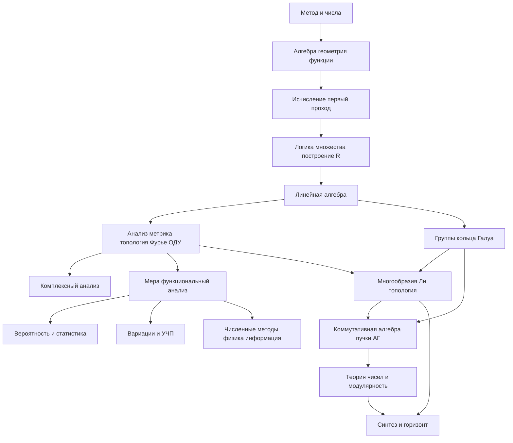

# Математика. Полный курс: от первых определений до исследовательского уровня

Карта самостоятельного изучения. Каждая часть начинается после тех понятий, на которые она опирается. Определения и доказательства живут в указанных книгах; здесь — порядок, состав и место, где отложенное доказательство закрывается.

Номер части задаёт достаточный порядок: идти по нему можно, не заглядывая вперёд. Где есть более ранний вход, это сказано в строке «Можно параллельно». Полный указатель таких развилок собран в части 56.

## Уровни

- **0.** Элементарная математика с доказательствами.
- **I.** Базовый университет.
- **II.** Продвинутый университет.
- **III.** Аспирантское ядро: теоремы этой части изучаются с доказательствами.
- **IV.** Исследовательский горизонт: точная постановка, место в курсе и минимальный вход. Владение горизонтом есть умение читать работы в этой точке, а не клетка в оглавлении.

## Спираль

Некоторые темы названы дважды. Второй проход закрывает то, что первый сознательно оставил аксиомой или формулировкой.

- Вещественная прямая в части 2 — рабочая аксиоматика. Построение из множеств — часть 15. Следствия полноты в анализе — часть 19.
- Исчисление части 10 даёт пределы, технику и основную теорему анализа в рабочем объёме. Полная ε-δ теория, интеграл Римана и равномерная сходимость — часть 19.
- Основная теорема алгебры сформулирована в части 8, доказана аналитически в части 27 и алгебраически в части 26.
- Задачи на построение циркулем и линейкой поставлены в части 4 и закрыты теорией Галуа в части 26.
- Жорданова форма вычисляется в части 16; структурное доказательство через модули — часть 25.
- Квадратичный закон взаимности доказан элементарно в части 12 и переосмыслен как закон Артина в части 45.
- Формула Стокса проходит путь: Грин, Гаусс и Стокс в части 20, формы на многообразиях в части 35, когомологии де Рама и теорема де Рама на стыке с частью 40.
- Спектральная теорема для матриц — часть 16, для операторов — часть 30, в квантовой механике — часть 55.

## Как читать часть

У каждой части четыре строки: уровень, опора, что она открывает, канон. Канон устроен так: первый текст — основной путь, следующие — параллельные. Параграф внутри главы называет определение, теорему или метод, которые в этом месте изучаются.

## Зависимости частей

## Содержание

0. [Математический способ мысли](#часть-0-математический-способ-мысли)
1. [Натуральные числа](#часть-1-натуральные-числа)
2. [Целые, рациональные и вещественные числа](#часть-2-целые-рациональные-и-вещественные-числа)
3. [Элементарная алгебра](#часть-3-элементарная-алгебра)
4. [Планиметрия](#часть-4-планиметрия)
5. [Стереометрия](#часть-5-стереометрия)
6. [Функции](#часть-6-функции)
7. [Тригонометрия](#часть-7-тригонометрия)
8. [Комплексные числа](#часть-8-комплексные-числа)
9. [Аналитическая геометрия](#часть-9-аналитическая-геометрия)
10. [Исчисление, первый проход](#часть-10-исчисление-первый-проход)
11. [Комбинаторика и классическая вероятность](#часть-11-комбинаторика-и-классическая-вероятность)
12. [Элементарная теория чисел](#часть-12-элементарная-теория-чисел)
13. [Логика, первый контур](#часть-13-логика-первый-контур)
14. [Теория множеств](#часть-14-теория-множеств)
15. [Построение числовых систем](#часть-15-построение-числовых-систем)
16. [Линейная алгебра](#часть-16-линейная-алгебра)
17. [Аффинная и проективная геометрия](#часть-17-аффинная-и-проективная-геометрия)
18. [Метрические пространства](#часть-18-метрические-пространства)
19. [Анализ одной переменной, теория](#часть-19-анализ-одной-переменной-теория)
20. [Анализ нескольких переменных](#часть-20-анализ-нескольких-переменных)
21. [Обыкновенные дифференциальные уравнения](#часть-21-обыкновенные-дифференциальные-уравнения)
22. [Классический анализ Фурье](#часть-22-классический-анализ-фурье)
23. [Общая топология](#часть-23-общая-топология)
24. [Теория групп](#часть-24-теория-групп)
25. [Кольца и модули](#часть-25-кольца-и-модули)
26. [Теория полей и Галуа](#часть-26-теория-полей-и-галуа)
27. [Комплексный анализ](#часть-27-комплексный-анализ)
28. [Кривые и поверхности](#часть-28-кривые-и-поверхности)
29. [Теория меры](#часть-29-теория-меры)
30. [Функциональный анализ](#часть-30-функциональный-анализ)
31. [Вариационное исчисление](#часть-31-вариационное-исчисление)
32. [Теория вероятностей](#часть-32-теория-вероятностей)
33. [Математическая статистика](#часть-33-математическая-статистика)
34. [Уравнения с частными производными](#часть-34-уравнения-с-частными-производными)
35. [Гладкие многообразия и риманова геометрия](#часть-35-гладкие-многообразия-и-риманова-геометрия)
36. [Группы Ли и алгебры Ли](#часть-36-группы-ли-и-алгебры-ли)
37. [Теория категорий](#часть-37-теория-категорий)
38. [Коммутативная алгебра](#часть-38-коммутативная-алгебра)
39. [Гомологическая алгебра](#часть-39-гомологическая-алгебра)
40. [Алгебраическая топология](#часть-40-алгебраическая-топология)
41. [Теория представлений](#часть-41-теория-представлений)
42. [Пучки и когомологии](#часть-42-пучки-и-когомологии)
43. [Алгебраическая геометрия](#часть-43-алгебраическая-геометрия)
44. [Алгебраическая теория чисел](#часть-44-алгебраическая-теория-чисел)
45. [Теория полей классов](#часть-45-теория-полей-классов)
46. [Аналитическая теория чисел](#часть-46-аналитическая-теория-чисел)
47. [Модулярные формы и эллиптические кривые](#часть-47-модулярные-формы-и-эллиптические-кривые)
48. [Симплектическая, контактная и комплексная геометрия](#часть-48-симплектическая-контактная-и-комплексная-геометрия)
49. [Динамические системы и эргодическая теория](#часть-49-динамические-системы-и-эргодическая-теория)
50. [Высшая логика и теория множеств](#часть-50-высшая-логика-и-теория-множеств)
51. [Высшая комбинаторика](#часть-51-высшая-комбинаторика)
52. [Численные методы](#часть-52-численные-методы)
53. [Оптимизация](#часть-53-оптимизация)
54. [Информация, коды и арифметика конечных полей](#часть-54-информация-коды-и-арифметика-конечных-полей)
55. [Математическая физика](#часть-55-математическая-физика)
56. [Синтез курса](#часть-56-синтез-курса)
57. [Исследовательский горизонт](#часть-57-исследовательский-горизонт)

---

## Часть 0. Математический способ мысли

**Уровень.** 0

**Опирается на.** Умение читать связный текст и пересчитывать конечные наборы предметов.

**Открывает.** Часть 1: индукция и делимость уже требуют различать определение, пример и доказательство.

**Канон.** Пойа, «Как решать задачу» — основной путь. Параллельно: Халмош, «Как писать математику»; Лакатос, «Доказательства и опровержения».

### Глава 1. Объект, свойство, высказывание

1.1. Математический объект, свойство и отношение на материале счёта.
1.2. Высказывание и условие со свободным местом; подстановка значения.
1.3. Обороты «для всех» и «существует» в обычном языке, до формального исчисления.
1.4. Определение как введение имени с указанной областью.
1.5. Два определения одного объекта: доказательство равносильности.

### Глава 2. Пример и контрпример

2.1. Пример как доказательство существования.
2.2. Контрпример как опровержение общего утверждения.
2.3. Сужение и расширение формулировки после контрпримера.
2.4. Крайние случаи: нуль, единица, пустой набор, вырожденный треугольник.
2.5. Порядок кванторов в готовой теореме и чтение её границ.

### Глава 3. Устройство доказательства

3.1. Прямой вывод из определений и уже установленных фактов.
3.2. Доказательство от противного.
3.3. Полный разбор случаев.
3.4. Существование построением и существование чистым аргументом.
3.5. Чертёж, вычисление нескольких значений и аналогия как разведка перед доказательством.
3.6. Место индукции: она будет определена на натуральных числах в части 1 и дальше станет обычным приёмом.

### Глава 4. Устройство этого курса

4.1. Курс как достаточный порядок чтения.
4.2. Уровни 0, I, II, III и IV и разный тип владения на IV.
4.3. Где курс сознательно откладывает доказательство и в какой части его закрывает.
4.4. Основной текст части и параллельные тексты.
4.5. Параллельные входы раньше номера части собраны в части 56.

**Переход.** Есть язык, на котором можно доказывать. Первый предмет — натуральные числа.

---

## Часть 1. Натуральные числа

**Уровень.** 0

**Опирается на.** Часть 0.

**Открывает.** Кольцо целых, дроби, индуктивные доказательства во всей алгебре, сравнения в элементарной теории чисел.

**Канон.** Курант, Роббинс, «Что такое математика», главы о натуральных числах — основной путь. Параллельно: Киселёв, «Арифметика».

**Можно параллельно с.** Ни с чем впереди: это основание курса.

### Глава 1. Счёт и системы счисления

1.1. Натуральный ряд как итог счёта; нуль как число пустого набора.
1.2. Позиционная запись, основание, перевод между основаниями.
1.3. Единственность записи без ведущих нулей.
1.4. Сравнение и сложение столбиком как алгоритмы, выводимые из позиционного принципа.
1.5. Признаки делимости как свойства записи в данном основании.

### Глава 2. Операции и их законы

2.1. Сложение как соединение конечных наборов; таблица и переместительный, сочетательный законы.
2.2. Умножение как повторное сложение; распределительный закон.
2.3. Степень с натуральным показателем.
2.4. Почему законы нужны для преобразования, а не для «удобства записи».
2.5. Деление с остатком: существование и единственность частного и остатка.

### Глава 3. Порядок

3.1. Отношение «меньше» и его согласие со сложением и умножением.
3.2. Дискретность: между n и n+1 нет натурального числа.
3.3. Принцип наименьшего элемента как рабочая форма индукции.
3.4. Оценка и сравнение сумм и произведений.

### Глава 4. Делимость

4.1. Делитель, кратное, простые и составные числа; единица не проста и не составна.
4.2. Наибольший общий делитель и наименьшее общее кратное.
4.3. Алгоритм Евклида и его конечность из убывания остатков.
4.4. Линейное представление НОД: тождество Безу для натуральных чисел.
4.5. Бесконечность множества простых чисел по Евклиду.
4.6. Решето Эратосфена.

### Глава 5. Основная теорема арифметики

5.1. Лемма Евклида: простое, делящее произведение, делит один из множителей.
5.2. Существование разложения на простые.
5.3. Единственность разложения с точностью до порядка.
5.4. Следствия: число делителей, канонический вид НОД и НОК.
5.5. Иррациональность корней из целых, не являющихся точными степенями, в том объёме, какой нужен до построения вещественной прямой: невозможность равенства в натуральных числах.

### Глава 6. Сравнения по модулю, первое знакомство

6.1. Отношение «давать одинаковый остаток» и классы вычетов.
6.2. Согласованность сравнений со сложением и умножением.
6.3. Обратимость вычета, взаимно простого с модулем, через Безу.
6.4. Малая теорема Ферма для простого модуля в первом доказательстве; полная теория сравнений — часть 12.

### Глава 7. Математическая индукция

7.1. Аксиома индукции в рабочей форме и принцип наименьшего элемента.
7.2. База и шаг; индукция с несколькими базами.
7.3. Возвратная индукция.
7.4. Индуктивное определение последовательности и функции на натуральных числах.
7.5. Типичные ошибки шага: скрытое использование того, что доказывается, и пустая база.

### Глава 8. Линейные диофантовы уравнения

8.1. Уравнение ax + by = c: критерий разрешимости через НОД.
8.2. Общее решение при наличии одного частного.
8.3. Уравнение в натуральных числах и ограничение перебора остатком.
8.4. Системы линейных сравнений с одним модулем; китайская теорема об остатках в полном виде — часть 12.

**Переход.** Деления нацело не хватает. Следующий шаг — обратные операции и числа, которые ими порождаются.

---

## Часть 2. Целые, рациональные и вещественные числа

**Уровень.** 0

**Опирается на.** Часть 1.

**Открывает.** Алгебру выражений, неравенства, координатную прямую, пределы.

**Канон.** Курант, Роббинс, «Что такое математика», главы о числовой системе — основной путь. Параллельно: Киселёв, «Арифметика», разделы о дробях и отрицательных числах.

### Глава 1. Целые числа

1.1. Вычитание как операция, которая на натуральных числах определена не всегда.
1.2. Целые числа как формальные разности и равенство разностей.
1.3. Сложение, умножение и порядок; проверка законов.
1.4. Модуль целого числа.
1.5. Деление с остатком для целых и перенос алгоритма Евклида.

### Глава 2. Рациональные числа

2.1. Дробь как решение уравнения nx = m.
2.2. Равенство дробей и несократимый вид.
2.3. Сложение и умножение дробей, вывод правил из законов.
2.4. Порядок на рациональных числах.
2.5. Рациональные числа как поле: каждый ненулевой элемент обратим.

### Глава 3. Отношения и пропорции

3.1. Отношение двух величин и пропорция.
3.2. Основное свойство пропорции и производные пропорции.
3.3. Деление в данном отношении.
3.4. Процент как отношение к сотой доле целого.
3.5. Масштаб и подобие величин до геометрической теории подобия.

### Глава 4. Степени и корни

4.1. Степень с целым показателем и законы степеней.
4.2. Корень натуральной степени: определение через степень.
4.3. Существование корня из положительного рационального на вещественной прямой будет следствием полноты; здесь — определение и единственность неотрицательного корня при условии существования.
4.4. Степень с рациональным показателем.
4.5. Тождества для корней и область, где они верны.

### Глава 5. Десятичная запись и погрешность

5.1. Конечные десятичные дроби как рациональные со знаменателем вида 2^a 5^b.
5.2. Бесконечная десятичная запись; период и рациональность периодической дроби.
5.3. Округление, абсолютная и относительная погрешность.
5.4. Верные цифры и накопление погрешности при арифметических операциях.
5.5. Двоичная и иные позиционные записи дробей.

### Глава 6. Числовая прямая и иррациональность

6.1. Точки прямой и координата; направленные отрезки.
6.2. Плотность рациональных чисел: между любыми двумя есть ещё одно.
6.3. Иррациональность √2 из основной теоремы арифметики.
6.4. Несоизмеримость диагонали и стороны квадрата как геометрический смысл того же факта.
6.5. Рабочее соглашение: дальше вещественные числа — упорядоченное поле, в котором каждый непустой ограниченный сверху набор имеет точную верхнюю грань. Построение такого поля — часть 15.

### Глава 7. Неравенства и абсолютная величина

7.1. Свойства неравенств относительно сложения и умножения.
7.2. Абсолютная величина как расстояние до нуля; неравенство треугольника на прямой.
7.3. Окрестность точки.
7.4. Неравенства между средним арифметическим и средним геометрическим для двух чисел.
7.5. Метод оценки: грубая оценка, достаточная для существования, и точная константа.

### Глава 8. Полнота как обязательство

8.1. Точная верхняя и точная нижняя грани.
8.2. Принцип вложенных отрезков в рабочей формулировке.
8.3. Архимедовость как следствие полноты.
8.4. Эквивалентные облики полноты будут сравнены в части 15; до тех пор в анализе разрешено ссылаться на грань, вложенные отрезки и архимедовость.
8.5. Чего этой аксиоматики ещё не даёт: построения вещественного числа из рационального и доказательства независимости аксиомы.

**Переход.** Числовое поле достаточно богато для буквенных выражений. Алгебра изучает преобразования, которые эту структуру сохраняют.

---

## Часть 3. Элементарная алгебра

**Уровень.** 0

**Опирается на.** Части 1–2.

**Открывает.** Функции, аналитическую геометрию, многочлены в линейной алгебре и теории полей.

**Канон.** Киселёв, «Алгебра» — основной школьный каркас. Параллельно: Прасолов, «Многочлены», первые главы.

**Можно параллельно с.** Частью 4 после главы 2 этой части: планиметрии достаточно рациональных чисел и пропорций.

### Глава 1. Выражения и тождества

1.1. Буквенное выражение, область допустимых значений, тождество и уравнение.
1.2. Приведение подобных членов из законов операций.
1.3. Формулы сокращённого умножения и их доказательство раскрытием.
1.4. Разложение на множители как обратная задача.
1.5. Подстановка и замена переменной.

### Глава 2. Линейные уравнения и системы

2.1. Равносильные преобразования уравнения.
2.2. Линейное уравнение ax = b: три случая.
2.3. Система двух линейных уравнений: подстановка и исключение.
2.4. Геометрический смысл будет дан в части 9; здесь — алгебраический критерий числа решений.
2.5. Текстовая задача как перевод условия в уравнение и проверка ответа областью задачи.

### Глава 3. Квадратные уравнения и многочлены

3.1. Многочлен, степень, старший коэффициент.
3.2. Квадратный трёхчлен: выделение полного квадрата.
3.3. Дискриминант и формула корней над вещественными числами.
3.4. Теорема Виета для квадратного трёхчлена.
3.5. Разложение квадратного трёхчлена на линейные множители при неотрицательном дискриминанте.

### Глава 4. Рациональные выражения и уравнения

4.1. Рациональное выражение и сокращение дроби.
4.2. Сумма и произведение алгебраических дробей.
4.3. Рациональное уравнение и появление посторонних корней при умножении на выражение.
4.4. Пропорция как рациональное уравнение.
4.5. Деление многочленов уголком в простом виде; полная теория — глава 10.

### Глава 5. Иррациональные уравнения

5.1. Область допустимых значений корня.
5.2. Уединение корня и возведение в степень; отслеживание равносильности.
5.3. Смешанные условия: корень и линейное выражение.
5.4. Проверка корня подстановкой как часть решения, а не как замена доказательства равносильности.

### Глава 6. Неравенства

6.1. Линейные неравенства и системы.
6.2. Квадратные неравенства через знак старшего коэффициента и корни.
6.3. Метод интервалов для произведения линейных множителей.
6.4. Рациональные неравенства и особые точки знаменателя.
6.5. Неравенства с модулем и геометрический смысл на прямой.

### Глава 7. Прогрессии и суммы

7.1. Числовая последовательность как функция на натуральных числах.
7.2. Арифметическая прогрессия: разность, общий член, сумма.
7.3. Геометрическая прогрессия: знаменатель, общий член, сумма.
7.4. Бесконечная убывающая геометрическая прогрессия: сумма как предел частичных сумм в рабочем смысле; строгое определение предела — часть 10.
7.5. Метод математической индукции в доказательствах формул сумм.

### Глава 8. Бином Ньютона

8.1. Факториал и биномиальный коэффициент через произведения.
8.2. Треугольник Паскаля и рекуррентное тождество.
8.3. Формула бинома и доказательство индукцией.
8.4. Сумма биномиальных коэффициентов и знакочередующаяся сумма.
8.5. Комбинаторный смысл коэффициента будет раскрыт в части 11; здесь он ещё алгебраический.

### Глава 9. Показательные и логарифмические уравнения

9.1. Показательная функция на рациональных показателях и рабочее продолжение на вещественные; строгое построение — часть 6 и часть 19.
9.2. Логарифм как обратная операция; основное логарифмическое тождество.
9.3. Формулы логарифма произведения, частного и степени с указанием области.
9.4. Показательные и логарифмические уравнения и неравенства.
9.5. Переход к новому основанию.

### Глава 10. Деление многочленов

10.1. Деление с остатком в кольце многочленов над полем.
10.2. Теорема Безу.
10.3. Корень и линейный множитель; число корней не превосходит степени.
10.4. Рациональные корни многочлена с целыми коэффициентами.
10.5. Схема Горнера.
10.6. Симметрические многочлены элементарного вида и теорема Виета для степени n.
10.7. Над вещественными числами неразложимый многочлен может иметь степень 2; над комплексными разложение полное — это содержание основной теоремы алгебры, часть 8 ставит её, части 26 и 27 доказывают.

**Переход.** Буквы и числа готовы. Планиметрия вводит пространство рассуждения, где алгебра ещё не обязана быть языком, но пропорция уже работает.

---

## Часть 4. Планиметрия

**Уровень.** 0

**Опирается на.** Части 0–2; с части 3 достаточно линейных уравнений и пропорций. Глава 10 использует векторы без полной линейной алгебры.

**Открывает.** Стереометрию, тригонометрию, аналитическую геометрию, постановку классических задач на построение.

**Канон.** Адамар, «Элементарная геометрия», часть I — основной путь. Параллельно: Прасолов, «Задачи по планиметрии»; Киселёв, «Элементарная геометрия».

**Можно параллельно с.** Главами 3–10 части 3.

### Глава 1. Аксиоматический каркас

1.1. Точка, прямая, плоскость, инцидентность, «лежать между», конгруэнтность отрезков и углов.
1.2. Рабочий список аксиом, достаточный для школьных теорем; полная система Гильберта — ориентир, не текущий текст.
1.3. Отрезок, луч, угол, ломаная, многоугольник.
1.4. Прямой угол и существование перпендикуляра.
1.5. Что в этом курсе принимается аксиомой, а что доказывается.

### Глава 2. Равенство треугольников

2.1. Определение равенства треугольников через соответственные элементы.
2.2. Признаки равенства: сторона и два прилежащих угла; две стороны и угол между ними; три стороны.
2.3. Равнобедренный треугольник: углы при основании и медиана, биссектриса, высота из вершины.
2.4. Признаки равенства прямоугольных треугольников.
2.5. Метод доказательства «достроим до треугольника, к которому применим признак».

### Глава 3. Параллельность

3.1. Определение параллельных прямых.
3.2. Признаки параллельности через углы с секущей.
3.3. Аксиома параллельных в формулировке единственности прямой через точку.
3.4. Сумма углов треугольника.
3.5. Сумма углов выпуклого многоугольника.
3.6. Отказ от аксиомы параллельных меняет теорию: сферическая и гиперболическая геометрии — часть 24, после групп преобразований.

### Глава 4. Неравенства и геометрические места

4.1. Неравенство треугольника.
4.2. Сравнение сторон и противолежащих углов.
4.3. Расстояние от точки до прямой.
4.4. Серединный перпендикуляр, биссектриса угла как геометрические места.
4.5. Окружность как геометрическое место; касательная перпендикулярна радиусу.

### Глава 5. Подобие

5.1. Пропорциональные отрезки и теорема Фалеса.
5.2. Признаки подобия треугольников.
5.3. Отношение площадей подобных треугольников — после главы о площади эта связь пересматривается; здесь вводится через равные высоты.
5.4. Теорема о пропорциональных отрезках в прямоугольном треугольнике.
5.5. Теорема Пифагора и обратная к ней.

### Глава 6. Окружность

6.1. Центральный и вписанный углы; угол, опирающийся на диаметр.
6.2. Угол между касательной и хордой.
6.3. Вписанный и описанный многоугольники; критерии.
6.4. Степень точки и подобие треугольников, ею порождённых.
6.5. Вписанные углы и дуги; радианная мера будет введена в части 7.

### Глава 7. Площадь

7.1. Аксиомы площади: неотрицательность, аддитивность, нормировка квадрата, инвариантность при разрезании и перекладывании.
7.2. Площадь параллелограмма, треугольника, трапеции.
7.3. Отношение площадей треугольников с общей высотой.
7.4. Формула Герона.
7.5. Равновеликость и равносоставленность многоугольников: теорема Бойяи–Гервина.

### Глава 8. Правильные многоугольники, длина окружности и площадь круга

8.1. Существование правильного n-угольника для малых n построением; общий критерий — часть 26.
8.2. Углы и соотношения сторон правильного многоугольника.
8.3. Периметры вписанных и описанных многоугольников как монотонные последовательности.
8.4. Длина окружности как общая грань этих периметров; число π.
8.5. Площадь круга.
8.6. Отложенный аналитический смысл π: ряды и интегралы части 10.

### Глава 9. Построения циркулем и линейкой

9.1. Разрешённые операции и понятие построенной точки.
9.2. Стандартные построения: середина, перпендикуляр, биссектриса, параллель, сумма и произведение отрезков.
9.3. Построение корня квадратного из отрезка.
9.4. Постановки, которые здесь не закрываются: удвоение куба, трисекция произвольного угла, квадратура круга, правильный семиугольник.
9.5. Мост: построенные длины образуют башню квадратичных расширений. Точный критерий — часть 26.

### Глава 10. Векторы на плоскости

10.1. Направленный отрезок, равенство векторов, нулевой вектор.
10.2. Сложение по правилу треугольника и параллелограмма; законы.
10.3. Умножение на число.
10.4. Разложение по двум неколлинеарным векторам; единственность коэффициентов.
10.5. Коллинеарность как пропорциональность.
10.6. Скалярное произведение будет введено в части 9, когда есть длины и углы тригонометрии; здесь вектор ещё аффинный.

**Переход.** Плоские фигуры описаны. Пространство добавляет плоскости, объёмы и новые отношения инцидентности.

---

## Часть 5. Стереометрия

**Уровень.** 0

**Опирается на.** Часть 4.

**Открывает.** Координатную геометрию пространства, криволинейные интегралы и поверхности, классическую дифференциальную геометрию.

**Канон.** Адамар, «Элементарная геометрия», часть о пространстве — основной путь. Параллельно: Киселёв, «Элементарная геометрия», стереометрия.

### Глава 1. Прямые и плоскости в пространстве

1.1. Аксиомы инцидентности пространства.
1.2. Взаимное расположение двух прямых: пересечение, параллельность, скрещивание.
1.3. Прямая и плоскость; две плоскости.
1.4. Признак перпендикулярности прямой и плоскости.
1.5. Теорема о трёх перпендикулярах.
1.6. Угол между скрещивающимися прямыми, угол между прямой и плоскостью, двугранный угол.

### Глава 2. Многогранники

2.1. Призма и параллелепипед.
2.2. Пирамида и усечённая пирамида.
2.3. Правильные многогранники: пять типов и эйлерова характеристика как счёт вершин, рёбер и граней.
2.4. Сечения многогранника плоскостью; метод следов.
2.5. Равенство и подобие пространственных фигур в элементарном смысле.

### Глава 3. Объёмы

3.1. Аксиомы объёма по образцу аксиом площади.
3.2. Объём параллелепипеда и призмы.
3.3. Объём пирамиды.
3.4. Принцип Кавальери.
3.5. Отношение объёмов подобных тел.

### Глава 4. Тела вращения

4.1. Цилиндр, конус, шар и их плоские сечения.
4.2. Касательная плоскость к шару.
4.3. Объём цилиндра, конуса и шара.
4.4. Площадь сферы.
4.5. Шаровой сегмент, слой и сектор.
4.6. Вписанные и описанные тела.

### Глава 5. Координаты и векторы в пространстве, первый вид

5.1. Прямоугольная система в пространстве и координаты точки.
5.2. Расстояние между точками.
5.3. Вектор, координаты вектора, действия в координатах.
5.4. Компланарность трёх векторов.
5.5. Уравнение сферы с центром в данной точке.
5.6. Полная векторная алгебра пространства, включая векторное произведение, — часть 9.

**Переход.** Фигуры и величины есть. Функция связывает две величины и даёт язык, на котором геометрия и алгебра говорят об одном изменении.

---

## Часть 6. Функции

**Уровень.** 0

**Опирается на.** Части 2–3; график на плоскости использует координаты части 5 в плоском частном случае, введённом заново на координатной плоскости.

**Открывает.** Тригонометрию как семейство функций, элементарное исчисление, понятие отображения в теории множеств.

**Канон.** Колмогоров и др., «Алгебра и начала анализа», разделы о функциях — основной школьный путь. Параллельно: Курант, Роббинс, главы о функциях.

### Глава 1. Соответствие и график

1.1. Функция как правило, сопоставляющее каждому элементу области определения ровно одно значение.
1.2. Область определения, множество значений, график.
1.3. Способы задания: формула, таблица, график, словесное правило.
1.4. Сумма, произведение, частное и композиция функций; область композиции.
1.5. Равенство функций как совпадение областей и значений.

### Глава 2. Качественное поведение графика

2.1. Нули, промежутки знакопостоянства.
2.2. Монотонность на промежутке.
2.3. Наибольшее и наименьшее значение на отрезке в задачах, где оно достигается явно.
2.4. Чётность, нечётность, периодичность.
2.5. Выпуклость графика наглядно; строгое определение через вторую производную — часть 10, через неравенство — часть 19.

### Глава 3. Линейная и квадратичная функции

3.1. Линейная функция, угловой коэффициент, параллельность графиков.
3.2. Квадратичная функция и парабола; вершина через выделение квадрата.
3.3. Квадратичные неравенства вторично, уже как вопрос о множестве значений и расположении графика.
3.4. Кусочно заданные функции из линейных и квадратичных кусков.

### Глава 4. Преобразования графиков

4.1. Сдвиг вдоль осей.
4.2. Растяжение и сжатие.
4.3. Отражения и модуль аргумента и значения.
4.4. Комбинация преобразований и порядок их применения.

### Глава 5. Обратная функция

5.1. Инъекция, сюръекция и биекция в рабочем языке, без аксиоматики множеств.
5.2. Критерий обратимости монотонной функции на промежутке.
5.3. График обратной функции и симметрия относительно прямой y = x.
5.4. Обратимость сужения функции, которая на всей области не инъективна.

### Глава 6. Степенные, показательные и логарифмические функции

6.1. Степенная функция с натуральным, целым и рациональным показателем; область и монотонность.
6.2. Показательная функция: функциональное уравнение f(x+y) = f(x)f(y) и рабочее построение через полноту.
6.3. Логарифм как обратная к показательной; свойства как перевод свойств степени.
6.4. Сравнение роста: логарифм, степень, показательная функция на уровне неравенств, доступных до интегрального признака.
6.5. Строгое доказательство существования показательной функции на всей прямой — часть 19, после полноты и непрерывности.

### Глава 7. Уравнения и неравенства графически

7.1. Корень уравнения f(x) = g(x) как абсцисса пересечения графиков.
7.2. Оценка числа корней по монотонности.
7.3. Графическое решение неравенства как сравнение графиков.
7.4. Граница метода: рисунок подсказывает, доказательство числа корней даёт монотонность или производная.

**Переход.** У функции появился угол. Тригонометрия измеряет угол числом и тем замыкает геометрию на анализ.

---

## Часть 7. Тригонометрия

**Уровень.** 0

**Опирается на.** Части 4 и 6; подобие и окружность из части 4, обратная функция из части 6.

**Открывает.** Комплексную плоскость, колебания в исчислении, скалярное произведение, ряды Фурье.

**Канон.** Гельфанд, Львовский, Тоом, «Тригонометрия» — основной путь. Параллельно: соответствующие главы Киселёва.

### Глава 1. Острый угол

1.1. Синус, косинус, тангенс и котангенс острого угла прямоугольного треугольника.
1.2. Зависимость только от угла, из подобия.
1.3. Основное тождество sin²α + cos²α = 1.
1.4. Значения для 30°, 45°, 60°.
1.5. Радианная мера: длина дуги единичной окружности; согласие с градусом через π из части 4.

### Глава 2. Функции произвольного угла

2.1. Единичная окружность и координатное определение синуса и косинуса.
2.2. Знаки по четвертям.
2.3. Период 2π и чётность.
2.4. Тангенс и котангенс, их периоды и вертикальные асимптоты в рабочем смысле.
2.5. Формулы приведения.

### Глава 3. Основные тождества

3.1. Тождества связи одной функции с другой.
3.2. Синус и косинус суммы и разности; доказательство через расстояния или через поворот, подготовленный здесь геометрически.
3.3. Тангенс суммы.
3.4. Формулы двойного и половинного угла.
3.5. Область равенств с половинным углом.

### Глава 4. Решение треугольников

4.1. Теорема косинусов.
4.2. Теорема синусов и её связь с описанной окружностью.
4.3. Площадь треугольника через две стороны и синус угла.
4.4. Решение треугольника по достаточному набору элементов; случай двух сторон и угла напротив одной из них.
4.5. Формулы Мольвейде и тангенс половинного угла как запасной аппарат.

### Глава 5. Преобразование выражений

5.1. Сумма и разность синусов и косинусов в произведение.
5.2. Произведение в сумму.
5.3. Линейная комбинация a sin x + b cos x как один синус сдвинутой фазы.
5.4. Метод вспомогательного аргумента.

### Глава 6. Уравнения и неравенства

6.1. Простейшие уравнения sin x = a, cos x = a, tg x = a и полная серия решений.
6.2. Сведение к простейшим: разложение, замена, вспомогательный аргумент.
6.3. Отбор корней на промежутке и условием.
6.4. Тригонометрические неравенства на окружности и на промежутке периода.
6.5. Однородные уравнения относительно синуса и косинуса.

### Глава 7. Обратные тригонометрические функции

7.1. Сужения синуса, косинуса и тангенса до биекций.
7.2. Арксинус, арккосинус, арктангенс: область значений и главные тождества.
7.3. Формулы, которые верны лишь на части области, и проверка подстановкой крайних точек.
7.4. Производные обратных функций появятся в части 10; здесь — только геометрия и графики.

**Переход.** Поворот на угол записан парой косинус–синус. Комплексное число собирает эту пару в один объект, который ещё и умножается.

---

## Часть 8. Комплексные числа

**Уровень.** 0, с выходом в I в главе об основной теореме алгебры.

**Опирается на.** Части 3 и 7.

**Открывает.** Корни многочленов, показательную форму в анализе, линейную алгебру над C, комплексный анализ.

**Канон.** Яглом, «Комплексные числа» — основной путь. Параллельно: соответствующие главы Куранта и Роббинса.

### Глава 1. Поле комплексных чисел

1.1. Определение пары вещественных чисел со сложением и умножением (a, b)(c, d) = (ac − bd, ad + bc).
1.2. Проверка аксиом поля.
1.3. Мнимая единица и запись a + bi.
1.4. Сопряжение, модуль, мультипликативность модуля.
1.5. Вложение вещественной прямой как чисел с нулевой мнимой частью.

### Глава 2. Комплексная плоскость

2.1. Аффикс точки и векторное чтение сложения.
2.2. Модуль как расстояние до нуля; неравенство треугольника.
2.3. Аргумент и его многозначность на 2π.
2.4. Геометрический смысл сопряжения и модуля разности.
2.5. Уравнение окружности и прямой в комплексной форме на элементарном уровне.

### Глава 3. Тригонометрическая и показательная форма

3.1. Тригонометрическая форма ненулевого числа.
3.2. Умножение и деление в тригонометрической форме.
3.3. Формула Муавра.
3.4. Показательная запись через рабочее тождество Эйлера e^{iφ} = cos φ + i sin φ; степенной ряд, который это тождество доказывает, — часть 10.
3.5. Связь с формулами синуса и косинуса суммы.

### Глава 4. Корни и основная теорема алгебры

4.1. Корень n-й степени: n значений на окружности.
4.2. Корни из единицы и их циклическая группа в элементарном языке, без слова «группа».
4.3. Решение квадратного уравнения над C; дискриминант всегда даёт корни.
4.4. Формулировка основной теоремы алгебры: непостоянный многочлен с комплексными коэффициентами имеет комплексный корень.
4.5. Следствие, которым пока разрешено пользоваться как теоремой с отложенным доказательством: разложение на линейные множители над C и на линейные и квадратичные над R.
4.6. Аналитическое доказательство — часть 27, после теоремы Лиувилля. Алгебраическое — часть 26.

### Глава 5. Комплексные числа в геометрии и тригонометрии

5.1. Поворот как умножение на число модуля 1.
5.2. Вывод формул сложения из Муавра.
5.3. Правильные многоугольники как корни из единицы.
5.4. Плоские преобразования подобия в комплексной записи.
5.5. Предел комплексной последовательности будет сведён к пределу модуля в части 10.

**Переход.** Число и плоскость соединены. Аналитическая геометрия делает координату основным языком и готовит линейные отображения.

---

## Часть 9. Аналитическая геометрия

**Уровень.** 0 с выходом в I.

**Опирается на.** Части 3–8.

**Открывает.** Линейную алгебру, многомерный анализ, классификацию квадрик, проективную геометрию.

**Канон.** Ильин, Позняк, «Аналитическая геометрия» — основной путь. Параллельно: Прасолов, Тихомиров, «Геометрия», главы об аффинной плоскости.

### Глава 1. Координаты

1.1. Координата на прямой, деление отрезка в данном отношении.
1.2. Декартова плоскость; расстояние.
1.3. Параллельный перенос и замена начала.
1.4. Полярные координаты на плоскости: определение; связь с декартовыми через тригонометрию.
1.5. Ориентация плоскости.

### Глава 2. Прямая и окружность

2.1. Уравнение прямой по точке и направляющему вектору; по двум точкам; в отрезках.
2.2. Общее уравнение прямой и геометрический смысл коэффициентов.
2.3. Угол между прямыми, условие параллельности и перпендикулярности.
2.4. Расстояние от точки до прямой.
2.5. Окружность: общее уравнение с условием, выделение центра и радиуса.
2.6. Взаимное расположение прямой и окружности через квадратное уравнение.

### Глава 3. Конические сечения

3.1. Эллипс, гипербола и парабола как геометрические места.
3.2. Канонические уравнения и параметры.
3.3. Фокальные свойства и директрисы.
3.4. Касательная к конике в канонических координатах.
3.5. Коники как плоские сечения конуса; согласование двух определений.
3.6. Полярное уравнение коники.

### Глава 4. Геометрия пространства в координатах

4.1. Прямая в пространстве: канонические и параметрические уравнения.
4.2. Плоскость: общее уравнение, нормаль.
4.3. Взаимное расположение прямых и плоскостей через ранги систем; слово «ранг» здесь рабочее и будет определено заново в части 16.
4.4. Расстояние от точки до плоскости и между скрещивающимися прямыми.
4.5. Уравнение сферы и взаимное расположение сферы и плоскости.

### Глава 5. Произведения векторов

5.1. Скалярное произведение: аксиомы через проекцию и выражение в координатах.
5.2. Длина, угол, критерий ортогональности.
5.3. Векторное произведение в ориентированном пространстве: длина как площадь, направление по правилу ориентации.
5.4. Смешанное произведение как объём; критерий компланарности.
5.5. Тождества двойного векторного произведения в объёме, нужном для геометрии, без тензорной записи.
5.6. Барицентрические комбинации и центр масс конечной системы точек.

### Глава 6. Движения плоскости

6.1. Определение движения как отображения, сохраняющего расстояния.
6.2. Параллельный перенос, поворот, отражение, скользящая симметрия.
6.3. Теорема Шаля: движение плоскости есть перенос, поворот или скользящая симметрия.
6.4. Композиция движений на примерах; группа движений станет теоремой части 24.
6.5. Подобия и гомотетия.

### Глава 7. Кривые второго порядка: классификация

7.1. Общее уравнение второй степени на плоскости.
7.2. Ортогональные замены координат и поворот осей.
7.3. Инварианты и приведение к каноническому виду над R.
7.4. Вырожденные случаи: пара прямых, точка, пустое множество.
7.5. Поверхности второго порядка: эллипсоид, гиперболоиды, параболоиды, цилиндры и конусы; полная классификация квадрик через квадратичные формы — часть 16.

### Глава 8. Криволинейные координаты

8.1. Полярные координаты и якобиан перехода в геометрическом виде площади сектора.
8.2. Цилиндрические координаты.
8.3. Сферические координаты.
8.4. Замена переменных в интеграле сделает эти формулы теоремами в части 20; здесь они готовятся как геометрия.

**Переход.** Геометрия записана уравнениями. Исчисление различает в этой записи мгновенное изменение и накопленную величину.

---

## Часть 10. Исчисление, первый проход

**Уровень.** 0 с выходом в I. Полнота используется как аксиома части 2. Утверждения, которым нужен аппарат равномерной сходимости, помечаются и закрываются в части 19.

**Опирается на.** Части 2, 3, 6–9.

**Открывает.** Дифференциальные уравнения, анализ нескольких переменных, ряды Фурье, оценку погрешности.

**Канон.** Спивак, «Calculus» — основной путь, с доказательствами. Параллельно: Фихтенгольц, «Курс дифференциального и интегрального исчисления», т. I, как справочник техники; Демидович, «Сборник задач по математическому анализу».

**Можно параллельно с.** Частью 11 после глав 1–3 части 3 и части 6. Частью 12 после части 1: элементарная теория чисел не ждёт интеграла.

### Глава 1. Предел последовательности

1.1. Последовательность и ε-N определение предела.
1.2. Единственность предела, предел суммы, произведения, частного.
1.3. Предел и неравенства; теорема о зажатой последовательности.
1.4. Монотонная ограниченная последовательность сходится — первое существенное следствие полноты.
1.5. Число e как предел (1 + 1/n)^n; существование из монотонности и ограниченности.
1.6. Подпоследовательности и теорема Больцано–Вейерштрасса; детальный разбор компактности отрезка — часть 18 и часть 19.
1.7. Критерий Коши в формулировке; эквивалентность полноте — часть 15 и часть 18.
1.8. Бесконечные пределы и определённые расходимости.

### Глава 2. Предел функции и непрерывность

2.1. Предел функции в точке по Коши и по Гейне; эквивалентность.
2.2. Односторонние пределы.
2.3. Непрерывность в точке и на множестве.
2.4. Непрерывность суммы, произведения, частного и композиции.
2.5. Теорема о промежуточном значении.
2.6. Непрерывная на отрезке функция ограничена и достигает граней — доказательство через Больцано–Вейерштрасса; равномерная непрерывность на отрезке формулируется и полностью используется в части 19.
2.7. Замечательные пределы и следствия для показательной и логарифмической функций в рабочем объёме.
2.8. Асимптоты графика.

### Глава 3. Производная

3.1. Производная как предел разностного отношения; касательная.
3.2. Дифференциал и линейное приближение.
3.3. Правила дифференцирования, производная композиции и обратной функции.
3.4. Производные степенной, показательной, логарифмической и тригонометрических функций.
3.5. Производные обратных тригонометрических функций.
3.6. Старшие производные.

### Глава 4. Приложения производной

4.1. Теорема Ферма о внутреннем экстремуме.
4.2. Теоремы Ролля, Лагранжа и Коши о среднем.
4.3. Правило Лопиталя.
4.4. Монотонность и знак производной.
4.5. Экстремумы, выпуклость и вторая производная.
4.6. Исследование функции и построение графика по производным.
4.7. Формула Тейлора с остатком в форме Лагранжа; ряд Тейлора — глава 8, когда есть язык рядов.
4.8. Метод Ньютона в геометрическом виде; сходимость — после сжимающих отображений, часть 18, и в численных методах, часть 52.

### Глава 5. Интеграл и основная теорема

5.1. Первообразная и неопределённый интеграл; две первообразные отличаются на постоянную на промежутке.
5.2. Определённый интеграл как предел интегральных сумм для непрерывной функции. Общее понятие интеграла Римана — часть 19.
5.3. Свойства: линейность, аддитивность по отрезку, монотонность.
5.4. Основная теорема анализа: производная интеграла с переменным верхним пределом и формула Ньютона–Лейбница.
5.5. Формула интегрирования по частям и замена переменной.
5.6. Интегральная теорема о среднем.

### Глава 6. Техника интегрирования

6.1. Таблица первообразных.
6.2. Рациональные функции: разложение на простейшие над R, используя отложенное разложение знаменателя на линейные и квадратичные множители.
6.3. Подстановки Эйлера и тригонометрические подстановки в стандартном наборе.
6.4. Интегралы, сводящиеся к рациональным функциям от синуса и косинуса.
6.5. Что алгоритм интегрирования элементарных функций не обещает: существование элементарной первообразной есть отдельный вопрос, и он не входит в этот проход.

### Глава 7. Несобственные интегралы и геометрические приложения

7.1. Несобственный интеграл по бесконечному промежутку.
7.2. Несобственный интеграл от неограниченной функции.
7.3. Признаки сравнения и интегральный признак сходимости ряда — связка с главой 8.
7.4. Площадь криволинейной трапеции.
7.5. Объём тела через поперечные сечения, согласие с принципом Кавальери.
7.6. Длина дуги графика; параметрический случай — глава 9.

### Глава 8. Числовые ряды

8.1. Частичные суммы и сумма ряда.
8.2. Необходимое условие сходимости; гармонический ряд расходится.
8.3. Ряды с неотрицательными членами: сравнение, Даламбер, Коши, интегральный признак.
8.4. Абсолютная и условная сходимость; теорема Лейбница.
8.5. Перестановка членов абсолютно сходящегося ряда; предупреждение о условно сходящихся перестановках, полное утверждение Римана — часть 19.
8.6. Произведение рядов в абсолютно сходящемся случае.

### Глава 9. Степенные ряды и формула Тейлора

9.1. Радиус сходимости по формуле Коши–Адамара в рабочем виде.
9.2. Непрерывность суммы степенного ряда внутри интервала сходимости; почленное дифференцирование и интегрирование с обоснованием, которое завершается в части 19 через равномерную сходимость на отрезках внутри интервала.
9.3. Ряд Тейлора и аналитические элементарные функции: экспонента, синус, косинус, логарифм, бином Ньютона для нецелого показателя.
9.4. Тождество Эйлера e^{iφ} = cos φ + i sin φ как отождествление рядов; этим закрывается рабочее соглашение части 8.
9.5. Оценка остатка и вычисление констант с заданной точностью.

### Глава 10. Параметрические кривые и полярные координаты

10.1. Параметрическая кривая на плоскости и касательная.
10.2. Длина параметрической кривой.
10.3. Площадь в полярных координатах.
10.4. Кривизна плоской кривой в элементарной формуле; геометрическая теория кривизны — часть 28.

**Переход.** Предел стал рабочим средством. Рядом с непрерывной математикой стоит конечный счёт, из которого вырастают вероятность и теория чисел.

---

## Часть 11. Комбинаторика и классическая вероятность

**Уровень.** 0 с выходом в I.

**Опирается на.** Части 1–3 и бином Ньютона; главы о вероятности используют дроби части 2.

**Открывает.** Производящие функции, теорию графов, аксиоматическую вероятность, перечислительную комбинаторику.

**Канон.** Виленкин, «Комбинаторика» — основной путь для счёта. Параллельно: Феллер, «Введение в теорию вероятностей и её приложения», т. I, главы о дискретном случае.

**Можно параллельно с.** Частью 10.

### Глава 1. Правила счёта

1.1. Правило суммы и правило произведения.
1.2. Перестановки, размещения и сочетания.
1.3. Биномиальный коэффициент как число подмножеств и как алгебраический коэффициент части 3: отождествление.
1.4. Перестановки с повторениями и сочетания с повторениями.
1.5. Число сюръекций и взаимно однозначных соответствий между конечными множествами в рабочем языке.

### Глава 2. Тождества и включения-исключения

2.1. Тождества Паскаля, симметрии и поглощения.
2.2. Комбинаторные доказательства биномиальных тождеств.
2.3. Принцип включения-исключения.
2.4. Задача о беспорядках.
2.5. Подсчёт чисел, взаимно простых с n, как вход в функцию Эйлера; арифметика этой функции — часть 12.

### Глава 3. Принцип Дирихле

3.1. Конечная форма принципа.
3.2. Усиленные формы со средним.
3.3. Приложения к делимости и к геометрии точек.
3.4. Бесконечный принцип Дирихле и его связь с компактностью — указатель на часть 18, без топологического языка.

### Глава 4. Рекуррентности и элементарные производящие функции

4.1. Линейные рекуррентности с постоянными коэффициентами.
4.2. Числа Фибоначчи и формула Бине через характеристическое уравнение.
4.3. Обыкновенная производящая функция последовательности.
4.4. Производящая функция как алгебраический объект: сложение и умножение свёртки.
4.5. Каталановы числа.
4.6. Экспоненциальные производящие функции упоминаются; систематическая теория перечисления — часть 51.

### Глава 5. Графы, первое знакомство

5.1. Граф, степень вершины, лемма о рукопожатиях.
5.2. Путь, связность, дерево; число рёбер дерева.
5.3. Эйлеров обход: критерий.
5.4. Двудольные графы и паросочетания в элементарных примерах.
5.5. Планарность и формула Эйлера для плоских графов, в согласии с эйлеровой характеристикой многогранников части 5.
5.6. Раскраски и обход; теорема о пяти красках доступна здесь, теорема о четырёх красках остаётся фактом с внешним доказательством и в ядро доказательств этого курса не входит.

### Глава 6. Классическая вероятность

6.1. Конечное пространство элементарных исходов и равновозможность.
6.2. Событие как подмножество; алгебра событий в конечном случае.
6.3. Условная вероятность.
6.4. Независимость событий и независимость испытаний.
6.5. Формула полной вероятности и формула Байеса.
6.6. Парадоксы, которые показывают границу «равновозможности»: Бертран будет разобран снова, когда появится мера, в части 32.

### Глава 7. Случайные величины в конечном случае

7.1. Случайная величина как функция на конечном пространстве.
7.2. Распределение, математическое ожидание, линейность ожидания без независимости.
7.3. Индикаторы и счёт через ожидание.
7.4. Дисперсия и независимость как достаточное условие сложения дисперсий.
7.5. Неравенство Чебышёва.

### Глава 8. Испытания Бернулли

8.1. Биномиальное распределение.
8.2. Наивероятнейшее число успехов.
8.3. Закон больших чисел Бернулли через Чебышёва.
8.4. Локальная и интегральная теоремы Муавра–Лапласа как формулировки; доказательство через характеристические функции — часть 32.
8.5. Случайное блуждание на прямой в симметричном случае: возвратность как задача, полное доказательство после производящих функций или после мартингалов.

**Переход.** Конечная арифметика сравнений уже появлялась. Теперь она становится самостоятельной теорией, пока ещё без полей и без дзета-функции.

---

## Часть 12. Элементарная теория чисел

**Уровень.** I

**Опирается на.** Части 1–3 и комбинаторный счёт части 11. Квадратичный закон доказывается элементарно, без теории полей.

**Открывает.** Кольцо целых в абстрактной алгебре, конечные поля, алгебраическую и аналитическую теорию чисел.

**Канон.** Виноградов, «Основы теории чисел» — основной путь. Параллельно: Дэвенпорт, «Высшая арифметика».

**Можно параллельно с.** Частями 10 и 13: логике не нужна теория сравнений, исчислению не нужна взаимность.

### Глава 1. Теория сравнений

1.1. Кольцо вычетов по модулю n в элементарном описании.
1.2. Обратимые вычеты и единицы кольца Z/nZ.
1.3. Линейное сравнение ax ≡ b (mod n).
1.4. Системы сравнений с одним неизвестным.
1.5. Отделение модуля на простые степени как приём; китайская теорема оформит его в главе 3.

### Глава 2. Теоремы Ферма, Эйлера и Вильсона

2.1. Функция Эйлера и мультипликативность.
2.2. Теорема Эйлера и малая теорема Ферма как частный случай.
2.3. Теорема Вильсона и критерий простоты, который она даёт теоретически.
2.4. Показатель числа по модулю и порядок элемента в элементарном языке.
2.5. Шифр RSA как приложение теоремы Эйлера: постановка операции, без курса криптографии. Математические основания — часть 54.

### Глава 3. Китайская теорема об остатках

3.1. Система сравнений с попарно взаимно простыми модулями.
3.2. Конструктивное решение через Безу.
3.3. Единственность по модулю произведения.
3.4. Следствие для функции Эйлера и для числа решений сравнений.
3.5. Кольцевая формулировка Z/mnZ ≅ Z/mZ × Z/nZ будет доказана снова в части 25 как теорема о кольцах.

### Глава 4. Первообразные корни и индексы

4.1. Первообразный корень по простому модулю: существование.
4.2. Первообразные корни по модулю p^k и 2p^k; отсутствие по модулю 8 и выше для степени двойки.
4.3. Индекс по первообразному корню.
4.4. Степенные вычеты через индекс.
4.5. Группа единиц кольца вычетов станет теоремой части 24; здесь она изучена вычислением.

### Глава 5. Квадратичные вычеты

5.1. Символ Лежандра и критерий Эйлера.
5.2. Гауссова лемма.
5.3. Квадратичный закон взаимности и дополнительные законы для −1 и 2.
5.4. Символ Якоби и вычисление без разложения модуля.
5.5. Число решений квадратичного сравнения.
5.6. Мост: взаимность есть частный случай закона Артина. Это утверждение части 45, и до полей классов оно не используется как лемма.

### Глава 6. Цепные дроби

6.1. Конечные цепные дроби и подходящие дроби.
6.2. Свойства подходящих: взаимная простота, рекуррентность, приближение.
6.3. Бесконечная цепная дробь вещественного числа.
6.4. Квадратичные иррациональности и периодичность.
6.5. Наилучшие приближения. Диофантовы приближения в метрической теории — горизонт части 57, после меры.

### Глава 7. Арифметические функции

7.1. Мультипликативные функции.
7.2. Число делителей и сумма делителей.
7.3. Функция Мёбиуса и формула обращения.
7.4. Свёртка Дирихле.
7.5. Средние порядки в элементарных оценках; аналитическое изучение через ряды Дирихле — часть 46.

### Глава 8. Диофантовы уравнения и спуск

8.1. Линейные уравнения повторно, уже в полном кольце целых.
8.2. Уравнение Пифагора и рациональные точки на окружности.
8.3. Бесконечный спуск Ферма.
8.4. Неразрешимость x^4 + y^4 = z^4.
8.5. Великая теорема Ферма: постановка. Метод спуска закрывает показатель 4 и, с отдельной работой, показатель 3. Общий случай — теорема модулярности, часть 47: здесь она не считается известной леммой.
8.6. Уравнение Пелля и связь с цепными дробями.
8.7. Суммы двух квадратов: теорема Ферма–Эйлера через спуск или через гауссовы целые в элементарном изложении. Кольцо гауссовых целых как евклидово — снова в части 25.

**Переход.** Вычислительная арифметика построена на наивном языке множеств. Дальше тот же язык становится теорией, и на нём заново собираются числа, уже без скрытых допущений.

---

## Часть 13. Логика, первый контур

**Уровень.** I

**Опирается на.** Части 0–2. Семантика в этой части опирается на наивное представление о множестве; аксиомы ZFC, которые делают семантику точной, — часть 14. До части 14 теоремы о моделях читаются как теоремы о наивных структурах.

**Открывает.** Аксиоматическую теорию множеств, построение чисел, границу формального доказательства. Форсинг и независимость континуум-гипотезы сюда не входят: они в части 50, когда построены ординалы и модели.

**Канон.** Верещагин, Шень, «Языки и исчисления» — основной путь. Параллельно: Верещагин, Шень, «Вычислимые функции»; Эндертон, «A Mathematical Introduction to Logic».

**Можно параллельно с.** Частью 12.

### Глава 1. Булева алгебра высказываний

1.1. Связки, формулы, истинностные таблицы.
1.2. Тавтологии, выполнимость, логическое следствие.
1.3. Дизъюнктивная и конъюнктивная нормальные формы.
1.4. Функциональная полнота набора связок.
1.5. Булева алгебра как алгебраическая структура; кольцо множеств появится в части 14 и совпадёт с этим исчислением на конечных наборах.

### Глава 2. Язык первого порядка

2.1. Сигнатура: константы, функции, отношения.
2.2. Термы и формулы; свободные и связанные переменные.
2.3. Подстановка терма и условие её корректности.
2.4. Предварённая форма.
2.5. Язык арифметики и язык теории множеств как два главных примера; сами аксиомы — части 14 и 15.

### Глава 3. Формальный вывод

3.1. Логические аксиомы и правило modus ponens; обобщение как правило для кванторов.
3.2. Вывод из множества гипотез.
3.3. Теорема о дедукции.
3.4. Доказуемая эквивалентность и замена эквивалентных подформул.
3.5. Непротиворечивость как отсутствие вывода противоречия.

### Глава 4. Семантика и полнота

4.1. Структура, оценка переменных, истинность формулы в структуре.
4.2. Выполнимость теории и семантическое следствие.
4.3. Теорема Гёделя о полноте исчисления предикатов: доказуемость совпадает с истинностью во всех моделях.
4.4. Доказательство через множества Хинтикки или через теорему о существовании модели у непротиворечивой теории.
4.5. Что полнота исчисления предикатов не говорит о полноте конкретной арифметики: это предмет главы 7.

### Глава 5. Компактность и теории

5.1. Теорема компактности.
5.2. Следствия: неаксиоматизируемость класса конечных структур одним набором предложений первого порядка, теорема Лёвенгейма–Сколема в счётном случае.
5.3. Элементарная эквивалентность и элементарные вложения на уровне определений.
5.4. Теории с элиминацией кванторов на примере плотного линейного порядка без концов.
5.5. Полная теория и разрешимая теория: определения. Алгоритм разрешения — глава 6.

### Глава 6. Вычислимость

6.1. Машина Тьюринга, вычислимая функция, разрешимое множество.
6.2. Тезис Чёрча–Тьюринга как содержательное отождествление, не как теорема.
6.3. Универсальная машина и перечислимые множества.
6.4. Неразрешимость проблемы остановки.
6.5. Сводимость и примеры неразрешимых теорий; неразрешимость исчисления предикатов.
6.6. Связь с словопроблемой групп будет указана в части 24, когда появятся задания групп.

### Глава 7. Неполнота

7.1. Представимость вычислимых функций в арифметике Робинсона и в арифметике Пеано.
7.2. Лемма о неподвижной точке.
7.3. Первая теорема Гёделя о неполноте.
7.4. Вторая теорема Гёделя: непротиворечивость достаточно сильной теории не доказывается в ней самой.
7.5. Теорема Тарского о неопределимости истинности.
7.6. Смысл для курса: дальнейшая математика не сводится к одной полной формальной системе, но каждая отдельная теорема по-прежнему есть доказательство в явном языке. Углубление — нестандартные модели, доказуемость и форсинг — часть 50.

**Переход.** Логика показала, какими аксиомами можно говорить о множествах. Теперь эти аксиомы фиксируются, и на них строятся мощность, порядок и число.

---

## Часть 14. Теория множеств

**Уровень.** I

**Опирается на.** Часть 13 для языка; содержательно читается и с наивной логикой части 0, если ссылки на полноту не нужны.

**Открывает.** Построение R, линейную алгебру как теорию множеств с операциями, общую топологию, измеримость.

**Канон.** Верещагин, Шень, «Начала теории множеств» — основной путь. Параллельно: Халмош, «Naive Set Theory».

### Глава 1. Множества, отношения, функции

1.1. Принадлежность, подмножество, пустое множество; почему «множество всех множеств» не вводится.
1.2. Булеан, объединение, пересечение, разность, декартово произведение.
1.3. Отношение, отношение эквивалентности, фактормножество.
1.4. Функция, образ, прообраз, композиция, ограничение.
1.5. Инъекция, сюръекция, биекция; обратная функция.
1.6. Семейства множеств и аксиомы, которые оправдывают их существование, — в главе 4; до неё обращения конечны или явно заданы.

### Глава 2. Мощность

2.1. Равномощность через биекцию.
2.2. Счётные множества; счётность Q и конечных последовательностей натуральных чисел.
2.3. Диагональный аргумент Кантора: несчётность R и теорема о булеане.
2.4. Теорема Кантора–Бернштейна.
2.5. Сравнение мощностей; без аксиомы выбора сравнимость любых двух мощностей не утверждается. Она войдёт в главу 7.

### Глава 3. Упорядоченные множества

3.1. Частичный, линейный и полный порядок.
3.2. Изоморфизм порядков.
3.3. Фундированные порядки и индукция по ним в первом виде.
3.4. Вполне упорядоченные множества: определение. Существование полного порядка на любом множестве — глава 7.
3.5. Решётки и булевы алгебры множеств как алгебраический двойник главы 1 части 13.

### Глава 4. Аксиоматика Цермело–Френкеля

4.1. Аксиомы экстенсиональности, пустого множества, пары, объединения, булеана, бесконечности.
4.2. Схема выделения и почему она схема, а не одна аксиома.
4.3. Аксиома регулярности и отсутствие x ∈ x.
4.4. Схема подстановки.
4.5. Аксиома выбора выделяется отдельно в главе 7: остальная система обозначается ZF, полная — ZFC.
4.6. Что в обычной математике соответствует какой аксиоме: существование Q, существование множества функций, рекурсивные определения.

### Глава 5. Ординалы

5.1. Транзитивные множества и ординал как транзитивное множество, вполне упорядоченное принадлежностью.
5.2. Наименьший бесконечный ординал ω и его отождествление с натуральными числами части 15.
5.3. Последователь и предельный ординал.
5.4. Трансфинитная индукция и трансфинитная рекурсия.
5.5. Ординальная арифметика: сложение и умножение, их некоммутативность.
5.6. Теорема о сравнении любых двух ординалов.

### Глава 6. Кардиналы

6.1. Начальный ординал и кардинал при наличии полного порядка; общий случай — после выбора.
6.2. Алеф и иерархия ℵ_α в объёме определения.
6.3. Сумма и произведение кардиналов.
6.4. Теорема Кёнига и строгость 2^κ > κ ещё раз, уже в кардинальной арифметике.
6.5. Континуум как 2^ℵ₀; континуум-гипотеза формулируется в главе 8 и не решается.

### Глава 7. Аксиома выбора

7.1. Формулировки: функция выбора, произведение непустых множеств непусто.
7.2. Лемма Цорна: доказательство из выбора через трансфинитную рекурсию или цепи.
7.3. Теорема Цермело о полном упорядочении.
7.4. Эквивалентность этих формулировок.
7.5. Базис Гамеля и неизмеримое множество Витали как примеры применения; само построение Витали ждёт меры в части 29, базис Гамеля — векторных пространств в части 16. Здесь фиксируется только, какой принцип их порождает.
7.6. Теорема Тихонова о произведении компактов эквивалентна выбору; доказательство этой эквивалентности — часть 23, где произведение топологий определено.

### Глава 8. Континуум-гипотеза как постановка

8.1. Формулировка CH и GCH.
8.2. Почему из ZFC не видно ни доказательства, ни опровержения: содержательная пауза до части 50.
8.3. Какие теоремы анализа используют только счётность или сепарабельность и не зависят от CH.
8.4. Кардинальные инварианты континуума упоминаются как горизонт части 50, без списка независимых утверждений «для запоминания».

**Переход.** Множества умеют быть классами эквивалентности и полными порядками. Из них собираются натуральные, целые, рациональные, вещественные и комплексные числа — уже как теоремы существования.

---

## Часть 15. Построение числовых систем

**Уровень.** I

**Опирается на.** Части 1, 2 и 14. Рабочие законы частей 1–2 здесь становятся теоремами о построенных объектах.

**Открывает.** Честный анализ части 19, единственность пределов, пополнение метрических пространств по тому же образцу.

**Канон.** Ландау, «Основы анализа» — основной путь. Параллельно: Фихтенгольц или Зорич, приложение о вещественных числах, — после первого чтения Ландау, как сверка с аналитическим языком.

### Глава 1. Натуральные числа по Пеано

1.1. Аксиомы Пеано.
1.2. Сложение и умножение рекурсией; доказательство законов индукцией.
1.3. Порядок и принцип наименьшего элемента как теоремы.
1.4. Единственность модели Пеано с точностью до изоморфизма в рамках ZFC неверна в сильном смысле: нестандартные модели появятся в части 50. Здесь доказывается единственность в классе моделей, где индукция понимается как внутренняя аксиома второго порядка, и отдельно фиксируется, что это более сильное требование.
1.5. Согласование с ординалом ω.

### Глава 2. Целые и рациональные числа

2.1. Целые как классы пар натуральных чисел; корректность операций.
2.2. Вложение натуральных чисел в целые.
2.3. Рациональные как классы пар целых; поле частных в этом конкретном случае. Общая конструкция поля частных области целостности — часть 25.
2.4. Порядок на Q и плотность.
2.5. Архимедовость Q и отсутствие полноты: явное ограниченное множество без точной верхней грани в Q, например сечения, задающие √2.

### Глава 3. Вещественные числа сечениями Дедекинда

3.1. Сечение, верхний и нижний классы.
3.2. Порядок, сложение и умножение сечений; проверка аксиом упорядоченного поля.
3.3. Полнота: точная верхняя грань любого непустого ограниченного множества сечений.
3.4. Вложение Q и сохранение операций.
3.5. Существование корней из положительных элементов.

### Глава 4. Вещественные числа пополнением по Коши

4.1. Фундаментальные последовательности рациональных чисел.
4.2. Отношение эквивалентности «разность стремится к нулю».
4.3. Операции на классах и полнота полученного поля относительно метрики модуля.
4.4. Согласование с пределом последовательностей части 10: тот предел теперь есть класс последовательности.
4.5. Почему определение через последовательности удобно для общего пополнения метрического пространства в части 18.

### Глава 5. Единственность R

5.1. Изоморфизм любых двух полных архимедовых упорядоченных полей.
5.2. Явное отождествление сечений и классов Коши.
5.3. Эквиваленты полноты: грань, вложенные отрезки, сходимость монотонных последовательностей, критерий Коши.
5.4. Расширенная прямая и символы ±∞ как компактификация, не как элементы поля.
5.5. Указатель, не теория: рациональные числа пополняются и по p-адической метрике. Построение p-адических чисел — часть 38, использование в теории чисел — часть 44. До тех пор p-адическое число в доказательствах не применяется.

### Глава 6. Комплексные числа как фактор

6.1. Кольцо многочленов R[x] в объёме, нужном для идеала (x² + 1); полная теория многочленов — часть 25.
6.2. Фактор R[x]/(x² + 1) и отождествление с полем пар из части 8.
6.3. Алгебраическая замкнутость C не доказывается в этой главе: она по-прежнему ждёт частей 26 и 27.
6.4. Сопряжение как единственный непрерывный автоморфизм C, тождественный на R; слово «непрерывный» опирается на модуль. Разрывные автоморфизмы требуют базиса Гамеля и здесь лишь упоминаются как следствие выбора.

**Переход.** Числовые поля существуют как множества. Линейная алгебра изучает конечномерные операции на абелевых группах над этими полями — и заодно даёт честный ранг системам, который в геометрии части 9 был рабочим словом.

---

## Часть 16. Линейная алгебра

**Уровень.** I

**Опирается на.** Части 3, 8, 9, 14 и 15. Основное поле скаляров — R или C. Определения верны для любого поля; поле вычетов по простому модулю уже есть в части 12, конечные поля общего вида — в части 26.

**Открывает.** Проективную геометрию, многомерный анализ, спектральную теорию операторов, теорию представлений.

**Канон.** Кострикин, Манин, «Линейная алгебра и геометрия» — основной путь. Параллельно: Гельфанд, «Лекции по линейной алгебре»; Акслер, «Linear Algebra Done Right», как второй взгляд на спектральную теорему.

**Можно параллельно с.** Частью 18 после части 15.

### Глава 1. Системы линейных уравнений

1.1. Элементарные преобразования строк и метод Гаусса.
1.2. Ступенчатый вид, главные и свободные неизвестные.
1.3. Ранг системы как число ненулевых строк ступенчатого вида. Критерий совместности: этот ранг совпадает у матрицы коэффициентов и у расширенной матрицы. Совпадение с рангом через миноры доказывается в главе 2.
1.4. Однородная система и размерность пространства решений в рабочем счёте до аксиоматики векторного пространства.
1.5. Общее решение неоднородной системы: частное решение плюс общее решение однородной. Обратная матрица определяется в главе 2, после умножения матриц.

### Глава 2. Матрицы и определители

2.1. Сложение и умножение матриц; ассоциативность умножения как композиция.
2.2. Обратимые матрицы и полная линейная группа в конкретном виде.
2.3. Определитель: аксиоматическое задание через полилинейность, кососимметричность и нормировку, и формула Лейбница.
2.4. Разложение по строке, мультипликативность, критерий обратимости.
2.5. Формулы Крамера.
2.6. Миноры, ранг матрицы и его совпадение со ступенчатым рангом.

### Глава 3. Векторные пространства

3.1. Аксиомы векторного пространства над полем.
3.2. Подпространство, линейная оболочка, линейная зависимость.
3.3. Базис и размерность; корректность размерности.
3.4. Координаты, матрица перехода, замена координат.
3.5. Сумма и прямая сумма подпространств; формула размерности суммы.
3.6. Факторпространство.
3.7. Бесконечномерные примеры: пространство многочленов, пространство последовательностей. Базис Гамеля в R над Q — следствие выбора из части 14; в этом курсе он не используется как вычислительный инструмент.

### Глава 4. Линейные отображения

4.1. Линейное отображение, ядро, образ; теорема о ранге и дефекте.
4.2. Матрица линейного отображения в выбранных базисах.
4.3. Композиция и умножение матриц.
4.4. Двойственный базис откладывается до главы 10; здесь достаточно сопряжённого отображения в евклидовом случае как указателя.
4.5. Проекторы и инволюции.
4.6. Линейные операторы и инвариантные подпространства.

### Глава 5. Собственные значения

5.1. Характеристический многочлен.
5.2. Собственные значения как корни; над алгебраически замкнутым полем они существуют, и эта ссылка явно помечена как зависимость от основной теоремы алгебры.
5.3. Геометрическая и алгебраическая кратность.
5.4. Минимальный многочлен, теорема Гамильтона–Кэли.
5.5. Критерий диагонализуемости через минимальный многочлен и через базис из собственных векторов.
5.6. Инвариантные подпространства и ограничение оператора.

### Глава 6. Жорданова и рациональная формы

6.1. Корневые подпространства и разложение пространства при наличии всех корней в поле.
6.2. Жорданова клетка и жорданов базис: алгоритм вычисления.
6.3. Единственность набора клеток.
6.4. Рациональная каноническая форма и фробениусова форма над полем, где характеристический многочлен не распадается.
6.5. Вещественная жорданова форма для комплексных собственных значений.
6.6. Доказательство существования через теорему о конечно порождённых модулях над областью главных идеалов переносится в часть 25. До той части жорданова форма — теорема с доказательством для операторов, у которых минимальный многочлен распадается на линейные множители, проведённым через корневые подпространства, и с явной отсылкой структурного аргумента в часть 25 для рациональной формы.

### Глава 7. Евклидовы и унитарные пространства

7.1. Скалярное произведение, аксиомы, длина и угол.
7.2. Неравенство Коши–Буняковского–Шварца.
7.3. Ортогонализация Грама–Шмидта и ортонормированный базис.
7.4. Ортогональное дополнение и ортогональная проекция; расстояние до подпространства.
7.5. Сопряжённый оператор.
7.6. Унитарные и ортогональные операторы; канонический вид ортогонального оператора на плоскости как поворот или отражение, в согласии с частью 9.

### Глава 8. Спектральная теорема и сингулярное разложение

8.1. Самосопряжённый оператор: вещественность спектра и ортогональность собственных векторов.
8.2. Спектральная теорема для самосопряжённого и для унитарного оператора в конечномерном пространстве.
8.3. Приведение квадратичной формы ортогональным преобразованием как переформулировка.
8.4. Сингулярное разложение.
8.5. Полярное разложение.
8.6. Норма оператора, подчинённая евклидовой норме, и её выражение через сингулярные числа.
8.7. Мост: та же спектральная теорема для компактных и для неограниченных операторов — часть 30; физический смысл самосопряжённости — часть 55.

### Глава 9. Билинейные и квадратичные формы

9.1. Билинейная форма и её матрица.
9.2. Симметрические и кососимметрические формы.
9.3. Квадратичная форма, поляризация, положительная определённость, критерий Сильвестра.
9.4. Лагранжево приведение и закон инерции.
9.5. Классификация квадрик части 9 как теорема о паре форм или об одной квадратичной форме в аффинном пространстве.
9.6. Симплектическая форма в конечномерном случае: стандартный базис. Геометрия этой формы — часть 48.

### Глава 10. Двойственность и тензоры

10.1. Сопряжённое пространство и двойственный базис.
10.2. Аннулятор и связь размерностей ядра и образа сопряжённого отображения.
10.3. Каноническое вложение во второе сопряжённое; рефлексивность конечномерного пространства.
10.4. Полилинейные отображения и тензорное произведение конечномерных пространств.
10.5. Свёртка, симметрические и внешние степени.
10.6. Координатные преобразования тензора. Геометрическое место тензора на многообразии — часть 35; до неё тензор есть полилинейная алгебра.

### Глава 11. Нормы и выпуклость в R^n

11.1. Норма и эквивалентность всех норм в конечномерном пространстве.
11.2. Открытые и замкнутые множества в R^n как подготовка к части 18, ещё на языке ε-окрестностей.
11.3. Компактность замкнутого ограниченного множества в R^n; теорема Гейне–Бореля.
11.4. Непрерывность линейного отображения и его ограниченность.
11.5. Выпуклые множества, опорная гиперплоскость в конечномерном случае, теорема об отделимости в R^n.
11.6. Крайние точки и конечномерная теорема Минковского–Крейна–Мильмана в явном виде для многогранников.

**Переход.** Линейные отображения и проекции описаны алгебраически. Аффинная и проективная геометрия возвращают этому исчислению пространство, в котором школьные коники становятся одной фигурой.

---

## Часть 17. Аффинная и проективная геометрия

**Уровень.** I

**Опирается на.** Части 9 и 16.

**Открывает.** Эрлангенскую программу части 24, алгебраическую геометрию части 43, однородные пространства групп Ли.

**Канон.** Прасолов, Тихомиров, «Геометрия» — основной путь. Параллельно: Кострикин, Манин, главы о проективной геометрии.

### Глава 1. Аффинные пространства

1.1. Аффинное пространство как множество с просто транзитивным действием векторного пространства сдвигов; действие групп будет названо своим именем в части 24, здесь достаточно аксиомы Вейля.
1.2. Аффинные базисы и барицентрические координаты.
1.3. Аффинные отображения и аффинная группа.
1.4. Аффинные подпространства, параллельность, отношение объёмов.
1.5. Теоремы Чевы и Менелая в барицентрических координатах как сверка с частью 4.

### Глава 2. Проективная плоскость и двойное отношение

2.1. Проективная прямая как множество прямых плоскости через начало, то есть P^1.
2.2. Однородные координаты и аффинные карты; бесконечно удалённая точка.
2.3. Проективная плоскость P^2 и общее проективное пространство P^n.
2.4. Двойное отношение четырёх точек прямой и его инвариантность при проективных преобразованиях прямой.
2.5. Двойственность точек и гиперплоскостей.

### Глава 3. Проективные преобразования

3.1. Проективная группа PGL(n+1).
3.2. Проективные преобразования прямой задаются образом трёх точек.
3.3. Проективные преобразования плоскости и задание образом четырёх точек общего положения.
3.4. Перспектива и проективный ряд.
3.5. Теоремы Дезарга и Паппа; связь Дезарга с возможностью ввести координатное тело упоминается, тело как алгебраическая структура — часть 25.

### Глава 4. Коники в проективной плоскости

4.1. Проективная коника как множество нулей квадратичной формы в однородных координатах.
4.2. Любые две невырожденные вещественные коники проективно эквивалентны над алгебраически замкнутым полем; над R остаётся различие типа.
4.3. Эллипс, парабола и гипербола как аффинные облики одной проективной коники, различающиеся положением бесконечно удалённой прямой.
4.4. Полюс и поляра.
4.5. Пучок коник и теорема Паскаля.

### Глава 5. Вещественная и комплексная проективные прямые

5.1. P^1(R) как окружность.
5.2. P^1(C) как сфера Римана; стереографическая проекция.
5.3. Дробно-линейные преобразования и их круговое свойство.
5.4. Три точки и единственность автоморфизма, переводящего их в 0, 1, ∞, в рабочем виде. Группа автоморфизмов сферы станет теоремой комплексного анализа, часть 27.
5.5. Постановка эрлангенской программы: геометрия есть изучение инвариантов группы преобразований. Группы, которыми это высказывание обязано быть теоремой, появляются в части 24. Там же закрываются сферическая и гиперболическая геометрии.

**Переход.** Конечномерная линейная и проективная геометрия собрана. Рядом с ней анализ нуждается в языке расстояния, который не обязан приходить из скалярного произведения.

---

## Часть 18. Метрические пространства

**Уровень.** I

**Опирается на.** Части 14 и 15; примеры из R^n опираются на часть 16, глава 11.

**Открывает.** Принцип сжимающих отображений для существования решений, общую топологию, пополнение как общий приём части 15.

**Канон.** Колмогоров, Фомин, «Элементы теории функций и функционального анализа», главы о метрических и нормированных пространствах, — основной путь до появления интеграла Лебега. Параллельно: Рудин, «Основы математического анализа», глава о метрических пространствах.

**Можно параллельно с.** Частью 16 после части 15.

### Глава 1. Метрика

1.1. Аксиомы метрики и неравенство треугольника.
1.2. Открытый и замкнутый шар, открытое и замкнутое множество, внутренность, замыкание, граница.
1.3. Сходимость последовательности и её единственность.
1.4. Липшицевы и равномерно непрерывные отображения; непрерывность в точке.
1.5. Примеры: прямая, дискретная метрика, равномерная метрика на непрерывных функциях отрезка, интегральная метрика. Полнота интегральной метрики не утверждается: она ложна для риманова интеграла и станет теоремой для Лебега в части 29.

### Глава 2. Полнота и пополнение

2.1. Фундаментальная последовательность и полное пространство.
2.2. Полнота R из части 15 как пример, а не как определение полноты.
2.3. Замкнутое подмножество полного пространства полно; полный подмножество замкнуто в объемлющем хаусдорфовом, здесь — в метрическом, пространстве.
2.4. Построение пополнения классами Коши и его единственность с точностью до изометрии.
2.5. Пространство ограниченных функций с равномерной метрикой полно.

### Глава 3. Компактность

3.1. Секвенциальная компактность и компактность через открытые покрытия; их эквивалентность в метрическом пространстве.
3.2. Компактность как полнота плюс полная ограниченность.
3.3. Компакт в R^n: замкнутость и ограниченность, сверка с Гейне–Борелем части 16.
3.4. Непрерывный образ компакта компактен; непрерывная функция на компакте достигает граней и равномерно непрерывна.
3.5. Критерий Больцано–Вейерштрасса как частный случай.

### Глава 4. Равномерная непрерывность и равномерная сходимость

4.1. Равномерная непрерывность и теорема Кантора на компакте.
4.2. Продолжение равномерно непрерывного отображения на пополнение.
4.3. Равномерный предел непрерывных функций непрерывен.
4.4. Равномерная сходимость и перестановка предела с интегралом Римана для непрерывных функций; общий признак Вейерштрасса для рядов.
4.5. Метрика Хаусдорфа на непустых компактах как пример, нужный дальше только как язык.

### Глава 5. Связность

5.1. Разбиение на два непустых отделённых множества.
5.2. Связность промежутка вещественной прямой.
5.3. Непрерывный образ связного множества связен; теорема о промежуточном значении как следствие.
5.4. Линейная связность и её отношение к связности.
5.5. Компоненты связности.

### Глава 6. Сжимающие отображения

6.1. Сжатие и теорема Банаха о неподвижной точке в полном метрическом пространстве.
6.2. Оценка скорости сходимости итераций.
6.3. Метод Ньютона как локальное сжатие; этим закрывается отсылка части 10.
6.4. Теорема об обратной функции в R^n будет доказана в части 20 этим принципом или эквивалентной оценкой.
6.5. Существование решения задачи Коши для обыкновенного уравнения — часть 21 — есть прямое приложение этой главы.

### Глава 7. Теорема Бэра

7.1. Нигде не плотное множество и множество первой категории.
7.2. Теорема Бэра о полных метрических пространствах.
7.3. Следствие: полное метрическое пространство без изолированных точек несчётно, сверка с R.
7.4. Применение к существованию непрерывной нигде не дифференцируемой функции: схема. Полное построение через равномерный предел — вместе с частью 19.
7.5. Принцип Банаха–Штейнгауза в функциональном анализе будет вторым применением; он ждёт нормированных пространств части 30.

**Переход.** Предел, компакт и равномерность имеют точные определения. Анализ одной переменной можно переписать так, чтобы ни одна оценка части 10 не осталась «очевидной».

---

## Часть 19. Анализ одной переменной, теория

**Уровень.** I

**Опирается на.** Части 10, 15 и 18. Эта часть не повторяет технику интегрирования и таблицу производных. Она закрывает обоснования, которые первый проход принял вместе с полнотой.

**Открывает.** Многомерный анализ, ряды Фурье, меру, корректную показательную функцию.

**Канон.** Зорич, «Математический анализ», т. I — основной путь. Параллельно: Рудин, «Основы математического анализа».

### Глава 1. Следствия полноты на прямой

1.1. Эквиваленты полноты ещё раз, уже как рабочий список для доказательств.
1.2. Принцип Архимеда и существование целой части.
1.3. Плотность Q в R как теорема о пополнении, а не как картинка.
1.4. Несчётность R через вложенные отрезки, в согласии с диагональю части 14.
1.5. Расширенная вещественная прямая и арифметика бесконечных пределов с явной таблицей неопределённостей.

### Глава 2. Пределы, полная теория

2.1. Частичные пределы и верхний и нижний пределы последовательности.
2.2. Критерий Коши для последовательностей и для функций.
2.3. Равномерность по параметру в семействе последовательностей: определение, нужное для интегралов с параметром.
2.4. Двойные пределы и условия перестановки.
2.5. О-символика и асимптотические разложения как язык, а не как набор приёмов.

### Глава 3. Непрерывность

3.1. Колебание функции в точке и критерий непрерывности.
3.2. Теоремы Больцано–Коши и Вейерштрасса с доказательствами из компактности отрезка.
3.3. Равномерная непрерывность на отрезке.
3.4. Точки разрыва: устранимый, скачок, разрыв второго рода; классификация монотонной функции.
3.5. Существование и единственность непрерывного продолжения показательной функции с рациональных показателей на прямую; логарифм как обратная. Этим закрывается обязательство частей 6 и 10.
3.6. Непрерывные нигде не дифференцируемые функции: пример и смысл для наивного чтения графика.

### Глава 4. Дифференцируемость, теоретические пункты

4.1. Производная и дифференцируемость; пример непрерывной всюду и нигде не дифференцируемой функции уже построен, пример дифференцируемой функции с разрывной производной строится здесь.
4.2. Теоремы о среднем в точных формулировках, включая равенство Коши как основу правила Лопиталя.
4.3. Формула Тейлора с остатком Лагранжа, Коши и Пеано.
4.4. Выпуклость: неравенство на промежутке, неотрицательность второй производной, неравенство Йенсена для сумм. Интегральное неравенство Йенсена — после интеграла.
4.5. Ряд тонких контрпримеров, которые отделяют поточечное поведение производной от непрерывности: производная Дарбу обладает промежуточным значением, не будучи обязанной быть непрерывной.

### Глава 5. Интеграл Римана

5.1. Верхние и нижние суммы Дарбу.
5.2. Критерий интегрируемости: множество точек разрыва имеет меру нуль в смысле покрытия интервалами. Лебегова мера, которая делает эту фразу теоремой Лебега, определяется в части 29; здесь «мера нуль» — явное покрытие, и этого достаточно для Римана.
5.3. Интегрируемость монотонной функции и функции с конечным числом разрывов.
5.4. Основная теорема анализа в точных границах: непрерывность подынтегральной функции даёт дифференцируемость интеграла всюду; интегрируемость производной требует отдельного условия, и контрпример Вольтерры или его упрощение приводится.
5.5. Множества меры нуль и множество Кантора: несчётный компакт меры нуль. Функция Кантора строится; её роль для сингулярных мер — часть 29.

### Глава 6. Функциональные последовательности и ряды

6.1. Поточечная и равномерная сходимость; критерий Коши в равномерной метрике.
6.2. Признак Вейерштрасса.
6.3. Предел, производная и интеграл равномерного предела: точные теоремы и контрпримеры на поточечный предел.
6.4. Теорема Дини о монотонной сходимости непрерывных функций на компакте.
6.5. Перестановка суммы условно сходящегося ряда: теорема Римана.
6.6. Двойные ряды и абсолютная сходимость как достаточное условие перемены порядка.

### Глава 7. Степенные ряды и вещественная аналитичность

7.1. Радиус сходимости и формула Коши–Адамара.
7.2. Равномерная сходимость на компактах внутри интервала и законность почленного дифференцирования.
7.3. Вещественно аналитическая функция и пример гладкой неаналитической функции.
7.4. Ряд Тейлора стандартных функций с оценкой остатка, закрывающий вычисления части 10.
7.5. Абелева теорема о непрерывности степенного ряда вплоть до конца интервала сходимости.
7.6. Комплексный степенной ряд будет тем же объектом в части 27; здесь коэффициенты вещественны, и голоморфность не предполагается.

### Глава 8. Несобственные интегралы и параметр

8.1. Критерий Коши для несобственного интеграла.
8.2. Абсолютная и условная сходимость; признак Дирихле.
8.3. Равномерная сходимость несобственного интеграла по параметру, признак Вейерштрасса.
8.4. Непрерывность, дифференцирование и интегрирование по параметру.
8.5. Гамма-функция Эйлера на положительной полуоси: функциональное уравнение и гладкость. Аналитическое продолжение — часть 27.
8.6. Интеграл Дирихле и другие условно сходящиеся интегралы, нужные рядам Фурье.

### Глава 9. Вариация и интеграл Стилтьеса

9.1. Функция ограниченной вариации и разложение Жордана на разность возрастающих.
9.2. Интеграл Римана–Стилтьеса.
9.3. Существование при непрерывной функции и функции ограниченной вариации без общих разрывов.
9.4. Интегрирование по частям.
9.5. Функция скачков. Абсолютно непрерывные функции и теорема о восстановлении по производной — часть 29, после меры и плотности.

### Глава 10. Приближение непрерывных функций

10.1. Теорема Вейерштрасса о многочленах, доказательство через свёртку с положительным ядром или через многочлены Бернштейна.
10.2. Теорема Вейерштрасса о тригонометрических многочленах на окружности.
10.3. Следствие: непрерывная функция на отрезке равномерно приближается кусочно линейной.
10.4. Модуль непрерывности и скорость приближения в качественном виде. Количественная теория Джексона — по желанию после части 22, в ядро она не входит отдельной частью.
10.5. Алгебра функций, разделяющая точки: теорема Стоуна–Вейерштрасса в вещественном и комплексном виде.

**Переход.** Одномерная теория замкнута. Отображения нескольких переменных требуют дифференциала как линейного отображения и интеграла по n-мерной клетке.

---

## Часть 20. Анализ нескольких переменных

**Уровень.** I с выходом во II в главах о формах.

**Опирается на.** Части 16, 18 и 19.

**Открывает.** Обыкновенные дифференциальные уравнения в системах, анализ на многообразиях, вариационное исчисление, классические уравнения математической физики.

**Канон.** Зорич, «Математический анализ», т. II — основной путь. Параллельно: Спивак, «Математический анализ на многообразиях», для глав о формах.

### Глава 1. Дифференциал отображения

1.1. Отображение областей R^n в R^m.
1.2. Дифференцируемость как существование линейного приближения; дифференциал есть элемент пространства линейных отображений.
1.3. Матрица Якоби.
1.4. Композиция дифференцируемых отображений: цепное правило.
1.5. Пример: существование частных производных не влечёт дифференцируемости. Непрерывность частных производных влечёт.

### Глава 2. Частные производные и теорема о среднем

2.1. Частная производная и градиент скалярной функции.
2.2. Производная по направлению и её выражение через градиент в евклидовой структуре.
2.3. Теорема о среднем для скалярной функции вдоль отрезка.
2.4. Почему для векторнозначной функции равенство со средним значением в той же точке ложно и чем оно заменяется.
2.5. Липшицевость дифференцируемого отображения на выпуклом компакте.

### Глава 3. Старшие производные и формула Тейлора

3.1. Равенство смешанных производных при условии непрерывности.
3.2. Дифференциал высшего порядка как симметрическая полилинейная форма.
3.3. Формула Тейлора с остатком.
3.4. Локальная запись критической точки через второй дифференциал.
3.5. Мультииндексная запись, нужная степенным рядам нескольких переменных.

### Глава 4. Обратная и неявная функции

4.1. Теорема об обратной функции; доказательство через сжатие.
4.2. Теорема о неявной функции.
4.3. Локальный вид субмерсии и иммерсии постоянного ранга.
4.4. Замена координат и функциональная независимость системы функций.
4.5. Эти теоремы станут определением гладкого многообразия и подмногообразия в части 35. До той части область в R^n — единственный локальный объект.

### Глава 5. Экстремумы

5.1. Необходимое условие первого порядка.
5.2. Достаточное условие второго порядка через определённость второго дифференциала.
5.3. Условный экстремум и множители Лагранжа; геометрический смысл как критическая точка на множестве уровня.
5.4. Глобальный экстремум на компакте: сравнение критических значений и поведения на границе.
5.5. Выпуклые функции нескольких переменных и единственность минимума. Систематическая выпуклость — часть 53.

### Глава 6. Кратный интеграл Римана

6.1. Прямоугольники, разбиения, верхние и нижние суммы в R^n.
6.2. Множества меры нуль в R^n через покрытия прямоугольниками.
6.3. Интегрируемость непрерывной функции на клетке.
6.4. Интеграл по жорданову множеству.
6.5. Линейность, аддитивность, теорема о среднем.

### Глава 7. Фубини и замена переменных

7.1. Теорема Фубини для непрерывных функций на прямоугольнике и сведение к повторному интегралу.
7.2. Граница этой теоремы: для разрывных функций риманова теория неудобна. Общая теорема — Фубини–Тонелли части 29.
7.3. Замена переменных и модуль якобиана.
7.4. Полярные, цилиндрические и сферические координаты как теоремы, закрывающие формулы части 9.
7.5. Интеграл Гаусса и объём шара.

### Глава 8. Криволинейные и поверхностные интегралы

8.1. Путь и криволинейный интеграл первого и второго рода.
8.2. Зависимость от параметризации и от ориентации.
8.3. Потенциальные векторные поля и условие равенства смешанных производных на односвязной плоской области. Точный смысл односвязности через фундаментальную группу — часть 40; здесь односвязность плоскости с выброшенными точками описывается явно, через число оборотов.
8.4. Поверхность в R^3, ориентация, поверхностный интеграл.
8.5. Поток векторного поля.

### Глава 9. Классические теоремы Стокса

9.1. Формула Грина на плоской области с кусочно гладкой границей.
9.2. Формула Гаусса–Остроградского.
9.3. Классическая формула Стокса для ориентированной поверхности с краем.
9.4. Следствия: интерпретация дивергенции и ротора.
9.5. Эти три формулы — частные случаи одной, которая записывается в следующей главе.

### Глава 10. Дифференциальные формы в R^n

10.1. Внешняя алгебра на кокасательном пространстве, свёрнутая с частью 16.
10.2. Дифференциальная форма, внешнее умножение, внешний дифференциал.
10.3. Перенос формы отображением.
10.4. Интеграл формы по ориентированной клетке и по сингулярному кубу.
10.5. Формула замены для интеграла формы.

### Глава 11. Общая формула Стокса в R^n

11.1. Ориентированная область с краем в рамках клеток.
11.2. Теорема Стокса ∫_M dω = ∫_{∂M} ω.
11.3. Вывод Грина, Гаусса и классического Стокса из общей формулы.
11.4. Лемма Пуанкаре о замкнутых и точных формах на звёздной области.
11.5. Глобальное препятствие к точности замкнутой формы на области с дыркой считается на примере формы dθ. Когомологии, которые это препятствие измеряют, — часть 35 для де Рама и часть 40 для сингулярных коцепей.

**Переход.** Локальный анализ в R^n готов, и сжимающее отображение уже доказано. Обыкновенное дифференциальное уравнение — первая теория, в которой существование решения есть теорема о неподвижной точке, а не приём угадывания.

---

## Часть 21. Обыкновенные дифференциальные уравнения

**Уровень.** I с выходом во II в главах об устойчивости и Штурме–Лиувилле.

**Опирается на.** Части 16, 18 и 20. Линейные системы используют жорданову форму в том объёме, в каком она доказана в части 16.

**Открывает.** Непрерывную динамику, краевые задачи математической физики, вариационные принципы, численные методы для задачи Коши.

**Канон.** Арнольд, «Обыкновенные дифференциальные уравнения» — основной путь. Параллельно: Филиппов, «Сборник задач по дифференциальным уравнениям».

### Глава 1. Уравнения первого порядка

1.1. Поле направлений и интегральная кривая.
1.2. Уравнения с разделяющимися переменными, однородные, линейные, в полных дифференциалах.
1.3. Интегрирующий множитель.
1.4. Уравнение, не разрешённое относительно производной; огибающая семейства как геометрическое место особых решений.
1.5. Продолжение решения до границы области.

### Глава 2. Существование и единственность

2.1. Задача Коши и интегральное уравнение, ей эквивалентное.
2.2. Теорема Пикара–Линделёфа через сжатие в полном пространстве непрерывных функций.
2.3. Теорема Пеано о существовании при одной непрерывности правой части и пример неединственности.
2.4. Зависимость решения от начальных данных и от параметра; дифференцируемость по параметру.
2.5. Максимальный интервал существования и признак ухода на границу компакта.

### Глава 3. Линейные уравнения и системы

3.1. Линейное уравнение n-го порядка и сведение к системе.
3.2. Пространство решений однородной системы; фундаментальная матрица и вронскиан.
3.3. Формула вариации постоянных.
3.4. Уравнения с постоянными коэффициентами: характеристический многочлен и базис решений, включая кратные корни.
3.5. Комплексные корни и вещественный базис через синус и косинус.

### Глава 4. Экспонента матрицы и фазовый портрет линейной системы

4.1. Норма матрицы и сходимость ряда экспоненты.
4.2. Экспонента жордановой клетки.
4.3. Фазовые портреты линейной системы на плоскости: узел, седло, фокус, центр, вырожденные случаи.
4.4. Устойчивость нулевого решения линейной системы по спектру.
4.5. Линеаризация нелинейной системы в гиперболической неподвижной точке: теорема Гробмана–Хартмана в формулировке, с доказательством в двумерном случае или с честной ссылкой на полный аргумент главы 9.

### Глава 5. Устойчивость

5.1. Устойчивость и асимптотическая устойчивость по Ляпунову.
5.2. Функция Ляпунова и теоремы об устойчивости и неустойчивости.
5.3. Устойчивость по первому приближению.
5.4. Предельные циклы и пример Ван дер Поля.
5.5. Орбитальная устойчивость отличается от устойчивости точки; точные определения для дальнейшего курса динамики, часть 49.

### Глава 6. Краевые задачи и функция Грина

6.1. Краевые условия и отличие краевой задачи от задачи Коши.
6.2. Однородная задача и размерность пространства решений.
6.3. Функция Грина линейного оператора второго порядка.
6.4. Альтернатива Фредгольма в конечномерном виде для краевой задачи.
6.5. Общая альтернатива Фредгольма для компактных операторов — часть 30; здесь она видна на конечномерной редукции.

### Глава 7. Задача Штурма–Лиувилля

7.1. Самосопряжённая форма оператора второго порядка.
7.2. Вещественность и простота собственных значений, ортогональность собственных функций в интегральном скалярном произведении.
7.3. Осцилляционная теорема Штурма.
7.4. Разложение по собственным функциям для регулярной задачи. Полнота системы в L² будет естественна после части 29; до меры полнота доказывается в классе непрерывных функций через равномерную сходимость или откладывается с явной пометкой.
7.5. Классические системы: синус-базис, многочлены Лежандра и Эрмита как задачи Штурма–Лиувилля. Их производящие функции — часть 22.

### Глава 8. Асимптотики

8.1. Асимптотика решений линейного уравнения второго порядка.
8.2. Метод ВКБ в объёме формального разложения и условия его применимости.
8.3. Регулярные особые точки и уравнение класса Фукса.
8.4. Разложение Фробениуса в степенной ряд, умноженный на степень.
8.5. Гипергеометрическое и вырожденное гипергеометрическое уравнения как источник специальных функций, без энциклопедии частных случаев.

### Глава 9. Нелинейные системы на плоскости

9.1. Индекс изолированной особой точки векторного поля.
9.2. Теорема Пуанкаре–Бендиксона.
9.3. Предельный цикл и его устойчивость.
9.4. Бифуркация Андронова–Хопфа в двумерном случае.
9.5. Структурная устойчивость и типичные бифуркации коразмерности один получат общий язык в части 49. Здесь они вычислены на плоскости.

**Переход.** Линейные краевые задачи уже разлагают функцию по собственным гармоникам. Анализ Фурье делает это разложение самостоятельной теорией, всё ещё до интеграла Лебега.

---

## Часть 22. Классический анализ Фурье

**Уровень.** I с выходом во II.

**Опирается на.** Части 7, 16, 19 и 21. Пространство L² в этой части есть пополнение непрерывных функций по норме, порождённой римановым интегралом квадрата, либо работа ведётся с самими непрерывными и кусочно гладкими функциями. Полнота лебегова L² и теорема Планшереля в общем виде — части 29 и 30.

**Открывает.** Специальные функции, спектральный метод для уравнений с частными производными, гильбертово пространство, аддитивную комбинаторику.

**Канон.** Кёрнер, «Fourier Analysis» — основной путь. Параллельно: Зорич, т. II, главы о рядах Фурье.

**Можно параллельно с.** Частью 23 после части 19. С главами теории групп части 24, если представления конечных групп ещё не нужны.

### Глава 1. Тригонометрическая система

1.1. Окружность как отрезок с отождествлёнными концами и периодические функции.
1.2. Ортогональность тригонометрической системы в интегральном скалярном произведении.
1.3. Коэффициенты Фурье и частичные суммы.
1.4. Ядро Дирихле и свёртка на окружности.
1.5. Ядро Фейера и неотрицательность.

### Глава 2. Сходимость

2.1. Равномерная сходимость ряда Фурье непрерывно дифференцируемой функции.
2.2. Теорема Фейера: средние Чезаро непрерывной функции сходятся к ней равномерно.
2.3. Признак Дини и поточечная сходимость в точке гладкости.
2.4. Пример непрерывной функции со всюду расходящимся рядом Фурье: существование через Бэра или явная конструкция, в объёме одного из двух путей.
2.5. Сходимость в среднеквадратичном для непрерывной функции и неравенство Бесселя.
2.6. Равенство Парсеваля для непрерывных функций. Полнота тригонометрической системы в лебеговом L² — часть 30.

### Глава 3. Преобразование Фурье на прямой

3.1. Преобразование Фурье интегрируемой функции; непрерывность и стремление к нулю на бесконечности, лемма Римана–Лебега.
3.2. Формула обращения при дополнительных условиях гладкости и убывания.
3.3. Преобразование Фурье производной и умножения на x.
3.4. Формула Планшереля для функций Шварца. Продолжение на L² — часть 30.
3.5. Принцип неопределённости в аналитической форме.
3.6. Формула суммирования Пуассона для функции Шварца и для решётки Z. Тождество для тета-функции, которое из неё следует, используется в функциональном уравнении дзета-функции в части 46.

### Глава 4. Свёртка

4.1. Свёртка двух интегрируемых функций на прямой и на окружности.
4.2. Преобразование Фурье свёртки есть произведение преобразований.
4.3. Аппроксимативная единица и восстановление функции равномерным пределом.
4.4. Связь с теоремой Вейерштрасса части 19.
4.5. Свёртка как прообраз умножения в групповой алгебре. Общий гармонический анализ на локально компактных абелевых группах отдельной частью ядра не является: евклидов случай доказан здесь, компактный случай закрывает теорема Петера–Вейля в части 36, мера Хаара там же даёт постановку общего случая.

### Глава 5. Ортогональные многочлены и специальные функции

5.1. Общая схема: вес на промежутке и ортогонализация мономов.
5.2. Многочлены Лежандра, Чебышёва и Эрмита; трёхчленная рекуррентность.
5.3. Производящие функции и дифференциальные уравнения, согласованные с частью 21.
5.4. Гамма- и бета-функции в вещественной области, сверка с частью 19.
5.5. Функции Бесселя как решения радиального уравнения: нужные тождества, без справочника всех нулей.

### Глава 6. Формальные решения уравнений с частными производными

6.1. Вывод уравнения теплопроводности и волнового уравнения из баланса, в объёме постановки.
6.2. Разделение переменных и ряд по синусам.
6.3. Какие шаги уже обоснованы равномерной сходимостью части 19, а какие ждут пространств Соболева и части 34.
6.4. Преобразование Фурье как приём решения уравнения теплопроводности на прямой при хороших начальных данных.

**Переход.** Метрика уже была. Общая топология оставляет от неё только открытые множества и тем готовит язык многообразий, пучков и слабой сходимости.

---

## Часть 23. Общая топология

**Уровень.** I с выходом во II.

**Опирается на.** Части 14 и 18. Фундаментальная группа в эту часть не входит: ей нужны нормальные подгруппы и накрытия, и её место — часть 40, после теории групп.

**Открывает.** Многообразия, алгебраическую топологию, слабые топологии функционального анализа, спектр кольца.

**Канон.** Виро, Иванов, Нецветаев, Харламов, «Элементарная топология» — основной путь. Параллельно: Манкрес, «Topology», главы об общей топологии.

**Можно параллельно с.** Частями 21 и 22.

### Глава 1. Топологии и базы

1.1. Топология, открытые и замкнутые множества, внутренность и замыкание.
1.2. База и предбаза; критерий базы.
1.3. Задание топологии метрикой и примеры неметризуемых пространств, которые будут понятны после аксиом отделимости.
1.4. Подпространство, сумма, факторпространство.
1.5. Произведение пространств и топология произведения.

### Глава 2. Непрерывность

2.1. Непрерывное отображение и прообразы открытых множеств.
2.2. Гомеоморфизм.
2.3. Сходимость сетей или фильтров в объёме, нужном для неметрических пространств; последовательности недостаточны, и это показано контрпримером.
2.4. Инициальная и финальная топологии.
2.5. Категория топологических пространств будет названа категорией в части 37; здесь фиксируются объекты и стрелки.

### Глава 3. Компактность

3.1. Открытые покрытия и компактность.
3.2. Компактность в метрическом случае совпадает с секвенциальной, сверка с частью 18.
3.3. Замкнутое подмножество компакта, непрерывный образ компакта, компакт в хаусдорфовом пространстве замкнут.
3.4. Теорема Тихонова о произведении компактов и её зависимость от аксиомы выбора. Эквивалентность тихоновости общему выбору закрывает отсылку части 14.
3.5. Одноточечная компактификация и компактификация Стоуна–Чеха в постановке; построение Стоуна–Чеха через максимальные идеалы можно отложить до части 38 как сверку.

### Глава 4. Связность

4.1. Связность и линейная связность в общем пространстве.
4.2. Компоненты и квазикомпоненты.
4.3. Локальная связность.
4.4. Связность произведения.
4.5. Континуум и неприводимые континуумы упоминаются; теория континуумов не входит в ядро.

### Глава 5. Аксиомы отделимости

5.1. T0, T1, хаусдорфовость, регулярность, нормальность.
5.2. Нормальность метрического пространства.
5.3. Лемма Урысона и теорема Титце о продолжении функций.
5.4. Зачем отделимость нужна анализу: единственность пределов и отделимость графика.
5.5. Примеры пространств, где последовательная непрерывность расходится с непрерывностью.

### Глава 6. Метризуемость и полнота

6.1. Метризуемость компактов: теорема Урысона в счётном случае.
6.2. Полные метризуемые пространства и Gδ-множества в компактах.
6.3. Теорема Бэра в формулировке для локально компактных хаусдорфовых пространств.
6.4. Польское пространство как стандартный объект дескриптивной теории; дескриптивная теория — горизонт части 50.
6.5. Паракомпактность и разбиение единицы в формулировке. Построение разбиения единицы на многообразии — часть 35, и там оно доказывается для хаусдорфовых многообразий со счётной базой.

### Глава 7. Компактно-открытая топология

7.1. Топология равномерной сходимости на компактах.
7.2. Компактно-открытая топология на пространстве непрерывных отображений.
7.3. Экспоненциальный закон для локально компактных хаусдорфовых пространств: непрерывность отображения произведения и сопряжённого отображения.
7.4. Зачем это геометрии: пространство путей появится в части 40, и его топология уже определена.

**Переход.** Непрерывные отображения образуют структуру, которую можно умножать. Теория групп называет такие структуры и считает их внутренние симметрии, включая симметрии геометрий части 17.

---

## Часть 24. Теория групп

**Уровень.** I с выходом во II в главах о представлениях и геометриях Клейна.

**Опирается на.** Части 12, 14, 16 и 17. Словопроблема опирается на вычислимость части 13.

**Открывает.** Кольца и поля, накрытия и фундаментальную группу, геометрию однородных пространств, представления.

**Канон.** Винберг, «Курс алгебры» — основной путь. Параллельно: Артин, «Алгебра».

**Можно параллельно с.** Частью 27 после частей 19 и 20: комплексному анализу группы не обязательны. Представления этой части требуют только линейную алгебру.

### Глава 1. Группы, подгруппы, гомоморфизмы

1.1. Аксиомы группы и первые примеры: симметрии треугольника и куба, обратимые матрицы, вычеты, корни из единицы.
1.2. Подгруппа и критерий.
1.3. Гомоморфизм, ядро, образ.
1.4. Циклические группы и классификация.
1.5. Порядок элемента и порядок группы.

### Глава 2. Смежные классы и нормальность

2.1. Смежные классы и теорема Лагранжа.
2.2. Теорема Эйлера ещё раз, как теорема о группе единиц кольца вычетов.
2.3. Нормальная подгруппа и факторгруппа.
2.4. Теоремы о гомоморфизмах и об изоморфизме.
2.5. Центр, коммутант, внутренние автоморфизмы.

### Глава 3. Действия

3.1. Действие группы на множестве, орбита, стабилизатор.
3.2. Формула орбит |G| = |Orb| · |Stab|.
3.3. Действие на себе сдвигами и сопряжениями.
3.4. Лемма Бернсайда о числе орбит.
3.5. Свободные и транзитивные действия. Просто транзитивное действие сдвигов аффинного пространства части 17 теперь названо точно.

### Глава 4. Теоремы Силова

4.1. p-группы и центр нетривиальной p-группы.
4.2. Первая, вторая и третья теоремы Силова.
4.3. Приложения к группам малого порядка.
4.4. Группы порядка pq.
4.5. Граница метода: классификация конечных простых групп есть теорема с доказательством вне этого курса. В ядре фиксируется формулировка и то, что знакопеременные группы A_n при n ≥ 5 просты, с доказательством простоты A_n.

### Глава 5. Произведения и расширения

5.1. Прямое произведение и внутреннее прямое произведение.
5.2. Полупрямое произведение и действия автоморфизмами.
5.3. Расширение групп и задача поднятия.
5.4. Коммутант и абелианизация.
5.5. Когомологии групп, классифицирующие расширения, — часть 39. Здесь достаточно явного полупрямого произведения.

### Глава 6. Разрешимые и нильпотентные группы

6.1. Коммутантный ряд и разрешимость.
6.2. Нормальный ряд с абелевыми факторами.
6.3. Нильпотентность, верхний и нижний центральные ряды.
6.4. Конечные p-группы нильпотентны.
6.5. Разрешимость группы перестановок корней станет критерием разрешимости в радикалах в части 26.

### Глава 7. Конечно порождённые абелевы группы

7.1. Свободная абелева группа.
7.2. Подгруппа свободной абелевой группы свободна.
7.3. Инвариантные множители и элементарные делители.
7.4. Канонический вид конечной абелевой группы.
7.5. Эта теорема есть частный случай структуры модуля над кольцом главных идеалов. Общая теорема — часть 25, и доказательство можно провести здесь для Z, а в части 25 указать, какие шаги переносятся на евклидово кольцо.

### Глава 8. Свободные группы и задания

8.1. Свободная группа и универсальное свойство.
8.2. Задание образующими и соотношениями.
8.3. Свободное произведение.
8.4. Словопроблема и её неразрешимость в общем виде, со ссылкой на часть 13.
8.5. Группы поверхностей будут построены в части 40 как задания; здесь достаточно свободной группы и примера Z².

### Глава 9. Группы симметрий

9.1. Группа перестановок и знакопеременная группа; разложение в транспозиции и чётность.
9.2. Группа движений правильных многогранников.
9.3. Конечные подгруппы группы вращений пространства: циклические, диэдральные, группы тетраэдра, куба и икосаэдра.
9.4. Кристаллографическое ограничение в двумерном и трёхмерном случае.
9.5. Дискретность и компактность: конечность группы, действующей собственно и кокомпактно, в конкретных геометрических примерах.

### Глава 10. Представления конечных групп

10.1. Представление как гомоморфизм в GL(V); эквивалентность представлений.
10.2. Унитарность относительно усреднённого скалярного произведения.
10.3. Теорема Машке о полной приводимости над полем характеристики, не делящей порядок группы.
10.4. Лемма Шура.
10.5. Характер, ортогональность характеров, число неприводимых представлений равно числу классов сопряжённости.
10.6. Таблица характеров групп малого порядка.
10.7. Индуцированное представление определяется. Взаимность Фробениуса и систематическое использование индукции — часть 41.

### Глава 11. Геометрии Клейна

11.1. Эрлангенская программа, поставленная в части 17: геометрия есть пара (пространство, группа), и изучаются инварианты.
11.2. Евклидова, аффинная и проективная геометрии как три группы одного пространства.
11.3. Сферическая геометрия: большие круги, избыток треугольника, площадь.
11.4. Плоскость Лобачевского: модель Пуанкаре в диске или полуплоскости, движения как дробно-линейные преобразования, сохраняющие диск.
11.5. Гиперболический избыток и площадь треугольника.
11.6. Параллельность в смысле Лобачевского и отличие от аксиомы части 4.
11.7. Однородные пространства в общем виде станут фактором группы Ли в части 36. Здесь фактор G/H считается для конкретных матричных групп.

**Переход.** Группы описывают симметрию. Кольца описывают сложение и умножение одновременно, и модуль над кольцом обобщает векторное пространство ровно настолько, чтобы доказать рациональную форму.

---

## Часть 25. Кольца и модули

**Уровень.** II

**Опирается на.** Части 12, 16 и 24.

**Открывает.** Теорией Галуа, коммутативной алгеброй, алгебраической теорией чисел, закрывает структурное доказательство жордановой и рациональной форм.

**Канон.** Винберг, «Курс алгебры», главы о кольцах и модулях, — основной путь. Параллельно: Ленг, «Алгебра», соответствующие главы.

### Глава 1. Кольца, идеалы, факторы

1.1. Кольцо, коммутативность, единица; в этом курсе кольцо с единицей, гомоморфизмы сохраняют единицу.
1.2. Идеал, главный идеал, факторкольцо.
1.3. Теорема о гомоморфизме колец.
1.4. Простые и максимальные идеалы; фактор по максимальному идеалу есть поле, по простому — область целостности.
1.5. Китайская теорема об остатках в кольцевой форме, закрывающая формулировку части 12.
1.6. Нильрадикал и радикал Джекобсона в определении. Спектр и топология Зарисского — часть 38.

### Глава 2. Области целостности и поле частных

2.1. Делители нуля и область целостности.
2.2. Поле частных и универсальное свойство.
2.3. Содержание многочлена и лемма Гаусса.
2.4. Кольцо целых гауссовых чисел как пример; евклидовость доказывается в следующей главе и закрывает теорему о суммах двух квадратов на структурном уровне.
2.5. Характеристика кольца и простое подкольцо.

### Глава 3. Евклидовы кольца, области главных идеалов, факториальные кольца

3.1. Евклидова норма и алгоритм Евклида в кольце.
3.2. Евклидово кольцо есть область главных идеалов.
3.3. Область главных идеалов факториальна.
3.4. Факториальность не влечёт главных идеалов: кольцо многочленов от двух переменных над полем.
3.5. Примеры: Z, F[x], Z[i].
3.6. Нётеровость области главных идеалов как частный случай; общее определение нётерова кольца — глава 6.

### Глава 4. Многочлены

4.1. Кольцо многочленов от одной и от нескольких переменных.
4.2. Деление с остатком над полем и степень.
4.3. Факториальность F[x], если F факториально, в нужном объёме: F[x] факториально, когда F — поле, и Z[x] факториально по Гауссу.
4.4. Неприводимость: признак Эйзенштейна.
4.5. Корни и производная; кратный корень и общая часть многочлена и производной.
4.6. Поле рациональных функций.

### Глава 5. Модули и структура над областью главных идеалов

5.1. Модуль, подмодуль, гомоморфизм модулей.
5.2. Конечно порождённые и свободные модули.
5.3. Теорема о согласованных базисах подмодуля свободного модуля над областью главных идеалов.
5.4. Структура конечно порождённого модуля: инвариантные множители и элементарные делители.
5.5. Следствия: конечно порождённые абелевы группы ещё раз и рациональная каноническая форма линейного оператора. Этим закрывается структурный долг части 16.
5.6. Жорданова форма как случай, когда элементарные делители линейны.

### Глава 6. Нётеровы и артиновы кольца

6.1. Условие обрыва возрастающих цепей идеалов, эквивалентность с конечной порождённостью идеалов.
6.2. Теорема Гильберта о базисе для кольца многочленов над нётеровым кольцом.
6.3. Артиновы кольца и обрыв убывающих цепей.
6.4. Разложение артинова кольца в произведение локальных; полная структурная теория артиновых колец ограничивается коммутативным случаем.
6.5. Модули конечной длины и теорема Жордана–Гёльдера для модулей.

### Глава 7. Локализация

7.1. Мультипликативное множество и кольцо частных.
7.2. Локализация по дополнению простого идеала; локальное кольцо и его единственный максимальный идеал.
7.3. Точность локализации на модулях в коммутативном случае.
7.4. Локальные свойства: свобода и обращение в нуль проверяются локально в тех теоремах, которые будут нужны в части 38.
7.5. Пополнение локального кольца определяется и откладывается как средство в часть 38, где появятся p-адические числа.

**Переход.** Кольцо многочленов над полем и его факторы дают расширения полей. Теория Галуа связывает эти расширения с конечными группами и закрывает задачи на построение и вопрос о радикалах.

---

## Часть 26. Теория полей и Галуа

**Уровень.** II

**Опирается на.** Части 4, 8, 24 и 25.

**Открывает.** Конечные поля для кодов, алгебраическую теорию чисел, разрешение классических задач на построение, алгебраическое доказательство основной теоремы алгебры.

**Канон.** Э. Артин, «Теория Галуа» — основной путь. Параллельно: Винберг, главы о полях; Постников, «Теория Галуа».

### Глава 1. Расширения полей

1.1. Расширение, степень, базис.
1.2. Мультипликативность степени в башне.
1.3. Присоединение элемента и простой расширение.
1.4. Минимальный многочлен.
1.5. Конечность степени и алгебраичность.

### Глава 2. Алгебраические и трансцендентные элементы

2.1. Алгебраический элемент и степень простого расширения.
2.2. Алгебраически зависимое множество.
2.3. Трансцендентный элемент и поле рациональных функций как чисто трансцендентное расширение степени трансцендентности 1.
2.4. Теорема Линдемана–Вейерштрасса не доказывается. Её следствие, трансцендентность π, нужно для квадратуры круга и принимается здесь как теорема с доказательством вне ядра, с указанием, что доказательство лежит в аналитической теории чисел и может быть прочитано после части 46. До этого квадратура круга закрывается условно: она невозможна, если π трансцендентно.
2.5. Алгебраические числа образуют поле.

### Глава 3. Поля разложения и алгебраическое замыкание

3.1. Поле разложения многочлена и его единственность с точностью до изоморфизма.
3.2. Существование алгебраического замыкания через лемму Цорна.
3.3. Алгебраическое замыкание конечного поля будет построено явно в главе 7, без выбора.
3.4. Продолжение вложения полей.
3.5. Нормальное расширение как поле разложения.

### Глава 4. Сепарабельность и нормальность

4.1. Сепарабельный многочлен и производная.
4.2. Совершенное поле; поля характеристики нуль и конечные поля совершенны.
4.3. Сепарабельное расширение и число вложений в замыкание.
4.4. Нормальное расширение и совпадение минимального многочлена с произведением всех сопряжённых.
4.5. Расширение Галуа как конечное нормальное сепарабельное.

### Глава 5. Соответствие Галуа

5.1. Группа Галуа расширения.
5.2. Неподвижное поле подгруппы.
5.3. Основная теорема: решётка подгрупп двойственна решётке промежуточных полей.
5.4. Нормальная подгруппа соответствует нормальному промежуточному расширению, и фактор группы есть группа Галуа этого расширения.
5.5. Вычисление групп Галуа конкретных многочленов малых степеней.

### Глава 6. Разрешимость в радикалах

6.1. Радикальное расширение и его группа Галуа как подгруппа разрешимой группы, после перехода к нормальному замыканию и корням из единицы.
6.2. Круговое расширение и его группа Галуа как группа единиц кольца вычетов.
6.3. Критерий разрешимости уравнения в радикалах через разрешимость группы Галуа.
6.4. Неразрешимость общего уравнения степени 5 и выше.
6.5. Дискриминант и знакопеременная группа как индекс 2.

### Глава 7. Конечные поля

7.1. Существование поля из p^n элементов как поля разложения x^{p^n} − x.
7.2. Единственность с точностью до изоморфизма.
7.3. Цикличность мультипликативной группы, закрывающая существование первообразных корней по простому модулю на структурном уровне.
7.4. Автоморфизм Фробениуса и группа Галуа конечного поля.
7.5. Подполя F_{p^n}.
7.6. Приложения, которые используют поле, но не являются этой теорией: линейные коды — часть 54.

### Глава 8. Классические построения

8.1. Построимые числа образуют поле, замкнутое относительно квадратных корней.
8.2. Степень построимого числа над Q есть степень двойки.
8.3. Невозможность удвоения куба и трисекции угла 60°.
8.4. Критерий Гаусса–Ванцеля: правильный n-угольник построим тогда и только тогда, когда n есть произведение степени двойки и различных простых Ферма.
8.5. Квадратура круга: невозможность следует из трансцендентности π. Статус этого факта указан в главе 2 и не маскируется под теорему Галуа.
8.6. Этим закрываются постановки части 4.

### Глава 9. Алгебраическое доказательство основной теоремы алгебры

9.1. Какое свойство R используется: каждый многочлен нечётной степени имеет вещественный корень, и положительные элементы имеют квадратный корень. Оба факта опираются на промежуточное значение части 19, так что доказательство алгебраично по форме и аналитично в одном месте.
9.2. Отсутствие расширения C степени 2.
9.3. Группа Галуа конечного расширения R и невозможность нетривиального расширения C.
9.4. Сравнение с аналитическим доказательством части 27: оба обязательны, потому что объясняют разные причины.
9.5. Алгебраическая замкнутость C как рабочая теорема дальше по курсу.

### Глава 10. Бесконечная теория Галуа

10.1. Проконечная топология на группе Галуа бесконечного алгебраического расширения.
10.2. Соответствие Галуа для замкнутых подгрупп.
10.3. Абсолютная группа Галуа поля и почему она является главным объектом арифметики.
10.4. Конкретное вычисление для алгебраического замыкания конечного поля: группа есть проконечное пополнение Z.
10.5. Мост к полям классов: абелевы расширения глобального поля описываются не этой главой, а частью 45. Здесь фиксируется только, что вопрос уже корректен.

**Переход.** Алгебраическая причина существования корней многочлена ясна. Аналитическая причина видна из интегральной формулы Коши, и вместе с ней появляется весь комплексный анализ.

---

## Часть 27. Комплексный анализ

**Уровень.** II

**Опирается на.** Части 8, 19 и 20. Глава о римановых поверхностях использует только локальные карты в C и не требует общей теории многообразий; та начинается в части 35.

**Открывает.** Аналитическое доказательство основной теоремы алгебры, эллиптические функции, теорию римановых поверхностей в зачатке, спектральную теорию, дзета-функцию.

**Канон.** Шабат, «Введение в комплексный анализ», т. I — основной путь. Параллельно: Альфорс, «Комплексный анализ».

**Можно параллельно с.** Частями 24–26 после частей 19 и 20.

### Глава 1. Голоморфность

1.1. Комплексная дифференцируемость и уравнения Коши–Римана.
1.2. Голоморфность и конформность в точке с ненулевой производной.
1.3. Связь с дифференцируемостью отображения R² в R².
1.4. Голоморфность суммы степенного ряда внутри круга сходимости.
1.5. Экспонента, логарифм как локальная обратная, степени.

### Глава 2. Интеграл и теорема Коши

2.1. Интеграл по кусочно гладкому пути.
2.2. Первообразная в односвязной области и независимость от пути.
2.3. Теорема Коши для треугольника и для гомотопного нулю контура. Гомотопия здесь геометрическая, для путей в плоской области; фундаментальная группа сделает её алгебраической в части 40.
2.4. Интегральная теорема для границы области с дырками через сумму вычетов, после главы 5, и круговая логика не нужна: сначала односвязный случай.
2.5. Теорема Мореры.

### Глава 3. Интегральная формула и следствия

3.1. Интегральная формула Коши.
3.2. Бесконечная дифференцируемость голоморфной функции.
3.3. Оценки Коши на производные.
3.4. Теорема Лиувилля об ограниченных целых функциях.
3.5. Аналитическое доказательство основной теоремы алгебры. Этим закрывается второй из двух путей, обещанных в части 8; третий, алгебраический, лежит в части 26 и не зависит от этого.

### Глава 4. Ряды Тейлора и Лорана

4.1. Разложение голоморфной функции в степенной ряд.
4.2. Нули конечного порядка и принцип изолированности нулей.
4.3. Ряд Лорана в кольце.
4.4. Классификация изолированных особых точек: устранимая, полюс, существенно особая.
4.5. Теорема Римана об устранимой особенности и теорема Сохоцкого–Вейерштрасса.

### Глава 5. Вычеты

5.1. Вычет как коэффициент при (z − a)^{−1} и как интеграл.
5.2. Теорема о вычетах.
5.3. Вычисление вещественных интегралов.
5.4. Лемма Жордана и интегралы Фурье, сверка с частью 22.
5.5. Принцип аргумента и теорема Руше.
5.6. Локальный вид голоморфной функции как степени и следствия для числа прообразов.

### Глава 6. Конформные отображения

6.1. Конформность и голоморфность однолистной функции.
6.2. Дробно-линейные автоморфизмы круга, полуплоскости и сферы Римана, в согласии с частью 17.
6.3. Принцип соответствия границ.
6.4. Теорема Римана об отображении односвязной области, не равной всей плоскости, на круг.
6.5. Принцип симметрии и отображения многоугольников; формула Кристоффеля–Шварца.

### Глава 7. Аналитическое продолжение

7.1. Продолжение вдоль цепочки кругов и единственность.
7.2. Продолжение вдоль пути и монодромия.
7.3. Особые точки на границе круга сходимости и наличие хотя бы одной особой точки на окружности сходимости.
7.4. Полная аналитическая функция как совокупность ростков.
7.5. Риманова поверхность полного аналитического продолжения в первом определении, через ростки. Абстрактная риманова поверхность — глава 10.

### Глава 8. Целые и мероморфные функции

8.1. Целая функция и порядок роста.
8.2. Теорема Вейерштрасса о разложении целой функции в произведение.
8.3. Мероморфная функция как отношение голоморфных или как голоморфное отображение в сферу Римана.
8.4. Теорема Миттаг-Леффлера в формулировке и доказательстве для плоскости.
8.5. Малая теорема Пикара доказывается через теорему Блоха. Большая теорема Пикара формулируется здесь и до собственного доказательства не используется как лемма; путь через модулярную функцию закрывается в части 47, после того как j-инвариант построен.
8.6. Произведение Вейерштрасса для гамма-функции и её мероморфное продолжение на плоскость с полюсами в неположительных целых точках. Этим закрывается отсылка части 19.

### Глава 9. Гармонические функции на плоскости

9.1. Вещественная и мнимая части голоморфной функции гармоничны.
9.2. Сопряжённая функция в односвязной области и интеграл от формы −u_y dx + u_x dy.
9.3. Формула Пуассона для круга и задача Дирихле.
9.4. Принцип максимума и лемма Шварца.
9.5. Связь с классической теорией потенциала; потенциал в R^n — часть 34.

### Глава 10. Эллиптические функции и первая риманова поверхность

10.1. Решётка в C и фактор C/Λ как тор.
10.2. Эллиптическая функция, поле функций решётки.
10.3. Функция ℘ Вейерштрасса, дифференциальное уравнение и решётка корней.
10.4. Закон сложения и связь с групповым законом на кубической кривой. Алгебраический групповой закон — часть 47; здесь он виден аналитически.
10.5. Модулярная инвариантность решёток ставится как задача. Модулярные формы — часть 47.
10.6. Риманова поверхность алгебраической функции √p(z) для многочлена без кратных корней как двулистное накрытие сферы. Род и формула Римана–Гурвица в этом примере.

**Переход.** Плоский анализ голоморфен, а кривизна кривой и поверхности ещё считалась школьной формулой. Классическая дифференциальная геометрия придаёт кривизне внутренний смысл до введения абстрактных многообразий.

---

## Часть 28. Кривые и поверхности

**Уровень.** II

**Опирается на.** Части 9, 20 и 21. Многообразия, связности в расслоениях и теорема Хопфа–Ринова в эту часть не входят.

**Открывает.** Риманову геометрию части 35, вариацию геодезических, гауссову кривизну как локальный инвариант, который в общей теории станет тензором.

**Канон.** ду Кармо, «Дифференциальная геометрия кривых и поверхностей» — основной путь. Параллельно: Погорелов, «Дифференциальная геометрия».

### Глава 1. Кривые в пространстве

1.1. Регулярная параметризованная кривая и натуральный параметр.
1.2. Кривизна и кручение, репер Френе.
1.3. Формулы Френе–Серре.
1.4. Основная теорема: кривизна и кручение определяют кривую с точностью до движения пространства.
1.5. Плоские кривые: кривизна со знаком и теорема о вращении касательной.

### Глава 2. Первая и вторая формы поверхности

2.1. Регулярная параметризованная поверхность и касательная плоскость.
2.2. Первая фундаментальная форма как ограничение евклидова скалярного произведения.
2.3. Вторая фундаментальная форма и отображение Гаусса.
2.4. Нормальная кривизна, главные кривизны, средняя и гауссова кривизна.
2.5. Линии кривизны и асимптотические линии.

### Глава 3. Внутренняя геометрия

3.1. Теорема Менье.
3.2. Theorema Egregium: гауссова кривизна выражается через первую форму и её производные.
3.3. Символы Кристоффеля как коэффициенты, которые в части 35 станут связностью Леви-Чивиты.
3.4. Изометрия поверхностей и сохранение гауссовой кривизны.
3.5. Невозможность изометрии области сферы на область плоскости.

### Глава 4. Геодезические

4.1. Геодезическая кривизна.
4.2. Уравнение геодезических как уравнение Эйлера–Лагранжа длины; вариационное исчисление в общем виде — часть 31, и здесь вывод проводится прямым варьированием.
4.3. Геодезические на сфере, на плоскости и на поверхности вращения.
4.4. Экспоненциальное отображение касательной плоскости в малой окрестности.
4.5. Локальная минимизация длины геодезической.

### Глава 5. Теорема Гаусса–Бонне

5.1. Избыток геодезического треугольника.
5.2. Теорема Гаусса–Бонне для области на поверхности.
5.3. Следствие для замкнутой ориентируемой поверхности: интеграл кривизны равен 2πχ.
5.4. Сверка с суммой углов на сфере и на плоскости Лобачевского в её гладкой модели.
5.5. Топологическая природа эйлеровой характеристики уже видна. Её гомологическое определение — часть 40, и современная формула Гаусса–Бонне — часть 35.

**Переход.** Длина, площадь и сходимость последовательностей функций упираются в класс интегрируемых функций шире риманова. Теория меры этот класс строит.

---

## Часть 29. Теория меры

**Уровень.** II

**Опирается на.** Части 14, 18, 19 и 23.

**Открывает.** Интеграл Лебега, пространства L^p, аксиоматическую вероятность, пространства Соболева, хаусдорфову размерность.

**Канон.** Штейн, Шакарчи, «Real Analysis» — основной путь. Параллельно: Халмош, «Теория меры».

### Глава 1. Алгебры и меры

1.1. Алгебра и σ-алгебра множеств.
1.2. Борелевская σ-алгебра, порождённая открытыми множествами.
1.3. Мера как счётно-аддитивная функция множества.
1.4. Полнота меры и пополнение.
1.5. Конечные и σ-конечные меры.

### Глава 2. Мера Лебега

2.1. Внешняя мера Лебега на R^n через покрытия прямоугольниками.
2.2. Измеримые по Каратеодори множества и σ-алгебра Лебега.
2.3. Счётная аддитивность и совпадение с объёмом на клетке.
2.4. Регулярность: приближение открытыми и замкнутыми множествами.
2.5. Множество Витали, неизмеримое при аксиоме выбора, закрывает отсылку части 14.
2.6. Мера нуль и сверка с критерием интегрируемости Римана из части 19.

### Глава 3. Измеримые функции

3.1. Измеримость относительно σ-алгебры.
3.2. Замкнутость относительно поточечных пределов и арифметических операций.
3.3. Простые функции и приближение неотрицательной измеримой функции.
3.4. Сходимость почти всюду и сходимость по мере; теоремы Егорова и Лузина.
3.5. Измеримость как «хорошее» условие, которое сохраняется при счётных конструкциях, где римановость ломается.

### Глава 4. Интеграл Лебега

4.1. Интеграл простой функции.
4.2. Интеграл неотрицательной измеримой функции как супремум интегралов простых.
4.3. Интегрируемые функции и абсолютная интегрируемость.
4.4. Согласование с интегралом Римана на отрезке для риманово интегрируемых функций.
4.5. Неравенства Чебышёва, Гёльдера и Минковского.

### Глава 5. Теоремы о предельном переходе

5.1. Теорема о монотонной сходимости.
5.2. Лемма Фату.
5.3. Теорема Лебега о мажорированной сходимости.
5.4. Параметрические интегралы под знаком интеграла Лебега, закрывающие дыры признаков части 19 в общем виде.
5.5. Абсолютная непрерывность интеграла как функции множества.

### Глава 6. Произведение мер

6.1. Произведение σ-алгебр и теорема Каратеодори о продолжении произведения мер.
6.2. Теоремы Тонелли и Фубини.
6.3. Сравнение с римановой теоремой Фубини части 20.
6.4. Мера Лебега на R^{m+n} как произведение.
6.5. Интегрирование по слоям.

### Глава 7. Абсолютная непрерывность мер

7.1. Абсолютная непрерывность и сингулярность мер.
7.2. Теорема Радона–Никодима.
7.3. Разложение Лебега меры на абсолютно непрерывную и сингулярную части.
7.4. Условное ожидание как производная Радона–Никодима будет центральным в части 32; здесь строится меро-теоретическое ядро.
7.5. Замена плотности при отображении в R^n и связь с якобианом для диффеоморфизмов.

### Глава 8. Пространства L^p

8.1. Норма L^p и полнота: пространство Банаха. Определение банахова пространства даётся здесь в конкретном случае и повторяется аксиоматически в части 30.
8.2. Неравенство Гёльдера и двойственность L^p и L^q при 1 ≤ p < ∞ на σ-конечном пространстве.
8.3. Плотность непрерывных функций с компактным носителем в L^p(R^n) при p < ∞.
8.4. L² как пространство со скалярным произведением; этим закрывается полнота среднеквадратичной нормы, которой не имел риманов интеграл.
8.5. Сходимость в L^p, по мере и почти всюду: диаграмма импликаций и контрпримеры.

### Глава 9. Дифференцирование мер

9.1. Максимальная функция Харди–Литтлвуда и слабое неравенство.
9.2. Теорема Лебега о дифференцировании интеграла: производная по шарам равна плотности почти всюду.
9.3. Функции ограниченной вариации на прямой и мера Лебега–Стилтьеса.
9.4. Абсолютно непрерывные функции: восстановление по интегрируемой производной. Этим закрывается глава 9 части 19.
9.5. Сингулярная функция Кантора как пример непрерывной неубывающей функции с производной нуль почти всюду.

### Глава 10. Меры на топологических пространствах

10.1. Борелевские меры и регулярность.
10.2. Теорема Рисса–Маркова–Какутани о представлении положительного линейного функционала на C_c(X) мерой.
10.3. Носитель меры.
10.4. Слабая сходимость мер в определении; слабая сходимость вероятностей и теорема о портманто — часть 32.
10.5. Меры Хаара на компактных группах будут построены в части 36; теорема Рисса — их аналитическая опора.

### Глава 11. Мера Хаусдорфа

11.1. Внешняя мера Хаусдорфа размерности s.
11.2. Хаусдорфова размерность.
11.3. Согласование H^n с мерой Лебега на R^n с точностью до постоянного множителя.
11.4. Размерность канторова множества и самоподобных множеств, удовлетворяющих условию открытого множества.
11.5. Кривые положительной площади и почему длина части 28 есть одномерная мера Хаусдорфа. Геометрическая теория меры — горизонт части 57.

**Переход.** Интегрируемые функции образуют полные нормированные пространства. Функциональный анализ изучает линейные операторы на них и переносит спектральную теорему части 16 на бесконечную размерность.

---

## Часть 30. Функциональный анализ

**Уровень.** II с выходом в III в главах о неограниченных операторах, распределениях и Соболеве.

**Опирается на.** Части 16, 18, 22, 23 и 29.

**Открывает.** Слабые решения уравнений с частными производными, спектральную теорию квантовой механики, основания пространств Соболева.

**Канон.** Колмогоров, Фомин, «Элементы теории функций и функционального анализа» — основной путь. Параллельно: Рудин, «Функциональный анализ».

### Глава 1. Нормированные и банаховы пространства

1.1. Норма, эквивалентность норм, банахово пространство.
1.2. Примеры: C(K), L^p, l^p, пространство ограниченных операторов.
1.3. Пополнение нормированного пространства.
1.4. Ряды в банаховом пространстве и абсолютная сходимость.
1.5. Конечномерность: замкнутость единичного шара и эквивалентность всех норм, сверка с частью 16.

### Глава 2. Гильбертовы пространства

2.1. Скалярное произведение и тождество поляризации.
2.2. Ортогональная проекция на замкнутое выпуклое множество и на замкнутое подпространство.
2.3. Ортонормированные системы, неравенство Бесселя, равенство Парсеваля.
2.4. Существование гильбертова базиса и размерность Гильберта.
2.5. Полнота тригонометрической системы в L² окружности и теорема Планшереля в L²(R). Этим закрываются долги части 22.
2.6. Теорема об изоморфизме сепарабельного бесконечномерного гильбертова пространства пространству l².

### Глава 3. Принципы линейного анализа

3.1. Теорема Хана–Банаха в вещественной и комплексной форме и геометрическая форма об отделимости.
3.2. Следствия: продолжение функционала, существование достаточно многих функционалов, рефлексивность не следует из одной теоремы и будет отдельным пунктом.
3.3. Теорема Бэра ещё раз и принцип равномерной ограниченности Банаха–Штейнгауза.
3.4. Теорема об открытом отображении и теорема о замкнутом графике.
3.5. Что эти принципы запрещают: поточечный предел непрерывных линейных операторов непрерывен, если пространство полно.

### Глава 4. Сопряжённые пространства и слабые топологии

4.1. Норма функционала и сопряжённое пространство.
4.2. Вычисление сопряжённых к L^p и к гильбертову пространству: теорема Рисса об общем виде функционала.
4.3. Слабая и слабая-* топологии.
4.4. Теорема Банаха–Алаоглу о слабой-* компактности шара.
4.5. Рефлексивность и слабая компактность шара рефлексивного пространства.
4.6. Слабая сходимость в гильбертовом пространстве и её отличие от сильной.

### Глава 5. Компактные операторы

5.1. Компактный оператор как предел конечномерных в типичных примерах и общее определение через образ шара.
5.2. Компактность интегрального оператора Гильберта–Шмидта.
5.3. Теорема Рисса–Шаудера о спектре компактного оператора.
5.4. Альтернатива Фредгольма, закрывающая конечномерную версию части 21.
5.5. Каноническое разложение компактного оператора между гильбертовыми пространствами.

### Глава 6. Спектр ограниченных операторов

6.1. Резольвента и спектр; непустота спектра ограниченного оператора на комплексном банаховом пространстве через теорему Лиувилля.
6.2. Спектральный радиус и формула Гельфанда.
6.3. Спектр самосопряжённого оператора вещественен и лежит на числовой оси в пределах нормы.
6.4. Непрерывное функциональное исчисление для самосопряжённого оператора через многочлены и теорему Вейерштрасса.
6.5. Спектральная теорема для ограниченного самосопряжённого оператора в гильбертовом пространстве через спектральную меру.
6.6. Сравнение с конечномерной теоремой части 16: там мера атомарна и сосредоточена в собственных значениях.

### Глава 7. Неограниченные операторы

7.1. Плотно заданный оператор и сопряжённый оператор.
7.2. Замкнутые операторы и замыкаемость.
7.3. Симметрические и самосопряжённые операторы; отличие, которого нет в конечной размерности.
7.4. Критерий самосопряжённости через дефектные индексы.
7.5. Спектральная теорема для неограниченного самосопряжённого оператора.
7.6. Существенно самосопряжённые операторы. Конкретные операторы Шрёдингера — часть 55, после этой главы ими можно пользоваться законно.

### Глава 8. Полугруппы

8.1. Сильно непрерывная полугруппа и её генератор.
8.2. Теорема Хилле–Иосиды.
8.3. Задача Коши для абстрактного эволюционного уравнения.
8.4. Связь с экспонентой матрицы части 21 и с уравнением теплопроводности.
8.5. Унитарные группы и теорема Стоуна как мост к квантовой эволюции части 55.

### Глава 9. Обобщённые функции

9.1. Пространство основных функций Шварца и пространство D.
9.2. Распределения и распределения медленного роста.
9.3. Дифференцирование распределений и регулярные распределения, заданные локально интегрируемыми функциями.
9.4. Преобразование Фурье распределений медленного роста.
9.5. Фундаментальное решение линейного дифференциального оператора с постоянными коэффициентами: существование по Мальгранжу–Эренпрайсу в постановке и доказательстве для обыкновенного оператора и для лапласиана. Общий случай можно принять теоремой, если доказательство не проводится; статус выбирается явно.
9.6. Свёртка распределения с основной функцией.

### Глава 10. Пространства Соболева

10.1. Слабая производная.
10.2. Пространство W^{k,p} и полнота.
10.3. Пространство H^s на R^n через преобразование Фурье.
10.4. Теоремы вложения Соболева в размерностях, нужных для уравнений, и след компактности Реллиха–Кондрашова на ограниченных областях.
10.5. След на границе в объёме, достаточном для постановки краевых условий.
10.6. Эквивалентные нормы и неравенство Пуанкаре.

### Глава 11. Локально выпуклые пространства

11.1. Полунормы и локально выпуклая топология.
11.2. Пространства Фреше на примере C^∞ и пространства Шварца.
11.3. Ограниченные множества и бочечность в определениях, нужных для теоремы Банаха–Штейнгауза в общем виде.
11.4. Индуктивный предел на примере D.
11.5. Ядерные пространства упоминаются как свойство пространства основных функций. Отдельная теория ядерных пространств в ядро курса не входит.

### Глава 12. Операторные алгебры, введение

12.1. Банахова алгебра и спектр элемента.
12.2. Коммутативная банахова алгебра и преобразование Гельфанда в обзоре, достаточном, чтобы видеть спектр как пространство характеров.
12.3. C*-тождество и норма, восстановленная по спектру.
12.4. Коммутативная теорема Гельфанда–Наймарка.
12.5. Алгебры фон Неймана и некоммутативная теорема Гельфанда–Наймарка не доказываются здесь. Их место — часть 55, рядом с квантовой механикой, и горизонт части 57 для некоммутативной геометрии.

**Переход.** Экстремум функционала длины уже появлялся у геодезических. Вариационное исчисление выделяет этот приём и готовит слабую формулировку уравнений с частными производными.

---

## Часть 31. Вариационное исчисление

**Уровень.** II

**Опирается на.** Части 20, 28 и 30. Прямые методы используют полноту и слабую компактность.

**Открывает.** Лагранжеву механику, слабые решения, принцип Дирихле для уравнения Лапласа.

**Канон.** Гельфанд, Фомин, «Вариационное исчисление» — основной путь. Параллельно: соответствующие главы Зорича, т. II.

### Глава 1. Первая вариация

1.1. Функционал на пространстве допустимых функций и норма, в которой берётся вариация.
1.2. Первая вариация и необходимое условие экстремума.
1.3. Основная лемма вариационного исчисления.
1.4. Уравнение Эйлера–Лагранжа для функционала ∫ L(x, u, u') dx.
1.5. Случай нескольких функций и старших производных.

### Глава 2. Вторая вариация и условия Лежандра и Якоби

2.1. Вторая вариация.
2.2. Условие Лежандра.
2.3. Уравнение Якоби и сопряжённые точки.
2.4. Достаточное условие слабого минимума.
2.5. Ломаные экстремали и условие Вейерштрасса–Эрдмана.

### Глава 3. Условные задачи

3.1. Изопериметрическая задача и множители Лагранжа в функциональном виде.
3.2. Голономные связи.
3.3. Задачи с подвижными концами и условия трансверсальности.
3.4. Связь с множителями Лагранжа части 20: конечномерная задача есть дискретизация, а не другая теория.

### Глава 4. Прямые методы

4.1. Почему минимизирующая последовательность может не сходиться в наивной норме.
4.2. Слабая полунепрерывность снизу и слабая компактность в рефлексивном пространстве.
4.3. Существование минимума выпуклого коэрцитивного функционала.
4.4. Принцип Дирихле для интеграла Дирихле и решение задачи Дирихле для уравнения Лапласа в соболевском пространстве.
4.5. Регулярность минимизатора не следует из существования. Она ставится как задача части 34.

### Глава 5. Поля и достаточные условия сильного минимума

5.1. Поле экстремалей и уравнение Гамильтона–Якоби в простейшем случае.
5.2. Инвариантный интеграл Гильберта.
5.3. Условие Вейерштрасса.
5.4. Связь с геометрической оптикой и с геодезическими части 28.
5.5. Гамильтонова форма того же формализма будет аксиоматизирована в части 48 и в механике части 55. Здесь она выводится из лагранжиана.

**Переход.** Интеграл перестал быть только площадью и стал ожиданием. Вероятность получает аксиомы Колмогорова и больше не опирается на равновозможные исходы.

---

## Часть 32. Теория вероятностей

**Уровень.** II с выходом в III в главах о мартингалах, броуновском движении и больших уклонениях.

**Опирается на.** Части 11 и 29; характеристические функции используют анализ Фурье части 22.

**Открывает.** Математическую статистику, эргодическую теорию, стохастические дифференциальные уравнения в объёме броуновского движения, теорию информации.

**Канон.** Ширяев, «Вероятность» — основной путь. Параллельно: Биллингсли, «Probability and Measure».

### Глава 1. Вероятностные пространства

1.1. Аксиомы Колмогорова: измеримое пространство с мерой единицы.
1.2. Вероятность как мера и событие как измеримое множество.
1.3. Условная вероятность относительно события положительной вероятности, сверка с частью 11.
1.4. Независимость событий и σ-алгебр.
1.5. Лемма Бореля–Кантелли.
1.6. Парадокс Бертрана разрешается указанием меры: разные «равномерности» суть разные меры. Этим закрывается отсылка части 11.

### Глава 2. Случайные величины

2.1. Измеримая вещественная функция как случайная величина.
2.2. Распределение как образ меры.
2.3. Функция распределения и её свойства; соответствие с мерой на прямой.
2.4. Типы распределений: дискретный, абсолютно непрерывный, сингулярный.
2.5. Независимость случайных величин через σ-алгебры и через произведение распределений.
2.6. Случайный вектор и совместная плотность.

### Глава 3. Математическое ожидание

3.1. Ожидание как интеграл Лебега по вероятностной мере.
3.2. Линейность и монотонность.
3.3. Формула замены для распределения.
3.4. Дисперсия, ковариация, коэффициент корреляции и его граница.
3.5. Производящие функции моментов там, где они конечны, и отличие от характеристических функций.

### Глава 4. Сходимости

4.1. Сходимость почти наверное, по вероятности, в L^p и по распределению.
4.2. Импликации и контрпримеры.
4.3. Теорема о мажорированной сходимости в вероятностной записи.
4.4. Равномерная интегрируемость и сходимость математических ожиданий.
4.5. Теорема Скорохода о реализации сходимости по распределению почти наверное на другом пространстве.

### Глава 5. Характеристические функции

5.1. Характеристическая функция как преобразование Фурье меры.
5.2. Теорема единственности.
5.3. Теорема непрерывности Леви: сходимость по распределению и поточечная сходимость характеристических функций.
5.4. Формула обращения.
5.5. Характеристические функции независимой суммы и гауссовского распределения.

### Глава 6. Законы больших чисел

6.1. Слабый закон больших чисел при конечной дисперсии через Чебышёва.
6.2. Слабый закон Хинчина при одном конечном ожидании.
6.3. Усиленный закон Колмогорова.
6.4. Закон повторного логарифма в формулировке и идея доказательства.
6.5. Эмпирическая мера и её сходимость; теорема Гливенко–Кантелли.

### Глава 7. Центральная предельная теорема

7.1. Формулировка для независимых одинаково распределённых величин с конечной дисперсией.
7.2. Доказательство через характеристические функции и теорему Леви.
7.3. Этим закрывается теорема Муавра–Лапласа части 11.
7.4. Теорема Линдеберга и условие Ляпунова для независимых, не одинаково распределённых величин.
7.5. Оценка скорости в форме Берри–Эссеена.
7.6. Многомерная центральная предельная теорема.

### Глава 8. Условное ожидание

8.1. Условное ожидание относительно σ-алгебры как проекция в L² и продолжение на L¹ через Радона–Никодима.
8.2. Свойства: башня, вынос измеримого множителя, независимость.
8.3. Регулярные условные распределения.
8.4. Условная плотность в гладком случае.
8.5. Марковское свойство в общей формулировке через условные σ-алгебры.

### Глава 9. Мартингалы

9.1. Фильтрация и адаптированный процесс.
9.2. Мартингал, субмартингал, супермартингал.
9.3. Остановка и теорема об остановленном мартингале при ограниченных моментах.
9.4. Неравенства Дуба.
9.5. Теорема о сходимости субмартингала.
9.6. Равномерная интегрируемость и замыкание мартингала условным ожиданием на предельной σ-алгебре.

### Глава 10. Цепи Маркова

10.1. Переходная матрица и матрица за n шагов.
10.2. Классификация состояний: возвратность, положительная возвратность, период.
10.3. Стационарное распределение и эргодическая теорема для конечной неприводимой апериодической цепи.
10.4. Случайное блуждание на прямой и на решётке: возвратность в размерностях 1 и 2 и невозвратность в размерности 3 и выше.
10.5. Этим закрывается постановка части 11 о возвратности симметричного блуждания.
10.6. Марковские процессы с непрерывным временем в объёме пуассоновского процесса и цепей с непрерывным временем.

### Глава 11. Пуассон и броуновское движение

11.1. Пуассоновский процесс: независимые приращения и времена ожидания.
11.2. Броуновское движение Винера: существование через меру Винера на пространстве непрерывных функций.
11.3. Свойства траекторий: непрерывность, нигде не дифференцируемость почти наверное, квадратичная вариация.
11.4. Марковское и строго марковское свойство.
11.5. Стохастический интеграл Ито и формула Ито в одномерном случае.
11.6. Стохастическое дифференциальное уравнение с липшицевыми коэффициентами: существование и единственность сильного решения. Систематическая стохастическая теория в ядре ограничивается этим объёмом.

### Глава 12. Большие уклонения

12.1. Экспоненциальная скорость уклонения эмпирического среднего.
12.2. Теорема Крамера и функция уклонений как преобразование Лежандра логарифма производящей функции моментов.
12.3. Принцип больших уклонений в конечномерном пространстве: скорость и замкнутые и открытые множества.
12.4. Качественная связь с энтропией; энтропия как отдельная теория — часть 54.
12.5. Большие уклонения для броуновского движения в формулировке Шильдера, с доказательством или с явно указанным статусом обзора. В ядре обязательна теорема Крамера.

**Переход.** Вероятностная модель задана. Статистика спрашивает, как по наблюдениям судить о параметрах этой модели, и отделяет оценку от самого вероятностного утверждения.

---

## Часть 33. Математическая статистика

**Уровень.** II

**Опирается на.** Часть 32. Линейные модели используют часть 16 и многомерный анализ.

**Открывает.** Статистическую сторону теории информации и прикладную проверку моделей. В основной курс анализа и алгебры статистика не входит как лемма; она стоит после вероятности как отдельная математическая дисциплина.

**Канон.** Боровков, «Математическая статистика» — основной путь. Параллельно: Леман, Романо, «Testing Statistical Hypotheses», для теории критериев.

### Глава 1. Статистическая модель

1.1. Выборка и статистическая модель как семейство мер.
1.2. Статистика и достаточная статистика.
1.3. Факторизационный критерий Неймана–Фишера.
1.4. Полные достаточные статистики и теорема Рао–Блэкуэлла–Колмогорова.
1.5. Экспоненциальные семейства.

### Глава 2. Оценивание

2.1. Оценка, смещение, среднеквадратичный риск.
2.2. Несмещённость и состоятельность.
2.3. Неравенство Рао–Крамера и информация Фишера.
2.4. Эффективные оценки.
2.5. Метод моментов.

### Глава 3. Максимальное правдоподобие

3.1. Функция правдоподобия и уравнение правдоподобия.
3.2. Инвариантность оценки.
3.3. Асимптотическая нормальность и асимптотическая эффективность при стандартных условиях регулярности.
3.4. Проверка условий регулярности на примерах, где они нарушаются: равномерное распределение на отрезке неизвестной длины.
3.5. Многомерный параметр и информационная матрица.

### Глава 4. Проверка гипотез

4.1. Простые и сложные гипотезы, ошибки первого и второго рода, мощность.
4.2. Лемма Неймана–Пирсона для простых гипотез.
4.3. Равномерно наиболее мощные критерии в односторонних экспоненциальных семействах.
4.4. Критерии отношения правдоподобия.
4.5. Уровень значимости и достигаемый уровень как разные способы сообщить одно и то же решение.

### Глава 5. Доверительные множества

5.1. Доверительный интервал и его частотная интерпретация.
5.2. Связь с семейством критериев.
5.3. Асимптотические доверительные интервалы через предельную нормальность.
5.4. Доверительные множества для векторного параметра.

### Глава 6. Байесовский вывод

6.1. Априорная и апостериорная меры.
6.2. Сопряжённые семейства.
6.3. Байесовский риск и оценка, его минимизирующая.
6.4. Согласование с частотными процедурами в пределе большой выборки.
6.5. Иерархические модели в постановке, без вычислительного курса.

### Глава 7. Линейные модели

7.1. Метод наименьших квадратов и нормальные уравнения.
7.2. Теорема Гаусса–Маркова.
7.3. Гауссовская линейная модель, распределения квадратичных форм и теорема Кокрена.
7.4. Доверительные интервалы и критерии для коэффициентов.
7.5. Мультиколлинеарность как вырождение матрицы Грама, на языке части 16.

### Глава 8. Асимптотическая статистика

8.1. Состоятельность как сходимость по вероятности к параметру.
8.2. Асимптотическая нормальность M-оценок.
8.3. Локальная асимптотическая нормальность в обзоре, достаточном, чтобы видеть границу Рао–Крамера как предельный факт.
8.4. Критерии хи-квадрат Пирсона и отношение правдоподобия для мультиномиального распределения.
8.5. Состоятельность критерия и почему фиксированный уровень не есть утверждение о нулевой гипотезе.

### Глава 9. Непараметрические методы

9.1. Ранговые статистики.
9.2. Критерий Колмогорова–Смирнова и распределение статистики, опирающееся на теорему Гливенко–Кантелли и на броуновский мост.
9.3. Ядерная оценка плотности: смещение, разброс и выбор ширины окна в асимптотике.
9.4. Бутстреп в постановке состоятельности для выборочного среднего.
9.5. Граница части: непараметрическая статистика бесконечна, в ядре остаются принципы, которые сводят её к вероятности части 32.

**Переход.** Анализ, мера и вариационные методы сходятся в уравнениях с частными производными: у этих уравнений есть классические решения, слабые решения и граница, за которой корректность задачи сама является теоремой.

---

## Часть 34. Уравнения с частными производными

**Уровень.** III

**Опирается на.** Части 20–22 и 29–31.

**Открывает.** Математическую физику сплошных сред, геометрический анализ, теорию индекса в её аналитической части.

**Канон.** Эванс, «Partial Differential Equations» — основной путь. Параллельно: Владимиров, «Уравнения математической физики», для классического слоя.

### Глава 1. Постановка и классификация

1.1. Линейное уравнение второго порядка и главная часть.
1.2. Эллиптический, параболический и гиперболический типы; приведение главной части заменой координат.
1.3. Характеристики и почему задача Коши по времени корректна не для всякого типа.
1.4. Корректность по Адамару: существование, единственность, непрерывная зависимость.
1.5. Пример Адамара некорректной задачи Коши для уравнения Лапласа.

### Глава 2. Уравнение переноса и характеристики

2.1. Линейное уравнение переноса и решение вдоль характеристик.
2.2. Квазилинейное уравнение первого порядка и образование разрывов.
2.3. Условие Ранкина–Гюгонио для слабого решения закона сохранения.
2.4. Энтропийное условие и единственность в скалярном законе сохранения одной пространственной переменной.
2.5. Метод характеристик для волнового уравнения в одном пространственном измерении как переход к главе 3.

### Глава 3. Волновое уравнение

3.1. Формула д'Аламбера на прямой.
3.2. Формулы Кирхгофа и Пуассона в трёх и двух пространственных измерениях и принцип Гюйгенса.
3.3. Энергетическое тождество и единственность.
3.4. Область зависимости и область влияния.
3.5. Отражение и метод изображений для полупрямой и полупространства.

### Глава 4. Уравнение теплопроводности

4.1. Фундаментальное решение и ядро Гаусса.
4.2. Задача Коши на прямой и свёртка с хорошими начальными данными.
4.3. Принцип максимума.
4.4. Бесконечная скорость распространения и сглаживание.
4.5. Энергетический метод и единственность в классе ограниченных решений.

### Глава 5. Гармонические функции

5.1. Фундаментальное решение лапласиана.
5.2. Формула среднего и принцип максимума.
5.3. Неравенство Харнака и теорема Лиувилля для ограниченных гармонических функций.
5.4. Функция Грина области и представление решения задачи Дирихле.
5.5. Свойство устранимой особенности и ёмкость в элементарном объёме.

### Глава 6. Спектральный метод

6.1. Задача Дирихле для лапласиана на отрезке и в прямоугольнике: ряды Фурье, теперь с обоснованием из частей 22 и 30.
6.2. Собственные функции лапласиана на ограниченных областях в слабом смысле.
6.3. Разложение решения волнового и теплового уравнений по собственным функциям.
6.4. Полнота собственной системы в L² как теорема о компактном самосопряжённом операторе.
6.5. Асимптотика Вейля числа собственных значений в формулировке.

### Глава 7. Фундаментальные решения

7.1. Фундаментальное решение в смысле распределений, сверка с частью 30.
7.2. Свёртка фундаментального решения с правой частью.
7.3. Функция Грина как поправка фундаментального решения краевым условием.
7.4. Параметрикс для эллиптического оператора с переменными коэффициентами.
7.5. Прыжковые соотношения потенциалов простого и двойного слоя.

### Глава 8. Слабые решения

8.1. Слабая формулировка эллиптического уравнения второго порядка.
8.2. Билинейная форма и теорема Лакса–Мильграма.
8.3. Существование и единственность слабого решения задачи Дирихле для равномерно эллиптического оператора.
8.4. Энергетическая оценка.
8.5. Разница между слабым и классическим решением как вопрос регулярности, а не как вопрос «правильности» постановки.

### Глава 9. Регулярность

9.1. Внутренняя оценка Каччопполи и разностные частные.
9.2. Теорема о внутренней регулярности: слабое решение с гладкой правой частью гладко внутри области.
9.3. Регулярность вплоть до границы при гладкой границе в обзоре схемы.
9.4. Уравнение с разрывными коэффициентами и граница теории Де Джорджи–Наша–Мозера: формулировка непрерывности по Гёльдеру слабых решений равномерно эллиптических уравнений.
9.5. Принцип Дирихле части 31 получает регулярность минимизатора в эллиптическом случае.

### Глава 10. Линейные эволюционные уравнения

10.1. Абстрактная задача Коши в гильбертовом пространстве через полугруппы части 30.
10.2. Параболическая теория в пространствах Соболева: энергетическое неравенство.
10.3. Гиперболическая теория: сохранение энергии и существование для симметрических систем в обзоре, достаточном для волнового уравнения с переменной скоростью.
10.4. Уравнения Шрёдингера с потенциалом, порождающие унитарную группу, как пример теоремы Стоуна.
10.5. Неоднородная задача и формула Дюамеля.

### Глава 11. Квазилинейные уравнения и предел теории

11.1. Квазилинейное эллиптическое уравнение и метод неподвижной точки для умеренной нелинейности.
11.2. Скалярный закон сохранения в нескольких пространственных переменных: существование энтропийного решения в обзоре.
11.3. Уравнения Навье–Стокса: постановка, глобальное существование слабых решений Лере–Хопфа в трёхмерном случае, открытость вопроса о глобальной гладкости и единственности.
11.4. Статус этой открытости: это исследовательская задача, а не упражнение части. Она возвращается в части 57 как проблема тысячелетия с точной формулировкой.
11.5. Что ядро обязано уметь: вывести энергетическое неравенство и понять, почему оно не даёт контроля над всеми производными.

**Переход.** Аналитическое ядро курса собрано. Дальше геометрия перестаёт жить в R^n: многообразие есть пространство, склеенное из карт, и анализ на нём использует всё, что уже построено.

---

## Часть 35. Гладкие многообразия и риманова геометрия

**Уровень.** III

**Опирается на.** Части 16, 20, 23, 24, 28 и 30. Теорема де Рама в этой части готовится со стороны форм; отождествление с сингулярными когомологиями доказывается в части 40, когда сингулярная теория построена.

**Открывает.** Группы Ли, алгебраическую топологию гладких многообразий, геометрический анализ, гамильтонову механику.

**Канон.** Ли, «Introduction to Smooth Manifolds» — основной путь. Параллельно: Дубровин, Новиков, Фоменко, «Современная геометрия», т. I–II.

### Глава 1. Гладкие многообразия

1.1. Топологическое многообразие, хаусдорфовость и счётная база.
1.2. Гладкий атлас и эквивалентность атласов.
1.3. Гладкое отображение и диффеоморфизм.
1.4. Подмногообразие как образ иммерсии, являющейся вложением на образ, и как множество уровня постоянного ранга.
1.5. Разбиение единицы, обещанное в части 23, строится здесь для многообразий со счётной базой.
1.6. Многообразия с краем.

### Глава 2. Касательное расслоение

2.1. Касательный вектор как дифференцирование ростков и как класс кривых.
2.2. Касательное и кокасательное пространства.
2.3. Дифференциал отображения.
2.4. Касательное расслоение как многообразие.
2.5. Векторное расслоение: локальная тривиальность и функции перехода. Характеристические классы этих расслоений — часть 40.

### Глава 3. Векторные поля и теорема Фробениуса

3.1. Векторное поле как сечение касательного расслоения и как дифференцирование алгебры гладких функций.
3.2. Скобка Ли и тождество Якоби.
3.3. Поток векторного поля и теорема существования для автономного уравнения на многообразии.
3.4. Производная Ли тензорного поля.
3.5. Распределение и интегрируемость.
3.6. Теорема Фробениуса: инволютивность скобки эквивалентна интегрируемости.

### Глава 4. Формы, ориентация и теорема Стокса

4.1. Дифференциальные формы и внешний дифференциал, глобализация главы 10 части 20.
4.2. Ориентация многообразия.
4.3. Интеграл формы старшей степени с компактным носителем.
4.4. Теорема Стокса на ориентированном многообразии с краем.
4.5. Вывод классических формул части 20 и теоремы о дивергенции на римановом многообразии после появления метрики; до метрики достаточно форм.
4.6. Сравнение с классической теоремой Гаусса–Бонне части 28 откладывается до главы 11, где есть кривизна.

### Глава 5. Когомологии де Рама

5.1. Замкнутые и точные формы; группы де Рама.
5.2. Гомотопическая инвариантность: гомотопные гладкие отображения индуцируют одно отображение в когомологиях.
5.3. Последовательность Майера–Вьеториса.
5.4. Вычисление когомологий де Рама сферы и тора.
5.5. Лемма Пуанкаре глобализуется: на стягиваемом многообразии старшие группы нулевые.
5.6. Формулировка теоремы де Рама: спаривание с сингулярными циклами задаёт изоморфизм с вещественными сингулярными когомологиями. Доказательство — часть 40, после построения сингулярных коцепей. До той части спаривание используется как инвариант, а изоморфизм не применяется как лемма.

### Глава 6. Связности в расслоениях

6.1. Связность в векторном расслоении как оператор, удовлетворяющий правилу Лейбница.
6.2. Локальная форма связности и функции склейки.
6.3. Кривизна и тождество Бьянки.
6.4. Параллельный перенос вдоль пути и голономия.
6.5. Связность на главном расслоении в объёме, нужном для групп Ли и для характеристических классов. Главные расслоения подробно классифицируются в части 40.

### Глава 7. Риманова метрика

7.1. Риманова метрика как гладкое поле положительно определённых скалярных произведений.
7.2. Существование метрики через разбиение единицы.
7.3. Связность Леви-Чивиты: единственная симметричная связность, согласованная с метрикой.
7.4. Символы Кристоффеля и согласие с формулами поверхности части 28.
7.5. Градиент, дивергенция, лапласиан.
7.6. Лоренцева метрика определяется здесь же как невырожденное поле сигнатуры. Её геометрия в теории относительности — часть 55; в этой части теоремы, требующие положительной определённости, явно помечены.

### Глава 8. Геодезические и теорема Хопфа–Ринова

8.1. Уравнение геодезических и экспоненциальное отображение.
8.2. Лемма Гаусса о сохранении радиальности.
8.3. Нормальные координаты.
8.4. Минимизация длины на малом шаре.
8.5. Теорема Хопфа–Ринова: на римановом многообразии метрическая полнота, геодезическая полнота и существование минимизирующей геодезической между любыми двумя точками эквивалентны.

### Глава 9. Кривизна

9.1. Тензор кривизны Римана и его симметрии.
9.2. Секционная кривизна.
9.3. Кривизна Риччи и скалярная кривизна.
9.4. Пространства постоянной секционной кривизны: сфера, евклидово пространство, гиперболическое пространство, в согласии с моделями части 24.
9.5. Вторая вариация энергии и поля Якоби.
9.6. Теорема Бонне–Майерса и теорема Синга в формулировках с доказательствами.
9.7. Теорема сравнения объёмов в объёме неравенства Бишопа–Громова.

### Глава 10. Подмногообразия

10.1. Вторая фундаментальная форма подмногообразия риманова многообразия.
10.2. Уравнения Гаусса, Кодацци и Риччи.
10.3. Средняя кривизна и минимальные подмногообразия как критические точки объёма.
10.4. Гиперповерхности в R^{n+1} и восстановление классической теории части 28.
10.5. Теорема об инвариантности гауссовой кривизны как частный случай уравнения Гаусса.

### Глава 11. Теорема Гаусса–Бонне и степень отображения

11.1. Степень гладкого отображения компактных ориентированных многообразий одной размерности.
11.2. Теорема Гаусса–Бонне–Черна для замкнутой ориентированной поверхности с полным доказательством и в высших чётных размерностях со схемой через форму Пфаффа.
11.3. Эйлерова характеристика через триангуляцию; совпадение с альтернированной суммой чисел Бетти будет теоремой части 40.
11.4. Индекс векторного поля и теорема Пуанкаре–Хопфа.
11.5. Следствие: чётность эйлеровой характеристики и существование нуля векторного поля на чётной сфере.

**Переход.** Скобка векторных полей удовлетворяет тождеству Якоби. Группа Ли есть многообразие, у которого эта скобка происходит из ассоциативного умножения, и алгебра Ли это умножение линеаризует.

---

## Часть 36. Группы Ли и алгебры Ли

**Уровень.** III

**Опирается на.** Части 16, 24 и 35.

**Открывает.** Теорию представлений полупростых алгебр, однородную геометрию, гамильтоновы действия, калибровочную запись связностей.

**Канон.** Холл, «Lie Groups, Lie Algebras, and Representations» — основной путь. Параллельно: Винберг, Онищик, «Семинар по группам Ли и алгебраическим группам», главы о матричных группах.

### Глава 1. Матричные группы

1.1. Классические группы GL, SL, O, SO, U, SU, Sp как замкнутые подгруппы GL(n).
1.2. Группа Ли как группа и гладкое многообразие с гладкими операциями. Теорема Картана: замкнутая подгруппа GL(n) есть вложенная группа Ли. В этой главе теорема доказывается.
1.3. Связная компонента единицы.
1.4. Явные гомеоморфизмы SU(2) ≅ S³ и SO(3) ≅ RP³. Универсальная накрывающая в общем виде опирается на часть 40; для этих двух групп вычисление проводится здесь.
1.5. Гомоморфизмы групп Ли.

### Глава 2. Экспонента и алгебра Ли

2.1. Левоинвариантные векторные поля и их скобка.
2.2. Алгебра Ли группы как касательное пространство в единице со скобкой.
2.3. Экспоненциальное отображение матричной группы и его дифференциал в нуле.
2.4. Формула Бейкера–Кэмпбелла–Хаусдорфа в сходящемся виде для малых элементов.
2.5. Однопараметрические подгруппы взаимно однозначно соответствуют элементам алгебры Ли.

### Глава 3. Присоединённое представление

3.1. Внутренние автоморфизмы и дифференциал в единице.
3.2. Присоединённое представление Ad и ad; формула ad_X Y = [X, Y].
3.3. Форма Киллинга.
3.4. Идеал алгебры Ли и нормальная подгруппа связной группы.
3.5. Представление группы Ли дифференцируется до представления алгебры Ли. Обратное соответствие требует односвязности и доказывается в главе 6.

### Глава 4. Полупростые алгебры, корни и группа Вейля

4.1. Нильпотентные и разрешимые алгебры Ли; теоремы Энгеля и Ли.
4.2. Радикал и полупростота; критерий Картана через невырожденность формы Киллинга.
4.3. Разложение Жордана абстрактного элемента и сохранение полупростоты и нильпотентности при представлении.
4.4. Подалгебра Картана, система корней, базис простых корней.
4.5. Группа Вейля и её действие на камере.
4.6. Классификация неразложимых систем корней диаграммами Дынкина. Существование алгебры Ли по диаграмме проводится для классических серий явно и для исключительных — одним полным построением, на которое курс ссылается, если не воспроизводит его.

### Глава 5. Нильпотентные и разрешимые группы

5.1. Экспонента нильпотентной алгебры и группа верхних треугольных матриц.
5.2. Теорема Ли о представлении разрешимой алгебры треугольными матрицами над алгебраически замкнутым полем характеристики нуль.
5.3. Унипотентные группы.
5.4. Разложение Ивасавы для SL(n, R) и для общих полупростых вещественных групп после компактного случая.

### Глава 6. Соответствие групп и алгебр

6.1. Подгруппы Ли и подалгебры: интегральная подгруппа.
6.2. Гомоморфизм алгебр Ли односвязной группы Ли интегрируется до гомоморфизма групп.
6.3. Дискретный центр и фундаментальная группа как ядро накрытия.
6.4. В ядре — это соответствие и классификация связных компактных групп через корневые данные. Классификация всех связных односвязных групп Ли целиком в ядро не входит.
6.5. Алгебраические группы над алгебраически замкнутым полем определяются. Мост к части 43: орбиты и факторы требуют теории инвариантов, и там указано, какой фрагмент входит в ядро.

### Глава 7. Однородные пространства

7.1. Фактор G/H гладкого действия замкнутой подгруппы есть многообразие.
7.2. Транзитивные действия и отождествление с G/H.
7.3. Инвариантные дифференциальные формы и мера.
7.4. Редуктивные однородные пространства и каноническая связность.
7.5. Примеры: сферы, проективные пространства, многообразие флагов. Эрлангенская программа части 24 получает здесь общую теорему.

### Глава 8. Компактные группы

8.1. Существование вероятностной меры Хаара на компактной группе; аналитическая опора — теорема Рисса части 29, явное построение для групп Ли через форму старшей степени.
8.2. Полная приводимость непрерывных представлений компактной группы усреднением.
8.3. Матричные коэффициенты и теорема Петера–Вейля о плотности в L².
8.4. Характеры и ортогональность.
8.5. Максимальный тор, сопряжённость торов и группа Вейля компактной связной группы.
8.6. Классификация неприводимых представлений через старшие веса доказывается в части 41. Здесь фиксируются тор и решётка весов.

**Переход.** Отображения между группами, кольцами, пространствами и расслоениями подчиняются одним формальным правилам. Теория категорий называет эти правила тогда, когда примеров уже достаточно, чтобы определения не висели в пустоте.

---

## Часть 37. Теория категорий

**Уровень.** II с выходом в III.

**Опирается на.** Части 16, 23, 24, 25 и 35. Примеры функторов берутся из уже построенных теорий. Высшие категории, ∞-категории и гомотопическая теория типов в эту часть не входят: они в части 57.

**Открывает.** Гомологическую алгебру, пучки, язык схем и производных функторов.

**Канон.** Лейнстер, «Basic Category Theory» — основной путь. Параллельно: Маклейн, «Categories for the Working Mathematician», главы о пределах и сопряжениях.

**Можно параллельно с.** Частью 36 после частей 23, 24 и 25.

### Глава 1. Категории, функторы, естественные преобразования

1.1. Объекты и стрелки, ассоциативность и тождественные стрелки.
1.2. Примеры: множества, группы, кольца, модули над фиксированным кольцом, топологические пространства, гладкие многообразия.
1.3. Функтор, ковариантный и контравариантный; забывающие функторы.
1.4. Естественное преобразование и естественный изоморфизм.
1.5. Эквивалентность категорий и её отличие от изоморфизма категорий как более грубое и более полезное отношение.
1.6. Определение через универсальное свойство первично, а построение есть доказательство существования.

### Глава 2. Пределы и сопряжённость

2.1. Произведение, копроизведение, уравнитель, коуравнитель как пределы диаграмм.
2.2. Общий предел и копредел малой диаграммы.
2.3. Полнота категории модулей и категории множеств.
2.4. Сопряжённые функторы и единица-коединица сопряжения.
2.5. Примеры сопряжений: свободная группа и забывающий функтор, тензорное произведение и внутренний Hom. Сопряжение пучковизации — часть 42.
2.6. Левые сопряжённые сохраняют копределы, правые — пределы.

### Глава 3. Абелевы категории

3.1. Нулевой объект, ядро и коядро.
3.2. Аддитивная категория.
3.3. Абелева категория: у каждого морфизма есть ядро и коядро, и образ изоморфен кообразу.
3.4. Категория модулей абелева. Категория пучков абелевых групп будет абелевой в части 42.
3.5. Точные функторы и левая и правая точность сопряжённых.
3.6. Лемма о змее и лемма о пяти гомоморфизмах.

### Глава 4. Предпучки

4.1. Категория открытых множеств пространства.
4.2. Предпучок множеств и предпучок абелевых групп.
4.3. Ограничение сечений и росток.
4.4. Пример предпучка ограниченных функций, который не склеивает сечения.
4.5. Пучок определяется условием склейки. Пучковизация, когомологии и точные последовательности пучков — часть 42.

### Глава 5. Универсальные конструкции, которые уже встречались

5.1. Факторгруппа, факторкольцо и пополнение как копределы.
5.2. Тензорное произведение модулей через сопряжение, сверка с частью 16 для векторных пространств.
5.3. Локализация как отражение в категорию модулей, на которых элементы мультипликативного множества обратимы.
5.4. Представимые функторы и лемма Йонеды.
5.5. Лемма Йонеды объясняет, почему объект восстанавливается по морфизмам в него. Так же будут устроены точки схем в части 43.

**Переход.** Категория модулей устроена жестко, потому что в основных примерах кольцо коммутативно и нётерово. Коммутативная алгебра изучает само кольцо: простые идеалы, целые расширения, размерность и пополнение, и здесь впервые строятся p-адические числа.

---

## Часть 38. Коммутативная алгебра

**Уровень.** III

**Опирается на.** Части 25, 26 и 37.

**Открывает.** Спектр схемы, размерность многообразия, локальные поля и дискретные нормирования теории чисел.

**Канон.** Атья, Макдональд, «Введение в коммутативную алгебру» — основной путь. Параллельно: Мацумура, «Commutative Ring Theory», как свод теорем, чьи доказательства в основном тексте Атьи и Макдональда уже есть, а соседние формулировки нужны при чтении схем.

### Глава 1. Спектр и радикал

1.1. Простые идеалы и спектр Spec(A) как множество.
1.2. Топология Зарисского и замкнутые множества V(I).
1.3. Нильрадикал как пересечение простых идеалов.
1.4. Радикал идеала. Слабая теорема Гильберта о нулях над алгебраически замкнутым полем доказывается в части 43; здесь готовится алгебраическая сторона.
1.5. Максимальный спектр и простой спектр.

### Глава 2. Нётеровость

2.1. Нётеровы кольца и модули, сверка с частью 25.
2.2. Теорема Гильберта о базисе в модульной форме.
2.3. Конечно представимые модули.
2.4. Носитель модуля и ассоциированные простые идеалы.
2.5. Примарное разложение в нётеровом кольце.

### Глава 3. Локализация и целые расширения

3.1. Локализация колец и модулей, сверка с частью 25.
3.2. Точность локализации и локальный критерий обращения в нуль.
3.3. Целая зависимость и целые расширения.
3.4. Лемма о подъёме и спуске простых идеалов.
3.5. Целое замыкание конечно порождённой области над полем само конечно порождено. Общая теория превосходных колец в ядро не входит.

### Глава 4. Размерность Крулля

4.1. Цепь простых идеалов и размерность Крулля.
4.2. Высота идеала и теорема Крулля о главном идеале.
4.3. Размерность конечно порождённой алгебры над полем равна степени трансцендентности поля частных, если кольцо есть область.
4.4. Системы параметров локального нётерова кольца.
4.5. Размерность модуля через носитель.

### Глава 5. Пополнения и p-адические числа

5.1. Фильтрация идеалом и пополнение.
5.2. Лемма Артина–Риса и точность пополнения конечно порождённых модулей над нётеровым кольцом.
5.3. Теорема Крулля о пересечении степеней идеала.
5.4. Кольцо p-адических целых чисел как пополнение Z и поле p-адических чисел как его поле частных. Этим исполняется указатель части 15.
5.5. Лемма Гензеля о подъёме корней.
5.6. p-адическая метрика и вещественная метрика дают разные пополнения Q. Предельные теоремы вещественного анализа на p-адическую прямую не переносятся.

### Глава 6. Регулярность и нормальность

6.1. Регулярное локальное кольцо: минимальное число образующих максимального идеала равно размерности.
6.2. Локальный критерий гладкости, который в части 43 совпадёт с невырожденностью якобиана.
6.3. Нормальное кольцо: целозамкнутость в поле частных.
6.4. Дивизоры Вейля на нормальном нётеровом кольце в алгебраическом определении. Геометрия дивизоров — часть 43.
6.5. Факториальность регулярного локального кольца и теорема Серра о конечности глобальной размерности отмечены как теоремы, чьё доказательство использует Ext. Они закрываются в части 39 и здесь не применяются раньше доказательства.

### Глава 7. Модули конечной длины

7.1. Длина модуля и аддитивность в точных последовательностях, сверка с теоремой Жордана–Гёльдера части 25.
7.2. Модуль конечной длины есть модуль, который одновременно нётеров и артинов.
7.3. Проективные и плоские модули над коммутативным кольцом.
7.4. Проективная размерность модуля.
7.5. Глобальная размерность кольца определяется. Её связь с регулярностью — теорема Серра, и её место доказательства указано в главе 6.

**Переход.** Модули над кольцом образуют абелеву категорию с достаточным запасом проективных объектов. Гомологическая алгебра измеряет отклонение функтора от точности и создаёт язык когомологий.

---

## Часть 39. Гомологическая алгебра

**Уровень.** III

**Опирается на.** Части 25, 37 и 38.

**Открывает.** Когомологии пучков, алгебраическую сторону сингулярных гомологий, когомологии групп и алгебр Ли. Производные категории входят в объёме языка квазиизоморфизмов.

**Канон.** Вейбель, «An Introduction to Homological Algebra» — основной путь. Параллельно: Ротман, «An Introduction to Homological Algebra».

### Глава 1. Комплексы

1.1. Цепной комплекс и дифференциал с квадратом нуль.
1.2. Циклы, границы, гомологии.
1.3. Морфизм комплексов и гомотопия морфизмов.
1.4. Длинная точная последовательность гомологий короткой точной последовательности комплексов.
1.5. Коцепные комплексы.

### Глава 2. Резольвенты

2.1. Проективный и инъективный модули.
2.2. Каждый модуль есть фактор свободного.
2.3. Теорема Бэра и вложение модуля в инъективный.
2.4. Проективная и инъективная резольвенты.
2.5. Теорема о сравнении резольвент с точностью до гомотопии.
2.6. Плоские резольвенты и их роль для тензорного произведения.

### Глава 3. Производные функторы

3.1. Левый и правый производные функторы аддитивного функтора.
3.2. Независимость от выбора резольвенты.
3.3. Длинная точная последовательность производных функторов.
3.4. Обращение производных в нуль на проективных и инъективных объектах.
3.5. Универсальный δ-функтор.
3.6. Квазиизоморфизм и локализация по квазиизоморфизмам. Триангулированная структура используется только там, где без неё формулировка конкретной теоремы нечитаема.

### Глава 4. Ext и Tor

4.1. Tor как левый производный функтор тензорного произведения.
4.2. Ext как правый производный функтор Hom.
4.3. Ext¹ и классы расширений модулей.
4.4. Когомологии групп как Ext над групповым кольцом. Этим закрывается указатель части 24.
4.5. Резольвента Кошуля регулярной последовательности.
4.6. Теорема Серра: локальное нётерово кольцо регулярно тогда и только тогда, когда его глобальная размерность конечна. Теорема Аусландера–Бухсбаума о факториальности регулярных локальных колец доказывается следом. Этим закрывается долг части 38.

### Глава 5. Спектральные последовательности

5.1. Фильтрованный комплекс и страницы спектральной последовательности.
5.2. Спектральная последовательность двойного комплекса.
5.3. Сходимость к ассоциированному градуированному модулю фильтрации.
5.4. Механизм осваивается на алгебраических примерах. Спектральная последовательность Лере–Серра применяется в части 40.
5.5. Гиперкогомологии в объёме определения.

### Глава 6. Гомологии ассоциативных алгебр и алгебр Ли

6.1. Гомологии Хохшильда.
6.2. Когомологии Шевалле–Эйленберга алгебры Ли.
6.3. Связь когомологий компактной алгебры Ли с инвариантными формами на группе.
6.4. Циклические гомологии указаны в части 57 и здесь не развиваются.

**Переход.** Алгебраический механизм гомологий готов. Алгебраическая топология наполняет его петлями, симплексами и клетками, и после этого теорема де Рама становится изоморфизмом двух теорий.

---

## Часть 40. Алгебраическая топология

**Уровень.** III

**Опирается на.** Части 23, 24, 35 и 39. Глава об индексе опирается также на части 30 и 35. Полное техническое доказательство теоремы Атьи–Зингера в ядро не входит; глава фиксирует формулировку, схему и следствия, которые проверяются.

**Открывает.** Классификацию расслоений, характеристические классы, топологическую K-теорию и постановку теоремы об индексе.

**Канон.** Хатчер, «Алгебраическая топология» — основной путь. Параллельно: Фоменко, Фукс, «Курс гомотопической топологии».

### Глава 1. Фундаментальная группа

1.1. Петли и гомотопия путей относительно концов.
1.2. Фундаментальная группа и зависимость от отмеченной точки.
1.3. Индуцированный гомоморфизм и гомотопическая инвариантность.
1.4. Фундаментальная группа окружности через накрытие прямой.
1.5. Теорема Зейферта–ван Кампена.
1.6. Вычисление для поверхностей, букета окружностей и дополнения трилистника.
1.7. Этим исполняется обещание части 23: фундаментальная группа живёт здесь.

### Глава 2. Накрытия

2.1. Накрывающее отображение и поднятие путей и гомотопий.
2.2. Соответствие подгрупп фундаментальной группы и связных накрытий.
2.3. Универсальное накрытие.
2.4. Регулярные накрытия и группа автоморфизмов накрытия.
2.5. Существование накрытия с заданной подгруппой для локально линейно связных полулокально односвязных пространств.
2.6. Критерий поднятия отображения.

### Глава 3. Высшие гомотопические группы

3.1. Гомотопическая группа π_n как классы отображений сфер.
3.2. Абелевость при n ≥ 2.
3.3. Длинная точная последовательность пары и расслоения.
3.4. Вычисления π_2(S²) и π_3(S²). Стабильные гомотопические группы сфер указаны в части 57 и в ядро не входит.
3.5. Пространство Эйленберга–Маклейна.
3.6. Теорема Уайтхеда о слабой гомотопической эквивалентности клеточных пространств.

### Глава 4. Симплициальные и клеточные гомологии

4.1. Симплициальный комплекс и симплициальные гомологии.
4.2. Сингулярные гомологии и гомотопическая инвариантность.
4.3. Вырезание и последовательность Майера–Вьеториса.
4.4. Клеточные гомологии CW-комплекса и совпадение с сингулярными.
4.5. Гомологии сфер и степень отображения, сверка с гладкой степенью части 35.
4.6. Эйлерова характеристика как альтернированная сумма чисел Бетти и её совпадение с комбинаторным подсчётом. Этим закрывается сверка частей 5, 11 и 35.

### Глава 5. Когомологии и умножение

5.1. Сингулярные когомологии с целыми и полевыми коэффициентами.
5.2. Теорема об универсальных коэффициентах.
5.3. Cup-произведение и кольцо когомологий.
5.4. Когомологии проективных пространств.
5.5. Квадраты Стинрода в объёме, достаточном, чтобы различать пространства с одинаковыми кольцами когомологий. Полная алгебра Стинрода в ядро не входит.
5.6. Теорема де Рама: спаривание части 35 есть изоморфизм с вещественными сингулярными когомологиями. Доказательство проводится через гладкие сингулярные симплексы. Пучковая сверка — часть 42. Этим закрывается долг части 35.

### Глава 6. Двойственность

6.1. Класс ориентации замкнутого многообразия.
6.2. Двойственность Пуанкаре.
6.3. Двойственность Лефшеца для многообразий с краем.
6.4. Двойственность Александера.
6.5. Форма пересечения и сигнатура.
6.6. Классификация замкнутых ориентируемых поверхностей родом.

### Глава 7. Расслоения

7.1. Локально тривиальное расслоение и сечение.
7.2. Операции над векторными расслоениями.
7.3. Главные расслоения и ассоциированные, сверка со связностью части 35.
7.4. Классифицирующее пространство.
7.5. Длинная точная последовательность гомотопических групп расслоения.
7.6. Спектральная последовательность Лере–Серра в конкретном вычислении. Механизм дан в части 39.

### Глава 8. Характеристические классы

8.1. Классы Черна.
8.2. Классы Штифеля–Уитни.
8.3. Класс Эйлера и связь с теоремой Пуанкаре–Хопфа.
8.4. Классы Понтрягина.
8.5. Аксиомы и принцип расщепления.
8.6. Препятствия к линейно независимым сечениям.

### Глава 9. Топологическая K-теория

9.1. Группа Гротендика векторных расслоений на компакте.
9.2. Комплексная периодичность Ботта.
9.3. K-теория как обобщённая теория когомологий.
9.4. Характер Черна.
9.5. Вещественная периодичность указывается. Полный счёт KO-групп сфер в ядро не входит.

### Глава 10. Теорема об индексе

10.1. Эллиптический оператор на компактном многообразии и фредгольмовость на модельных операторах, где априорная оценка уже доступна из части 34.
10.2. Аналитический индекс.
10.3. Топологический индекс через характеристические классы символа.
10.4. Теорема Атьи–Зингера. Статус: точная формулировка и одна связная схема доказательства входят в ядро; полное техническое доказательство не считается пройденным.
10.5. Следствия, которые проверяются отдельно: Гаусс–Бонне–Черн, теорема Римана–Роха для кривых в дифференциальной форме, сигнатурная теорема Хирцебруха.
10.6. Эти следствия возвращаются в частях 43 и 48 как геометрические теоремы.

**Переход.** Представления конечных и компактных групп считались характерами. Дальше тот же характер возникает из старшего веса, а индукция получает взаимность Фробениуса.

---

## Часть 41. Теория представлений

**Уровень.** III

**Опирается на.** Части 24, 36 и 39.

**Открывает.** Конечномерную модель автоморфных форм, геометрию флагов и тот словарь представлений, на котором формулируется программа Ленглендса.

**Канон.** Фултон, Харрис, «Теория представлений. Начальный курс» — основной путь. Параллельно: Серр, «Линейные представления конечных групп».

### Глава 1. Индукция и взаимность Фробениуса

1.1. Индуцированное представление конечной группы.
1.2. Взаимность Фробениуса. Этим закрывается отсылка части 24.
1.3. Ограничение на подгруппу.
1.4. Эндоморфизмы индуцированного представления.
1.5. Критерий Макки для конечных полупрямых произведений.

### Глава 2. Представления симметрической группы

2.1. Диаграммы Юнга и симметризаторы Юнга.
2.2. Модули Шпехта.
2.3. Классификация неприводимых представлений над C.
2.4. Правило ветвления при ограничении на S_{n−1}.
2.5. Двойственность Шура–Вейля.

### Глава 3. Представления компактных групп

3.1. Полная приводимость и характеры как рабочий аппарат части 36.
3.2. Веса тора и решётка весов.
3.3. Доминантный вес и старший вектор.
3.4. Теорема о старшем весе.
3.5. Геометрическая реализация Бореля–Вейля формулируется как пространство голоморфных сечений линейного расслоения на флаговом многообразии. Доказательство опирается на части 42 и 48, поэтому до них эта реализация не используется как лемма. Теорема о старшем весе доказывается алгебраически в главе 4. Теорема Бореля–Вейля–Ботта входит в ядро формулировкой после части 42.

### Глава 4. Полупростые алгебры Ли

4.1. Конечномерные представления над C.
4.2. Универсальная обёртывающая алгебра и теорема Пуанкаре–Биркгофа–Витта.
4.3. Модуль Верма.
4.4. Конечномерность неприводимого фактора с доминантным целочисленным старшим весом.
4.5. Полная приводимость, теорема Вейля.
4.6. Формула характера Вейля и формула размерности.

### Глава 5. Классические группы

5.1. Представления SL_2 и коэффициенты Клебша–Гордана.
5.2. Фундаментальные веса классических серий.
5.3. Спинорное представление и группа Spin.
5.4. Тензорные представления.
5.5. Компактная и расщепимая вещественные формы.

### Глава 6. Характеры

6.1. Формула интегрирования Вейля.
6.2. Знаменатель Вейля.
6.3. Инфинитезимальный характер.
6.4. Коприсоединённая орбита компактной группы и симплектическая форма на ней. Полная теория орбит в ядро не входит; связь с частью 48 фиксируется.
6.5. Бесконечномерные представления вещественных и p-адических групп, нужные автоморфным формам, указаны в части 57.

**Переход.** Представления реализованы сечениями расслоений. Когомологии сечений становятся теоремой после того, как пучок отделён от схемы и построен как самостоятельное средство.

---

## Часть 42. Пучки и когомологии

**Уровень.** III

**Опирается на.** Части 23, 37 и 39.

**Открывает.** Когомологии когерентных пучков, пучковую сверку теоремы де Рама, локальные системы.

**Канон.** Теннисон, «Sheaf Theory» — основной путь. Параллельно: Ивасен, «Cohomology of Sheaves», главы о топологических пространствах.

### Глава 1. Пучки

1.1. Условие единственности и склейки.
1.2. Пучковизация и её универсальное свойство.
1.3. Стебли и точность на стеблях.
1.4. Прямой и обратный образы.
1.5. Пучки непрерывных и гладких функций, постоянный пучок, пучок сечений расслоения.

### Глава 2. Когомологии

2.1. Вялые и мягкие пучки.
2.2. Ацикличность мягких пучков на паракомпактном пространстве.
2.3. Правые производные функторы глобальных сечений.
2.4. Длинная точная последовательность.
2.5. Пучковое вычисление когомологий де Рама через резольвенту гладких форм. Это сверка теоремы, доказанной в части 40.

### Глава 3. Когомологии Чеха

3.1. Коцепи Чеха.
3.2. Сравнение с производными функторами на хорошем покрытии.
3.3. Теорема Лере об ацикличном покрытии.
3.4. Когомологии проективного пространства в модельных случаях.
3.5. Механизм обращения в нуль когомологий на аффинном спектре. Точная теорема для квазикогерентных пучков — часть 43.

### Глава 4. Носители и локальные системы

4.1. Семейства носителей.
4.2. Когомологии с компактными носителями и ориентационный пучок.
4.3. Локально постоянные пучки.
4.4. Монодромия и представление фундаментальной группы.
4.5. Скрученные когомологии.

### Глава 5. Пучки модулей

5.1. Пучок колец и модули над ним.
5.2. Когерентность на окольцованном пространстве.
5.3. Окольцованное пространство как общий объект, частным случаем которого станет схема.
5.4. Тензорное произведение и внутренний Hom пучков модулей.
5.5. Плоские пучки модулей определяются. Теоремы о спуске плоскостности, нужные схемам, доказываются в части 43 в момент применения.

**Переход.** Локальные регулярные функции склеены в пучок. Алгебраическая геометрия объявляет само пространство склейкой спектров колец.

---

## Часть 43. Алгебраическая геометрия

**Уровень.** III

**Опирается на.** Части 17, 26, 27, 38, 39 и 42.

**Открывает.** Арифметику эллиптических кривых и геометрический язык дивизоров, параллельный идеалам числовых полей.

**Канон.** Шафаревич, «Основы алгебраической геометрии» — основной путь для многообразий. Параллельно: Хартсхорн, «Алгебраическая геометрия», для схем и когомологий.

### Глава 1. Аффинные многообразия

1.1. Алгебраически замкнутое поле констант. Незамкнутые поля входят вместе со схемами.
1.2. Алгебраическое множество и идеал.
1.3. Теорема Гильберта о нулях.
1.4. Координатное кольцо и соответствие радикальных идеалов и множеств.
1.5. Топология Зарисского, сверка с частью 38.
1.6. Морфизмы аффинных многообразий и гомоморфизмы колец.

### Глава 2. Проективные многообразия

2.1. Проективное пространство, сверка с частью 17.
2.2. Однородный идеал.
2.3. Аффинные карты.
2.4. Замкнутость образа проективного морфизма.
2.5. Вложение Сегре.

### Глава 3. Рациональные отображения

3.1. Локальное кольцо точки и регулярные функции.
3.2. Доминантный морфизм и вложение полей функций.
3.3. Бирациональная эквивалентность.
3.4. Раздутие точки.
3.5. Нормализация.

### Глава 4. Размерность и особые точки

4.1. Размерность как степень трансцендентности и как размерность Крулля.
4.2. Теорема о размерности слоёв.
4.3. Касательное пространство Зарисского.
4.4. Критерий гладкости через якобиан, геометрическое закрытие критерия части 38.
4.5. Разрешение особенностей кривой проводится полностью. Теорема Хиронаки в характеристике нуль формулируется; её доказательство в ядро не входит.

### Глава 5. Дивизоры и линейные системы

5.1. Дивизоры Вейля и Картье; совпадение на гладком многообразии.
5.2. Группа Пикара.
5.3. Линейная система и отображение в проективное пространство.
5.4. Обильные дивизоры.
5.5. Пучок, ассоциированный с дивизором.

### Глава 6. Схемы

6.1. Спектр кольца как окольцованное пространство.
6.2. Схема как склейка спектров.
6.3. Точка схемы есть простой идеал.
6.4. Схема над базой.
6.5. Расслоённое произведение.
6.6. Собственный и проективный морфизмы. Теорема конечности прямого образа когерентного пучка входит в ядро вместе с чтением доказательства по Хартсхорну.

### Глава 7. Когомологии когерентных пучков

7.1. Квазикогерентные и когерентные пучки.
7.2. Обращение их высших когомологий в нуль на аффинной схеме.
7.3. Когомологии O(d) на проективном пространстве.
7.4. Теорема Серра об обращении в нуль после сдвига обильным дивизором.
7.5. Эйлерова характеристика когерентного пучка.

### Глава 8. Кривые

8.1. Гладкая проективная кривая и поле функций.
8.2. Род через когомологии структурного пучка и через топологический род комплексной кривой. Один из путей согласования проводится полностью.
8.3. Теорема Римана–Роха.
8.4. Двойственность Серра на кривой.
8.5. Степень канонического класса равна 2g − 2.
8.6. Каноническое вложение негиперэллиптической кривой.
8.7. Кривая рода 1 с отмеченной точкой. Групповой закон хорд и касательных вводится геометрически; арифметика — часть 47.

### Глава 9. Поверхности

9.1. Пересечение дивизоров на гладкой проективной поверхности.
9.2. Формула присоединения.
9.3. Иррегулярность и геометрический род.
9.4. Стягивание (−1)-кривой, теорема Кастельнуово.
9.5. Словарь классификации Энриквеса–Кодаиры и примеры рациональных, линейчатых, K3, абелевых поверхностей и поверхностей общего типа. Полное доказательство классификации в ядро не входит.
9.6. География поверхностей общего типа остаётся исследовательской областью после словаря этой главы и в ядро не входит.

**Переход.** Целые алгебраические числа образуют кольца, в которых ненулевой простой идеал раскладывается в произведение простых идеалов. Это содержание алгебраической теории чисел.

---

## Часть 44. Алгебраическая теория чисел

**Уровень.** III

**Опирается на.** Части 12, 26, 38 и 43 в объёме дивизоров. Геометрия чисел использует выпуклость части 16 и меру части 29.

**Открывает.** Поля классов, дзета-функцию Дедекинда, локальный язык автоморфных форм.

**Канон.** Нойкирх, «Algebraic Number Theory» — основной путь. Параллельно: Маркус, «Number Fields», как первый проход по глобальным полям до идулей.

### Глава 1. Целые алгебраические числа

1.1. Целый элемент в расширении полей характеристики нуль.
1.2. Кольцо целых числового поля конечно порождено как Z-модуль.
1.3. Базис степени и дискриминант набора.
1.4. След и норма.
1.5. Квадратичные поля как счётный пример, на котором проверяется каждая следующая теорема.

### Глава 2. Дедекиндовы кольца

2.1. Нётерова целозамкнутая область размерности 1.
2.2. Каждое ненулевое идеалы раскладывается в произведение простых идеалов однозначно.
2.3. Дробные идеалы образуют группу.
2.4. Локализация дедекиндова кольца есть кольцо дискретного нормирования.
2.5. Кольцо целых числового поля дедекиндово.

### Глава 3. Ветвление

3.1. Разложение простого числа в расширении: e, f, g и формула n = Σ e_i f_i.
3.2. Дискриминант поля и простые числа, которые ветвятся.
3.3. Дифферанта.
3.4. Теорема Куммера о разложении через минимальный многочлен при условии, что простое число не делит индекс кольца Z[α].
3.5. Ветвление в круговых расширениях.
3.6. Теорема Эрмита–Минковского о том, что дискриминант нетривиального расширения отличен от ±1, в форме, следующей из геометрии чисел следующей главы.

### Глава 4. Геометрия чисел

4.1. Решётка в R^n и её определитель.
4.2. Теорема Минковского о выпуклом центрально-симметричном теле.
4.3. Существование коротких векторов.
4.4. Приложение к представимости числам квадратичными формами в малых случаях.
4.5. Связь с упаковками решёток. Коды из решёток — часть 54.

### Глава 5. Группа классов и единицы

5.1. Группа классов идеалов.
5.2. Конечность группы классов через теорему Минковского.
5.3. Теорема Дирихле о единицах: ранг решётки единиц равен r_1 + r_2 − 1.
5.4. Регулятор.
5.5. Уравнение Пелля как группа единиц вещественного квадратичного поля, сверка с частью 12.

### Глава 6. Локальные поля

6.1. Нормирование, эквивалентность нормирований, пополнение.
6.2. Поле p-адических чисел, сверка с частью 38, и конечные расширения.
6.3. Кольцо целых, максимальный идеал, поле вычетов.
6.4. Неразветвлённое расширение и расширение, порождённое корнем из униформизующей.
6.5. Мультипликативная группа локального поля.
6.6. Теорема Островского: нормированные пополнения Q суть R и Q_p.

### Глава 7. Дзета-функция Дедекинда

7.1. Ряд Эйлера по целым идеалам.
7.2. Ряд задаёт голоморфную функцию при Re s > 1. Аналитическое продолжение и простой полюс в s = 1 доказываются тем же методом, что и для дзета-функции Римана, в части 46. До этого продолжение не используется как лемма. Конечность числа классов уже доказана в главе 5, и часть 45 на аналитическое продолжение не опирается.
7.3. Формула аналитического класса читается после части 46: вычет в s = 1 выражается через число классов, регулятор и дискриминант.
7.4. Аналитическое доказательство конечности числа классов как сверка с геометрическим доказательством главы 5, а не как его замена.
7.5. L-функции Гекке с гроссенхарактером определяются. Их продолжение — вместе с частью 46.

**Переход.** Группа классов и группы Галуа абелевых расширений описывают одно и то же явление. Теория полей классов называет этот изоморфизм законом взаимности.

---

## Часть 45. Теория полей классов

**Уровень.** III, с выходом к формулировкам уровня IV в глобальной теории.

**Опирается на.** Части 12, 26 и 44. Бесконечная теория Галуа части 26 используется как язык проконечных групп.

**Открывает.** Явное описание абелевых расширений, закон Артина как продолжение квадратичной взаимности, вход в программу Ленглендса.

**Канон.** Нойкирх, «Algebraic Number Theory», главы о полях классов, — основной путь. Параллельно: Касселс, Фрёлих, «Algebraic Number Theory», обзорные главы.

### Глава 1. Идеали и идели

1.1. Конечные адельные компоненты и полное аделево кольцо.
1.2. Группа иделей.
1.3. Топология иделей и компактность иделей нормы 1 по модулю главных.
1.4. Идеальная группа числового поля и её связь с иделями.
1.5. Зачем два языка: идеалы удобны для вычислений, идели — для формулировки взаимности.

### Глава 2. Локальная теория полей классов

2.1. Группа Брауэра локального поля.
2.2. Локальный инвариант и изоморфизм группы Брауэра с Q/Z.
2.3. Локальное отображение взаимности.
2.4. Норменная группа абелева расширения совпадает с открытой подгруппой конечного индекса, и расширение ею восстанавливается.
2.5. Символ норменного вычета и символ Гильберта.

### Глава 3. Глобальная теория полей классов

3.1. Глобальная группа Брауэра и точная последовательность инвариантов.
3.2. Глобальное отображение взаимности Артина.
3.3. Теорема существования: открытые подгруппы конечного индекса в группе классов лучей соответствуют абелевым расширениям.
3.4. Поле классов Гильберта: максимальное абелево неразветвлённое расширение и изоморфизм его группы Галуа с группой классов.
3.5. Что именно входит в ядро как доказанное: одна полная цепочка доказательства, когомологическая или аналитическая, доводится до конца. Вторая цепочка читается как сверка формулировок.

### Глава 4. Закон взаимности Артина

4.1. Символ Артина простого идеала.
4.2. Квадратичный закон взаимности части 12 как частный случай закона Артина для квадратичного расширения. Этим закрывается мост, объявленный в части 12.
4.3. Закон взаимности для символа степенного вычета.
4.4. Круговые расширения как поля классов лучей поля Q.
4.5. Теорема Кронекера–Вебера: каждое конечное абелево расширение Q вкладывается в круговое. Это явное описание, которым глобальная теория для Q заканчивается.

### Глава 5. Явные конструкции

5.1. Локальные единицы и ветвление в верхней нумерации.
5.2. Теорема локального Кронекера–Вебера.
5.3. Комплексное умножение эллиптических кривых как явный поля классов мнимых квадратичных полей. Геометрия кривых — часть 47; здесь фиксируется арифметическое утверждение и его зависимость.
5.4. Гильбертов класс-поля и приложение к представлению простых чисел главными идеалами в квадратичном поле.
5.5. Неабелево обобщение не строится в этой части. Оно формулируется в части 57 как программа Ленглендса, после модулярных форм части 47.

**Переход.** Абелева взаимность доказана. Распределение простых чисел и L-функции требуют анализа: дзета-функция Римана и ряды Дирихле.

---

## Часть 46. Аналитическая теория чисел

**Уровень.** III

**Опирается на.** Части 12, 22, 27 и 44. Формула класса части 44 может читаться параллельно с продолжением дзета-функции этой части; логически продолжение дзета-функции Римана здесь первично.

**Открывает.** Теорему о простых в арифметических прогрессиях, явную формулу, круговой метод в объёме, нужном аддитивным задачам, вход к модулярным L-функциям.

**Канон.** Апостол, «Introduction to Analytic Number Theory» — основной путь до теоремы о простых в прогрессии. Параллельно: Титчмарш, «The Theory of the Riemann Zeta-Function», для функционального уравнения и нулей.

**Можно параллельно с.** Частью 45 после части 44, если глобальная взаимность ещё не нужна.

### Глава 1. Ряды Дирихле

1.1. Полуплоскость сходимости ряда Дирихле.
1.2. Эйлерово произведение для мультипликативной функции.
1.3. Свёртка Дирихле и ряд произведения, сверка с частью 12.
1.4. Обращение Мёбиуса в аналитической записи.
1.5. Абсолютная сходимость и единственность коэффициентов.

### Глава 2. Дзета-функция Римана

2.1. Произведение Эйлера и полюс в s = 1, выведенный из гармонического ряда.
2.2. Аналитическое продолжение в область Re s > 0 через частичное суммирование.
2.3. Функциональное уравнение через тета-функцию Пуассона и преобразование Фурье части 22.
2.4. Тривиальное нули и полоса 0 < Re s < 1.
2.5. Гипотеза Римана формулируется. Она не является теоремой ядра. Её следствия, которые доказываются безусловно, отделены от следствий, зависящих от гипотезы.

### Глава 3. L-функции Дирихле

3.1. Характер Дирихле по модулю q.
3.2. L-функция и эйлерово произведение.
3.3. Необращение L(1, χ) в нуль для неглавного характера.
3.4. Теорема Дирихле о простых числах в арифметической прогрессии.
3.5. Функциональное уравнение L-функции Дирихле.

### Глава 4. Явная формула и распределение простых

4.1. Пси-функция Чебышёва и эквивалентность асимптотик.
4.2. Явная формула, связывающая простые числа и нули дзета-функции.
4.3. Бесконечность нулей на критической прямой в теореме Харди.
4.4. Безусловная оценка нулевой области и следствие для ошибки в теореме о простых числах в классическом виде Адамара и де ла Валле Пуссена.
4.5. Теорема о простых числах.

### Глава 5. Круговой метод

5.1. Интеграл по единичной окружности как счётчик числа представлений.
5.2. Большие и малые дуги в задаче Варинга для достаточно большого числа слагаемых.
5.3. Асимптотика в тернарной проблеме Гольдбаха для нечётных чисел по Виноградову в обзоре схемы, с точным указанием, какие оценки сумм входят в ядро.
5.4. Граница метода: бинарная проблема Гольдбаха и чётность кругового метода не закрываются этой главой.
5.5. Производящие функции разбиений и ряд Эйлера. Модулярность производящей функции разбиений — часть 47.

**Переход.** L-функции Дирихле абелевы. Эллиптические кривые и модулярные формы дают L-функции, по которым арифметика кривой читается аналитически, и теорема модулярности связывает оба языка.

---

## Часть 47. Модулярные формы и эллиптические кривые

**Уровень.** III. Теорема модулярности входит формулировкой и картой доказательства, не пошаговой редукцией всех статей.

**Опирается на.** Части 27, 43, 44 и 46.

**Открывает.** Формулировку великой теоремы Ферма как следствия модулярности, комплексное умножение как явные поля классов, вход в автоморфные формы.

**Канон.** Силверман, «The Arithmetic of Elliptic Curves» — основной путь для кривых. Параллельно: Даймонд, Шурман, «A First Course in Modular Forms».

### Глава 1. Решётки и кривые над C

1.1. Решётка и тор C/Λ, сверка с эллиптическими функциями части 27.
1.2. Функция ℘ и вложение тора в проективную плоскость как кубики.
1.3. Инвариант j и модулярная инвариантность.
1.4. Верхняя полуплоскость и фактор по SL_2(Z) как пространство решёток с точностью до подобия.
1.5. Компактификация фундаментальной области каспом.

### Глава 2. Групповой закон

2.1. Закон хорд и касательных.
2.2. Согласование с законом сложения эллиптической функции.
2.3. Точки кручения и теорема Вейля о спаривании в алгебраической форме над алгебраически замкнутым полем.
2.4. Дифференциал Нерона и инвариантность регулярной формы.
2.5. Эндоморфизмы и комплексное умножение мнимым квадратичным порядком.

### Глава 3. Кривые над конечными и числовыми полями

3.1. Уравнение Вейерштрасса и дискриминант; минимальная модель.
3.2. Редукция по простому идеалу: хорошая, мультипликативная, аддитивная.
3.3. Группа рациональных точек над конечным полем и оценка Хассе.
3.4. Теорема Морделла–Вейля о конечной порождённости E(Q).
3.5. Высота и регулятор. Вычислимый ранг в общем случае не следует из доказательства конечной порождённости, и это ограничение фиксируется.
3.6. Гипотеза Бёрча–Суиннертон-Дайера формулируется после L-функции главы 5. Доказательство гипотезы в ядро не входит.

### Глава 4. Модулярные формы

4.1. Слабая модулярность веса k и условие на каспах.
4.2. Пространство M_k и параболические формы S_k; размерности для SL_2(Z).
4.3. Ряды Эйзенштейна и дискриминант Δ.
4.4. Операторы Гекке и одновременная диагонализация.
4.5. Новые формы и кратные уровни.
4.6. Разложение Фурье и мультипликативность коэффициентов собственной формы.

### Глава 5. L-функции и модулярность

5.1. L-функция модулярной формы и её аналитическое продолжение через преобразование Меллина.
5.2. L-функция эллиптической кривой, определённая эйлеровым произведением по локальным множителям редукции.
5.3. Теорема о модулярности: каждая эллиптическая кривая над Q соответствует параболической форме веса 2. Статус в курсе: точная формулировка, логическая карта доказательства через деформации галуа представлений и теорему о поднятии, список входных теорем. Пошаговое воспроизведение всех оценок в ядро не входит.
5.4. Великая теорема Ферма как следствие модулярности полустабильных кривых. Этим закрывается постановка части 12: спуск закрывал показатель 4, общий случай закрывается здесь по статусу предыдущего пункта.
5.5. Комплексное умножение даёт явную взаимность части 45 для мнимых квадратичных полей в объёме теоремы, сформулированной там.

**Переход.** У кривой и у формы есть аналитические инварианты. У гамильтоновой системы инвариант геометрический: симплектическая форма, и комплексная геометрия добавляет к римановой метрике комплексную структуру.

---

## Часть 48. Симплектическая, контактная и комплексная геометрия

**Уровень.** III

**Опирается на.** Части 34, 35, 36 и 40. Теория Ходжа использует эллиптическую регулярность части 34.

**Открывает.** Гамильтонову механику в геометрической форме, кэлерову геометрию алгебраических многообразий над C, теорию особенностей как локальную геометрию.

**Канон.** Каннас да Силва, «Lectures on Symplectic Geometry» — основной путь для симплектической стороны. Параллельно: Хёйбрехтс, «Complex Geometry».

**Можно параллельно с.** Частями 44–47 после частей 34 и 35.

### Глава 1. Симплектические многообразия

1.1. Симплектическая форма: замкнутая невырожденная 2-форма.
1.2. Теорема Дарбу: локальная единственность симплектической структуры.
1.3. Почти комплексная структура, согласованная с формой, и риманова метрика как её следствие.
1.4. Гамильтоново векторное поле и скобка Пуассона.
1.5. Симплектоморфизмы и теорема Лиувилля о сохранении объёма.

### Глава 2. Интегрируемые системы

2.1. Интегралы в инволюции.
2.2. Теорема Лиувилля–Арнольда о слоении на торы в компактном случае с полным доказательством локальной нормальной формы.
2.3. Переменные действие–угол.
2.4. Примеры: гармонический осциллятор, волчок Эйлера в осесимметричном случае, геодезический поток на эллипсоиде в постановке.
2.5. Монодромия действия в обходе особенности слоя.

### Глава 3. Групповые действия

3.1. Гамильтоново действие группы Ли и отображение момента.
3.2. Редукция Марсдена–Вайнстейна в регулярном значении.
3.3. Коприсоединённые орбиты как симплектические многообразия, сверка с частью 41.
3.4. Выпуклость образа момента для компактной группы в теореме Атьи–Гийемина–Стернберга.
3.5. Торические многообразия как симплектический фактор и как алгебраическое многообразие. Словарь согласовывается с частью 43 на примерах проективного пространства и поверхности Хирцебруха.

### Глава 4. Контактная геометрия

4.1. Контактная форма и контактное распределение.
4.2. Теорема Дарбу в контактном случае.
4.3. Поток Риба.
4.4. Симплектизация контактного многообразия.
4.5. Лежандровы подмногообразия. Гипотезы о периодических орбитах указываются как горизонт и не входят в список теорем ядра.

### Глава 5. Комплексные многообразия

5.1. Голоморфный атлас и голоморфные отображения.
5.2. Почти комплексная структура и теорема Ньюлендера–Ниренберга об интегрируемости.
5.3. Касательное расслоение типа (1,0) и формы типа (p, q).
5.4. Оператор Дольбо.
5.5. Голоморфные линейные расслоения и связность Черна.

### Глава 6. Кэлерова геометрия и теория Ходжа

6.1. Кэлерова метрика: замкнутость кэлеровой формы.
6.2. Примеры: проективное пространство с метрикой Фубини–Штуди, комплексный тор, гладкая проективная комплексная разновидность с метрикой, индуцированной вложением.
6.3. Тождество Кэлера и лапласианы.
6.4. Разложение Ходжа когомологий де Рама компактного кэлерова многообразия.
6.5. Соотношения Ходжа–Римана на примитивных классах в объёме теоремы для когомологий степени 1 и схемы для старших степеней.
6.6. Следствие для топологии: нечётные числа Бетти кэлерова многообразия чётны. Этим комплексная геометрия ограничивает топологию сильнее, чем одна риманова.

### Глава 7. Несколько комплексных переменных

7.1. Голоморфные функции в областях C^n и отличие от одного переменного: отсутствие изолированных особенностей в размерности больше 1.
7.2. Теорема Осгуда и подготовительная теорема Вейерштрасса.
7.3. Области голоморфности и псевдовыпуклость; решение проблемы Леви формулируется как теорема с указанием одного полного источника доказательства.
7.4. Когерентность пучка идеалов аналитического множества, теорема Ока. Статус: формулировка и следствие для локального кольца аналитического ростка входят в ядро, полное доказательство когерентности читается по выбранному источнику и может остаться за пределом пошагового воспроизведения.
7.5. Связь с алгебраической геометрией над C: теорема Серра об аналитических и алгебраических когерентных пучках на проективном многообразии формулируется.

### Глава 8. Особенности

8.1. Росток голоморфной функции и алгебра Милнора.
8.2. Изолированная гиперповерхностная особенность и число Милнора.
8.3. Топология слоя Милнора: гомотопический тип букета сфер.
8.4. Простые особенности A-D-E и их связь с диаграммами Дынкина части 36.
8.5. Разрешение особенностей поверхности в комплексном случае как сверка с раздутиями части 43.

**Переход.** Непрерывная динамика до этого жила на плоскости. В общей постановке сохраняющее меру преобразование и гиперболический аттрактор изучаются одними и теми же теоремами о возвращении и энтропии.

---

## Часть 49. Динамические системы и эргодическая теория

**Уровень.** III

**Опирается на.** Части 21, 29, 32 и 35.

**Открывает.** Эргодические теоремы как усиление закона больших чисел для зависимых величин, гиперболическую теорию, символическое кодирование.

**Канон.** Каток, Хасселблат, «Introduction to the Modern Theory of Dynamical Systems» — основной путь. Параллельно: Айнзидлер, Уорд, «Ergodic Theory with a View towards Number Theory», для эргодической стороны и связи с частью 46.

### Глава 1. Непрерывные динамические системы

1.1. Поток и каскад, орбита, инвариантное множество.
1.2. Топологическая сопряжённость и полусопряжённость.
1.3. Возвращение по Пуанкаре для сохраняющего меру отображения вероятностного пространства.
1.4. Сечение Пуанкаре потока.
1.5. Структурная устойчивость в определении. Двумерные примеры части 21 перечитываются этим языком.

### Глава 2. Гиперболичность

2.1. Гиперболическая неподвижная точка диффеоморфизма и теорема Адамара–Перрона об устойчивом многообразии.
2.2. Теорема Гробмана–Хартмана в общем конечномерном случае, закрывающая двумерную версию части 21.
2.3. Подкова Смейла и сдвиг Бернулли как модель хаоса.
2.4. Аносовские диффеоморфизмы и структурная устойчивость гиперболического множества в теореме о тени.
2.5. Частично гиперболические системы указываются как горизонт.

### Глава 3. Энтропия

3.1. Топологическая энтропия через покрытия и через разделённые множества.
3.2. Метрическая энтропия разбиения и энтропия преобразования.
3.3. Вариационный принцип: топологическая энтропия есть супремум метрических.
3.4. Энтропия сдвига Бернулли.
3.5. Энтропия и показатели Ляпунова в теореме Песина для диффеоморфизмов компактного многообразия, сохраняющих гладкую меру. Доказательство схемы входит в ядро в объёме неравенства Руэлля и формулы Песина.

### Глава 4. Эргодические теоремы

4.1. Эргодичность, слабое и сильное перемешивание.
4.2. Эргодическая теорема фон Неймана в L².
4.3. Эргодическая теорема Биркгофа.
4.4. Эргодическое разложение инвариантной меры.
4.5. Единственность меры максимальной энтропии и единственность меры Синая–Рюэлля–Боуэна для равномерно гиперболических аттракторов в формулировке.
4.6. Связь с усиленным законом больших чисел: независимые испытания — бернуллиевский сдвиг, и теорема Биркгофа его обобщает.

### Глава 5. Символическая динамика и примеры

5.1. Пространство последовательностей и сдвиг.
5.2. Подсдвиги конечного типа и матрица переходов.
5.3. Кодирование гиперболического множества марковским разбиением.
5.4. Геодезический поток на компактной гиперболической поверхности и его эргодичность.
5.5. Бильярд в эллипсе как интегрируемый пример и бильярд Синая как гиперболический пример. Общая теория бильярдов в ядро не входит: эти два примера проверяют понятия предыдущих глав.
5.6. Равномерная распределённость последовательности и эргодичность иррационального поворота тора. Критерий Вейля свергается с аналитической теорией чисел там, где последовательность связана с дробными долями.

**Переход.** Формальные системы части 13 умели говорить о доказуемости. После ординалов можно строить модели, в которых континуум-гипотеза истинна, и модели, в которых она ложна.

---

## Часть 50. Высшая логика и теория множеств

**Уровень.** III. Большие кардиналы и тонкая структура входят как карта уровня IV.

**Опирается на.** Части 13 и 14. Нестандартные модели арифметики используют теорему компактности части 13.

**Открывает.** Независимость континуум-гипотезы, границу доказуемости в арифметике Пеано, точный смысл интуиционистской альтернативы классической логике.

**Канон.** Кунен, «Set Theory» — основной путь для форсинга и конструктивного универсума. Параллельно: Маркер, «Model Theory».

### Глава 1. Теория моделей

1.1. Элементарные подструктуры и критерий Тарского–Вота.
1.2. Теорема Лёвенгейма–Сколема вверх и вниз в полном виде.
1.3. Типы и реализация типов.
1.4. Теорема об опускании типов.
1.5. Насыщенные модели в счётном случае.
1.6. Теорема Морли о категоричности в несчётных мощностях формулируется. Её доказательство входит в ядро как чтение одного связного источника, если этот источник выбран; иначе в ядре остаётся формулировка и доказательство теоремы Вота о счётной категоричности.

### Глава 2. Арифметика и доказуемость

2.1. Арифметика Пеано первого порядка и арифметика Робинсона.
2.2. Нестандартные модели и переполнение.
2.3. Доказуемостные условия Гильберта–Бернайса и производность второй теоремы Гёделя из условий, сверка с частью 13.
2.4. Теорема Лёба.
2.5. Неразрешимые комбинаторные утверждения: теорема Гудстейна и теорема о конечности последовательностей Крускала в формулировке, с указанием, что их доказательства используют индукцию за пределами Пеано. Полный разбор ординала Γ₀ не входит в ядро.

### Глава 3. Конструктивный универсум

3.1. Иерархия L_α.
3.2. Аксиома конструктивности V = L.
3.3. Доказательство аксиомы выбора и обобщённой континуум-гипотезы в L.
3.4. Относительная непротиворечивость GCH: если ZF непротиворечива, то непротиворечива ZFC + GCH.
3.5. Определимость и тонкая структура в объёме проекции и конденсации, нужном для этого доказательства.

### Глава 4. Форсинг

4.1. Частично упорядоченное множество условий и фильтр.
4.2. Имена и интерпретация.
4.3. Отношение вынуждения и теорема об истине в расширении.
4.4. Сохранение ординалов и аксиом ZFC при подходящих условиях на порядок.
4.5. Форсинг Коэна, добавляющий вещественное число.
4.6. Независимость континуум-гипотезы: относительная непротиворечивость её отрицания. Вместе с главой 3 это закрывает постановку части 14.
4.7. Форсинг, разрушающий аксиому выбора, упоминается отдельно: независимость выбора от ZF имеет другой статус, чем независимость CH от ZFC, и схема этого отличия входит в ядро.

### Глава 5. Большие кардиналы

5.1. Недостижимый кардинал и почему его существование не доказывается в ZFC, если ZFC непротиворечива.
5.2. Измеримый кардинал и ультрафильтр.
5.3. Кардиналы Рамсея и связь с разделом 51: разделительное свойство как большая кардинальность.
5.4. Карта силы: от недостижимого к компактному и к кардиналам Вудина, без доказательств эквивалентностей, которые составляют отдельную монографию. В ядре — определения, импликации, которые коротки, и смысл программы.
5.5. Детерминированность проективных множеств как следствие больших кардиналов формулируется. Дескриптивная теория множеств, обещанная указателем части 23, получает здесь свой вход: борелевская и аналитическая иерархии и теорема Суслина об аналитических множествах доказываются.

### Глава 6. Интуиционистская логика

6.1. Отсутствие закона исключённого третьего как аксиомы.
6.2. Семантика Крипке и полнота интуиционистского исчисления высказываний.
6.3. Интерпретация Гейтинга арифметики.
6.4. Что остаётся верным в анализе при отказе от выбора и от исключённого третьего: теорема о промежуточном значении в её конструктивных формах.
6.5. Топологическая интерпретация и связь с пучками части 42 в обзоре. Гомотопическая теория типов — часть 57.

**Переход.** Бесконечные комбинаторные принципы соприкасаются с большими кардиналами. Сама комбинаторика в сильном смысле начинается раньше логики и теперь собирается в одну часть: экстремальные задачи, случайный метод и спектр графа.

---

## Часть 51. Высшая комбинаторика

**Уровень.** III

**Опирается на.** Части 11, 16, 22 и 32. Аддитивные задачи используют анализ Фурье. Вероятностный метод использует моменты и неравенства части 32.

**Открывает.** Спектральную теорию графов, матроиды как общую базу линейной зависимости и циклов, перечислительную теорию в полном объёме.

**Канон.** Алон, Спенсер, «The Probabilistic Method» — основной путь для случайного метода. Параллельно: ван Линт, Уилсон, «A Course in Combinatorics».

**Можно параллельно с.** Частями 48–50 после частей 16, 22 и 32.

### Глава 1. Экстремальная комбинаторика

1.1. Теорема Турана и экстремальные графы без клики.
1.2. Теорема Эрдёша–Ко–Радо о пересекающихся семействах.
1.3. Теорема Дилуорса о цепях и антицепях.
1.4. Линейно-алгебраические границы: теорема Фишера о блок-схемах и неравенство Рэя-Чоудхури–Вильсона в объёме одной теоремы о пересечениях.
1.5. Метод контейнеров указывается границей ядра: формулировка и один пример применения.

### Глава 2. Теория Рамсея

2.1. Конечная теорема Рамсея для графов и для гиперграфов.
2.2. Бесконечная теорема Рамсея.
2.3. Теорема ван дер Вардена об арифметических прогрессиях в конечных раскрасках.
2.4. Теорема Семереди о плотности и арифметических прогрессиях. Статус: формулировка и доказательство для прогрессий длины 3 через Фурье входят в ядро; общее доказательство читается по одному источнику и может остаться за пределом пошагового ядра с явной пометкой.
2.5. Канонические теоремы в обзоре.

### Глава 3. Вероятностный метод

3.1. Существование через положительную вероятность.
3.2. Метод альтераций.
3.3. Локальная лемма Ловаса.
3.4. Неравенства концентрации и оценка хвоста.
3.5. Случайные графы G(n, p): порог связности и появление клики в грубой шкале.
3.6. Число Рамсея: вероятностная нижняя оценка и простая верхняя.

### Глава 4. Линейно-алгебраический метод

4.1. Пространство многочленов и ограничение размерности как экстремальная оценка.
4.2. Теорема о множествах с ограниченными пересечениями.
4.3. Полиномиальный метод в задаче о конечных множествах в R^n.
4.4. Спектр графа: матрица смежности, лапласиан, связь спектральной щели с связностью и с изопериметрией в теореме Чигера для графов.
4.5. Сильно регулярные графы и параметры целочисленности.

### Глава 5. Аддитивная комбинаторика

5.1. Множества с малым удвоением.
5.2. Теорема Фреймана в формулировке и доказательство теоремы Рота ещё раз как модельный случай части Фурье.
5.3. Неравенство Плюннеке.
5.4. Теорема сумм-произведений в конечном поле в качественной форме.
5.5. Теорема Грина–Тао о прогрессиях в простых числах формулируется как теорема уровня IV: карта зависимости от псевдослучайности и от теоремы Семереди, без претензии, что ядро включает все оценки.

### Глава 6. Матроиды

6.1. Аксиомы независимости, баз и циклов.
6.2. Линейные матроиды и матроид циклов графа.
6.3. Двойственность.
6.4. Жадный алгоритм и теорема Радо–Эдмондса: матроид есть в точности та структура независимости, на которой жадный алгоритм даёт оптимум.
6.5. Представимость над полями и конечные проективные плоскости как пример, связывающий часть с частью 17.

### Глава 7. Перечисление

7.1. Обыкновенные и экспоненциальные производящие функции, продолжение части 11.
7.2. Формула обращения Лагранжа.
7.3. Комбинаторные виды в объёме определения и примеров: множества, циклы, деревья.
7.4. Перечисление деревьев: формула Кэли.
7.5. Асимптотика коэффициентов через особенности производящей функции в гладком случае. Общая теория Харди–Рамануджана для разбиений связывается с модулярностью части 47 и здесь проводится в объёме главной асимптотики, если тета-функция уже построена; иначе даётся схема.

**Переход.** Чистое ядро курса на этом заканчивается. Численные методы, оптимизация, информация и математическая физика применяют уже построенные теоремы и добавляют собственные теоремы о приближении, двойственности и спектре.

---

## Часть 52. Численные методы

**Уровень.** II с выходом в III в главах об уравнениях с частными производными.

**Опирается на.** Каждая глава опирается на ту теорию, которую приближает: часть 16 для линейной алгебры, части 18 и 19 для итераций и приближения, часть 21 для обыкновенных уравнений, части 22 и 30 для быстрого преобразования Фурье, части 30 и 34 для проекционных методов.

**Открывает.** Контролируемое вычисление там, где замкнутой формы нет. Численный анализ здесь — теоремы о сходимости и устойчивости, а не набор программ.

**Канон.** Бахвалов, Жидков, Кобельков, «Численные методы» — основной путь. Параллельно: Трефеттен, Бау, «Numerical Linear Algebra».

**Можно параллельно с.** Поздними частями основного курса. Главы 1–4 можно читать после частей 16 и 19. Глава 5 — после части 21. Глава 6 — после части 34. Глава 7 — после части 22.

### Глава 1. Приближение и устойчивость

1.1. Абсолютная и относительная ошибка, прямая и обратная устойчивость.
1.2. Число обусловленности задачи как свойство самой задачи, отдельное от алгоритма.
1.3. Машинная арифметика: представление с плавающей запятой и модель единицы округления.
1.4. Накопление ошибки в сумме и в скалярном произведении.
1.5. Аппроксимация, устойчивость и сходимость: лемма о том, что из аппроксимации и устойчивости следует сходимость, в конечномерной постановке.

### Глава 2. Линейная алгебра в конечной точности

2.1. LU-разложение и выбор главного элемента.
2.2. Число обусловленности матрицы и оценка невязки.
2.3. QR-разложение и ортогональные преобразования как устойчивый путь к задаче наименьших квадратов.
2.4. Итерационные методы: Якоби, Гаусс–Зейдель, градиентный спуск для положительно определённой матрицы.
2.5. Метод сопряжённых градиентов и связь с крыловскими подпространствами.
2.6. Итерации для собственных значений в объёме степенного метода и QR-алгоритма как идеи, опирающейся на спектральную теорему части 16.

### Глава 3. Нелинейные уравнения

3.1. Метод Ньютона в нескольких переменных и локальная квадратичная сходимость при невырожденном якобиане.
3.2. Теорема Канторовича как достаточное условие сходимости из явной окрестности.
3.3. Методы спуска для минимизации, когда ньютоновский шаг не определён.
3.4. Квазиньютоновские обновления в постановке.
3.5. Связь с принципом сжимающих отображений части 18.

### Глава 4. Квадратуры

4.1. Интерполяционная квадратура и степень точности.
4.2. Формулы Гаусса и ортогональные многочлены части 22.
4.3. Составные формулы и оценка через производную.
4.4. Сходимость составной трапеции для функций ограниченной вариации.
4.5. Интегрирование осциллирующих функций и зачем для них преобразование Фурье полезнее равномерной сетки.

### Глава 5. Численные методы для обыкновенных уравнений

5.1. Одношаговые методы и порядок аппроксимации.
5.2. Сходимость метода Эйлера и методов Рунге–Кутты через устойчивость и аппроксимацию.
5.3. A-устойчивость и жёсткие системы.
5.4. Симплектические интеграторы для гамильтоновых систем в постановке, которая станет естественной после части 48; до неё достаточно сохранения квадратичного инварианта линейной системы.
5.5. Оценка глобальной ошибки на конечном интервале и её отличие от локальной ошибки шага.

### Глава 6. Методы для уравнений с частными производными

6.1. Разностная схема и шаблон.
6.2. Условие устойчивости Куранта–Фридрихса–Леви для гиперболического уравнения переноса.
6.3. Энергетический метод для симметричной схемы.
6.4. Метод Галёркина и связь с теоремой Лакса–Мильграма части 34.
6.5. Оценка ошибки в норме пространства Соболева для кусочно линейных элементов на задаче Дирихле.
6.6. Что эта глава не обещает: устойчивую схему для всякой нелинейной системы. Уравнения Навье–Стокса остаются в статусе части 34.

### Глава 7. Быстрое преобразование Фурье

7.1. Дискретное преобразование Фурье как унитарная матрица.
7.2. Свёртка последовательностей и циклическая свёртка.
7.3. Алгоритм Кули–Тьюки и оценка числа операций.
7.4. Связь с тригонометрической интерполяцией и с рядами Фурье части 22.
7.5. Устойчивость преобразования в евклидовой норме.

**Переход.** Итерации этой части минимизируют квадратичные функции. Оптимизация ставит ту же задачу для выпуклых функций и отделяет существование минимума от алгоритма.

---

## Часть 53. Оптимизация

**Уровень.** II с выходом в III в бесконечномерных задачах.

**Опирается на.** Части 16, 20, 30 и 31. Конечномерная выпуклость части 16 переписывается здесь как самостоятельная теория.

**Открывает.** Двойственность ограничений, субдифференциал, вариационные неравенства как общую форму задачи о препятствии.

**Канон.** Бойд, Ванденбергхе, «Convex Optimization» — основной путь. Параллельно: Рокафеллар, «Convex Analysis», для субдифференциала и сопряжённых функций.

### Глава 1. Выпуклые множества и функции

1.1. Выпуклое множество, крайние точки, теорема Каратеодори в R^n.
1.2. Выпуклая функция и надграфик.
1.3. Непрерывность выпуклой функции во внутренности области в R^n.
1.4. Дифференциальный критерий выпуклости через монотонность градиента и неотрицательность гессиана.
1.5. Сильная выпуклость и единственность минимума.

### Глава 2. Сопряжение и двойственность

2.1. Преобразование Лежандра–Фенхеля.
2.2. Теорема Фенхеля–Моро: выпуклая полунепрерывная снизу функция совпадает со своим дважды сопряжённым.
2.3. Лагранжиан и двойственная задача.
2.4. Слабая двойственность.
2.5. Условия регулярности, при которых разрыв двойственности равен нулю: условие Слейтера в конечномерном случае.

### Глава 3. Условия оптимальности

3.1. Необходимое условие для гладкой задачи без ограничений.
3.2. Условия Каруша–Куна–Таккера.
3.3. Достаточность условий ККТ при выпуклости.
3.4. Седловая точка лагранжиана.
3.5. Геометрический смысл множителя как чувствительности значения к ограничению.

### Глава 4. Линейное и полуопределённое программирование

4.1. Стандартная форма линейной программы.
4.2. Базисные допустимые решения и вершины многогранника.
4.3. Двойственная линейная программа и теорема о дополняющей нежёсткости.
4.4. Существование оптимума при непустоте и ограниченности.
4.5. Полуопределённая программа: конус положительно полуопределённых матриц и двойственность в объёме формулировки сильной двойственности при условии Слейтера.

### Глава 5. Субдифференциал

5.1. Субградиент выпуклой функции.
5.2. Субдифференциал суммы и правило цепи в условиях квалификации.
5.3. Монотонность субдифференциала.
5.4. Проксимальный оператор и его связь с сопряжённой функцией.
5.5. Негладкий метод спуска в выпуклом случае: сходимость при суммируемом шаге.

### Глава 6. Вариационные неравенства

6.1. Вариационное неравенство на выпуклом замкнутом множестве.
6.2. Эквивалентность задаче проектирования и задаче о неподвижной точке.
6.3. Теорема существования в конечномерном коэрцитивном случае.
6.4. Задача о препятствии для энергии Дирихле как бесконечномерный пример, опирающийся на часть 31.
6.5. Монотонные операторы и теорема Минти–Браудера в рефлексивном банаховом пространстве.

**Переход.** Энтропия уже появлялась как скорость больших уклонений. Теория информации делает энтропию основной величиной и связывает её с кодами, конечными полями и решётками.

---

## Часть 54. Информация, коды и арифметика конечных полей

**Уровень.** II с выходом в III в главах о кодах и решётках.

**Опирается на.** Части 26, 32 и 44. Криптографические применения эллиптических кривых опираются на часть 47. Эта часть не заменяет те теории, а показывает, какие их теоремы становятся оценками и конструкциями.

**Открывает.** Количественный смысл взаимной информации, границу сферы для кодов, математическое описание задач дискретного логарифма и короткого вектора.

**Канон.** Кавер, Томас, «Elements of Information Theory» — основной путь для энтропии. Параллельно: Лидл, Нидеррайтер, «Finite Fields», для арифметики, нужной кодам.

### Глава 1. Энтропия

1.1. Энтропия Шеннона дискретной случайной величины.
1.2. Совместная и условная энтропия, взаимная информация.
1.3. Неравенство обработки данных.
1.4. Относительная энтропия и неравенство Гиббса.
1.5. Связь относительной энтропии с функцией уклонений части 32 в дискретном случае.

### Глава 2. Кодирование источника и канала

2.1. Типичные последовательности и асимптотическая равнораспределённость.
2.2. Теорема Шеннона о кодировании источника.
2.3. Пропускная способность канала.
2.4. Теорема кодирования для канала с шумом: существование кодов со скоростью ниже пропускной способности.
2.5. Обращение теоремы: скорость выше пропускной способности недостижима.
2.6. Канал с гауссовским шумом и формула пропускной способности через дисперсию.

### Глава 3. Линейные и циклические коды

3.1. Линейный код как подпространство над конечным полем.
3.2. Минимальное расстояние и обнаружение ошибок.
3.3. Граница Хэмминга и граница Синглтона.
3.4. Коды Хэмминга и их совершенство.
3.5. Циклические коды и идеалы кольца F_q[x]/(x^n − 1).
3.6. Коды Рида–Соломона как оценка многочлена в точках поля.

### Глава 4. Решётки

4.1. Решётка, минимальная норма, определитель, сверка с геометрией чисел части 44.
4.2. Упаковка шаров и плотность.
4.3. Двойственная решётка и формула суммирования Пуассона для гауссовых сумм по решётке, сверка с формулой части 22.
4.4. Корневые решётки A_n, D_n, E_8 и связь с системами корней части 36.
4.5. Задача о кратчайшем векторе как математическая постановка. Алгоритмы её решения входят в объёме метода Гаусса в размерности 2 и формулировки LLL-приведения в старших размерностях с доказательством свойства LLL.

### Глава 5. Математические основания публичных задач

5.1. Кольцо вычетов и теорема Эйлера ещё раз как язык протокола, сверка с частью 12.
5.2. Дискретный логарифм в мультипликативной группе конечного поля и в группе точек эллиптической кривой над конечным полем.
5.3. Билинейные спаривания Вейля и Тейта в объёме определения и свойства, без криптографического протокола.
5.4. Редукция задачи короткого вектора к качеству базиса решётки.
5.5. Граница части: стойкость конкретной схемы не есть теорема этой главы. Глава даёт математические задачи, к которым такие схемы сводят различение.

**Переход.** Те же лагранжианы, спектры и лоренцевы метрики возникают как математическая форма механики, квантовой теории и тяготения. Математическая физика выделяет теоремы, которые при этом остаются математикой.

---

## Часть 55. Математическая физика

**Уровень.** III

**Опирается на.** Части 21, 30, 31, 34, 35, 36 и 48.

**Открывает.** Гамильтонову и лагранжеву механику как теоремы о вариациях и симплектических формах, квантовую динамику как унитарную группу, уравнения Эйнштейна как геометрическую систему, операторные алгебры как язык наблюдаемых.

**Канон.** Арнольд, «Математические методы классической механики» — основной путь для классической стороны. Параллельно: Рид, Саймон, «Methods of Modern Mathematical Physics», т. I, для функционально-аналитической стороны квантовой теории.

### Глава 1. Лагранжева механика

1.1. Конфигурационное многообразие и лагранжиан.
1.2. Уравнения Эйлера–Лагранжа на многообразии, сверка с частью 31.
1.3. Теорема Нётер: однопараметрическая группа симметрий даёт первый интеграл.
1.4. Энергия и сохранение энергии при автономном лагранжиане.
1.5. Малые колебания и положительно определённый гессиан в положении равновесия.

### Глава 2. Гамильтонова механика

2.1. Преобразование Лежандра и гамильтониан на кокасательном расслоении.
2.2. Каноническая симплектическая форма, сверка с частью 48.
2.3. Уравнения Гамильтона.
2.4. Скобка Пуассона первых интегралов и теорема Лиувилля об интегрируемости в этом языке.
2.5. Канонические преобразования и производящие функции.

### Глава 3. Сплошные среды как источник уравнений

3.1. Законы сохранения массы и импульса в интегральной форме.
3.2. Вывод уравнения Эйлера идеальной жидкости и уравнения неразрывности.
3.3. Вязкий член и уравнения Навье–Стокса как математическая модель. Статус глобальной гладкости остаётся статусом части 34.
3.4. Линейная упругость и система Ламе в постановке.
3.5. Волновое уравнение как линеаризация одномерной упругой среды и как уравнение струны. Существование решения уже дано частью 34.

### Глава 4. Квантовая механика как спектральная теория

4.1. Состояние как единичный вектор гильбертова пространства и наблюдаемая как самосопряжённый оператор. Самосопряжённость в смысле части 30.
4.2. Спектральная мера и вероятность исхода измерения.
4.3. Оператор Шрёдингера −Δ + V на L²(R^n): условия на потенциал, при которых он существенно самосопряжён на пространстве Шварца.
4.4. Дискретный спектр оператора с потенциалом, уходящим на бесконечность, в модельных теоремах.
4.5. Унитарная группа e^{−itH} по теореме Стоуна и уравнение Шрёдингера.
4.6. Соотношение неопределённостей как следствие коммутатора, сверка с принципом неопределённости части 22.

### Глава 5. Фундаментальные решения в физическом контексте

5.1. Фундаментальное решение волнового оператора и распространение особенностей вдоль характеристик.
5.2. Фундаментальное решение лапласиана как потенциал.
5.3. Функция Грина задачи Дирихле как физический потенциал заземлённой области.
5.4. Причинные фундаментальные решения и носитель в световом конусе.
5.5. Сглаживание параболического ядра против сохранения особенностей гиперболического.

### Глава 6. Лоренцева геометрия

6.1. Сигнатура и времениподобные, пространственноподобные и световые векторы.
6.2. Времениподобная геодезическая и собственное время.
6.3. Кривизна и тензор Эйнштейна.
6.4. Уравнения Эйнштейна как уравнение на метрику. Локальное существование для задачи Коши формулируется теоремой Шоке–Брюа; доказательство в ядре входит схемой энергетических оценок, полное техническое доказательство может остаться за пределом пошагового воспроизведения с явной пометкой.
6.5. Решение Шварцшильда и его горизонт в координатах, где метрика гладка.
6.6. Отличие лоренцевой полноты от римановой теоремы Хопфа–Ринова: теоремы части 35, требующие положительной определённости, сюда не переносятся.

### Глава 7. Операторные алгебры

7.1. C*-алгебра и теорема Гельфанда–Наймарка о представлении изометрическим *-гомоморфизмом в алгебру ограниченных операторов. Коммутативный случай был в части 30; здесь доказывается общий случай или фиксируется один полный источник, по которому доказательство входит в ядро.
7.2. Состояния и представление ГНС.
7.3. Алгебра фон Неймана как слабое замыкание.
7.4. Классификация факторов типа I и смысл типа I как алгебры всех операторов на гильбертовом пространстве.
7.5. Типы II и III указываются. Их классификация не входит в ядро.
7.6. Некоммутативная геометрия, которая берёт спектральную тройку за исходный объект, — часть 57.

**Переход.** Курс пройден несколько раз в разных языках. Синтез собирает теоремы, у которых в курсе больше одного доказательства, и список мест, где чтение может идти параллельно номеру части.

---

## Часть 56. Синтез курса

**Уровень.** Сводка уровней 0–III.

**Опирается на.** На те части, которые названы в каждой главе. Эту часть читают не вместо курса, а после того, как соответствующие доказательства уже пройдены.

**Открывает.** Умение видеть одну теорему в нескольких категориях и выбирать ранний вход в прикладные и геометрические ветви.

**Канон.** Отдельной книги нет. Канон каждой теоремы — те тексты, которые указаны в частях, где лежат доказательства.

### Глава 1. Основная теорема алгебры

1.1. Формулировка из части 8 и разложение многочлена над C и над R.
1.2. Аналитическое доказательство через теорему Лиувилля, часть 27: корень существует, потому что целая функция без корня дала бы ограниченную обратную.
1.3. Топологическое доказательство через степень отображения или основную теорему алгебры как следствие нетривиальности π_1(S¹), если этот путь был пройден в части 40.
1.4. Алгебраическое доказательство части 26: оно аналитично ровно в теореме о промежуточном значении для многочлена нечётной степени и в существовании квадратного корня из положительного числа.
1.5. Зачем держать все пути: первый объясняет комплексную дифференцируемость, второй — топологию плоскости, третий — теорию Галуа вещественных чисел.

### Глава 2. Спектральная теорема

2.1. Конечномерная теорема части 16: ортонормированный базис из собственных векторов самосопряжённого оператора.
2.2. Компактный самосопряжённый оператор части 30: счётный базис и собственные значения, стремящиеся к нулю.
2.3. Ограниченный и неограниченный самосопряжённый оператор: спектральная мера вместо базиса, когда непрерывный спектр непуст.
2.4. Квантовая наблюдаемая части 55 как та же теорема, прочитанная как исчисление вероятностей исходов.
2.5. Что теряется при каждом обобщении: в бесконечной размерности самосопряжённость уже не следует из симметричности.

### Глава 3. Формула Стокса

3.1. Основная теорема анализа как Стокс на отрезке.
3.2. Грин, Гаусс и классический Стокс части 20.
3.3. Формула для форм на ориентированном многообразии с краем, часть 35.
3.4. Теорема де Рама части 40: интеграл замкнутой формы по циклу зависит только от классов формы и цикла.
3.5. Индекс эллиптического оператора части 40 как глобальный аналитический наследник той же идеи спаривания.

### Глава 4. Взаимность

4.1. Квадратичный закон части 12, доказанный леммой Гаусса.
4.2. Символ степенного вычета и круговые расширения части 26.
4.3. Закон Артина части 45 и восстановление квадратичного закона как частного случая.
4.4. Теорема Кронекера–Вебера как полное описание абелевых расширений Q.
4.5. Теорема модулярности части 47 как неабелев шаг для эллиптических кривых над Q. Общая взаимность — постановка части 57, а не ещё одно доказательство этой главы.

### Глава 5. Вещественные числа

5.1. Рабочая аксиоматика части 2.
5.2. Сечения Дедекинда и классы Коши части 15 и их изоморфизм.
5.3. Единственность полного архимедова упорядоченного поля.
5.4. Какие теоремы анализа используют только это свойство: точная грань, вложенные отрезки, сходимость монотонных последовательностей.
5.5. p-адическое пополнение как другой выбор метрики на том же поле Q. Оно не опровергает единственность R, потому что единственность требует порядка и архимедовости.

### Глава 6. Реестр отложенных доказательств

6.1. Построения циркулем и линейкой: постановка в части 4, критерий в части 26. Трансцендентность π для квадратуры круга остаётся теоремой со внешним доказательством, и это единственный такой пункт в этой задаче.
6.2. Жорданова и рациональная формы: вычисление в части 16, структура модуля в части 25.
6.3. Полнота среднеквадратичной теории Фурье: классические теоремы в части 22, пространство L² в частях 29 и 30.
6.4. Фундаментальная группа отсутствует в части 23 и построена в части 40.
6.5. Континуум-гипотеза поставлена в части 14 и получила относительную непротиворечивость обоих ответов в части 50.
6.6. Великая теорема Ферма: спуск для показателя 4 в части 12, общий случай по карте модулярности в части 47.
6.7. Глобальная размерность и регулярность: указатель в части 38, доказательство в части 39.

### Глава 7. Ранние развилки

7.1. После пропорций части 2 планиметрию части 4 можно вести рядом с главами 3–10 части 3.
7.2. Комбинаторику части 11 можно вести рядом с исчислением части 10. Элементарную теорию чисел части 12 можно вести рядом с частями 10 и 13.
7.3. После части 15 линейную алгебру и метрические пространства можно читать параллельно.
7.4. После части 19 общую топологию можно читать параллельно с обыкновенными уравнениями и рядами Фурье.
7.5. После частей 19 и 20 комплексный анализ можно читать параллельно с группами, кольцами и теорией Галуа.

### Глава 8. Поздние развилки

8.1. После частей 23–25 теорию категорий можно читать параллельно с группами Ли.
8.2. После части 44 аналитическую теорию чисел и поля классов можно читать параллельно. Главу о дзета-функции Дедекинда в части 44 читают после продолжения дзета-функции Римана в части 46.
8.3. После частей 34 и 35 симплектическую и комплексную геометрию можно читать параллельно с частями 44–47.
8.4. Высшую комбинаторику можно читать после частей 16, 22 и 32, не дожидаясь частей 48–50.
8.5. Численные методы читаются по главам сразу после соответствующей теории, как сказано в части 52. Статистику части 33 можно читать сразу после части 32. Достаточный порядок всего файла — порядок номеров. Этот указатель нужен только там, где ранний вход не ломает зависимость.

**Переход.** Ядро кончается теоремами с доказательствами. Горизонт начинается там, где честная карта постановки и входа важнее, чем клетка оглавления, притворяющаяся пройденным курсом.

---

## Часть 57. Исследовательский горизонт

**Уровень.** IV

**Опирается на.** На ядро, названное в каждой главе. Владение горизонтом есть умение восстановить постановку, указать, какие теоремы ядра в неё входят, и читать специальную работу в этой точке. Оно не состоит в том, что каждая названная теорема доказана читателем.

**Открывает.** Границу, от которой начинается самостоятельная литература. Новые программы, не вошедшие в список, подключаются сюда тем же способом: постановка, вход из ядра, статус.

**Канон.** У каждой главы свой обзор, названный в ней. Обзор не заменяет статьи, в которых живёт доказательство.

### Глава 1. Программа Ленглендса

1.1. Что уже есть в ядре: абелева взаимность части 45 есть соответствие для GL_1, теорема модулярности части 47 есть соответствие для эллиптических кривых над Q и голоморфных форм веса 2.
1.2. Постановка: конечномерным представлениям группы Галуа числового поля, удовлетворяющим условиям совместности локальных данных, должны отвечать автоморфные представления адельной группы, и их L-функции совпадают.
1.3. Локальная гипотеза взаимности связывает представления группы Галуа локального поля и гладкие представления GL_n над этим полем.
1.4. Минимальный вход сверх ядра: бесконечномерные представления вещественных и p-адических редуктивных групп, адельные группы, L-функции автоморфных форм.
1.5. Обзор для входа: Бомбьери, или более прямо Бумпа, «Automorphic Forms and Representations», как словарь, а не как список доказанных случаев.
1.6. Статус: многие локальные и отдельные глобальные случаи являются теоремами; общая глобальная взаимность над числовыми полями остаётся программой.

### Глава 2. Геометрическая программа Ленглендса

2.1. Что есть в ядре: пучки, кривые, представления, локальные системы фундаментальной группы.
2.2. Постановка: категории пучков на пространстве модулей G-расслоений на кривой соответствуют категориям локальных систем для двойственной группы.
2.3. Минимальный вход сверх ядра: производные категории когерентных пучков, D-модули, стеки модулей расслоений.
2.4. Функция и пучок связаны одной эвристикой: след Фробениуса функции, восстановленной из пучка, даёт автоморфную функцию в конечном поле.
2.5. Обзор для входа: Френкель, «Lectures on the Langlands Program and Conformal Field Theory», как карта соответствий.
2.6. Статус: это геометрическая теория со своими теоремами, и она не сводится к главе 1 заменой слова «функция» на слово «пучок».

### Глава 3. Перфектоиды и p-адическая теория Ходжа

3.1. Что есть в ядре: p-адические поля части 38 и 44, схемы части 43, поля классов части 45, когомологии.
3.2. Постановка теории Ходжа в p-адическом случае: сравнить этальные когомологии многообразия над p-адическим полем с дифференциальными формами, несмотря на то что классическое разложение Ходжа части 48 использует комплексную аналитику.
3.3. Перфектоидное поле и наклон: эквивалентность некоторых категорий алгебр в характеристике нуль и в характеристике p.
3.4. Минимальный вход сверх ядра: этальные когомологии, кольца периодов, адические пространства.
3.5. Обзор для входа: обзор Схольце «Perfectoid spaces» как постановка и обзор Бергера по p-адическим представлениям Галуа как предшествующий слой.
3.6. Статус: перфектоидная техника стала рабочей теоремой в арифметической геометрии; новые приложения читаются по статьям, а не по этой карте.

### Глава 4. Зеркальная симметрия

4.1. Что есть в ядре: кэлерова и симплектическая геометрия части 48, теория Ходжа, кривые и их инварианты части 43.
4.2. Постановка: зеркальная пара многообразий обменивает кэлеровы параметры одного и комплексные параметры другого, а инварианты кривых на одном считаются периодами другого.
4.3. Гипотеза о зеркальной симметрии для многообразий Калаби–Яу в форме равенства потенциалов Громova–Виттена и вариации структуры Ходжа.
4.4. Минимальный вход сверх ядра: инварианты Громова–Виттена, вариация структуры Ходжа, торические вырождения.
4.5. Обзор для входа: Кокс, Кац, «Mirror Symmetry and Algebraic Geometry», как словарь примеров, начиная с квинтики.
4.6. Статус: для ряда классов многообразий соответствие доказано; общая геометрическая формулировка остаётся программой с проверенными случаями.

### Глава 5. Геометрический анализ

5.1. Что есть в ядре: риманова кривизна, эллиптическая регулярность, слабые решения, минимальные подмногообразия.
5.2. Поток Риччи и его неподвижные точки — метрики Эйнштейна.
5.3. Гипотеза Пуанкаре и геометризационная гипотеза Тёрстона являются теоремами: доказательство Перельмана идёт через поток Риччи с хирургией. Это не открытая проблема тысячелетия, а теорема, чьё доказательство лежит на этом горизонте и опирается на ядро частей 34 и 35.
5.4. Поток средней кривизны и особенности минимальных гиперповерхностей.
5.5. Минимальный вход сверх ядра: оценки монотонности, анализ особенностей, слабая компактность в геометрической теории меры. Геометрическая теория меры сама опирается на меру Хаусдорфа части 29.
5.6. Обзор для входа: Морган, Тянь, «Ricci Flow and the Poincaré Conjecture», как разбор уже законченного доказательства, и не как список открытых задач.

### Глава 6. Аддитивная и вероятностная теория чисел сверх ядра

6.1. Что есть в ядре: круговой метод части 46, теорема Семереди и теорема Грина–Тао в статусе части 51, случайный метод.
6.2. Постановка о чётности: круговой метод в бинарной проблеме Гольдбаха встречает чётностный барьер, и этот барьер есть математическое утверждение об ограничениях метода, а не эмпирическая трудность.
6.3. Вероятностные модели простых чисел: случайная мультипликативная функция и гипотезы о распределении значений L-функций.
6.4. Гипотеза Римана остаётся открытой. Её формулировка и безусловные следствия лежат в части 46; условные следствия помечаются как условные и в исследовательской работе.
6.5. Минимальный вход сверх ядра: оценки сумм Клоостермана, теория автоморфных форм в объёме главы 1, большое решето.
6.6. Обзор для входа: Иванец, Ковальский, «Analytic Number Theory», как рабочий свод методов после Апостола и Титчмарша.
6.7. Метрическая теория диофантовых приближений: теорема Хинчина о приближении почти всех вещественных чисел. Вход — мера части 29 и цепные дроби части 12. Этим закрывается указатель части 12.

### Глава 7. Некоммутативная геометрия

7.1. Что есть в ядре: C*-алгебры и представление ГНС части 55, спектральная теорема, K-теория части 40, циклические гомологии как указатель части 39.
7.2. Постановка: спектральная тройка (алгебра, гильбертово пространство, неограниченный оператор) заменяет пространство с метрикой, и коммутативный случай восстанавливает риманово многообразие.
7.3. Минимальный вход сверх ядра: циклические когомологии, K-гомологии, псевдодифференциальное исчисление.
7.4. Обзор для входа: Конн, «Noncommutative Geometry», главы о спектральных тройках, как программа с уже построенным коммутативным восстановлением.
7.5. Статус: коммутативная теорема восстановления является теоремой; некоммутативные приложения к физическим моделям читаются как отдельные результаты.

### Глава 8. Высшие категории и гомотопическая теория типов

8.1. Что есть в ядре: обычные категории части 37, гомотопические группы и слабые эквивалентности части 40, интуиционистская логика части 50.
8.2. Постановка высшей категории: у морфизмов между морфизмами есть морфизмы, и равенство заменено когерентной гомотопией.
8.3. Постановка гомотопической теории типов: типы суть пространства, доказательство равенства есть путь, а унивалентность отождествляет эквивалентность с равенством.
8.4. Минимальный вход сверх ядра: модельные категории или альтернативный фундамент квазикатегорий, теория типов Мартина-Лёфа.
8.5. Обзор для входа: Льюри, «Higher Topos Theory», как справочник квазикатегорий, и книга «Homotopy Type Theory» как замкнутое введение в унивалентные основания.
8.6. Статус: это действующий язык части современной алгебраической топологии и геометрии. Он не отменяет теоретико-множественное ядро частей 14 и 50, на котором записаны предыдущие части.
8.7. Стабильные гомотопические группы сфер — соседний горизонт алгебраической топологии. Часть 40 считает низкие нестабильные группы; общий стабильный счёт в ядро не входит.

### Глава 9. Постановки, которые остаются открытыми

9.1. Гипотеза Римана, часть 46.
9.2. Гипотеза Бёрча–Суиннертон-Дайера, часть 47.
9.3. Глобальная гладкость и единственность решений трёхмерных уравнений Навье–Стокса, части 34 и 55.
9.4. Гипотеза Ходжа: класс Ходжа типа (p, p) на гладком проективном комплексном многообразии есть рациональная линейная комбинация классов алгебраических циклов коразмерности p. Вход — части 43 и 48.
9.5. Существование теории Янга–Миллса с массовой щелью в четырёхмерном случае. Вход — части 30, 40 и 55; постановка принадлежит математической физике калибровочных полей.
9.6. Гипотеза Пуанкаре в этот список не входит: она доказана, и её место — глава 5.
9.7. Вопрос о равенстве классов сложности P и NP формулируется как вопрос о существовании полиномиальной процедуры для задач, проверяемых за полиномиальное время. Вход — вычислимость части 13 и комбинаторика частей 11 и 51. Доказательства равенства или неравенства нет.
9.8. Как пользоваться списком: открытая постановка не становится упражнением. Она становится ориентиром, какие части ядра должны быть живыми, чтобы текст статьи в этой области был читаем.

---

Конец курса. Дальше нет общей карты, которая заменяла бы статьи. Есть ядро, в котором доказательства входят в обязательство читателя, и горизонт, в котором обязательство состоит в точной постановке и честном входе.

---

---

---

